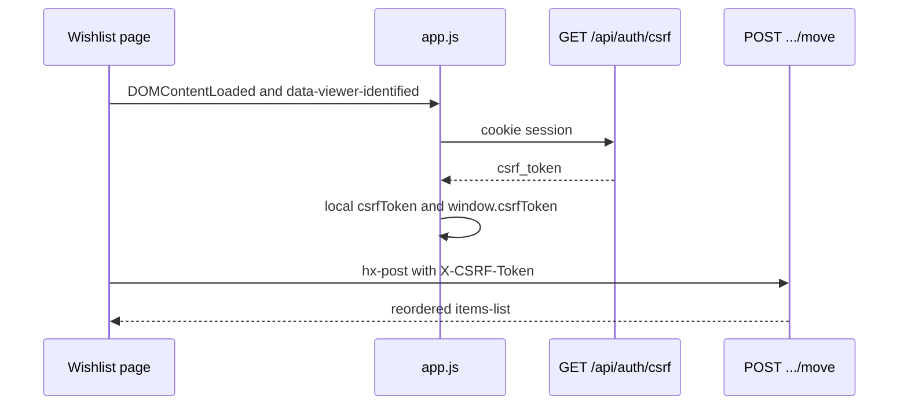

# WISHENKA-267: Signed-in move obtains a CSRF token

## Research

The standing check
`tests/test_wishlist_htmx_smoke_browser.py::test_real_htmx_move_button_with_cookie_and_csrf`
opens the list with the owner `session_id` cookie and real htmx 1.9.12.
After the page loads it polls this expression for 5 seconds:

```text
Boolean(window.csrfToken)
```

`CdpPage.wait_for` returns only when that expression is truthy. At the
deadline it reports the last value. `Boolean` of a missing property is
`false`, so the recorded timeout is `last value: False`. The click on
`.btn-move-down` never runs.

The token the page actually fetches is not that property.

`wishenka/web/templates/base.html` loads `/static/app.js` with `defer`.
When the signed-in list sets `data-viewer-identified` on `<body>`
(`wishenka/web/routes/items_ui.py` passes `viewer_identified` when
`current_user` is present), `DOMContentLoaded` in `app.js` calls
`prepareCsrf()`. That function `fetch`es `GET /api/auth/csrf` with
`credentials: 'same-origin'`.

`wishenka/web/routes/auth.py` `get_csrf` accepts a cookie session and
returns `{"csrf_token": ...}`, an HMAC of that cookie
(`wishenka/web/security.py` `csrf_value`). `prepareCsrf` stores the
trimmed string in the IIFE local `csrfToken`. A search of the repository
shows no assignment to `window.csrfToken`. The local and the property the
wait reads are different names. The wait therefore stays false for the
whole 5 seconds whether or not `GET /api/auth/csrf` returned 200.

The move control is already on the card. In
`wishenka/web/templates/partials/item_card.html`, `.btn-move-down` is an
`hx-post` to `/web/wishlists/{id}/items/{item_id}/move?direction=down`
with `hx-target="#items-list"` and `hx-swap="innerHTML"`.
`wishenka/web/routes/items_ui.py` `move_item_ui` swaps that item one step
and returns the list. `BrowserSecurityMiddleware` accepts the POST when
the cookie session sends `Origin` equal to `application_origin` and
`X-CSRF-Token` equal to `csrf_value` of that cookie.

`app.js` already copies the local `csrfToken` onto `X-CSRF-Token` in
`htmx:configRequest` for methods other than GET, HEAD, and OPTIONS. The
move button is not a reservation path, so the giver `preventDefault` in
that handler does not apply. HTMX 1.9 runs `htmx:configRequest` to
completion before the request is sent, and it does not wait on an async
listener
([htmx events](https://github.com/bigskysoftware/htmx/blob/master/www/content/events.md),
[discussion 1599](https://github.com/bigskysoftware/htmx/discussions/1599)).
The existing prefetch-then-header pattern is the one that fits. Fetching
the token inside `htmx:configRequest` would not.

The 5 second budget is enough once the property updates. `prepareCsrf`
starts at `DOMContentLoaded`, and its own deadline is 10 seconds. The
check fails because the property never changes, not because five seconds
is short.

Out of this change: the WishlistStore import cycle (WISHENKA-357), any
edit of `app.js` that introduces the substring `receipt`, a longer wait,
and any change to who may move a wish.

## Implementation Plan

One file, `wishenka/web/static/app.js`.

In `prepareCsrf`, in the branch that already stores the fetched string on
the local `csrfToken` when the generation still matches, assign that same
string to `window.csrfToken`. In the branch that clears the local after
an `Invalid CSRF token` response, clear `window.csrfToken` in the same
place. Do not add a second fetch, a retry, a longer `wait_for`, or a new
header hook. Do not edit the move button, `get_csrf`, the middleware, or
`move_item_ui`.

After that assignment, the existing 5 second poll sees the token from
`GET /api/auth/csrf`. The click then sends the move. The existing
`htmx:configRequest` hook attaches the same string, the middleware accepts
it, and the reordered list is what reload shows.

Leave the substring `receipt` out of `app.js`. Do not change the
WishlistStore import cycle.

**Mandatory — Failing Repro (next Step 3):** The red check already exists.
Do not add another test and do not change the 5 second timeout. Re-run:

```text
tests/test_wishlist_htmx_smoke_browser.py::test_real_htmx_move_button_with_cookie_and_csrf
```

On the current tree, before the `app.js` assignment, it must fail with
`PageWaitTimeout` while waiting for `CSRF token from /api/auth/csrf`,
last value `False`. If collecting that file alone errors on
`WishlistStore`, collect
`tests/test_receipt_modal_browser.py::test_stale_giver_card_is_neutral`
first, then the smoke check. That collection order is harness priming
only. Do not turn it into a product fix (WISHENKA-357).

Sequence: this design, then confirm that red failure, then the one
assignment in `app.js`, then the same check passes inside the existing
5 second wait.

## Architecture

No new module and no new route. The signed-in list, the CSRF issuer, the
move handler, and the browser check stay as they are. The only gap is
that the script which already obtained the token does not publish it
where the check reads it.



### Modules

- **Wishlist page** (`items_ui` list response, `base.html`,
  `item_card.html`). Renders the list for the cookie session, marks the
  body `data-viewer-identified`, and exposes `.btn-move-down`. Unchanged.
- **CSRF client** (`wishenka/web/static/app.js`). Fetches the token once
  and, after this change, publishes that string on `window.csrfToken`.
  On a later move, copies the same string to `X-CSRF-Token`. This is the
  only file to edit.
- **CSRF issuer** (`wishenka/web/routes/auth.py` `get_csrf`,
  `csrf_value`). Issues the session-bound token. Unchanged.
- **CSRF gate** (`BrowserSecurityMiddleware`). Checks origin and HMAC on
  the cookie mutation. Unchanged.
- **Move** (`move_item_ui`). Persists one step and returns the list HTML.
  Unchanged.
- **Standing check** (`test_real_htmx_move_button_with_cookie_and_csrf`).
  Reads `window.csrfToken`, then clicks the move. Unchanged, including
  its 5 second wait.

### Interfaces

- `GET /api/auth/csrf` with the session cookie returns
  `{"csrf_token": "<hex>"}`.
- `window.csrfToken` becomes that same non-empty string when `prepareCsrf`
  stores it, and becomes empty when the local cache is cleared.
- `POST /web/wishlists/{wishlist_id}/items/{item_id}/move?direction=down`
  carries `X-CSRF-Token` from the local cache and is accepted with 200.

### Patterns

Keep the current prefetch. `prepareCsrf` already runs before the giver
clicks, which is what HTMX requires: `htmx:configRequest` cannot `await`
a fetch. Publishing the cached string is smaller than a template
`hx-headers` value, a second client, or a test-only wait.

Python stays the server language (FastAPI route, middleware, move
handler). The behavioral edit is the static script those routes already
serve. No new Python type, dependency, or exception.

## Q&A

- **Q:** Why does the 5 second wait see false?
  **A:** It evaluates `Boolean(window.csrfToken)`. `app.js` stores the
  issued token only in the IIFE local `csrfToken` and never assigns
  `window.csrfToken`. The property stays missing, so the value stays
  false until the deadline. The file is `wishenka/web/static/app.js`.

- **Q:** Does the move need a new header path?
  **A:** No. `htmx:configRequest` already sends the local token. Once the
  wait can see that token, the existing click is accepted by the existing
  middleware and `move_item_ui`.

- **Q:** Why not wait longer or fetch again inside the click?
  **A:** A longer wait is out of scope, and HTMX does not wait for an
  async `htmx:configRequest` listener. The token is already requested at
  `DOMContentLoaded`.

- **Q:** What stays out?
  **A:** WISHENKA-357, the substring `receipt` in `app.js`, who may move,
  and what a recipient can learn.
