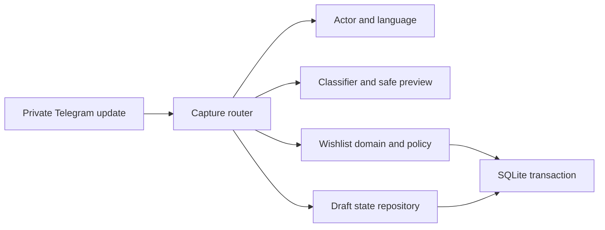

# WISHENKA-28: Bot wish capture architecture

## Research

- `wishenka.bot.entry` receives private `/start` and help updates in a separate polling process;
  its dependencies currently expose the Mini App URL and user store only. Extend its composition
  root with the wishlist store, preview service, and draft repository; preserve entry handlers.
- `UniversalInputClassifier` and `ItemPreviewService` already classify text and retrieve metadata.
  The fetcher validates each destination and redirect using the existing SSRF-safe transport;
  use that service, not a new HTTP client or Telegram fetching an untrusted image URL.
- `CreateItemDTO` and `WishlistService.add_wish_item` provide validation and the existing
  owner/admin/member policy. The DTO does not currently expose a comment field: do not invent a
  persisted comment. Show and edit only fields the actual creation path supports.
- `WishlistStore.transaction` starts an immediate SQLite transaction, while ordinary `execute`
  opens its own transaction. A new transaction-aware domain persistence seam is needed to commit
  a wish and its draft's success receipt atomically; nesting `execute` cannot meet this guarantee.
  SQLite describes atomic, isolated transactions in its
  [transaction documentation](https://www.sqlite.org/transactional.html).
- Telegram callback data is bounded; send compact opaque draft/action identifiers rather than
  titles, URLs, list names, or authorization facts. See the
  [aiogram documentation](https://docs.aiogram.dev/en/latest/api/types/inline_keyboard_button.html).

## Implementation Plan

1. Add migrated SQLite draft and receipt persistence and a transaction-aware save seam to the
   wishlist store. Wire the bot's separate polling process to the existing stores and preview
   service, with shutdown cleanup and migration startup consistent with the web process.
2. Add a private-chat capture router and explicit state machine. Resolve the actor from the
   Telegram update, query eligible lists, classify and safely preview input, and render localized
   review, edit, destination, save and cancel prompts. Preserve `/start` and help routing.
3. Bind every callback and edit response to the authenticated Telegram sender, private chat,
   opaque draft ID, and revision. Validate every field and recheck the list's current status and
   membership at save. Do not expose reservation-derived state in previews or confirmations.
4. Persist save receipt and wish together, return a truthful result after retry, and add bounded
   lifecycle cleanup. Add safe observability without submitted text, raw URL, or exception data.
5. Exercise integration through fake Telegram transport and temporary SQLite, including restart,
   race, denied access, parser failures, localization and existing bot navigation; run the project
   quality gate.

### Failing repro for Step 3

Before production changes, add timeout-bounded tests under `tests/` driving fake private Telegram
updates and callbacks against the router with fake preview service and temporary database. Assert
plain text and forwarded link start a review without a wish, one versus several versus no eligible
lists, editable partial/failed previews, explicit save/cancel, and RU/EN prompts. Replay save after
an interrupted acknowledgement and in concurrent requests and assert exactly one wish and the
same truthful result. Cover revoked/deleted list, expired/replaced/other-user callback, invalid
fields, no network for unsafe URLs, and unchanged `/start` and help. The tests must fail for absent
capture behavior, not missing external Telegram/network services; verify the fake transport with a
small test-only handler. Keep fixtures bounded, no production fix until the independent red review.

## Architecture

### Components and interfaces

- **Capture router:** aiogram handler for private non-command messages and capture-prefixed
  callbacks; forward text is content only. `from_user.id` is the authenticated actor, never the
  forwarded sender. Ignore groups and callbacks lacking a private accessible message. A distinct
  namespace avoids intercepting existing help or `/start`; answer callback queries promptly.
- **Actor adapter:** build `AuthenticatedUser` from the Telegram-verified sender and upsert or
  resolve the existing user record using the shared database. Use the existing language preference,
  then Telegram language code, then English. Never accept a user ID from callback data as identity.
- **Preview adapter:** `preview(raw_text)` uses `ItemPreviewService`; classify a single supported
  URL and retain the submitted URL in the draft even on blocked/failed extraction. Reuse the safe
  fetcher with bounded timeout, redirect, body size and DNS/IP checks, including cache hits. Unsafe
  or unsupported schemes cause no network access and receive manual-entry guidance. Store only
  editable fields; map extracted price/currency and photo into existing DTO rules, indicate missing
  fields and never infer that an unverified preview is confirmed. Avoid logging raw input, URL,
  query strings or exception messages, including in reused preview logging paths.
- **Destination selector:** list only active wishlists satisfying
  `WishlistAccessPolicy.can_add_or_edit_item(resolve_context(actor, wishlist), wishlist)`. Public
  visibility alone never grants write access. Derive options from domain state, paginate bounded
  inline choices and recheck the selected identifier against current eligibility on every action.
  One option is auto-selected; none offers the existing creation link or invitation guidance.
- **Draft repository:** persist a random opaque ID, owner Telegram ID and chat ID, state, revision,
  editable values, selected list, timestamps and expiry in the same SQLite database. The callback
  contains only short ID, action and revision within Telegram's limit; the server loads the draft
  and checks ownership, chat, state, expiry and revision. Use typed/whitelisted edit actions and
  `CreateItemDTO` validation; supported fields are title, description, link, image URL, price,
  currency, quantity, priority, category and supported recipient fields. Every field can be
  corrected or cleared where allowed, with validation errors preserving the previous draft.
- **Transactional save adapter:** a new store operation loads the draft and list under one
  `BEGIN IMMEDIATE`, checks actor, current revision/state/expiry and permissions, validates the
  DTO, invokes the existing domain `add_wish_item`, persists domain changes and records the
  resulting item/list ID and terminal receipt in that same transaction. Extend the existing store
  seam rather than nesting transactions or writing an item directly around its policy. Unique draft
  ID/receipt constraints and the lock serialize concurrent callbacks. A committed receipt is read
  on retries for the same owner/action, without creating another item. Return success only after
  commit; a rolled-back or uncertain operation is retried against the receipt. Keep receipts long
  enough for a retry, but never disclose saved title or list when authorization was later revoked.

### State and interaction

A user has at most one active draft per private chat. A new usable non-command message explicitly
replaces the old draft, invalidates its callbacks by changing ID/revision, and tells the user the
old draft was discarded; an invalid or unsupported new message leaves it intact. Drafts expire
24 hours after last valid interaction. Cancel atomically marks the draft cancelled and clears its
sensitive values. Expired and superseded drafts cannot be saved; a callback returns a generic
start-again message. Retain a minimal successful receipt for seven days after save for retries,
then delete it; after that, old actions receive a generic expired response and never create a wish.
Expiry and receipt cleanup must also run on startup/periodically, with bounded batches. Editing is
an explicit field-selection action followed by one private reply; it must not misinterpret a new
normal message as an edit without an active edit state. Commands keep their existing meaning.

List-choice and edit callbacks increment the draft revision. Save/cancel carry the displayed
revision; stale edits or other-user callbacks have no effect. A transient preview error falls back
to manual entry. If a list becomes unavailable at save, retain the draft, remove the destination,
show only current eligible lists and permit cancel. Validation and transient database failures keep
an editable retryable draft; no success is reported without the committed receipt. After successful
save, return the list name only if still authorized; no reservation details are returned. A
concurrent second save sees the receipt, while cancel/replace versus save are serialized in SQLite.

## Q&A

- **Why durable drafts?** A process restart or lost Telegram acknowledgement must not cause a
  duplicate save or a false confirmation. The receipt and item must share one transaction.
- **Why not use the public list link as authorization?** It grants viewing, not membership or
  permission to add. Both selection and commit use the existing access policy.
- **What if parsing is unavailable?** Keep the submitted link and let the user supply the title
  and any supported field manually; no external site availability is required for saving.
- **Is a photo uploaded?** The existing item model stores an image URL; do not introduce file
  upload or fetch untrusted images outside the existing safety rules in this task.
