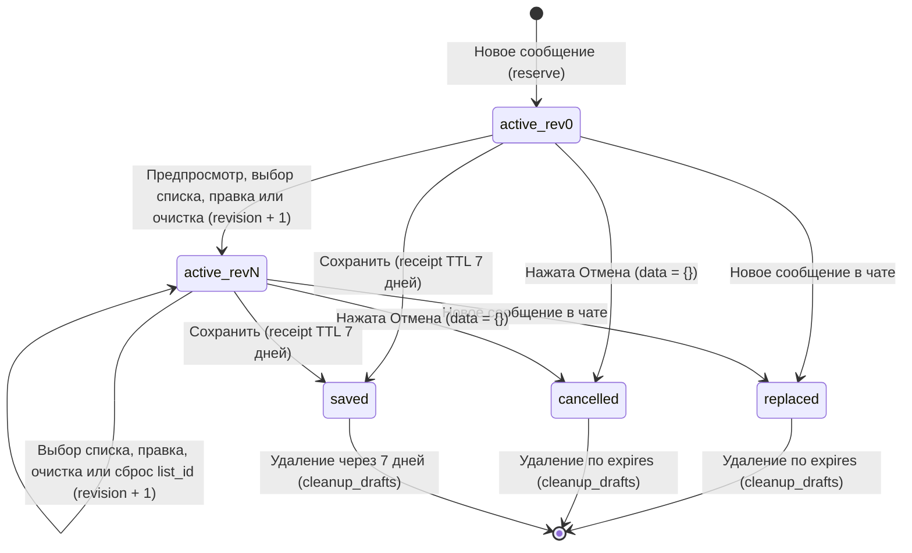

# Спецификация: WISHENKA-28 — Добавление желаний через Telegram-бота

- **Задача:** WISHENKA-28
- **Статус:** реализовано (этапы 1–8 Top-Down workflow выполнены)
- **Платформы и стек:** Telegram Bot (`aiogram`), Python 3.12+, SQLite + Alembic, Pydantic v2
- **Языки интерфейса:** русский (`ru`), английский (`en`)

## 1. Назначение и бизнес-цель

### 1.1. Постановка проблемы

До реализации данной задачи добавление желания требовало открытия Telegram Mini App, перехода в нужный вишлист и заполнения формы внутри веб-интерфейса. Когда пользователь встречает идею подарка в переписке, канале или интернет-магазине внутри Telegram, необходимость переключаться в Mini App создаёт лишний барьер и повышает риск потерять идею.

### 1.2. Бизнес-цель и ценность

**Бизнес-цель** — предоставить пользователю быстрый, безопасный и полностью управляемый сценарий фиксации желания прямо в приватном чате с Telegram-ботом за счёт отправки или пересылки обычного текста либо ссылки на товар.

Ключевая ценность решения:

- **Для пользователя (владельца, администратора или участника вишлиста):** быстрый захват идеи подарка без открытия Mini App, автоматическое извлечение доступных сведений о товаре, выбор целевого вишлиста, редактирование любых поддерживаемых полей и явное подтверждение сохранения.
- **Для системы и продукта:** сохранение единых доменных инвариантов (`WishlistAccessPolicy`, валидация `CreateItemDTO`, тайна сюрприза для получателя), защита от SSRF при обработке ссылок, а также гарантированное отсутствие дублей желаний и ложных подтверждений при сбоях сети, повторной доставке обновлений или перезапуске процесса бота.

### 1.3. Границы функциональности

В рамках `WISHENKA-28` реализуется только захват черновика желания в приватном чате с ботом. Следующие области находятся за пределами задачи:

- Создание новой модели ролей, членства или управление правами доступа к вишлистам.
- Редактирование уже сохранённых желаний и загрузка бинарных файлов фотографий.
- Отправка сервисных уведомлений и напоминаний (реализуется в рамках `WISHENKA-29`), обработка обращений в поддержку, управление языковыми настройками профиля и каскадное удаление аккаунта (`WISHENKA-35`).
- Захват желаний в групповых чатах и добавление поля комментария (модель `CreateItemDTO` не содержит поля `comment`).

## 2. Функциональные требования и пользовательские сценарии

### 2.1. Входные данные и маршрутизация сообщений

1. Захват работает исключительно в **приватных чатах** (`chat.type == "private"`) для текстовых не-командных сообщений (`~F.text.startswith("/")`) от аутентифицированного пользователя (`message.from_user`). Сообщения из групповых чатов игнорируются.
2. Пересланные сообщения обрабатываются исключительно как пользовательский ввод: идентификатор актора всегда определяется по `message.from_user.id`, а сведения об исходном отправителе пересланного сообщения не используются для аутентификации или проверки прав.
3. Существующие команды и сценарии бота (`/start`, `/help`, callback `entry:help`, `/reservation_confirmations`, а также активные сессии поддержки `support_input` и ввода дней рождения `birthday_input`, имеющие более высокий приоритет в роутере) остаются доступными даже при наличии активного черновика.
4. Правила первичной проверки ввода:
   - Пустое сообщение (после удаления пробелов) отклоняется с подсказкой `bot.capture.empty_input`; желание и черновик не создаются, прежний активный черновик сохраняется.
   - Сообщение длиннее `2048` символов отклоняется с подсказкой `bot.capture.too_long` без изменения существующего черновика.
   - Ссылка с неподдерживаемой схемой (любой URI, не начинающийся с `http://` или `https://`, например `ftp://`, `file://`, `javascript:`) классифицируется как `unsupported`: сетевой запрос предпросмотра **не выполняется**, ссылка сохраняется в поле `link` с флагом ручного режима (`_preview_fallback = True`).
   - Корректный текст и ссылки HTTP(S) передаются в `UniversalInputClassifier.classify(raw)`: выделяется нормализованный URL (включая доменные ссылки без протокола, нормализуемые в `https://...`) и остаточный текст (`residual_text`), который подставляется как исходное `title`.
5. Отправка или пересылка сообщения сама по себе никогда не создаёт желание — она формирует только черновик для проверки.

### 2.2. Предпросмотр товара и работа с неполными данными

- При обнаружении поддерживаемой HTTP(S)-ссылки вызывается `ItemPreviewService.preview(raw)` через существующий SSRF-безопасный транспорт.
- Из ответа предпросмотра в черновик переносятся доступные поля: `title`, `description`, `image_url`, `price`, `currency`.
- Если предпросмотр вернул признак fallback (`is_fallback`), не заполнено хотя бы одно из ключевых полей (`title`, `description`, `image_url`, `price`), возникла ошибка извлечения либо ссылка имела неподдерживаемую схему:
  - исходная ссылка сохраняется в черновике;
  - активируется режим ручного заполнения (`_preview_fallback = True`);
  - пользователь получает явное уведомление (`bot.capture.preview_fallback`) и перечень отсутствующих полей (`bot.capture.missing_prefix`);
  - неполные или предположительные данные не выдаются за подтверждённые факты.
- Ручное заполнение и сохранение желания не зависят от доступности внешнего магазина.

### 2.3. Выбор целевого вишлиста

Список доступных назначений формируется в реальном времени по политике доступа `WishlistAccessPolicy.can_add_or_edit_item(WishlistAccessPolicy.resolve_context(actor, wl), wl)`:

- Учитываются только активные вишлисты, в которых текущий пользователь имеет право добавлять или редактировать желания (владелец, администратор или участник).
- Наличие публичной ссылки для просмотра само по себе не даёт права на добавление; удалённые и недоступные списки исключаются.
- Поведение зависит от количества доступных вишлистов:
  - **0 списков:** желание не сохраняется; отображается сообщение `bot.capture.no_lists` с объяснением необходимости создать список или получить приглашение, кнопкой открытия Mini App (`startapp=create`) и кнопкой отмены.
  - **1 список:** вишлист выбирается автоматически (`list_id`), его название выводится в карточке черновика.
  - **Несколько списков:** отображаются inline-кнопки выбора вишлиста с пагинацией по `8` списков на страницу (`p_<page>`), пока пользователь не выберет назначение (`l_<list_id>`).

### 2.4. Просмотр, редактирование, очистка и сохранение черновика

1. **Карточка проверки (`_review`):** отображает заголовок экрана (либо уведомление о замене предыдущего черновика `previous_discarded`), предупреждение о ручном вводе и перечень незаполненных полей (при fallback), напоминание об обязательности названия (если `title` пуст), все заполненные поддерживаемые поля и выбранный вишлист (либо приглашение к выбору). Значения длиннее `100` символов усекаются в сводке с выводом `truncated_notice`.
2. **Полный просмотр (`view`):** отправляет все непустые поля отдельными сообщениями частями до `1800` символов (с учётом лимита Telegram в единицах UTF-16), после чего повторно выводит карточку черновика и клавиатуру.
3. **Поддерживаемые поля (`_FIELDS`):**
   - обязательное поле: `title`;
   - необязательные поля: `description`, `link`, `image_url`, `price`, `currency`, `quantity`, `priority`, `category`, `recipient_user_id`, `recipient_name`.
4. **Редактирование и очистка:**
   - Нажатие «Редактировать» (`edit`) открывает список кнопок изменения (`e_<field>`) и очистки (`c_<field>` для всех полей, кроме обязательного `title`).
   - Выбор поля сохраняет `edit_field` в БД и увеличивает `revision`; следующее текстовое не-командное сообщение в том же приватном чате валидируется независимо для этого поля через `CreateItemDTO` (`{"title": "placeholder", field: value}`, для `quantity` и `recipient_user_id` выполняется приведение к `int`). При ошибке валидации отправляется `bot.capture.invalid_field`, а прежнее состояние черновика сохраняется.
   - Очистка поля (`c_<field>`) удаляет значение из черновика и обновляет `revision`; при сохранении подставляются значения по умолчанию из `CreateItemDTO`.
5. **Отмена (`cancel`):** переводит черновик в состояние `cancelled`, очищает поля черновика (`data = '{}'`, `edit_field = NULL`) и выводит подтверждение `bot.capture.cancelled` без создания или изменения желания.
6. **Явное сохранение (`save`):** кнопка доступна только при выбранном `list_id`. При нажатии в одной транзакции выполняются:
   - повторная проверка прав доступа и доступности целевого списка (`unavailable` сбрасывает `list_id = NULL`, увеличивает `revision`, сохраняет черновик и предлагает заново выбрать из актуальных списков либо отменить);
   - проверка безопасности ссылок `link` и `image_url` функцией `_safe_web_url` (`unsafe_url` сохраняет черновик для исправления);
   - полная валидация `CreateItemDTO` (`invalid` сохраняет черновик для исправления);
   - создание ровно одного желания через `WishlistService.add_wish_item`;
   - фиксация терминальной квитанции сохранения и подтверждение с названием целевого списка (`bot.capture.saved_prefix + wl.title`).

### 2.5. Жизненный цикл черновика, конкурентность и инварианты

- **Один активный черновик на приватный чат:** новое корректное не-командное сообщение переводит предыдущий активный черновик пользователя в этом чате в состояние `replaced`, очищает его `data` и уведомляет пользователя (`previous_discarded`). Невалидный ввод (пустая строка или превышение длины) не заменяет текущий черновик.
- **Время жизни:** активный черновик действует `24` часа с момента создания или последнего валидного взаимодействия (выбор списка, редактирование, очистка). После успешного сохранения квитанция хранится `7` дней для безопасной обработки повторов.
- **Защита по ревизии и принадлежности:** каждая мутация черновика (обогащение предпросмотром, выбор списка, вход в редактирование поля, сохранение правки, очистка поля, сброс недоступного списка) увеличивает `revision`. Запросы с устаревшей ревизией, истёкшим сроком, отменённым/заменённым статусом или от другого пользователя не изменяют данные и получают нейтральный ответ `bot.capture.expired`.
- **Защита порядка сообщений и повторная доставка:** таблица `bot_capture_order` фиксирует максимальный `message_id` для пары `(owner, chat)`. Запаздывающий ответ `ItemPreviewService` не может перезаписать черновик, если пользователь уже отправил новое сообщение или отредактировал черновик (`revision != 0`). При повторной доставке сообщения с тем же `message_id` после сбоя до ответа пользователю восстанавливается и показывается уже сохранённый черновик.
- **Идемпотентность и конкурентное сохранение:** повторный или параллельный callback `save` с совпадающими `(id, owner, chat, revision)` для уже сохранённого черновика в пределах 7-дневного срока квитанции не создаёт второе желание: он возвращает подтверждение с именем списка, если права доступа по-прежнему действуют, либо нейтральный ответ `unavailable` без раскрытия названия списка и желания, если доступ был отозван.
- **Локализация и тайна сюрприза:** все тексты формируются на языке пользователя (`ru` или `en`, по данным `UserStore`, далее `language_code` Telegram с fallback на `en`). В сообщениях и логах никогда не раскрываются сведения о бронированиях, покупателях, статусе покупки или чужих списках.

### 2.6. Пользовательские сценарии

| Сценарий | Входные условия | Ожидаемое поведение |
| --- | --- | --- |
| SC-01: Текст и один список | 1 доступный вишлист, отправлен обычный текст | Список выбирается автоматически, текст подставляется в `title`, желание создаётся только после нажатия «Сохранить» |
| SC-02: Пересылка ссылки и выбор списка | >1 доступного списка (плюс чужой список только для просмотра), переслана ссылка | Просмотр-только список не предлагается; показаны только доступные для записи списки; пользователь выбирает список, правит поля и сохраняет |
| SC-03: Неуспешный или частичный парсинг | Сайт недоступен, парсер вернул не все поля или схема не HTTP(S) | Ссылка сохраняется в черновике, указаны недостающие поля, пользователь вручную вводит/исправляет `title` и сохраняет без обращения к сайту |
| SC-04: Отсутствие доступных списков | 0 доступных для записи вишлистов | Желание не создаётся; бот объясняет необходимость создать список или получить приглашение и даёт кнопку перехода в Mini App |
| SC-05: Отзыв доступа до сохранения | Список удалён или права пользователя отозваны между показом черновика и нажатием «Сохранить» | Сохранение отклоняется без раскрытия закрытых данных; выбранный `list_id` сбрасывается, предлагаются актуальные списки или отмена |
| SC-06: Повторы, гонки и устаревшие кнопки | Повторное/параллельное нажатие «Сохранить», отмена или истёкший черновик | При повторном/параллельном «Сохранить» создаётся ровно 1 желание и возвращается прежний результат; отменённый, заменённый, просроченный или чужой callback отклоняется без изменений |

## 3. Архитектура, компоненты и интерфейсы

### 3.1. Модули и компоненты

| Компонент / модуль | Ключевые символы | Назначение |
| --- | --- | --- |
| Композиция процесса бота (`wishenka/bot/__main__.py`) | `Dependencies`, `cleanup_loop`, `run` | Инициализирует `Settings`, `UserStore`, `WishlistStore`, `ItemPreviewService`, запускает polling `Dispatcher` и фоновый цикл очистки `cleanup_loop`, корректно освобождает ресурсы при остановке |
| Входной роутер (`wishenka/bot/entry.py`) | `create_router`, `EntryDependencies`, `_language`, `_url` | Подключает `LocaleMiddleware`, безопасный `@router.errors()`, команды `/start`, `/help`, `entry:help`, `/reservation_confirmations`, и монтирует `create_support_router`, `create_birthday_router`, `create_capture_router` в порядке приоритета |
| Резолвер пользователя (`wishenka/bot/principal.py`) | `ensure_private_bot_user` | Резолвит или создаёт пользователя в `UserStore` для верифицированного приватного чата (`chat_id == user.id`) и активирует `bot_destinations` |
| Роутер захвата (`wishenka/bot/capture.py`) | `create_capture_router`, `cleanup_drafts`, `_review`, `_keyboard`, `_safe_web_url`, `_allowed`, `_actor`, `_PrivatePreviewFilter` | Обрабатывает приватные сообщения и `cap:`-коллбэки, управляет черновиками, предпросмотром, редактированием, атомарным сохранением и пакетной очисткой |
| Классификатор и схемы (`wishenka/items/classifier.py`, `wishenka/items/schemas.py`, `wishenka/items/service.py`) | `UniversalInputClassifier.classify`, `ItemPreviewService.preview`, `CreateItemDTO`, `ItemPreviewDTO` | Классифицирует текст/URL, безопасно извлекает метаданные товара и валидирует поля создаваемого желания |
| Домен вишлистов (`wishenka/wishlists/policy.py`, `wishenka/wishlists/service.py`, `wishenka/wishlists/store.py`) | `WishlistAccessPolicy`, `WishlistService.add_wish_item`, `WishlistStore` | Проверяет права на добавление, выполняет доменную мутацию и предоставляет транзакционную границу SQLite (`BEGIN IMMEDIATE`) |

### 3.2. Контракты данных и схема хранения

#### Таблицы SQLite (миграции Alembic)

В рамках `WISHENKA-28` добавлены две обратимые миграции (`ROLLBACK_POLICY = "reversible"`):

1. **`add_bot_drafts`** (`wishenka/wishlists/alembic/versions/add_bot_drafts.py`, `down_revision = "add_notice_outbox"`):
   - Таблица `bot_drafts`:
     - `id TEXT PRIMARY KEY` — случайный непрозрачный идентификатор (`secrets.token_urlsafe(9)`).
     - `owner INTEGER NOT NULL` — Telegram ID владельца черновика.
     - `chat INTEGER NOT NULL` — ID приватного чата.
     - `revision INTEGER NOT NULL` — монотонно возрастающий номер ревизии.
     - `state TEXT NOT NULL` — состояние (`active`, `replaced`, `cancelled`, `saved`).
     - `data TEXT NOT NULL` — JSON-объект со значениями полей и служебным флагом `_preview_fallback` (обнуляется в `'{}'` при завершении/отмене/замене).
     - `list_id INTEGER` — выбранный ID целевого вишлиста (или `NULL`).
     - `edit_field TEXT` — имя поля в режиме ожидания текстового ввода (или `NULL`).
     - `expires TEXT NOT NULL` — срок истечения в формате ISO-8601 UTC.
     - `receipt_list_id INTEGER`, `receipt_item_id INTEGER` — идентификаторы сохранённых списка и желания для квитанции идемпотентности.
   - Индексы: `ix_bot_drafts_owner` по `(owner, chat, state)` и `ix_bot_drafts_expiry` по `(expires)`.
2. **`add_bot_capture_order`** (`wishenka/wishlists/alembic/versions/add_bot_capture_order.py`, `down_revision = "add_bot_drafts"`):
   - Таблица `bot_capture_order`:
     - `owner INTEGER NOT NULL`, `chat INTEGER NOT NULL`, `message_id INTEGER NOT NULL`, `PRIMARY KEY (owner, chat)`.
   - Хранит последний принятый `message_id` в приватном диалоге для защиты от гонок и повторной доставки. *(Последующая задача `WISHENKA-178` расширила таблицу миграцией `add_bot_capture_order_retention`, добавив столбец `updated_at` и индекс `idx_bot_capture_order_updated_at` для ограниченного хранения.)*

#### Формат inline callback-данных

Все кнопки используют компактный префиксный формат `cap:<ident>:<revision>:<action>`, укладывающийся в ограничение Telegram (64 байта) и не содержащий названий желаний, URL, имён списков или прав доступа:

- `edit` — переход к меню выбора редактируемого поля.
- `view` — отправка полных значений всех заполненных полей.
- `save` — подтверждение сохранения желания.
- `cancel` — отмена черновика.
- `p_<page>` — переключение страницы списка доступных вишлистов.
- `l_<list_id>` — выбор целевого вишлиста.
- `e_<field>` — перевод черновика в режим ожидания значения поля `<field>`.
- `c_<field>` — очистка необязательного поля `<field>` (кроме `title`).

#### Валидация полей (`CreateItemDTO` и `_safe_web_url`)

| Поле | Тип и ограничения `CreateItemDTO` | Дополнительные правила захвата |
| --- | --- | --- |
| `title` | `str`, `1..255` символов, не состоит из одних пробелов | Обязательно; кнопка очистки отсутствует |
| `description` | `str \| None`, до `2000` символов | Может заполняться из предпросмотра |
| `link` | `str \| None`, до `2048` символов | При сохранении `_safe_web_url`: только абсолютный `http`/`https` с `hostname`, без управляющих символов (`ord <= 32`) и `\` |
| `image_url` | `str \| None`, до `2048` символов | Те же правила `_safe_web_url`, что и для `link` |
| `price` | `int \| float \| None`, `0..999_999_999` | Извлекается предпросмотром или вводится вручную |
| `currency` | `str`, до `10` символов (по умолчанию `DEFAULT_CURRENCY`) | Может быть очищено к значению по умолчанию |
| `quantity` | `int`, `1..1000` (по умолчанию `1`) | При текстовом редактировании приводится к `int` |
| `priority` | `ItemPriority` (по умолчанию `ItemPriority.MEDIUM`) | — |
| `category` | `str \| None`, до `50` символов | — |
| `recipient_user_id` | `int \| None` | При текстовом редактировании приводится к `int` |
| `recipient_name` | `str \| None`, до `100` символов | — |

### 3.3. Диаграмма состояний и транзакционные переходы

Последовательность транзакций при обработке входящего сообщения и callback-действий:

1. **Режим редактирования (`pending`):** перед классификацией нового сообщения проверяется наличие активного непросроченного черновика с заполненным `edit_field`. Если сообщение новее `bot_capture_order.message_id`, оно валидируется как новое значение `edit_field` и атомарно обновляет `data`, сбрасывает `edit_field = NULL`, увеличивает `revision` и продлевает `expires` на `24` часа.
2. **Резервирование черновика (`reserve`):** до сетевого запроса предпросмотра внутри `store.transaction` обновляется watermark `bot_capture_order` при условии `excluded.message_id > bot_capture_order.message_id`. Если `rowcount == 0`, проверяется повторная доставка того же `message_id` — при наличии активного черновика он восстанавливается без создания нового. При новом сообщении предыдущий активный черновик переводится в `replaced`, удаляется до `100` просроченных записей `bot_drafts`, и вставляется новый черновик с `revision = 0` и `expires = now + 24h`.
3. **Сетевой предпросмотр и завершение (`finish`):** `deps.preview_service.preview(raw)` выполняется вне транзакции БД под фильтром `_preview_active`. Затем `finish` обновляет черновик и увеличивает `revision` только при условии `state = 'active' AND revision = 0` и совпадения актуального `message_id` в `bot_capture_order`, что исключает затирание более новых сообщений или правок.
4. **Атомарное сохранение (`mutate`):** проверка владельца, чата, состояния, срока жизни, ревизии, прав доступа `WishlistAccessPolicy`, валидация `CreateItemDTO`, вызов `WishlistService.add_wish_item` и перевод черновика в `saved` с записью квитанции (`receipt_list_id`, `receipt_item_id`, `expires = now + 7d`) выполняются в единой транзакции `BEGIN IMMEDIATE`. *(В исходной реализации `WISHENKA-28` для объединения снимка хранилища с SQL-запросами в `store.transaction` использовались приватные методы `_read` / `_write`, как зафиксировано в `60-tech-debt.md`; в текущей кодовой базе `mutate` переведён на публичный метод `WishlistStore.execute_with_connection` согласно задаче `WISHENKA-179`.)*

## 4. Нефункциональные требования, безопасность и наблюдаемость

### 4.1. Безопасность и защита приватности

- **Авторизация и изоляция черновиков:** каждый callback проверяет совпадение `from_user.id == draft["owner"]` и `callback.message.chat.id == draft["chat"]` в приватном чате; идентификатор пользователя никогда не берётся из `callback.data`. Повторная проверка прав к целевому списку обязательна непосредственно в транзакции `save`.
- **Защита от SSRF и небезопасных ссылок:** неподдерживаемые схемы URI не инициируют сетевые запросы. HTTP(S)-ссылки обрабатываются исключительно через `ItemPreviewService` (ограниченные таймауты, редиректы, размер тела и проверка DNS/IP). При сохранении `_safe_web_url` допускает для `link` и `image_url` только абсолютные HTTP(S)-URL без управляющих символов и обратных слэшей; загрузка произвольных внешних изображений на сервер или в Telegram не выполняется.
- **Минимизация утечек данных:** при переходе черновика в `replaced`, `cancelled` или `saved` поле `data` очищается в `'{}'`. Если к моменту повторного `save` по квитанции пользователь потерял доступ к целевому вишлисту, бот отвечает нейтральным отказом `unavailable` без раскрытия названия списка или желания. Тайна сюрприза соблюдается на всех шагах потока.

### 4.2. Производительность, лимиты и обслуживание состояния

- **Ограничения размеров:** максимальная длина входного текста — `2048` символов; длина поля в компактном обзоре — до `100` символов; длина фрагмента при полном просмотре — `1800` символов; пагинация списков — по `8` позиций на страницу.
- **Очистка и сроки хранения:** активные черновики истекают через `24` часа, квитанции сохранения — через `7` дней. Фоновая задача `cleanup_loop` в `wishenka/bot/__main__.py` запускается немедленно при старте и далее с интервалом `3600` секунд (1 час); при ошибке очистка повторяется через `60` секунд (1 минута). Каждая итерация `cleanup_drafts` удаляет ограниченными пакетами до `100` истёкших записей за проход (`LIMIT 100`).
- **Сериализация конкурентных запросов:** SQLite `BEGIN IMMEDIATE` сериализует параллельные `save`, `cancel` и замену черновиков.

### 4.3. Наблюдаемость: логирование и метрики

Логирование управляется настройками `WISHENKA_LOG_LEVEL` и `WISHENKA_LOG_JSON` (`LOG_LEVEL` и `LOG_JSON`). Структурированные события потока захвата (по `50-observability.md` и `wishenka/bot/capture.py`):

| Уровень | Событие (`event`) | Поля контекста | Назначение |
| --- | --- | --- | --- |
| `INFO` | `bot_capture_preview` | `outcome` (`complete`, `partial`, `error`, `unsupported`), `duration_ms` | Фиксирует результат и длительность предпросмотра (по монотонным часам) |
| `INFO` | `bot_capture_draft_ready` | отсутствуют | Черновик подготовлен и отправлен пользователю |
| `INFO` | `bot_capture_save` | `outcome` (ограниченный код статуса: `saved`, `unavailable`, `invalid`, `unsafe_url`, `expired` и т.д.) | Зафиксирован исход попытки сохранения; название списка не логируется |
| `ERROR` | `bot_capture_action_error` | отсутствуют | Ошибка транзакции при обработке callback-действия без текста исключения |
| `ERROR` | `bot_draft_cleanup_failed` | параметры конфигурации (`order_retention_days` в текущей версии) | Сбой фоновой очистки без текста исключения (повтор через 1 минуту) |
| `INFO` / `DEBUG` | `bot_draft_cleanup_completed` | счётчики удалений по таблицам, `total_removed`, `duration_ms` | Результат пакетной очистки (`INFO` при `total_removed > 0`, иначе `DEBUG`) |

Конфиденциальность логов обеспечивается двумя механизмами:

- **Контекстный фильтр `_PrivatePreviewFilter` (`ContextVar("bot_private_preview")`):** во время классификации, предпросмотра и транзакций сохранения подавляет записи логгеров `wishenka.items`, `httpx`, `httpcore*`, `wishenka.users`, `wishenka.wishlists`, `wishenka.wishlists.store` и `wishenka.wishlists.notices` только в текущей корутине, не затрагивая параллельные независимые операции.
- **Безопасная обработка ошибок диспетчера:** обработчик `@router.errors()` в `wishenka/bot/entry.py` перехватывает исключения, предотвращая вывод трассировок `aiogram` с пользовательским вводом или URL.

Специализированный сборщик метрик (Prometheus/Grafana) для данного сценария не внедрялся; пропускная способность, доля ошибок и задержка предпросмотра (`duration_ms`) могут рассчитываться внешним коллектором логов по структурированным событиям.

## 5. Верификация и критерии приёмки

### 5.1. Критерии приёмки

1. Пользователь может отправить или переслать текст либо ссылку в приватный чат бота и сформировать черновик без открытия Mini App; отправка без явного подтверждения не создаёт желание.
2. Поддерживаемые ссылки запускают предпросмотр; при частичном успехе, недоступности сайта или неподдерживаемой схеме ссылка сохраняется, явно перечисляются недостающие поля и доступно ручное редактирование без выдачи догадок за факты.
3. Предлагаются только активные вишлисты с правом добавления; один список выбирается автоматически, несколько отображаются кнопками с пагинацией, при нуле доступных списков даётся инструкция без сохранения.
4. Поддерживаются просмотр полных значений, редактирование и очистка необязательных полей (`CreateItemDTO`), при обязательном валидном `title`.
5. Явное сохранение создаёт ровно одно желание в выбранном списке и называет его; отмена полностью сбрасывает черновик без побочных эффектов.
6. Отзыв прав или удаление списка до сохранения не допускает запись, сохраняет редактируемый черновик и позволяет выбрать другой список или отменить действие.
7. Истёкшие, отменённые, заменённые и чужие callback-запросы не изменяют состояние; повторное или параллельное нажатие «Сохранить» не создаёт дублей и возвращает достоверный статус.
8. Все сообщения локализованы на `ru` и `en`, не нарушают тайну сюрприза, а команды `/start` и `/help` остаются полностью работоспособными.

### 5.2. Автоматизированная верификация

Сценарии проверены автоматизированными тестами на базе фиктивного транспорта Telegram и временной SQLite (включая `tests/test_bot_capture_repro.py`):

- Создание черновика из текста и пересланной ссылки без немедленной записи желания;
- Автовыбор при 1 списке, выбор и пагинация при нескольких списках (исключая списки с доступом только на просмотр), руководство при 0 списков;
- Обработка частичных, fallback-, не-fallback неполных и ошибочных предпросмотров, независимое редактирование и очистка полей, валидация `title` и остальных полей;
- Отсутствие сетевых запросов для небезопасных/неподдерживаемых схем и отклонение небезопасных URL при сохранении (как исходных, так и отредактированных);
- Повторная проверка прав и существования списка при сохранении (удалённый список и исключённый участник);
- Повторное и конкурентное нажатие «Сохранить» (создаётся ровно 1 желание), отмена, истечение TTL, замена новым сообщением, чужие callback-действия;
- Защита от запоздавшего предпросмотра после нового сообщения/редактирования и восстановление черновика при повторной доставке после перезапуска диспетчера;
- Сохранение работоспособности `/start` и `/help` при активном черновике;
- Проверка отсутствия URL, доменов, пользовательских текстов и текстов исключений в логах (включая debug-логи HTTP-клиента и классификатора), изоляция параллельных операций и восстановление `cleanup_loop` после сбоя.

По отчётам в `ai-tasks/WISHENKA-28/40-code-cleanup.md`, `50-observability.md` и `60-tech-debt.md` на этапе завершения задачи выполнялись: проверка форматирования и линтера Ruff, статическая проверка Mypy по `154` исходным файлам, проверка наличия явных timeout-маркеров у всех `909` собранных на этапе 5 тестов и полный прогон `make check PYTEST_JOBS=4` (`909` тестов на этапе 5 и `910` тестов на этапе 6 до финального исправления по результатам ревью, с последующими целевыми проверками после исправления).

### 5.3. Известные ограничения и задачи развития (по `60-tech-debt.md`)

При анализе технического долга по итогам реализации `WISHENKA-28` зафиксированы следующие неблокирующие ограничения и последующие задачи:

1. **Фиксированные параметры срока жизни и пакетной очистки:** значения TTL черновика (`24` часа), квитанции (`7` дней), размера пакета (`100` строк) и периодичности очистки (`1` час, повтор через `1` минуту) зашиты в коде без замеров реальной производственной нагрузки; при устойчивом росте числа истечений быстрее пропускной способности пакета возможен рост остатка.
2. **Ограниченное хранение `bot_capture_order` (`NON-BLOCKER, Medium`, `WISHENKA-178`):** исходная миграция `add_bot_capture_order` не предусматривала столбца срока жизни и внешнего ключа, а исходный `cleanup_drafts` очищал только `bot_drafts`. Зафиксирована задача на проектирование ограниченного срока хранения водяных знаков порядка сообщений с сохранением защиты от запоздавших обновлений Telegram.
3. **Очистка новых таблиц при удалении аккаунта (`NON-BLOCKER, Medium`, `WISHENKA-35`):** на момент завершения `WISHENKA-28` сценарий удаления аккаунта ещё не был реализован; в рамках `WISHENKA-35` необходимо обеспечить удаление или обезличивание записей `bot_drafts` (включая квитанции) и `bot_capture_order`, а также добавить соответствующие тесты.
4. **Публичный транзакционный контракт хранилища (`NON-BLOCKER, Low`, `WISHENKA-179`):** в первоначальной реализации `WISHENKA-28` для атомарного объединения доменной записи и квитанции внутри транзакции использовались приватные методы снимка хранилища `_read` и `_write`; заведена задача на вынесение поддерживаемого публичного транзакционного метода (с сохранением тестов отката, конкурентности и идемпотентности).
