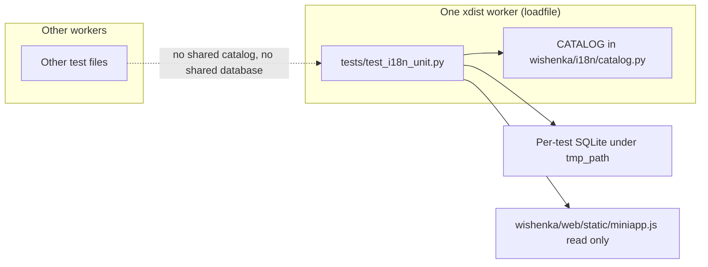

# WISHENKA-283: Parallel suite keeps three language checks green

## Research

The three checks live in `tests/test_i18n_unit.py` and already pass when that
file runs with other tests. A shared catalog, a locale cache, and a file
write were the suspects. None of them is shared in a way that can change
these three results.

### What the three checks touch

| Check | What it reads | Private state |
| --- | --- | --- |
| `test_anonymous_share_and_invite_locale_priority_chain` | `html lang` on `GET /share/{token}` and `GET /invite/{token}` | Its own app and `tmp_path` database (`anon_share_invite.db`) |
| `test_reminders_fallback_to_en_for_missing_user_locale_and_legacy_schema` | `claim_reminder` / `refresh_reminder` body | Its own `WishlistStore` and `UserStore` on `reminder_fallback.db` |
| `test_miniapp_js_localizes_home_nav_shell_and_settings_label` | `miniapp_catalog()` and `GET /static/miniapp.js` | Its own app on `miniapp_js.db`; the script is the repository file |

Locale choice for the anonymous pages is per request:
`wishenka/i18n/dependencies.py` `get_request_locale` uses the link's `lang`
query, then `Accept-Language`, then English. It stores the result on
`request.state.locale`. There is no process-wide locale cache.

`wishenka/i18n/catalog.py` `CATALOG` is a module dict. `miniapp_catalog()`
builds a new dict on every call. It is not wrapped in `lru_cache` or
`functools.cache`. The only test that replaces a catalog entry is
`test_t_fallbacks_and_missing_key_logging` in the same file, and it does so
with `monkeypatch.setitem(CATALOG, "ru", ...)`, which pytest restores before
the next test. No test assigns into `CATALOG["en"]` or `CATALOG["ru"]` in
place. No test writes `wishenka/web/static/miniapp.js` or a locale file.

Each check opens a database under pytest's `tmp_path`. `tests/conftest.py`
also points a default `Settings()` at a per-test file, so these checks do
not use `data/wishenka.db`. Alembic's lock in `wishenka/db/migrations.py` is
a sidecar of that database file (`<db>.migrate.lock`), not a lock on the
catalog. `wishenka/web/rate_limit.py` keeps its window on `app.state` of the
app that check created. The share check issues 14 GETs; the default window
is 30 requests, and each test builds a new limiter.

### How xdist runs them

`make test` uses `pytest -n $(PYTEST_JOBS) --dist loadfile` (`Makefile`).
With `loadfile`, every test in `tests/test_i18n_unit.py` runs in one worker
process, in file order. Other files on that worker share the process, but
only after the previous file has finished. Other workers are other
processes: they do not see this process's `CATALOG`. They can interfere only
through a file both sides write. These three checks do not have such a file.

That distribution is the current pytest-xdist contract
([distribution modes](https://pytest-xdist.readthedocs.io/en/stable/distribution.html)).
A failure that appears only under xdist is either a shared file, a port, or
an external resource, or it is order dependence inside one worker
([parallel isolation](https://flakytest.dev/guides/pytest-xdist/)).
The catalog and the locale helpers are none of those.

### Bounded runs on this tree

Both runs used `.venv/bin/pytest -n 4 --dist loadfile` (pytest 9.2.0,
pytest-xdist 3.8.0). Both included the three checks. Neither failed.

1. `tests/test_i18n_unit.py` plus `test_i18n_sync.py`,
   `test_miniapp_i18n_repro.py`, `test_ssr_i18n_repro.py`,
   `test_public_link_rate_limit.py`, `test_wishenka_34_repro.py`, and
   `test_infra.py`: **80 passed in 10.01s**.
2. The same i18n file plus the largest non-browser neighbors
   (`test_ssrf_configurable_settings.py`, `test_reservations_cabinet_ui.py`,
   `test_wish_items_crud_api.py`, `test_bot_capture_repro.py`,
   `test_wish_items_tma_ui.py`, `test_wish_card_giver_controls.py`,
   `test_wishlist_roles_lifecycle.py`, `test_favorites_access_control.py`,
   `test_notice_delivery_repro.py`, `test_home_overview_ui.py`,
   `test_receipt_notices.py`, `test_public_link_rate_limit.py`,
   `test_shared_inventory_multiprocess.py`, `test_wishlist_delete_ui.py`,
   `test_wishlist_delete_api.py`, `test_wishlist_create_form_ui.py`,
   `test_i18n_sync.py`): **508 passed in 33.46s**.

The WISHENKA-98 report is one full `make test PYTEST_JOBS=4` that printed
`FAILED` for these three node ids and then stopped at 600 seconds and 47
percent, before pytest printed a traceback. `pyproject.toml` puts `-v` in
`addopts`, so xdist prints the `FAILED` line when the worker finishes a
test. The traceback is part of the session summary. `Makefile` wraps the
run in `timeout -k 30 600`. A run killed at 47 percent never reaches that
summary. That is why the ticket has names and no stack. The hang that
prevents the summary is WISHENKA-285 and is not fixed here.

### Cause

There is no shared mutable catalog, locale cache, or file write that makes
these three checks fail while other tests run. The failure was not
reproduced. Product behavior for anonymous share and invite language,
English occasion reminders, and the Mini App home catalog stays as it is.

## Implementation Plan

Do not change product code. Do not edit `wishenka/web/static/app.js`. Do not
fix WISHENKA-357, WISHENKA-298, or WISHENKA-311. Do not raise
`TEST_WALL_LIMIT`.

The parallel proof for this task is the second command above (this file plus
that neighbor set, `-n 4 --dist loadfile`). It finishes in well under a
minute. A 600-second full suite is not required and is not the close of
this task.

**Mandatory — Failing Repro (next Step 3):** `N/A — no behavioral change`.
The three checks already encode the language rules, and they pass under
xdist with neighbors. A new test written to go red first would be green on
the first run, so it would not demonstrate a defect. Step 3 records that
N/A in the roadmap and does not add a test.

Step 4 re-runs the bounded neighbor command and stops. No source file is
edited.

## Architecture

### Modules

- **`wishenka/i18n/catalog.py`** — bilingual `CATALOG` and `t()`.
  `miniapp_catalog()` projects `nav.*` and `miniapp.*` into a new dict.
  Unchanged.
- **`wishenka/i18n/locale.py`** and **`wishenka/i18n/dependencies.py`** —
  pure functions and a per-request dependency. Unchanged.
- **`wishenka/notices/reminders.py`** — `claim_reminder` /
  `refresh_reminder` read `users.locale` and, when that column is absent,
  pass `None` into `_normalize_row_locale`, which yields English. Unchanged.
- **`wishenka/web/routes/sharing.py`** and **`wishenka/web/routes/miniapp.py`**
  — render `locale` from the request dependency and embed `miniapp_catalog()`.
  Unchanged.
- **`tests/test_i18n_unit.py`** — already gives each check its own database.
  Unchanged.
- **`tests/conftest.py`** — autouse database isolation for a default
  `Settings()`. Unchanged.

### Patterns

Keep the current pattern: one process-local catalog, per-request locale,
per-test database. Adding a cache, a lock around `CATALOG`, or a copied
catalog file would be new shared state, which is the hazard these checks
do not have.

### Interfaces

No interface changes. `t(key, locale)`, `miniapp_catalog()`,
`get_request_locale`, and `claim_reminder` / `refresh_reminder` stay as
they are. Supported languages stay Russian and English. English stays the
fallback.

## Q&A

- **Q:** What is the exact cause?
  **A:** Not a shared catalog, locale cache, or file write. Those were
  inspected and are private to the process or to the test. The recorded
  `FAILED` lines came from one full run that was killed at 600 seconds
  before pytest printed tracebacks. The same three checks passed in a
  4-worker run of 508 tests in 33.46 seconds.

- **Q:** Which file changes?
  **A:** None. Product modules stay as they are. `wishenka/web/static/app.js`
  is not edited.

- **Q:** How does a maintainer get the parallel proof without the 600-second
  suite?
  **A:** `pytest -n 4 --dist loadfile` on `tests/test_i18n_unit.py` plus the
  neighbor files listed under Research. That run passed here: 508 tests,
  33.46 seconds.

- **Q:** Why is there no red test in Step 3?
  **A:** There is no behavioral change to force red. The existing checks
  are already the specification, and they are green under the parallel
  command this task can actually finish.

- **Q:** What stays out of scope?
  **A:** WISHENKA-357, WISHENKA-298, WISHENKA-311, any `receipt` substring
  in `app.js`, and the 600-second suite hang tracked as WISHENKA-285.
