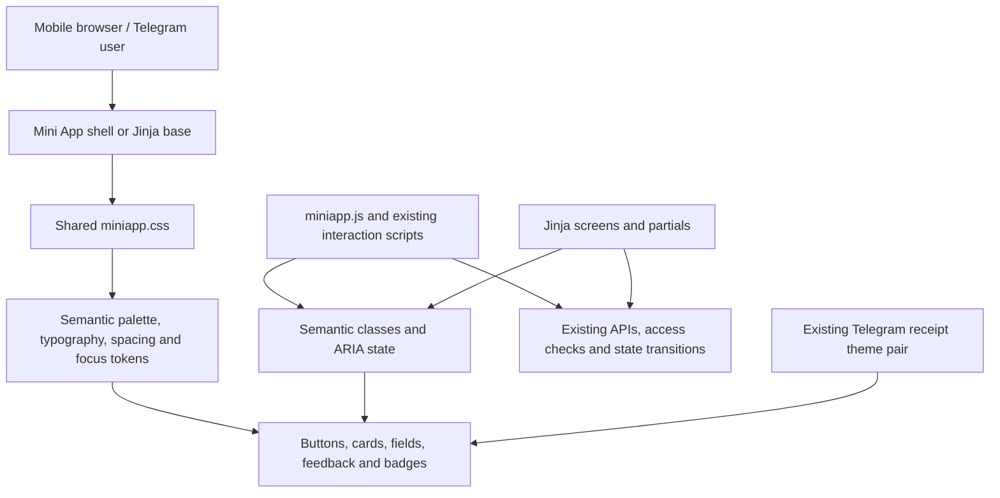

# WISHENKA-288: Shared visual language

## Research

The Jira story and [parent epic](https://pypost.atlassian.net/browse/WISHENKA-287) request a
consistent light, airy interface. The epic's reference image shows pale blush backgrounds, light
rounded surfaces, plum headings, cherry accents, small motifs, clear primary buttons, outlined
secondary actions and separately marked destructive actions. It is visual guidance, not a source
of new interaction requirements.

The application has two entry shells: `wishenka/web/routes/miniapp.py` serves the Mini App shell,
and `wishenka/web/templates/base.html` is the base for server-rendered screens. Both already load
`wishenka/web/static/miniapp.css`. `miniapp.js` builds home, history and detail controls in the DOM;
Jinja templates and partials render settings, wishlist, sharing, receipt and invitation screens.
The stylesheet contains shared section, form, button and badge rules, plus existing modal and
receipt rules. Existing `--tg-theme-bg-color` and `--tg-theme-text-color` variables are used for
receipt surfaces; receipt contrast tests explicitly exercise them. Existing ARIA, live feedback,
HTMX attributes, links, IDs and button handlers are behavioral interfaces and must survive.

CSS custom properties permit shared values with locally scoped overrides; preserve a paired
foreground/background when applying theme overrides. Keyboard focus should remain visible through
`:focus-visible`, and native checkbox and selected state semantics must remain present. See
[MDN focus-visible](https://developer.mozilla.org/en-US/docs/Web/CSS/:focus-visible) and
[MDN color-scheme](https://developer.mozilla.org/en-US/docs/Web/CSS/color-scheme).
No new third-party runtime library or externally loaded font is required.

## Implementation Plan

1. Inventory shared styles and representative primary, secondary, destructive, selected, disabled,
   feedback and focus states across both shells. Map each existing control deliberately; do not
   infer destructive actions from button text, ordering or language. Keep page-specific redesign
   and navigation changes in the later sprint stories.
2. Before modifying production files, add an offline browser regression in
   `tests/test_visual_identity_browser.py` using existing browser fixtures and deterministic
   mocked/seeded app data. In light mode, assert representative Mini App and server-rendered
   settings controls show a coherent light background and surface, a distinct primary versus
   secondary action and a separately distinguishable destructive action. Verify selected and
   disabled states and visible keyboard focus, and ensure these checks fail against the current
   unmodified shared styles for the intended missing visual distinction. Use computed styles,
   explicit role/state attributes and stable selectors; avoid literal screenshot pixel snapshots.
   Apply `pytest.mark.timeout` and `pytest.mark.browser`. If environment lacks Chromium, record that
   as a setup limitation; do not misrepresent fixture failure as the intended RED. Establish the
   intended visual failure using a runnable local browser before accepting Step 3.
3. Introduce semantic design tokens and shared component styles in `miniapp.css`, with scoped
   class hooks applied to existing markup only where semantics are known. Preserve native element
   types, role-specific visibility, links, accessible names, events and action outcomes. Apply the
   common foundation consistently to both Mini App and Jinja pages without reimplementing their
   screen-specific workflows.
4. Keep light styling default, with tested paired foreground/background theme values where the
   current Telegram receipt/modal interface already expects them. Never mix a themed background
   with a hard-coded incompatible foreground; ensure fallback and dark receipt cases remain legible.
   Avoid expanding reliance on Telegram variables beyond paired safe values. Respect reduced motion
   for any added animation, and preserve touch target sizing and wrapping for both locales.
5. Run the red test until green, focused existing receipt theme, settings, Mini App, wishlist,
   localization and privacy tests, plus the repository analysis gate. Inspect representative
   mobile-width screens visually against the supplied reference, in Russian and English; verify
   hover/focus/disabled/selected and alert states, role privacy, and dark receipt contrast.
   Record environment-related baseline failures separately and compare them with the base revision.

## Architecture

### Responsibilities and dependencies

- **Shared stylesheet and tokens** own the light blush canvas, near-white surfaces, plum text,
  cherry action colors, restrained borders, spacing, typography and rounded corners. Tokens describe
  semantic uses rather than section-specific meaning. Explicit paired colors, focus outlines and
  danger styles are provided for accessibility and consistency. They are internal CSS interfaces.
- **Component rules** apply the tokens to existing `section`, `.wishlist-card`, `.history-item`,
  `.badge`, `.alert`, forms, navigation and modal components where appropriate. Define clear
  primary, secondary and danger class hooks, with selected and disabled states expressed through
  existing native/ARIA states as well as visual treatment. Scope overrides so generic rules do not
  break receipt controls, hidden content or reserved bottom space.
- **Mini App and Jinja markup** assign semantic hooks to controls using their actual action purpose,
  preserve all IDs, selectors, handlers, translation keys, ARIA and live regions, and use the same
  vocabulary across locales. Existing APIs and authorization remain unchanged. Modifying markup
  requires rechecking selectors used by scripts and tests.
- **Theme boundary** retains the existing Telegram receipt foreground/background pair and safe
  fallbacks; a component with that background receives a compatible foreground, including nested
  forms and controls. A global theme mode must not be inferred solely from one Telegram variable.
- **Test boundary** drives real entry shells using the existing local browser harness, and asserts
  both visual state and retained behavior. Existing server-side and browser privacy tests remain
  authoritative for role and surprise visibility. Browser setup issue WISHENKA-297 is a known
  environment constraint, not evidence of a visual test result.

### Interface contracts

There is no new backend, endpoint, payload, storage or localization contract. The two HTML shells
continue to load `/static/miniapp.css`; browser code and templates keep current endpoint calls,
selectors and translations. Semantic CSS classes are shared presentation hooks, not authorization
or business-state decisions. Existing `aria-pressed`, disabled properties, labels and live regions
remain the source of state and accessible meaning. Later screen stories can reuse the tokens and
hooks without requiring a separate design system dependency.

### Patterns and trade-offs

A shared token and component layer fits the existing single stylesheet and two rendering paths,
reduces visual drift and permits incremental screen work. The existing cascading stylesheet remains
an integration constraint: each override needs targeted verification against modal specificity,
Telegram theme colors and HTMX-replaced fragments. Restrained CSS shapes and existing system fonts
keep the UI self-contained; no decorative image is necessary for the foundation.

## Q&A

- **Why not change every screen's workflow here?** This story establishes the common visual
  vocabulary; the sprint's screen stories own their specific flow and layout requirements.
- **What about dark Telegram themes?** Existing receipt and modal surfaces already consume paired
  theme variables. Preserve and test that behavior while the reference guides the default light UI.
- **Can color alone distinguish state?** No. Native disabled/selected semantics, text and focus
  indicators remain available alongside visual styling.
- **Is an automated visual test enough?** No. It checks representative computed properties and
  behavior; visual review at mobile width, both locales and theme regression checks complement it.
