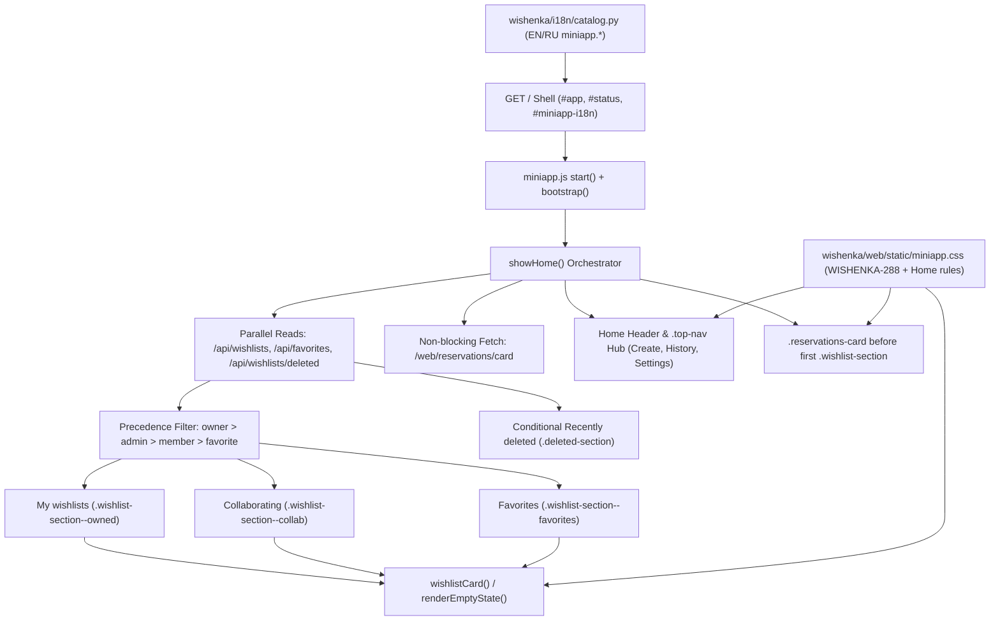

# WISHENKA-289: Convenient wishlist overview and navigation

## Research

### Existing Home Implementation and Boundaries

The Telegram Mini App home screen is served as an empty HTML skeleton from
`wishenka/web/routes/miniapp.py` (`GET /` with `
`
and `<main id="app" data-bot data-miniapp data-locale>`) plus an embedded JSON i18n payload
(`<script id="miniapp-i18n" type="application/json">` produced by `miniapp_catalog()`). Client
rendering lives in `wishenka/web/static/miniapp.js` using pure DOM helpers (`node()`, `button()`)
and `t()`, styled by `wishenka/web/static/miniapp.css` alongside `WISHENKA-288` light tokens.

Currently, `showHome()` renders a flat `<h1>` and a single wrapping `.top-nav` row containing
**Create wishlist** (`.btn-primary`), **Viewing history**, and **Settings** (`a.settings-link`).
It fetches `/api/wishlists`, `/api/favorites`, and `/api/wishlists/deleted` in parallel, appends
three `<section class="wishlist-section">` blocks plus conditional `.deleted-section`, and then
fetches `/web/reservations/card` and inserts an unstyled `<a>` link before the first
`.wishlist-section`. Several UX and contract gaps exist today:

1. **Unstyled reservations link and flat top nav**: the reservations anchor inserted before
   `.wishlist-section` has no card class or layout treatment, and **Create wishlist** sits inline
   with secondary links without a clear hero/hub hierarchy on narrow screens.
2. **Ambiguous card hierarchy and Favorites wording**: `wishlistCard()` renders the wishlist title
   itself inside a bordered button alongside `.badge`, and Favorites cards append a second
   equal-weight button labeled `Remove` (`Удалить`), which visually competes with opening the list
   and sounds like deleting the wishlist.
3. **Collaborator-favorited duplication**: `GET /api/favorites` in
   `wishenka/web/routes/wishlists.py` returns every entry from `wl_favorites`, including shared
   lists where the caller is `admin` or `member` (with `role` set to the operational role). Because
   `showHome()` currently renders `favs` unfiltered, collaborator-favorited lists appear twice on
   Home: once in **Collaborating** and again in **Favorites**.
4. **Minimal empty states**: `.empty-notice` strings state only that no lists exist without
   explaining *why* or *what to do next*.

### Preserved Test and Contract Constraints

Inspection of the existing test suite revealed strict source, DOM, and API contracts that the
architecture must preserve verbatim:

- **`tests/test_reservations_cabinet_ui.py`**: `home_script_problems()` slices `miniapp.js` using
  `source_between(source, "async function showHome(", "function settingsForm(")` and requires that
  slice to contain `/web/reservations/card` and `node(`, and to exclude `innerHTML`,
  `insertAdjacentHTML`, and `createContextualFragment`. `publicView` and `invitationView` must
  remain free of `/web/reservations/card`.
- **`tests/test_visual_identity_browser.py`**: requires `.wishlist-section` to sit inside a
  `<section>` with opaque `--surface` (`#ffffff`) distinct from `--canvas` (`#fff7f9`), and
  explicitly asserts `document.querySelectorAll('.top-nav button').length === 2` with
  `styles[0] !== styles[1]` (primary Create vs secondary Viewing history).
- **`tests/test_bot_menu_miniapp_e2e_browser.py`**: asserts `#app h1` `innerText` matches
  `t('miniapp.home.title')` exactly, `#status` clears to `''`, `startapp=create` focuses the
  Create wishlist button (whose `innerText` matches `t('miniapp.home.create_wishlist')`) via
  `root.querySelector('button')?.focus()`, and Home load creates no wishlist.
- **`tests/test_miniapp_i18n_repro.py`**: runs `miniapp.js` in a minimal Node VM DOM mock that
  implements `setAttribute`, `getAttribute`, `append`, `replaceChildren`, `insertBefore`, and
  `root.querySelector('.wishlist-section')` scanning **direct children** of `#app` (without
  `classList`, `prepend`, `closest`, or `querySelectorAll`). Keeping `.wishlist-section` elements
  as direct children of `#app` and constructing elements via `node()` preserves compatibility.
- **`tests/test_i18n_unit.py` and `tests/test_wishlist_deleted_restore.py`**: require identical
  EN/RU key sets and placeholders in `wishenka/i18n/catalog.py`, `nav.*`/`miniapp.*` key prefixes
  for `miniapp_catalog()`, exact EN/RU copy for `nav.settings`, `miniapp.home.title`,
  `miniapp.home.create_wishlist`, `miniapp.home.viewing_history`, and `miniapp.home.my_wishlists`,
  and intact `miniapp.deleted.*` recovery wiring.

### Accessibility and Mobile Reflow Findings

Per W3C WCAG 2.2 Reflow (SC 1.4.10) at `320px+`, Target Size Minimum (SC 2.5.8), and Label in
Name (SC 2.5.3):

- Narrow mobile containers (`320px–412px`) avoid horizontal overflow when flex/grid children set
  `min-width: 0` and text containers apply `overflow-wrap: anywhere` while badges use
  `flex-shrink: 0`.
- Touch targets keep `min-height: var(--touch-target)` (`44px`), exceeding WCAG 2.5.8 (`24px`).
- Disambiguated card button `aria-label` attributes (`Open: <title>` / `Открыть «<title>»`) must
  start with the visible button label (`Open` / `Открыть`) to satisfy WCAG 2.5.3 Label in Name.

## Implementation Plan

### Mandatory Failing Repro (next Step 3)

Before editing any production source, add two complementary red test suites (or run both under
existing pytest marks without live network dependencies):

1. **`tests/test_home_overview_ui.py` (fast Node VM + i18n contract suite)**:
   - Verifies EN/RU catalog parity and placeholder matching for all new `miniapp.home.*` keys.
   - Executes real `miniapp.js` inside an extended Node VM harness (isolated, mocked `fetch`) to
     assert:
     - **Role precedence deduplication**: a wishlist present in `/api/wishlists` (`role: "member"`)
       and also returned by `/api/favorites` (`role: "member", is_favorite: true`) renders once in
       **Collaborating** with its operational badge and never duplicates into **Favorites**.
     - **Informative two-part empty states**: empty **My wishlists**, **Collaborating**, and
       **Favorites** sections each render both `.empty-notice` (why empty) and `.empty-hint` (next
       step) in EN and RU, while empty **Recently deleted** stays hidden.
     - **Card action hierarchy and unambiguous Favorites removal**: active cards separate the title
       and role badge from `.wishlist-card-open` (`Open` / `Открыть`) and Favorites cards render a
       subordinate `.wishlist-card-remove` (`Remove from favorites` / `Убрать из избранного`)
       instead of bare `Remove` / `Удалить` or `.btn-danger`.
     - **Reservations card fallback and Surprise Invariant**: `/web/reservations/card` renders
       `.reservations-card` with `.reservations-badge` before the first `.wishlist-section`, falls
       back cleanly on HTTP 500 without hiding sections, and Home cards never expose reservation
       counts or gifter identities.
   - Fails RED on unmodified code because deduplication, `.empty-hint`, `.wishlist-card-open`,
     `.wishlist-card-remove`, `.reservations-card`, and new i18n keys do not exist yet.

2. **`tests/test_home_overview_browser.py` (`@pytest.mark.browser`, `@pytest.mark.timeout(45)`)**:
   - Uses the offline `BrowserServer` and CDP Chromium harness at `360x800` and `412x800` mobile
     viewports in both `en` and `ru` locales (with deterministic seeded data and mocked `/api/*`
     cases for multi-section and deleted-list states).
   - Asserts zero horizontal overflow (`scrollWidth <= innerWidth`), `>= 44px` touch targets,
     non-overlapping rects for long Russian titles/badges/actions, visual distinction between
     `Create wishlist`, secondary nav controls, `.reservations-card`, section types, and card open
     vs remove actions, keyboard `:focus-visible`, and `startapp=create` focus without creating a
     wishlist.
   - Fails RED on unmodified code due to missing `.reservations-card`, `.empty-hint`,
     `.wishlist-card-open`, and `.wishlist-card-remove` selectors/geometry.

Sequencing: write and confirm intended RED failure on unmodified code -> implement Step 4 changes ->
re-run new suites plus existing regression tests (`test_reservations_cabinet_ui.py`,
`test_wishlist_sections_ui.py`, `test_wishlist_deleted_restore.py`,
`test_bot_menu_miniapp_e2e_browser.py`, `test_visual_identity_browser.py`,
`test_miniapp_i18n_repro.py`, `test_i18n_unit.py`) and repository static checks until green.

### Step 4 File Plan

- **Modify `wishenka/i18n/catalog.py`**: add paired EN/RU `miniapp.home.*` keys for header lead,
  section subtitles, card primary/subordinate labels and `aria-label` templates, reservations card
  hint, and two-part empty-state next-step guidance.
- **Modify `wishenka/web/static/miniapp.js`**: refine `wishlistCard()`, add `renderEmptyState()`,
  `renderSectionHeader()`, and `formatDate()` helpers *before* `async function showHome(`,
  enhance `showHome()` layout, deduplicate `favs` against active owned/collaborative lists, apply
  semantic classes to `.reservations-card` while preserving `/web/reservations/card`, `node()`, and
  function boundary order before `function settingsForm(`.
- **Modify `wishenka/web/static/miniapp.css`**: add `#app`-scoped Home hub, `.home-top-nav`,
  `.reservations-card`, section modifier/header/count, card anatomy, `.empty-state`, and mobile
  wrap rules (`<= 412px`) built on `WISHENKA-288` palette tokens.
- **Unchanged by design**: `wishenka/web/routes/miniapp.py`, `wishenka/web/routes/wishlists.py`,
  `wishenka/web/templates/base.html`, `wishenka/web/templates/partials/reservations_card.html`
  (preserving all backend endpoints, SSR views, and `WISHENKA-296` creation compatibility).

## Architecture

### System Module Diagram

### Component and Visual Hierarchy Specification

1. **Home Header and Action Hub (`#app` top block)**:
   - `<h1>` renders exact `t('miniapp.home.title')` (`Wishlists` / `Вишлисты`) so existing exact
     heading assertions remain valid.
   - `
` provides a concise orientation subtitle via `t('miniapp.home.lead')`.
   - `<nav class="top-nav home-top-nav">` holds **exactly three direct controls** (and **exactly
     two `<button>` elements** to satisfy `test_visual_identity_browser.py`):
     - `button[0]` (`.btn-primary.home-create-btn`): `t('miniapp.home.create_wishlist')`. Kept as
       the first `<button>` in `#app` so `startapp=create` continues to focus it via
       `root.querySelector('button')?.focus()`, spanning the primary top row on mobile (`flex: 1 1
       100%`) and preserving `POST /api/wishlists` `{}` submission until `WISHENKA-296`.
     - `button[1]` (`.home-nav-action`): `t('miniapp.home.viewing_history')`, single-step
       transition to `showHistory()`.
     - `<a>` (`.settings-link.home-nav-action`, `href="/settings"`): `t('nav.settings')`, styled
       as a 44px-tall secondary navigation control paired evenly beside **Viewing history** on the
       subordinate nav row.

2. **My Reservations Summary Card (`.reservations-card`)**:
   - Fetched from `/web/reservations/card` inside `showHome()` and parsed with `DOMParser` (never
     injected via `innerHTML`).
   - Built via `node('a', '', {href, class: 'reservations-card'})` with `.reservations-card-main`
     (`.reservations-title` + `.reservations-card-hint` from `t('miniapp.home.reservations_hint')`)
     and `.reservations-badge` (`distinct_count` pill) with `min-height: var(--touch-target)`.
   - Inserted into `#app` immediately before `root.querySelector('.wishlist-section')` via
     `root.insertBefore()`. Failure or malformed HTML is silently ignored so Home sections stay
     intact.

3. **Categorized Sections (Direct Children of `#app`)**:
   - Every section is a `<section role="region" aria-label="..." class="wishlist-section ...">`
     attached directly to `#app` (preserving Node VM `root.querySelector('.wishlist-section')` and
     `.closest('section')` checks):
     1. **My wishlists** (`.wishlist-section--owned`): `lists.filter(l => l.role === 'owner')`
     2. **Collaborating** (`.wishlist-section--collab`):
        `lists.filter(l => ['admin', 'member'].includes(l.role))`
     3. **Favorites** (`.wishlist-section--favorites`):
        `favs.filter(l => !activeIds.has(l.id) && !['owner', 'admin', 'member'].includes(l.role))`
        where `activeIds = new Set(lists.map(l => l.id))`
     4. **Recently deleted** (`.deleted-section.wishlist-section--deleted`): rendered conditionally
        only when `Array.isArray(deletedLists) && deletedLists.length > 0`, visually separated by
        a distinct muted/dashed border treatment so recoverable items are never mistaken for active
        wishlists.
   - Each section opens with `.wishlist-section-header` (`<h2>` title + `.section-count` pill) and
     a brief `.section-subtitle` explaining what belongs in that section.

4. **Scannable Card Anatomy (`.wishlist-card`)**:
   - Active cards are created by `wishlistCard(list, onOpen, options = {})` (defined before
     `async function showHome(`):
     - `.wishlist-card-header`: `<h3 class="wishlist-card-title">` (`list.name ||
       t('miniapp.common.untitled_wishlist')`, `min-width: 0`, `overflow-wrap: anywhere`) +
       `renderBadge(list.role)` (`flex-shrink: 0`).
     - Optional `.wishlist-card-meta`: non-sensitive event context (`event_title` and localized
       `formatDate(event_date)` joined with `' · '`), strictly excluding any reservation counts,
       buyer names, or purchase statuses (Surprise Invariant).
     - `.wishlist-card-actions`:
       - Primary card button: `button(t('miniapp.home.open_wishlist'), onOpen,
         'wishlist-card-open')` with `aria-label` set to `t('miniapp.home.open_wishlist_named',
         {name: title})`. Styled with soft cherry tint (`#fff0f4`), `var(--accent)` border, and
         `var(--accent-dark)` bold text — clearly prioritized over secondary actions while letting
         **Create wishlist** remain the sole solid `.btn-primary` CTA on Home.
       - Favorites-only subordinate action: `button(t('miniapp.home.remove_favorite'), removeFn,
         'wishlist-card-remove')` with `aria-label` set to `t('miniapp.home.remove_favorite_named',
         {name: title})`, styled with a quiet muted border and `--muted` label (`min-height: 44px`)
         so removing a bookmark never looks like deleting another person's list.
   - Deleted cards keep `.wishlist-card.deleted-wishlist-card` with title, retention badge
     (`miniapp.deleted.days_left`), and `Restore` (`miniapp.deleted.restore`) preserving disabled
     in-flight state and `200`/`410`/error handling.

5. **Two-Part Informative Empty States (`.empty-state`)**:
   - Empty **My wishlists**, **Collaborating**, and **Favorites** render `.empty-state` inside
     their `--surface` card containing:
     - `.empty-notice` (`miniapp.home.*_empty`): explains *why* the section has no lists.
     - `.empty-hint` (`miniapp.home.*_empty_hint`): states *what to do next* in calm `--muted`
       surface styling (never using error/warning alert colors).

### Scoped CSS Token and Layout Interface

New CSS variables and rules in `wishenka/web/static/miniapp.css` build directly on `WISHENKA-288`
tokens without altering `base.html`, `.modal-sheet`, `.receipt-sheet`, or `.settings-page`:

- **Additive light tokens in `:root`**: `--surface-subtle: #fffafd`, `--border-subtle: #edd8e0`,
  `--accent-soft: #fff0f4`, `--muted-border: #d5c1ca` (internal stylesheet tokens; existing
  `--canvas`, `--surface`, `--ink`, `--muted`, `--accent`, `--accent-dark`, `--danger`, `--focus`,
  and `--touch-target` remain unchanged).
- **Scoping discipline**: Home nav rules use `#app .home-top-nav` so `base.html`'s `nav.top-nav` is
  untouched. `.wishlist-section` keeps `background: var(--surface)` (`#ffffff`) for
  `test_visual_identity_browser.py` contrast checks, using subtle left-edge accents
  (`--accent`, `#0f766e` or `#71319a`, `--muted`) to visually distinguish sections.
- **Mobile `<= 412px` wrap layout**: `box-sizing: border-box` on cards/controls, `min-width: 0`
  and `overflow-wrap: anywhere` on titles/subtitles/hints, `flex-wrap: wrap` on
  `.wishlist-card-header` and `.wishlist-card-actions`, and `min-height: var(--touch-target)` on
  every button, `.settings-link`, and `.reservations-card`.

### Bilingual Localization Contract (`wishenka/i18n/catalog.py`)

Preserve all existing `nav.*`, `miniapp.role.*`, `miniapp.deleted.*`, and `miniapp.home.*` keys
(including `miniapp.home.remove` for backward compatibility if referenced), and add paired EN/RU
`miniapp.home.*` keys:

| Key | EN purpose | RU parity rule |
| --- | --- | --- |
| `miniapp.home.lead` | Brief overview subtitle | Natural Russian lead |
| `miniapp.home.reservations_hint` | Active & purchased gifts hint | Natural Russian hint |
| `miniapp.home.my_wishlists_sub` | Personal lists scope cue | Matches EN scope |
| `miniapp.home.collaborating_sub` | Shared lists scope cue | Matches EN scope |
| `miniapp.home.favorites_sub` | Bookmarked lists scope cue | Matches EN scope |
| `miniapp.home.deleted_sub` | Recoverable window cue | Matches EN scope |
| `miniapp.home.my_wishlists_empty_hint` | Next step: Create wishlist | Matches Create button |
| `miniapp.home.collaborating_empty_hint` | Next step: ask for invite | Matches invite terminology |
| `miniapp.home.favorites_empty_hint` | Next step: save shared list | Matches favorite action |
| `miniapp.home.open_wishlist` | Visible primary card CTA | `Открыть` |
| `miniapp.home.open_wishlist_named` | `Open: {name}` | `Открыть «{name}»` |
| `miniapp.home.remove_favorite` | `Remove from favorites` | `Убрать из избранного` |
| `miniapp.home.remove_favorite_named` | Prefix + `{name}` | `Убрать из избранного «{name}»` |

### Patterns and Rejected Alternatives

- **Deduplicating Favorites in `showHome()` rather than altering `GET /api/favorites`**:
  `tests/test_wishlist_sections_ui.py` tests `/api/favorites` directly; filtering collaborator and
  owner IDs/roles in `showHome()` enforces `Owner > Admin > Collaborator > Favorite` on Home with
  zero API regression.
- **Keeping `.wishlist-section` direct children of `#app` and 2 buttons in `.top-nav`**: rejected
  wrapping sections in an outer `
` or turning `Settings`/`My reservations` into `<button>`
  elements inside `.top-nav`, because both would break existing DOM/VM contracts in
  `test_miniapp_i18n_repro.py` and `test_visual_identity_browser.py`.
- **Distinct soft-accent `.wishlist-card-open` vs quiet `.wishlist-card-remove`**: rejected solid
  `.btn-primary` on every card (dilutes **Create wishlist**) and rejected `.btn-danger` or
  `"Remove"` / `"Удалить"` on Favorites (creates false destructive alarm).
- **Keeping `POST /api/wishlists` `{}` on Create click**: rejected introducing a Home pre-creation
  wizard here because `WISHENKA-296` owns creation-submission changes.

## Q&A

- **Does `WISHENKA-289` change what happens after clicking Create wishlist or opening a card?**
  No. **Create wishlist** keeps `POST /api/wishlists` `{}` -> `showList(list.id)` until
  `WISHENKA-296`, and cards continue calling `showList(l.id)` (`WISHENKA-290` owns detail view).
- **Why keep `.deleted-section` hidden when empty?**
  Recoverable deletions are exceptional; showing an empty recovery section adds noise on normal
  visits, whereas the three primary sections benefit from persistent educational empty states.
- **How is the Surprise Invariant guaranteed on Home?**
  `/api/wishlists` and `/api/favorites` omit all reservation/giver fields for list views, and Home
  cards display only title, role badge, and optional event title/date (`My reservations` counts
  only the caller's own active/purchased promises).
