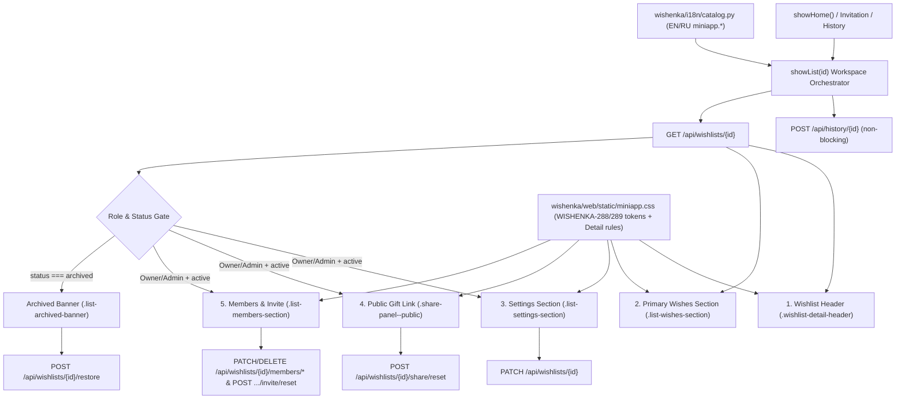

# WISHENKA-290: Clear specific wishlist view and management

## Research

### Existing Specific Wishlist View and Management Gaps

In `wishenka/web/static/miniapp.js`, opening a wishlist calls `showList(id)` (lines 511–563),
which currently appends bare, ungrouped DOM nodes directly into `#app`:

1. **Flat header and missing occasion context**: `showList(id)` replaces `#app` with a bare
   `Back` button and `<h1>`, appends `.badge` and the non-owner favorite button directly to `#app`,
   and renders `
` for `list.description || ''` even when empty. Although
   `GET /api/wishlists/{id}` returns `event_title` and `event_date`, `showList(id)` never displays
   them in the header, and updating event metadata in `settingsForm(list)` produces no visible
   change in the wishlist overview header.
2. **Unbounded wishes area**: `showList(id)` appends a loose `<h2>Wishes</h2>`, raw `
` tags
   for `list.items`, and `
Adding wishes will be available in a future update.
` directly on
   the canvas without a primary surface card, item count badge, or empty-state container. As a
   result, the wishes area is visually overshadowed by the `<form>` and `<section>` cards below it.
3. **Unstructured settings form and undifferentiated Cancel button**: `settingsForm(list)` (lines
   445–479) appends a bare `<h2>Settings</h2>` outside `<form>`, provides no section subtitle or
   optional-field guidance for event/date, and places `Save settings` (`.btn-primary`) next to
   `Cancel` with no action row layout or class hooks to separate primary saving from discarding
   unsaved edits on narrow screens.
4. **Confusable public gift link vs collaborator invitation link**:
   - `sharePanel(token, prefix, title)` (lines 105–130) renders an identical `<section>` for both
     the public gift-selection link (`prefix = 'p'`) and the collaborator invitation link
     (`prefix = 'i'`) with only an `<h2>`, a readonly `<input>`, `Copy link`, and
     `Share via Telegram` — without any plain-language audience explanation of who the link is for
     or what permissions it grants.
   - In `showList(id)`, `Replace public link` is appended as a loose button *outside* the public
     `sharePanel` section directly on `#app`, while `Revoke invitation` is appended at the bottom
     of `memberControls(list)` outside the invite `sharePanel`.
5. **Unformatted participant rows and silent role changes**: `memberControls(list)` (lines 480–510)
   renders each participant as raw text `"${member.display_name} (${roleLabel(member.role)}) "`
   instead of using semantic `.badge.badge-${role}` pills, includes no explanation of what
   participants/roles can do, and does not announce a confirmation status message when the owner
   promotes or demotes an admin (`PATCH /api/wishlists/{id}/members/{uid}/role`).

### Preserved Test and Runtime Contracts

Inspection of the test suite identified strict contracts that MUST remain intact:

- **`tests/test_reservations_cabinet_ui.py`**: `home_script_problems()` slices `miniapp.js` via
  `source_between(source, "async function showHome(", "function settingsForm(")` and also checks
  `source_between(source, "async function publicView(", "async function invitationView(")` and
  `source_between(source, "async function invitationView(", "async function bootstrap(")`.
  Therefore, `function settingsForm(` MUST remain immediately after `showHome()`, and the function
  declaration order `showHome` -> `settingsForm` -> `memberControls` -> `showList` ->
  `unavailableLink` -> `publicView` -> `invitationView` -> `bootstrap` -> `start` MUST NOT change.
- **`tests/test_wishlist_management_browser.py`**:
  - Opens a list from Home by clicking a button matching `/Party/i` (satisfied by
    `.wishlist-card-open` `aria-label="Open: Party"`).
  - Checks `ownerControl` via `find(/member|участник|настро/i)` on `button,a,[role=button]`.
  - Clicks the **first** visible button matching `/copy|копир/i` and the **first** visible button
    matching `/share|подел/i`, and asserts that every copied/shared URL contains `public-token`
    and NEVER `private-invite-token`. Thus, the **Public gift-selection link** panel (and its copy
    and Telegram share buttons) MUST appear in DOM order BEFORE the **Collaborator invitation**
    panel.
  - Under `?test_role=member`, asserts that no visible `button,a,[role=button]` matches
    `/invite|приглас|manage members|управление участ/i`.
- **`tests/test_miniapp_i18n_repro.py`**: executes `miniapp.js` inside a minimal Node VM DOM mock
  where elements only implement `setAttribute`, `getAttribute`, `append`, `replaceChildren`,
  `insertBefore`, `querySelector('button' | '.wishlist-section')`, `addEventListener`, `click`,
  `select`, and `focus` (no `classList`, `prepend`, `closest`, or `querySelectorAll`). All new DOM
  construction in `miniapp.js` MUST use `node()` and `button()`.
  - Furthermore, `test_miniapp_i18n_repro.py` runs `showList(1)`, `publicView('tok')`, and
    `invitationView('tok')` in `ru` and asserts no English strings (`Back`, `Wishes`,
    `Save settings`, `Manage members`, `Copy link`, `Share via Telegram`,
    `Public gift-selection link`, `Replace public link`, `Collaborator invitation`,
    `Revoke invitation`, `Reserve`, `Confirm joining`) appear in `collectText(rootEl)`.
- **`tests/test_i18n_unit.py` and `tests/test_i18n_sync.py`**: require 100% key and `{placeholder}`
  parity between `CATALOG["en"]` and `CATALOG["ru"]`, no Cyrillic in `"en"`, and `"nav."` /
  `"miniapp."` prefixes for `miniapp_catalog()`.
- **`tests/test_wishlists_htmx_sharing.py` and `tests/test_visual_identity_browser.py`**: test SSR
  `/share/{token}`, `/invite/{token}`, `/wishlists/{id}/members/partial`, and
  `/wishlists/{id}/share-modal`. Keeping SSR templates and endpoints unchanged preserves 100% of
  SSR sharing and modal contracts.

### Mobile Ergonomics and Accessibility Findings

Following W3C WCAG 2.2 Reflow (SC 1.4.10), Target Size Minimum (SC 2.5.8), and Label in Name
(SC 2.5.3), narrow mobile viewports (`360px–412px`) require:

- Flex/grid containers with `flex-wrap: wrap` and children with `min-width: 0` +
  `overflow-wrap: anywhere` so long Russian labels (`Назначить администратором`,
  `Снять права администратора`, `Заменить публичную ссылку`) wrap onto multiple lines without
  horizontal overflow or overlapping bounding boxes.
- Read-only capability link inputs (`https://t.me/...`) paired with full-width or flex-wrapped
  action rows where every button meets `min-height: var(--touch-target)` (`44px`).

## Implementation Plan

### Mandatory Failing Repro (next Step 3)

Before modifying any production file, create two automated red test suites that fail against the
current unmodified codebase without external network dependencies:

1. **`tests/test_wishlist_detail_ui.py` (fast Node VM + i18n contract suite,
   `pytestmark = pytest.mark.timeout(20)`)**:
   - Asserts EN/RU catalog parity, non-empty translations, and placeholder matching for all new
     `miniapp.list.*`, `miniapp.wishlist_settings.*`, `miniapp.share.*`, and `miniapp.members.*`
     keys.
   - Executes real `miniapp.js` in an isolated Node VM harness across `en` and `ru` locales to
     verify:
     - **Header & wishes-first hierarchy (FR-1)**: `showList(id)` renders `.wishlist-detail-header`
       with back navigation (`.list-back-btn`), `<h1>` title (or `miniapp.common.untitled_wishlist`
       fallback), role badge (`.badge.badge-${role}`), optional `.list-description` (omitted when
       blank), optional `.list-event-meta` (rendering `event_title` and formatted `event_date`),
       and non-owner favorite button (`.list-favorite-btn`); immediately followed by the primary
       `.list-wishes-section` (`<h2>` + `.section-count` + wish items `.list-wish-card` or
       `.empty-state` guidance) *before* any management sections.
     - **Settings save, cancel, and error retention (FR-2)**: `.list-settings-section` wraps the
       heading, `.section-subtitle`, and `settingsForm(list)` with distinct `.settings-save-btn`
       (`.btn-primary`) and `.settings-cancel-btn`; submitting valid changes sends `PATCH
       /api/wishlists/{id}`, updates the header title/description/event metadata, and announces
       `miniapp.wishlist_settings.saved`; clicking Cancel restores saved values and announces
       `miniapp.wishlist_settings.cancelled` after the refresh; failed `PATCH`
       announces `miniapp.wishlist_settings.save_failed` while keeping unsaved input values intact.
     - **Public sharing vs collaborator invitation separation (FR-3)**: active owner/admin view
       renders `.share-panel--public` (with `miniapp.share.public_title`,
       `miniapp.share.public_hint`, readonly input, copy, Telegram share, and inline
       `.share-reset-btn` for `Replace public link`) *before* `.list-members-section` containing
       `.share-panel--invite` (with `miniapp.members.invite_heading`,
       `miniapp.members.invite_hint`, readonly input, copy, Telegram share, and inline
       `.invite-revoke-btn` for `Revoke invitation`).
     - **Self-explanatory member rows & actions (FR-4)**: `.member-row` elements render
       `.member-name` and `.badge.badge-${member.role}` (localized `Owner` / `Admin` /
       `Collaborator`), owner-only `.member-role-btn` (`Make admin` / `Remove admin`) announcing
       `miniapp.members.role_updated` on success or `miniapp.members.role_change_failed` on error,
       and destructive `.btn-danger.member-remove-btn` (`Remove member`) for `member` role.
     - **Archived state & Surprise Invariant (FR-5, FR-6)**: archived lists hide settings, sharing,
       and member mutation sections, display `.list-archived-banner` with `.archived-notice` and
       manager-only `.list-restore-btn` announcing `miniapp.list.restored` on success; recipient
       views never expose reservation counts or giver identities.
   - Fails RED on unmodified code due to missing new i18n keys, missing `.wishlist-detail-header`,
     `.list-event-meta`, `.list-wishes-section`, `.list-settings-section`, `.share-panel--public`,
     `.share-panel--invite`, `.member-row` badge structure, and missing role-change confirmation
     status.

2. **`tests/test_wishlist_detail_browser.py` (`@pytest.mark.browser`,
   `@pytest.mark.timeout(45)`)**:
   - Uses the offline `BrowserServer` and headless Chromium CDP harness at `360x800` and `412x800`
     mobile viewports in both `en` and `ru` locales.
   - Verifies DOM visual order (Header -> Wishes section top Y < Settings section top Y < Public
     share section top Y < Member & Collaborator invite section top Y), distinct computed styles
     for primary `Save settings` vs secondary `Cancel` and destructive `Remove member` vs secondary
     `Make admin`, zero horizontal overflow (`scrollWidth <= innerWidth`), `>= 44px` touch target
     heights, non-overlapping bounding boxes on long Russian strings, live settings save/cancel/
     failure retention, public link copy/share/replace vs invite revoke, member promote/demote/
     remove, non-owner favorite toggle without admin clutter, and archived list restore.
   - Fails RED on unmodified code because wishes are not inside `.list-wishes-section`, event
     metadata is absent from the wishlist header, public vs invite panels lack audience hints and
     scoped classes, and member rows lack `.member-row` / `.badge` markup.

Sequencing: write red tests -> verify RED failure against unmodified production code -> implement
Step 4 changes -> verify new tests and all existing regression suites pass GREEN.

### Step 4 File Plan

- **Modify `wishenka/i18n/catalog.py`**: add paired EN/RU keys for wishlist detail subtitles,
  wishes count/empty guidance, settings subtitle and optional-field hints, public gift-selection
  audience explanation, collaborator invitation audience explanation, member roles explanation,
  role-updated confirmation, and archived-restore confirmation while keeping all existing keys and
  exact strings required by existing tests.
- **Modify `wishenka/web/static/miniapp.js`**:
  - Enhance `sharePanel(token, prefix, title, options = {})` to support optional audience `hint`,
    semantic modifier class (`share-panel--public` / `share-panel--invite`), `.share-panel-actions`
    wrapper, and an optional subordinate `footerAction` button inside the panel.
  - Enhance `settingsForm(list)` (keeping its exact function signature and position immediately
    after `showHome()`) with field helper hints, `.form-actions` container, `.settings-save-btn`
    (`.btn-primary`), `.settings-cancel-btn`, and in-flight submit disabling that preserves user
    input on failure.
  - Enhance `memberControls(list)` to render `.list-members-section` with `<h2>`,
    `.section-subtitle` role explanation, structured `.member-row` items (`.member-row-info` with
    `.member-name` + `renderBadge(member.role)` and `.member-row-actions` with `.member-role-btn`
    and `.btn-danger.member-remove-btn`), status announcement on role update, and embedded
    `.share-panel--invite` with `Revoke invitation`.
  - Enhance `showList(id)` to render `.wishlist-detail-header` (back button, `<h1>` title, role
    badge, non-owner favorite toggle, non-empty description, and formatted occasion metadata),
    followed immediately by `.list-wishes-section` (wishes first), and then role-gated management
    sections (`.list-settings-section`, `.share-panel--public` with `Replace public link`, and
    `memberControls(list)`) or `.list-archived-banner`.
- **Modify `wishenka/web/static/miniapp.css`**: add `#app`-scoped rules for
  `.wishlist-detail-header`, `.list-wishes-section`, `.list-admin-section`, `.share-panel`,
  `.member-row`, `.form-actions`, and `.list-archived-banner` built on `WISHENKA-288` and
  `WISHENKA-289` light tokens.
- **Unchanged by design**: `wishenka/web/routes/wishlists.py`, `wishenka/web/routes/sharing.py`,
  `wishenka/web/routes/miniapp.py`, and `wishenka/web/templates/**`.

## Architecture

### System Module Diagram

### Component and Visual Hierarchy Specification

1. **Wishlist Header and Context Block (`.wishlist-detail-header`)**:
   - Rendered as a `<section class="wishlist-detail-header">` at the top of `#app`:
     - `.list-header-nav`: `button(t('nav.back'), showHome, 'list-back-btn')` (`Back` / `Назад`,
       kept as the first button in `#app` so `page.click('#app button')` back navigation works)
       and, when `list.role !== 'owner'`, the secondary favorite toggle button
       (`button(favLabel, toggleFav, 'list-favorite-btn')`).
     - `.list-header-title-row`: `<h1 class="list-title">` (`list.name ||
       t('miniapp.common.untitled_wishlist')`) + `renderBadge(list.role)` (when `list.role` is
       present). Keeping `<h1>` as the sole `<h1>` inside `#app` preserves
       `document.querySelector('#app h1')?.innerText === listTitle`.
     - Conditional `
`: rendered when `list.event_title` or
       `list.event_date` is present, joining `list.event_title` and `formatDate(list.event_date)`
       with `' · '` and prefixed by `t('miniapp.list.occasion_prefix')` (`Occasion:` / `Событие:`)
       so occasion edits in settings are immediately visible in the header.
     - Conditional `
`: rendered when `list.description` is non-empty.

2. **Primary Wishes Section (`.list-wishes-section` — Always First After Header)**:
   - Rendered as `<section role="region" aria-label="..."
     class="wishlist-section list-wishes-section">` immediately after `.wishlist-detail-header`
     and before any administrative panels:
     - Uses `renderSectionHeader(wishesSection, t('miniapp.list.wishes_heading'),
       (list.items || []).length, t('miniapp.list.wishes_subtitle'))`.
     - If `list.items` has entries, renders each item inside `
` with
       `
` (`item.title`) and optional non-sensitive item metadata
       (description or recipient name if present, never reservation data).
     - Appends `
` containing
       `
` (`t('miniapp.list.wishes_empty')` when `items.length === 0`) and
       `
` (`t('miniapp.list.wishes_future_update')`, preserving the exact
       `miniapp.list.wishes_future_update` string asserted by `test_miniapp_i18n_repro.py`).

3. **Non-Distracting Wishlist Settings Section (`.list-settings-section`)**:
   - Rendered for `['owner', 'admin'].includes(list.role) && list.status === 'active'` inside
     `<section role="region" aria-label="..."
     class="list-admin-section list-settings-section">`:
     - `<h2>` (`t('miniapp.wishlist_settings.heading')`) and `
`
       (`t('miniapp.wishlist_settings.subtitle')`).
     - Appends `settingsForm(list)`:
       - `<form class="wishlist-settings-form">` containing four labeled fields (`name`,
         `description`, `event_title`, `event_date`) wrapped in `.settings-field` labels with
         `.settings-field-label` and `.settings-field-hint` (`miniapp.wishlist_settings.hint_*`)
         clarifying what each field controls and that event/date are optional.
       - `
` containing:
         - Primary submit button: `node('button', t('miniapp.wishlist_settings.save'),
           {type: 'submit', class: 'btn-primary settings-save-btn'})`.
         - Secondary cancel button: `button(t('miniapp.wishlist_settings.cancel'), async () => {
           await showList(list.id); status(t('miniapp.wishlist_settings.cancelled')); },
           'settings-cancel-btn')`.
       - On `submit`: sends `PATCH /api/wishlists/${list.id}`; on success calls
         `await showList(list.id)` and sets `status(t('miniapp.wishlist_settings.saved'))` *after*
         `showList(list.id)` completes so the confirmation message stays visible in `#status`!
         On failure, leaves the form DOM and all user-entered input values untouched and sets
         `status(t('miniapp.wishlist_settings.save_failed'))`.

4. **Public Gift-Selection Link Panel (`.share-panel--public`)**:
   - Rendered immediately after `.list-settings-section` (and before `memberControls(list)` so its
     Copy and Share buttons are first in DOM order for `test_wishlist_management_browser.py`):
   - Built via `sharePanel(list.share_token || '', 'p', t('miniapp.share.public_title'), {
     hint: t('miniapp.share.public_hint'), variant: 'public', footerAction: replacePublicBtn })`:
     - `<section class="list-admin-section share-panel share-panel--public">`.
     - `<h2>` (`t('miniapp.share.public_title')`) + `
`
       (`t('miniapp.share.public_hint')` — explaining that this link is for gift givers to view
       wishes and reserve gifts secretly without editing access).
     - Read-only `<input class="share-link-input">` with `value: url` and `aria-label: title`.
     - `
` with:
       - `button(t('miniapp.share.copy_link'), ..., 'share-copy-btn')`
       - `button(t('miniapp.share.share_telegram'), ..., 'btn-primary share-telegram-btn')`
     - `
` with the subordinate link-rotation button:
       `button(t('miniapp.share.replace_public'), ..., 'share-reset-btn')`, which posts to
       `/api/wishlists/${list.id}/share/reset`, awaits `showList(list.id)`, and announces
       `status(t('miniapp.share.public_replaced'))` (or `replace_public_failed` on error).

5. **Participant List, Role Controls, and Collaborator Invitation (`memberControls(list)`)**:
   - Rendered for active managers inside `<section role="region" aria-label="..."
     class="list-admin-section list-members-section">`:
     - `<h2>` (`t('miniapp.members.heading')`) and `
`
       (`t('miniapp.members.subtitle')` — explaining **Owner**, **Admin**, and **Collaborator**
       permissions).
     - `
` containing one `
` per member in
       `list.members || []`:
       - `
`: `` (`member.display_name`) +
         `renderBadge(member.role)` (`.badge.badge-${member.role}`).
       - `
`:
         - When `list.role === 'owner' && member.role !== 'owner'`: secondary role-change button
           (`button(roleBtnLabel, ..., 'member-role-btn')`) for `Make admin` / `Remove admin`. On
           success, awaits `showList(list.id)` and sets
           `status(t('miniapp.members.role_updated'))`; on failure sets
           `status(t('miniapp.members.role_change_failed'))`.
         - When `member.role === 'member'`: destructive removal button
           (`button(t('miniapp.members.remove'), ..., 'btn-danger member-remove-btn')`). On
           success, awaits `showList(list.id)` and sets `status(t('miniapp.members.removed'))`;
           on failure sets `status(t('miniapp.members.remove_failed'))`.
     - Embedded Collaborator Invitation sub-panel built via `sharePanel(list.invite_token, 'i',
       t('miniapp.members.invite_heading'), { hint: t('miniapp.members.invite_hint'),
       variant: 'invite', footerAction: revokeInviteBtn })`:
       - Visually nested inside `.list-members-section` as `.share-panel.share-panel--invite` with
         a distinct collaborator border accent (`#0f766e`) and `
`
         explaining that anyone joining via this link becomes a co-author who can add and edit
         wishes.
       - Includes its own readonly link input, `Copy link`, `Share via Telegram` (`.btn-primary`),
         and subordinate `Revoke invitation` (`.invite-revoke-btn`) announcing
         `t('miniapp.members.invite_revoked')` on success or `revoke_invite_failed` on error.

6. **Archived Wishlist Banner (`.list-archived-banner`)**:
   - When `list.status === 'archived'`, active mutation sections are omitted and
     `<section class="list-admin-section list-archived-banner">` renders:
     - `
` (`t('miniapp.list.archived_notice')`).
     - For `manager` (`owner` or `admin`), `button(t('miniapp.list.restore'), ...,
       'btn-primary list-restore-btn')` which posts `/api/wishlists/${list.id}/restore`, awaits
       `showList(id)`, and announces `status(t('miniapp.list.restored'))` (or `restore_failed`).

### Scoped CSS Token and Layout Interface (`wishenka/web/static/miniapp.css`)

All new rules are scoped to `#app` or dedicated detail classes so SSR pages, modals, and Home
cards remain unaffected:

- **Primary vs Subordinate Section Hierarchy**:
  - `#app .wishlist-detail-header`: `--surface` card with `border: 1px solid var(--border-subtle)`,
    `border-left: 4px solid var(--accent)`, compact top nav row (`.list-header-nav`), flex-wrapped
    title + role badge row (`.list-header-title-row`), `.list-event-meta` pill/line, and
    `.list-description`.
  - `#app .list-wishes-section`: prominent `--surface` card with `border: 2px solid var(--accent)`
    and subtle shadow so the wishes area is visually dominant above administrative sections.
  - `#app .list-admin-section`: calmer `--surface` cards with `1px solid var(--border-subtle)` and
    purpose-specific left accents:
    - `.list-settings-section`: `border-left: 4px solid var(--muted-border)`
    - `.share-panel--public`: `border-left: 4px solid var(--accent)` (gift-giver cherry accent)
    - `.list-members-section` and `.share-panel--invite`: `border-left: 4px solid #0f766e`
      (collaborator teal accent matching `.wishlist-section--collab` on Home)
- **Action Button Distinction and Mobile Wrapping (`<= 412px` / `360px`)**:
  - `.settings-form-actions`, `.share-panel-actions`, `.share-panel-footer`, and
    `.member-row-actions` use `display: flex; flex-wrap: wrap; gap: .5rem; align-items: center`
    with `margin: 0` and `min-height: var(--touch-target)` on child buttons.
  - `.settings-save-btn` uses `.btn-primary` (solid `--accent` fill, white text), while
    `.settings-cancel-btn`, `.share-reset-btn`, and `.invite-revoke-btn` use quiet secondary
    borders (`--muted-border`, `--surface` background, `--ink`/`--muted` text) so secondary or
    link-rotation controls never compete with primary CTAs.
  - `.member-row` uses `display: flex; flex-wrap: wrap; justify-content: space-between;
    align-items: center; gap: .5rem; padding: .65rem .75rem; border: 1px solid
    var(--border-subtle); border-radius: .75rem; background: var(--surface-subtle)` with
    `.member-remove-btn` styled via `.btn-danger` (`--danger` border and text).

### Bilingual Localization Contract (`wishenka/i18n/catalog.py`)

All existing keys in `CATALOG["en"]` and `CATALOG["ru"]` keep their exact names and values. The
following paired EN/RU keys are added under `miniapp.*`:

| Key | EN Purpose | RU Parity Rule |
| --- | --- | --- |
| `miniapp.list.occasion_prefix` | `Occasion:` | `Событие:` |
| `miniapp.list.wishes_subtitle` | Main gift list scope cue | Matches EN scope |
| `miniapp.list.wishes_empty` | `No wishes in this list yet.` | Natural RU empty copy |
| `miniapp.list.restored` | `Wishlist restored` | `Вишлист восстановлен` |
| `miniapp.wishlist_settings.subtitle` | Title, description & occasion cue | Matches EN scope |
| `miniapp.wishlist_settings.hint_title` | Header & card title helper | Matches EN helper |
| `miniapp.wishlist_settings.hint_description` | Optional giver note helper | Matches EN helper |
| `miniapp.wishlist_settings.hint_event` | Optional occasion name helper | Matches EN helper |
| `miniapp.wishlist_settings.hint_date` | Optional occasion date helper | Matches EN helper |
| `miniapp.wishlist_settings.cancelled` | `Changes discarded` | `Изменения отменены` |
| `miniapp.share.public_hint` | For gift givers (secret reserve) | Matches giver scope |
| `miniapp.members.subtitle` | Role permissions summary | Matches role rules |
| `miniapp.members.invite_hint` | For co-authors (join & edit) | Matches co-author scope |
| `miniapp.members.role_updated` | `Member role updated` | `Роль участника обновлена` |

Full EN/RU copy for the explanatory strings:

- `miniapp.list.wishes_subtitle`:
  - EN: `"Main gift list and wish items"`
  - RU: `"Основной список подарков и желаний"`
- `miniapp.list.wishes_empty`:
  - EN: `"No wishes in this list yet."`
  - RU: `"В этом вишлисте пока нет желаний."`
- `miniapp.wishlist_settings.subtitle`:
  - EN: `"Update the title, description, and occasion details."`
  - RU: `"Измените название, описание и детали события."`
- `miniapp.wishlist_settings.hint_title`:
  - EN: `"Shown at the top of the wishlist and on cards"`
  - RU: `"Отображается в заголовке и на карточке списка"`
- `miniapp.wishlist_settings.hint_description`:
  - EN: `"Optional note or preferences for gift givers"`
  - RU: `"Необязательная заметка или пожелания для дарителей"`
- `miniapp.wishlist_settings.hint_event`:
  - EN: `"Optional occasion name (e.g. Birthday, Wedding)"`
  - RU: `"Необязательное название повода (например, День рождения)"`
- `miniapp.wishlist_settings.hint_date`:
  - EN: `"Optional occasion date and time"`
  - RU: `"Необязательные дата и время события"`
- `miniapp.share.public_hint`:
  - EN: `"For gift givers: view wishes and reserve gifts secretly without editing the list."`
  - RU: `"Для дарителей: просмотр желаний и тайное бронирование подарков без права редактирования."`
- `miniapp.members.subtitle`:
  - EN: `"Owners and admins manage settings and links; collaborators add and edit wishes."`
  - RU: `"Владелец и админы управляют настройками и ссылками; соавторы редактируют желания."`
- `miniapp.members.invite_hint`:
  - EN: `"For co-authors: anyone with this link can join the wishlist and edit wishes."`
  - RU: `"Для соавторов: по этой ссылке можно присоединиться к вишлисту и редактировать желания."`

### Patterns and Rejected Alternatives

- **Keeping `settingsForm` immediately after `showHome`**: rejected moving helper functions between
  `showHome` and `settingsForm` because `tests/test_reservations_cabinet_ui.py` slices `miniapp.js`
  from `"async function showHome("` to `"function settingsForm("` and forbids any non-Home code in
  that slice.
- **Keeping Public Gift-Selection Link before Collaborator Invitation in DOM order**: rejected
  placing Member/Invite controls above Public Sharing because
  `tests/test_wishlist_management_browser.py` clicks the first visible Copy and Share buttons on
  the page and asserts the URL contains `public-token` and not `private-invite-token`.
- **Setting `#status` after `await showList(list.id)` on save, cancel, and role update**: in the
  current code, `settingsForm` called `status(t('miniapp.wishlist_settings.saved'))` *before*
  `await showList(list.id)`, and `showList` immediately overwrote `#status` with `nav.loading` and
  then `''`! Calling `await showList(list.id)` first and then setting `status(...)` ensures the
  user and automated tests observe the confirmation message.
- **Inline subordinate link-reset actions inside each `sharePanel`**: rejected floating
  `Replace public link` and `Revoke invitation` outside their respective link sections, because
  grouping each rotation action inside its own card makes it unmistakable which link is being
  invalidated.

## Q&A

- **Why keep `miniapp.list.wishes_future_update` in the wishes section?**
  Existing i18n regression tests (`tests/test_miniapp_i18n_repro.py`) assert that `showList`
  renders `miniapp.list.wishes_future_update` in Russian without leaking English. Pairing it with
  the wishes section header and item list keeps the contract intact while making the wishes section
  the primary visual focus.
- **How does a user distinguish Public Sharing from Collaborator Invitation at a glance?**
  Public Sharing appears in its own cherry-accented card titled **Public gift-selection link** with
  an explicit gift-giver explanation, while Collaborator Invitation is nested inside the
  teal-accented **Manage members** card titled **Collaborator invitation** with a co-author
  explanation.
- **Are any backend endpoints or database tables changed?**
  No. All required fields (`name`, `description`, `event_title`, `event_date`, `role`,
  `is_favorite`, `status`, `items`, `members`, `share_token`, `invite_token`) and endpoints are
  already served by `wishenka/web/routes/wishlists.py`.
