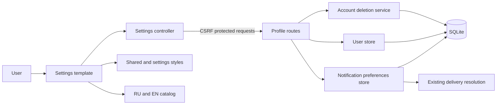

# WISHENKA-291: Personal settings architecture

## Research

The accepted requirements describe a clearer presentation of existing profile settings, not a
new delivery or deletion policy. `wishenka/web/routes/profile.py` renders `/settings` and supplies
the current profile, global preferences and accessible wishlists. `settings.html`, `settings.js`,
`miniapp.css` and `wishenka/i18n/catalog.py` own presentation. `NotificationPreferencesStore`
resolves individual overrides before global preferences and defaults. The four per-list
categories are `wishlist_changes`, `reservation_changes`, `gift_received` and `reminders`;
`birthday_reminders` is global only. `doc/dev/users.md` and `doc/dev/notifications.md` describe
these contracts and the existing tests.

The current template already contains the required controls, but visual hierarchy is uneven and
checkboxes lack explicit visible state text. The controller reports success for mutations but does
not restore or reconcile controls after failed requests, catch network failures, or update inherited
badges after a global change. Clearing a birthdate silently ignores failed responses. The current
locale choice uses HTMX refresh, with no page-specific error or pending feedback. These are UI
gaps, not reasons to change the server's authorization, preference rules or storage.

W3C guidance recommends associated labels and semantically grouped controls, including visible
instructions where needed ([labels](https://www.w3.org/WAI/tutorials/forms/labels/),
[grouping](https://www.w3.org/WAI/tutorials/forms/grouping/)). A `role=status` region announces
non-interruptive updates to assistive technology ([W3C ARIA22][aria22]).

[aria22]: https://www.w3.org/WAI/WCAG21/Techniques/aria/ARIA22

## Implementation Plan

1. Keep server rendering and existing selectors, endpoints and authorization. Use consistent cards
   and headings for language, birthday, birthday reminders, account-wide defaults and per-list
   exceptions; retain a clearly separated danger section and back link. Add concise localized
   explanations of optional year, manual priority, default and override precedence.
2. Add visible enabled/disabled text associated with each checkbox while retaining native checked
   state and labels. Each wishlist select keeps explicit inherit/enabled/disabled values and its
   effective state. Provide a localized empty state and ensure long list titles wrap.
3. Update controller state and feedback as specified below, including pending, confirmed success,
   error, network uncertainty and retry. Preserve date drafts on rejected saves; clear fields only
   after a confirmed clear. Replace raw exception or server detail with safe localized text when
   the response does not provide an appropriate string in the active language.
4. Preserve deletion preview and explicit confirmation; pending/error UI must never bypass the
   preview, retain or repeat a destructive request automatically, or expose protected details.
   Use existing count fields only. Apply responsive styling for 320px and wider viewports and keep
   controls keyboard operable, with focus indicators and live feedback.
5. Add and verify translations in both catalogs. Keep backend preference resolution, Surprise
   Invariant, session and CSRF handling unchanged. Avoid adding analytics containing profile data.

### Mandatory failing repro for Step 3

Before production changes, add `tests/test_personal_settings_browser.py` using the existing real
Chromium/CDP fixture, isolated seeded users and bounded waits with explicit per-test timeouts.
Use server intercepts or a controlled `window.fetch` wrapper to force HTTP errors, transport
rejection and delayed responses without external services. Exercise real UI events and persisted
state, not just DOM source. New tests must fail for the intended UI gap on the unchanged tree;
the execution agent records exact failures and then an independent reviewer verifies them.

- In English and Russian, assert labeled sections, visible on/off text matching native checkbox
  state, selected locale and explicit guidance separating defaults from overrides. Confirm empty
  and populated wishlist states and accessible names, keyboard focus and live feedback.
- At 320 and 375 pixels with long localized labels and a long wishlist name, assert no horizontal
  overflow, no overlap among interactive controls, readable text and touch targets. Check that
  destructive controls are visually separated from routine settings.
- Toggle a global category with at least one inherited and one explicit per-list choice: verify
  pending feedback, saved indication, persisted state after reopening, and effective badges that
  change only for inheriting lists. Switch each override through true, false and inherit; check
  isolation of another list and category and persistence after reload.
- Force known pre-mutation validation or authorization rejections for global and per-list updates,
  then simulate a network rejection. Also persist a preference change before returning a `5xx`
  response, for both global and per-list updates. Verify the subsequent read shows the committed
  value, or an unavailable read leaves the affected state explicitly unknown and disabled; never
  show the old value as confirmed or claim an unverified save. Check unrelated controls and retry.
  Delay responses to verify conflicting edits cannot finish out of order and leave stale badges.
- Exercise birthday save with and without year, invalid input, clear success and clear failure;
  verify explicit source and persistence, untouched reminders, draft retention on failure and
  useful localized feedback. Exercise reminder on/off independently of birthday data.
- Switch locale with a successful request and after reload confirm localized selection. Force
  validation, transport and post-commit `5xx` failures: reconcile to the actual locale or indicate
  an unknown state, offer localized retry, and avoid false saved feedback. Include the analogous
  post-commit `5xx` and failed-read case for birthday changes.
- Exercise preview counts, warning, cancel and confirm on isolated seeded users; simulate preview
  and delete errors and network rejection. Verify no delete request on cancel or failed preview,
  no duplicate submission while pending, and no other people's protected data in presentation.
- Run existing `tests/test_wishenka_34_preferences.py`, `tests/test_wishenka_34_repro.py`,
  `tests/test_i18n_unit.py`, `tests/test_account_deletion_repro.py`, and
  `tests/test_visual_identity_browser.py` as regression checks. Step 4 implements until both the
  new repro and applicable existing tests pass; classify full-suite failures against the task base.

## Architecture

### Responsibilities and interactions

| Module | Responsibility |
| --- | --- |
| `profile.py` | Authenticate, provide SSR data and validate existing mutation contracts. |
| `settings.html` | Render semantic sections, labels, current values, preview and live regions. |
| `settings.js` | Own form actions, confirmed state, pending controls and safe reconciliation. |
| `miniapp.css` | Apply consistent cards, states, wrapping, focus and responsive layout. |
| `catalog.py` | Supply every visible label, status and failure message for RU and EN. |
| User and preference stores | Persist choices and enforce existing default/override behavior. |
| Account deletion service | Compute aggregate preview and perform existing atomic deletion. |

The page remains server-rendered, with progressive interaction through the existing deferred
script and authenticated endpoints. This avoids a second state store and preserves tested routes.
The server is authoritative: keep each confirmed checkbox or select value in the controller and
disable the relevant control while its request is pending. Serialize preference mutations at least
per affected category, including global and list overrides for that category, so an older response
cannot overwrite a newer effective value. Restore the last confirmed value only after a validation
or authorization rejection whose endpoint contract guarantees it occurred before mutation. Treat
`5xx`, transport errors, malformed success responses and any rejection without that guarantee as
ambiguous: the server may have committed. Fetch `GET /api/profile/preferences` (or the individual
wishlist GET) to reconcile.
If reconciliation also fails, show an explicit unknown/reload-required state, disable affected
controls until successful retry, and never claim the previous value is authoritative. For a global
change, update effective badges from a fresh preferences response, or derive inherited badges only
from confirmed global and override values; explicit overrides do not change.

For date fields, retain editable drafts and show a localized error on validation failure; use the
server response or a subsequent profile refresh for confirmed values. Reconcile ambiguous errors,
including `5xx`, before asserting whether a clear or save took effect. A failed clear must not
erase form data. For locale, retain the existing HTMX contract or use a CSRF-protected fetch of
the same endpoint, but show pending and error feedback and reload only on confirmed success.
After any ambiguous failure reconcile with preferences before displaying a selected locale as saved.
Preserve `HX-Refresh` behavior for other callers. For deletion, fetch the preview before
showing confirmation; disable duplicate actions while pending, offer cancel before submission and
never automatically retry the POST. If a network failure or `5xx` leaves deletion outcome unknown,
clearly state this and require a fresh authenticated page load to determine session/account status.

### Existing interfaces

| Interface | Contract and use |
| --- | --- |
| `GET /settings` | Authenticated HTML with profile, locale and accessible list preferences. |
| `PATCH /api/profile/locale` | `{locale: "ru" or "en"}`; explicit locale, `HX-Refresh`. |
| `GET /api/profile/preferences` | Authoritative locale, date, global and list preferences. |
| `PATCH /api/profile/birthdate` | `{day, month, year}` or `{clear: true}`; validates date. |
| `PUT /api/profile/notifications/global` | `{settings: {category: boolean}}`; returns globals. |
| `GET /api/profile/notifications/wishlists/{id}` | Return accessible list overrides/effective. |
| `PUT /api/profile/notifications/wishlists/{id}` | `{overrides: {category: true/false/null}}`. |
| `GET /api/profile/deletion-preview` | Return counts for the authenticated owner's impact. |
| `POST /api/profile/delete` | `{confirm: true}`; authenticated, CSRF protected and irreversible. |

Use `window.prepareCsrf` for mutations, same-origin credentials, and existing localized API
contracts. The page never exposes reservation identities or details; list titles are escaped by
the template. No schema changes or new API fields are required.

## Q&A

- **Are notification precedence or categories changing?** No; only existing choices are shown.
- **Can failed requests be treated as unchanged?** Only a rejection guaranteed by the endpoint
  contract to precede mutation proves no change. A `5xx` or lost response can hide a successful
  commit, so reconcile or mark the result unknown.
- **Can account deletion be retried automatically?** No. It requires explicit user intent and
  an authenticated state check after an ambiguous outcome.
