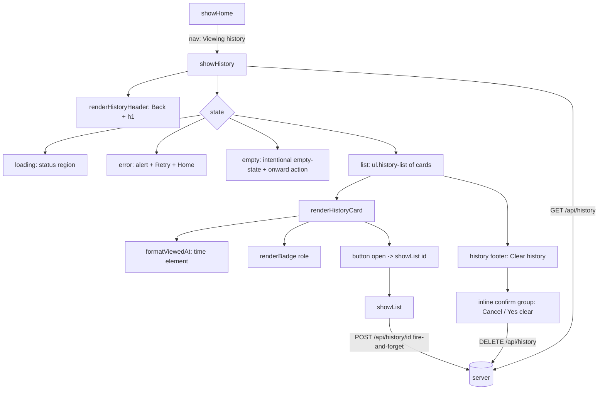

# WISHENKA-292: Convenient wishlist viewing history

## Research

### What exists today

- `showHistory()` in `wishenka/web/static/miniapp.js` renders the whole screen imperatively into
  `#app`. Order: Back button, `h1`, a `btn-danger` "Clear history" button placed **above** the
  list, then a `section[role=region]` with one `.history-item` per entry. Each row is a flat
  flex line: a plain title button, a muted text `Viewed: <toLocaleString>` and a role badge.
- Loading is only the shared `#status` live region (`role=status`, `aria-live=polite`, in
  `wishenka/web/routes/miniapp.py`). A load failure is only a status string: no retry, no way
  onward except the Back button that was rendered before the request.
- Clearing runs `DELETE /api/history` on the **first click** with no confirmation. On success the
  screen is re-rendered and then the "History cleared" status is set; on failure only the status
  string changes (the displayed list stays, which is consistent with storage).
- The empty state is a bare `<p>` "No viewing history yet" with no explanation or onward action.
- Time: `formatDateTime()` = `new Date(iso).toLocaleString('ru-RU'|'en-US')`, locale from
  `activeLocale()` (profile locale, then Telegram `language_code`, `dataset.locale`, `lang`).
- Styling: `.wishlist-card, .history-item` share one rule in `miniapp.css`; `.history-time` is
  `.85rem` muted with a left margin. The shared identity (WISHENKA-288/289/290) offers tokens
  (`--surface`, `--border-subtle`, `--accent`, `--accent-soft`, `--muted`, `--danger`,
  `--touch-target: 44px`), the home card pattern (`.wishlist-card`, `.wishlist-card-title`,
  `.wishlist-card-meta`, `.wishlist-card-actions`, `button.wishlist-card-open`), the quiet
  secondary button `.wishlist-card-remove` and `.empty-state/.empty-notice/.empty-hint`.
- Server: `GET /api/history` (`wishenka/web/routes/wishlists.py`) returns at most 20 items,
  most recent first, each `{id, name, description, event_title, event_date, viewed_at,
  is_favorite, role}`. `POST /api/history/{id}` records a view (404 for missing/deleted),
  `DELETE /api/history` removes all entries of the caller and returns `{"status": "cleared"}`.
  `service.get_history` filters out deleted wishlists; `record_view` bounds history to 20
  entries per user. i18n lives in `wishenka/i18n/catalog.py` (keys `miniapp.history.*`), the
  browser reads the catalog through `I18N_CATALOG` and `t()`.
- Existing tests that already touch history: `tests/test_home_overview_browser.py`
  (navigation Home -> History -> Back, `#app h1` equals `miniapp.history.title`),
  `tests/test_home_overview_ui.py` (JS harness with `/api/history` stubs),
  `tests/test_i18n_unit.py` / `test_i18n_sync.py` (catalog parity).

### Privacy: what the code actually enforces

Verified in code, and the design stays within exactly this:

1. `service.get_history` drops entries whose wishlist is **deleted** (`WishlistStatus.DELETED`).
   `record_view` and `POST /api/history/{id}` reject missing/deleted wishlists with 404.
2. History is scoped by `user.telegram_id`; `DELETE` affects only the caller's entries.
3. There is **no access-policy check** in `get_history`/`record_view`: any non-deleted wishlist
   id recorded for the user is listed with its title. The payload additionally carries
   `description`, `event_title`, `event_date` (the screen does not render them and will not).
4. The payload contains no reservation, purchase or reserver data, so the surprise invariant is
   preserved by construction. The design adds no new fields and renders only `name`,
   `viewed_at`, `role` and `id`.

Consequence: resolved. `10-requirements.md` now states exactly this scope (deleted lists are not
offered; entries show only title, last-viewed time and relation; no reservation or purchase
information; access checks unchanged). The remaining access-check gap is recorded as tech debt
in the Q&A below.

## Implementation Plan

Scope: presentation and client state of the history screen only. No change to
`/api/history*` contracts, `service.get_history/record_view/clear_history`, ordering, the limit 20
or privacy filtering. Files expected to change in Step 4: `wishenka/web/static/miniapp.js`
(`showHistory` plus small helpers), `wishenka/web/static/miniapp.css` (history block),
`wishenka/i18n/catalog.py` (RU/EN keys). No templates or Python routes.

1. Replace the flat `.history-item` row by a card list (`ul.history-list` > `li.history-card`)
   built on the shared card tokens, with title primary, a `<time>` and the role badge secondary,
   and one prominent open action per card.
2. Make the screen a small explicit state machine (below) rendered from one function so the
   Back / title header is always present, including on error and empty states.
3. Move "Clear history" below the list into a quiet footer and put it behind an inline
   two-step confirmation (decision below).
4. Add relative/absolute time formatting with locale-aware output and a machine-readable
   `datetime`.
5. Add RU/EN catalog keys (parity enforced by existing sync tests) and CSS for 320 px.

### Mandatory failing repro (Step 3)

See "Test strategy for Step 3" at the end.

## Architecture

### Components (all in the Mini App client)



- `showHistory()`: orchestrates state transitions (fetch, render, retry); owns the single
  in-flight guard.
- `renderHistoryHeader()`: Back-to-home button (`nav.back`, existing `showHome`) and `h1`;
  rendered in every state.
- `renderHistoryCard(item)`: one `li.history-card` with title, secondary meta (time, badge) and
  the open action.
- `formatViewedAt(iso)`: returns `{text, absolute, iso}` or `null` for invalid/missing.
- `renderHistoryFooter(count)`: Clear action and its confirmation group; present only for
  non-empty history.
- `status()` (existing): polite live region for loading and success messages.
- `api()` (existing): unchanged; supplies CSRF and throws on non-2xx.

Dependencies are one-way: `showHistory` -> helpers -> existing `node/button/t/api/renderBadge/
activeLocale`; no new modules, no new network endpoints.

### Pattern

Keep the existing imperative DOM-builder pattern (`node()`/`button()`, no `innerHTML`, so titles
are always inserted as text and cannot inject markup; this also keeps the CSP posture). Use
"render from state" within the function rather than mutating the DOM piecemeal, so a failed
clear never leaves a half-updated screen. Rationale: consistency with the other screens and no
new framework; the screen has seven states and one mutation.

### States and transitions

- **loading**
  - Trigger: enter screen, Retry.
  - UI: header + a loading line (`nav.loading`) in `#status`; list area empty; `aria-busy=true`
    on the section; no clear action.
  - Exit: success -> list/empty; failure -> error.
- **error (load)**
  - Trigger: `GET` rejects or non-2xx.
  - UI: header (with Back) + `p.history-error[role=alert]` `history.load_failed` + `Retry`
    button; no clear action.
  - Exit: Retry -> loading.
- **empty**
  - Trigger: `[]`.
  - UI: `.empty-state` with `history.empty` (notice) and `history.empty_hint` ("The section
    fills as you open wishlists"), plus a "Go to my wishlists" button (`history.open_home`)
    -> `showHome`; no clear action.
  - Exit: Home.
- **list**
  - Trigger: `length > 0`.
  - UI: cards, footer with quiet "Clear history".
  - Exit: open card, Clear.
- **confirming**
  - Trigger: click Clear.
  - UI: footer swaps the button for a `div[role=group]` with message, `Cancel` (focused) and
    `Yes, clear history`.
  - Exit: Cancel/Escape -> list (no request, focus back on Clear); Confirm -> clearing.
- **clearing**
  - Trigger: confirm.
  - UI: both confirm buttons `disabled`, `aria-busy=true` on the group, status
    `history.clearing`; guard blocks duplicate requests.
  - Exit: success -> empty + status `history.cleared`; failure -> clear-failed.
- **clear-failed**
  - Trigger: `DELETE` rejects.
  - UI: list and stored history untouched and still shown; confirm group remains open with
    `p[role=alert]` `history.clear_failed` and buttons re-enabled (confirm acts as retry).
  - Exit: confirm -> clearing; Cancel -> list.

Success after clearing: re-render the screen in the empty state (using the already known empty
result or a fresh `GET`; prefer a fresh `GET` so the display equals storage) and then announce
`history.cleared` in `#status` **after** the render (the current order already does this; it must
be kept, since `showHistory()` resets the status). After success focus moves to the `h1`
(tabindex -1) so keyboard/AT users are not left on a removed element.

A stale response guard (a monotonically increasing `historyRenderToken`) prevents an older fetch
from overwriting a newer render if the user navigates away and back quickly.

### Entry card design

```
li.history-card
  div.history-card-main
    h2.history-title            (wishlist title or t('miniapp.common.untitled_wishlist'))
    p.history-meta
      time.history-time[datetime=iso][title=absolute]   "Viewed: 5 minutes ago"
      span.badge.badge-<role>                           (only when role present)
  button.history-open           (t('miniapp.home.open_wishlist'),
                                 aria-label=t('miniapp.home.open_wishlist_named',{name}))
```

- Whole-entry open: the title text is not a second link; one clearly labelled `Open` button
  (existing visual `wishlist-card-open`) gives a 44 px target and a single tab stop per entry.
  An optional pointer-only enhancement may make the card body clickable, but the button stays the
  keyboard/AT path. Open handler is unchanged (`showList(item.id)`, which records the view through
  the existing `POST /api/history/{id}` call).
- Distinct separation: card with `--surface`, `--border-subtle`, radius .9rem and
  `margin .5rem 0`, matching the home cards; the history-specific rule is split from the shared
  `.wishlist-card, .history-item` selector so the old `.history-item` flat row can be removed
  without affecting home cards.
- Long titles: `overflow-wrap:anywhere`, `min-width:0` on the main column, title not
  `white-space:nowrap`; the card is a column on very narrow widths (`flex-wrap`) so the Open
  button drops under the text at <= 360 px and takes full width.
- Heading semantics: `h1` screen title, `h2` per card title inside `ul/li`, so assistive
  technology can navigate by heading; list semantics give "list, N items".

### Time rendering (relative vs absolute)

- Locale tag from the existing mapping (`ru` -> `ru-RU`, else `en-US`) based on `activeLocale()`,
  never the browser locale.
- Visible text: for age under 7 days use `Intl.RelativeTimeFormat(tag, {numeric: 'auto'})`
  (minute/hour/day buckets; under one minute -> the dedicated key `history.just_now`: a fixed
  catalog phrase that is engine-independent and deterministic in tests, whereas the engine's
  0-minute wording ("this minute") varies); for older entries show the absolute
  localized date and time (`toLocaleString(tag, {dateStyle:'medium', timeStyle:'short'})`).
- Always provide the full absolute time in `title` and in `datetime` (ISO) on `<time>`, so
  precise time is reachable on hover and in the DOM even when relative text is shown.
- Prefix keeps the existing key `miniapp.history.viewed_at` ("Viewed: {date}" /
  "Просмотрено: {date}") so meaning and existing tests stay valid.
- Future timestamps (clock skew) and unparseable values: treat future as "just now"; invalid or
  missing -> omit the time element (never print "Invalid Date"). Relative text is computed once
  at render; no timers (a stale "5 minutes ago" is acceptable for a screen that is re-rendered
  on every visit, and avoids live-region noise).
- Fallback if `Intl.RelativeTimeFormat` is unavailable: absolute format.

### Clear action: decision on the confirmation question

Decision: an **in-page inline two-step confirmation** (not `window.confirm`), with Cancel as the
default focus.

Justification:

- Required by Step 1 (item 6): explicit, cancellable, accessible; a deliberate action.
  Clearing is irreversible and there is no undo endpoint, so an undo/snackbar pattern (delete
  later) would require API/retention changes that are out of scope; a delayed client-side
  `DELETE` would break "outcome shown matches storage" if the app is closed.
- `window.confirm` is poorly styled, not localizable in button labels, can be suppressed in
  embedded WebViews (Telegram) and is hard to assert reliably in browser tests; an inline group
  lives in the DOM, is themable, localized and testable.
- A modal dialog adds focus-trap and layering complexity (and `receipt` modal debt); the inline
  group needs none. The confirm group has a visible message naming the consequence ("All N
  entries will be removed from your history. Wishlists and favorites are not affected.").

Safeguards that keep it secondary and non-accidental:

- Placed in a footer **below** the list (after the last card, separated by a divider and extra
  top margin), never above or between entries, so scanning and tapping `Open` cannot hit it;
  not sticky.
- Style: outlined ghost-danger (`--danger` text and border, transparent background, regular
  weight), no filled red; smaller visual weight than the `Open` buttons, but with the 44 px
  target, text label (no icon-only) and a visible focus ring, so it is distinguishable beyond
  colour by label and border.
- After the first click the Clear button is replaced by the confirm group; "Yes, clear history"
  is the only filled-danger control on the screen, adjacent to a Cancel that has initial focus.
  `Escape` in the group cancels. Cancel performs no network call and restores focus to Clear.
- Request is sent only on the second explicit activation; the clearing state disables both
  buttons so a double tap cannot send twice.
- Shown only when `history.length > 0`; hidden in empty/loading/error.

### Accessibility

- Landmarks: keep `<section aria-label=history.title>`; `role="region"` is redundant with
  `aria-label` on a section, and is kept only if existing tests rely on it.
- Names: Open button `aria-label` = `miniapp.home.open_wishlist_named`; Clear and confirm buttons
  have visible text equal to their name; `time` is readable text.
- Announcements: `#status` (polite) for loading, clearing and cleared. Errors use `role="alert"`
  in the screen (load failure and clear failure) so they are announced assertively and are not
  lost when `#status` is reset by a re-render.
- Focus: visible focus uses the shared focus style; on state changes focus is managed
  (Cancel on confirm open, Clear on cancel, `h1` after success, Retry stays focusable after
  failure). Entire flow is operable with Tab/Enter/Space/Escape.
- Not colour only: badges have text; danger action has text and border; error text is prefixed by
  the message, not just red.
- Contrast: reuse tokens already verified in the shared identity; no new colours.

### i18n

- All new strings are catalog keys with both `en` and `ru` (no inline literals), so
  `tests/test_i18n_sync.py` keeps parity. Reused: `nav.back`, `nav.loading`,
  `miniapp.history.title|clear|cleared|clear_failed|empty|viewed_at|load_failed`,
  `miniapp.home.open_wishlist_named`, `miniapp.common.untitled_wishlist`.
- New keys (names fixed here, texts decided in Step 4):
  `miniapp.history.empty_hint`, `miniapp.history.open_home`, `miniapp.history.retry`,
  `miniapp.history.just_now`, `miniapp.history.clear_confirm_title`,
  `miniapp.history.clear_confirm_body` (with `{count}`; RU plural handled by phrasing the body
  without a counted noun, e.g. "Записей будет удалено: {count}"),
  `miniapp.history.clear_confirm_yes`, `miniapp.history.clear_confirm_cancel`,
  `miniapp.history.clearing`.
- Language follows `activeLocale()` (profile locale first), same as other screens; dates and
  relative text use the same locale tag.

### Narrow viewport

- 320 px is the floor; no fixed widths; `min-width:0` and `overflow-wrap:anywhere` on text
  columns; cards stack (title block above, Open full width) with `flex-wrap`; confirm buttons
  wrap into a column; footer buttons `max-width:100%`.
- Touch targets >= `--touch-target` (44 px) for Back, Open, Retry, Clear, Cancel, Confirm;
  spacing >= .5rem between adjacent controls.
- No `position: fixed/sticky` additions (the quick-add bar exists on list screens only).
- `document.documentElement.scrollWidth <= clientWidth` must hold with very long RU/EN titles
  and unbroken strings.

### Interfaces and invariants

- Unchanged: `GET /api/history` (shape, order, limit 20), `POST /api/history/{id}`,
  `DELETE /api/history` (`{"status":"cleared"}`), CSRF header handling in `api()`.
- UI reads only `id`, `name`, `viewed_at`, `role` from the payload; `description`,
  `event_title`, `event_date` remain unused here (no new disclosure).
- No logging of titles on the client; server logging unchanged (Step 6 may revisit).
- Surprise invariant: nothing reservation/purchase related is read or rendered.

### Risks

- Existing tests that read `#app h1`, a Back button first in DOM order, or `.history-item`
  must be reviewed in Step 4; keep the Back button and `h1` first in every state, and keep
  `.history-item` as an additional class on the card if existing JS-harness tests depend on it.
- `Intl.RelativeTimeFormat` output differs by engine; tests assert structure and the absolute
  `title`/`datetime`, plus locale-specific substrings only against seeded known ages.

## Test strategy for Step 3

New file `tests/test_history_screen_browser.py` using the existing CDP fixtures
(`tests/browser_cdp.py`, `tests/conftest.py` `BrowserServer`, helper patterns from
`tests/test_home_overview_browser.py`: signed init data, `PATCH /api/profile/locale`, seeded
wishlists), `@pytest.mark.timeout(45)`, `@pytest.mark.browser`, bounded waits, no external
services. History is seeded through the real `POST /api/history/{id}`; failures are forced with a
page-side `window.fetch` wrapper (reject, 500, delayed) installed before the screen opens, which
also counts `DELETE /api/history` calls.

Hooks the repro relies on (the design contract; fixed here so Step 3 and 4 agree):
`ul.history-list`, `li.history-card`, `.history-title`, `time.history-time[datetime]`,
`.history-open`, `.history-footer`, `.history-clear`, `.history-confirm` (group),
`.history-confirm-yes`, `.history-confirm-cancel`, `.history-retry`, `.history-error`,
`.history-empty` (empty state), `.history-empty-action`.

### Must fail on the unchanged tree (target assertions)

1. Structure: seeded entries render as `ul.history-list > li.history-card`; each has a title and
   a `time[datetime]`, a labeled open button whose accessible name contains the title; order is
   most recent first. (Baseline: no list/cards/time/open button.)
2. Clear is deliberate: first click on Clear sends **zero** `DELETE` calls and shows
   `.history-confirm` with Cancel focused; Cancel leaves history and request count unchanged;
   Escape cancels; confirm sends exactly one `DELETE`. (Baseline: first click deletes.)
3. Clear placement and weight: `.history-clear` appears after the last card in DOM and
   geometrically below it, and its computed style is not a filled danger (background transparent
   or equal to surface) while `.history-open` is visually heavier. (Baseline: above the list.)
4. Clear visibility: absent in empty, loading and load-error states.
5. Empty state: `.history-empty` contains the explanation text (en and ru, via `t()`), and a
   `.history-empty-action` that navigates to home in one step. (Baseline: bare `p`.)
6. Load failure (fetch rejects/500): `.history-error[role=alert]` text equals
   `t('miniapp.history.load_failed')`, `.history-retry` exists; stubbing the next response to
   success and clicking Retry renders the list. (Baseline: status text only, no retry.)
7. Clear failure (DELETE returns 500): error is announced (`role=alert`), cards still present
   and equal to `GET /api/history`, no "cleared" message, retry via the confirm button succeeds
   afterwards and shows empty state with `#status` = `t('miniapp.history.cleared')`.
8. Locale and time: in ru and en, seeded entries with known ages (e.g. 5 minutes, 3 days,
   40 days) show locale-correct text (relative for recent, absolute for old), `datetime`
   parses to the seeded ISO time, no "Invalid Date" for an item with missing/invalid
   `viewed_at` (served via fetch stub).
9. Narrow viewport: at 320 and 375 px width with very long RU and EN titles (including an
   unbroken 80-char string): `scrollWidth <= clientWidth`, no control rects overlap, every
   interactive element >= 44 px high/wide, title not clipped (`scrollWidth <= clientWidth` per
   card).
10. Accessibility: keyboard-only flow (Tab to Open, Enter opens list; Tab to Clear, Enter,
    focus on Cancel); visible focus indicator (non-zero outline or box-shadow) on
    Open/Clear/Cancel/Confirm; headings `h1` then per-card `h2`.
11. Loading state: the page-side `fetch` wrapper holds `GET /api/history` pending (delayed
    response, released by the test). While pending, assert (a) the history container
    (`section`) has `aria-busy="true"`, (b) `#status` text equals `t('nav.loading')`, (c)
    `.history-clear` is absent, and (d) after release, `aria-busy` is not `true` and the cards
    are shown. The proving assertion is (a). Failure on the unchanged tree: the section has
    no `aria-busy` attribute at all (assertion on the attribute value fails). Correction after
    Step 3: `showHistory` appends Clear only after the awaited fetch, so (c) already passes
    on the unchanged tree and is a positive control, not a red check.
12. Escape-in-confirm focus restoration: open Clear, assert `.history-confirm` is visible, press
    `Escape` (CDP key event with focus inside the group), then assert `.history-confirm` is
    gone, zero `DELETE` calls were made, and `document.activeElement` is the `.history-clear`
    button. The proving assertion is the `activeElement` check. Failure on the unchanged tree:
    the first Clear click already sends `DELETE` and no confirm group exists, so the wait for
    `.history-confirm` times out (selector not found) before Escape is pressed; after Step 4 a
    missing focus restore would fail with `activeElement` being `body`.

### Positive controls (must pass on baseline and after)

- Seeding twenty-one distinct lists keeps 20 entries, newest first (existing limit/order).
- A deleted wishlist is absent from the list (server filter) and `POST /api/history/{deleted}`
  returns 404.
- Opening an entry (via the title/Open control, using whichever control exists) records the
  view and moves that list to the top on return; navigation Home -> History -> Back works.
- Clear scope: confirmed/unconfirmed clear (by direct API call as in baseline) empties only the
  caller's history; another user's history, the wishlists and favorites are unchanged.
- API contract: `DELETE /api/history` returns `{"status":"cleared"}`; GET shape keys unchanged.
- Privacy control: GET payload and rendered text contain no reservation/reserver data for a list
  with reservations (surprise invariant).
- RU/EN catalog parity for all `miniapp.history.*` (existing `test_i18n_sync.py`).
- No uncaught console errors (`assert_clean_console`).

### Baseline vs target failure modes

| Check | Baseline failure (expected) | Target |
|---|---|---|
| 1, 3, 4, 8, 10 | selector not found / assertion on missing element | pass |
| 11 | no `aria-busy` (Clear is already absent: control) | busy, status, no Clear |
| 12 | `.history-confirm` never appears (timeout) | Escape restores focus to Clear |
| 2 | `DELETE` count is 1 after first click | 0, then 1 after confirm |
| 5 | no explanation / no action element | present, both locales |
| 6, 7 | no `.history-error` / no `.history-retry` | present, retry works |
| 9 | layout fails on structure hooks first; geometry assertions run after structure exists | pass |

Failures must be for the intended reason (missing structure/behaviour), not fixture errors:
Step 3 asserts the fixture itself (seed visible via API) before the UI assertions, so a red run
cannot come from broken setup. The test file must not change production code; an independent
reviewer re-runs it on a clean tree to confirm red for these reasons.

## Q&A

- **Why not `window.confirm`?** Unreliable and unstyled in Telegram WebView, not localizable
  per button, hard to test; inline group is accessible and testable.
- **Why not undo?** Needs delayed deletion or an API for restoring; out of scope, contradicts
  "preserve existing API and results of clearing".
- **Why relative time at all?** The goal is quick recognition of recency; the absolute time stays
  available in `title`/`datetime`, and entries older than a week show it directly.
- **Does the redesign change the history limit, order or recording?** No.
- **Tech debt (Step 7):** `POST /api/history/{id}` records any non-deleted list without an
  access check, so a user can make the title of a list they cannot open appear in their
  history. Not fixed here: the task preserves existing access rules and API behaviour; ticket
  as a Debt item in Step 7. (The requirements wording is already corrected: resolved.)
- **Is the mockup `WISHENKA-292_History.png` reviewed?** No (not available to this step); the
  design follows the requirements and the shared identity.
