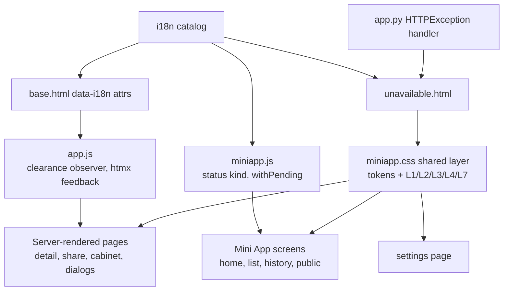

# WISHENKA-294: Comfortable and reliable experience on all key screens

## Corrections to Step 1 Q&A

`10-requirements.md` is not edited; these corrections (verified in the tests) supersede its
"What already exists as verification" bullets.

- **(a) Long English text is tested for home and history.** `tests/test_home_overview_browser.py`
  (about lines 97-101) seeds a long English title for locale `en` and a long Russian title for
  `ru`. `tests/test_history_screen_browser.py::_long_names` has an English title, a Russian title
  and an unbroken 80-character `W` string. The real gap is long English text (and unbroken
  words and links) in **item cards, item dialogs, member names, descriptions and share links**.
- **(b) Phone widths per test, as they really are:**
  - Invitation preview (`test_visual_identity_browser.py`): 412 px only (`_open` is fixed to
    `(412, 800)`).
  - Receipt mark/edit/cancel dialogs (`test_receipt_accessibility_browser.py`): 390x844,
    Russian; the receipt **edit** dialog is covered there too (`test_edit_modal_touch_targets_
    and_stepper`, line about 467).
  - Item add/edit/archive dialogs (`test_item_modals_repro.py`): 390x844, Russian, but only
    layering and error rendering, no overflow or long-text assertion; the archive dialog also
    at 412 in `test_visual_identity_browser.py`.
  - History and personal settings: 320 and 375 px.
  - Home: 412 (en, ru) and 360 (ru). Mini App detail: 360 and 412 (en, ru).
  - Therefore no test uses 390 for overflow of a whole page and nothing except history and
    settings reaches 320 px.

## Research

### Method (evidence-based audit)

Read-only probes were run against the real application with the repository browser harness
(`tests/conftest.py` fixtures, headless Chromium over CDP). Nothing in the tree was modified;
probe scripts live in the scratchpad only. Fixtures: wishlist title and description with
English, Russian, an unbroken 80-character word and a 120-character URL; four items with the
same long titles, descriptions, links, a 60-character unbroken recipient name, quantity 3 and
a price; a second user holding a reservation. Widths 320, 360, 375, 390, 412; locale `ru` for
server-rendered pages. Measured per page: `scrollWidth` vs `innerWidth`, elements whose
rectangle leaves the viewport, interactive elements under 44 px, text that is wider than its
box, WCAG contrast of every text element against its nearest opaque background, and the
overlap between the fixed quick-add bar and the last content.

Structural finding that explains most defects: `base.html` loads only `miniapp.css`. No
Tailwind or any utility stylesheet is loaded anywhere (`grep -ri tailwind` over `wishenka/` and
`tests/` finds nothing). All utility classes in the server-rendered templates (`flex`,
`gap-2`, `p-3`, `pb-24`, `break-words`, `w-full`, `text-blue-600`, ...) are **inert**. The
Mini App screens are styled by selectors scoped to `#app` and `.settings-page`; the
server-rendered pages (wishlist detail, public share, cabinet, dialogs) only get the generic
rules at the top of `miniapp.css`.

### Defects confirmed by probes (the Step 3 targets)

- **D1. Unbroken long text widens the whole server-rendered page.** Re-measured at 320, 375
  and 412 px on the wishlist detail page and on the public share page (identical numbers on
  both, at every width), one fixture field at a time:
  - wishlist description, 240 unbroken characters: `scrollWidth` **3813** (the earlier
    "about 1363" came from a shorter string and is superseded);
  - recipient badge (`Для: WWWW...`, 80 unbroken characters, two items): `scrollWidth` **1185**;
  - wishlist title 80 characters: 305 at 320 (inside the viewport), 360 at 375, 397 at 412 on
    detail and 375/412 on share, i.e. the page is only as wide as the viewport or slightly
    wider on detail (the `h1` rule `overflow-wrap: anywhere` keeps it from overflowing; the
    reviewer saw no overflow for it);
  - item description 240 characters: no overflow (320/375/412).
  So the two fields that overflow are the **wishlist description** and the **recipient
  badge**. Item description and title are not sources. Category/store badges, the event line
  and member names have the same missing rule but were not shown to overflow; L1 covers them
  and A2 checks them only as positive controls. The Mini App detail and home are already safe
  (`#app` scoped rules, no overflow measured). Root cause: `overflow-wrap` is only applied to
  selected selectors.
- **D2. The quick-add bar squeezes its input to 18 px at 320, 23 px at 360, 38 px at 375 and
  75 px at 412** (Russian labels, items present; 390 was not measured, a linear estimate is
  about 53 px, confirmed in the Step 3 run). Every value is below the 10rem (160 px) of A5.
  `.quick-add-row` is a one-line flex row, the input keeps
  `min-width: auto`. The primary action "Add" stays but the field it acts on is unusable.
- **D3. The fixed quick-add bar covers the last content** of the detail page (56 px overlap at
  320 and 412 px, viewport height 700). The template relies on `pb-24`, which is inert.
- **D4. Touch targets below 44 px on server-rendered pages**: the item store link
  (`a.item-link`: 19 px high at 390/412, 38 px at 320-375), the cabinet link "Go to wish"
  (84x19 px) and the giver quantity `<select>` on the share page (30x19 px). The existing
  rule for `select` and `textarea` is scoped to `#app, .settings-page`, so server-rendered
  selects are native-sized; links get 44 px only with the class `btn`.
- **D5. Mini App feedback is out of sight.** `#status` is a static paragraph at the top of the
  document. After "Copy link" in the invite panel of a long detail screen at 320x568 the text
  "Link copied" sits at `top = -1535 px` (scrollY 1567). The same holds for every message that
  `status()` writes while the user is lower on the page (member removal, role change, share
  reset, favorite, save failures).
- **D6. No duplicate-submission guard on Mini App actions.** Three rapid clicks on "Create
  wishlist" sent **3** `POST /api/wishlists` (the click-time creation of WISHENKA-289, which
  keeps `POST /api/wishlists {}` compatible). Same pattern (no disabled state, no waiting
  message) in `showList` favorite toggle, member remove and role change, revoke invite, reset
  public link, restore in `showHome`. Only history clearing and wishlist-settings save guard
  against repeat taps.
- **D7. Server-rendered unavailable states are raw JSON.** `GET /share/<bad>` and
  `GET /web/wishlists/<missing>` answer `404 application/json {"detail":"Wishlist not found"}`
  regardless of the viewer's language; `GET /web/reservations` without a session answers
  `401 {"detail":"Authentication required"}`. Re-checked with `Accept: text/html` on
  `/share/bad`: still JSON. No page, no heading, no way home. (`/invite/<bad>`
  already has a proper card.) Mini App `unavailableLink()` is fine.
- **D8. Root font size is fixed in pixels** (`:root { font: 16px system-ui }`), so the user's
  browser/OS text-size setting does not scale `rem` based text. Static finding, no probe.
- **D9. Server-rendered htmx actions give no pending and no network-failure feedback
  (confirmed, IN scope).** Probe (real htmx 1.9.12, detail page at 390x800, `ru`, quick add
  with a page-side `XMLHttpRequest.send` wrapper): a forced network error (`sendError`) and a
  response delayed by 1 s were both observed at 0.4 s and 2 s. Result: `#btn-quick-add` keeps
  its class, `disabled=false`, no `aria-busy`; no `role=alert` or `role=status` text appears
  and the page text length is unchanged; the only trace is two console errors
  (`htmx:afterRequest`, `htmx:sendError`). Code agrees: `app.js` has no `htmx:beforeRequest`,
  `htmx:sendError` or `htmx:timeout` listener, no `hx-indicator`/`htmx-request` rule exists in
  CSS, and htmx 1.9 does not swap 4xx/5xx answers by default. Actions affected (htmx on
  server pages): quick add and its preview, item add/edit submit, archive submit, restore,
  move up/down, invitation "join". Already handled and therefore excluded (positive controls):
  stale reorder (`list-notice`), reservation busy/cancel/purchase (`data-reservation-busy`),
  receipt dialogs (`aria-busy`, `receipt-feedback`), the item dialogs' server `role=alert`
  answers (modal swaps through `htmx:beforeSwap`). A probe of a stale archive submit was not
  conclusive (the archive call is repeatable) and is not used as evidence.

### Positive controls found by the probes (must stay green)

- No horizontal overflow of the Mini App home, history, detail (long title/description) and of
  settings at 320-412 px; the invitation preview (valid and invalid) at 320-412 px.
- Contrast: a scan of every visible text element on SSR detail (collapsed, expanded), settings,
  cabinet, Mini App home and history found **no element below WCAG AA** (4.5, 3.0 for large
  text). Hint text uses `--muted` (`#695663` on white) and badge colors pass.
- Focus: one global `:focus-visible { outline: 3px solid var(--focus) }`; the only `outline`
  declaration in the CSS; dialogs re-point `--focus` to the dialog text color.
- Item dialogs (new, edit, archive, receipt) render inside the viewport with a long title and
  fit their sheet (`.modal-sheet` `max-height: 90vh; overflow-y: auto`).
- Touch targets of buttons and inputs everywhere else measured >= 44 px.

### Observations kept out of scope

- `partials/share_modal.html` and `/wishlists/{id}/share-modal`, and `partials/member_list.html`
  routes exist but no template or script links to them (no entry point); they are not part of
  the user-visible scenarios and are only noted for Step 7.
- Server-rendered item cards and member rows lose their intended card look because the
  utility classes are inert; this story fixes overflow, targets and clearance, it does not
  restyle those cards (they are visually plain but legible and pass contrast).
- Probe run on an unprovisioned user (token without `POST /api/auth/telegram`) makes
  `POST /api/history/{id}` raise a storage integrity error (500). Test users must be
  provisioned like `_set_user_locale` does; it is a harness precondition, not a product defect.

## Implementation Plan

Scope: presentation, client feedback behavior and one HTML error page. No change to
`/api/*` contracts, access rules, data, ordering or privacy filtering. Files expected to
change in Step 4:

- `wishenka/web/static/miniapp.css` (shared layer, all CSS fixes).
- `wishenka/web/static/miniapp.js` (`status()` kinds, `withPending()`, applying it).
- `wishenka/web/static/app.js` (clearance observer and L8 shared htmx feedback).
- `wishenka/web/templates/` (`base.html`: feedback region and data attributes; item card and
  reservation row links get class `btn`; new `unavailable.html`).
- `wishenka/web/app.py` (one HTML-aware `HTTPException` handler) and `wishenka/i18n/catalog.py`
  (new RU/EN keys, parity enforced by the existing sync tests).

### Fix strategy: shared design layer, not per-screen patches

- **L1 text wrapping at the root.** `body { overflow-wrap: anywhere; }` (the property is
  inherited, so pages, cards, badges, dialogs and Mini App blocks all get it), plus
  `.badge { max-width: 100%; }` and `:where(img, svg, video) { max-width: 100%; }`. The existing
  scoped rules stay (harmless duplicates, removed later as debt). Closes D1 for every
  present and future text element.
- **L2 interactive-element size.** Widen the existing field rule from
  `:where(#app, .settings-page) :is(select, textarea)` to `:where(body) :is(select, textarea)`
  (same specificity, so dialog overrides keep winning). Links used as actions get the class
  `btn` (already 44 px, inline-flex, centered): `a.item-link` in `item_card.html` and
  `a` "Go to wish" in `reservations_list.html`. No new component. Closes D4.
- **L3 fixed bottom bar contract.** Token `--quick-add-clearance` (default `7.5rem` plus
  `env(safe-area-inset-bottom)`) used as `padding-bottom` of the detail view when the bar
  exists; a few lines in `app.js` keep it equal to the real bar height with a
  `ResizeObserver` (the preview card grows the bar). `.quick-add-row` becomes
  `flex-wrap: wrap`, the input `flex: 1 1 100%` below 480 px and `flex: 1 1 10rem` above,
  buttons `flex: 1 1 auto`. Closes D2 and D3.
- **L4 shared feedback region.** `#status` (Mini App) and `#list-notice`/`#feedback` (server
  pages) share one pattern: sticky at the top of the viewport (`position: sticky; top: 0;
  z-index: var(--layer-status)`, new token `30`, below the quick-add bar 40 and dialogs 100),
  opaque `--surface` background, border, hidden when empty (`:empty`). Kinds via
  `data-kind="pending|success|error"` with a text prefix glyph (the existing
  `.is-error::before` and `.is-success::before` pattern of settings) so state is not color
  alone. `status(message, kind)` sets `data-kind` and toggles `aria-live` between `polite`
  and `assertive` for errors. Closes D5 and gives requirement 6 (same look on all screens).
- **L5 pending guard.** One helper `withPending(control, action, pendingKey)` in
  `miniapp.js`: ignores re-entry while pending, sets `disabled`, `aria-busy="true"` and the
  class `is-pending` on the control, writes `status(t('nav.working'), 'pending')`, awaits
  `action()`, restores state in `finally`. Applied to create wishlist, favorite toggle, member
  remove / role change, revoke invite, reset public link, restore (home). Existing
  hand-written guards (history clear, settings save) are left alone. Closes D6.
  **Scope note (WISHENKA-296):** the guard on "Create wishlist" is scoped to the current
  click-time creation (`POST /api/wishlists {}` on click, kept compatible by 289). The
  separate sprint bug WISHENKA-296 (an empty wishlist is created when the create form is left)
  will change that flow; if it lands first or later, the `withPending` application to the
  create button and the create part of A6 must be revisited. The other `withPending` targets
  are unaffected.
- **L6 unavailable page.** `unavailable.html` extends `base.html` and reuses the invitation
  error-card markup/classes (`error-card`, `btn btn-primary` "Back to home"). One
  `HTTPException` handler in `app.py`, with these decisions:
  - **Scope (path):** the handler acts only on `GET` requests whose path matches exactly
    `/share/<token>`, `/web/wishlists/<id>` or `/web/reservations` (regexes with no further
    segment, so `/web/wishlists/<id>/items/...`, `/web/reservations/card`, `/static/x` and
    every `/api` path are untouched), and only for status 404 and 401. All other statuses
    (403, 429, 5xx) and all other paths keep the default JSON, unchanged.
  - **Scope (client):** no `HX-Request` header, and the request prefers `text/html`
    (see Accept below).
  - **Accept negotiation:** `Accept: */*`, a missing `Accept` and anything that ranks
    `application/json` first stay JSON; only a header that lists `text/html` with q > 0 at
    least as high as `application/json` (every browser navigation) gets the page. Verified by
    grep: the named tests (`test_items_ui_error_mapping.py`, `test_item_modals_repro.py`,
    `test_wishlist_management_ui.py`) assert 404 JSON/HTML only on `/api/...` and
    `/web/wishlists/<id>/items/...` sub-paths (outside the path scope); the tests that hit the
    three in-scope paths with the default `*/*` (`test_public_link_rate_limit.py` bad share
    token, `test_i18n_sync.py` cabinet) check only the status code or a 200, so none breaks.
  - **Locale:** `LocaleDep` is a FastAPI dependency and does not run inside an exception
    handler. The handler calls the plain coroutine
    `await get_request_locale(request, get_settings(request), get_user_store(request))`
    (`wishenka.i18n.dependencies`, `wishenka.auth.dependencies`; profile locale first, then
    `?lang=`, then `Accept-Language`), and falls back to
    `resolve_accept_language(request.headers.get("accept-language"))`
    (`wishenka.i18n.locale`) if that call raises.
  - **Status and privacy:** the status code is preserved, so the 404/401 distinction is
    unchanged (401 shows the sign-in text, 404 the neutral text). Missing, deleted, invalid
    and not-visible links produce byte-identical 404 text, so no new existence leak.
  Closes D7.
- **L7 text size.** `:root { font: 100% / 1.4 system-ui, sans-serif }` instead of `16px`
  (the `rem` scale then follows the user's setting; the default stays 16 px). Closes D8.
- **L8 htmx feedback (IN scope, D9 confirmed).** `app.js`: on `htmx:beforeRequest` mark the
  triggering form/button `aria-busy="true"` and disable its submit controls; on
  `htmx:afterRequest` restore them; on `htmx:sendError`, `htmx:timeout` and a
  `htmx:responseError` that htmx did not swap (excluding the existing reorder, reservation and
  receipt cases, recognized by their marker headers and selectors) write the localized
  `data-i18n-request-failed` text into the shared feedback region with `data-kind="error"`
  (`role=alert`). Applies to quick add, item add/edit/archive submit, restore and move; the
  preview and `hx-get` modal openers only get `aria-busy`, no failure text. No change to the
  swap targets.

### Order of work in Step 4

1. Shared CSS (L1, L2, L3 CSS part, L4 CSS, L7).
2. Template classes and `base.html` feedback region; `app.js` clearance observer.
3. `status(kind)` and `withPending` in `miniapp.js`, applied to the listed actions.
4. `unavailable.html`, handler, catalog keys.
5. L8 (htmx feedback). Then re-run the whole browser suite and the cross-screen audit.

### Mandatory failing repro (Step 3)

Described in "Test strategy for Step 3": one parametrized browser module, red only for
D1-D9, green positive controls elsewhere.

## Architecture

### Modules and interaction

- **Shared CSS layer (`miniapp.css`)**: single owner of tokens (`--touch-target`,
  `--quick-add-clearance`, `--layer-status`), text wrapping, field/target sizing, feedback
  region look and pending look. Screens add only layout rules.
- **`miniapp.js` feedback API**: `status(message, kind)` and `withPending(control, action)`;
  screens call these instead of ad-hoc `disabled` and status strings. Public contract of
  existing hooks (`#status`, `.home-create-btn`, `.share-copy-btn`, `.history-*`) is kept.
- **`app.js`**: server-rendered pages only; keeps the clearance variable current and (L8)
  routes htmx failures to the shared region.
- **Error page**: handler plus template; depends on `base.html` and the catalog only.

### Patterns and justification

- Fix at the inherited/root level (overflow-wrap, font-size, field rule) so new screens cannot
  regress; this matches the 288 decision to centralize identity tokens.
- Keep the imperative `node()`/`button()` builders and no `innerHTML` (CSP and text-safety
  unchanged); `withPending` wraps handlers, it does not replace them.
- Prefer CSS over JS: only the dynamic bar height (L3) and pending/failure state need script.
- No Tailwind dependency is introduced; inert utility classes are left (harmless) and not
  relied upon by any fix.

### Interfaces (observable hooks fixed for tests)

- `#status[data-kind]` (`pending|success|error`), `aria-live` `polite|assertive`.
- `.is-pending` and `[aria-busy="true"]` on a control while its action runs.
- `#quick-add-bar`, `#quick-add-input`, `--quick-add-clearance` on `:root`.
- `.unavailable-card` (root of the error page), `h1` heading, `.unavailable-home`
  (the `btn btn-primary` link to `/`).
- Existing: `.home-create-btn`, `.share-copy-btn`, `.member-remove-btn`, `.invite-revoke-btn`,
  `.share-reset-btn`, `.list-favorite-btn`, `.item-link`, `.reservation-row a`.

### i18n, a11y, privacy, API

- **i18n (RU/EN, same meaning):** new catalog keys only for new text: `nav.working`
  ("Working..." / "Выполняется..."), `web.unavailable.heading`,
  `web.unavailable.description`
  (one neutral sentence for invalid, expired, deleted and missing), `web.unavailable.auth`
  (sign-in required) and `web.common.request_failed` (D9/L8 is IN scope), five new keys in
  total (`nav.working`, three `web.unavailable.*`, `web.common.request_failed`;
  `request_failed` is exposed through `data-i18n-request-failed` on `<body>`, like the
  existing attributes).
  `go_home` reuses `web.invite.go_home`. `test_i18n_sync.py` guards parity.
- **a11y:** one polite live region, assertive only for errors; pending exposed via
  `aria-busy` and `disabled`; error page uses `h1` and a 44 px link; focus rule unchanged.
  Contrast tokens are unchanged (scan was clean); the new feedback region uses `--ink` on
  `--surface`.
- **Privacy / surprise invariant:** no new field is read or shown. The error page text is the
  same for missing, deleted and invalid links; nothing about reservations or purchases is
  rendered by any new text. Test checks the page does not contain the wishlist title of a
  deleted list.
- **API:** no endpoint, schema or status code changes; JSON error bodies stay for `/api`,
  htmx requests and non-HTML clients.

### Risks and compatibility

- Making `#status` sticky moves a long-standing element; the existing tests read its text
  (`innerText`) only, which is unchanged. Step 4 re-runs the home, history, settings and
  detail browser tests.
- `body { overflow-wrap: anywhere }` can change min-content widths of flex children; the audit
  module and the existing geometry tests catch regressions.
- The handler must not intercept htmx fragments (modals expect their own 404 markup): the
  `HX-Request` and `/api` exclusions are asserted as positive controls.

## Test strategy for Step 3

One module `tests/test_cross_screen_comfort_browser.py` plus one shared helper
`tests/browser_screens.py`, following the conventions of the 291/292 tests: module-level
`pytestmark = [pytest.mark.timeout(45), pytest.mark.browser]` (enforced by
`test_browser_prerequisites.py::test_new_browser_modules_declare_marker_and_timeout`), CDP
fixtures from `tests/conftest.py`, bounded `wait_for` (default 5 s, never `sleep`), no
external requests (`assert page.external_requests == []`), `assert_clean_console`.

### Shared helper `tests/browser_screens.py` (move, do not import privately)

- Moved (public names) from `test_home_overview_browser.py`: `telegram_init_data`,
  `provision_user(server, token, telegram_id, name, locale)` (was `_set_user_locale`),
  `open_miniapp(...)` (was `_open_home`). The old test files keep working through
  `from tests.browser_screens import provision_user as _set_user_locale` aliases, so the
  detail and history tests that import the private names stay unchanged.
- New: `GEOMETRY_JS` (the measurement used in the probes, returns `scrollWidth`,
  `innerWidth`, off-screen elements, undersized targets, clipped text, covered-by-fixed-bar
  rectangle), `assert_screen_fits(page, label, width)` composing readable failure messages,
  `long_texts(locale)` (long title in the locale, the other language's long title, an
  unbroken 80-character word, a 120-character URL), `seed_comfort_wishlist(server, locale)`
  and `configured_server` (module fixture setting `WISHENKA_TELEGRAM_BOT_USERNAME` and
  `WISHENKA_TELEGRAM_APP_SHORT_NAME` through `monkeypatch.setenv` before `wishlist_server`,
  so share panels render a link and copy button; the default test server has empty values
  and shows the "not configured" text).
- New public `CdpPage.set_viewport(width, height)` in `tests/browser_cdp.py`
  (re-issues `Emulation.setDeviceMetricsOverride`) so one page and one server serve all
  widths; this keeps each test inside 45 s.

### Matrix

Locales `en`, `ru` (profile locale and `Accept-Language`) x screens, each test looping over
`WIDTHS = (320, 360, 375, 390, 412)` on one page. About 24 tests. Screens (fixture data are
the long texts above):

- `mini_home`: sections with a long-titled list, empty sections (second user), create action.
- `mini_detail`: long title/description/event, long member name, share panels (public and
  invite) with the long link in the input, settings form (create/edit wishlist fields).
- `ssr_detail`: collapsed and expanded item cards (long title, description, URL link,
  recipient, category), quick-add bar, archived and gifted sections present.
- `ssr_dialogs`: add, edit, archive and receipt dialogs opened through the real buttons
  (`use_real_htmx=True`), long values in fields.
- `settings`, `history` (long titles, seeded through the API).
- `public_share` (anonymous) and `giver_share` (second user, reserve form visible).
- `invite_valid`, `invite_invalid`, `cabinet` (second user with a reservation).
- `unavailable`: `/share/<bad>`, `/web/wishlists/<missing>`, `/web/reservations` anonymous,
  Mini App `unavailableLink()` (page evaluates the global function).

### Assertions (every screen and width)

- **A1 no horizontal scroll:** `documentElement.scrollWidth <= innerWidth` and no visible
  element with `right > innerWidth + 1` or `left < -1` (fixed overlays excluded by id).
- **A2 long text:** no leaf text element wider than its own box unless it is an `input`
  (value scroll is normal); every long fixture string is present in `innerText` or in the
  input value in full (not shortened without a reachable full text).
- **A3 primary actions reachable:** the screen's declared primary action selector exists, is
  visible, inside the viewport horizontally, not covered (`elementFromPoint` at its center
  after `scrollIntoView` returns the control or its descendant) and, on `ssr_detail`, the last
  content element's bottom is above the quick-add bar top after scrolling to the end.
- **A4 touch size:** every visible `button`, `a[href]`, `select`, `input` (except checkbox
  and readonly share input, which are asserted separately) and `summary` has width and height
  >= 44 px (the repository convention, e.g. history test).
- **A5 quick-add input:** `#quick-add-input` is at least 10rem wide at every width.
- **A6 feedback (Mini App, en and ru):** at 320x568 on the long `mini_detail` page, after the
  copy click: `#status` text equals the catalog text, `data-kind` is `success` (or `error`
  with the manual-copy text when the clipboard API is unavailable in headless), and its
  rectangle intersects the viewport. Create wishlist (D6 guard, scoped to the current
  click-time creation; WISHENKA-296 may change this flow, then A6 and `withPending` on the
  create button are revisited): a burst of three taps sends **one** `POST /api/wishlists`
  per burst (the assertion is only "no duplicate POST per tap", not the later state of the
  screen); a failed create (wrapper returns 500) shows `miniapp.home.create_failed` with
  `data-kind="error"` and `aria-live="assertive"`. The state checks (disabled button,
  `aria-busy`, `nav.working` pending text, restore after release) are made on the other
  `withPending` targets (favorite toggle, reset public link), not on the create button.
  Determinism: `showList` replaces the create button after the first response, so the triple
  click is **one synchronous page-side `evaluate`** (three `.click()` calls in one task, as
  in the D6 probe), or three clicks issued before the create response resolves (the delayed
  `fetch` wrapper of the history test holds the response); never three CDP clicks after a
  free response.
- **A7 unavailable states:** content-type `text/html`, status code preserved (404/401),
  `lang` equals locale, `h1` text equals the catalog heading, `.unavailable-home` is >= 44 px
  and points to `/`, no wishlist title of a deleted list in the body, no horizontal scroll at
  all widths. JSON preserved for `Accept: application/json` and `Accept: */*`, for
  `/api/...`, for an htmx request, for unknown routes and 403 answers (positive controls). The
  404 text for a missing and for a deleted wishlist is byte-identical.
- **A8 contrast and focus (positive controls, all screens):** the contrast scan reports no
  text element below 4.5 (3.0 for large text); after `Tab` the focused element has a
  non-zero outline width.
- **A9 text size:** static check that the computed root font-size is unchanged at default,
  and the `:root` rule in `miniapp.css` does not use a `px` font size (read through
  `document.styleSheets` in the page, not a file grep).
- **A10 htmx feedback (IN scope):** with `use_real_htmx=True` on `ssr_detail`, a page-side
  `XMLHttpRequest.send` wrapper (installed as in the D9 probe) forces a network error on the
  quick-add submit: assert a visible `role=alert` with the localized
  `web.common.request_failed` text, `data-kind="error"`, and the submit enabled again with no
  `aria-busy`; for pending, a response delayed by the wrapper shows `aria-busy="true"` and a
  disabled submit until the response arrives. Positive controls: the stale reorder notice
  and the reservation busy text are unchanged.

### Hooks fixed here

`#status[data-kind]`, `.is-pending`, `[aria-busy]`, `#quick-add-bar`, `#quick-add-input`,
`--quick-add-clearance`, `.unavailable-card`, `.unavailable-home`, plus the existing hooks
listed under Interfaces. Each screen definition in the helper carries its declared primary
action selector (e.g. `.home-create-btn`, `.settings-save-btn`, `#btn-quick-add`,
`.history-open`, `.btn-primary` in the invitation card, `.share-copy-btn`).

### Baseline vs target (expected result per area)

- **D1 overflow, SSR detail and public share (A1, A2):** fixture `seed_comfort_wishlist`
  must contain the fields that overflow: a 240-character unbroken wishlist description and an
  80-character unbroken recipient name (plus the 80-character title and item description as
  positive controls, which do not overflow alone). Baseline FAIL at all five widths, both
  locales (`scrollWidth` 3813 with the 240-character description, 1185 with the recipient
  alone); target PASS.
- **D2 quick-add input (A5):** baseline FAIL at **every** width (18/23/38 px at 320/360/375,
  75 px at 412, about 53 px at 390 by estimate, all below the 160 px of A5); target PASS. No
  width is green on the baseline, so A5 has no positive control of its own; the positive
  control of this area is that the "Add" button stays visible and at least 44 px at every
  width (A3/A4).
- **D3 clearance (A3):** baseline FAIL (about 56 px covered) at every width; target PASS.
- **D4 touch targets (A4):** baseline FAIL for store link, "Go to wish" link and giver
  `select`; target PASS; all other controls are positive controls.
- **D5 feedback visibility (A6):** baseline FAIL (`top` about -1535 px, no `data-kind`);
  target PASS.
- **D6 duplicate submission (A6):** baseline FAIL (3 POSTs per burst); target PASS (1 POST);
  scoped to the click-time creation (see WISHENKA-296 note in L5).
- **D7 unavailable states (A7):** baseline FAIL (JSON, English, no heading); target PASS;
  JSON checks (`Accept: */*`, `application/json`, `/api/...`, htmx, `/static/x`, a sub-path
  such as `/web/wishlists/<id>/items/999999/archive`) pass on both.
- **D8 text size (A9):** baseline FAIL (root uses `px`); target PASS.
- **D9 htmx feedback (A10):** baseline FAIL (no `aria-busy`, no alert on `sendError`);
  target PASS.
- **Positive controls (green on baseline and after):** A1/A2/A4 for `mini_home`, `history`,
  `settings`, `invite_valid`, `invite_invalid`, `mini_detail` page fit; A8 contrast and focus
  on every screen; dialog fit (`ssr_dialogs` A1/A2) with the long values; empty sections
  explain themselves (`.empty-state` has notice and hint text in both locales).
- A test must not be red for a reason outside this list; if the Step 3 run shows a different
  failure, it is investigated and the table is corrected instead of weakening the assertion.

### Failure forcing and determinism

Failures and delays are forced by a page-side `window.fetch` wrapper installed with
`Page.addScriptToEvaluateOnNewDocument` (as in `test_history_screen_browser.py`); no external
services; clipboard failure is accepted as the documented alternative branch of A6. Server
data is seeded through the REST API of the per-test server. The module must pass under the
repository's xdist setup (`test_parallel_run_contract.py`): each test owns its server and
page.

## Q&A

- **Why one module and not per-screen tests?** The earlier stories proved each screen alone;
  this story is about the same checks holding on all screens at the same width set.
  A parametrized module makes a new screen or width one line and keeps the checks identical.
- **Why not fix every screen separately?** The probes show one root cause behind most
  defects (inert utility classes and selectors scoped to `#app`); four rules in the shared
  CSS close D1-D4 and D8 for all current and future screens.
- **Is the Python handler scope creep?** The requirement "unavailable states" and language
  parity cannot be met by CSS: today the user sees raw English JSON. The handler is
  presentation only, status codes and API are unchanged.
- **Why is the SSR share dialog not audited?** It has no entry point in any template or
  script; the sharing surface a user can reach is the Mini App share panel and the public
  page. Recorded for Step 7.
- **Which contrast threshold?** WCAG AA (4.5, 3.0 for large text), not weaker than the
  existing `test_receipt_theme_browser.py` and `test_visual_identity_browser.py` checks.
- **Enlarged text?** Handled by L7 (relative root size) and checked statically in A9;
  a real 200% text-zoom run is not added to avoid a flaky layout test.

## Corrections after Step 3 (for Step 4)

The Step 3 repro found more than the plan listed. Step 4 must also cover:

- **D4b:** the `summary` elements of the archived and gifted sections are 19 px high.
  L2 must give `summary` a 44 px minimum height.
- **D1 extension:** expanded item descriptions of 240 unbroken characters overflow, so
  `overflow-wrap` must also cover `p.item-description` and the card paragraphs.
- **D1 extension:** the archive dialog with a long item title overflows its sheet (sheet
  1289 px against 305), and the ru label "Ориентировочная цена" is clipped at 360 px.
  Both need wrapping in the shared layer.
- **D5:** the `#status` sticky position and the `aria-live` rule are defined in the docstring
  of `tests/test_cross_screen_comfort_browser.py`; implement them exactly.
- **Fixtures:** member names cannot be seeded (the API returns "User <id>"), so the long
  name is the owner's first name; the deleted wishlist is seeded by an sqlite UPDATE.
- **Open nit:** the D4 control test ignores bare `a ` and `select ` entries in
  `D4_SUSPECTS` (test line ~90), which slightly weakens that control.
