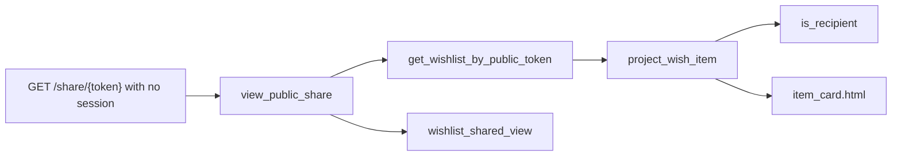

# WISHENKA-298: Keep the anonymous share on the giver contract

## Research

No product change is required. [WISHENKA-235](https://pypost.atlassian.net/browse/WISHENKA-235)
already projects a missing caller as a giver. Both standing checks pass on
this tree because of that projection and the share-page log that reads it.

Public gift lists that coordinate buyers show a remainder to a reader who
is not the recipient, and they keep the holder's identity off that page
(DEV Community, "Designing a Shared Wishlist That Keeps Gifts a Surprise";
[public registry versus owner claims][registry]).
This service already does that on the server. The anonymous share is that
reader. Booking still needs a Telegram identity.

### Why the anonymous share shows the free remainder

`tests/test_surprise_role_context.py`
`test_share_link_visit_creates_no_account` opens
`GET /share/{public_token}` with no session and `Accept-Language: ru`. It
expects HTTP 200, an unchanged user count, no `user_created` log, the
Russian label «Доступно:», and no «Забронировать».

`view_public_share` in `wishenka/web/routes/sharing.py` resolves the list
with `current_user` unset. `record_share_view_if_authenticated` returns
immediately when the caller is missing, so the visit writes no account
and no view row.

`RepoWishlistOps.project_wishlist_view` calls `project_wish_item` in
`wishenka/wishlists/service.py`. That function calls
`WishlistAccessPolicy.is_recipient`. `is_recipient_id` returns false when
`user_id` is `None`, before it compares the owner. A missing caller is
not the recipient, so the function builds `WishItemGifterViewDTO` with
`is_recipient` false. For a wish that asks for 2 units and has no
reservations, `available_quantity` is `max(0, 2 - 0 - 0)`, which is 2.
Personal promise fields stay empty because the function does not read
`telegram_id` unless a caller exists.

`partials/item_card.html` renders the giver block when `item.is_recipient`
is false. While `available_quantity >= 1` that block prints
`web.item.available_of` («Доступно: {available} из {quantity}»). The book
form renders only when `can_promise` is true, and `can_promise` requires
`viewer_identified`. The route sets that flag from `current_user is not
None`, so a guest does not see «Забронировать».

### Why a missing caller is not logged as the recipient

`tests/test_wishlists_htmx_observability.py`
`test_wishlist_shared_view_observability` reads one
`wishlist_shared_view` record per visit. For the guest it requires
`is_recipient` false, `is_collaborative` false, and the secret token
absent from the log. The owner of the personal list is `is_recipient`
true. Another signed-in person is `is_recipient` false. The token stays
out of all three records.

`view_public_share` sets the flag only when a caller exists:

```python
is_recipient = current_user is not None and (
    any(getattr(item, "is_recipient", False) for item in dto.items)
    or (not dto.is_collaborative and dto.user_role == WishlistRole.OWNER)
)
```

A missing caller makes the conjunction false. The info log
`wishlist_shared_view` stores that boolean and `dto.is_collaborative`.
It does not store `public_token`.

The same resolution logs `public_wishlist_resolved` from
`get_wishlist_by_public_token`. When the caller is missing and the
projected items are giver DTOs, `projection_mode` is `anonymous_gifter`.
That name is the log of the same fact: the guest received the giver
view, not the silent recipient card. An empty list with no role uses the
same mode. `anonymous_safe` is the other anonymous mode, and this path
does not use it.

Restoring the old silent card would hide «Доступно:» and would make a
guest look like the recipient. Both checks reject that pair. They stay
as written.

### Left unchanged

WISHENKA-356, WISHENKA-357, and WISHENKA-311 stay out of this task.
Receipt stays with the list's authors. This task does not add a receipt
action to `wishenka/web/static/app.js` or to the share page.

## Implementation Plan

No further product change. Leave `project_wish_item`,
`WishlistAccessPolicy`, `view_public_share`, `item_card.html`, the i18n
catalog, and `app.js` as they are. Do not rewrite the two checks.

**Mandatory — Failing Repro (next Step 3):** N/A — no behavioral change.
The contract already holds, and the two checks already assert it: the
anonymous share shows the free remainder without a book control, and a
missing caller is logged with `is_recipient` false (`anonymous_gifter`
on the resolve log). A new red test would have to break that contract
first. This task does not do that.

## Architecture

The modules below already implement the contract. This task adds none
and changes none.



- `is_recipient`. A missing id is not the recipient. The owner of a
  personal list is.
- `project_wish_item`. The recipient card is used only when the policy
  says so. Otherwise the caller gets the giver DTO: the shared remainder
  and empty personal fields.
- `get_wishlist_by_public_token`. Loads the share. Logs
  `anonymous_gifter` when a missing caller received giver items.
- `view_public_share`. Renders the page. Logs `is_recipient` false when
  the caller is missing. The token is not a field.
- `record_share_view_if_authenticated`. Returns without writing when the
  caller is missing.
- `partials/item_card.html`. Prints the availability line for a
  non-recipient. The book control needs an identified viewer.

Dependencies stay one way: the route asks the repository for a view, the
repository asks `project_wish_item`, and that function asks the policy.
The template reads the DTO and `viewer_identified`. It does not decide
who the recipient is.

The pattern is the existing surprise projection: one policy answer, two
view DTOs, and server-rendered gates. A separate anonymous DTO is
unnecessary. The giver DTO already carries the remainder and marks
`is_recipient` false.

Interfaces that stay:

- `project_wish_item(item, current_user) -> WishItemRecipientViewDTO | WishItemGifterViewDTO`
- `GET /share/{public_token}` HTML, `viewer_identified` false for a guest
- Log `wishlist_shared_view`: `wishlist_id`, `is_recipient`,
  `is_collaborative`. No secret token.
- Log `public_wishlist_resolved`: `projection_mode=anonymous_gifter` for
  this guest path.

## Q&A

- **Why is there no product change?** WISHENKA-235 removed the fold of a
  missing caller into `recipient_view`. The two checks that failed on
  base `762922f` now pass for the reasons above.
- **Why is Step 3 N/A?** There is no new behavior to fail first. The
  standing checks are already the proof.
- **Does the guest log use `anonymous_gifter` and `is_recipient` false
  together?** Yes. Resolve logs `anonymous_gifter` because the items are
  giver DTOs. The share-view log sets `is_recipient` false because
  `current_user` is missing.
- **Are WISHENKA-356, WISHENKA-357, WISHENKA-311, or a receipt control in
  `app.js` part of this design?** No. They stay out of scope.

[registry]: https://strapi.io/blog/build-gift-registry-platform-with-strapi-and-nextjs
