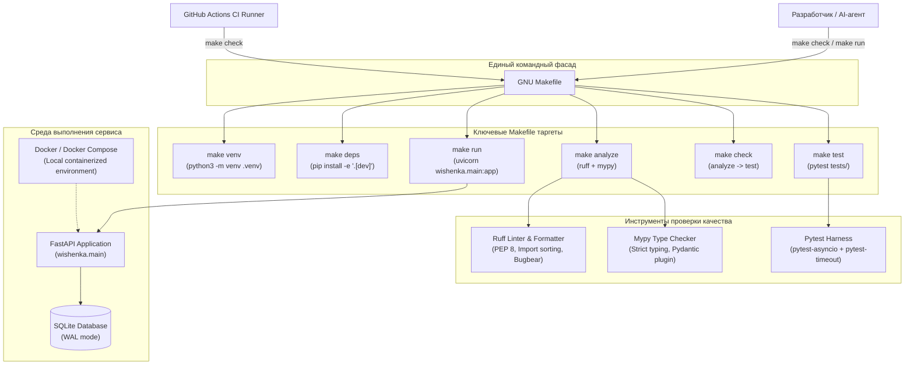
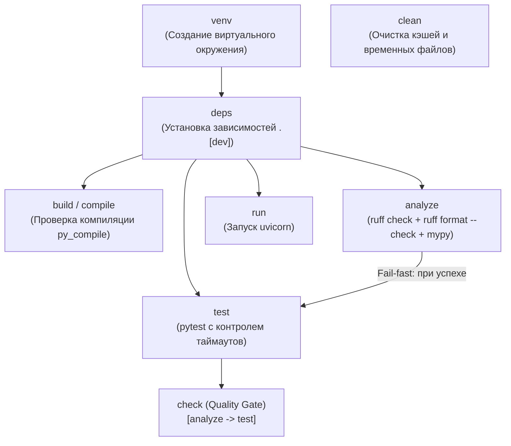
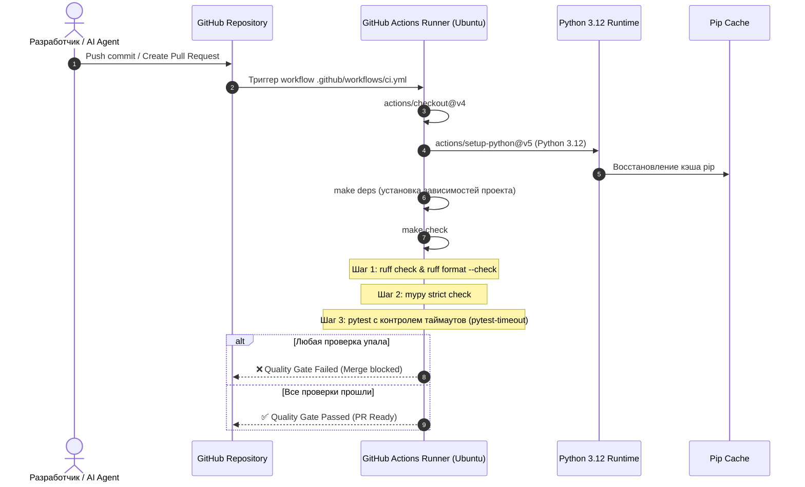

# WISHENKA-3: [Инфраструктура] Каркас репозитория, Makefile, линтеры, CI/CD и тестовая среда

## Research

### 1. Стандарты упаковки и управления зависимостями в Python (PEP 517 / PEP 518 / PEP 621)
- **Контекст**: В современном экосистеме Python (3.11+) стандартной точкой конфигурации проекта является файл `pyproject.toml` в соответствии с PEP 517, PEP 518 и PEP 621. Использование устаревших `setup.py` или разрозненных конфигурационных файлов (`setup.cfg`, `flake8.ini`) не рекомендуется.
- **Сравнение build-бэкендов**:
  - `setuptools`: Исторический стандарт, но громоздкий и избыточный для чистых сервисных приложений без C-расширений.
  - `poetry` / `pdm`: Комплексные менеджеры пакетов со своим CLI и форматами lock-файлов, создающие зависимость от внешнего бинарного инструмента при сборке в CI/CD и Docker.
  - `flit`: Минималистичный бэкенд, но имеет ограниченную гибкость в структуре директорий.
  - `hatchling`: Высокопроизводительный, строго следующий спецификации PEP 621 современный бэкенд от авторов Hatch (официальный проект PyPA). Поддерживает стандартизированную структуру метаданных, простое объявление зависимостей и опциональных групп (`optional-dependencies`), а также бесшовный `pip install -e .`.
- **Выбор**: `hatchling` в качестве бэкенда сборки в `pyproject.toml`. Зависимости разделяются на:
  - Основные (runtime): `fastapi`, `uvicorn[standard]`, `aiogram`, `jinja2`, `python-multipart`, `sqlalchemy[asyncio]`, `aiosqlite`, `pydantic`, `pydantic-settings`, `httpx`, `beautifulsoup4`.
  - Дополнительные для разработки и тестирования (`optional-dependencies.dev`): `pytest`, `pytest-asyncio`, `pytest-timeout`, `ruff`, `mypy`.
  - Для максимальной совместимости со стандартными инструментами формируется также `requirements.txt` и `requirements-dev.txt` (или единый инсталляционный таргет `pip install -e ".[dev]"`).

### 2. Инструменты статического анализа и форматирования кода (Ruff & Mypy)
- **Линтинг и форматирование**:
  - Традиционная связка `black` + `isort` + `flake8` + `autoflake` требует настройки множества утилит, медленно работает на больших кодовых базах и нередко приводит к конфликтам форматирования между Black и Flake8.
  - `Ruff` (написанный на Rust) выполняет линтинг и форматирование в 10–100 раз быстрее аналогов на Python. Он полностью заменяет Black, isort, Flake8 и десятки его плагинов (включая `flake8-bugbear`, `flake8-comprehensions`, `pyupgrade`).
  - Конфигурация размещается в секции `[tool.ruff]` в `pyproject.toml`:
    - Целевая версия Python: `py312`.
    - Ограничение длины строки: `100` символов (соответствует современным стандартам читаемости).
    - Включенные наборы правил: `E`, `W` (pycodestyle), `F` (pyflakes), `I` (isort), `B` (bugbear), `C4` (comprehensions), `UP` (pyupgrade), `SIM` (simplify).
- **Статическая типизация**:
  - `mypy` со строгим профилем (`strict = true`).
  - Проект оперирует критическими инвариантами («Тайна сюрприза», разграничение прав участников вишлиста, защита от овербукинга). Ошибки типизации должны выявляться на этапе компиляции/анализа, а не в рантайме.
  - Поддержка `pydantic.mypy` плагина для валидации моделей Pydantic v2.

### 3. Тестовая среда и контракт защиты от зависаний (`pytest` + `pytest-timeout`)
- **Фреймворк**: `pytest` 8+ с плагином `pytest-asyncio` (`asyncio_mode = "auto"`) для нативного тестирования асинхронных роутов FastAPI и хэндлеров aiogram.
- **Требование skill `do-testing`**:
  - Каждый автотест должен иметь строго ограниченное время выполнения, чтобы исключить блокировку локальной разработки и пайплайнов CI.
  - Интеграция `pytest-timeout`:
    - Установка пакета `pytest-timeout`.
    - Обязательное объявление явного таймаута: для модуля тестов `pytestmark = pytest.mark.timeout(10)` либо на уровне функций `@pytest.mark.timeout(5)`.
    - Запрещено полагаться только на глобальный неявный дефолт; автотесты обязаны явно декларировать временные рамки.

### 4. Автоматизация жизненного цикла (`Makefile`)
- В соответствии с корпоративными стандартами `run-makefile`, `lsr-python`, `run-analyze`, `run-test`, `run-check`, `run-deps`, `run-compile`, `run-run`:
  - `Makefile` выступает единым интерфейсом для всех типовых операций.
  - Обязательные цели (phony):
    - `help`: вывод списка доступных целей с комментариями (по умолчанию).
    - `venv`: создание локального виртуального окружения `.venv`.
    - `deps`: установка базовых и dev-зависимостей (`pip install -e ".[dev]"`).
    - `build` / `compile`: верификация компиляции байткода (`python -m compileall wishenka tests`).
    - `analyze`: запуск `ruff check`, `ruff format --check` и `mypy` без запуска тестов.
    - `test`: запуск `pytest` с таймингами.
    - `check`: единый Quality Gate, объединяющий `analyze` и `test` с fail-fast логикой (при ошибках анализа тесты не запускаются, сборка падает).
    - `run`: запуск веб-сервиса локально через `uvicorn`.
    - `clean`: очистка временных артефактов (`.pytest_cache`, `.ruff_cache`, `.mypy_cache`, `__pycache__`, `.coverage`).

### 5. Контейнеризация для локальной разработки (Docker & Docker Compose)
- **Dockerfile**:
  - Многоэтапная сборка (Multi-stage build) на базе официального легковесного образа `python:3.12-slim`.
  - Этап 1 (`builder`): сборка и установка зависимостей.
  - Этап 2 (`runtime`): копирование установленного окружения, создание непривилегированного пользователя `appuser` (UID 10001) в целях безопасности.
  - Открытие порта 8000.
  - Директива `HEALTHCHECK` с проверкой доступности эндпоинта `/healthz`.
- **docker-compose.yml**:
  - Сервис `app` (или `wishenka`), монтирующий локальный исходный код для hot-reload разработки.
  - Выделенный том `sqlite_data` для хранения файла базы данных SQLite (`/app/data/wishenka.db`), что обеспечивает сохранность данных между пересборками контейнера.
  - Режим WAL в SQLite гарантирует корректную работу при конкурентных чтениях и изолированных записях.

### 6. Непрерывная интеграция CI (GitHub Actions)
- Конфигурация в `.github/workflows/ci.yml`.
- Триггеры: `push` в ветки `main`/`master`, `pull_request` в ветки `main`/`master`.
- Среда выполнения: `ubuntu-latest`, Python `3.12`.
- Кэширование `pip` зависимостей через `actions/setup-python` с ключом кэша на основе `pyproject.toml`.
- Выполнение единого гейта: `make check`.

---

## Implementation Plan

### Высокоуровневый план реализации по этапам
1. **Шаг 3: Разработка падающего воспроизводящего теста (Failing Repro Test)**:
   - Создание структуры каталога `tests/` и базового файла тестов инфраструктуры `tests/test_infra.py`.
   - Тесты проверяют импортируемость пакета `wishenka`, наличие константы `__version__`, корректность фабрики приложения FastAPI и доступность эндпоинта проверки работоспособности `GET /healthz`.
   - До реализации исходного кода на Шаге 4 тест падает с `ModuleNotFoundError: No module named 'wishenka'`, что является легитимным красным тестом (red test).
2. **Шаг 4: Реализация каркаса проекта (Development)**:
   - Создание конфигурации `pyproject.toml` с метаданными проекта, зависимостями, настройками Ruff, Mypy и Pytest.
   - Создание `.gitignore` для исключения кэшей, виртуальных окружений, SQLite БД и локальных секретов.
   - Реализация корневого `Makefile` со всеми стандартизированными целями (`help`, `venv`, `deps`, `build`, `analyze`, `test`, `check`, `run`, `clean`).
   - Инициализация минимального ядра пакета приложения:
     - `wishenka/__init__.py` с версией пакета (`__version__ = "0.1.0"`).
     - `wishenka/config.py` с Pydantic Settings (параметры приложения, порт, хост, путь к SQLite БД, токен бота).
     - `wishenka/main.py` с инициализацией FastAPI приложения, базовым роутом `/healthz` и заготовкой для подключения бота.
   - Создание `Dockerfile` и `docker-compose.yml` для контейнеризации.
   - Настройка пайплайна GitHub Actions `.github/workflows/ci.yml`.
   - Достижение зеленого статуса (green) при прогоне `make check`.
3. **Шаг 5: Очистка кода (Code Cleanup)**:
   - Запуск `make analyze`, форматирование кода и фиксация отчета в `40-code-cleanup.md`.
4. **Шаг 6: Наблюдаемость (Observability)**:
   - Конфигурация структурированного логирования при запуске сервиса и обработке запросов healthcheck.
5. **Шаг 7: Анализ технического долга (Tech Debt)**:
   - Формирование отчета `60-tech-debt.md`.
6. **Шаг 8: Документация разработчика (Dev Docs)**:
   - Обновление `doc/dev/testing.md` и документации по запуску окружения.

### Mandatory — Failing Repro (next Step 3)
- **Цель теста**: Подтвердить, что до реализации кода пакет `wishenka` отсутствует, а тестовая инфраструктура корректно отлавливает отсутствие обязательных компонентов приложения (версия пакета, конфигурация, эндпоинт healthcheck).
- **Размещение теста**: `tests/test_infra.py`.
- **Что утверждает тест (Desired Behavior)**:
  1. `test_package_version()`:
     - Проверяет успешный импорт модуля `wishenka`.
     - Проверяет наличие атрибута `wishenka.__version__` и соответствие формату SemVer (например, `"0.1.0"`).
  2. `test_application_settings()`:
     - Проверяет успешный импорт класса `Settings` из `wishenka.config`.
     - Проверяет, что экземпляр настроек инициализируется со значениями по умолчанию (`app_name == "Wishenka"`, `environment == "development"`).
  3. `test_healthcheck_endpoint()`:
     - Проверяет успешный импорт экземпляра FastAPI `app` из `wishenka.main`.
     - С помощью `httpx.AsyncClient(transport=ASGITransport(app=app), base_url="http://test")` выполняет асинхронный запрос `GET /healthz`.
     - Утверждает статус-код ответа `200 OK` и структуру JSON `{"status": "ok", "app": "wishenka"}`.
- **Соблюдение контракта `do-testing`**:
  - Файл содержит модуль-уровневый маркер таймаута: `pytestmark = pytest.mark.timeout(10)`.
- **Как вызывается сбой**:
  - При запуске `pytest tests/test_infra.py` до шага 4 тест аварийно завершается с ошибкой `ModuleNotFoundError: No module named 'wishenka'`.
- **Изоляция**:
  - Тест не требует работающей внешней БД или реального Telegram Bot API (работает в чистой памяти процесса).

---

## Architecture

### 1. Дерево структуры репозитория

```
/home/src/
├── Makefile                                # Автоматизация жизненного цикла: venv, deps, build, analyze, test, check, run, clean
├── pyproject.toml                          # Стандарт PEP 621: метаданные, зависимости, конфигурации ruff, mypy, pytest
├── .gitignore                              # Исключения Git: venv, кэши, *.db, *.db-wal, .env, IDE
├── Dockerfile                              # Multi-stage сборка контейнера (Python 3.12-slim)
├── docker-compose.yml                      # Локальное окружение разработки со смонтированным SQLite volume
├── .github/
│   └── workflows/
│       └── ci.yml                          # Пайплайн GitHub Actions: запуск make check на Python 3.12
├── tests/
│   ├── __init__.py
│   ├── conftest.py                         # Фикстуры pytest (event_loop, httpx client)
│   └── test_infra.py                       # Автотесты каркаса, настроек и healthcheck (Failing Repro)
├── wishenka/                               # Корневой пакет приложения
│   ├── __init__.py                         # Экспорт __version__
│   ├── config.py                           # Pydantic Settings для конфигурации сервиса
│   └── main.py                             # Точка входа: инициализация FastAPI, эндпоинт /healthz
├── doc/
│   └── dev/                                # Документация разработчика
└── ai-tasks/
    └── WISHENKA-3/                         # Артефакты Top-Down задачи
```

---

### 2. Компонентная диаграмма взаимодействия разработчика и инструментов



---

### 3. Граф зависимостей Makefile-таргетов



---

### 4. Пайплайн непрерывной интеграции (CI Pipeline Stages)



---

### 5. Спецификация конфигурационных файлов

#### 5.1. Спецификация `pyproject.toml`
```toml
[build-system]
requires = ["hatchling"]
build-backend = "hatchling.build"

[project]
name = "wishenka"
version = "0.1.0"
description = "Telegram Wishlist Service («Вишенка»)"
readme = "README.md"
requires-python = ">=3.12"
license = { text = "MIT" }
authors = [
    { name = "Wishenka Team" }
]
dependencies = [
    "fastapi>=0.115.0",
    "uvicorn[standard]>=0.32.0",
    "aiogram>=3.15.0",
    "jinja2>=3.1.4",
    "python-multipart>=0.0.12",
    "sqlalchemy[asyncio]>=2.0.36",
    "aiosqlite>=0.20.0",
    "alembic>=1.14.0",
    "pydantic>=2.10.0",
    "pydantic-settings>=2.6.0",
    "httpx>=0.28.0",
    "beautifulsoup4>=4.12.3",
]

[project.optional-dependencies]
dev = [
    "pytest>=8.3.0",
    "pytest-asyncio>=0.24.0",
    "pytest-timeout>=2.3.1",
    "ruff>=0.8.0",
    "mypy>=1.13.0",
]

[tool.ruff]
target-version = "py312"
line-length = 100

[tool.ruff.lint]
select = [
    "E",    # pycodestyle errors
    "W",    # pycodestyle warnings
    "F",    # pyflakes
    "I",    # isort (import sorting)
    "B",    # flake8-bugbear
    "C4",   # flake8-comprehensions
    "UP",   # pyupgrade
    "SIM",  # flake8-simplify
]
ignore = []

[tool.ruff.lint.isort]
known-first-party = ["wishenka"]

[tool.mypy]
python_version = "3.12"
strict = true
disallow_untyped_defs = true
disallow_incomplete_defs = true
check_untyped_defs = true
no_implicit_optional = true
warn_redundant_casts = true
warn_unused_ignores = true
warn_return_any = true
plugins = ["pydantic.mypy"]

[[tool.mypy.overrides]]
module = "tests.*"
disallow_untyped_defs = false
check_untyped_defs = true

[tool.pytest.ini_options]
minversion = "8.0"
testpaths = ["tests"]
asyncio_mode = "auto"
asyncio_default_fixture_loop_scope = "function"
addopts = "-v --strict-markers"
```

#### 5.2. Спецификация `Makefile`
```makefile
.DEFAULT_GOAL := help
VENV := .venv
PYTHON := $(VENV)/bin/python
PIP := $(VENV)/bin/pip
UVICORN := $(VENV)/bin/uvicorn
PYTEST := $(VENV)/bin/pytest
RUFF := $(VENV)/bin/ruff
MYPY := $(VENV)/bin/mypy

.PHONY: help
help: ## Отобразить список доступных команд с описанием
	@grep -E '^[a-zA-Z_-]+:.*?## .*$$' $(MAKEFILE_LIST) | sort | awk 'BEGIN {FS = ":.*?## "}; {printf "\033[36m%-18s\033[0m %s\n", $$1, $$2}'

.PHONY: venv
venv: ## Инициализировать виртуальное окружение .venv
	@test -d $(VENV) || python3 -m venv $(VENV)
	@$(PYTHON) -m ensurepip --upgrade >/dev/null 2>&1 || true
	@$(PIP) install --upgrade pip

.PHONY: deps
deps: venv ## Установить зависимости проекта и инструменты разработки
	@$(PIP) install -e ".[dev]"

.PHONY: build
build: deps ## Проверить компилируемость исходного кода и сборку пакета
	@$(PYTHON) -m compileall wishenka tests

.PHONY: analyze
analyze: deps ## Запустить статический анализ кода (Ruff + Mypy)
	@echo "==> Running Ruff linter..."
	@$(RUFF) check wishenka tests
	@echo "==> Running Ruff format check..."
	@$(RUFF) format --check wishenka tests
	@echo "==> Running Mypy type checker..."
	@$(MYPY) wishenka tests

.PHONY: format
format: deps ## Автоматически отформатировать код через Ruff
	@$(RUFF) format wishenka tests
	@$(RUFF) check --fix wishenka tests

.PHONY: test
test: deps ## Запустить полный набор автоматизированных тестов
	@echo "==> Running Pytest test suite..."
	@$(PYTEST)

.PHONY: check
check: analyze test ## Единый Quality Gate (статический анализ + тесты)
	@echo "==> All Quality Gate checks passed successfully!"

.PHONY: run
run: deps ## Запустить сервис локально в режиме разработки
	@$(UVICORN) wishenka.main:app --host 0.0.0.0 --port 8000 --reload

.PHONY: clean
clean: ## Очистить кэши и временные артефакты сборки
	@rm -rf .pytest_cache .ruff_cache .mypy_cache __pycache__ wishenka/__pycache__ tests/__pycache__ *.egg-info build dist .coverage
	@find . -type d -name "__pycache__" -exec rm -rf {} + 2>/dev/null || true
	@echo "==> Clean completed."
```

#### 5.3. Спецификация `.gitignore`
```gitignore
# Virtual Environments
.venv/
venv/
ENV/
env/

# Python Bytecode & Cache
__pycache__/
*.py[cod]
*$py.class
*.so

# Distribution & Build
build/
dist/
*.egg-info/
*.egg

# Testing & Quality Tools Cache
.pytest_cache/
.ruff_cache/
.mypy_cache/
.coverage
htmlcov/

# Local Environment Variables & Secrets
.env
.env.local
.env.*.local

# SQLite Database Files
*.db
*.db-wal
*.db-shm
*.sqlite
*.sqlite3

# Container & Editor Artifacts
.DS_Store
.idea/
.vscode/
*.swp
*.swo
```

#### 5.4. Спецификация `Dockerfile`
```dockerfile
# Stage 1: Build virtual environment
FROM python:3.12-slim AS builder

WORKDIR /build

RUN apt-get update && apt-get install -y --no-install-recommends \
    build-essential \
    && rm -rf /var/lib/apt/lists/*

COPY pyproject.toml README.md ./
RUN python -m venv /opt/venv \
    && /opt/venv/bin/pip install --no-cache-dir --upgrade pip \
    && /opt/venv/bin/pip install --no-cache-dir .

# Stage 2: Runtime image
FROM python:3.12-slim AS runtime

WORKDIR /app

# Создание непривилегированного пользователя
RUN groupadd -g 10001 appgroup && \
    useradd -u 10001 -g appgroup -s /bin/bash -m appuser

# Копирование venv из этапа builder
COPY --from=builder /opt/venv /opt/venv
ENV PATH="/opt/venv/bin:$PATH" \
    PYTHONUNBUFFERED=1 \
    PYTHONDONTWRITEBYTECODE=1

# Каталог для базы данных SQLite
RUN mkdir -p /app/data && chown -R appuser:appgroup /app/data

# Копирование приложения
COPY --chown=appuser:appgroup wishenka/ /app/wishenka/

USER appuser

EXPOSE 8000

HEALTHCHECK --interval=30s --timeout=5s --start-period=5s --retries=3 \
    CMD python -c "import urllib.request; urllib.request.urlopen('http://localhost:8000/healthz')" || exit 1

CMD ["uvicorn", "wishenka.main:app", "--host", "0.0.0.0", "--port", "8000"]
```

#### 5.5. Спецификация `docker-compose.yml`
```yaml
services:
  wishenka:
    build:
      context: .
      dockerfile: Dockerfile
    container_name: wishenka-app
    ports:
      - "8000:8000"
    environment:
      - WISHENKA_DATABASE_URL=sqlite+aiosqlite:////app/data/wishenka.db
      - WISHENKA_ENVIRONMENT=development
      - WISHENKA_DEBUG=1
      - WISHENKA_BOT_TOKEN=${BOT_TOKEN:-dummy_bot_token}
    volumes:
      - sqlite_data:/app/data
      - ./wishenka:/app/wishenka:ro
    restart: unless-stopped

volumes:
  sqlite_data:
    driver: local
```

#### 5.6. Спецификация `.github/workflows/ci.yml`
```yaml
name: CI Quality Gate

on:
  push:
    branches: [ main, master ]
  pull_request:
    branches: [ main, master ]

jobs:
  quality-gate:
    name: Lint, Type Check & Test
    runs-on: ubuntu-latest

    steps:
      - name: Checkout repository
        uses: actions/checkout@v4

      - name: Set up Python 3.12
        uses: actions/setup-python@v5
        with:
          python-version: "3.12"
          cache: "pip"

      - name: Install dependencies
        run: |
          make deps

      - name: Run Quality Gate (make check)
        run: |
          make check
```

---

## Q&A

### В: Почему для сборки выбран PEP 621 бэкенд `hatchling`, а не Poetry?
**О:** Poetry навязывает собственный бинарный CLI и уникальный формат lock-файлов, что усложняет сборку в легковесных Docker-образах и создает зависимость от сторонней утилиты. `hatchling` является официальным легковесным бэкендом PyPA, поддерживает чистый стандарт PEP 621 и позволяет использовать стандартный `pip install -e ".[dev]"`, не требуя дополнительных инструментов ни в CI, ни в Docker.

### В: Почему виртуальное окружение размещается в `.venv`?
**О:** Директория `.venv` в корне репозитория является де-факто стандартом для большинства современных IDE (VS Code, PyCharm, Cursor), которые автоматически распознают и активируют интерпретатор из `.venv`. Она также включена в `.gitignore` по умолчанию.

### В: Почему `make check` использует fail-fast семантику?
**О:** Быстрый отклик разработчику и экономия ресурсов CI: если код содержит синтаксические ошибки, проблемы форматирования или нарушение строгой типизации Mypy, прогон тестов не имеет смысла. Ошибки статического анализа выявляются за доли секунды и должны устраняться до запуска тестового контура.

### В: Как в тестовой среде обеспечивается строгое соблюдение skill `do-testing`?
**О:** В файле `tests/test_infra.py` объявляется обязательный маркер таймаута на уровне модуля: `pytestmark = pytest.mark.timeout(10)`. Также в проект включается пакет `pytest-timeout`, а документация для разработчиков фиксирует данное правило как обязательное для всех новых тестов в кодовой базе.

### В: Нужен ли отдельный контейнер базы данных в Docker Compose?
**О:** Нет. В соответствии с архитектурой сервиса «Вишенка» (WISHENKA-2), используется встраиваемая СУБД SQLite в режиме WAL (`PRAGMA journal_mode = WAL;`). В `docker-compose.yml` создается именованный volume `sqlite_data`, монтируемый в `/app/data/`, где сохраняется файл базы данных между перезапусками. Это обеспечивает нулевые накладные расходы на администрирование внешней СУБД и идентичность локального и продакшн-окружения.