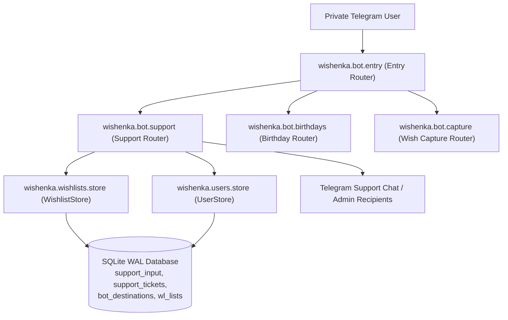
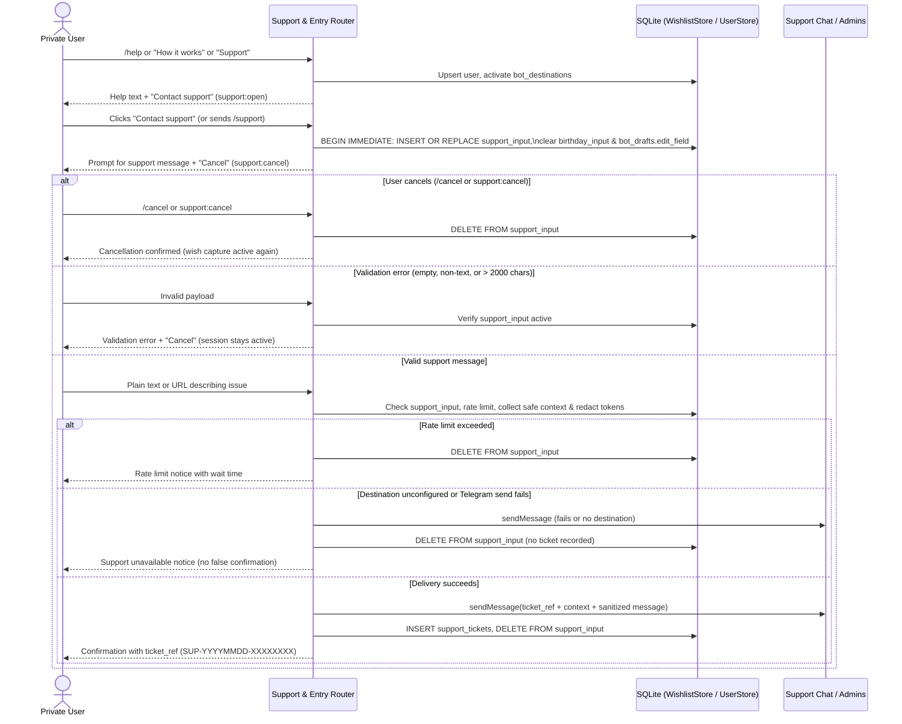

# WISHENKA-30: Support and feedback channel in the Telegram bot

## Research

- **Existing Bot Composition Root and Routing (`wishenka/bot/`):**
  - `wishenka/bot/__main__.py` starts a single aiogram polling receiver with `Dependencies(mini_app_url, user_store, wishlist_store, preview_service)` and runs an hourly `cleanup_loop` calling `cleanup_drafts(wishlist_store)`.
  - `wishenka/bot/entry.py` (`create_router`) handles private `/start` commands, `entry:help` (`How it works` / `Как это работает`) callbacks, and `/reservation_confirmations on|off`. When `wishlist_store` is present, it mounts `create_birthday_router` (`wishenka/bot/birthdays.py`) and `create_capture_router` (`wishenka/bot/capture.py`).
  - `create_birthday_router` intercepts private non-command text messages (`F.chat.type == "private", F.text, ~F.text.startswith("/")`) when an active row exists in `birthday_input` (`expires_at > now`); otherwise it raises `SkipHandler` from `aiogram.dispatcher.event.bases` so `create_capture_router` handles the text message as a wish draft. See the [aiogram router and handler documentation](https://docs.aiogram.dev/en/latest/dispatcher/router.html).
- **Database Schema and Migrations (`wishenka/wishlists/alembic/`):**
  - `WishlistStore.initialize()` runs Alembic migrations up to `head` (`add_notice_uncertain` currently) under a cross-process file lock and enables SQLite WAL mode (`PRAGMA journal_mode=WAL`, `PRAGMA busy_timeout=5000`, `BEGIN IMMEDIATE` transactions). See the [SQLite transactional documentation](https://www.sqlite.org/transactional.html).
  - Durable bot conversation state (`bot_drafts`, `bot_capture_order`, `birthday_input`, `bot_destinations`) lives in the wishlist SQLite database so active sessions survive process restarts and are cleaned up in bounded batches by `cleanup_drafts`.
- **Privacy, Surprise Protection, and Logging (`wishenka/logging.py`, `wishenka/bot/capture.py`, `wishenka/bot/birthdays.py`):**
  - `_PrivateUserLogFilter` in `wishenka/bot/birthdays.py` and `_PrivatePreviewFilter` in `wishenka/bot/capture.py` use `ContextVar` flags to suppress downstream `wishenka.users`, `wishenka.items`, and `wishenka.wishlists` logs during private bot interactions so user IDs, profile names, URLs, and capability tokens are never written to application logs.
  - Telegram's `sendMessage` API limits plain-text messages to 4096 UTF-16 code units and allows disabling link previews (`link_preview_options` / `disable_web_page_preview`) so forwarded URLs do not trigger external previews or leak capabilities. See the [Telegram Bot API sendMessage specification](https://core.telegram.org/bots/api#sendmessage).

## Implementation Plan

1. **Configuration and Schema Migration:**
   - Extend `Settings` in `wishenka/config.py` with support channel settings: `support_chat_id`, `support_admin_ids`, `support_session_ttl_seconds` (default `3600`), `support_max_message_length` (default `2000`), `support_rate_limit_window_seconds` (default `3600`), and `support_rate_limit_max_tickets` (default `3`).
   - Add Alembic revision `add_support_channel` (`down_revision = "add_notice_uncertain"`) in `wishenka/wishlists/alembic/versions/add_support_channel.py` creating `support_input` (durable active support input sessions) and `support_tickets` (content-free ticket metadata and per-user rate-limit log with index `idx_support_tickets_owner_time`).
   - Extend `cleanup_drafts` in `wishenka/bot/capture.py` to purge expired `support_input` rows and aged `support_tickets` rows in bounded batches.
2. **Support Router, Session Isolation, and Diagnostic Context (`wishenka/bot/support.py`):**
   - Implement `create_support_router(dependencies)` handling `/help`, `/support` (both interactive `/support` and inline `/support <text>`), `/cancel`, callbacks `support:open` and `support:cancel`, and private non-command messages while a `support_input` session is active.
   - Enforce deterministic session precedence across `support_input`, `birthday_input`, and `bot_drafts`: starting a support session clears any pending `birthday_input` and active `bot_drafts.edit_field`; starting `/start`, `/help`, `/birthdays`, `/reservation_confirmations`, or a birthday add/edit flow clears any pending `support_input`; `/cancel` and `support:cancel` clear pending input sessions without sending a ticket or creating a wish draft.
   - Implement `collect_diagnostic_context` and `redact_capabilities` to assemble safe metadata (internal user ID, Telegram ID, username, display name, resolved language, destination readiness, and aggregate wishlist/membership counts) while stripping any capability tokens (`p_*`, `i_*`, `/share/*`, `/invite/*`, and stored `wl_lists` / `wl_tokens` / `wl_invite_tokens` values) from the submitted message text.
3. **Ticket Delivery, Rate Limiting, and Truthful Reporting:**
   - Enforce validation (non-text payload rejection, empty text rejection, max length `2000` chars) keeping `support_input` active on validation errors so the user can retry or cancel.
   - Enforce per-user sliding-window rate limiting via `support_tickets` before attempting delivery.
   - Deliver formatted plain-text tickets (with link previews disabled) to configured support destinations (`support_chat_id` and `support_admin_ids`). Confirm receipt with the generated `SUP-...` ticket reference only if at least one destination succeeds; otherwise return a localized unavailable notice without recording a sent ticket.
4. **Entry Integration and Verification:**
   - Wire `create_support_router` into `wishenka/bot/entry.py` (`create_router`) and pass settings through `Dependencies` in `wishenka/bot/__main__.py`. Update the `/start` keyboard and `/help` (`entry:help`) view to expose localized support actions in Russian and English.
   - Run full test suites and static analysis gates (`make check`).

**Mandatory — Failing Repro (next Step 3):**
Before modifying any production code, create `tests/test_bot_support_repro.py` (with `pytestmark = pytest.mark.timeout(30)`) driving `create_router` through an in-process fake Telegram `Bot.__call__` transport and temporary SQLite stores (`WishlistStore` and `UserStore`):

- Assert that `/help`, the `How it works` (`entry:help`) callback, the main `/start` menu, and `/support` expose localized (RU and EN) help and support entry points in private chat.
- Assert that starting support (`support:open` or `/support`) and sending plain text or a problematic product URL delivers a formatted ticket with a `SUP-` reference and safe diagnostic context (internal ID, Telegram ID, username/name, language, active wishlist count, destination status) to the configured `support_chat_id` / `support_admin_ids`, replies to the user with the ticket reference, and creates **zero** wishlists or wish drafts (`bot_drafts` / `wl_items`).
- Assert that cancelling via `support:cancel` or `/cancel` (or superseding the session with `/start` or `/birthdays`, or session expiry) sends no ticket, creates no wish draft, preserves existing wishlists and birthday entries, and allows the next plain-text message to capture a wish draft normally.
- Assert that empty messages, non-text messages (e.g., photo/sticker), and messages exceeding the maximum length are rejected with localized guidance while keeping the support session active for retry or cancellation, and that rapid repeated submissions hit the per-user rate limit.
- Assert that when no support destination is configured or Telegram delivery to the support destination fails, the bot reports unavailability honestly and never returns a false ticket confirmation.
- Assert that secret capability tokens (`public_token`, `invite_token`, `p_<token>`, `i_<token>`), wishlist item titles, reservation statuses, giver identities, and receipt records never appear in delivered support tickets, user responses, or logs, and that support message bodies and user identifiers never appear in operational logs.
- Sequence: research → write red tests in `tests/test_bot_support_repro.py` → verify tests fail against unimplemented support channel → independent Step 3 review → implement in Step 4 until green.

## Architecture

### System Module Diagram



### Module Descriptions and Responsibilities

| Module | Path | Responsibility |
| ------ | ---- | -------------- |
| Configuration | `wishenka/config.py` | Loads and validates `WISHENKA_SUPPORT_*` environment settings (destination chat/admin IDs, session TTL, max message length, rate-limit window and cap). |
| Bot Entry & Navigation | `wishenka/bot/entry.py` | Handles `/start`, `/help`, `entry:help`, and `/reservation_confirmations`; renders localized menus including the support entry button; mounts `support`, `birthday`, and `capture` routers in deterministic order. |
| Support Channel Router & Service | `wishenka/bot/support.py` | Manages `support_input` sessions, `/support` and `/cancel` commands, `support:open` and `support:cancel` callbacks, input validation, per-user rate limiting, capability redaction, safe diagnostic context assembly, and ticket forwarding to support destinations. |
| Birthday Router | `wishenka/bot/birthdays.py` | Manages `/birthdays` and `birthday_input` state; clears any stale `support_input` when birthday flows start. |
| Wish Capture Router & Cleanup | `wishenka/bot/capture.py` | Captures wishes from private non-command text when neither `support_input` nor `birthday_input` is active; `cleanup_drafts` purges expired `bot_drafts`, `birthday_input`, `support_input`, and aged `support_tickets` rows. |
| Bot Runner | `wishenka/bot/__main__.py` | Instantiates `Settings`, `UserStore`, `WishlistStore`, and `Dependencies` (including support configuration) for the polling process. |
| Schema Migration | `wishenka/wishlists/alembic/versions/add_support_channel.py` | Alembic revision creating `support_input` and `support_tickets` tables and indexes. |

### Selected Architectural Patterns and Justification

- **Chain of Responsibility (Router Precedence with `SkipHandler`):** Aiogram routers are mounted in strict priority order (`support` → `birthdays` → `capture`). When a private non-command message arrives, `support` inspects `support_input` first; if no active session exists, it raises `SkipHandler` so `birthdays` and then `capture` process the message. When a `support_input` session is active, `support` handles the update and stops propagation, guaranteeing that support messages (including URLs) never trigger `ItemPreviewService` or create wish drafts.
- **Durable Database-Backed Conversation State:** Storing active support sessions in `support_input` and rate-limit records in `support_tickets` inside SQLite WAL (via `WishlistStore.transaction` with `BEGIN IMMEDIATE`) ensures deterministic behavior across process restarts and concurrent updates without in-memory state drift.
- **Data Minimization and Capability Redaction:** `support_tickets` stores only metadata (`id`, `ticket_ref`, `owner_id`, `telegram_id`, `created_at`) and never persists message bodies in SQLite. Diagnostic context queries only aggregate counts and account identifiers, never touching reservation, receipt, or item content tables, and `redact_capabilities` scrubs any capability tokens from user-supplied text before forwarding.
- **Context-Scoped Log Suppression (`ContextVar` Filter):** Reuses the `_private_bot_user` context filter pattern so user upserts and diagnostic reads never emit PII or message contents to application loggers.

### Main Interfaces and Data Structures

#### 1. Configuration (`wishenka/config.py`)

```python
class Settings(BaseSettings):
    ...
    support_chat_id: int | None = None
    support_admin_ids: tuple[int, ...] = ()
    support_session_ttl_seconds: int = Field(default=3600, ge=60, le=86400)
    support_max_message_length: int = Field(default=2000, ge=100, le=3500)
    support_rate_limit_window_seconds: int = Field(default=3600, ge=60)
    support_rate_limit_max_tickets: int = Field(default=3, ge=1, le=50)
```

#### 2. SQLite Schema (`add_support_channel`)

```sql
CREATE TABLE IF NOT EXISTS support_input (
    owner_id INTEGER NOT NULL,
    chat_id INTEGER NOT NULL,
    expires_at INTEGER NOT NULL,
    PRIMARY KEY (owner_id, chat_id)
);

CREATE TABLE IF NOT EXISTS support_tickets (
    id INTEGER PRIMARY KEY AUTOINCREMENT,
    ticket_ref TEXT NOT NULL UNIQUE,
    owner_id INTEGER NOT NULL,
    telegram_id INTEGER NOT NULL,
    created_at INTEGER NOT NULL
);

CREATE INDEX IF NOT EXISTS idx_support_tickets_owner_time
    ON support_tickets(owner_id, created_at);
```

#### 3. Domain Data Structures and Functions (`wishenka/bot/support.py`)

```python
@dataclass(frozen=True)
class DiagnosticContext:
    """Safe, metadata-only account and bot context attached to a support ticket."""

    ticket_ref: str
    submitted_at_iso: str
    internal_user_id: int
    telegram_user_id: int
    username: str
    display_name: str
    effective_language: str
    telegram_language_code: str
    bot_destination_active: bool
    active_wishlist_count: int
    archived_wishlist_count: int
    collaborative_membership_count: int
    active_draft_present: bool


def create_support_router(dependencies: Any) -> Router:
    """Create the private-chat support and help router."""


async def clear_support_session(store: WishlistStore, owner_id: int, chat_id: int) -> None:
    """Remove any active support_input row when another bot command supersedes it."""


def redact_capabilities(text_value: str, known_tokens: Iterable[str] = ()) -> str:
    """Replace capability tokens and share/invite link secrets with [REDACTED]."""


def format_support_ticket(context: DiagnosticContext, sanitized_message: str) -> str:
    """Render the plain-text support ticket payload within Telegram's 4096-char limit."""
```

### Interaction and Sequence Flow



### Validation, Rate Limiting, Error Handling, and Privacy

- **Input Bounds and Session Lifetime:**
  - Active sessions in `support_input` expire after `support_session_ttl_seconds` (`3600` seconds by default). Expired rows never intercept plain-text messages; those messages fall through to normal wish capture.
  - Non-text updates (photos, stickers, voice notes, documents without text) and empty/whitespace-only strings sent during an active `support_input` session are intercepted and rejected with localized instructions while keeping `support_input` open.
  - Text messages exceeding `support_max_message_length` (`2000` characters after `.strip()`) are rejected with localized length guidance while keeping `support_input` open.
- **Per-User Rate Limiting:**
  - Each user is limited to `support_rate_limit_max_tickets` (`3` by default) within `support_rate_limit_window_seconds` (`3600` seconds by default), tracked in `support_tickets(owner_id, created_at)`.
  - When rate-limited, the bot computes the remaining wait time (`max(1, ceil((oldest_in_window + window - now) / 60))` minutes), exits the support input session so normal bot usage is not blocked, and informs the user in Russian or English.
- **Truthful Delivery and Fault Tolerance:**
  - Destination chat IDs are resolved from `dependencies` / `Settings` (`support_chat_id` and `support_admin_ids`, deduplicated).
  - If no destination is configured, no network send is attempted, no row is written to `support_tickets`, `support_input` is cleared, and the user receives a localized unavailable notice.
  - When delivering to multiple administrator/support chat IDs, each destination is tried with `LinkPreviewOptions(is_disabled=True)`. Delivery is considered successful if at least one destination accepts the message; if all destinations raise an exception, no ticket is recorded and the user receives a localized failure notice.
- **Privacy, Surprise Protection, and Log Redaction:**
  - Diagnostic queries read only `users`, `bot_destinations`, `wl_lists` (counts by `status` and `public_token`/`invite_token` for redaction), `wl_members` (count), `wl_tokens`, `wl_invite_tokens`, and `bot_drafts` (existence check). They never read `wl_items` titles/descriptions, `wl_reservations`, or `wl_receipts`, preserving the Surprise Invariant under all roles.
  - `redact_capabilities` strips URL/payload patterns (`p_<token>`, `i_<token>`, `/share/<token>`, `/invite/<token>`, `/api/public/wishlists/<token>`) as well as any known token strings from `wl_lists`, `wl_tokens`, and `wl_invite_tokens` before formatting the ticket.
  - Structured log events on `wishenka.bot.support` (`bot_support_prompted`, `bot_support_cancelled`, `bot_support_rejected`, `bot_support_submitted`, `bot_support_unavailable`) record only bounded `event` and `outcome`/`reason` fields—never user IDs, usernames, ticket text, URLs, or exception strings.

## Q&A

- **How does the bot distinguish a support message with a broken product URL from a wish capture message?**
  `create_support_router` is mounted before `create_birthday_router` and `create_capture_router`. When a user has an active `support_input` row (`expires_at > now`), the support router consumes the message and never raises `SkipHandler`. Once the support ticket is submitted, cancelled, superseded by another command, or expired, `support_input` is cleared and subsequent plain-text messages and links flow to `create_capture_router` as usual.
- **Where are support destination IDs configured?**
  Through `WISHENKA_SUPPORT_CHAT_ID` (for a dedicated Telegram support group/channel/chat) and/or `WISHENKA_SUPPORT_ADMIN_IDS` (for one or more administrator chat IDs) on `wishenka.config.Settings`, passed into the bot's `Dependencies`.
- **Why store `support_tickets` without the message body?**
  Storing only `(id, ticket_ref, owner_id, telegram_id, created_at)` provides durable cross-restart rate limiting and unique ticket reference tracking while minimizing sensitive data retention in SQLite. The sanitized message text is forwarded directly to the Telegram support destination.
- **What happens if a user accidentally pastes a secret wishlist share link or collaborator invite link into a support request?**
  `redact_capabilities` replaces both pattern-matched capability tokens (`p_*`, `i_*`, `/share/*`, `/invite/*`) and any matching stored token from `wl_lists`, `wl_tokens`, and `wl_invite_tokens` with `[REDACTED]` before the message is sent to the support channel.
