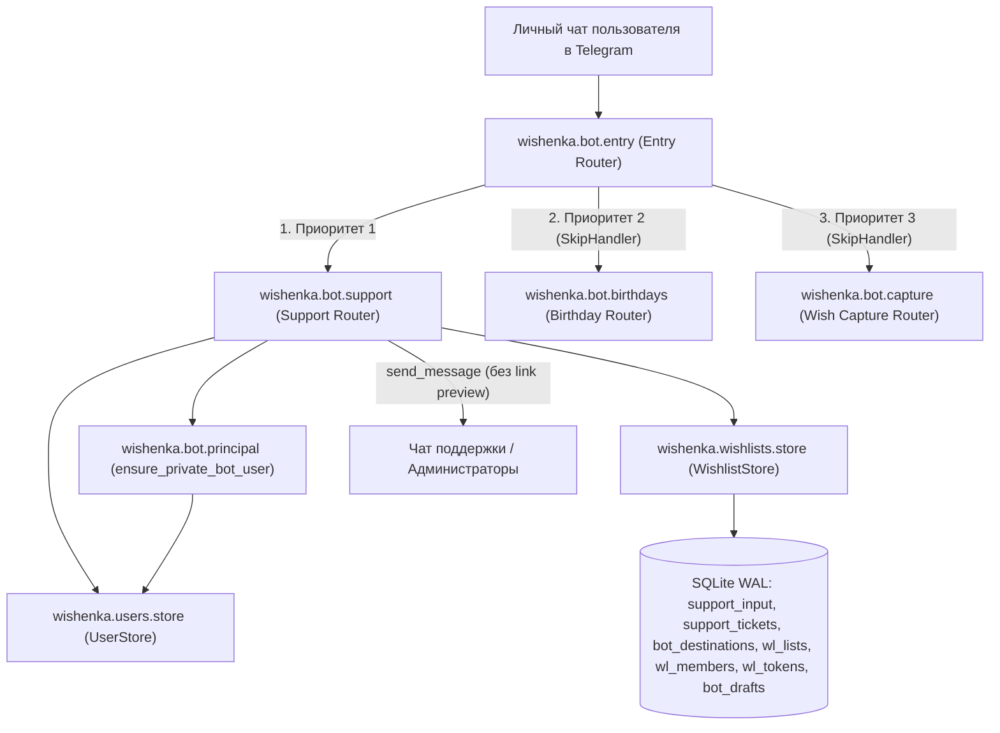
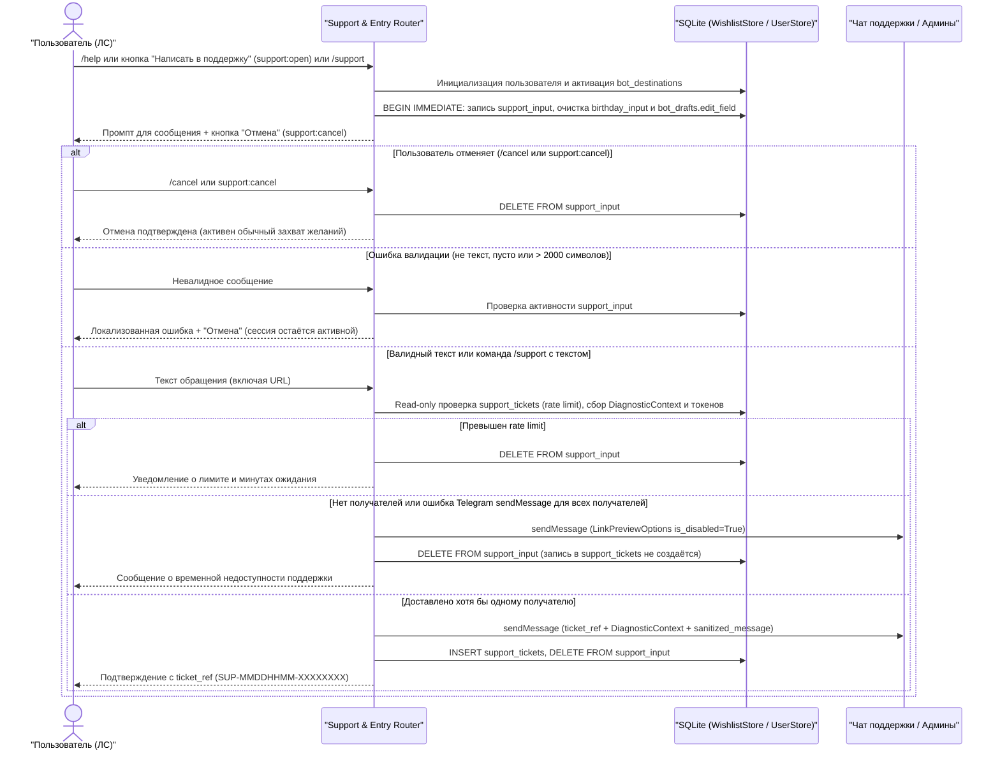

# Спецификация: WISHENKA-30 — Канал поддержки и обратной связи в Telegram-боте

**Статус:** реализовано и верифицировано (см. [00-roadmap.md](00-roadmap.md))  
**Платформа:** Telegram Bot (приватные чаты, aiogram 3)  
**Язык реализации:** Python 3.12+  
**Языки интерфейса:** русский (`ru`), английский (`en`)  
**Связанные документы:** [specs/00-high.md](../../specs/00-high.md) (раздел 2.1), [in-docs/spec.md](../../in-docs/spec.md) (разделы 12, 14, сценарий UC-12)

## 1. Назначение и бизнес-цель

### 1.1. Постановка проблемы

В соответствии с продуктовой концепцией (`specs/00-high.md`, раздел 2.1) и функциональной спецификацией (`in-docs/spec.md`, разделы 12 и 14), Telegram-бот служит точкой контакта со службой поддержки без создания отдельной административной веб-панели. До реализации задачи `WISHENKA-30` пользователи не имели выделенного канала в боте для отправки вопросов, отчётов об ошибках (включая ссылки на товары, не прошедшие парсинг) и отзывов, а администраторы не получали безопасного диагностического контекста для разбора обращений.

При этом текстовые сообщения и ссылки в личном чате с ботом уже используются для быстрого захвата желаний (`bot_drafts`), а также для ввода дат рождения (`birthday_input`). Без явного разделения потоков обращение в поддержку с текстом или URL-ссылкой могло ошибочно создать черновик желания, а сбор диагностической информации без строгих ограничений мог бы нарушить принцип тайны сюрприза или раскрыть секретные ссылки доступа к вишлистам.

### 1.2. Цели задачи

- Предоставить пользователям доступный и понятный вход в справку и службу поддержки непосредственно внутри личного чата с Telegram-ботом (`/help`, меню `/start`, `/support`, кнопка `support:open`).
- Изолировать интерактивный ввод обращения в поддержку от захвата желаний и ввода дней рождения с детерминированным приоритетом и возможностью отмены.
- Обеспечить доставку обращения вместе с безопасным метаданным диагностическим контекстом в настроенный чат поддержки или личные чаты администраторов, без развёртывания внешней helpdesk-системы или веб-панели.
- Защитить канал поддержки от флуда и некорректных сообщений (ограничение длины, отклонение нетекстовых вложений, скользящий rate limit на пользователя).
- Гарантировать соблюдение принципа сюрприза, защиту секретных capability-токенов и честное информирование пользователя при недоступности канала поддержки.

### 1.3. Ценность для пользователей и системы

- **Для пользователей:** быстрое обращение в поддержку на родном языке (`ru` / `en`) без выхода из Telegram, получение номера тикета (`SUP-...`) после реальной доставки и гарантия, что обращение не создаст лишних желаний и не раскроет скрытую активность дарителей.
- **Для администраторов и эксплуатации:** получение структурированного тикета с идентификаторами аккаунта, языковыми настройками, состоянием доставки бота и сводными счётчиками списков для диагностики без веб-админки; защита логов от утечки PII и содержимого обращений.
- **Границы охвата (Non-Goals):** в рамках задачи не создаются веб-панель администратора, интеграция с внешними тикет-системами, двусторонний live-чат или автоматические ответы на базе ИИ.

## 2. Функциональные требования и пользовательские сценарии

### 2.1. Точки входа и навигация

Пользовательские сценарии поддержки работают исключительно в верифицированном личном чате с ботом (`F.chat.type == "private"`):

- **Меню `/start`:** содержит локализованную кнопку перехода в поддержку (`callback_data="support:open"` — «Написать в поддержку» / «Contact support») наряду с кнопкой справки (`callback_data="entry:help"`).
- **Справка (`/help` и `entry:help`):** отображает локализованное описание работы сервиса (включая правила вишлистов, защиту сюрприза и управление подтверждениями бронирований) и клавиатуру с кнопкой `support:open`.
- **Интерактивное открытие сессии (`/support` без аргументов или нажатие `support:open`):** переводит приватный чат в режим ожидания сообщения в поддержку, отправляет инструкцию и inline-кнопку отмены (`callback_data="support:cancel"`).
- **Одношаговая отправка (`/support <текст>`):** команда `/support` с непустыми аргументами открывает сессию и сразу передаёт `<текст>` в конвейер валидации и отправки тикета без ожидания следующего сообщения.

### 2.2. Изоляция потоков ввода и управление сессией

Для исключения конфликтов с захватом желаний и сценарием дней рождения действуют следующие правила:

1. **Приоритет роутеров:** в `wishenka.bot.entry.create_router` дочерние роутеры подключаются в строгом порядке:
   1. `create_support_router` (`wishenka/bot/support.py`);
   2. `create_birthday_router` (`wishenka/bot/birthdays.py`);
   3. `create_capture_router` (`wishenka/bot/capture.py`).
2. **Взаимоисключение при открытии сессии поддержки (`_open_support_session`):** атомарно в SQLite-транзакции `BEGIN IMMEDIATE`:
   - создаётся или обновляется запись `(owner_id, chat_id, expires_at)` в `support_input` со временем жизни `support_session_ttl_seconds` (по умолчанию `3600` секунд);
   - удаляется активная запись `birthday_input` для `(owner_id, chat_id)`;
   - сбрасывается `edit_field = NULL` у активного черновика в `bot_drafts` для `(telegram_id, chat_id)`.

   Существующие вишлисты, желания, записи о днях рождения и базовое состояние черновика сохраняются.
3. **Перехват сообщений во время активной сессии:** пока существует запись в `support_input` с `expires_at > now`, некомандные личные сообщения полностью потребляются `create_support_router` и не передаются в `create_birthday_router` и `create_capture_router` (`SkipHandler` не выбрасывается). В частности, URL-ссылка на товар (включая проблемную) обрабатывается как текст обращения и не запускает `ItemPreviewService` и создание черновика желания.
4. **Истечение срока действия сессии:** если `expires_at <= now`, просроченная строка `support_input` лениво удаляется при проверке `has_active_session`, а сообщение передаётся через `SkipHandler` следующим роутерам (включая обычный захват желаний).
5. **Явная отмена (`/cancel` и `support:cancel`):**
   - callback `support:cancel` удаляет запись из `support_input` и подтверждает отмену пользователю;
   - команда `/cancel` удаляет активную запись `support_input` и подтверждает отмену; если активной сессии поддержки нет, выбрасывается `SkipHandler`, чтобы `/cancel` мог обработать `create_birthday_router`.

   При отмене тикет не отправляется, черновик желания не создаётся, вишлисты и напоминания не изменяются.
6. **Неявное вытеснение другими командами:** вызов `/start`, `/help`, `entry:help`, `/reservation_confirmations`, `/birthdays` или callback `birthday:*` вызывает `clear_support_session(store, owner_id, chat_id)`, очищая незавершённую сессию поддержки без отправки тикета.

### 2.3. Валидация ввода, ограничение частоты и правила доставки

| Условие / Вход | Поведение системы | Состояние `support_input` | Запись в `support_tickets` |
| --- | --- | --- | --- |
| Нетекстовое сообщение (`~F.text`: фото, стикер, голос, документ) | Локализованное сообщение с просьбой прислать текст и кнопкой «Отмена» | Сохраняется открытой | Нет |
| Пустое сообщение (после `.strip()`) | Локализованное сообщение об ошибке ввода с кнопкой «Отмена» | Сохраняется открытой | Нет |
| Длина текста `> support_max_message_length` (по умолчанию `2000`) | Локализованное предупреждение с указанием лимита символов и кнопкой «Отмена» | Сохраняется открытой | Нет |
| Превышен лимит обращений (`>= max_tickets` в окне `window_sec`) | Локализованное уведомление с временем ожидания в минутах (`max(1, ceil((oldest + window - now) / 60))`) | Очищается | Нет |
| Не настроены получатели (`support_chat_id` и `support_admin_ids` пусты) | Локализованное сообщение о временной недоступности поддержки | Очищается | Нет |
| Сбой отправки во все настроенные чаты (`delivered == 0`) | Локализованное сообщение о временной недоступности поддержки (без ложного подтверждения) | Очищается | Нет |
| Успех доставки хотя бы одному получателю (`delivered > 0`) | Локализованное подтверждение пользователю с номером тикета `ticket_ref` | Очищается | Да |

### 2.4. Пользовательские сценарии

- **Сценарий 1 — Справка и вход в поддержку:** пользователь отправляет `/help` или нажимает «Как это работает» / «Написать в поддержку» в меню `/start`. Бот показывает справку и кнопку «Написать в поддержку» (`support:open`). После нажатия `support:open` или отправки `/support` бот просит описать проблему и показывает кнопку «Отмена».
- **Сценарий 2 — Успешная отправка обращения (включая ссылку на товар):** в активной сессии пользователь отправляет текст вопроса или описание проблемы со ссылкой (либо выполняет `/support <текст>`). Бот санитизирует возможные секретные токены, собирает безопасный `DiagnosticContext`, пересылает тикет в чат поддержки / администраторам, закрывает сессию и отвечает пользователю номером тикета `SUP-...`. Черновик желания не создаётся.
- **Сценарий 3 — Отмена, вытеснение или истечение сессии:** пользователь начинает обращение, затем нажимает «Отмена» (`support:cancel`), отправляет `/cancel` или переключается на `/start` / `/birthdays` (либо сессия истекает по TTL). Тикет не создаётся; следующее обычное сообщение с названием или ссылкой на товар штатно создаёт черновик желания.
- **Сценарий 4 — Ошибки ввода и защита от флуда:** при отправке картинки, пустой строки или текста длиннее `2000` символов бот сообщает о причине на языке пользователя и оставляет сессию открытой для повторного ввода или отмены. При отправке более `3` тикетов за `3600` секунд бот сообщает время ожидания и завершает сессию поддержки.
- **Сценарий 5 — Недоступность канала поддержки:** если получатели поддержки не заданы в конфигурации или Telegram API вернул ошибку для всех получателей, пользователь получает честное сообщение о недоступности канала без генерации подтверждения тикета.

### 2.5. Ключевые инварианты

1. **Изоляция потоков:** активная сессия `support_input` имеет безусловный приоритет над захватом желаний и вводом дней рождения; отменённая, вытесненная или истёкшая сессия никогда не блокирует последующий захват желаний.
2. **Честное подтверждение доставки:** подтверждение с номером тикета выдаётся пользователю и фиксируется в `support_tickets` только после успешного вызова `send_message` хотя бы для одного настроенного получателя.
3. **Защита тайны сюрприза и секретных ссылок:** ни сам тикет, ни диагностический контекст, ни ответы пользователю, ни логи не раскрывают бронирования, личности дарителей, статусы покупок/получения, содержимое вишлистов и capability-токены.
4. **Двуязычие (RU / EN):** все пользовательские тексты поддержки и справки локализованы на русский и английский языки в соответствии с сохранённым языком профиля или языковым кодом Telegram.

## 3. Архитектура, компоненты и интерфейсы

### 3.1. Диаграмма модулей и потоков обработки



### 3.2. Компоненты и их ответственность

| Компонент | Путь | Ответственность |
| --- | --- | --- |
| Конфигурация | `wishenka/config.py` | Определение и валидация параметров `WISHENKA_SUPPORT_*` в классе `Settings`. |
| Точка сборки бота | `wishenka/bot/__main__.py` | Передача параметров поддержки в `Dependencies` и запуск ежечасного `cleanup_loop`. |
| Входной роутер | `wishenka/bot/entry.py` | Обработка `/start`, `/help`, `entry:help`, `/reservation_confirmations`; кнопка `support:open`; вызов `clear_support_session` при переключении сценариев; подключение суб-роутеров в порядке приоритета; граница перехвата ошибок `entry_error`. |
| Сервис и роутер поддержки | `wishenka/bot/support.py` | Управление `support_input`, обработка `/support`, `/cancel`, `support:open`, `support:cancel`, валидация, rate limit, редактирование токенов (`redact_capabilities`), сбор `DiagnosticContext` и доставка тикетов. |
| Инициализация пользователя | `wishenka/bot/principal.py` | Единый хелпер `ensure_private_bot_user(...)` для разрешения/создания пользователя под подавлением PII-логов и активации `bot_destinations`. |
| Роутер дней рождения | `wishenka/bot/birthdays.py` | Очистка активной сессии `support_input` через `clear_support_session` при запуске `/birthdays` и `birthday:*`. |
| Захват желаний и очистка | `wishenka/bot/capture.py` | Захват желаний, если предыдущие роутеры передали обновление; функция `cleanup_drafts` удаляет просроченные `support_input` и устаревшие `support_tickets` батчами по 100 строк. |
| Миграция БД | `wishenka/wishlists/alembic/versions/add_support_channel.py` | Обратимая Alembic-ревизия `add_support_channel` (`down_revision = "add_notice_uncertain"`), создающая таблицы `support_input` и `support_tickets`. |

### 3.3. Схема базы данных (`add_support_channel`)

Миграция `wishenka/wishlists/alembic/versions/add_support_channel.py` (`ROLLBACK_POLICY = "reversible"`) создаёт две таблицы и индекс в SQLite (режим WAL):

```sql
CREATE TABLE IF NOT EXISTS support_input (
    owner_id INTEGER NOT NULL,
    chat_id INTEGER NOT NULL,
    expires_at INTEGER NOT NULL,
    PRIMARY KEY (owner_id, chat_id)
);

CREATE TABLE IF NOT EXISTS support_tickets (
    id INTEGER PRIMARY KEY AUTOINCREMENT,
    ticket_ref TEXT NOT NULL UNIQUE,
    owner_id INTEGER NOT NULL,
    telegram_id INTEGER NOT NULL,
    created_at INTEGER NOT NULL
);

CREATE INDEX IF NOT EXISTS idx_support_tickets_owner_time
    ON support_tickets(owner_id, created_at);
```

- **`support_input`** хранит долговременное состояние активного ввода обращения на пару `(owner_id, chat_id)`, устойчивое к перезапускам процесса бота.
- **`support_tickets`** содержит только метаданные доставленных тикетов для уникальности `ticket_ref` и проверки скользящего rate limit; **текст обращений пользователей в базе данных не сохраняется**.
- **Плановая очистка (`cleanup_drafts` в `wishenka/bot/capture.py`):** на каждом ежечасном проходе удаляется до `100` строк `support_input` с `expires_at <= now` и до `100` строк `support_tickets` старше 30 суток (`created_at <= now - 30 * 86400`).

### 3.4. Конфигурация и программные интерфейсы

#### Параметры `Settings` (`wishenka/config.py`)

| Поле `Settings` | Переменная окружения | Значение по умолчанию | Ограничения и назначение |
| --- | --- | --- | --- |
| `support_chat_id` | `WISHENKA_SUPPORT_CHAT_ID` | `None` | Необязательный `int` ID основного чата/группы/канала поддержки |
| `support_admin_ids` | `WISHENKA_SUPPORT_ADMIN_IDS` | `()` | Необязательный кортеж `int` ID администраторов (дедуплицируется с `support_chat_id`) |
| `support_session_ttl_seconds` | `WISHENKA_SUPPORT_SESSION_TTL_SECONDS` | `3600` | Целое в диапазоне `60..86400`; время жизни активной сессии `support_input` в секундах |
| `support_max_message_length` | `WISHENKA_SUPPORT_MAX_MESSAGE_LENGTH` | `2000` | Целое в диапазоне `100..3500`; максимальная длина сообщения после `.strip()` |
| `support_rate_limit_window_seconds` | `WISHENKA_SUPPORT_RATE_LIMIT_WINDOW_SECONDS` | `3600` | Целое `>= 60`; длина скользящего окна ограничения частоты тикетов в секундах |
| `support_rate_limit_max_tickets` | `WISHENKA_SUPPORT_RATE_LIMIT_MAX_TICKETS` | `3` | Целое в диапазоне `1..50`; максимум доставленных тикетов на пользователя за окно |

#### Контракт данных `DiagnosticContext` и основные функции (`wishenka/bot/support.py`)

```python
@dataclass(frozen=True)
class DiagnosticContext:
    """Safe, metadata-only account and bot context attached to a support ticket."""

    ticket_ref: str
    submitted_at_iso: str
    internal_user_id: int
    telegram_user_id: int
    username: str
    display_name: str
    effective_language: str
    telegram_language_code: str
    bot_destination_active: bool
    active_wishlist_count: int
    archived_wishlist_count: int
    collaborative_membership_count: int
    active_draft_present: bool
```

Основные функции модуля `wishenka/bot/support.py`:

- `create_support_router(dependencies: Any) -> Router` — создаёт и настраивает роутер приватного чата для `/support`, `support:open`, `support:cancel`, `/cancel`, `non_text_message` и `text_message`.
- `clear_support_session(store: WishlistStore, owner_id: int, chat_id: int) -> None` — удаляет активную строку `support_input` для `(owner_id, chat_id)` при переключении пользователя на другую команду.
- `generate_ticket_ref(now: datetime) -> str` — формирует идентификатор тикета формата `SUP-MMDDHHMM-XXXXXXXX` по UTC (с заменой `"202"` на `"303"` в числовой метке времени для исключения случайных совпадений с короткими тестовыми ID и 8 случайными символами из алфавита `ABCDEFGHJKLMNPQRSTUVWXYZ3456789`).
- `collect_diagnostic_context(conn: AsyncConnection, *, ticket_ref: str, now: datetime, ...) -> tuple[DiagnosticContext, set[str]]` — собирает агрегированные метаданные аккаунта (`submitted_at_iso` в формате `%d.%m.%y %H:%M:%S UTC`) и множество токенов доступа текущего пользователя для санитизации.
- `redact_capabilities(text_value: str, known_tokens: Iterable[str] = ()) -> str` — заменяет capability-токены и секретные части ссылок на `[REDACTED]`.
- `format_support_ticket(context: DiagnosticContext, sanitized_message: str) -> str` — формирует plain-text тело тикета (заголовок с полями `DiagnosticContext` + разделитель `---\nMessage:\n` + очищенное сообщение), усекая сообщение так, чтобы суммарная длина не превышала лимит Telegram в `4096` символов (`budget = max(100, 4096 - len(header))`).

### 3.5. Диаграмма переходов и последовательность обработки



## 4. Нефункциональные требования, безопасность и наблюдаемость

### 4.1. Производительность и эксплуатационные ограничения

- **Лимиты ввода и исходящих сообщений:** входное сообщение ограничивается `support_max_message_length` (по умолчанию `2000` символов, допустимо `100..3500`); исходящий тикет гарантированно укладывается в `4096` символов Telegram Bot API (`sendMessage`).
- **Время жизни сессии и защита от флуда:** по умолчанию сессия ввода действует `3600` секунд (`60..86400`), а пользователь может отправить не более `3` тикетов (`1..50`) в окне `3600` секунд (`>= 60`).
- **Минимизация блокировок БД:** проверка лимита в `support_tickets` и сбор `DiagnosticContext` выполняются в read-only контексте (`store.execute_read`), не удерживая писательский lock SQLite `BEGIN IMMEDIATE` во время сетевых запросов к Telegram API; запись тикета в `support_tickets` и удаление `support_input` выполняются короткой транзакцией уже после доставки.
- **Контролируемый рост таблиц:** ежечасная задача `cleanup_drafts` ограничивает каждую операцию удаления по `support_input` и `support_tickets` (`LIMIT 100`), предотвращая длительные блокировки WAL.

### 4.2. Безопасность, приватность и защита тайны сюрприза

- **Строго метаданный диагностический контекст:** `collect_diagnostic_context` читает исключительно `bot_destinations`, счётчики списков из `wl_lists` (`status = 'active'` и `'archived'`), число совместных участий из `wl_members` (`l.status != 'deleted'`), наличие активного черновика в `bot_drafts` и токены доступа пользователя (`wl_lists`, `wl_tokens`). Запросы к таблицам желаний (`wl_items`), бронирований (`wl_reservations`) и получений (`wl_receipts`) полностью отсутствуют.
- **Редактирование capability-токенов (`redact_capabilities`):** перед формированием тикета из текста обращения вырезаются (заменяются на `[REDACTED]`):
  - параметры запуска Mini App `startapp=p_...` и `startapp=i_...` (`_STARTAPP_TOKEN_RE`);
  - пути публичных и пригласительных ссылок `/share/<token>`, `/invite/<token>`, `/api/public/wishlists/<token>` (`_CAPABILITY_PATH_RE`);
  - префиксные токены `p_<token>` и `i_<token>` (`_CAPABILITY_TOKEN_RE`);
  - точные совпадения сохранённых токенов длиной `>= 4` символов, принадлежащих или доступных пользователю по `wl_lists(public_token, invite_token)` и `wl_tokens(token)`.
- **Подавление предпросмотра ссылок:** вызовы `send_message` к получателям поддержки передают `LinkPreviewOptions(is_disabled=True)`, чтобы пересылаемые URL не инициировали внешние HTTP-запросы предпросмотра со стороны Telegram.
- **Изоляция логов от PII и секретов:** в `wishenka.bot.support` никогда не логируются тексты обращений, URL, `ticket_ref`, внутренние и Telegram ID пользователей/чатов, `username`, имена, названия желаний, данные бронирований или тексты исключений. Инициализация пользователя в приватном боте (`ensure_private_bot_user`) работает под фильтром `_private_bot_user`, подавляющим PII-события в `wishenka.users`, а обработчик `entry_error` в `wishenka/bot/entry.py` перехватывает необработанные исключения, логируя только имя класса исключения.

### 4.3. Структурированное логирование и метрики

События модуля `wishenka.bot.support` используют структурированное поле `extra={"event": ...}` с ограниченным набором значений `reason` и `outcome` (см. [50-observability.md](50-observability.md)):

| Уровень | Событие (`event`) | Поля `extra` | Точка генерации | Назначение |
| --- | --- | --- | --- | --- |
| `INFO` | `bot_support_prompted` | `event` | `support_command`, `support_open_callback` | Открыта интерактивная сессия поддержки |
| `INFO` | `bot_support_cancelled` | `event` | `support_cancel_callback`, `cancel_command` | Пользователь отменил активную сессию поддержки |
| `INFO` | `bot_support_rejected` | `event`, `reason` | `_submit_support_message`, `non_text_message` | Обращение отклонено (`reason`: `empty`, `too_long`, `non_text`, `rate_limited`) |
| `INFO` | `bot_support_submitted` | `event`, `outcome` | `_submit_support_message` | Тикет доставлен хотя бы одному получателю (`outcome`: `delivered`, `partial`) |
| `WARNING` | `bot_support_unavailable` | `event`, `reason` | `_submit_support_message` | Получатели не настроены (`unconfigured`) или часть получателей отклонила отправку (`partial_send_failed`) |
| `ERROR` | `bot_support_unavailable` | `event`, `reason` | `_submit_support_message` | Сбой доставки во все настроенные чаты (`send_failed`) |

Смежные границы наблюдаемости и поведение форматтеров:

- При необработанных ошибках в роутерах `wishenka.bot.entry:entry_error` пишет `ERROR` с `event="bot_start_failed"` (имя класса исключения без traceback).
- При сбое фоновой очистки `wishenka.bot.__main__:cleanup_loop` пишет `ERROR` с `event="bot_draft_cleanup_failed"` без текста исключения.
- Просмотр `/help` / `entry:help`, неявная очистка `support_input` при переключении команд, ленивое удаление просроченной сессии и успешная плановая очистка в `cleanup_drafts` намеренно не логируются.
- **Режимы форматтера:** для сбора `extra`-полей (`event`, `reason`, `outcome`) внешним агрегатором необходимо включать `WISHENKA_LOG_JSON=true` (`JsonFormatter`); при `WISHENKA_LOG_JSON=false` выводятся только статические строки сообщений.
- **Метрики:** встроенный экспортер Prometheus в репозитории отсутствует; продуктовые и эксплуатационные показатели (воронка `bot_support_prompted` → `bot_support_submitted` / `bot_support_cancelled`, отказы по `bot_support_rejected`, доступность канала по `bot_support_unavailable` и `bot_start_failed`) строятся во внешнем коллекторе по JSON-логам.

## 5. Верификация и критерии приёмки

### 5.1. Тестовые сценарии и зафиксированные результаты проверок

Автоматизированное покрытие сосредоточено в двух тестовых модулях с ограничением времени выполнения `pytestmark = pytest.mark.timeout(30)` и использованием перехватчика транспорта `Bot.__call__` и временных SQLite БД (`WishlistStore`, `UserStore`):

1. **Интеграционные и репродукционные сценарии (`tests/test_bot_support_repro.py`, 8 тестовых запусков):**
   - `test_help_and_menu_expose_localized_support_entry_points`: доступность `/help`, `entry:help`, кнопки поддержки в меню `/start` и `/support` на русском и английском языках.
   - `test_support_submission_delivers_ticket_and_context_without_creating_wish_draft`: отправка текстового обращения и проблемного URL в интерактивном режиме и через `/support <текст>` доставляет тикет с `SUP-...` и `DiagnosticContext` получателям, отвечает пользователю номером тикета и не создаёт вишлистов и черновиков (`bot_drafts` / `wl_items`).
   - `test_cancel_supersede_and_expiration_preserve_state_and_restore_wish_capture`: отмена (`support:cancel`, `/cancel`), вытеснение (`/start`, `/birthdays`) и истечение TTL не отправляют тикет, сохраняют вишлисты и дни рождения и восстанавливают захват желаний.
   - `test_validation_and_rate_limiting_in_support_flow`: отклонение пустых, нетекстовых и слишком длинных сообщений с сохранением активной сессии; срабатывание скользящего rate limit с указанием минут ожидания.
   - `test_unconfigured_or_failing_destination_reports_honestly_without_false_confirmation`: при отсутствии получателей или отказе отправки во все чаты возвращается честное уведомление о недоступности без ложного подтверждения и с ожидаемой записью в лог ошибок.
   - `test_privacy_surprise_protection_and_capability_redaction`: проверка отсутствия capability-токенов (`public_token`, `invite_token`, `p_*`, `i_*`), названий желаний, статусов бронирований, личностей дарителей, записей получений, текстов обращений и PII в тикетах, ответах и логах.
2. **Модульные, миграционные и наблюдаемостные тесты (`tests/test_bot_support.py`, 5 тестов):**
   - `test_support_unit_helpers_redaction_formatting_and_settings`: санитизация ссылок/токенов, обрезка тикета под лимит Telegram 4096 символов и валидация границ `Settings`.
   - `test_add_support_channel_migration_upgrade_and_downgrade`: обратимость Alembic-миграции `add_support_channel` (`upgrade` и `downgrade`).
   - `test_session_precedence_with_birthday_input_and_draft_edit`: взаимная очистка `support_input`, `birthday_input` и `bot_drafts.edit_field`.
   - `test_partial_destination_success_stored_language_and_ticket_cleanup`: частичный успех доставки при отказе одного из получателей, приоритет сохранённой локали пользователя и батчевая очистка старых записей в `cleanup_drafts`.
   - `test_support_observability_events_json_format_and_error_redaction`: валидация всех событий `wishenka.bot.support` через `JsonFormatter` и отсутствия текста исключений в логах `wishenka.bot.entry`.

Зафиксированные в артефактах `WISHENKA-30` ([40-code-cleanup.md](40-code-cleanup.md), [50-observability.md](50-observability.md), [60-tech-debt.md](60-tech-debt.md)) результаты прогонов:

- Набор тестов поддержки (`.venv/bin/pytest tests/test_bot_support_repro.py tests/test_bot_support.py`): `13 passed in 2.08s`.
- Полная проверка качества (`make check`): `999 passed in 61.78s`; аудит маркеров таймаута (`pytest --collect-only -q -m "not timeout"`): `1000` собрано, `0` тестов без `pytest.mark.timeout`.
- Статический анализ (`make analyze`): `ruff check`, `ruff format --check` и `mypy wishenka tests` (`172` файла) — `0` ошибок и замечаний; `python -m compileall wishenka tests` — без ошибок.

### 5.2. Критерии приёмки

1. В личном чате с ботом доступны `/help`, действие «Как это работает» (`entry:help`) и вход в поддержку из меню `/start` (`support:open`) и по команде `/support`.
2. Пока сессия `support_input` активна (`expires_at > now`), любые текстовые сообщения и URL-ссылки обрабатываются как обращение в поддержку и не создают черновики желаний в `bot_drafts`.
3. Пользователь может отменить ввод через `support:cancel` или `/cancel`; отмена, истечение TTL или вытеснение командами `/start`, `/help`, `/birthdays`, `/reservation_confirmations` возвращают чат к штатному поведению без отправки тикета и без повреждения данных.
4. Невалидные сообщения (нетекстовые, пустые, `> 2000` символов) отклоняются с понятным сообщением и возможностью повтора или отмены; rate limit (`3` тикета за `3600` секунд) предотвращает флуд.
5. Доставленный тикет содержит уникальный `ticket_ref`, время отправки, санитизированный текст обращения и безопасный `DiagnosticContext`; подтверждение пользователю отправляется только при успешной доставке хотя бы одному получателю.
6. При отсутствии конфигурации получателей или полном отказе Telegram API пользователь получает честное сообщение о недоступности без записи в `support_tickets`.
7. Capability-токены, содержимое вишлистов и скрытая информация о бронированиях/покупках/получениях не попадают в тикеты, ответы бота и логи.
8. Все сообщения сценария поддержки локализованы для `ru` и `en`; существующие сценарии (`/start`, `How it works`, `/birthdays`, `/reservation_confirmations`, захват желаний) работают штатно вне активной сессии поддержки.

### 5.3. Известные ограничения и дальнейшие доработки (из `60-tech-debt.md`)

**Принятые архитектурные допущения и ограничения:**

- **Синхронная доставка в обработчике:** `_submit_support_message` отправляет сообщение напрямую в обработчике обновления без фоновой outbox-очереди и автоматических повторов. Это обеспечивает немедленную и честную обратную связь, но временные сбои Telegram API сразу возвращаются пользователю как недоступность канала.
- **Формат `ticket_ref` и временной метки:** в реализации используется `SUP-MMDDHHMM-XXXXXXXX` (с заменой `"202"` на `"303"`) и `%d.%m.%y %H:%M:%S UTC` (в отличие от первоначального эскиза `SUP-YYYYMMDD-XXXXXXXX` / ISO-8601 в [20-architecture.md](20-architecture.md)) во избежание ложных срабатываний подстроковых проверок приватности на коротких тестовых идентификаторах.
- **Фиксированный срок хранения и размер батча очистки:** порог удаления `support_tickets` (`30 * 86400` секунд) и лимит `100` строк за проход в `cleanup_drafts` зашиты в коде и не вынесены в `Settings`.
- **Последовательная рассылка нескольким получателям:** при настройке одновременно `support_chat_id` и нескольких `support_admin_ids` запросы `send_message` выполняются последовательно, поэтому сетевые задержки суммируются.

**Задачи развития и технического долга (Non-Blocker):**

1. **Medium — Удаление персональных данных (`WISHENKA-35`):** включить таблицы `support_input` и `support_tickets` в каскадную очистку/обезличивание при удалении аккаунта (раздел 11 `in-docs/spec.md`) и добавить автоматические тесты верификации.
2. **Low — Оптимизация выборки токенов и унификация инициализации пользователя (`WISHENKA-182`):** в [60-tech-debt.md](60-tech-debt.md) зафиксирована необходимость заменить полные сканы таблиц токенов в `collect_diagnostic_context` (выполнявшиеся в транзакции записи) на адресные выборки и выделить общий хелпер инициализации пользователя приватного бота, сохраняющий `language_code`. *(По текущему состоянию исходного кода в репозитории адресная выборка токенов в `store.execute_read` и общий хелпер `wishenka.bot.principal.ensure_private_bot_user` уже применены.)*
3. **Low — Smoke-тестирование с реальным Telegram Bot API (`WISHENKA-156`):** расширить опциональные smoke-тесты реального Telegram Bot API проверкой доставки тикетов поддержки, работы `LinkPreviewOptions(is_disabled=True)` и многоадресной рассылки.
