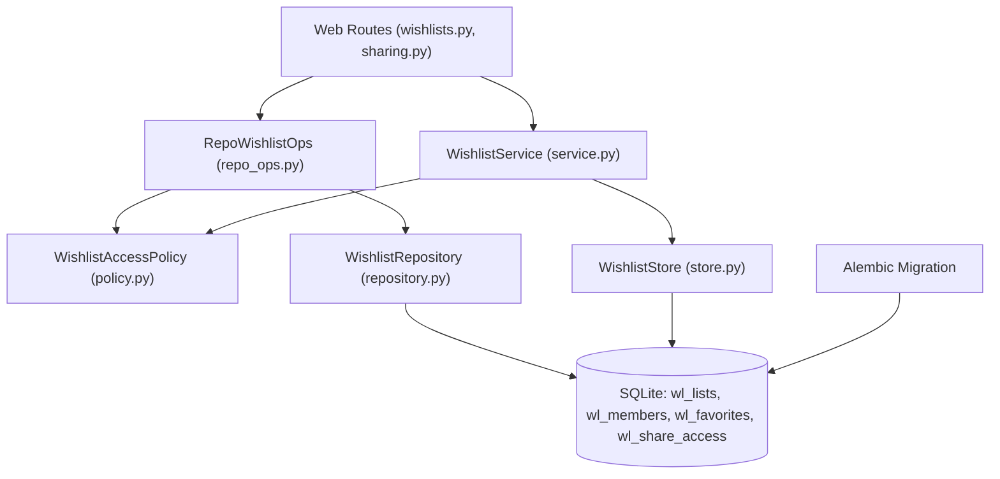

# WISHENKA-302: Access model for Favorites and protection against unauthorized wishlist disclosure

## Research

### External Best Practices & Standards

1. **OWASP IDOR / Broken Object Level Authorization (BOLA):**
   - Per the OWASP IDOR Prevention Cheat Sheet and OWASP API Security Top 10 (BOLA), every request that reads, creates, updates, or deletes an object must perform an explicit server-side object-level authorization check against the authenticated user's context, rather than trusting client-supplied IDs ([OWASP IDOR Cheat Sheet](https://cheatsheetseries.owasp.org/cheatsheets/Insecure_Direct_Object_Reference_Prevention_Cheat_Sheet.html)).
   - Data lookups and mutations should be scoped directly by authorization predicates (e.g., membership or valid share-access grant) rather than fetching by primary key alone, and unauthorized access to private objects should return `404 Not Found` consistently to prevent object ID enumeration ([OWASP](https://owasp.org/)).
   - Authorization logic should be centralized in a policy/service layer with a deny-by-default posture and verified with cross-user "swap" integration tests across all endpoints ([OWASP](https://owasp.org/)).
2. **Capability URLs & Share-Token Access Control:**
   - Per the W3C TAG finding *Good Practices for Capability URLs*, a share link acts as a bearer capability token and should grant least-privilege access scoped strictly to the target resource ([W3C Capability URLs](https://www.w3.org/TR/capability-urls/)).
   - Capability URLs require an explicit revocation mechanism (such as rotating `public_token`); binding server-side grants (`wl_share_access`) to the active `public_token` ensures that token rotation immediately invalidates prior capability grants ([W3C Capability URLs](https://www.w3.org/TR/capability-urls/)).
3. **Alembic & SQLite Migration Considerations:**
   - Per SQLAlchemy/Alembic documentation, SQLite migrations should avoid importing live ORM models (which can drift from historical schemas) and instead use decoupled `op` DDL or `sa.text()`/`sa.table()` expressions ([SQLAlchemy / Alembic](https://alembic.sqlalchemy.org/)).
   - Because `CREATE TABLE` / `DROP TABLE` for `wl_share_access` and `DELETE FROM wl_favorites` are standalone DDL/DML operations rather than `ALTER TABLE` column mutations, `batch_alter_table()` is not required; however, foreign-key constraints and `upgrade()`/`downgrade()` behavior must be tested explicitly, and any irreversible data purge must be documented as a one-way security remediation.

### Current State in Codebase

1. **Favorites HTTP endpoints (`wishenka/web/routes/wishlists.py`):**
   - `GET /api/favorites` (`list_favorites`) calls `service.list_favorites(user)` and returns `id`, `name`, `description`, `event_title`, `event_date`, `status`, `role`, `is_favorite`.
   - `POST /api/favorites/{wishlist_id}` (`add_favorite`) checks only that the wishlist exists, `status != WishlistStatus.DELETED`, and `wl.owner_id != user.telegram_id`, then calls `service.add_favorite(user, wishlist_id)`. It does not check membership or share-link access.
   - `DELETE /api/favorites/{wishlist_id}` (`remove_favorite`) calls `service.remove_favorite(user, wishlist_id)`.
2. **Domain Policy (`wishenka/wishlists/policy.py`):**
   - `WishlistAccessPolicy.can_favorite(user, wishlist)` currently checks only `user is not None`, `wishlist.status != WishlistStatus.DELETED`, and `wishlist.owner_id != user.telegram_id`.
3. **Dual Execution Paths (`RepoWishlistOps` vs `WishlistService` / `WishlistStore`):**
   - Production HTTP routes (`wishenka/web/routes/wishlists.py`, `wishenka/web/routes/sharing.py`) inject `WishlistRepo` and execute via `RepoWishlistOps` (`wishenka/wishlists/repo_ops.py`) + `WishlistRepository` (`wishenka/wishlists/repository.py`).
   - Reservation endpoints (`POST /api/public/wishlists/{token}/items/{item_id}/reservations`) and test harnesses injecting `app.state.wishlist_service` use `WishlistService` (`wishenka/wishlists/service.py`) backed by `WishlistStore` (`wishenka/wishlists/store.py`).
   - Both `RepoWishlistOps` and `WishlistService` must enforce the same access model and record verified share-link access.
4. **Share-Link Resolution & Token Rotation:**
   - Authenticated share-link entry points call `service.get_wishlist_by_public_token(public_token, current_user)`:
     - `GET /share/{public_token}` (`wishenka/web/routes/sharing.py`)
     - `GET /api/public/wishlists/{token}/view` (`wishenka/web/routes/wishlists.py`)
     - `POST /api/public/wishlists/{token}/items/{item_id}/reservations` (`wishenka/web/routes/wishlists.py`)
   - `GET /api/public/wishlists/{token}` passes `current_user=None` (anonymous-safe projection).
   - Share-link rotation occurs in `regenerate_public_token` (`repo_ops.py` / `service.py`), `transfer_ownership` (`repo_ops.py` / `service.py` -> `rotate_public_token`), and `restore_deleted_wishlist` (`repo_ops.py` -> `repo.rotate_public_token` and `service.py` -> token rotation + store persistence).
5. **Membership & Account Deletion:**
   - Member removal occurs in `remove_member` (`repo_ops.py` / `service.py`).
   - Account deletion (`wishenka/wishlists/deletion.py`) cleans up `wl_favorites` and `wl_view_history` by `user_id = :uid`.
6. **Database Schema & Migrations (`wishenka/wishlists/db_models.py`, `wishenka/wishlists/alembic/versions/`):**
   - Current Alembic head is `unify_user_keys_and_cascades` (`down_revision = "add_receipt_delivery_fence"`).
   - `wl_favorites` has `(user_id, wishlist_id, created_at)` with `ON DELETE CASCADE` FKs to `users(telegram_id)` and `wl_lists(id)`.
7. **Downstream Consumers of `wl_favorites`:**
   - `wishenka/notices/preferences.py`, `wishenka/notices/scheduler.py`, and `wishenka/notices/reminders.py` query `wl_favorites` directly to determine notification recipients and roles. Purging unauthorized legacy rows and deleting revoked rows keeps notifications consistent with the Favorites access model.
8. **Affected Existing Tests:**
   - Several existing tests call `POST /api/favorites/{wishlist_id}` directly as a non-member without first opening the wishlist via its share link (e.g., `tests/test_wishlist_sections_ui.py`, `tests/test_wishlist_sections_observability.py`, `tests/test_i18n_sync.py`, `tests/test_home_overview_browser.py`, `tests/test_history_screen_browser.py`, `tests/test_wishlist_delete_api.py`). These will need to be updated to either grant share-link access or test the new denial behavior.

## Implementation Plan

1. **Database Schema & Alembic Migration:**
   - Add `ShareAccessRow` (`wl_share_access`) to `wishenka/wishlists/db_models.py` with `(user_id, wishlist_id)` primary key, `public_token` (`TEXT NOT NULL`), `granted_at` (`TEXT NOT NULL`), `ON DELETE CASCADE` foreign keys to `users(telegram_id)` and `wl_lists(id)`, and index `idx_wl_share_access_wishlist` on `(wishlist_id)`.
   - Create an Alembic migration revising `unify_user_keys_and_cascades`:
     - `upgrade()` creates `wl_share_access` and `idx_wl_share_access_wishlist`, and purges legacy non-member rows from `wl_favorites` (`DELETE FROM wl_favorites WHERE NOT EXISTS (SELECT 1 FROM wl_members m WHERE m.wishlist_id = wl_favorites.wishlist_id AND m.user_id = wl_favorites.user_id)`).
     - **Rollback policy & limitations:** Schema `downgrade()` is reversible (drops `idx_wl_share_access_wishlist` and `wl_share_access`), whereas the data purge of unauthorized `wl_favorites` rows in `upgrade()` is **intentionally irreversible** as a security remediation — deleted unauthorized rows are not archived or restored on `downgrade()`.
2. **Domain Model & Access Policy (`wishenka/wishlists/models.py`, `wishenka/wishlists/policy.py`):**
   - Add `ShareAccessGrant` dataclass (`user_id`, `wishlist_id`, `public_token`, `granted_at`).
   - Update `WishlistAccessPolicy.can_favorite(user, wishlist, *, has_share_access: bool = False)` to require `user is not None`, `wishlist.status != WishlistStatus.DELETED`, `wishlist.owner_id != user.telegram_id`, and `(is_member or has_share_access)`.
3. **Persistence Layer (`wishenka/wishlists/repository.py`, `wishenka/wishlists/store.py`, `wishenka/wishlists/deletion.py`):**
   - Add repository methods: `upsert_share_access`, `has_valid_share_access(user_id, wishlist_id, public_token)`, `revoke_share_access_for_wishlist(wishlist_id)`, and `delete_non_member_favorites(wishlist_id)` / `delete_favorite_if_no_share_access(user_id, wishlist_id, public_token)`.
   - Update `WishlistRepository.list_favorite_wishlists(user_id)` (and `list_favorite_ids(user_id)`) to filter to wishlists where `l.owner_id != :uid` and (`wl_members` match OR `wl_share_access` matches with `sa.public_token = l.public_token`).
   - Update `WishlistStore` to hydrate and persist `wl_share_access` for `WishlistService`:
     - In full-storage load/persist (`_load_storage` / `_persist_storage`), hydrate and diff `wl_share_access` alongside `wl_favorites`.
     - In scoped wish transactions (`execute_wish` and `execute_wish_idempotent`, both of which use `_load_wish` and `_persist_wish`), extend `_WishSnapshot` with `share_access: dict[tuple[int, int], tuple[str, str]]`. `_load_wish(conn, item_id)` loads `wl_share_access` rows for `wishlist.id` into `service._share_access` and snapshots them; `_persist_wish(conn, service, snapshot)` diffs `service._share_access` for that `wishlist_id` against `snapshot.share_access` and issues `INSERT INTO wl_share_access ... ON CONFLICT(user_id, wishlist_id) DO UPDATE SET public_token = excluded.public_token, granted_at = excluded.granted_at` for any new or updated grant inside the same `BEGIN IMMEDIATE` transaction.
   - Update `wishenka/wishlists/deletion.py` to include `wl_share_access` cleanup.
4. **Application Services (`wishenka/wishlists/repo_ops.py`, `wishenka/wishlists/service.py`):**
   - In `get_wishlist_by_public_token(public_token, current_user)`: when `current_user is not None`, `wl.status != WishlistStatus.DELETED`, and `wl.owner_id != current_user.telegram_id`, upsert verified share-link access bound to `wl.public_token`.
   - In `add_favorite(user, wishlist_id)`: verify `WishlistAccessPolicy.can_favorite(..., has_share_access=...)`; if denied for a non-owner, log `favorite_access_denied` (WARNING) and raise `WishlistNotFoundError(f"Wishlist {wishlist_id} not found")` so the response is indistinguishable from a missing or deleted wishlist.
   - In `list_favorites(user)`: enforce the access filter (member or valid active share-link access, non-deleted, non-owner).
   - In `remove_member(...)`: after removing membership, if the user lacks valid `wl_share_access` for the current `public_token`, delete their `wl_favorites` entry for that wishlist.
   - In `regenerate_public_token(...)`, `transfer_ownership(...)`, and `restore_deleted_wishlist(...)` (both `RepoWishlistOps` and `WishlistService` / `WishlistStore` restore paths): when `public_token` rotates, revoke all `wl_share_access` grants for the wishlist and delete `wl_favorites` rows for users who are not `wl_members`. Purging non-member `wl_favorites` rows on restore is essential because downstream notification consumers (`wishenka/notices/preferences.py`, `scheduler.py`, `reminders.py`) query `wl_favorites` directly, so stale non-member rows must not remain after the wishlist is restored with a new `public_token`.
5. **HTTP Route Alignment (`wishenka/web/routes/wishlists.py`):**
   - Simplify `POST /api/favorites/{wishlist_id}` to delegate validation to `service.add_favorite(user, wishlist_id)` so `RepoWishlistOps` and `WishlistService` share one canonical enforcement path.
6. **Tests:**
   - Update existing tests that favorited arbitrary wishlists without share-link access, and add comprehensive automated tests for stranger denial, participant access, giver share-link access, scoped reservation share-access persistence (`POST /api/public/wishlists/{token}/items/{item_id}/reservations` via `execute_wish` / `execute_wish_idempotent` persisting `wl_share_access` so subsequent `POST /api/favorites/{wishlist_id}` succeeds and `GET /api/favorites` includes the wishlist, and revoking on token rotation), membership removal revocation, share-link rotation revocation, and migration purge.

**Mandatory — Failing Repro (next Step 3):**
- **Where it lives:** `tests/test_favorites_access_control.py` (with `@pytest.mark.timeout(...)` per `do-testing`).
- **What it asserts (desired behavior):**
  1. An authenticated stranger (non-owner, non-member, no share-link visit) calling `POST /api/favorites/{wishlist_id}` receives HTTP `404` with the exact same error shape/detail as a non-existent wishlist ID, and `GET /api/favorites` remains empty (`[]`).
  2. When a legacy unauthorized row exists directly in `wl_favorites` for that stranger, `GET /api/favorites` does not return the private wishlist's metadata.
  3. After a giver opens the wishlist via its active share link (`GET /api/public/wishlists/{public_token}/view`), `POST /api/favorites/{wishlist_id}` returns `200` and `GET /api/favorites` returns the wishlist with `role == "favorite"`.
  4. When the owner rotates the share link (`POST /api/wishlists/{wishlist_id}/share/reset`), the giver's `GET /api/favorites` no longer includes the wishlist and `POST /api/favorites/{wishlist_id}` returns `404` again.
- **How to force failure without live external deps:** Uses FastAPI `TestClient` with an isolated temporary SQLite database and `Authorization: Bearer <token>` headers minted via `SessionTokenService` (the standard in-process fixture pattern used in `tests/test_wishlist_sections_ui.py`), requiring zero network or Telegram Bot API calls.
- **Sequencing:** Research (done) → Write red test in Step 3 (`POST /api/favorites/{id}` currently returns `200` for stranger, causing test to fail) → Implement Step 4 changes until green.

## Architecture

### System Module Diagram



### Module Responsibilities

- **`wishenka/wishlists/policy.py` (`WishlistAccessPolicy`):** Pure domain authorization rules. `can_favorite` evaluates ownership, deletion status, membership (`ctx.is_member`), and verified share-link access (`has_share_access`) without performing I/O.
- **`wishenka/wishlists/db_models.py` & Alembic Migration:** Defines `ShareAccessRow` (`wl_share_access`) and provides an Alembic migration whose schema changes are reversible (`downgrade()` drops `idx_wl_share_access_wishlist` and `wl_share_access`), while its `upgrade()` data purge of legacy non-member `wl_favorites` rows is intentionally irreversible (security remediation).
- **`wishenka/wishlists/repository.py` (`WishlistRepository`) & `wishenka/wishlists/store.py` (`WishlistStore`):** Persistence for `wl_share_access` and `wl_favorites`, including token-matched share-access verification, access-filtered favorite listing, atomic cleanup on member removal or public token rotation, and scoped `_load_wish` / `_persist_wish` hydration and upsert of `wl_share_access` during `execute_wish` / `execute_wish_idempotent`.
- **`wishenka/wishlists/repo_ops.py` (`RepoWishlistOps`) & `wishenka/wishlists/service.py` (`WishlistService`):** Application-level orchestration:
  - Grants share-link access when an authenticated non-owner resolves an active wishlist via `get_wishlist_by_public_token`.
  - Enforces `WishlistAccessPolicy.can_favorite` on `add_favorite`, raising `WishlistNotFoundError` on unauthorized access to prevent ID enumeration.
  - Revokes `wl_share_access` grants and non-member `wl_favorites` rows on `remove_member` (unless valid share-link access remains) and whenever `public_token` rotates: `regenerate_public_token`, `transfer_ownership`, and `restore_deleted_wishlist`.
- **`wishenka/web/routes/wishlists.py`:** HTTP boundary for `/api/favorites`, `/api/favorites/{wishlist_id}`, and `/api/public/wishlists/{token}/view`, delegating favorite validation to the service layer.
- **`wishenka/wishlists/deletion.py` (`AccountDeletionService`):** Ensures `wl_share_access` rows for a deleted user are explicitly cleaned up alongside `wl_favorites`.

### Module Interaction Scheme

1. **Share-link visit & reservation (Giver):**
   `GET /share/{token}` or `GET /api/public/wishlists/{token}/view` or `POST /api/public/wishlists/{token}/items/{item_id}/reservations` (with authenticated `user`) → `service.get_wishlist_by_public_token(token, user)` → if `user` is non-owner and wishlist is non-deleted, `upsert_share_access(user.telegram_id, wl.id, wl.public_token)` (in `WishlistStore.execute_wish` / `execute_wish_idempotent`, `_load_wish` hydrates `wl_share_access` for `wl.id` into `service._share_access` and `_persist_wish` upserts new/changed grants in the same transaction).
2. **Add to Favorites:**
   `POST /api/favorites/{wishlist_id}` → `service.add_favorite(user, wishlist_id)` → fetches wishlist header/members + checks `has_valid_share_access(user.telegram_id, wishlist_id, wl.public_token)` → `WishlistAccessPolicy.can_favorite(user, wl, has_share_access=...)` → if denied for non-owner, logs `favorite_access_denied` and raises `WishlistNotFoundError` (HTTP 404); if allowed, upserts `wl_favorites`.
3. **List Favorites:**
   `GET /api/favorites` → `service.list_favorites(user)` → returns only non-deleted, non-owned wishlists where `user` is in `wl_members` OR has a `wl_share_access` row whose `public_token` matches `wl_lists.public_token`.
4. **Revocation:**
   - `remove_member(wishlist_id, actor, user_id)` → deletes `wl_members` row → if `not has_valid_share_access(user_id, wishlist_id, wl.public_token)`, deletes `wl_favorites` row for `(user_id, wishlist_id)`.
   - `regenerate_public_token` / `transfer_ownership` / `restore_deleted_wishlist` (when `public_token` rotates in `RepoWishlistOps` or `WishlistService` / `WishlistStore`) → deletes all `wl_share_access` grants for `wishlist_id` and deletes `wl_favorites` rows for `wishlist_id` where `user_id` is not in `wl_members` (ensuring downstream notification consumers that read `wl_favorites` directly do not see stale non-member rows after restore).

### Architectural Patterns & Justification

- **Capability-Bound Access Grant (`wl_share_access`):** Binding each grant to `(user_id, wishlist_id, public_token)` ensures that rotating `public_token` immediately invalidates all prior share-link grants both via eager deletion and via token-equality checks at read time.
- **Anti-Enumeration Uniform Error Mapping:** Raising `WishlistNotFoundError` for unauthorized `POST /api/favorites/{wishlist_id}` ensures identical HTTP 404 status and response body compared to non-existent or soft-deleted wishlists.
- **Repository + Domain Policy Separation:** Keeping `WishlistAccessPolicy.can_favorite` pure and putting SQL predicates in `WishlistRepository` / `WishlistStore` preserves testability and keeps `RepoWishlistOps` and `WishlistService` aligned.
- **Transactional Integrity:** All share-access grants, revocations, and favorite cleanups run within the active SQLAlchemy transaction (`WishlistRepository` or `WishlistStore` `BEGIN IMMEDIATE`).

### Main Interfaces & Data Schema

#### Database Table: `wl_share_access`

```sql
CREATE TABLE wl_share_access (
    user_id INTEGER NOT NULL REFERENCES users(telegram_id) ON DELETE CASCADE,
    wishlist_id INTEGER NOT NULL REFERENCES wl_lists(id) ON DELETE CASCADE,
    public_token TEXT NOT NULL,
    granted_at TEXT NOT NULL,
    PRIMARY KEY (user_id, wishlist_id)
);
CREATE INDEX idx_wl_share_access_wishlist ON wl_share_access(wishlist_id);
```

#### Domain Policy Signature (`wishenka/wishlists/policy.py`)

```python
@staticmethod
def can_favorite(
    user: AuthenticatedUser | None,
    wishlist: Wishlist,
    *,
    has_share_access: bool = False,
) -> bool:
    """Check if user can favorite the wishlist (non-owner, non-deleted, member or valid share-link access)."""
```

#### Repository Interface (`wishenka/wishlists/repository.py`)

- `async def upsert_share_access(self, grant: ShareAccessGrant) -> None`
- `async def has_valid_share_access(self, user_id: int, wishlist_id: int, public_token: str) -> bool`
- `async def revoke_share_access_for_wishlist(self, wishlist_id: int) -> None`
- `async def delete_non_member_favorites(self, wishlist_id: int) -> None`
- `async def delete_favorite_if_no_share_access(self, user_id: int, wishlist_id: int, public_token: str) -> None`

## Q&A

- **Q:** Why store `public_token` in `wl_share_access` instead of only a boolean or timestamp?
  **A:** Storing `public_token` provides defense in depth: even if a revocation hook were ever bypassed or delayed, `sa.public_token = l.public_token` guarantees stale share links cannot authorize Favorites after rotation.
- **Q:** Does `GET /api/public/wishlists/{token}` (without `/view`) record share-link access?
  **A:** No. `GET /api/public/wishlists/{token}` is an anonymous-safe endpoint that passes `current_user=None` and does not authenticate a user. Authenticated share-link visits use `GET /share/{public_token}`, `GET /api/public/wishlists/{token}/view`, or `POST /api/public/wishlists/{token}/items/{item_id}/reservations`.
- **Q:** What happens to `wl_view_history` when share-link access is revoked?
  **A:** Viewing History access control is explicitly out of scope for `WISHENKA-302` and is tracked separately in `WISHENKA-303`.
