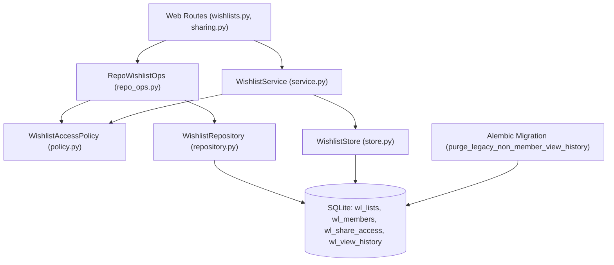

# WISHENKA-303: Access model for Viewing History and protection against unauthorized wishlist disclosure

## Research

### External Best Practices & Standards

1. **OWASP IDOR / Broken Object Level Authorization (BOLA):**
   - Per the OWASP IDOR Prevention Cheat Sheet and OWASP API Security Top 10 (BOLA), every request that reads or mutates an object must perform an explicit server-side object-level authorization check against the authenticated user's context rather than trusting client-supplied sequential IDs ([OWASP IDOR Cheat Sheet](https://cheatsheetseries.owasp.org/cheatsheets/Insecure_Direct_Object_Reference_Prevention_Cheat_Sheet.html)).
   - To prevent resource enumeration on sequential integer IDs, unauthorized access attempts to specific objects should return a uniform `404 Not Found` response indistinguishable from missing or deleted records, while logging the denied attempt internally for auditing ([OWASP](https://owasp.org/)).
   - Data queries for list endpoints (`GET /api/history`) should be scoped directly by authorization predicates (ownership, membership, or valid capability grant) so unauthorized rows are never returned ([OWASP](https://owasp.org/)).
2. **Capability URLs & Share-Token Access Control:**
   - Per the W3C TAG finding *Good Practices for Capability URLs*, a share link acts as a bearer capability token granting least-privilege access to the target resource ([W3C Capability URLs](https://www.w3.org/TR/capability-urls/)).
   - Capability URLs require explicit revocation via token rotation (`public_token`). Binding server-side grants (`wl_share_access`) to the active `public_token` ensures that rotating `public_token` immediately invalidates prior capability grants ([W3C Capability URLs](https://www.w3.org/TR/capability-urls/)).
3. **Alembic & SQLite Data Migration Considerations:**
   - Per SQLAlchemy/Alembic best practices, SQLite data migrations should use decoupled `sa.text()` / `op.execute()` expressions rather than importing live ORM models that may drift from historical schemas ([SQLAlchemy / Alembic](https://alembic.sqlalchemy.org/)).
   - Security-driven data purges (deleting unverified legacy `wl_view_history` rows) are intentionally irreversible: `downgrade()` must not attempt to restore purged unauthorized rows, and the migration's rollback policy must be explicitly documented and tested against a populated SQLite snapshot.

### Current State in Codebase

1. **Viewing History HTTP Endpoints (`wishenka/web/routes/wishlists.py`):**
   - `GET /api/history` (`get_history`) calls `service.get_history(user, limit=20)` and returns `id`, `name`, `description`, `event_title`, `event_date`, `viewed_at`, `is_favorite`, `role`. It performs no access check beyond filtering out `WishlistStatus.DELETED`.
   - `POST /api/history/{wishlist_id}` (`record_view`) checks only that `wl` exists and `wl.status != WishlistStatus.DELETED`, then calls `service.record_view(user, wishlist_id)`. It does not verify ownership, membership, or share-link access.
   - `DELETE /api/history` (`clear_history`) deletes all `wl_view_history` rows for `user.telegram_id` and remains user-scoped.
   - `GET /share/{public_token}` (`wishenka/web/routes/sharing.py`) and `GET /api/public/wishlists/{token}/view` (`wishenka/web/routes/wishlists.py`) call `service.get_wishlist_by_public_token(token, current_user)` (which persists `wl_share_access` for non-owners when `current_user is not None`), but neither endpoint currently records the visit in `wl_view_history`.
2. **Domain Policy (`wishenka/wishlists/policy.py`):**
   - `WishlistAccessPolicy` already implements `resolve_context(user, wishlist)` and `can_favorite(user, wishlist, *, has_share_access=False)`. There is currently no `can_view_history` policy method.
3. **Dual Execution Paths (`RepoWishlistOps` vs `WishlistService` / `WishlistStore`):**
   - Production HTTP routes inject `WishlistRepo` and execute via `RepoWishlistOps` (`wishenka/wishlists/repo_ops.py`) + `WishlistRepository` (`wishenka/wishlists/repository.py`).
   - Test harnesses and wish-scoped endpoints use `WishlistService` (`wishenka/wishlists/service.py`) backed by `WishlistStore` (`wishenka/wishlists/store.py`).
   - From `WISHENKA-302`, `wl_share_access` grants are already persisted on `get_wishlist_by_public_token(public_token, current_user)` in both `RepoWishlistOps` and `WishlistService` (including scoped `execute_wish` / `execute_wish_idempotent` via `_load_wish` / `_persist_wish` in `WishlistStore`).
4. **Revocation Paths:**
   - `remove_member`: implemented in both `RepoWishlistOps.remove_member` and `WishlistService.remove_member`. Currently revokes `wl_favorites` if no valid `wl_share_access` remains, but does not touch `wl_view_history`.
   - `regenerate_public_token`: implemented in both `RepoWishlistOps` and `WishlistService`. Currently calls `_revoke_share_access_and_favorites` / `_revoke_share_access_for_wishlist`, which deletes `wl_share_access` and non-member `wl_favorites`, but does not purge non-member `wl_view_history`.
   - `restore_deleted_wishlist`: implemented in both `RepoWishlistOps` and `WishlistService` (rotates `public_token` and revokes share access/favorites, but does not purge non-member `wl_view_history`).
   - `transfer_ownership`: implemented on `WishlistService` only (`wishenka/wishlists/service.py`; `RepoWishlistOps` does not expose `transfer_ownership`). On transfer, `old_owner_id` is added to `wl.members` with `WishlistRole.ADMIN`, `new_owner_id` becomes `wl.owner_id`, and `public_token` rotates. Purging non-member `wl_view_history` rows preserves both the new owner and the former owner (now an `admin` member) while removing non-member share-link viewers.
5. **Database Schema & Migrations (`wishenka/wishlists/alembic/versions/`):**
   - Current Alembic head is `add_share_access_and_purge_favorites` (`WISHENKA-302`).
   - `wl_view_history` has `(id, user_id, wishlist_id, viewed_at)` with `UNIQUE(user_id, wishlist_id)` and `ON DELETE CASCADE` FKs to `users(telegram_id)` and `wl_lists(id)`.
6. **Affected Existing Tests:**
   - Existing tests that call `POST /api/history/{wishlist_id}` as a non-member without first opening the share link (e.g., `tests/test_wishlist_sections_ui.py`, `tests/test_wishlist_sections_observability.py`, `tests/test_history_screen_browser.py`) will need to be updated in Step 4 to match the access model.

## Implementation Plan

1. **Alembic Migration (revising `add_share_access_and_purge_favorites`):**
   - Create a new Alembic revision with `down_revision = "add_share_access_and_purge_favorites"` and `ROLLBACK_POLICY = "one-way"`.
   - In `upgrade()`, purge legacy `wl_view_history` rows where the user is neither the wishlist owner (`wl_lists.owner_id`), nor a current member (`wl_members`), nor a holder of a valid `wl_share_access` grant matching `wl_lists.public_token`:
     ```sql
     DELETE FROM wl_view_history
     WHERE NOT EXISTS (
         SELECT 1 FROM wl_lists l
         WHERE l.id = wl_view_history.wishlist_id
           AND (
               l.owner_id = wl_view_history.user_id
               OR EXISTS (
                   SELECT 1 FROM wl_members m
                   WHERE m.wishlist_id = l.id AND m.user_id = wl_view_history.user_id
               )
               OR EXISTS (
                   SELECT 1 FROM wl_share_access sa
                   WHERE sa.wishlist_id = l.id
                     AND sa.user_id = wl_view_history.user_id
                     AND sa.public_token = l.public_token
               )
           )
     )
     ```
   - **Rollback policy:** `ROLLBACK_POLICY = "one-way"`. Per `doc/dev/migrations.md`, `downgrade()` refuses to run: it logs `wishlist_migration_downgrade_refused` (`WARNING`, `extra={"event": "wishlist_migration_downgrade_refused", "revision": revision}`) and raises `NotImplementedError` with backup-restoration guidance, because purging unverified legacy `wl_view_history` rows is an intentionally irreversible security remediation.
2. **Domain Access Policy (`wishenka/wishlists/policy.py`):**
   - Add `WishlistAccessPolicy.can_view_history(user, wishlist, *, has_share_access: bool = False) -> bool`:
     - Returns `False` if `user is None` or `wishlist.status == WishlistStatus.DELETED`.
     - Resolves `ctx = WishlistAccessPolicy.resolve_context(user, wishlist)` and returns `ctx.is_owner or ctx.is_member or has_share_access`.
3. **Persistence Layer (`wishenka/wishlists/repository.py`, `wishenka/wishlists/store.py`):**
   - Add `WishlistRepository.delete_non_member_history(self, wishlist_id: int) -> int`: deletes `wl_view_history` rows for `wishlist_id` where `user_id` is neither `wl_lists.owner_id` nor in `wl_members`.
   - Add `WishlistRepository.delete_history_if_no_share_access(self, user_id: int, wishlist_id: int, public_token: str) -> int`: deletes `wl_view_history` row for `(user_id, wishlist_id)` unless `wl_share_access` has a matching `(user_id, wishlist_id, public_token)` grant (and user is not owner/member).
   - Update `WishlistRepository.list_view_history(self, user_id: int, limit: int = 20)` (or filter in `RepoWishlistOps.get_history` / SQL join) so only non-deleted wishlists where `user_id` is owner, member, or holds a valid `wl_share_access` matching `wl_lists.public_token` are returned within `limit`. Filtering in SQL via `JOIN wl_lists` ensures `LIMIT :lim` applies to *accessible* entries rather than being truncated by stale rows.
   - `WishlistStore` already hydrates and persists `wl_view_history` and `wl_share_access` in `_load_storage` / `_persist_storage` and `wl_share_access` in `_load_wish` / `_persist_wish` (`execute_wish` / `execute_wish_idempotent`).
4. **Application Services (`wishenka/wishlists/repo_ops.py`, `wishenka/wishlists/service.py`):**
   - **Recording (`record_view`):** In both `RepoWishlistOps.record_view` and `WishlistService.record_view`, fetch `wl` (header/members in `RepoWishlistOps`), check `has_share = await self.repo.has_valid_share_access(...)` / `self._has_valid_share_access(user.telegram_id, wl)`, and enforce `WishlistAccessPolicy.can_view_history(user, wl, has_share_access=has_share)`. If denied, log `view_history_access_denied` (WARNING) and raise `WishlistNotFoundError(f"Wishlist {wishlist_id} not found")` (HTTP 404 anti-enumeration).
   - **Listing (`get_history`):** In both `RepoWishlistOps.get_history` and `WishlistService.get_history`, return only non-deleted wishlists passing `WishlistAccessPolicy.can_view_history(user, wl, has_share_access=...)` up to `limit`.
   - **Revocation across all paths:**
     - `remove_member` (`RepoWishlistOps` & `WishlistService`): call `delete_history_if_no_share_access(user_id, wl.id, wl.public_token)` (and in-memory removal from `self._view_history` in `WishlistService` when `not self._has_valid_share_access(user_id, wl)` and `user_id != wl.owner_id`).
     - `regenerate_public_token` (`RepoWishlistOps` & `WishlistService`): extend `_revoke_share_access_and_favorites` (or rename/extend helper) to also call `delete_non_member_history(wishlist_id)` / purge non-owner, non-member entries from `self._view_history`.
     - `restore_deleted_wishlist` (`RepoWishlistOps` & `WishlistService`): ensure the same token-rotation revocation helper purges non-member `wl_view_history` rows.
     - `transfer_ownership` (`WishlistService` only): calls `_revoke_share_access_for_wishlist(wl, reason="ownership_transferred", actor_id=actor.telegram_id)` after `wl.owner_id = new_owner_id` and adding `old_owner_id` to `wl.members` as `ADMIN`, so non-member `wl_view_history` rows are purged while both `new_owner_id` and `old_owner_id` retain their history.
5. **HTTP Route Alignment (`wishenka/web/routes/wishlists.py`, `wishenka/web/routes/sharing.py`):**
   - Simplify `POST /api/history/{wishlist_id}` (`record_view`) to delegate existence, deletion, and access validation to `service.record_view(user, wishlist_id)`, ensuring `RepoWishlistOps` and `WishlistService` share one canonical enforcement path (`WishlistAccessPolicy.can_view_history`).
   - In `GET /share/{public_token}` (`wishenka/web/routes/sharing.py`) and `GET /api/public/wishlists/{token}/view` (`wishenka/web/routes/wishlists.py`), when an authenticated user is present (`current_user is not None` / `user is not None`) and `get_wishlist_by_public_token` succeeds for a non-deleted wishlist, automatically call `await service.record_view(current_user, dto.id)` / `await service.record_view(user, view.id)`. This ensures a legitimate giver (as well as an owner or member) records/updates Viewing History simply by opening the active share link, while anonymous visits (`user is None`, including `GET /api/public/wishlists/{token}`) do not record history.
6. **Tests:**
   - Add `tests/test_history_access_control.py` covering stranger denial (`404` on `POST /api/history/{id}`, empty `GET /api/history`), owner & member access, automatic history recording on authenticated share-link visits (`GET /share/{public_token}` and `GET /api/public/wishlists/{token}/view`), no history recording on anonymous share-link visits, giver share-link access (including via `execute_wish` reservation), membership removal revocation (with and without active share-link access), share-link rotation revocation (`regenerate_public_token`, `restore_deleted_wishlist`, `transfer_ownership`), and Alembic migration purge + one-way `downgrade()` refusal (logging `wishlist_migration_downgrade_refused` and raising `NotImplementedError` with backup-restoration guidance).
   - Update affected existing tests (`tests/test_wishlist_sections_ui.py`, `tests/test_wishlist_sections_observability.py`, `tests/test_history_screen_browser.py`) to grant share-link access or use members where appropriate.

**Mandatory — Failing Repro (next Step 3):**
- **Where it lives:** `tests/test_history_access_control.py` (with `@pytest.mark.timeout(30)` per `do-testing`).
- **What it asserts (desired behavior):**
  1. An authenticated stranger (non-owner, non-member, no share-link visit) calling `POST /api/history/{wishlist_id}` receives HTTP `404` with the uniform `"Wishlist {id} not found"` error template matching a non-existent or deleted wishlist ID (e.g., `unauthorized_resp.status_code == 404 == missing_resp.status_code` and `unauthorized_resp.json()["detail"].replace(str(wl_id), "<id>") == missing_resp.json()["detail"].replace(str(missing_id), "<id>")`), and `GET /api/history` remains empty (`[]`).
  2. When a legacy unauthorized row exists directly in `wl_view_history` for that stranger, `GET /api/history` does not return the private wishlist's metadata.
  3. After a giver opens the wishlist via its active share link while authenticated (`GET /api/public/wishlists/{public_token}/view` or `GET /share/{public_token}`), `GET /api/history` immediately returns the wishlist without requiring a separate `POST /api/history/{wishlist_id}` call, and subsequent `POST /api/history/{wishlist_id}` returns `200`. Anonymous share-link visits (`user is None`) do not record history.
  4. When the owner rotates the share link (`POST /api/wishlists/{wishlist_id}/share/reset`), the giver's `GET /api/history` no longer includes the wishlist and `POST /api/history/{wishlist_id}` returns `404` again.
- **How to force failure without live external deps:** Uses FastAPI `TestClient` with an isolated temporary SQLite database and `Authorization: Bearer <token>` headers minted via `SessionTokenService` (matching `tests/test_wishlist_sections_ui.py` and `tests/test_favorites_access_control.py`), requiring zero network or Telegram Bot API calls.
- **Sequencing:** Research (done) → Write red test in Step 3 (`POST /api/history/{id}` currently returns `200` for stranger, causing test to fail) → Implement Step 4 changes until green.

## Architecture

### System Module Diagram



### Module Responsibilities

- **`wishenka/wishlists/policy.py` (`WishlistAccessPolicy`):** Pure domain authorization rule `can_view_history(user, wishlist, *, has_share_access=False)` checking non-null user, non-deleted wishlist, and `(ctx.is_owner or ctx.is_member or has_share_access)` without performing I/O.
- **Alembic Migration (revising `add_share_access_and_purge_favorites`):** Purges legacy `wl_view_history` rows where the user is neither `wl_lists.owner_id`, nor in `wl_members`, nor holds a `wl_share_access` row matching `wl_lists.public_token`. Declares `ROLLBACK_POLICY = "one-way"` and refuses `downgrade()` by logging `wishlist_migration_downgrade_refused` and raising `NotImplementedError` with backup-restoration guidance (intentionally irreversible security remediation).
- **`wishenka/wishlists/repository.py` (`WishlistRepository`) & `wishenka/wishlists/store.py` (`WishlistStore`):** SQL-scoped `list_view_history`, `delete_non_member_history`, and `delete_history_if_no_share_access`; `WishlistStore` persists `wl_view_history` and `wl_share_access` changes atomically within `BEGIN IMMEDIATE` transactions.
- **`wishenka/wishlists/repo_ops.py` (`RepoWishlistOps`) & `wishenka/wishlists/service.py` (`WishlistService`):** Enforces `WishlistAccessPolicy.can_view_history` in `record_view` (raising `WishlistNotFoundError` on denial) and `get_history`, and purges revoked `wl_view_history` entries on `remove_member`, `regenerate_public_token`, `restore_deleted_wishlist`, and `transfer_ownership` (`WishlistService` only).
- **`wishenka/web/routes/wishlists.py` & `wishenka/web/routes/sharing.py`:** HTTP boundary for `POST /api/history/{wishlist_id}`, `GET /api/history`, `GET /api/public/wishlists/{token}/view`, and `GET /share/{public_token}`. Delegates authorization to `service.record_view` and `service.get_history`, and automatically invokes `service.record_view` when an authenticated user opens an active share link.

### Module Interaction Scheme

1. **Share-link visit (Authenticated Giver / Member / Owner):** `GET /share/{token}` or `GET /api/public/wishlists/{token}/view` with authenticated `user` → `get_wishlist_by_public_token(token, user)` persists `wl_share_access` bound to `wl.public_token` for non-owners (already implemented in `WISHENKA-302`) → route calls `service.record_view(user, view.id)` (enforcing `can_view_history` and upserting `wl_view_history`). Anonymous visits (`user is None`, including `GET /api/public/wishlists/{token}`) do not grant `wl_share_access` and do not call `record_view`. (`POST /api/public/wishlists/{token}/items/{item_id}/reservations` continues to use `execute_reservation` / `_load_wish`, persisting `wl_share_access` only.)
2. **Explicit Record View:** `POST /api/history/{wishlist_id}` → `service.record_view(user, wishlist_id)` → checks `has_valid_share_access(user.telegram_id, wishlist_id, wl.public_token)` + `WishlistAccessPolicy.can_view_history(user, wl, has_share_access=has_share)` → if denied, logs `view_history_access_denied` and raises `WishlistNotFoundError` (HTTP 404); if allowed, upserts `wl_view_history`.
3. **List History:** `GET /api/history` → `service.get_history(user, limit=20)` → returns only non-deleted wishlists where `user` is owner, member, or holds a `wl_share_access` row matching `wl_lists.public_token`.
4. **Revocation:**
   - `remove_member` → removes `wl_members` row → deletes `wl_view_history` row unless user is owner or still holds valid `wl_share_access` for `wl.public_token`.
   - `regenerate_public_token` / `restore_deleted_wishlist` / `transfer_ownership` (`WishlistService` only) → rotates `public_token`, revokes `wl_share_access`, and deletes `wl_view_history` rows for users who are neither `wl.owner_id` nor in `wl_members`.

### Architectural Patterns & Justification

- **Reuse of `wl_share_access` Capability Grants (`WISHENKA-302`):** Avoids duplicating share-link tracking tables and guarantees that `public_token` rotation revokes both Favorites and Viewing History consistently.
- **Anti-Enumeration Uniform Error Mapping:** Raising `WishlistNotFoundError` for unauthorized `POST /api/history/{wishlist_id}` ensures identical HTTP 404 status and response body compared to non-existent or deleted wishlists.
- **Pure Domain Policy + Scoped Persistence:** Keeping `WishlistAccessPolicy.can_view_history` pure while filtering `list_view_history` in SQL ensures `LIMIT 20` is accurate and both `RepoWishlistOps` and `WishlistService` behave identically.

### Main Interfaces & Data Schema

#### Domain Policy Signature (`wishenka/wishlists/policy.py`)

```python
@staticmethod
def can_view_history(
    user: AuthenticatedUser | None,
    wishlist: Wishlist,
    *,
    has_share_access: bool = False,
) -> bool:
    """Check if user can record or view the wishlist in Viewing History."""
```

#### Repository Interface (`wishenka/wishlists/repository.py`)

- `async def delete_non_member_history(self, wishlist_id: int) -> int`
- `async def delete_history_if_no_share_access(self, user_id: int, wishlist_id: int, public_token: str) -> int`
- `async def list_view_history(self, user_id: int, limit: int = 20) -> list[ViewHistoryEntry]` (SQL-filtered to non-deleted wishlists where `user_id` is owner, member, or valid `wl_share_access` holder)

## Q&A

- **Q:** Can a wishlist owner record and see their own wishlist in Viewing History?
  **A:** Yes. Unlike `can_favorite` (which rejects `wishlist.owner_id == user.telegram_id`), `can_view_history` allows owners, collaborative members, and verified share-link visitors on non-deleted wishlists.
- **Q:** What happens to the previous owner's viewing history on `transfer_ownership`?
  **A:** `WishlistService.transfer_ownership` demotes `old_owner_id` to `WishlistRole.ADMIN` in `wl_members` before calling `_revoke_share_access_for_wishlist`, so purging non-owner, non-member `wl_view_history` rows preserves both the new owner and the former owner while revoking non-member share-link viewers.
- **Q:** Why does `downgrade()` refuse to run (`ROLLBACK_POLICY = "one-way"`) for the `wl_view_history` data purge?
  **A:** Purging unverified non-member `wl_view_history` rows is an intentionally irreversible security remediation; per `doc/dev/migrations.md`, one-way revisions log `wishlist_migration_downgrade_refused` and raise `NotImplementedError` with backup-restoration guidance so previously leaked wishlist associations cannot be restored on rollback.
