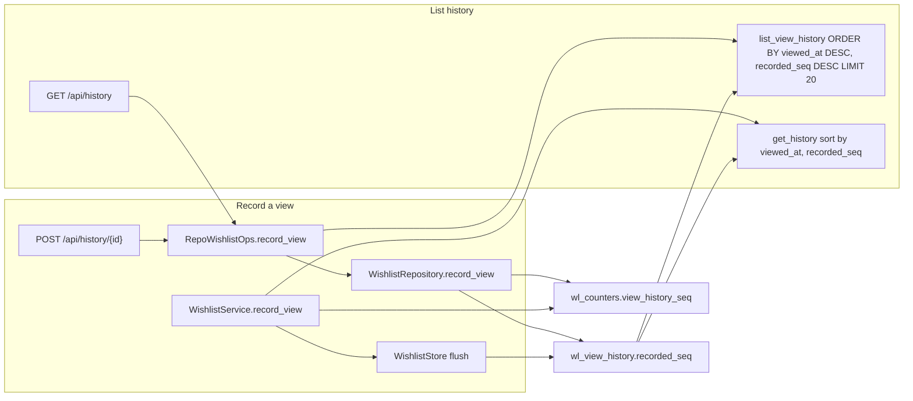

# WISHENKA-304: Deterministic order when viewing times match

## Research

### Where the order is decided today

Viewing history is most recent `viewed_at` first. Nothing else participates. A
repeated view keeps the row's lasting `id` and only refreshes `viewed_at`.

Two stacks share that gap:

| Path | Who the viewer hits | Where equal times are ordered | Where the limit of 20 is applied |
| --- | --- | --- | --- |
| In-memory session | `WishlistService` (`in_memory()` and `WishlistStore` hydrate) | `get_history` sorts `key=lambda e: e.viewed_at, reverse=True` (`wishenka/wishlists/service.py`) | `record_view` sorts `key=lambda e: e.viewed_at` ascending and drops `user_entries[:-20]` |
| Stored SQLite | `GET /api/history` → `RepoWishlistOps.get_history` → `WishlistRepository.list_view_history` | `ORDER BY vh.viewed_at DESC` (`wishenka/wishlists/repository.py`) | that same statement's `LIMIT :lim` (default 20) |

`wishenka/web/routes/wishlists.py` `get_history` returns the service list in the
order it receives. It does not sort again.

`WishlistService.record_view` moves a repeat to the end of `_view_history` and
does not allocate a new `id` (`_next_view_history_id` increments only for a new
entry). `WishlistRepository.record_view` is `INSERT ... ON CONFLICT(user_id,
wishlist_id) DO UPDATE SET viewed_at = excluded.viewed_at`, so the primary key
stays the first insert. `WishlistStore` reloads history with `ORDER BY id ASC`
and, on flush, updates only `viewed_at` for an existing id.

### Why that is not a stable recording sequence

Python's list sort is stable: rows that compare equal keep their previous
relative order ([Sorting HOW TO](https://docs.python.org/3/howto/sorting.html)).
After a session of appends, that previous order is oldest recording first, so
`reverse=True` on `viewed_at` alone shows the older recording above the newer
one when the times match. After `WishlistStore` loads `ORDER BY id ASC`, the
order a stable sort preserves is row identity. A repeat still has the smaller
id, so it sorts as if it were the older view.

SQLite leaves any remaining tie undefined: if every `ORDER BY` expression is
equal, the engine may return those rows in either order
([SELECT](https://www.sqlite.org/lang_select.html)). An index may break that
tie with the rowid ([Query Planning](https://www.sqlite.org/queryplanner.html)).
Using `id` or the rowid as that second key records the first insert, not the
latest recording. A repeat would stay behind a wishlist that was first opened
later and happened to receive a larger id. `LIMIT` would then keep or drop the
wrong equal-time rows
([SQLite: do not treat rowid as insertion order](https://sqlite.work/reliable-insertion-and-retrieval-order-in-sqlite-without-rowid-assumptions/)).

List position in `_view_history` matches recording order only until the next
load. The load sorts by `id`. List position is therefore not a tie-break that
both stacks can share.

WISHENKA-292 item 2 suggested `id` as the secondary key. The accepted
requirements of this task reject that: the lasting identity is not freshness.

### Chosen tie-break

A monotonic integer, `recorded_seq`, stored on the history entry and on
`wl_view_history`. It increases by one on every recorded view, including a
repeat. Equal `viewed_at` values order by `recorded_seq` descending (newest
recording first). Different `viewed_at` values stay most recent first. The
comparator never reads `id`.

The counter is global (`wl_counters.name = 'view_history_seq'`), separate from
the existing `view_history` counter that allocates row ids. Another viewer's
recording consumes a number and does not reorder this viewer's rows, because
each listing is already restricted to one `user_id`.

## Implementation Plan

1. Add `recorded_seq` and the counter (Alembic, on top of head
   `purge_legacy_non_member_view_history`).
2. Assign the next value in both record paths, including the update branch of
   a repeat, and persist it.
3. Sort and limit with `(viewed_at, recorded_seq)` in `WishlistService` and in
   `list_view_history`.
4. Leave access checks, clear, the size of the limit (20), the HTTP payload,
   and order among different view times as they are.

**Mandatory — Failing Repro (next Step 3):** One new module,
`tests/test_wishenka_304_history_order_repro.py`, with
`pytestmark = pytest.mark.timeout(30)`. No live Telegram or network. Clock is
frozen by patching `datetime.now` on `wishenka.wishlists.service` and
`wishenka.wishlists.repo_ops` to one fixed UTC instant for the recordings
only, so at least two entries share `viewed_at`. Wishlists are created before
the patch.

The test asserts wishlist id order, newest recording first. It does not assert
row ids. One sequence must reject today's sorts and both "order ties by `id`"
directions:

1. Record wishlist A, then B, then C, then A again, all at the frozen instant.
   A keeps its original id; the repeat is the newest recording.
   Expected order: A, C, B.
   Today the in-memory stable sort returns B, C, A (append order, A moved to
   the end). `id` ascending would be A, B, C. `id` descending would be C, B, A.
   None of those is A, C, B.
2. Same recordings through `WishlistStore` on a temporary SQLite file: record,
   let the transaction flush, read back with a new service load (`get_history`)
   and with `WishlistRepository.list_view_history`. Both return A, C, B.
   Today's store reload is `ORDER BY id ASC`, and the SQL list is
   `ORDER BY viewed_at DESC` only, so this read-back fails the same assertion.
3. Limit, same frozen instant. Record L1 through L20, repeat L1, then record
   L21 (21 distinct wishlists, one repeat). The 20 shown start with L21, L1
   and then L20 down through L3. L2 is absent (oldest recording that was not
   repeated). L1 is present even though its row id is the smallest. Assert
   that on `WishlistService.get_history` and on `list_view_history` (the SQL
   `LIMIT` is what drops stored rows; `RepoWishlistOps` does not delete older
   rows). A second viewer recording other wishlists at the same instant does
   not change the first viewer's order.
4. A control with two different `viewed_at` values still lists the later time
   first, so the red test does not depend on equal times being the only order.

Sequencing: this architecture is the research. Step 3 adds the red test and
stops while it fails. Step 4 changes production code until that test is green.
The test is red before the fix because the order above is not what
`viewed_at`-only sorting or `id` ordering produces.

## Architecture

No new service, screen, or route. The change is one ordering key on the entry
both stacks already share, written on record and read on list.



### Modules

- **`ViewHistoryEntry` (`wishenka/wishlists/models.py`)** and **`ViewHistoryRow`
  (`wishenka/wishlists/db_models.py`)**: carry `recorded_seq: int`. `id` stays
  the lasting identity and is still stable across a repeat. `recorded_seq` is
  not part of the HTTP history object. Callers keep using `id` as identity and
  do not read freshness from it.
- **`WishlistService.record_view`**: on a new entry and on a repeat, set
  `recorded_seq` from `_next_view_history_seq` (increment by one) before the
  entry is appended. The repeat still `remove`s and `append`s the same object
  and still keeps `id`. The prune sort key becomes
  `(viewed_at, recorded_seq)` ascending, then `[:-20]`, so a smaller sequence
  is dropped before a larger one when the times match. The limit stays 20.
- **`WishlistService.get_history`**: sort key
  `(viewed_at, recorded_seq)` with `reverse=True`, then the existing access
  check and `limit`. Later time wins. Equal time: larger `recorded_seq` first.
- **`WishlistRepository.record_view`**: in the same transaction, take the next
  `view_history_seq` and write it on insert and on
  `ON CONFLICT DO UPDATE` together with `viewed_at`. Do not call `_allocate_id`
  for this value. `_allocate_id` mixes the counter with `MAX(id)` and would
  tie the sequence to the primary key.
- **`WishlistRepository.list_view_history`**: `ORDER BY vh.viewed_at DESC,
  vh.recorded_seq DESC LIMIT :lim`. Access predicates and the limit value stay.
  The second key decides which equal-time rows fall inside `LIMIT`.
- **`WishlistStore`**: hydrate `recorded_seq` and `_next_view_history_seq`
  from `wl_counters` the same way `_next_view_history_id` is loaded. Flush
  writes `recorded_seq` on insert and on update. Loading may keep
  `ORDER BY id ASC`; list and prune do not use that order.
- **`RepoWishlistOps`**: no new policy. `record_view` already builds the entry
  and delegates the write. The sequence is assigned in the repository so the
  HTTP path and any other repository caller share it. `get_history` keeps the
  repository's order.
- **Alembic revision** `add_view_history_recorded_seq`, `down_revision =
  "purge_legacy_non_member_view_history"`, `ROLLBACK_POLICY = "reversible"`.
  `upgrade` adds `recorded_seq INTEGER NOT NULL`, backfills existing rows with
  their current `id` so the column is unique, sets `wl_counters.view_history_seq`
  to `MAX(recorded_seq)`, and replaces
  `idx_wl_view_history_user_time` with
  `(user_id, viewed_at DESC, recorded_seq DESC)`. `downgrade` restores the
  previous index and drops the column. `_REVISIONS` in
  `wishenka/wishlists/migrations.py` is the legacy-adoption map for early
  schemas and does not gain a new head entry; head stays
  `ScriptDirectory.get_current_head()`.

The backfill copies `id` once so old rows have a number. That is not the
tie-break. The next `record_view` of that row, including a repeat at the same
`viewed_at`, replaces `recorded_seq` with a new counter value. From then on,
freshness is the counter.

### Patterns

- **Same key on both stacks.** The in-memory sorts and the SQL `ORDER BY`
  use `(viewed_at DESC, recorded_seq DESC)`. A stable sort is not the contract.
- **Repository write owns the stored counter; the service owns the in-memory
  counter.** This matches the existing split: HTTP uses `RepoWishlistOps` and
  `WishlistRepository`; `WishlistStore` persists the service's entries and
  `wl_counters` at flush. The new counter is a sibling of `view_history`, not
  a reuse of it.
- **Explicit total order.** SQLite does not promise an order for tied
  `ORDER BY` expressions, so the second expression is in the query that also
  applies `LIMIT`.

### Interfaces

```python
@dataclass
class ViewHistoryEntry:
    id: int = 0
    user_id: int = 0
    wishlist_id: int = 0
    viewed_at: datetime = field(default_factory=lambda: datetime.now(UTC))
    recorded_seq: int = 0
```

In-memory rank, shared by the list sort and the prune sort so the two sites
cannot drift:

```python
def _history_rank(entry: ViewHistoryEntry) -> tuple[datetime, int]:
    return (entry.viewed_at, entry.recorded_seq)
```

`get_history` sorts with `key=_history_rank, reverse=True`. The prune sorts
with `key=_history_rank` (ascending) and still keeps the last 20.

Stored list, same rank, access filter unchanged:

```sql
ORDER BY vh.viewed_at DESC, vh.recorded_seq DESC
LIMIT :lim
```

Repeat write, identity unchanged, sequence moved forward:

```sql
INSERT INTO wl_view_history (user_id, wishlist_id, viewed_at, recorded_seq)
VALUES (:user_id, :wishlist_id, :viewed_at, :recorded_seq)
ON CONFLICT(user_id, wishlist_id) DO UPDATE SET
    viewed_at = excluded.viewed_at,
    recorded_seq = excluded.recorded_seq
```

`GET /api/history` still returns `viewed_at` and does not return
`recorded_seq`.

## Q&A

**Why a counter instead of list position?**
List position is the recording sequence only inside one process, and only until
`WishlistStore` loads `ORDER BY id ASC`. The stored list is what
`GET /api/history` reads. A position that is not stored cannot decide the SQL
`LIMIT`. The counter is stored on the row and copied onto the in-memory entry,
so both paths use one rule.

**Why not the row id?**
A repeat keeps `id`. Ordering by `id` treats the first insert as the latest
view. The red sequence A, then B, then C, then A again expects A, C, B.
`id` ascending yields A, B, C. `id` descending yields C, B, A.

**Why is the counter global rather than per viewer?**
Listings are already per `user_id`. A single increasing counter keeps every
recording, including a repeat, strictly after the previous one without a
second allocator. Another viewer taking the next number does not swap this
viewer's relative order.

**What about rows that already exist?**
Upgrade gives them `recorded_seq = id` and starts the counter at the max.
That only fills the new column. The live rule still does not read `id`. The
next recording of a row replaces `recorded_seq`.

**Does the limit change?**
No. It stays 20. Only which equal-time rows fall inside it changes: larger
`recorded_seq` is kept ahead of a smaller one.
