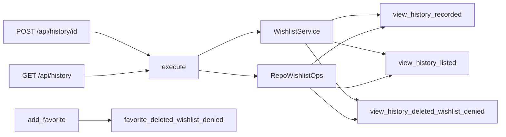

# WISHENKA-305: One log line per viewing-history event

## Research

### Who writes the lines today

Two adapters implement the same viewing-history operations. The HTTP handlers
in `wishenka/web/routes/wishlists.py` call whichever one `execute()` selects.
`request.app.state.wishlist_service`, when set, wins. Otherwise the handler
builds `RepoWishlistOps` around the request's `WishlistRepository`. Production
`create_app` does not set `wishlist_service`, so a normal request uses
`RepoWishlistOps`. Loggers differ: the route uses `wishenka.web.wishlists`,
both adapters use `wishenka.wishlists`.

- `view_history_recorded`. `WishlistService.record_view` writes it after a
  successful store. `RepoWishlistOps.record_view` does not. The route writes
  it on `POST /api/history/{id}` after `record_view` returns.
- `view_history_listed`. `WishlistService.get_history` writes it with
  `count`. `RepoWishlistOps.get_history` does not. The route writes it on
  `GET /api/history`, with `count`.
- `view_history_deleted_wishlist_denied`. Both `record_view` methods write it
  for a deleted list, then raise `WishlistNotFoundError`. The route does not.
- `favorite_deleted_wishlist_denied`. Both `add_favorite` methods write it.
  History does not.
- `view_history_cleared`. Both `clear_history` methods write it. The route
  does not. WISHENKA-292 already removed the route copy.

Fields already carried, and kept: recorded has `wishlist_id` and `user_id`;
listed has `user_id` and `count`; both denials have `wishlist_id` and
`user_id`. None of these lines include a wishlist title or a secret.
`DELETE /api/history` is already one `view_history_cleared` and stays that way.

A request that runs `WishlistService` through the route therefore writes
`view_history_recorded` twice and `view_history_listed` twice: once on
`wishenka.wishlists`, once on `wishenka.web.wishlists`. The same call through
`RepoWishlistOps` writes each success name once, and only from the route,
because that adapter does not log those two names. Deleting the route lines
without adding them on `RepoWishlistOps` would silence the SQLite path.

The history route does not log `favorite_deleted_wishlist_denied`. Both
`record_view` implementations already refuse a deleted wishlist with
`view_history_deleted_wishlist_denied` and then raise, so the route's success
line does not run. `favorite_deleted_wishlist_denied` is the favorites
refusal inside `add_favorite` on both adapters.

`tests/test_wishlist_sections_observability.py` already counts that split:

- `test_domain_service_warnings_on_violations` calls `add_favorite` on a
  deleted list and `record_view` on a deleted list in one capture, then
  asserts `favorite_deleted_wishlist_denied` once and
  `view_history_deleted_wishlist_denied` once.
- `test_warning_on_self_favoriting_and_deleted_wishlists` expects the
  favorites name on `POST /api/favorites/{id}` and the history name on
  `POST /api/history/{id}`.
- `test_view_history_lifecycle_observability` counts recorded and listed on
  the route logger only (`>= 1`). It does not see the service copy.
- `tests/test_history_access_control.py` expects
  `view_history_deleted_wishlist_denied` on the service logger for
  `POST /api/history/{id}` of a deleted list.

WISHENKA-292 wrote the debt when the route and the service both used the
favorites name for a deleted-list history refusal. Later access-control work
renamed the history refusal. Putting that favorites name back on `record_view`
would make the existing `== 1` count into `2` and would drop the history name
those tests require.

### What "one owner" means for Python logging

A count of an event name counts `logger.info` / `logger.warning` calls, not
handler propagation. Two calls with the same `extra["event"]` are two records
even when they use different logger names
([logging](https://docs.python.org/3/library/logging.html)). `caplog.records`
keeps each of those `LogRecord`s, and `extra` keys become attributes
([pytest caplog](https://docs.pytest.org/en/stable/how-to/logging.html)).
The layer that decides the outcome should be the only caller. A second call
at the HTTP boundary inflates the count.
`view_history_cleared` already follows that rule. Recorded and listed should
follow it too.

## Implementation Plan

No new route, screen, or table. Step 4 edits log calls only.

1. Remove `view_history_recorded` from `record_view` in
   `wishenka/web/routes/wishlists.py` and `view_history_listed` from
   `get_history` there. Leave the JSON each handler returns as it is.
2. Keep those two INFO lines on `WishlistService.record_view` and
   `get_history`, with the same fields.
3. Add the same two INFO lines to `RepoWishlistOps.record_view` (after the
   row is stored) and `RepoWishlistOps.get_history` (after access filtering,
   `count` equal to the list it returns). Same fields, same logger
   `wishenka.wishlists`, no title.
4. Leave both `record_view` WARNING lines named
   `view_history_deleted_wishlist_denied`. Do not add
   `favorite_deleted_wishlist_denied` on the history route or on
   `record_view`.
5. Leave `add_favorite`'s `favorite_deleted_wishlist_denied` on both adapters.
   Leave `clear_history`, access checks, order, and the HTTP body unchanged.
6. `record_share_view_if_authenticated` calls `record_view` and does not log
   this event itself. After step 3 a share-link recording emits one service
   line. The share route must not add a second.

`test_view_history_lifecycle_observability` filters
`wishenka.web.wishlists`. Step 4 points that filter at `wishenka.wishlists`
and expects one record. That edit is part of making the suite green, after
the red test exists.

**Mandatory — Failing Repro (next Step 3):** Add
`tests/test_wishenka_305_history_log_repro.py` with
`pytestmark = pytest.mark.timeout(30)`. No Telegram and no network. Use
`TestClient`, `caplog`, and `WishlistService.in_memory()`. Count
`LogRecord`s by `event` across every logger. Do not filter to the route
logger: that filter hides the duplicate.

The module is red before any production edit.

1. Inject `WishlistService.in_memory()` as `app.state.wishlist_service`.
   Record one view with `POST /api/history/{id}`, then list with
   `GET /api/history`. Assert exactly one `view_history_recorded` and exactly
   one `view_history_listed`. Today each name is 2 (service plus route). The
   listed record still has `count` equal to the number of entries returned,
   and neither message contains the wishlist title.
2. Repeat record and list on the default app (`RepoWishlistOps`, no
   injection). Assert exactly one of each name and
   `record.name == "wishenka.wishlists"`. Today the only record is
   `wishenka.web.wishlists`, so the owner assertion fails. A fix that only
   deletes the route lines makes this count 0 and stays red.
3. `POST /api/history/{deleted_id}` (both adapters) asserts
   `favorite_deleted_wishlist_denied` is 0 and
   `view_history_deleted_wishlist_denied` is 1, on `wishenka.wishlists`.
   Today the names already match, so this part stays green. It fails if a
   later edit puts the favorites name back on the history path.
4. On `WishlistService.in_memory()` alone, `record_view` of a deleted
   wishlist asserts `view_history_deleted_wishlist_denied` once and
   `favorite_deleted_wishlist_denied` zero times. A separate `add_favorite`
   of a deleted wishlist asserts `favorite_deleted_wishlist_denied` once.
   That is the service event
   `test_domain_service_warnings_on_violations` counts. The repro must not
   require the favorites name on `record_view`.

Sequencing: this note is the research. Step 3 adds the red module and stops
while case 1 is 2 and case 2 still names the route logger. Step 4 moves the
success lines onto both adapters and updates the older route-logger assertion
until the new module and the existing history tests pass.

## Architecture

The HTTP handler stays a thin adapter. The domain operation is the only
writer of its event. Both adapters implement that operation, so a SQLite
request and an in-memory request emit the same name once.

### Modules

- `wishenka/web/routes/wishlists.py` — auth, status mapping, JSON shape.
  After this task it does not log recorded, listed, or either denial.
- `wishenka/wishlists/service.py` — in-memory owner of recorded, listed,
  cleared, and the history denial. `add_favorite` remains the owner of
  `favorite_deleted_wishlist_denied`.
- `wishenka/wishlists/repo_ops.py` — SQLite owner of the same history events.
  `record_view` and `get_history` gain the success lines they lack.
  `add_favorite` keeps the favorites denial.
- `tests/test_wishenka_305_history_log_repro.py` — the red count. Existing
  observability tests stay the regression net; Step 4 retargets the one
  assertion that only watches the route logger.

### Pattern

One domain event, one call site per adapter. The route must not repeat a
name the operation already writes. This is the same split WISHENKA-292 used
for `view_history_cleared`. It is not a new logger hierarchy and not a second
handler: the duplicate is a second `logger.info` with the same `event`.

### Interfaces

No HTTP or Python signature changes.

- `record_view(user, wishlist_id)` stores one view or raises
  `WishlistNotFoundError`. Success logs INFO `view_history_recorded` with
  `wishlist_id` and `user_id`. A deleted wishlist logs WARNING
  `view_history_deleted_wishlist_denied` with those ids, then raises. The
  route still answers 404.
- `get_history(user, limit=20)` returns the same entries in the same order.
  It logs INFO `view_history_listed` with `user_id` and `count`.
- `add_favorite` on a deleted wishlist still logs WARNING
  `favorite_deleted_wishlist_denied` once. History does not call it.

### Single owner of each event

- `view_history_recorded` — INFO. Owner: `record_view` on `WishlistService`
  and on `RepoWishlistOps`. The history route and the share route do not
  write it.
- `view_history_listed` — INFO. Owner: `get_history` on both adapters. The
  history route does not write it.
- `view_history_deleted_wishlist_denied` — WARNING. Owner: `record_view` on
  both adapters, and only for a deleted wishlist. The history route does not
  write it.
- `favorite_deleted_wishlist_denied` — WARNING. Owner: `add_favorite` on both
  adapters. The history route and `record_view` do not write it.
- `view_history_cleared` — INFO. Owner: `clear_history` on both adapters.
  Unchanged. The history route does not write it.

## Q&A

**Why is the service the owner, not the route?**
`view_history_cleared` is already service-owned, and direct
`WishlistService` calls never pass through the route. One call site per
adapter covers HTTP, share-link recording, and in-memory tests. The route
only shapes the response.

**Why must `RepoWishlistOps` gain lines instead of only deleting the route lines?**
On the SQLite path the route is the only writer of recorded and listed.
Deleting it without a service line drops the event. The red test's
repository case locks the logger name to `wishenka.wishlists`, so that
deletion stays red.

**Why does `record_view` keep `view_history_deleted_wishlist_denied`?**
That is the history refusal, already one service record, and
`test_domain_service_warnings_on_violations` plus
`test_history_access_control.py` require it. The Jira note that
`record_view` logs `favorite_deleted_wishlist_denied` describes the
WISHENKA-292 tree. The current service does not. Restoring the favorites
name on `record_view` would make
`events.count("favorite_deleted_wishlist_denied")` equal 2 in that test,
because `add_favorite` already emits it once in the same capture.

**Which line must stay so the existing count remains 1?**
`add_favorite` in `WishlistService` and `RepoWishlistOps`. The repro asserts
that call still emits `favorite_deleted_wishlist_denied` once, and that
`record_view` of a deleted wishlist emits it zero times.

**Does a share visit start logging a recorded view?**
Yes, once, from `record_view`, because that call stores the view. The share
route does not log the name today and must not start.
