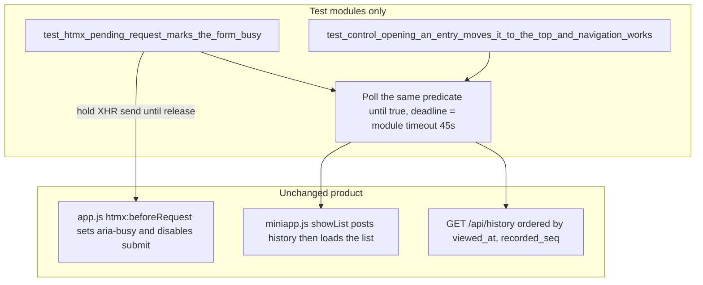

# WISHENKA-311: Browser checks stay green beside other browser checks

## Research

Both checks already pass one after another and fail only while other browser
checks run at the same time (`doc/dev/testing.md`). The product rules they
guard are already implemented. This task changes how those two checks wait.
It does not change the product.

Playwright's timeout guide says a flaky browser check is not fixed by
raising a low-level timeout. The check should retry until a condition it
can see is true. Raising the action or navigation clock is called out as
the wrong place to look
([Timeouts](https://playwright.dev/docs/test-timeouts),
[Best Practices](https://playwright.dev/docs/best-practices)).
These tests use a small CDP driver, not Playwright. The same rule still
fits: the pass signal is the predicate, and a longer copy of today's short
clock is not the fix.

htmx 1.9 can delay a request on `htmx:confirm` and continue it later with
`issueRequest()`
([htmx events](https://htmx.org/events/#htmx:confirm)).
That event fires before `htmx:beforeRequest`. The busy flag and the
disabled add control are set in `htmx:beforeRequest`
(`wishenka/web/static/app.js`). Holding on `htmx:confirm` would pause the
request before the form is busy, so the busy assertion would fail. The
check already holds `XMLHttpRequest.send` instead, which runs after that
flag is set. That hold stays.

### What each check waits on today

`test_htmx_pending_request_marks_the_form_busy` builds the page through
`_quick_add_page(..., "hold")`. That helper waits up to `WAIT` (3.0
seconds) until `window.htmx` is an object, then installs `XHR_WRAPPER`.
In `hold` mode every `send` is pushed onto `window.__x.held` and the real
send does not run. The check then waits up to 3.0 seconds for
`held.length === 1`, reads `aria-busy` and the disabled add control,
releases the held send, and waits up to 3.0 seconds for four
`#items-list .item-card` nodes. The module mark is
`pytest.mark.timeout(45)`. `WAIT` is also used by other checks in the
file. Those other checks are not this task.

`test_control_opening_an_entry_moves_it_to_the_top_and_navigation_works`
does not read `WAIT`. Its short clocks are the 5.0 second default of
`CdpPage.wait_for` and of `_wait_until`:

- history title and two rows, inside `_history_screen`
- heading text `Older list` after the older entry is opened
- `_wait_until` until `GET /api/history` lists `Older list` first (5.0
  seconds, poll every 0.05 seconds)
- history title and two rows again after `page.navigate` to `/`
- heading text of the Mini App home after Back

`page.navigate` waits for the load event up to `LOAD_TIMEOUT` (10
seconds) inside the driver. `showList` in `miniapp.js` fires
`POST /api/history/{id}` without waiting, then awaits
`GET /api/wishlists/{id}` and sets the heading. The page fetch wrapper
`HX_PRELOAD` holds only `GET` or `DELETE` of the exact path
`/api/history`. It does not hold `POST /api/history/{id}`. The order
read uses `viewed_at` then `recorded_seq`, and a new view gets a new
sequence, so a same-second tie does not leave the older list behind.
The parallel failure is the short clock expiring while neighbors occupy
the machine, which matches the testing doc: under worker load the
timeouts grow, the product rules do not change.

`do-testing` still requires every poll to have a deadline. The deadline
for these two checks is the 45 second module mark they already have.
That mark is not raised.

## Implementation Plan

Test-only change in the two modules below. No edit under `wishenka/`.
`wishenka/web/static/app.js` is not edited, so it does not gain
`receipt`. The WishlistStore import cycle (WISHENKA-357) is not touched.
`TEST_WALL_LIMIT` and a full `make test` (WISHENKA-285) are not the
proof and are not changed.

1. Leave `WAIT = 3.0` as it is. Leave `CdpPage.wait_for`'s default of
   5.0 seconds, `LOAD_TIMEOUT`, `COMMAND_TIMEOUT`, and both modules'
   `pytest.mark.timeout(45)` as they are. Do not pass a larger number
   through `WAIT`.
2. In the busy-form check only, keep `XHR_WRAPPER` mode `hold`. The
   in-flight assertion stays a direct read while `held` still contains
   the send: `aria-busy` is `true` and the add control is disabled.
   Release stays `window.__x.held.splice(0).forEach(send => send())`.
3. Replace the 3.0 second gates on this check's path with a poll of the
   same predicates, deadline 45 seconds (the module mark, not a new
   constant):
   - `typeof window.htmx === 'object'` before the wrapper is installed
   - `window.__x.held.length === 1` after the click
   - four `#items-list .item-card` nodes after release, then the direct
     read that the form is usable again
   `_quick_add_page` is shared with the network-failure check. The
   longer poll is opt-in for the busy-form check. The failure check
   keeps `timeout=WAIT`.
4. In the history check only, poll the same observations until they
   hold, deadline 45 seconds. Shared helpers keep today's defaults.
   This check passes the 45 second deadline in (or stops using the
   helper and polls locally):
   - history heading and two rows, before the click and after the
     return to history
   - heading `Older list` after the older entry is opened
   - first history entry is `Older list`
   - heading is the Mini App home title after Back
   One failed history read (the client gives up on its own 10 second
   call) is tried again until the order is visible or the 45 second
   deadline is hit. Do not raise that client timeout. Do not change
   `_api` for the rest of the file.
5. Leave `assert_clean_console` as a single read after home is visible.
6. Do not add a hold for `POST /api/history/{id}`. The heading depends
   on the wishlist `GET`, which that hold would not gate. The existing
   quick-add hold is the one request the check keeps until it releases
   it.

**Mandatory — Failing Repro (next Step 3):** N/A — no new test and no
product behavioral change. The two nodes already state the desired
outcomes and already go red only under parallel load. Step 3 runs the
parallel command below and records the result. It does not add a third
test, does not edit `wishenka/`, and does not lengthen `WAIT`.

### Proof commands

Parallel proof (these two nodes plus the other checks in the same two
modules, two workers, `--dist loadfile`). This is not the full suite:

```bash
make test PYTEST_JOBS=2 PYTEST_ARGS="\
tests/test_cross_screen_comfort_browser.py \
tests/test_history_screen_browser.py -q"
```

Sequential command that must still pass:

```bash
make test-serial PYTEST_ARGS="\
tests/test_cross_screen_comfort_browser.py \
tests/test_history_screen_browser.py -q"
```

`make test` is `-n $(PYTEST_JOBS) --dist loadfile`. `PYTEST_JOBS=2`
puts one module on each worker, so the two nodes run while the
neighboring checks in these files run. `make test-serial` is `-n 0`.

## Architecture



### Modules

- **Busy-form check.** Hold the quick-add send, read busy and
  disabled while it is held, release, then poll until the new wish is
  on the list and the form is usable.
- **History check.** Poll until the opened list is on screen, the API
  lists it first, Back shows home, and the console is clean.
- **`_quick_add_page`, `_history_screen`, `_go_history`, `_wait_rows`,
  `_wait_until`.** Keep current defaults. Accept an opt-in deadline
  only where this task's check calls them.
- **`CdpPage.wait_for`.** Unchanged. Default stays 5.0 seconds for
  every other check.
- **`app.js`, `miniapp.js`, history repository.** Unchanged. They
  already implement the two product rules.

### Interactions

1. The busy-form check opens the real htmx detail page, waits until
   `window.htmx` exists, installs the XHR hold, and clicks add.
2. `htmx:beforeRequest` marks the form busy and disables the add
   control. `send` is stored on `window.__x.held` and does not reach
   the server. The check reads that busy state. Neighbors cannot make
   the response arrive early, because the check has not released it.
3. The check releases the held send and polls until four item cards
   are present, then reads that the form is usable again.
4. The history check opens history, clicks the older entry, and polls
   until the heading is that list and the history API lists it first.
   It polls again for the reordered rows and for the home heading
   after Back.

### Patterns

- **Hold until the check releases the request.** Used for the quick-add
  XHR that is already wrapped. The busy read happens in that window, so
  it does not race the server.
- **Poll a condition the check can see.** Used for htmx being present,
  the held send, the new card, the history heading, the history order,
  and the home heading. The deadline is the 45 second mark already on
  the module. `WAIT` and the 5.0 second defaults stay for every check
  this task does not own.
- **Rejected: a longer wall-clock timeout.** `WAIT = 3.0` is not turned
  into a bigger float. The driver defaults are not raised. The module
  mark is not raised. Playwright treats that kind of change as the
  wrong fix, and the requirements reject it.

### Interfaces

- Busy-form check to the page: `window.__x.mode = "hold"`,
  `window.__x.held.length === 1`, then
  `held.splice(0).forEach(send => send())`. DOM reads:
  `#quick-add-form` `aria-busy`, `#btn-quick-add` `disabled`,
  `#items-list .item-card` count.
- History check to the page: heading text, history row titles, Back
  control, `assert_clean_console`.
- History check to the server: existing `GET /api/history`. No new
  route. A single client timeout on that read is retried inside the
  poll for this check only.
- Opt-in deadline on the shared helpers, default unchanged, so the
  network-failure check and the other history checks keep today's
  clocks.

## Q&A

- **Q:** Why is the fix not `WAIT = 10`?
  **A:** The requirements reject giving the same wait more seconds.
  Playwright's timeout guide says the same about low-level clocks. The
  pass signal is the predicate. The hang bound is the 45 second module
  mark that already exists, and that mark is not increased.

- **Q:** Why keep the XHR hold?
  **A:** While the send sits in `window.__x.held`, the form stays busy
  no matter how fast the server would have been. `htmx:confirm` would
  hold too early, before `aria-busy` is set. The wrapper already holds
  at `send`, which is the smallest place.

- **Q:** Why not hold the history POST as well?
  **A:** The heading the check waits for comes from
  `GET /api/wishlists/{id}`. Holding `POST /api/history/{id}` would not
  make that heading appear. The order is already stable once the POST
  lands (`recorded_seq` moves forward). The missing piece is polling
  that order and the heading until they are visible.

- **Q:** What proves the task, and what must still pass?
  **A:** Parallel: `make test PYTEST_JOBS=2` with both browser modules
  in `PYTEST_ARGS`. Sequential: `make test-serial` with the same
  modules. The full commands are in the plan above.
  A full `make test` that stops at 600 seconds is WISHENKA-285 and is
  not this proof.

- **Q:** What stays outside the change?
  **A:** WISHENKA-357, WISHENKA-285, any edit of `app.js`, and every
  other check's use of `WAIT` or the 5.0 second default.
