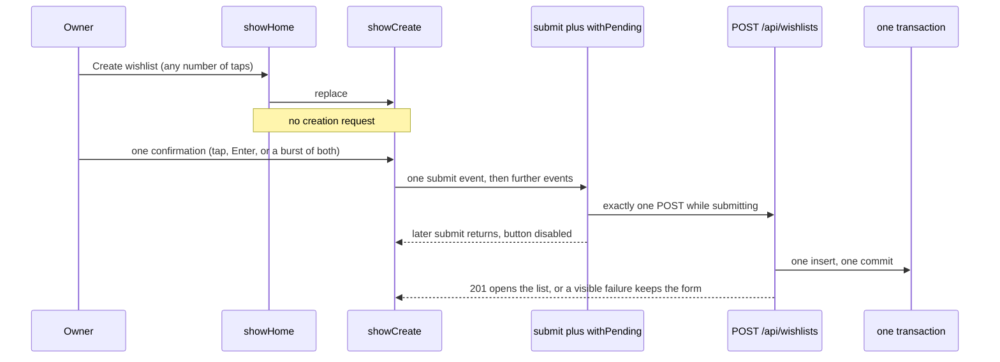

# WISHENKA-312: One confirmation creates one wishlist

## Research

Checked the creation path that WISHENKA-296 left in the tree, the server write that
backs it, and the HTML rules for a second Enter or tap while a submit control is
disabled. The accepted rule is: one deliberate confirmation creates one list and
sends one creation request; the home action only opens the form; the product
changes only when that confirmation can still duplicate a list or a request.

### Client (one screen, one request)

`showCreate()` in `wishenka/web/static/miniapp.js` is the only production sender of
`POST /api/wishlists`. The home control is a `type="button"` whose click handler is
`showCreate` (`button()` at `miniapp.js`). That call replaces `#app` with the form
and sends nothing. Repeating it replaces the form again and still sends nothing.
Cancel calls `goHome()` only while `submitting` is false. Invalid client data
returns before `api()`. The bot `startapp=create` path still only focuses the home
button.

The confirmation listener is a single `submit` handler on
`.wishlist-create-form`. A tap on `.create-submit-btn` and Enter in a text field
both fire that same `submit` event
([MDN `submit` event][mdn-submit]).
The handler calls `preventDefault()` first, so the browser does not navigate. There
is no `form.submit()` or `requestSubmit()` elsewhere in `miniapp.js`, so every
confirmation goes through this listener.

The listener closes the duplicate window before the first `await`:

1. `if (submitting) return` drops a later `submit` while the first confirmation is
   in flight.
2. Client validation runs synchronously. A failing form sends no request and never
   sets `submitting`.
3. `withPending(createBtn, send, …)` inserts `createBtn` into a `WeakSet` and
   disables it before its first `await`. A second call for that element returns
   without running `send`.
4. `send()` sets `submitting` and marks the fields read-only before `await api(...)`.

JavaScript runs the handler on one thread, so a second `submit` cannot start until
the first handler reaches `await api(...)`. By then `submitting` is already true.
While the button is disabled, the HTML living standard suppresses implicit
submission: Enter does not activate a disabled default submit button
([MDN, implicit submission][mdn-submit];
[WHATWG form submission][whatwg-form]).
A disabled control also drops queued user `click` events. The in-progress state the
owner can see is the existing pending status (`miniapp.create.pending`),
`aria-busy="true"`, `.is-pending`, a disabled Create and Cancel, and read-only
fields.

After a visible failure, `setBusy(false)` runs once the request has settled, and a
later confirmation is a new action (requirement 7). After success, `showList`
replaces the form before the pending guard releases the button, so the successful
form cannot be confirmed again. A retry after a lost response, where the server
committed and the client only saw a failure, stays the separate limit recorded for
WISHENKA-322. This task leaves that limit in place.

The same `miniapp.js` runs in the Telegram Mini App and in a plain mobile browser.
Copy is locale data only; `send()` has no language branch.

### Server (one request, one insert)

`POST /api/wishlists` (`create_wishlist` in `wishenka/web/routes/wishlists.py`)
accepts `WishlistCreateInput` and calls `RepoWishlistOps.create_wishlist` once.
`get_wishlist_repository` wraps that work in one transaction and commits once on
success. `WishlistRepository.create_wishlist` inserts one `wl_lists` row (plus its
capability-token rows) per call. The route does not retry the action, and this
endpoint does not read `Idempotency-Key`. A second list appears only when a second
HTTP request commits. The client path above does not send that second request for
one deliberate confirmation.

Reservation and gift-receipt idempotency (`doc/dev/idempotency.md`) stays on those
endpoints. Extending it to wishlist creation would change the lost-response retry,
which this task leaves with WISHENKA-322.

### Tests that already lock the rule

These tests pass against the current tree and match the requirements:

- `test_home_create_button_opens_the_form_and_sends_no_request` in
  `tests/test_wishlist_create_form_ui.py` — opening the flow sends no `POST`.
- `tests/test_wishlist_create_form_ui.py::test_submit_burst_sends_exactly_one_post`
  — three submits in one turn send one `POST`.
- `tests/test_wishlist_create_form_browser.py::test_enter_and_tap_burst_sends_exactly_one_post`
  — Enter plus further taps and Enters while the request is held send one `POST`
  and leave one list.
- `tests/test_wishlist_create_form_browser.py::test_real_tap_burst_sends_exactly_one_post`
  — a tap burst on the real Create button sends one `POST` and leaves one list.
- `tests/test_cross_screen_comfort_browser.py::test_create_wishlist_burst_sends_a_single_post`
  — the same one-`POST` burst in both locales.
- `test_retry_after_a_failure_sends_a_second_request_only_on_the_next_submit` in
  `tests/test_wishlist_create_form_ui.py`, and the browser failure test — a
  visible failure stores nothing; the next confirmation sends the next request.

No second production caller of `POST /api/wishlists` exists under `wishenka/`.

## Implementation Plan

Leave the product as it is. One deliberate confirmation already creates one
wishlist and sends one `POST /api/wishlists`. Opening, repeating, cancelling, or
leaving "Create wishlist" already creates nothing. A repeated confirmation before
the outcome is known already stays on that single request. A visible failure still
allows one later confirmation.

Step 4 does not edit `miniapp.js`, the create route, `RepoWishlistOps`, the
schema, or i18n. `POST /api/wishlists` stays a single insert per request, without
an `Idempotency-Key`. The lost-response retry stays with WISHENKA-322.

Step 8 updates `doc/dev/miniapp.md` so the create-button paragraph records that
this re-check found the existing guard sufficient, and drops the open pointer to
WISHENKA-312. That is a documentation sentence. It does not change runtime
behavior.

**Mandatory — Failing Repro (next Step 3):** N/A — no behavioral change. The
current confirmation path already meets the definition of done, so there is no
red production failure for a new test to show. The tests listed in Research
already assert one request and one list for a confirmation burst, no request from
the home action, and one later request after a visible failure. Step 3 records
that N/A in the roadmap and does not add a test that would already pass.

## Architecture

No module is added, split, or rewired. The existing Mini App screen and the
existing create route already implement the invariant.



### Modules and responsibilities

- **Home action** (`showHome`, `.home-create-btn`). Opens `showCreate`. Sends no
  creation request, including when tapped again.
- **Creation screen** (`showCreate`). Collects the title and optional fields.
  Confirms through one `submit` listener.
- **In-flight guard** (`submitting`, `withPending`). A burst of taps and keyboard
  confirmations is one action: one `send()`, one `POST`, and a visible pending
  state.
- **`api()`**. Sends that single JSON `POST` with the CSRF header. Maps `422`
  back onto the form.
- **`create_wishlist` route**. Validates `WishlistCreateInput` and calls the
  domain create once per request.
- **`RepoWishlistOps` / `WishlistRepository`**. Inserts one wishlist in the
  request transaction and commits once.
- **i18n catalog**. Supplies EN and RU strings. The catalog does not choose how
  many requests are sent.

Other owner actions (edit, archive, delete, restore, share, favorites, history)
keep their current handlers. This task does not put them under the create guard.

### Dependencies

```text
home button --> showCreate --> submit listener --> withPending --> api()
    --> POST /api/wishlists --> RepoWishlistOps.create_wishlist
    --> WishlistRepository.create_wishlist --> commit
```

`withPending` also serves other Mini App controls. Their call sites stay as they
are. The create screen depends on it only for the Create button.

### Patterns

- **Existing Mini App screen function.** `showCreate` stays a function in
  `miniapp.js`, same as `showHome` and `showHistory`. A new view layer would not
  change the request count.
- **Single submit listener plus an in-flight flag.** Tap and Enter share one
  event. The flag and the disabled default button collapse a burst into one
  `fetch`. That is the usual fix once `preventDefault()` has turned off the
  browser's native "keep only the latest navigation" behavior.
- **Thin route, repository, one transaction.** The route stays a single call into
  `RepoWishlistOps`. The request-scoped repository (dependency injection already
  used by wishlist routes) commits one insert. Server-side idempotency stays the
  pattern for reservations and receipts, where a client key already exists.

### Interfaces

Home action, unchanged:

- Input: click on `.home-create-btn`.
- Effect: `showCreate()`. No `fetch`.

Deliberate confirmation, unchanged:

- Input: `submit` on `.wishlist-create-form` with a valid title (1–255 code points
  after trim). Optional `description`, `event_title`, and `event_date`.
- Effect: one `POST /api/wishlists` with `Content-Type: application/json` and
  `X-CSRF-Token`. Body is the trimmed payload from `buildPayload()`.
- `201`: body is the wishlist projection; the client opens that list.
- `422`: form stays, fields keep what the owner typed, no list is stored.
- Network error or other status: form stays, `miniapp.home.create_failed` is
  shown, no list is stored. The next confirmation is a new action.

A confirmation that fails client validation has no HTTP call.

`POST /api/wishlists` request and response shapes stay those of WISHENKA-296.
Callers other than this form (tests, a direct API client) still get one list per
request they actually send. This task does not add a server-side deduplication
key.

## Q&A

- **Does one confirmation still need a product change?** No. A burst of taps,
  Enters, or both, before the outcome is visible, sends one `POST` and commits
  one row. The home action only opens the form. Requirements 3 and 4 therefore
  leave the owner's experience as it is.
- **Why keep idempotency off this endpoint?** One confirmation already produces
  one request, so a second committed list does not come from that action.
  Idempotency keys on this route would also change the lost-response retry, which
  stays with WISHENKA-322 and out of this task
  (`doc/dev/idempotency.md`).
- **What is a second confirmation allowed to do?** After the owner sees a failed
  creation, the next confirmation is a new action. It sends one new request and,
  on success, leaves one list. The tests named above already cover that.
- **Where did the external checks come from?** [MDN `HTMLFormElement` submit
  event][mdn-submit] (tap, Enter, and `requestSubmit` share `submit`; a disabled
  default button does not implicitly submit) and the
  [HTML living standard][whatwg-form] (disabled controls do not take user click
  activation).

[mdn-submit]: https://developer.mozilla.org/en-US/docs/Web/API/HTMLFormElement/submit_event
[whatwg-form]: https://html.spec.whatwg.org/multipage/form-control-infrastructure.html
