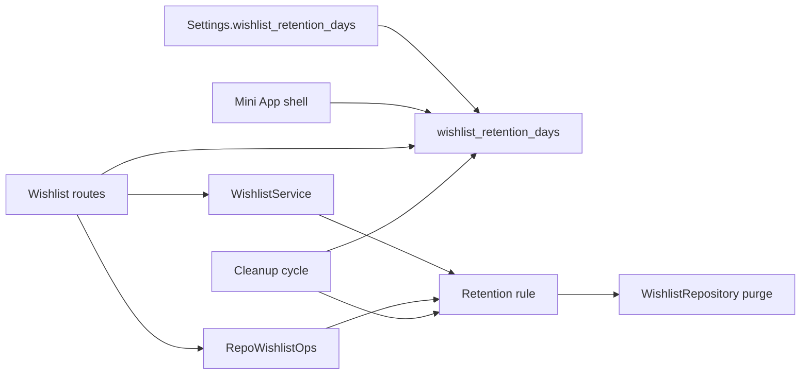

# WISHENKA-316: One rule for restoring a deleted wishlist

## Research

Checked the owner-delete path WISHENKA-295 left in the tree, the retention copies
named in `ai-tasks/WISHENKA-295/60-tech-debt.md` (S-1, S-2, S-3), and the checks
that already lock the owner-visible result. The accepted rule is one restorability
decision and one deletion action. The days the owner is told are that same
configured period. Log event names and fields stay. Where the product already
matches the requirements, the owner's experience stays as it is.

### Where the period is copied today

`Settings.wishlist_retention_days` (`wishenka/config.py`) is a typed `int` whose
usual value is 30. That is the configured period.

Four call sites do not read that field as a typed value. Each does
`getattr(..., "wishlist_retention_days", 30)`:

- `wishenka/web/routes/wishlists.py` — `list_deleted_wishlists`, `delete_wishlist`,
  `restore_deleted_wishlist`
- `wishenka/web/routes/miniapp.py` — the shell attribute `data-retention-days`

`get_settings` (`wishenka/auth/dependencies.py`) already returns `Settings` from
application state, or a new `Settings()` when state has no `Settings` instance.
A missing application setting therefore already becomes the typed field, including
its usual 30. The extra `getattr` default is a second 30 that can disagree with
the field if the field's usual value changes.

`WishlistService.list_deleted_wishlists` and `restore_deleted_wishlist`, and the
same two methods on `RepoWishlistOps`, take `retention_days: int = 30`. Cleanup
(`wishenka/wishlists/cleanup.py`) reads `settings.wishlist_retention_days` and
subtracts it from now. Those are further copies of the length and of the
threshold formula.

### Where restorability is decided today

A deleted list is still restorable while its deletion moment is strictly after
`now - retention_days`. The deletion moment is `updated_at`, treated as UTC when
it has no timezone. The comparison used by delete, list, restore, and permanent
removal is the same inclusive boundary:

- delete route (`wishlists.py`): `deleted_at <= now - timedelta(days=retention_days)`
  raises `WishlistRetentionExpiredError`
- `list_deleted_wishlists` on both backends: the same `<=` omits the list
- `restore_deleted_wishlist` on both backends: the same `<=` raises
  `WishlistRetentionExpiredError`
- purge SQL (`WishlistRepository.purge_archived_wishlists`): `status = 'deleted'
  AND updated_at <= :threshold`, with `threshold = now - retention_days`

Days left, only for a list that is still inside the window, are
`max(1, ceil((deleted_at + period - now) / 86400))`.

The delete route does this comparison itself. For the row it uses
`service.repo.get_wishlist` on `RepoWishlistOps` and `service._wishlists.get` on
`WishlistService`. `get_wishlist_by_id` cannot replace that read:
`WishlistService.get_wishlist_by_id` logs `deleted_wishlist_access_attempt` and
raises `WishlistDeletedError` for a deleted list, and `execute` turns that into
404. The idempotent second delete needs the deleted row without that log.

Shipping HTTP does not put a `WishlistService` on `app.state.wishlist_service`.
`execute` in `wishlists.py` then runs the action on `RepoWishlistOps`. An injected
`wishlist_service` is the other branch. Both backends already implement
`delete_wishlist`, `list_deleted_wishlists`, and `restore_deleted_wishlist`. A
rule that exists only on `WishlistService` would leave the shipping delete route
on its own comparison.

`delete_wishlist(wishlist_id, actor) -> None` is the mutation. It marks the list
deleted, cancels active and purchased reservations, and logs
`wishlist_status_changed`. It refuses an archived list with
`WishlistArchivedError` and a deleted list with `WishlistDeletedError`. The route
calls it only when the list is not already deleted. A second confirmation inside
the window does not call it, so `updated_at` stays the original deletion moment.

`tests/test_wishlist_delete_observability.py::test_unexpected_error_is_logged_by_request_middleware_without_title`
replaces `WishlistService.delete_wishlist` and `RepoWishlistOps.delete_wishlist`
with a function that raises `RuntimeError`. The route must still call that method
for the first delete, and must log `wishlist_deleted_by_owner` only after it
returns. The four modules `tests/test_wishlist_delete_*.py` lock status codes,
the JSON body (`status`, `wishlist_id`, `retention_days`), the shell attribute,
and the log events below.

### Log events that stay

| Event | Where it is written | Fields that stay |
| --- | --- | --- |
| `wishlist_delete_not_found` | delete route, unknown id | `wishlist_id`, `user_id` |
| `wishlist_delete_denied` | delete route, non-owner | `wishlist_id`, `user_id` |
| `wishlist_permission_denied` | `execute`, on `PermissionDeniedError` | `operation` |
| `wishlist_archived_mutation_blocked` | `execute`, on `WishlistArchivedError` | `operation` |
| `wishlist_retention_expired` | `execute`, on `WishlistRetentionExpiredError` | `operation` |
| `wishlist_deleted_by_owner` | delete route, after a successful classification | `wishlist_id`, `user_id`, `retention_days`, `outcome` (`deleted` or `already_deleted`) |
| `wishlist_status_changed` | `delete_wishlist` on the first delete | `wishlist_id`, `actor_id`, `from_status`, `to_status` |
| `wishlist_mutation_committed` | `execute`, after a successful delete action | `operation` |
| `wishlist_deleted_listed` | list route and both list methods | `user_id` or `actor_id`, `count`, `retention_days` |
| `wishlist_restored_from_deleted` | restore route and both restore methods | existing fields, including `retention_days` |
| `wishlist_restore_retention_expired` | both restore methods | `wishlist_id`, `actor_id`, `retention_days` |

The shared `execute` warning text stays "Wishlist restore rejected because
retention window expired". WISHENKA-318 owns that wording. This task does not add
fields and does not drop these events.

### What the shell already does

`miniapp.js` reads `data-retention-days` for the confirmation copy before
`DELETE`. The delete response also carries `retention_days`, and the result text
prefers that number. `tests/test_wishlist_delete_api.py::test_miniapp_shell_exposes_the_real_retention_days`
and `test_retention_days_in_reply_and_recently_deleted_follow_settings` already
require the shell attribute and the JSON number to follow
`Settings.wishlist_retention_days`. The attribute stays. S-3's private default
goes away because the shell reads the typed accessor. A new bootstrap field is
not required: the next document load renders the shell from that accessor, which
is the "next open" the requirements describe.

### External practice

Composition-root configuration, with the domain receiving a typed value, is the
pattern in [Governed AI delivery, cross-cutting concerns](https://github.com/Accelerated-Innovation/governed-ai-delivery/blob/main/docs/backend/architecture/CROSS_CUTTING_CONCERNS.md)
(sections on soft delete and configuration). This task follows that shape with
the settings object the application already has: routes and cleanup ask one
accessor for `int`, and the domain functions take that `int`. It does not add a
`deleted_at` column or a new settings framework. The deletion moment remains
`updated_at`.

## Implementation Plan

Add one retention module and use it from both backends and from the HTTP edge.
Leave `delete_wishlist`'s signature, mutation, and `wishlist_status_changed` log
as they are. Leave the delete route's log statements and `execute`'s exception
mapping as they are. The route stops choosing the row and stops doing the
comparison.

Step 4 order, after the red test:

1. Add `wishenka/wishlists/retention.py` with the usual-length constant, the
   typed accessor, the comparison helpers, and the classification value type.
   Point `Settings.wishlist_retention_days` at that constant so the usual 30
   lives in one assignment. The accessor module must not import `config` at
   runtime (`from __future__ import annotations`, `Settings` only for type
   checkers), so `config` can import the constant without a cycle.
2. Add `get_wishlist_or_none` and `classify_owner_delete` to `WishlistService`
   and to `RepoWishlistOps`. Register the new single-id methods in
   `_SINGLE_WISHLIST_METHODS` so a store-backed `WishlistService` still hydrates
   one list.
3. Replace the inline timezone normalisation and `<=` comparison in
   `list_deleted_wishlists` and `restore_deleted_wishlist` on both classes with
   the helpers. Keep their current log calls and the `retention_days` argument.
   The default on that argument becomes the shared constant, so callers that
   already omit it (for example `restore_deleted_wishlist` in the favorites
   tests) still see the usual 30.
4. Switch the three wishlist routes, the Mini App shell, and
   `run_cleanup_cycle` to the accessor. The delete route calls
   `classify_owner_delete` and then, only for a list that is not yet deleted,
   `delete_wishlist`.
5. Run the existing delete modules:
   `tests/test_wishlist_delete_api.py`,
   `tests/test_wishlist_delete_observability.py`,
   `tests/test_wishlist_delete_ui.py`,
   `tests/test_wishlist_delete_browser.py`,
   plus `tests/test_wishlist_deleted_restore.py`. They stay green with no edits.
   The new Step 3 test turns green in the same pass.

Out of scope for the edit: a `deleted_at` column, HTML delete on the plain web
list screen (S-4), the expired-path focus and the second Cancel name
(WISHENKA-317), the "restore" wording in the shared expiry log (WISHENKA-318),
and the other routes that still read `service._wishlists` for listing and
favorites. Those reads are not the delete classification.

**Mandatory — Failing Repro (next Step 3):** Add
`tests/test_wishlist_retention_single_rule.py` with module
`pytestmark = pytest.mark.timeout(30)`. Do not change production code in that
step. The test imports `wishenka.wishlists.retention.is_retention_expired` and
drives the real app the way `tests/test_wishlist_delete_api.py` does.

On the current tree the import fails. That is the first red signal: the single
rule is absent. After the module exists, the test still fails until the delete
route, list, and restore call it. The assertion is:

- Create an owner list, delete it once, and leave `updated_at` inside the
  configured window (a repeat delete is 200 today).
- Monkeypatch `wishenka.wishlists.retention.is_retention_expired` so it returns
  true. Call sites must look the function up on that module at call time
  (`retention.is_retention_expired(...)`), so one patch covers the route and
  both backends.
- `DELETE /api/wishlists/{id}` then answers 410 with
  `detail.code == "retention_expired"`.
- The captured `wishlist_retention_expired` record has `operation` equal to
  `delete_wishlist`. There is no `wishlist_deleted_by_owner` and no
  `wishlist_status_changed`.
- `GET /api/wishlists/deleted` omits the list.
- `POST /api/wishlists/{id}/restore-deleted` answers 410 with the same code.

Today those three paths use their own comparisons, so the patch does not move
them and the assertions fail. The test does not change the unpatched outcomes
the existing delete modules already lock. No live external service is required:
`create_app` plus `TestClient` and a temporary SQLite file, as in the current
delete API tests.

## Architecture

### Modules



The route's `service` is `RepoWishlistOps` on the shipping path and
`WishlistService` when `app.state.wishlist_service` is set. The diagram shows
both. The rule module is the only place that computes the threshold, the
deletion moment, days left, and the owner-delete classification.

| Module | Responsibility |
| --- | --- |
| `wishenka/config.py` `Settings` | Holds the configured period. The field default is the shared constant. |
| `wishenka/wishlists/retention.py` | Typed accessor, usual-length constant, pure comparison, classification value. No logging, no I/O. |
| `wishenka/auth/dependencies.py` `get_settings` | Supplies `Settings` to the accessor. Unchanged. |
| `WishlistService` | In-memory and store-backed domain operations. Classifies an owner delete and applies the mutation. |
| `RepoWishlistOps` | Same classification and the same helpers for the SQLite request path. |
| `wishenka/web/routes/wishlists.py` | Maps a classification to the existing HTTP status, JSON body, and log events. |
| `wishenka/web/routes/miniapp.py` | Writes `data-retention-days` from the accessor. |
| `wishenka/wishlists/cleanup.py` | Builds the purge threshold with the same helper and the accessor. |
| `WishlistRepository.purge_archived_wishlists` | Keeps `updated_at <= :threshold`. The threshold comes from the helper. |

### Patterns

**One pure rule, two adapters.** `WishlistService` and `RepoWishlistOps` are
already the two adapters in front of the same owner operations (WISHENKA-80).
The retention arithmetic is a pure function both call. Putting a second copy on
only one class would leave the shipping path free to drift, which is the S-2
defect.

**Dependency injection of a typed int.** FastAPI already injects `Settings`
through `get_settings`. The period the routes see is
`wishlist_retention_days(settings) -> int`. Handlers take that `int` (a small
`Depends` wrapper next to the other wishlist dependencies is enough). They do
not call `getattr` and they do not write a literal 30.

**Route as the HTTP adapter.** Classification returns a value. The route turns
that value into the exceptions `execute` already maps, and it keeps the log
lines the observability tests count. The domain function does not log the
delete-route events, so those records are not doubled.

**Existing mutation method.** `delete_wishlist(wishlist_id, actor) -> None`
stays the single deletion action: status, reservation cancellation, and
`wishlist_status_changed`. PEP 484 annotations stay on the new helpers. The
classification value is a frozen dataclass with an enum kind, so the route
cannot pass a bare string into the log.

### Retention module

```python
DEFAULT_WISHLIST_RETENTION_DAYS: int = 30

def wishlist_retention_days(settings: Settings) -> int:
    """Configured period. The usual length is Settings' field default."""
    return settings.wishlist_retention_days

def deletion_moment(updated_at: datetime) -> datetime:
    """UTC deletion moment. Naive updated_at is UTC, as the route does today."""

def is_retention_expired(updated_at: datetime, retention_days: int, now: datetime) -> bool:
    """True when deletion_moment(updated_at) <= now - timedelta(days=retention_days)."""

def days_remaining(updated_at: datetime, retention_days: int, now: datetime) -> int:
    """max(1, ceil(seconds_until_expiry / 86400)), for a list still inside the window."""

def purge_threshold(now: datetime, retention_days: int) -> datetime:
    """now - timedelta(days=retention_days), the cutoff purge already uses."""
```

`is_retention_expired` is the restorability rule. A deleted list is restorable
when this returns false. List, restore, the delete classification, and the purge
threshold all use that boundary. `days_remaining` is called only after the list
has been kept, so the `max(1, ...)` floor stays on the same rows as today.

`Settings` keeps the field the environment sets:

```python
wishlist_retention_days: int = DEFAULT_WISHLIST_RETENTION_DAYS
```

A configured value of 7 remains 7 everywhere the accessor is used. A missing
environment value remains the constant, through `Settings`, including the
`Settings()` fallback inside `get_settings`.

### Classification

Both backends gain the same two methods.

`get_wishlist_or_none(wishlist_id: int) -> Wishlist | None` returns the row in
any status, including deleted, and writes no log. `WishlistService` reads its
map. `RepoWishlistOps` reads `repo.get_wishlist`. The delete route no longer
mentions `_wishlists` or `repo.get_wishlist`.

`classify_owner_delete(wishlist_id, actor, retention_days, now=None) -> OwnerDeleteDecision`
uses that lookup, `WishlistAccessPolicy.can_delete`, and `is_retention_expired`.
It does not mutate and it does not log. `now` defaults to `datetime.now(UTC)`,
matching the route. The decision is a frozen dataclass:

| `kind` | Meaning | What the route does |
| --- | --- | --- |
| `missing` | No row | Log `wishlist_delete_not_found`, raise `WishlistNotFoundError` |
| `forbidden` | Row exists, caller is not the owner | Log `wishlist_delete_denied`, raise `PermissionDeniedError` |
| `expired` | Deleted and `is_retention_expired` | Raise `WishlistRetentionExpiredError` before any success log |
| `repeat` | Deleted and still restorable | Log `wishlist_deleted_by_owner` with `outcome="already_deleted"`. Do not call `delete_wishlist` |
| `apply` | Not deleted | Call `delete_wishlist`. On success, log `outcome="deleted"` |

An archived list is `apply`. `delete_wishlist` still raises
`WishlistArchivedError`, `execute` still logs `wishlist_archived_mutation_blocked`
with `operation="delete_wishlist"`, and the success log still runs only after
`delete_wishlist` returns. That keeps the archived observability test and the
storage-failure monkeypatch on the current call.

`retention_days` on the decision is the int the route passed in from the
accessor. The JSON body stays
`{"status": "deleted", "wishlist_id": <id>, "retention_days": <that int>}`
for both `apply` and `repeat`.

Direct callers of `delete_wishlist` that are not the HTTP route keep today's
permission and archived behaviour, including the service `access_denied` log on
a direct non-owner call. The HTTP route does not reach that log: it classifies
`forbidden` first, as it already returns before calling `delete_wishlist`.

### Route and shell wiring

`list_deleted_wishlists`, `delete_wishlist`, and `restore_deleted_wishlist`
receive the period from `wishlist_retention_days(settings)` via `Depends`.
They pass that int into the service methods. List and restore keep their
current log statements and response shapes. Their service methods replace only
the arithmetic.

`miniapp` sets `data-retention-days` from `wishlist_retention_days(get_settings(request))`.
`miniapp.js` is unchanged.

`run_cleanup_cycle` uses
`purge_threshold(effective_now, wishlist_retention_days(settings))` and still
calls `store.purge_archived_wishlists`. The SQL predicate stays
`updated_at <= :threshold`.

### Interaction

1. The owner opens the Mini App. The shell's `data-retention-days` is the
   accessor's int. Confirmation copy uses it.
2. The owner confirms. `DELETE` loads the same int, classifies, and either
   applies `delete_wishlist` once or reports the idempotent success or the
   expiry error.
3. "Recently deleted" and restore receive that same int and the same
   `is_retention_expired` result for that `updated_at`.
4. Cleanup purges with `purge_threshold` of that same int. A list the rule
   calls expired is the list the purge select can remove.

A second confirmation inside the window is `repeat`: success for the owner,
original `updated_at`, reservations left cancelled, no second
`wishlist_status_changed`. After the boundary, delete, restore, and the list
agree on expiry, and the row remains until purge.

## Q&A

- **Why does the rule live in a module both backends call?** The shipping
  `DELETE` runs on `RepoWishlistOps`. `WishlistService` is the store-backed and
  injected backend. S-2 is the two copies plus the route. One pure function,
  called by the new `classify_owner_delete` on each class and by list, restore,
  and cleanup, is the single restorability rule.
- **Why does the route still log?** The observability module counts one
  `wishlist_delete_not_found`, one `wishlist_delete_denied`, and one
  `wishlist_deleted_by_owner` with the current fields. Those statements stay in
  the route. The classifier is silent so the counts stay one.
- **Why does `delete_wishlist` stay a `None` mutation?** The storage-failure
  test replaces that method on both classes and expects `RuntimeError` before
  `wishlist_deleted_by_owner`. Many other tests call the same signature. The
  first delete still goes through it. The idempotent and expired paths still
  do not.
- **What is the deletion moment?** `updated_at` of the soft-deleted row, UTC
  when naive. This task does not add `deleted_at`. A later column would change
  `deletion_moment` only.
- **What closes S-1 for this route?** `get_wishlist_or_none` plus
  `classify_owner_delete`. The delete handler no longer reads `_wishlists` or
  the repository. The typed accessor replaces the three `getattr` defaults on
  the wishlist routes and the one on the shell.
- **What closes S-2?** `is_retention_expired` and `purge_threshold` replace the
  route comparison and the copies in list, restore, and cleanup. The purge SQL
  keeps `<=`, which is that predicate.
- **What closes S-3?** The shell attribute is filled only by the accessor, so
  it cannot keep a private 30. The attribute stays because the confirmation
  needs the number before `DELETE`. The next shell response follows the
  configured period. A bootstrap API is a later change if a cached shell must
  update without a new document load.
- **Do the records change?** They stay, including the expiry warning that still
  says "restore". That wording is WISHENKA-318.
