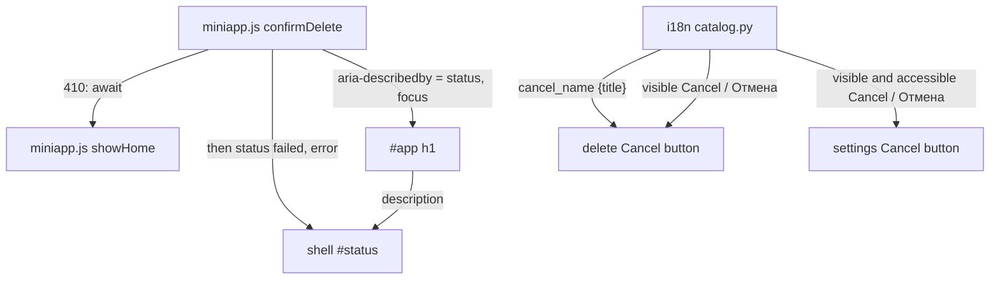

# WISHENKA-317: Focus and accessibility of the wishlist delete panel

## Research

### Verified baseline

Checked in the current tree. No server or catalog change is required for the
deletion rule itself. Sources: WISHENKA-295 `20-architecture.md` (D-3),
`ai-tasks/WISHENKA-295/60-tech-debt.md` items C-1, C-2, and T-2, and the
files below.

- **Expired confirm still updates the detached panel.**
  `confirmDelete` in `wishenka/web/static/miniapp.js` (`deleteWishlistControls`)
  treats HTTP 410 as `expired`. It `await`s `showHome()`, which replaces
  `#app` and ends by clearing `#status`. The failure text is then written
  with `status(..., 'error')`. After that, the same function still fills
  `failure` (`role="alert"`), inserts it into `panel`, and calls
  `yesBtn.focus()`. Those nodes are no longer in the document. The visible
  line works only because `#status` lives outside `#app`. Keyboard focus
  does not land on the home heading. C-1 and T-2.
- **Success already focuses the home heading.** A 200 response does
  `await showHome()`, then `status(..., 'success')`, then
  `root.querySelector('h1')?.focus()`. `showHome` creates that heading with
  `tabindex="-1"`. The expired branch does not follow this order through to
  the focus call.
- **`#status` is the shell live region.** `wishenka/web/routes/miniapp.py`
  renders `
` as a sibling of
  `<main id="app">`, so `root.replaceChildren` does not remove it.
  `status()` (`miniapp.js`) sets `textContent`, `data-kind`, and
  `aria-live="assertive"` when `kind === 'error'`. `role="status"` implies
  `aria-live="polite"` and `aria-atomic="true"` (WAI-ARIA 1.2; MDN status
  role). An author `aria-live` overrides the implicit value. A `role="alert"`
  node announces only when its text changes on an element that is already in
  the page; creating an alert that is never inserted does not announce (MDN
  alert role).
- **A focus move can swallow a live region.** Assistive technology treats a
  programmatic focus change like a user focus change and starts speech from
  the newly focused element. An assertive update in the same turn is not a
  reliable announcement once focus has moved, including a move onto a
  heading
  ([NVDA 11299](https://github.com/nvaccess/nvda/issues/11299)). The current
  expired path focuses a detached button, so the browser leaves focus on the
  document background and the alert never enters the tree.
- **The two Cancels share one name.** The delete button uses
  `miniapp.wishlist_delete.cancel` (`catalog.py`, English "Cancel", Russian
  "Отмена") as its text and has no `aria-label`. The settings button uses
  `miniapp.wishlist_settings.cancel` with the same two strings and also has
  no `aria-label` (`settingsForm`). Both are on the owner list screen while
  the confirmation is open. C-2. The node harness already clicks the delete
  Cancel with `within: "wishlist-delete-confirm"` because the labels match.
- **Accessible name calculation.** A non-empty `aria-label` replaces the name
  computed from a button's text
  ([Accname 1.1](https://www.w3.org/TR/accname-1.1/), step 2C;
  [APG names](https://www.w3.org/WAI/ARIA/apg/practices/names-and-descriptions/)).
  The visible label stays in the button. Precedent in this file: the favorite
  remove control keeps a short visible label and sets `aria-label` from a
  catalog string that includes the list title (`setAttribute`, not HTML).
  `t()` substitutes `{title}` once. `node()` / `textContent` do not parse
  markup. The title already used by the confirmation is
  `list.name || t('miniapp.common.untitled_wishlist')` ("Untitled wishlist" /
  "Вишлист без названия").
- **Label in Name.** WCAG 2.5.3 requires the visible label's text to occur
  intact in the accessible name
  ([Understanding 2.5.3](https://www.w3.org/WAI/WCAG22/Understanding/label-in-name),
  [G208](https://www.w3.org/WAI/WCAG22/Techniques/general/G208)). The accepted
  English name starts with "Cancel". The accepted Russian name,
  "Отменить удаление «{title}»", does not contain "Отмена". That gap is a
  consequence of the wording fixed in `10-requirements.md`. This task does
  not rewrite it.
- **Tests that already exist and must stay.**
  `tests/test_wishlist_delete_ui.py` (`pytestmark` timeout 20) asserts that
  a 410 reply refreshes home and shows `miniapp.wishlist_delete.failed`, and
  that any other failure keeps the panel, the alert, and focus on confirm.
  It does not assert focus or `aria-live` after 410. Its fake `querySelector`
  (`tests/test_miniapp_i18n_repro.py`) handles `button` and
  `.wishlist-section` only, so `root.querySelector('h1')` is `null` there
  even though the success path calls it. The delete module's focus patch
  records `focusedEl` even when the node is no longer under `rootEl`.
  `tests/test_wishlist_delete_browser.py` (timeout 45, `browser`) asserts
  home-heading focus after success and reads the accessibility tree with
  `Accessibility.getFullAXTree` for the confirmation group. `_installed_fetch`
  can fail a DELETE with 500 or a network error and let later GETs through.
  It has no 410 mode. Catalog parity is already enforced by
  `tests/test_i18n_unit.py`.
- **Out of this change.** The DELETE route, retention arithmetic, who may
  delete, success copy, the non-410 failure branch, the settings Cancel, CSS,
  and the plain web list screen stay as they are. C-3, S-1, and T-1 belong
  to other tickets.

Sources:

- https://www.w3.org/TR/wai-aria-1.2/
- https://www.w3.org/TR/accname-1.1/
- https://www.w3.org/WAI/ARIA/apg/practices/names-and-descriptions/
- https://www.w3.org/WAI/WCAG22/Understanding/label-in-name
- https://www.w3.org/WAI/WCAG22/Techniques/general/G208
- https://github.com/nvaccess/nvda/issues/11299
- https://developer.mozilla.org/en-US/docs/Web/Accessibility/ARIA/Reference/Roles/status_role
- https://developer.mozilla.org/en-US/docs/Web/Accessibility/ARIA/Reference/Roles/alert_role

### Findings that shape the design

1. The failure sentence already exists (`miniapp.wishlist_delete.failed`) and
   `#status` already shows it after `showHome` returns. The missing
   announcement is the detached `role="alert"`, and the missing place is the
   home heading. A second sentence, or a new alert created already filled,
   would not match the wording rule and is a poor announcement.
2. Focusing the heading in the same turn as a live update can drop the live
   announcement. The heading must expose the same `#status` text as its
   accessible description, so the required focus move carries the failure.
3. The delete Cancel needs an `aria-label` from a new catalog key. The
   settings Cancel must not gain one, or the two names collapse again.

## Implementation Plan

Client and catalog only. No new module, route, service method, or stylesheet.

1. `wishenka/i18n/catalog.py`: add `miniapp.wishlist_delete.cancel_name` to
   the English table and the Russian table, beside
   `miniapp.wishlist_delete.cancel`. The `miniapp.` prefix puts it in
   `miniapp_catalog()`. English value: `Cancel deleting "{title}"`. Russian
   value: `Отменить удаление «{title}»`. Leave `miniapp.wishlist_delete.cancel`
   and `miniapp.wishlist_settings.cancel` as they are.
2. `wishenka/web/static/miniapp.js`, inside `deleteWishlistControls`:
   - After the delete Cancel is created, set its `aria-label` to
     `t('miniapp.wishlist_delete.cancel_name', {title})` with the `title`
     already computed for the confirmation. Do not set `aria-label` on the
     settings Cancel.
   - In `confirmDelete`, when the reply is 410: `await showHome()`, then
     `status(t('miniapp.wishlist_delete.failed'), 'error')`, then set
     `aria-describedby="status"` on `root.querySelector('h1')`, then
     `focus()` that heading, then `return`. Do not write `failure`, insert
     into `panel`, or focus `yesBtn` on this branch.
   - Leave the 200 branch and the non-410 `catch` branch as they are,
     including the in-panel `role="alert"` and `yesBtn.focus()` for every
     failure that is not 410.

`withPending`'s `finally` still re-enables the confirm button after the
return. That button is detached on this path. That write is harmless and
does not call `status()`, so it must not be "fixed" by clearing `#status`.

**Mandatory — Failing Repro (next Step 3).** Red tests before any production
edit. Sequencing: this research, then the red tests, then Step 4 until those
tests pass. No new test module. Both modules already carry
`pytest.mark.timeout`. Do not add a route test. The real 410 body and the
unchanged row are already pinned in `tests/test_wishlist_delete_api.py` by
`test_repeat_delete_after_retention_window_is_410_and_changes_nothing`.

### Interface check (`tests/test_wishlist_delete_ui.py`)

Extend the existing Node harness patch in this module only.

- Teach `querySelector('h1')` to walk descendants and return the first `H1`.
  Without this, a correct `root.querySelector('h1')?.focus()` cannot go green
  in the harness. The patch alone does not make today's 410 path pass: that
  path still calls `yesBtn.focus()` after `showHome`.
- Record whether `focusedEl` is still under `rootEl` (`findParent`), plus
  `focusedEl.tagName`, `tabindex`, and `aria-describedby`.
- Export `statusEl.attributes['aria-live']`.

New cases, each parametrized with `en` and `ru`, driven by the existing
`reply={"status": 410, "body": {}}` (no live server):

1. **Expired return.** Open the confirmation and press confirm. Assert all of
   the following. Today the focus assertions fail; `#status` text and
   `aria-live` may already match and still sit in this red test.
   - Home title (`miniapp.home.title`) is in the tree, and
     `.wishlist-delete-confirm` is not.
   - The connected focused node is that `H1`, its `tabindex` is `-1`, and
     its `aria-describedby` is `status`. Focus text is not the confirm label
     and not the delete Cancel label.
   - `#status` text is exactly `miniapp.wishlist_delete.failed` for that
     locale, `data-kind` is `error`, and `aria-live` is `assertive`.
   - The success prefix of `miniapp.wishlist_delete.done` is absent.
   - Exactly one DELETE of `/api/wishlists/1`.
   - A `role="alert"` node is not required in the tree. Do not assert that
     one appears. The detached alert is not the announcement.
2. **Delete Cancel name.** On the open panel, the delete Cancel's
   `textContent` stays `miniapp.wishlist_delete.cancel`, and its `aria-label`
   equals `cancel_name` with the list title substituted. The settings Cancel
   (`settings-cancel-btn`) has no `aria-label` and its text stays
   `miniapp.wishlist_settings.cancel`. Repeat with `name=""` and expect
   `miniapp.common.untitled_wishlist` inside `cancel_name`. A title containing
   `<` and quotes is stored as text in the attribute, not as child elements.
   This case is red today because the attribute is absent. The browser check
   below is still required for the computed name.

Existing cases stay regression guards and should remain green when Step 3
adds only assertions that already hold, or stay untouched: non-410 failure
keeps the panel, the alert, and confirm focus; cancel and Escape send
nothing and focus `.wishlist-delete-open`; success still sets the done
status. Do not point cancel steps at the accessible name. The runner matches
button `textContent`.

### Browser check (`tests/test_wishlist_delete_browser.py`)

Add a `410` mode to `_installed_fetch`: count the DELETE, return
`new Response` with status 410, and do not call the real `fetch`. Later
list and deleted-list GETs still hit the server, so the row stays `active`.
That is the forced failure without ageing retention or opening a list the
home screen no longer shows.

New cases, `en` and `ru`:

1. **Expired return.** Open the panel, install the 410 stub, confirm. Wait
   until `#app h1` text is the home title and `#status` `data-kind` is
   `error` (do not reuse `_wait_home`, which waits for `success`). Assert:
   - `document.activeElement` is `#app h1`, that heading's `tabindex` is
     `-1`, and its `aria-describedby` is `status`. `activeElement` is not
     `document.body`.
   - `#status` text is `miniapp.wishlist_delete.failed`, `role` is `status`,
     `aria-live` is `assertive`, and the node is not inside `#app`.
   - `.wishlist-delete-confirm` and `[role="alert"]` are absent.
   - `window.deleteCalls === 1` and `_list_status` is `active`.
   - The accessibility tree describes the focused heading with that failure
     text (the `description` of the focused heading node, or the equivalent
     described-by relationship). The status node exposes the same text.
2. **Distinct Cancel names.** With the panel open, in both locales, read
   `Accessibility.getFullAXTree`. The delete Cancel's accessible name is
   exactly `cancel_name` for that title. Its `innerText` stays "Cancel" or
   "Отмена". The settings Cancel's accessible name is exactly
   `miniapp.wishlist_settings.cancel` and the element has no `aria-label`.
   The two names differ. Repeat with `MARKUP_TITLE` via `_rename` so the name
   contains that title as characters and the button has no injected element.
   Untitled stays on the interface check: creating a wishlist requires a
   title of 1 to 255 characters, and this task does not change that contract.

Regression guard on the existing success test, already true today: after a
successful delete, the focused home `h1` has no `aria-describedby`. The
non-410 failure test stays the guard that the panel, the alert, and confirm
focus remain.

## Architecture

### Modules

One Mini App module (`wishenka/web/static/miniapp.js`) and the existing
catalog (`wishenka/i18n/catalog.py`). The shell in
`wishenka/web/routes/miniapp.py` already provides `#status`. No new
JavaScript file: the behavior is two branches of `deleteWishlistControls`,
and splitting them would separate the confirmation from its buttons.

### Expired return

`showHome` must finish before the failure is written. It clears `#status`
on the way out. The order after a 410 is fixed:

1. `await showHome()` so the confirmation is gone and the home heading
   exists with `tabindex="-1"`.
2. `status(t('miniapp.wishlist_delete.failed'), 'error')` so the visible
   sentence is the one the owner already sees, on the shell live region,
   with `aria-live="assertive"`.
3. `aria-describedby="status"` on that heading, then `focus()`.

The description is the same node as the visible status. There is no second
copy of the sentence and no `role="alert"` on this path. The heading's
accessible name stays the home title. The failure is its description, which
is what focus announces when a live region would otherwise lose the race.
`showHome` builds a new `h1` on every entry, so the attribute does not stick
to a later visit. The success branch must not set it.

`#status` stays `role="status"`. Changing that role would affect pending and
success messages. The assertive value is the existing `status(..., 'error')`
behavior.

A superseded `showHome` (a newer `homeRenderToken`) is the same race the
success path already accepts: focus and the message apply to the tree that
is current when `showHome` returns.

### Delete Cancel name

| Control | Visible label | Accessible name |
| --- | --- | --- |
| Delete Cancel | `miniapp.wishlist_delete.cancel` | `miniapp.wishlist_delete.cancel_name` |
| Settings Cancel | `miniapp.wishlist_settings.cancel` | the same visible label, no `aria-label` |

`cancel_name` placeholders: `{title}` only. `{title}` is the confirmation
title, including the untitled catalog string when `list.name` is missing.
`setAttribute('aria-label', ...)` stores the substituted string. It does not
parse HTML. The settings button is unchanged, so its name remains "Cancel"
or "Отмена" from its text content.

While the panel is open the names differ in both locales. Speech control is
covered by those computed names in Chromium's accessibility tree. This task
does not drive a speech engine. English still contains the visible word
"Cancel", so a short "Cancel" command may match both; the distinct command
is the full name. Russian does not contain "Отмена"; the distinct command
is the full name, and the visible word "Отмена" still names the settings
Cancel. Step 4 must not "correct" the Russian string to include "Отмена".

### Patterns

- **Existing status-then-focus return** (success delete, restore): reuse it
  for 410, and add `aria-describedby` only on that branch because the focus
  target must carry the failure
  ([WAI-ARIA alert and status](https://www.w3.org/TR/wai-aria-1.2/),
  [NVDA 11299](https://github.com/nvaccess/nvda/issues/11299)).
- **String accessible name** (`aria-label` over button text): the Accname
  rule that replaces child text, already used for named favorite removal.
  Rejected: changing the visible label to "Keep wishlist", and
  `aria-labelledby` that would concatenate the visible "Отмена" into a name
  the requirements do not specify.
- **Rejected for the announcement:** focusing the failure instead of the
  heading; inserting `role="alert"` into the detached panel; delaying focus
  with a timer; adding a second visible sentence inside `#app`.

### Interfaces

No HTTP change. `DELETE /api/wishlists/{id}` still returns 410 with
`retention_expired` when the list can no longer be restored, and the client
still shows the generic failure rather than that code.

| Contract | Detail |
| --- | --- |
| Catalog key | `miniapp.wishlist_delete.cancel_name`, `{title}`, both locales |
| Delete Cancel | `textContent` from `.cancel`; `aria-label` from `.cancel_name` |
| Settings Cancel | text from `miniapp.wishlist_settings.cancel`; no `aria-label` |
| 410 status | `.failed`, `data-kind="error"`, `aria-live="assertive"`, `role="status"` |
| 410 focus | `#app h1` focused, `tabindex="-1"`, `aria-describedby="status"` |
| 410 panel | `.wishlist-delete-confirm` is gone; no inserted `role="alert"` |
| 200 | home, `.done`, focus `h1`, no `aria-describedby` |
| Other errors | panel stays, in-panel `role="alert"`, focus returns to confirm |

## Q&A

- **Why describe the heading instead of relying on `#status` alone?** The
  status line is already filled on this path, and a visible line is not an
  announcement. Focusing the detached confirm button drops focus to the page
  background. Moving focus to the heading can itself interrupt a live region
  ([NVDA 11299](https://github.com/nvaccess/nvda/issues/11299)). Pointing
  `aria-describedby` at the same `#status` node makes that focus move expose
  the failure without a second sentence.
- **Why not `role="alert"` on the home screen?** An alert is announced when
  its content changes in place. The current alert is inserted into a removed
  panel. A new alert created already filled is the pattern MDN warns does not
  announce. The shell live region is already primed, and the heading
  description covers the focus move.
- **Why does the Russian name omit "Отмена"?** `10-requirements.md` fixes the
  name as `Отменить удаление «{title}»` and fixes the visible label as
  "Отмена". Accname uses `aria-label` alone, so the visible word is not added
  back. Including it would change the accepted name. The settings Cancel
  keeps "Отмена" as its whole name, which is how the two controls stay
  distinct
  ([Accname 1.1](https://www.w3.org/TR/accname-1.1/),
  [WCAG 2.5.3](https://www.w3.org/WAI/WCAG22/Understanding/label-in-name)).
- **What stays the same?** Who may delete, the retention rule, the failure
  wording, the success return, other failures, both visible Cancel labels,
  the settings Cancel's accessible name, and cancel-without-change.
