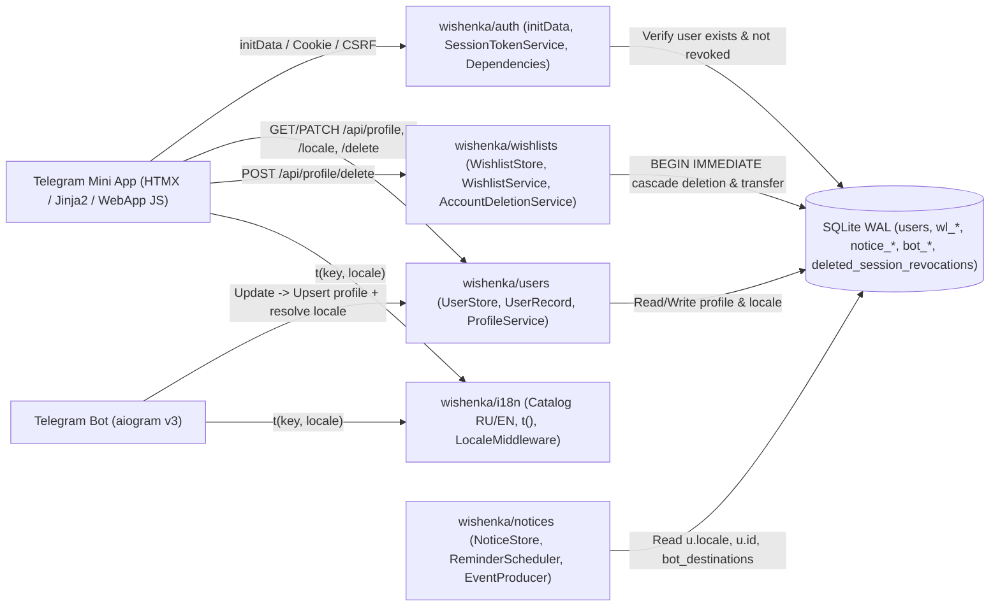

# WISHENKA-32: Модель пользовательских данных, i18n и процедура удаления аккаунта

## Research

### 1. Анализ текущей кодовой базы

Анализ выполнен по модулям `wishenka/users/`, `wishenka/auth/`, `wishenka/wishlists/`, `wishenka/notices/`, миграциям Alembic и проектной документации (`in-docs/spec.md`, `doc/dev/architecture.md`).

1. **Профиль пользователя (`wishenka/users/models.py`, `wishenka/users/store.py`):**
   - `UserRecord` содержит поля `id`, `telegram_id`, `first_name`, `last_name`, `username`, `language_code`, `is_premium`, `created_at`, `updated_at`.
   - Отсутствуют поля: `avatar_url`, `birthday`, `birthday_source`, `locale`, `locale_source` и вычисляемый `display_name`.
   - Таблица `users` создаётся императивно в `UserStore.initialize()` (`CREATE TABLE IF NOT EXISTS users ...`) вне цепочки ревизий Alembic (`wishenka/wishlists/alembic/versions/`), хотя `UserStore` и `WishlistStore` используют один и тот же SQLite-файл (`settings.database_url`, что подтверждается `JOIN users u` в `wishenka/notices/store.py` и `wishenka/notices/reminders.py`).
   - В `UserStore.upsert_user()` используется `ON CONFLICT(telegram_id) DO UPDATE SET ... language_code = excluded.language_code`, что безусловно перезаписывает язык пользователя при каждом входе и нарушает приоритет явного выбора (`FR-8`).
   - `wishenka/auth/models.py` (`TelegramUser`) не включает поле `photo_url` из `WebAppUser` `initData`.

2. **Раздвоение идентификаторов пользователя в таблицах БД (критический факт схемы):**
   - Домен вишлистов, настройки уведомлений и outbox используют **`users.telegram_id`**:
     - `wl_lists.owner_id` (плюс денормализованный `owner_name`)
     - `wl_members.user_id`
     - `wl_items.recipient_user_id` (плюс `recipient_name`; отдельного поля автора `created_by` в `wl_items` нет)
     - `wl_reservations.user_id`
     - `wl_favorites.user_id`
     - `wl_view_history.user_id`
     - `wl_idempotency_records.actor_id`
     - `notification_outbox.giver_user_id` и `notice_receipt_keys.giver_user_id` (`JOIN users u ON u.telegram_id = o.giver_user_id` в `wishenka/notices/store.py`)
     - `user_notification_settings.user_id` и `wl_list_notification_settings.user_id`
     - `reminder_outbox.user_id` (`JOIN users u ON u.telegram_id = q.user_id` в `wishenka/notices/reminders.py`)
   - Бот-таблицы доставки и приватных напоминаний используют внутренний PK **`users.id`** (и/или `telegram_id` в `support_tickets`):
     - `bot_destinations.user_id` (`JOIN users u ON d.user_id = u.id` в `wishenka/notices/store.py` и `wishenka/notices/reminders.py`)
     - `birthday_entries.owner_id` (`JOIN users u ON u.id = b.owner_id` в `wishenka/notices/reminders.py` и `wishenka/notices/scheduler.py`)
     - `support_tickets`: содержит оба столбца `owner_id` и `telegram_id` (`add_support_channel.py`)
     - Таблицы состояния диалогов бота: `birthday_input(owner_id, chat_id)`, `support_input(owner_id, chat_id)`, `bot_drafts(owner, chat)`, `bot_capture_order(owner, chat)` — при реализации `WISHENKA-35` ключ `owner`/`owner_id` и `chat`/`chat_id` должен очищаться с точным сопоставлением по типам ключей соответствующих бот-хендлеров.

3. **Текущее состояние локализации (i18n):**
   - `wishenka/notices/store.py` (`_eligible`) и `wishenka/notices/reminders.py` (`claim_reminder`, `refresh_reminder`) читают `u.language_code`, причём в `notices/store.py` fallback равен `"ru"`, а в `notices/reminders.py` проверяется `(language or "").lower().startswith("en")` с неявным fallback на русский. Это расходится с `FR-6` (поддержка только `ru`/`en`, fallback по умолчанию — `en`).
   - В `wishenka/bot/entry.py` используется `record.language_code` с fallback на `user.language_code`.
   - В Mini App (FastAPI + Jinja2 + HTMX) отсутствует централизованный каталог переводов и endpoint явного переключения локали.

4. **Текущее состояние сессий и жизненного цикла вишлистов:**
   - `SessionTokenService` (`wishenka/auth/session.py`) выпускает stateless HMAC-SHA256 токены с TTL по умолчанию 30 дней (`default_ttl_seconds = 2592000`), содержащие `telegram_id`, `first_name`, `username`, `user_id`, `iat`, `exp`. `get_optional_current_user` (`wishenka/auth/dependencies.py`) не обращается к БД, поэтому удаление строки `users` само по себе не отзовёт активные cookie/Bearer-токены на других устройствах.
   - `WishlistAccessPolicy.is_recipient_id` (`wishenka/wishlists/policy.py`) считает владельца получателем всех желаний только при `not wishlist.is_collaborative`. В `WishlistService.remove_member()` выставляется `wl.is_collaborative = len(wl.members) > 0`, что при сжатии совместного списка до одного нового владельца изменит семантику видимости чужих желаний в списке, если сбрасывать флаг `is_collaborative`.
   - `WishlistRole` (`wishenka/wishlists/models.py`) содержит `OWNER = "owner"`, `ADMIN = "admin"`, `MEMBER = "member"`.
   - `wl_tokens` (`wishlist_id` без `FOREIGN KEY`) и `wl_invite_tokens` (отдельный реестр токенов), а также `reminder_outbox` (`list_id` без `FOREIGN KEY`) не удаляются автоматически через SQLite `ON DELETE CASCADE` при удалении `wl_lists` — их нужно чистить явно.
   - При этом `NoticeStore.refresh_claim` и `refresh_reminder` уже выполняют `BEGIN IMMEDIATE` перепроверку `JOIN users` и `JOIN bot_destinations` непосредственно перед отправкой в Telegram, что предотвращает гонки отправки уведомлений после удаления аккаунта.

### 2. Внешние ограничения Telegram API (WebApp & Bot API)

По официальной документации Telegram (`core.telegram.org/bots/webapps`, `core.telegram.org/bots/api`):
1. **`WebAppUser.photo_url`** в `initData`: опциональное поле URL фотографии профиля (`.jpeg`/`.svg`), доступное при разрешённых настройках приватности пользователя и запуске Mini App. При скрытии/удалении аватара в Telegram поле отсутствует (`None`). Для безопасности в Mini App допускаются только `https://` URL; прокси-URL Bot API (`api.telegram.org/file/bot<TOKEN>/...`) **нельзя** сохранять в `avatar_url`, чтобы не скомпрометировать токен бота.
2. **`ChatFullInfo.birthdate`** в Telegram Bot API: возвращается методом `getChat` для приватного чата в виде объекта `Birthdate(day: int [1..31], month: int [1..12], year: int | None)`. Поле `year` опционально, поэтому модель хранения даты рождения должна поддерживать как полную дату `YYYY-MM-DD`, так и дату без года `--MM-DD`.

---

## Implementation Plan

### Распределение работ по задачам эпика `WISHENKA-31`

Задача `WISHENKA-32` (`[Декомпозиция]`) формирует единую архитектурную модель, схему миграций, протоколы и матрицу тестов для трёх последующих задач реализации в текущем спринте:

| Задача | Область ответственности | Ключевые артефакты / модули |
| ------ | ----------------------- | ---------------------------- |
| **WISHENKA-32** *(текущая)* | Декомпозиция, архитектура, спецификации и документация | `ai-tasks/WISHENKA-32/10-requirements.md`, `ai-tasks/WISHENKA-32/20-architecture.md`; шаг 4: обновление `in-docs/spec.md` (закрытие вопросов §16 по удалению и опциональным полям, уточнение §10/§11); шаг 8: обновление `doc/dev/` (`doc/dev/architecture.md`, `doc/dev/auth.md` / `doc/dev/users.md`). |
| **WISHENKA-33** | Мультиязычность `RU`/`EN` в Mini App и Telegram-боте, базовая эволюция схемы `users` для i18n | Миграция Alembic (ветка от `add_idempotency_records`) + синхронизация `UserStore.initialize()`, `UserRecord` (`locale`, `locale_source`, `display_name`), `resolve_telegram_locale()`, каталог `wishenka/i18n/`, Jinja2-глобал `t()`, FastAPI locale dependency + `PATCH /api/profile/locale`, aiogram i18n middleware (`entry.py`, `capture.py`, `birthdays.py`, `support.py`), чтение `u.locale` в `wishenka/notices/store.py` и `wishenka/notices/reminders.py`. |
| **WISHENKA-34** | Расширенный профиль и экран настроек уведомлений/персонализации в Mini App | `TelegramUser.photo_url` в `wishenka/auth/models.py`, поля `avatar_url`, `birthday`, `birthday_source` в `UserRecord`/`UserStore`, приоритет ручной даты рождения (`FR-4`), best-effort синхронизация `ChatFullInfo.birthdate` в боте, Mini App экран и API настроек профиля и уведомлений (`GET /settings`, `GET/PATCH /api/profile`, CRUD над `user_notification_settings` и `wl_list_notification_settings` для `gift_received`, `wishlist_changes`, `reservation_changes`, `reminders`), отображение реальных имён/аватаров участников вишлистов вместо `User <id>`. |
| **WISHENKA-35** | Механизм удаления аккаунта, передача владения, отзыв сессий и очистка ПДн | Таблица `deleted_session_revocations` + очистка в `wishenka/wishlists/cleanup.py`, проверка живости аккаунта и отзывов в `wishenka/auth/dependencies.py`, сервис `AccountDeletionService` / метод `WishlistStore` в `BEGIN IMMEDIATE` (каскад Step 0–4, детерминированный выбор преемника, обезличивание `wl_items`), UI подтверждения + `GET /api/profile/deletion-preview` + `POST /api/profile/delete` с CSRF и удалением cookie. |

> **Координация со смежными задачами (`WISHENKA-73`, `WISHENKA-89`):** Детальное содержание `WISHENKA-73` и `WISHENKA-89` находится вне файлов текущего рабочего скоупа (не проверялось в Jira в рамках Шага 2), однако любые задачи эпика `WISHENKA-31` или смежные UI/доменные доработки профиля, настроек и ролей должны опираться на единую ревизию схемы `users` и контракты `UserRecord`/`locale`/`AccountDeletionService`, описанные в данном документе, без создания параллельных таблиц профиля или конкурирующих миграций Alembic.

### Mandatory — Failing Repro (next Step 3)

**Для `WISHENKA-32`:** `N/A — no behavioral change` (`WISHENKA-32` — задача декомпозиции, архитектуры и документации; production-код и runtime-поведение в ней не меняются, обновления касаются спецификаций `in-docs/spec.md` и документации `doc/dev/`).

Ниже зафиксирована обязательная матрица автоматизированных **red-тестов (Step 3)** для реализации в `WISHENKA-33`, `WISHENKA-34`, `WISHENKA-35` (каждый тест оформляется с `@pytest.mark.timeout(...)` / `pytestmark` согласно `do-testing` и без сетевых вызовов к Telegram API):

#### Матрица Failing Repro для `WISHENKA-33` (i18n RU/EN и синхронизация)

| Файл теста | Тест-кейс | Проверяемое поведение (до фикса падает) | Изоляция |
| ---------- | --------- | --------------------------------------- | -------- |
| `tests/test_i18n_sync.py` | `test_first_login_locale_mapping_ru_en_and_fallback` | `initData` с `language_code="ru-RU"` → `locale="ru", locale_source="auto"`; `"en-US"`, `"de"`, `None` → `locale="en", locale_source="auto"`. | Локальный `TestClient` + временный SQLite (`UserStore`). |
| `tests/test_i18n_sync.py` | `test_auto_locale_tracks_telegram_client_until_explicit_switch` | При `locale_source="auto"` повторный `/api/auth/telegram` или бот-апдейт с новым `language_code` меняет `users.locale`; после `PATCH /api/profile/locale` (`"ru"` → `"en"`) `locale_source="explicit"` и повторный вход с `language_code="ru"` сохраняет `"en"`. | То же + прямой вызов `UserStore.upsert_user`. |
| `tests/test_i18n_sync.py` | `test_miniapp_switch_immediately_updates_ssr_bot_and_pending_notices` | После переключения языка в Mini App: (1) следующий HTML-ответ Mini App рендерится на новом языке (`<html lang="...">`), (2) следующий вызов бот-хендлера `/start` отвечает на новом языке вопреки `from_user.language_code`, (3) уже поставленный `pending` в `notification_outbox`/`reminder_outbox` при `claim_next`/`claim_reminder` доставляется на новом языке. | Фейковый `aiogram` `Bot`/`Message` (без сети) + `WishlistStore`/`NoticeStore`. |

#### Матрица Failing Repro для `WISHENKA-34` (Профиль, день рождения, аватар и настройки)

| Файл теста | Тест-кейс | Проверяемое поведение (до фикса падает) | Изоляция |
| ---------- | --------- | --------------------------------------- | -------- |
| `tests/test_profile_settings.py` | `test_telegram_sync_clears_removed_username_and_avatar` | Повторный `initData` без `username` и без `photo_url` очищает `username` и `avatar_url` в `None`, сохраняя работоспособность сервиса (`FR-3`, `FR-4`). | Временный SQLite + `TelegramUser`. |
| `tests/test_profile_settings.py` | `test_birthday_manual_override_beats_telegram_sync` | Пустой `birthday` заполняется из TG (`birthday_source="telegram"`) и очищается при скрытии в TG; после ручного `PATCH /api/profile` (`birthday="--05-14"`) `birthday_source="manual"` и повторная TG-синхронизация (с другой датой или `None`) не перезаписывает значение; поддерживаются форматы `YYYY-MM-DD` и `--MM-DD`. | Фейковый `ChatFullInfo.birthdate` + `UserStore`. |
| `tests/test_profile_settings.py` | `test_notification_settings_crud_and_list_override_priority` | Изменение глобальных (`user_notification_settings`) и списочных (`wl_list_notification_settings`) тумблеров через Mini App API корректно применяется в `NoticeStore` и `claim_reminder` с приоритетом настроек списка над общими. | Локальный `TestClient` + `NoticeStore`/`WishlistStore`. |

#### Матрица Failing Repro для `WISHENKA-35` (Удаление аккаунта)

| Файл теста | Тест-кейс | Проверяемое поведение (до фикса падает) | Изоляция |
| ---------- | --------- | --------------------------------------- | -------- |
| `tests/test_account_deletion.py` | `test_delete_personal_lists_cancels_reservations_and_preserves_surprise` | Личные списки удаляются вместе с желаниями, чеками (`wl_receipts`) и бронями; активные/купленные брони удаляемого пользователя в чужих списках удаляются, немедленно увеличивая `available_quantity`; получатель в чужих списках не получает уведомлений о снятии броней. | `WishlistStore` + `UserStore` в общем SQLite. |
| `tests/test_account_deletion.py` | `test_collaborative_owner_transfer_deterministic_tie_breaker` | Проверяет строгий порядок: (1) `admin` > `coauthor`/`member`, (2) более ранний `joined_at`, (3) более ранний `users.created_at`, (4) наименьший `telegram_id`. Проверяет сохранение желаний (с обнулением `recipient_user_id`/`recipient_name` удалённого) и броней других дарителей, удаление без участников, сохранение `is_collaborative=1`. | Фикстуры участников в `BEGIN IMMEDIATE`. |
| `tests/test_account_deletion.py` | `test_collaborative_member_exit_anonymizes_and_keeps_list_and_bookings` | Выход удаляемого участника (не владельца) сохраняет чужой совместный список, добавленные туда желания (без ПДн автора/получателя) и активные/купленные брони других дарителей без раскрытия тайны сюрприза. | То же. |
| `tests/test_account_deletion.py` | `test_deletion_purges_pii_revokes_sessions_and_is_idempotent` | Удаляются `users`, `wl_favorites`, `wl_view_history`, `user_notification_settings`, `wl_list_notification_settings`, `notification_outbox`, `notice_receipt_keys`, `reminder_outbox`, `wl_idempotency_records`, `bot_destinations`, `birthday_entries`, `birthday_input`, `support_input`, `support_tickets`, `bot_drafts`, `bot_capture_order`, `wl_tokens`; все старые cookie/Bearer токены (даже на другом устройстве и даже после немедленного повторного входа `FR-17`) получают `401`; повторный вызов удаления идемпотентен; при rollback середины транзакции ничего не удаляется (`NFR-1`). | `TestClient` + monkeypatch сбоя для проверки отката + повторная аутентификация `initData`. |

---

## Architecture

### 1. Диаграмма модулей и потоков данных



### 2. Модель пользовательских данных и эволюция схемы SQLite

#### 2.1. Целевая схема таблицы `users`

Все таблицы (`users`, `wl_*`, `notification_outbox`, `reminder_outbox`, `bot_*`) располагаются в единой БД `settings.database_url` (SQLite WAL, `PRAGMA foreign_keys = ON`, `PRAGMA busy_timeout = 5000`).

Целевой DDL таблицы `users`:

```sql
CREATE TABLE IF NOT EXISTS users (
    id INTEGER PRIMARY KEY AUTOINCREMENT,
    telegram_id INTEGER NOT NULL UNIQUE,
    first_name TEXT NOT NULL,
    last_name TEXT,
    username TEXT,
    avatar_url TEXT,
    birthday TEXT,
    birthday_source TEXT CHECK (birthday_source IS NULL OR birthday_source IN ('telegram', 'manual')),
    language_code TEXT,
    locale TEXT NOT NULL DEFAULT 'en' CHECK (locale IN ('ru', 'en')),
    locale_source TEXT NOT NULL DEFAULT 'auto' CHECK (locale_source IN ('auto', 'explicit')),
    is_premium INTEGER NOT NULL DEFAULT 0 CHECK (is_premium IN (0, 1)),
    created_at TEXT NOT NULL,
    updated_at TEXT NOT NULL
);
```

- **`display_name`:** вычисляемое свойство в `UserRecord` и `UserProfileDTO`:
  `f"{first_name} {last_name}".strip()` если `last_name` непустой, иначе `first_name` (единый источник истины без дублирующего столбца, который мог бы рассинхронизироваться с `first_name`/`last_name`). При рендере участников вишлистов (`GET /api/wishlists/{id}/members` и шаблоны) отображается `UserRecord.display_name` (с fallback `f"User {user_id}"` только если строка `users` отсутствует в старых тестовых фикстурах). `wl_lists.owner_name` актуализируется при создании списка и передаче владения.
- **`avatar_url`:** заполняется из `TelegramUser.photo_url` (прошедшего валидацию схемы `https://` и длины). При получении `initData` с `photo_url=None` очищается в `NULL` (`FR-4`). При обновлении из бот-апдейтов `aiogram.types.User` (где `photo_url` протокольно отсутствует) существующий `avatar_url` не затирается.
- **`birthday` и `birthday_source`:**
  - Допустимые форматы `birthday`: `YYYY-MM-DD` (полная дата) или `--MM-DD` (дата без года из Telegram `Birthdate` или пользовательского ввода), валидируемые календарно (29 февраля допускается при отсутствии года).
  - Матрица переходов (`FR-4`):
    - Текущее состояние `birthday_source IS NULL` или `'telegram'`: синхронизация из TG (`ChatFullInfo.birthdate`) записывает значение и `birthday_source = 'telegram'`, а при скрытии/удалении в TG очищает оба поля в `NULL`.
    - Текущее состояние `birthday_source = 'manual'`: ручной ввод (включая явное удаление даты в настройках с сохранением `birthday = NULL, birthday_source = 'manual'`) имеет абсолютный приоритет и **никогда** не перезаписывается и не очищается при синхронизации с TG.
- **Связь с настройками уведомлений:**
  - Пользовательские настройки уведомлений хранятся в существующих таблицах:
    - `user_notification_settings(user_id, event_type, enabled, updated_at)` — общие настройки на уровне пользователя;
    - `wl_list_notification_settings(user_id, wishlist_id, event_type, enabled, updated_at)` — переопределения на уровне конкретного вишлиста (имеют приоритет над общими при `COALESCE`).
  - В обеих таблицах столбец `user_id` хранит **`users.telegram_id`** (единый внешний ключ домена вишлистов и уведомлений). Поддерживаемые значения `event_type`: `gift_received`, `wishlist_changes`, `reservation_changes` (opt-in по умолчанию `0`), `reminders`.

#### 2.2. Новая таблица отзыва stateless-сессий без хранения ПДн

```sql
CREATE TABLE IF NOT EXISTS deleted_session_revocations (
    subject_hash TEXT PRIMARY KEY,
    revoked_before INTEGER NOT NULL,
    expires_at INTEGER NOT NULL
);
CREATE INDEX IF NOT EXISTS idx_deleted_session_revocations_expires
    ON deleted_session_revocations (expires_at);
```

- `subject_hash = HMAC-SHA256(settings.secret_key, f"deleted:{telegram_id}")` (hex-строка). Необратим без серверного секрета, не содержит `telegram_id` или иных ПДн (`FR-16`), автоматически очищается в `wishenka/wishlists/cleanup.py` по истечении `settings.session_ttl_seconds`.

#### 2.3. Стратегия миграций (Alembic + совместимость `UserStore`)

1. В `wishenka/wishlists/alembic/versions/` добавляется новая ревизия с `down_revision = "add_idempotency_records"`:
   - Идемпотентно создаёт таблицу `users` (если отсутствует в БД, инициализированной только через `WishlistStore`), либо через `PRAGMA table_info(users)` добавляет недостающие столбцы (`avatar_url`, `birthday`, `birthday_source`, `locale`, `locale_source`).
   - Выполняет backfill `locale` и `locale_source` для существующих строк:
     ```sql
     UPDATE users
     SET locale = CASE
             WHEN lower(trim(coalesce(language_code, ''))) LIKE 'ru%' THEN 'ru'
             ELSE 'en'
         END,
         locale_source = 'auto'
     WHERE locale IS NULL OR locale NOT IN ('ru', 'en');
     ```
   - Создаёт таблицу `deleted_session_revocations` и индекс `idx_deleted_session_revocations_expires`.
2. `UserStore.initialize()` сохраняет идемпотентную инициализацию таблицы `users` с полным набором новых столбцов (и проверкой `PRAGMA table_info(users)` для локальных unit-тестов, которые создают `UserStore` без запуска `WishlistStore.initialize()`). Обе точки инициализации строго согласованы по DDL.
3. Примечание к `wishenka/wishlists/migrations.py`: `_adopt_known_schema` применяется только для очень старых БД без `alembic_version`; все актуальные БД уже имеют `alembic_version` и обновляются стандартным `upgrade head`.

---

### 3. Протокол синхронизации локали `RU`/`EN` (Mini App ↔ Bot ↔ Outbox)

#### 3.1. Нормализация и правила записи

```python
SupportedLocale = Literal["ru", "en"]
LocaleSource = Literal["auto", "explicit"]

def resolve_telegram_locale(language_code: str | None) -> SupportedLocale:
    if language_code and language_code.strip().lower().startswith("ru"):
        return "ru"
    return "en"
```

1. **Автоматическое определение и обновление (`locale_source = 'auto'`):**
   - При первом создании записи в `users` выставляется `locale = resolve_telegram_locale(tg_user.language_code)` и `locale_source = 'auto'`.
   - При каждом последующем входе в Mini App (`POST /api/auth/telegram`) или сообщении/команде боту (`aiogram` middleware / `entry.py`) вызывается `UserStore.upsert_user(...)`:
     - `language_code` обновляется сырым значением из Telegram.
     - `locale` обновляется формулой `CASE WHEN users.locale_source = 'explicit' THEN users.locale ELSE excluded.locale END` — атомарно на уровне SQL без race condition.
2. **Явное переключение (`locale_source = 'explicit'`):**
   - Выполняется в Mini App через `PATCH /api/profile/locale` (с CSRF-защитой для cookie-сессии и проверкой `get_current_user`).
   - `UserStore.set_explicit_locale(telegram_id, locale)` устанавливает `locale = :locale, locale_source = 'explicit', updated_at = :now`.
   - Последующие визиты с любым `language_code` клиента Telegram **не изменяют** `users.locale` (`FR-8`).

#### 3.2. Чтение и синхронизация на всех точках вывода

1. **Mini App (SSR + HTMX):**
   - Локаль **не кешируется** в cookie-токене `SessionClaims`. Зависимость `get_request_locale` для авторизованного запроса читает актуальное `users.locale` из SQLite WAL (`UserStore.get_by_telegram_id`). Для анонимных посетителей публичной share-ссылки `/s/{token}` используется `resolve_telegram_locale` по `?lang=` / `Accept-Language` (fallback `'en'`).
   - Каталог переводов `wishenka/i18n/` (`ru`, `en`) инъектирует функцию `t(key, locale, **params)` в шаблоны Jinja2 и JSON/HTML ошибки маршрутов.
   - При ответе на `PATCH /api/profile/locale` сервер может возвращать заголовок `HX-Refresh: true` (для HTMX) и JSON `{ "locale": ..., "locale_source": "explicit" }`, мгновенно перерисовывая открытый экран Mini App.
2. **Telegram-бот (`aiogram` v3):**
   - Единое outer middleware на `Dispatcher` перед всеми роутерами (`entry`, `capture`, `birthdays`, `support`) вызывает `UserStore.upsert_from_bot(event.from_user)` и передаёт в `data["locale"]` актуальное `user_record.locale` (и `t`).
   - Опционально при явном переключении локали в Mini App (если сконфигурирован активный `Bot` и найден активный `bot_destinations.chat_id`) выполняется best-effort обновление локализованного меню команд `bot.set_my_commands(..., scope=BotCommandScopeChat(chat_id=chat_id))`, не блокирующее HTTP-ответ при сетевых сбоях Telegram.
3. **Асинхронные уведомления (`wishenka/notices/store.py`, `wishenka/notices/reminders.py`):**
   - `NoticeStore._eligible` (и соответственно `claim_next` / `refresh_claim`) и `claim_reminder` / `refresh_reminder` переключаются с `u.language_code` на `u.locale` с fallback `'en'`.
   - Поскольку `refresh_claim` и `refresh_reminder` перечитывают `users` непосредственно перед отправкой сообщения, даже отложенные уведомления, созданные до смены языка, отправляются на новом выбранном языке (`FR-9`).

---

### 4. Транзакционный контракт удаления аккаунта

#### 4.1. Идентификация и порядок блокировки

Весь процесс выполняется внутри **одной транзакции `BEGIN IMMEDIATE`** (`WishlistStore.transaction`) с `PRAGMA foreign_keys = ON` и `PRAGMA busy_timeout = 5000` (`NFR-1`). Это полностью сериализует удаление с конкурентными операциями бронирования, отметки прихода подарка, планировщиком напоминаний и воркером outbox.

Для удаляемого аккаунта из `AuthenticatedUser` берётся `tg_id = current_user.telegram_id`, а в начале транзакции из `users` читается внутренний ключ `internal_user_id = id` и из `bot_destinations` — привязанный `chat_id`.

#### 4.2. Пошаговая спецификация каскада (внутри `BEGIN IMMEDIATE`)

1. **Проверка существования (Идемпотентность `NFR-3`):**
   - Проверить наличие строки `users` для `tg_id` (и возможных остаточных строк в `wl_lists`/`wl_members`/`wl_reservations`). Если ничего не найдено — вернуть `DeletionResult(already_deleted=True)` без ошибки.
2. **Аннулирование собственных бронирований дарителя (`FR-14`, `FR-15`, `FR-16`):**
   - Удалить все строки `DELETE FROM wl_reservations WHERE user_id = :tg_id` (во всех статусах: `active`, `purchased`, `cancelled`, `completed`).
   - Эффект: занятое количество в `WishItem.reserved_quantity` немедленно снижается, возвращая остаток в `available_quantity` другим дарителям; таблица `wl_receipts` не содержит `user_id`/`reservation_id` и остаётся консистентной; персональный `tg_id` полностью стирается из `wl_reservations`; получателям не формируется никаких уведомлений (`FR-15`).
3. **Обработка вишлистов, где пользователь является владельцем (`wl_lists WHERE owner_id = :tg_id` across all statuses):**
   - Для каждого списка:
     - **A. Soft-deleted список (`status = 'deleted'`):** немедленно выполнить жёсткое удаление (`DELETE FROM wl_lists WHERE id = :wid`), очистить `wl_tokens`, `wl_invite_tokens`, `reminder_outbox WHERE list_id = :wid`, чтобы не оставлять `owner_id`/`owner_name` до фоновой чистки.
     - **B. Личный список (`is_collaborative = 0`) ИЛИ совместный список без других участников (`SELECT ... FROM wl_members WHERE wishlist_id = :wid AND user_id != :tg_id` пуст) (`FR-11`, `FR-12`):**
       - Выполнить жёсткое удаление `DELETE FROM wl_lists WHERE id = :wid` (с активным `PRAGMA foreign_keys = ON` это каскадно удаляет `wl_items`, `wl_reservations` других дарителей на этот список, `wl_receipts`, `wl_members`, `wl_favorites`, `wl_view_history`, `wl_list_notification_settings`, `notification_outbox` и `notice_receipt_keys` для данного списка).
       - Дополнительно явно удалить строки без FK CASCADE:
         - `DELETE FROM wl_tokens WHERE wishlist_id = :wid`
         - `DELETE FROM wl_invite_tokens WHERE token = :invite_token`
         - `DELETE FROM reminder_outbox WHERE list_id = :wid`
     - **C. Совместный список с другими участниками (`FR-12`, независимо от `status = 'active'` или `'archived'`):**
       - Загрузить всех кандидатов `m` из `wl_members WHERE wishlist_id = :wid AND user_id != :tg_id`, с `LEFT JOIN users u ON u.telegram_id = m.user_id` для получения `u.created_at`, `u.first_name`, `u.last_name`.
       - Выбрать единственного преемника по детерминированному ключу сортировки `(role_rank, joined_at_utc, user_created_at_utc, user_id)` по возрастанию:
         1. `role_rank`: `admin → 1`, `coauthor` / `collaborator` *(при наличии роли)* `→ 2`, `member` / прочие роли `→ 3`.
         2. `joined_at_utc`: наиболее ранняя дата/время присоединения `wl_members.joined_at` (приведённая к UTC `datetime`).
         3. `user_created_at_utc`: наиболее ранняя `users.created_at` (при отсутствии строки `users` в тестовых фикстурах — `datetime.max` UTC).
         4. `user_id` (`telegram_id`): наименьшее числовое значение `Telegram ID`.
       - Обновить `wl_lists`: `owner_id = successor.user_id`, `owner_name = successor_display_name`, `updated_at = :now`. **Флаг `is_collaborative` сохраняется равным `1`**, даже если в `wl_members` больше не осталось других участников, чтобы не активировалась эвристика личного списка `not wl.is_collaborative and wl.owner_id == user_id` в `WishlistAccessPolicy.is_recipient_id` и не скрывались существующие брони от нового владельца на не-его желания.
       - Удалить нового владельца (и при наличии — уходящего) из `wl_members` (`DELETE FROM wl_members WHERE wishlist_id = :wid AND user_id IN (:successor_id, :tg_id)`).
       - Зафиксировать нейтральное событие `membership_changed` через `EventProducer` **только** для оставшихся участников (включая нового владельца, без упоминания удалённого пользователя и деталей бронирований).
4. **Выход из чужих совместных вишлистов и обезличивание желаний (`FR-13`, `FR-15`):**
   - `DELETE FROM wl_members WHERE user_id = :tg_id`
   - Обезличить привязку на желаниях в оставшихся совместных списках (`wl_items`):
     `UPDATE wl_items SET recipient_user_id = NULL, recipient_name = NULL, updated_at = :now WHERE recipient_user_id = :tg_id`
   - Все сами желания и активные/купленные бронирования других дарителей на них остаются без изменений; `wl_receipts` сохраняются.
5. **Очистка всех остальных пользовательских данных и состояния бота (`FR-16`):**
   - По `tg_id`:
     - `DELETE FROM wl_favorites WHERE user_id = :tg_id`
     - `DELETE FROM wl_view_history WHERE user_id = :tg_id`
     - `DELETE FROM user_notification_settings WHERE user_id = :tg_id`
     - `DELETE FROM wl_list_notification_settings WHERE user_id = :tg_id`
     - `DELETE FROM notification_outbox WHERE giver_user_id = :tg_id`
     - `DELETE FROM notice_receipt_keys WHERE giver_user_id = :tg_id`
     - `DELETE FROM reminder_outbox WHERE user_id = :tg_id`
     - `DELETE FROM wl_idempotency_records WHERE actor_id = :tg_id`
   - По `internal_user_id` (когда `users` строка найдена) и `tg_id`:
     - `DELETE FROM birthday_entries WHERE owner_id = :internal_user_id`
     - `DELETE FROM birthday_input WHERE owner_id = :internal_user_id` (+ `OR chat_id = :chat_id` при наличии)
     - `DELETE FROM bot_destinations WHERE user_id = :internal_user_id`
     - `DELETE FROM support_input WHERE owner_id = :internal_user_id` *(в `WISHENKA-35` подтвердить ключ `owner_id` в `bot/support.py`)*
     - `DELETE FROM support_tickets WHERE owner_id = :internal_user_id OR telegram_id = :tg_id`
     - `DELETE FROM bot_drafts` и `DELETE FROM bot_capture_order` *(в `WISHENKA-35` очистить по точному ключу `owner`/`chat` из `bot/capture.py`)*
   - Удаление профиля:
     - `DELETE FROM users WHERE telegram_id = :tg_id`
6. **Отзыв сессий и поддержка повторного входа (`FR-16`, `FR-17`, `NFR-2`):**
   - Внутри той же транзакции записать в `deleted_session_revocations`:
     `(subject_hash = HMAC(secret_key, f"deleted:{tg_id}"), revoked_before = now_epoch, expires_at = now_epoch + session_ttl_seconds)`.
   - В `get_optional_current_user` (`wishenka/auth/dependencies.py`):
     - Если `claims.user_id is not None`: проверить существование строки `SELECT 1 FROM users WHERE id = :user_id AND telegram_id = :tg_id` (если таблицы `users` нет — пропустить для обратной совместимости изолированных маршрутных тестов; если таблица есть и строка отсутствует — `401 Unauthorized`). Поскольку `users.id` использует `AUTOINCREMENT`, даже при мгновенной повторной регистрации (`FR-17`) новый пользователь получит новый `users.id`, а старый cookie/Bearer токен со старым `user_id` останется навсегда недействительным на всех устройствах!
     - Если `claims.user_id is None` (токены, выпущенные напрямую `SessionTokenService` без `user_id`): проверить таблицу `deleted_session_revocations` по `subject_hash` — при `claims.iat <= revoked_before` вернуть `401 Unauthorized`.
   - HTTP-маршрут `POST /api/profile/delete` вызывает `delete_session_cookie(response, settings)`.

---

### 5. Интерфейсы между модулями

1. **`wishenka/users/store.py` & `wishenka/users/models.py`:**
   - `UserRecord`: добавляются `avatar_url: str | None`, `birthday: str | None`, `birthday_source: Literal["telegram", "manual"] | None`, `locale: Literal["ru", "en"]`, `locale_source: Literal["auto", "explicit"]`, property `display_name -> str`.
   - `UserStore.upsert_user(user: TelegramUser, *, sync_avatar: bool = True) -> UserRecord`: обновляет `first_name`, `last_name`, `username`, `language_code`, `is_premium`, при `sync_avatar=True` обновляет/очищает `avatar_url`, обновляет `locale` только если `locale_source == "auto"`.
   - `UserStore.set_explicit_locale(telegram_id: int, locale: SupportedLocale) -> UserRecord`
   - `UserStore.update_manual_birthday(telegram_id: int, birthday: str | None) -> UserRecord` (устанавливает `birthday_source = "manual"`)
   - `UserStore.sync_telegram_birthday(telegram_id: int, birthday: str | None) -> UserRecord | None` (обновляет/очищает только если `birthday_source != "manual"`)
2. **`wishenka/i18n/` (`WISHENKA-33`):**
   - `resolve_telegram_locale(language_code: str | None) -> SupportedLocale`
   - `t(key: str, locale: SupportedLocale, **kwargs: Any) -> str`
   - FastAPI dependency `get_request_locale(...) -> SupportedLocale`
   - aiogram outer middleware `LocaleMiddleware` (`data["locale"]`, `data["t"]`)
3. **`wishenka/wishlists/deletion.py` / `AccountDeletionService` (`WISHENKA-35`):**
   - `preview_account_deletion(telegram_id: int) -> DeletionPreviewDTO` (`personal_lists_count`, `collaborative_transferred_count`, `collaborative_deleted_count`, `reservations_count`) — не раскрывает данные чужих броней/получателей.
   - `delete_account(telegram_id: int, *, secret_key: str, session_ttl_seconds: int, now: datetime | None = None) -> DeletionResultDTO` (`already_deleted`, `deleted_lists`, `transferred_lists`, `cancelled_reservations`).
4. **HTTP API маршруты (Mini App):**
   - `GET /settings` — HTML-страница настроек профиля, языка, уведомлений и удаления аккаунта.
   - `GET /api/profile` — JSON/HTML профиль текущего пользователя.
   - `PATCH /api/profile/locale` — переключение `ru` ↔ `en` (`locale_source = "explicit"`).
   - `PATCH /api/profile` — ручное изменение/очистка `birthday` (`birthday_source = "manual"`).
   - `PUT /api/notifications/settings` & `PUT /api/wishlists/{wishlist_id}/notifications/settings` — управление общими и списочными настройками (`gift_received`, `wishlist_changes`, `reservation_changes`, `reminders`).
   - `GET /api/profile/deletion-preview` и `POST /api/profile/delete` (с `confirm: true` и CSRF) — предварительный расчёт последствий и атомарное удаление аккаунта.

### 6. Архитектурные паттерны и обоснование

- **Single SQLite WAL + `BEGIN IMMEDIATE` (`WishlistStore.transaction`):** устраняет межузловую/межпроцессную рассинхронизацию при удалении аккаунта, гарантирует `NFR-1` и исключает гонки с `NoticeStore` и `ReminderScheduler` без распределённых блокировок.
- **Database-backed single source of truth для локали:** хранение `locale` и `locale_source` в `users` вместо сессионного cookie гарантирует мгновенную синхронизацию между Mini App, ботом и фоновыми воркерами уведомлений (`FR-9`, `NFR-4`).
- **Keyed HMAC revocation без ПДн:** позволяет моментально инвалидировать даже stateless-токены без `user_id` после удаления аккаунта, сохраняя `FR-16` (отсутствие ПДн удалённого пользователя в БД).

---

## Q&A

- **Q1: Почему в части таблиц (`wl_lists`, `wl_reservations`, `notification_outbox`) используется `telegram_id`, а в `bot_destinations` и `birthday_entries` — `users.id`?**
  - **A1:** Так исторически сложилась текущая схема: домен вишлистов (и `user_notification_settings` / `wl_list_notification_settings`) работает по внешнему `telegram_id`, тогда как `bot_destinations`, `birthday_entries` и `support_tickets.owner_id` ссылаются на автоинкрементный PK `users.id`. В `20-architecture.md` оба вида ключей учтены явно: перед удалением `users` внутри `BEGIN IMMEDIATE` резолвятся и `tg_id`, и `internal_user_id`, чтобы ни одна таблица не оставила «осиротевших» строк.

- **Q2: Почему при передаче прав совместного вишлиста последнему оставшемуся участнику нельзя сбрасывать `is_collaborative` в `0`?**
  - **A2:** Согласно `WishlistAccessPolicy.is_recipient_id`, при `is_collaborative = 0` владелец списка автоматически считается получателем **всех** желаний в списке (даже добавленных ранее для других людей или для удалившегося бывшего владельца). Сохранение `is_collaborative = 1` сохраняет корректную изоляцию по `recipient_user_id` и не скрывает бронирования от нового владельца на чужие желания, равно как и сохраняет тайну сюрприза на его собственные желания.

- **Q3: Как предотвращается утечка токена бота через `avatar_url`?**
  - **A3:** `avatar_url` принимается только из проверенного `initData` (`WebAppUser.photo_url` по `https://`), а не через `getFile` Bot API (чьи URL содержат `bot<TOKEN>`). Если пользователь скрывает аватар в настройках приватности Telegram, `photo_url` не приходит в `initData`, и `avatar_url` очищается в `NULL`.

- **Q4: Что происходит с уже запущенным уведомлением в воркере, если пользователь удалил аккаунт в момент между `claim_next` и отправкой в Telegram?**
  - **A4:** Оба воркера (`NoticeStore.refresh_claim` и `refresh_reminder`) непосредственно перед сетевым вызовом Telegram перепроверяют `JOIN users` и `JOIN bot_destinations` внутри транзакции `BEGIN IMMEDIATE`. После коммита удаления аккаунта эта проверка возвращает `None`, и отправка отменяется без показа сообщения удалённому пользователю.
