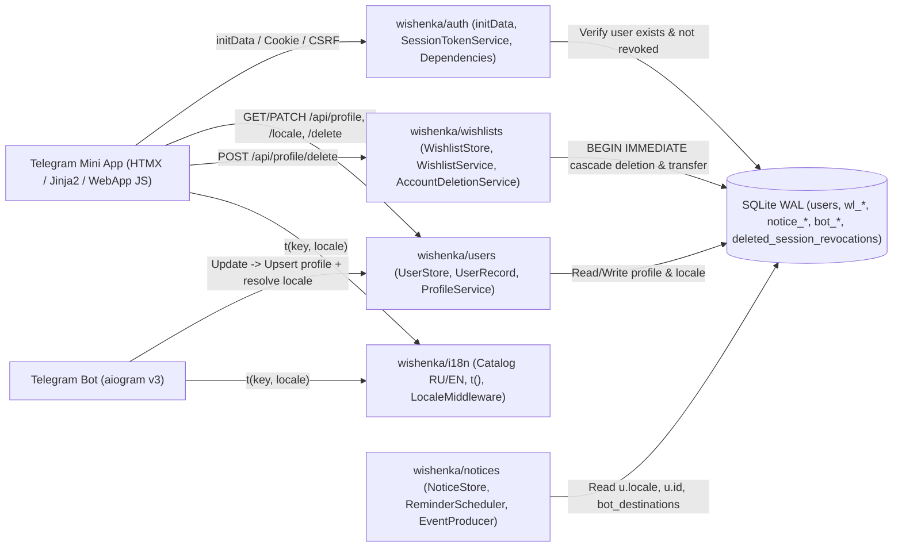

# Спецификация: WISHENKA-32 — Модель пользовательских данных, i18n и процедура удаления аккаунта

- **Задача / Эпик:** `WISHENKA-32` (`[Декомпозиция]`, эпик `WISHENKA-31`)
- **Язык реализации:** Python (FastAPI, Jinja2 + HTMX, aiogram v3, SQLite WAL, Alembic)
- **Статус документа:** Согласованная архитектурно-функциональная спецификация; реализация распределена по задачам спринта 2112 (`WISHENKA-33`, `WISHENKA-34`, `WISHENKA-35`)
- **Область изменений `WISHENKA-32`:** Формализация требований, проектирование архитектуры и контрактов наблюдаемости, обновление `in-docs/spec.md` (§10, §11, UC-10, §16) и `doc/dev/` (`architecture.md`, `users.md`, `auth.md`); runtime-код Python и автотесты в `WISHENKA-32` не изменялись

## 1. Назначение и бизнес-цель

### 1.1. Контекст и постановка проблемы

В сервисе «Вишенка» (Telegram Bot + Telegram Mini App) реализованы базовые домены вишлистов, желаний, бронирований, получения подарков, уведомлений и поддержки, однако до выполнения `WISHENKA-32` отсутствовала единая формализованная модель пользовательских данных и связанных сквозных протоколов:

1. **Профиль пользователя:** таблица `users` (`UserRecord` в `wishenka/users/models.py`) не содержала полей `avatar_url`, `birthday`, `birthday_source`, `locale`, `locale_source` и вычисляемого `display_name`, создавалась императивно вне цепочки миграций Alembic, а `TelegramUser` (`wishenka/auth/models.py`) не извлекал `photo_url` из `initData`.
2. **Локализация (`RU` / `EN`):** `UserStore.upsert_user()` безусловно перезаписывал `language_code` при каждом входе, в Mini App отсутствовали словарь переводов и endpoint явного переключения языка, а `wishenka/notices/store.py` и `wishenka/notices/reminders.py` читали `u.language_code` с несогласованным fallback на русский язык.
3. **Удаление аккаунта:** в схеме БД сложилось историческое расщепление ключей пользователя между `users.telegram_id` (домен вишлистов и outbox) и `users.id` (таблицы бота), в ряде таблиц отсутствуют `FOREIGN KEY ... ON DELETE CASCADE`, а stateless HMAC-сессии (`SessionTokenService`) не проверялись в БД при запросах.

### 1.2. Бизнес-цели и ценность решения

- **Для пользователей:**
  - Обеспечить вход в сервис исключительно по неизменяемому `Telegram ID` без регистрации, логина, пароля и обязательных дополнительных полей профиля.
  - Гарантировать консистентный интерфейс на русском (`ru`) или английском (`en`) языке во всех каналах (Mini App, меню и ответы Telegram-бота, отложенные уведомления и напоминания) с приоритетом ручного выбора.
  - Предоставить пользователю полный контроль над персональными данными и датой рождения, а также возможность необратимого самостоятельного удаления аккаунта после явного подтверждения без потери работоспособности чужих и совместных вишлистов и при строгом сохранении тайны сюрприза (`Surprise Invariant`).
- **Для системы и команды разработки:**
  - Задать единый контракт схемы БД, миграций Alembic, межмодульных интерфейсов и наблюдаемости (логирование, метрики, приватность) для декомпозированных задач реализации `WISHENKA-33`, `WISHENKA-34`, `WISHENKA-35`.
  - Устранить открытые вопросы в `in-docs/spec.md` §16 по удалению совместных вишлистов владельца и обработке недоступных из Telegram полей (`username`, аватара, даты рождения).

### 1.3. Границы решения и декомпозиция

**Входит в scope:**

- Бизнес-модель профиля пользователя (`Telegram ID`, имя, `username`, аватар, дата рождения, локаль) и правила синхронизации/очистки с Telegram.
- Протокол первичного определения, автообновления, явного переключения и сквозной синхронизации локали `ru` / `en` между Mini App, ботом и очередями уведомлений.
- Атомарная и идемпотентная процедура удаления аккаунта (личные и совместные списки, передача владения, выход из чужих списков, аннулирование броней, очистка ПДн, отзыв сессий, повторный вход).
- Контракты структурированного логирования, метрик, безопасности и матрица тестового покрытия для дочерних задач реализации.

**Не входит в scope (Non-Goals):**

- Поддержка языков интерфейса, отличных от русского (`ru`) и английского (`en`).
- Создание отдельной системы регистрации, логинов/паролей, публичных каталогов профилей или системы друзей и подписок.
- Административная веб-панель управления пользователями и внешняя веб-версия вне Telegram.
- Финансовые расчёты, совместная оплата и детальный визуальный дизайн экранов настроек.

**Декомпозиция работ в эпике `WISHENKA-31`:**

| Задача | Область ответственности | Ключевые артефакты и целевые модули |
| ------ | ----------------------- | ------------------------------------ |
| `WISHENKA-32` *(текущая)* | Декомпозиция, архитектура, спецификация и документация | `ai-tasks/WISHENKA-32/*`, обновление `in-docs/spec.md` (§10, §11, UC-10, §16) и `doc/dev/` (`architecture.md`, `users.md`, `auth.md`) |
| `WISHENKA-33` | Мультиязычность `RU` / `EN` и базовая эволюция `users` для i18n | Миграция Alembic от `add_idempotency_records`, синхронизация `UserStore.initialize()`, `resolve_telegram_locale()`, каталог `wishenka/i18n/`, `t()`, `PATCH /api/profile/locale`, `LocaleMiddleware`, чтение `u.locale` в `notices` |
| `WISHENKA-34` | Расширенный профиль, день рождения, аватар и настройки уведомлений | `TelegramUser.photo_url`, `avatar_url`, `birthday`, `birthday_source`, best-effort синхронизация `ChatFullInfo.birthdate`, `GET /settings`, `GET/PATCH /api/profile`, CRUD уведомлений, `display_name`/аватары участников |
| `WISHENKA-35` | Удаление аккаунта, передача владения, очистка ПДн и отзыв сессий | Таблица `deleted_session_revocations` и очистка в `cleanup.py`, проверка живости сессии в `auth/dependencies.py`, `AccountDeletionService` в `BEGIN IMMEDIATE`, `GET /api/profile/deletion-preview`, `POST /api/profile/delete` |

> **Координация со смежными задачами (`WISHENKA-73`, `WISHENKA-89`):** любые доработки профиля, настроек и ролей должны опираться на единую ревизию таблицы `users` и контракты `UserRecord`, `locale` и `AccountDeletionService` без создания параллельных таблиц профиля или конкурирующих веток миграций Alembic.

## 2. Функциональные требования и пользовательские сценарии

### 2.1. Пользовательские истории и сценарии

- **US-1 (Профиль из Telegram):** Пользователь входит в сервис через Telegram без создания логина и пароля; его имя, `username`, аватар и доступная дата рождения автоматически используются в профиле.
- **US-2 (Переключение и синхронизация языка):** Пользователь переключает язык интерфейса (`ru` ↔ `en`) в Mini App и немедленно видит выбранный язык в Mini App, во всех ответах/меню Telegram-бота и в доставляемых уведомлениях.
- **US-3 (Первичное определение языка):** Новый пользователь при первом запуске видит интерфейс на языке клиента Telegram (`ru` или `en`, с fallback `en`).
- **US-4 (Удаление аккаунта):** Пользователь инициирует удаление своего аккаунта из настроек Mini App после ознакомления со сводкой последствий и явного подтверждения.
- **US-5 (Сохранение совместных списков):** При удалении аккаунта владельцем совместного вишлиста с другими участниками список не исчезает, а права владения детерминированно передаются одному из оставшихся участников.
- **US-6 (Освобождение броней и тайна сюрприза):** При удалении аккаунта пользователя его бронирования в чужих списках аннулируются, возвращая остаток другим дарителям, при этом получатели подарков никогда не узнают о личности дарителя и факте существования броней.

Указанные истории детализируют сценарии **UC-10** («Персонализация») и **UC-11** («Управление данными») в `in-docs/spec.md`.

### 2.2. Бизнес-модель профиля и правила синхронизации с Telegram (`FR-1` – `FR-4`)

Идентификация и авторизация выполняются исключительно по уникальному неизменяемому `Telegram ID` (`FR-1`). Отсутствие любых опциональных полей (`username`, аватара, даты рождения, года рождения) не ограничивает доступ пользователя ни к каким функциям сервиса (`FR-3`).

| Атрибут профиля | Обязательность | Правило инициализации и синхронизации (`FR-4`) |
| --------------- | -------------- | ---------------------------------------------- |
| `Telegram ID` (`telegram_id`) | Обязательно | Неизменяемый внешний идентификатор пользователя в Telegram |
| Отображаемое имя (`first_name`, `last_name` → `display_name`) | Обязательно | Обновляется актуальными именем и опциональной фамилией из Telegram |
| `Username` (`username`) | Необязательно | Обновляется из Telegram; при удалении `username` в Telegram очищается в `NULL` |
| Аватар (`avatar_url`) | Необязательно | Обновляется из `WebAppUser.photo_url` при запуске Mini App; при удалении или скрытии настройками приватности в Telegram (`photo_url = None`) очищается в `NULL`; при взаимодействии только через Telegram-бота существующий аватар не затирается |
| Дата рождения (`birthday`, `birthday_source`) | Необязательно | Поддерживает форматы `YYYY-MM-DD` и `--MM-DD` (без года, включая `--02-29`). При `birthday_source IS NULL` или `'telegram'` заполняется/обновляется из Telegram (`ChatFullInfo.birthdate`) и очищается в `NULL` при скрытии или удалении в Telegram. Ручной ввод или явная очистка в настройках Mini App выставляет `birthday_source = 'manual'`, что имеет безусловный приоритет и никогда не перезаписывается и не очищается при синхронизации с Telegram |
| Локаль и источник (`locale`, `locale_source`) | Обязательно | Допустимы только `ru` и `en`; в режиме `'auto'` обновляется по языку клиента Telegram, в режиме `'explicit'` защищена от перезаписи |
| Временные метки (`created_at`, `updated_at`) | Обязательно | Фиксируют дату создания и последнего обновления профиля (UTC) |

### 2.3. Локализация (`RU` / `EN`) и протокол синхронизации (`FR-5` – `FR-9`)

1. **Поддерживаемые языки (`FR-5`):** сервис поддерживает ровно два языка интерфейса — русский (`ru`) и английский (`en`).
2. **Автоматическое определение и отслеживание (`FR-6`):** при первом входе локаль получает источник `'auto'` и вычисляется по языку клиента Telegram: если код языка начинается с `ru` (без учёта регистра и пробелов по краям), устанавливается `'ru'`; для `'en'`, иных языков или отсутствующего значения устанавливается `'en'`. Пока пользователь не переключил язык вручную, локаль остаётся `'auto'` и продолжает автоматически обновляться при изменении языка клиента Telegram на последующих визитах в Mini App или бот.
3. **Явное переключение (`FR-7`, `FR-8`):** в любой момент пользователь может переключить язык (`ru` ↔ `en`) в настройках Mini App. Локаль получает источник `'explicit'`, становится единым источником истины и сохраняет приоритет над языком клиента Telegram при всех последующих визитах во всех каналах.
4. **Немедленная сквозная синхронизация (`FR-9`):** переключение языка в Mini App сразу перерисовывает открытый экран Mini App, а все последующие ответы и меню Telegram-бота (все роутеры: `entry`, `capture`, `birthdays`, `support`) и исходящие асинхронные уведомления/напоминания — включая уже поставленные в очередь `pending` записи на момент доставки — используют актуальный выбранный язык.
5. **Анонимный просмотр:** для неавторизованного посетителя публичной ссылки `/s/{token}` язык интерфейса определяется по параметру запроса `?lang=` или заголовку `Accept-Language` с языком по умолчанию `'en'`.

### 2.4. Процедура удаления аккаунта и каскадные эффекты (`FR-10` – `FR-17`)

- **Инициация и подтверждение (`FR-10`):** удаление инициируется самим аутентифицированным пользователем из настроек Mini App. Перед выполнением отображается предупреждение о необратимости и сводка последствий (количество затрагиваемых личных списков, передаваемых/удаляемых совместных списков и аннулируемых собственных броней без раскрытия чужих броней или получателей) и требуется явное подтверждение.
- **Личные и пустые списки (`FR-11`):** все личные (`is_collaborative = 0`), мягко удалённые (`status = 'deleted'`) и совместные без других участников вишлисты удаляемого владельца безвозвратно удаляются со всеми желаниями, историей раздела «Подаренные» (`wl_receipts`), токенами доступа и бронированиями других дарителей на эти желания (все брони аннулируются).
- **Совместные вишлисты — удаляемый пользователь является владельцем (`FR-12`):**
  - Если в списке (активном или архивном) присутствуют другие участники, вишлист сохраняется с `is_collaborative = 1`, а права владельца передаются единственному преемнику по строгому детерминированному порядку:
    1. **Приоритет роли:** сначала `admin` (уровень 1) → при отсутствии администраторов `coauthor` / `collaborator` *(при наличии такой роли)* (уровень 2) → при отсутствии обоих `member` или любой иной оставшийся участник (уровень 3).
    2. **Стаж участия:** внутри наивысшей доступной роли выбирается участник с наиболее ранней датой и временем присоединения к списку (`joined_at`).
    3. **Возраст профиля:** при равном стаже — участник с наиболее ранней датой создания профиля в сервисе (`users.created_at`).
    4. **Детерминированный tie-breaker:** при совпадении даты создания профиля — участник с наименьшим числовым значением `Telegram ID`.
  - Все желания в переданном списке (с обезличиванием привязки к удалённому пользователю) и активные/купленные бронирования других дарителей сохраняются (собственные брони удаляемого пользователя аннулируются). Оставшимся участникам, включая нового владельца, может отправляться нейтральное событие об изменении состава/владения без персональных данных удалившегося пользователя и без упоминания бронирований.
- **Совместные вишлисты — удаляемый пользователь является участником (`FR-13`):** пользователь исключается из состава участников чужих совместных списков независимо от его роли. Сам список, желания других участников и желания, ранее связанные с удаляемым участником, сохраняются (с обезличиванием привязки авторства/получателя), а все активные и купленные бронирования других дарителей остаются в силе без раскрытия тайны сюрприза.
- **Бронирования удаляемого пользователя (`FR-14`):** все бронирования удаляемого пользователя в чужих списках (во всех статусах) удаляются; занятое количество экземпляров немедленно возвращается в доступный остаток для других дарителей.
- **Очистка персональных данных и отзыв сессий (`FR-16`):** безвозвратно удаляются профиль `users`, избранные списки, история просмотров, глобальные и списочные настройки уведомлений, записи дней рождения (`/birthdays`), состояния диалогов и черновики в боте, обращения в поддержку, ключи идемпотентности и неотправленные исходящие уведомления/напоминания; все активные сессии на всех устройствах немедленно отзываются без сохранения ПДн. Сообщения, уже доставленные в чат Telegram до момента удаления, остаются в истории переписки на стороне клиента Telegram.
- **Повторный вход (`FR-17`):** при повторном открытии бота или Mini App после удаления человек регистрируется заново как новый пользователь без восстановления удалённых вишлистов, настроек и броней; ранее выпущенные сессионные токены остаются недействительными.

### 2.5. Ключевые доменные инварианты

1. **Тайна сюрприза (`FR-15` / Surprise Invariant):** ни при удалении аккаунта, ни при аннулировании броней, ни при передаче владения совместным вишлистом, ни в сводке предпросмотра удаления получатель подарка не должен получать сведений о личности дарителя, наличии брони или статусе покупки.
2. **Приоритет пользовательского выбора:** явная локаль (`locale_source = 'explicit'`) и ручная дата рождения (`birthday_source = 'manual'`) никогда не перезаписываются данными из Telegram.
3. **Атомарность и идемпотентность:** процедура удаления аккаунта либо полностью завершается со всеми каскадами, либо целиком откатывается; повторный вызов удаления не создаёт ошибок и побочных эффектов.

## 3. Архитектура, компоненты и интерфейсы

### 3.1. Компонентная модель и потоки данных



### 3.2. Модель данных, расщепление ключей и миграции SQLite

Все таблицы располагаются в едином файле SQLite WAL (`settings.database_url`, `PRAGMA foreign_keys = ON`, `PRAGMA busy_timeout = 5000`).

#### 3.2.1. Целевая схема `users` и `deleted_session_revocations`

```sql
CREATE TABLE IF NOT EXISTS users (
    id INTEGER PRIMARY KEY AUTOINCREMENT,
    telegram_id INTEGER NOT NULL UNIQUE,
    first_name TEXT NOT NULL,
    last_name TEXT,
    username TEXT,
    avatar_url TEXT,
    birthday TEXT,
    birthday_source TEXT CHECK (birthday_source IS NULL OR birthday_source IN ('telegram', 'manual')),
    language_code TEXT,
    locale TEXT NOT NULL DEFAULT 'en' CHECK (locale IN ('ru', 'en')),
    locale_source TEXT NOT NULL DEFAULT 'auto' CHECK (locale_source IN ('auto', 'explicit')),
    is_premium INTEGER NOT NULL DEFAULT 0 CHECK (is_premium IN (0, 1)),
    created_at TEXT NOT NULL,
    updated_at TEXT NOT NULL
);

CREATE TABLE IF NOT EXISTS deleted_session_revocations (
    subject_hash TEXT PRIMARY KEY,
    revoked_before INTEGER NOT NULL,
    expires_at INTEGER NOT NULL
);

CREATE INDEX IF NOT EXISTS idx_deleted_session_revocations_expires
    ON deleted_session_revocations (expires_at);
```

- **`display_name`:** вычисляемое свойство в `UserRecord` и `UserProfileDTO` (`f"{first_name} {last_name}".strip()` при непустом `last_name`, иначе `first_name`), без дублирующего столбца в `users`. При отображении участников (`GET /api/wishlists/{id}/members` и шаблоны) используется `UserRecord.display_name` (fallback `f"User {user_id}"` только если строка `users` отсутствует в legacy-фикстурах). `wl_lists.owner_name` актуализируется при создании списка и при передаче владения.
- **Настройки уведомлений:** хранятся в существующих таблицах `user_notification_settings(user_id, event_type, enabled, updated_at)` и `wl_list_notification_settings(user_id, wishlist_id, event_type, enabled, updated_at)` с привязкой `user_id = users.telegram_id` и приоритетом списочных настроек над общими через `COALESCE`. Поддерживаемые значения `event_type`: `gift_received`, `wishlist_changes`, `reservation_changes` (opt-in `0` по умолчанию), `reminders`.
- **Без-ПДн идентификатор отзыва:** `subject_hash = HMAC-SHA256(settings.secret_key, f"deleted:{telegram_id}")` (hex-строка), очищается в `wishenka/wishlists/cleanup.py` по истечении `expires_at` (`now_epoch + settings.session_ttl_seconds`).

#### 3.2.2. Карта расщепления идентификаторов пользователя в БД

При операциях удаления и выборки данных учитывается историческое разделение внешних ключей:

| Тип ключа | Таблицы и столбцы | Примечание по каскадам |
| --------- | ----------------- | ---------------------- |
| `users.telegram_id` | `wl_lists.owner_id`, `wl_members.user_id`, `wl_items.recipient_user_id`, `wl_reservations.user_id`, `wl_favorites.user_id`, `wl_view_history.user_id`, `wl_idempotency_records.actor_id`, `notification_outbox.giver_user_id`, `notice_receipt_keys.giver_user_id`, `user_notification_settings.user_id`, `wl_list_notification_settings.user_id`, `reminder_outbox.user_id` | Без FK на `users`; `wl_tokens`, `wl_invite_tokens` и `reminder_outbox` не имеют `ON DELETE CASCADE` на `wl_lists` и удаляются явно |
| `users.id` (PK) | `bot_destinations.user_id`, `birthday_entries.owner_id`, `birthday_input.owner_id`, `support_input.owner_id` | Требует резолва `internal_user_id = users.id` до удаления строки `users` |
| Смешанные / диалоговые ключи | `support_tickets` (`owner_id` + `telegram_id`), `birthday_input` (`owner_id` + `chat_id`), `bot_drafts(owner, chat)`, `bot_capture_order(owner, chat)` | Очищаются явно в транзакции удаления по подтверждённым ключам бот-хендлеров |

#### 3.2.3. Стратегия миграций Alembic

- В `wishenka/wishlists/alembic/versions/` добавляется новая ревизия с `down_revision = "add_idempotency_records"`:
  1. Идемпотентно создаёт таблицу `users` или через `PRAGMA table_info(users)` добавляет столбцы `avatar_url`, `birthday`, `birthday_source`, `locale`, `locale_source`.
  2. Выполняет backfill `locale` (`ru*` → `'ru'`, иначе `'en'`) и `locale_source = 'auto'` для существующих записей с пустым/невалидным значением.
  3. Создаёт таблицу `deleted_session_revocations` и индекс `idx_deleted_session_revocations_expires`.
- `UserStore.initialize()` сохраняет идемпотентный DDL `users` и `PRAGMA table_info(users)` со строго идентичной схемой для изолированных тестов, не запускающих `WishlistStore.initialize()`. В `wishenka/wishlists/migrations.py` сохраняется `_adopt_known_schema` только для старых БД без `alembic_version`.

### 3.3. Контракты данных и переходы состояний

#### 3.3.1. Переходы локали (`locale`, `locale_source`) и синхронизация каналов

```python
SupportedLocale = Literal["ru", "en"]
LocaleSource = Literal["auto", "explicit"]

def resolve_telegram_locale(language_code: str | None) -> SupportedLocale:
    if language_code and language_code.strip().lower().startswith("ru"):
        return "ru"
    return "en"
```

- **Upsert из Mini App или бота:** обновляет `language_code` сырым значением и атомарно вычисляет локаль на уровне SQL: `CASE WHEN users.locale_source = 'explicit' THEN users.locale ELSE excluded.locale END`.
- **Явное переключение (`PATCH /api/profile/locale`):** переводит запись в `locale = :locale, locale_source = 'explicit'`, возвращает JSON `{"locale": ..., "locale_source": "explicit"}` и заголовок `HX-Refresh: true` для мгновенной перерисовки HTMX-интерфейса; опционально в режиме best-effort обновляет локализованное меню команд бота через `bot.set_my_commands(..., scope=BotCommandScopeChat(chat_id=chat_id))`.
- **Чтение в точках вывода:**
  - Mini App (`get_request_locale`): локаль не кешируется в cookie-токене `SessionClaims`, а читается из `users.locale` (для анонимных запросов `/s/{token}` — `resolve_telegram_locale` по `?lang=` / `Accept-Language`).
  - Бот (`LocaleMiddleware`): outer middleware на `Dispatcher` перед роутерами `entry`, `capture`, `birthdays`, `support` обновляет профиль через `UserStore.upsert_from_bot(event.from_user)` и передаёт в `data["locale"]` и `data["t"]` актуальную локаль из БД.
  - Воркеры уведомлений (`NoticeStore._eligible`, `claim_next`, `refresh_claim`, `claim_reminder`, `refresh_reminder`): переключаются с `u.language_code` на `u.locale` с единым fallback `'en'`; перечитывание `users` в `refresh_claim` / `refresh_reminder` внутри `BEGIN IMMEDIATE` гарантирует отправку даже ранее поставленных в очередь сообщений на актуальном языке (и отмену отправки при удалении аккаунта).

#### 3.3.2. Переходы `avatar_url` и `birthday`

- **`avatar_url`:** принимается исключительно из проверенного `initData` (`TelegramUser.photo_url`). Валидация разрешает только `https://` URL допустимой длины и блокирует URL Bot API вида `https://api.telegram.org/file/bot<TOKEN>/...` для исключения утечки токена бота. При `sync_avatar=True` и `photo_url=None` в Mini App столбец `avatar_url` очищается в `NULL`; при бот-апдейтах (`sync_avatar=False` через `upsert_from_bot`) ранее сохранённый `avatar_url` сохраняется.
- **`birthday` / `birthday_source`:**
  - При `birthday_source IS NULL` или `'telegram'` вызов `sync_telegram_birthday` записывает дату из `ChatFullInfo.birthdate` (`YYYY-MM-DD` или `--MM-DD`, с календарной валидацией, допускающей `--02-29`) с `birthday_source = 'telegram'` либо очищает оба столбца в `NULL` при отсутствии/скрытии даты в Telegram.
  - При `update_manual_birthday` (включая явную очистку в настройках Mini App → `birthday = NULL`) выставляется `birthday_source = 'manual'`; любые последующие вызовы `sync_telegram_birthday` пропускаются без изменения записи.

#### 3.3.3. Транзакционный каскад `AccountDeletionService.delete_account`

Весь процесс выполняется в одной транзакции `BEGIN IMMEDIATE` (`WishlistStore.transaction`):

1. **Резолв ключей и идемпотентность (`NFR-3`):** чтение `tg_id = current_user.telegram_id`, `internal_user_id = users.id`, `chat_id` из `bot_destinations`. Если строка `users` и остаточные строки в `wl_lists`/`wl_members`/`wl_reservations` отсутствуют — возврат `DeletionResultDTO(already_deleted=True)`.
2. **Аннулирование собственных броней (`FR-14`, `FR-15`):** `DELETE FROM wl_reservations WHERE user_id = :tg_id` (все статусы: `active`, `purchased`, `cancelled`, `completed`). Снижает `WishItem.reserved_quantity` и восстанавливает `available_quantity` без уведомлений получателям.
3. **Обработка принадлежащих вишлистов (`wl_lists WHERE owner_id = :tg_id`):**
   - *Ветка A (`status = 'deleted'`)*: немедленное жёсткое удаление `wl_lists` и явная очистка `wl_tokens`, `wl_invite_tokens`, `reminder_outbox`.
   - *Ветка B (`is_collaborative = 0` или нет других участников в `wl_members`)*: жёсткое удаление `DELETE FROM wl_lists WHERE id = :wid` (срабатывает `ON DELETE CASCADE` на `wl_items`, `wl_reservations` других дарителей, `wl_receipts`, `wl_members`, `wl_favorites`, `wl_view_history`, `wl_list_notification_settings`, `notification_outbox`, `notice_receipt_keys`) плюс явное удаление `wl_tokens`, `wl_invite_tokens`, `reminder_outbox`.
   - *Ветка C (совместный список `active` или `archived` с другими участниками)*: выбор преемника из `wl_members LEFT JOIN users` по ключу сортировки `(role_rank, joined_at_utc, user_created_at_utc, user_id)` по возрастанию (`role_rank`: `admin → 1`, `coauthor`/`collaborator` → `2`, `member`/прочие → `3`; `user_created_at_utc` при отсутствии строки `users` — `datetime.max` UTC); обновление `wl_lists.owner_id`, `owner_name`, `updated_at` **с обязательным сохранением `is_collaborative = 1`** (чтобы эвристика `not wl.is_collaborative and wl.owner_id == user_id` в `WishlistAccessPolicy.is_recipient_id` не превращала нового владельца в получателя всех чужих желаний списка); удаление преемника и уходящего владельца из `wl_members`; публикация нейтрального события `membership_changed` через `EventProducer` только оставшимся участникам.
4. **Выход из чужих совместных списков и обезличивание (`FR-13`):** `DELETE FROM wl_members WHERE user_id = :tg_id` и `UPDATE wl_items SET recipient_user_id = NULL, recipient_name = NULL, updated_at = :now WHERE recipient_user_id = :tg_id` с сохранением самих желаний, `wl_receipts` и чужих броней.
5. **Очистка остальных ПДн и состояния бота (`FR-16`):**
   - По `tg_id`: `wl_favorites`, `wl_view_history`, `user_notification_settings`, `wl_list_notification_settings`, `notification_outbox`, `notice_receipt_keys`, `reminder_outbox`, `wl_idempotency_records`.
   - По `internal_user_id` / `chat_id` / `tg_id`: `birthday_entries`, `birthday_input`, `bot_destinations`, `support_input`, `support_tickets`, `bot_drafts`, `bot_capture_order`.
   - Удаление записи `DELETE FROM users WHERE telegram_id = :tg_id`.
6. **Отзыв сессий (`FR-16`, `FR-17`, `NFR-2`):** вставка `(subject_hash, now_epoch, now_epoch + session_ttl_seconds)` в `deleted_session_revocations`; HTTP-маршрут `POST /api/profile/delete` вызывает `delete_session_cookie(response, settings)`.

#### 3.3.4. Проверка живости сессии при аутентификации (`wishenka/auth/dependencies.py`)

В `get_optional_current_user`:

- При `claims.user_id is not None`: выполняется проверка `SELECT 1 FROM users WHERE id = :user_id AND telegram_id = :tg_id` (при отсутствии таблицы `users` в изолированных маршрутных тестах проверка пропускается для обратной совместимости; при наличии таблицы и отсутствии строки возвращается `401 Unauthorized`). Поскольку `users.id` использует `AUTOINCREMENT`, повторная регистрация после удаления (`FR-17`) выдаёт новый `users.id`, оставляя все старые токены навсегда недействительными.
- При `claims.user_id is None` (прямые токены `SessionTokenService` без `user_id`): выполняется проверка `deleted_session_revocations` по `subject_hash`; при `claims.iat <= revoked_before` возвращается `401 Unauthorized`.

### 3.4. Программные и HTTP-интерфейсы

| Модуль / Слой | Символ или маршрут | Назначение и контракт |
| ------------- | ------------------ | --------------------- |
| `wishenka/users/models.py`, `store.py` | `UserRecord`, `UserProfileDTO`, `upsert_user`, `upsert_from_bot`, `set_explicit_locale`, `update_manual_birthday`, `sync_telegram_birthday` | Хранение и правила синхронизации профиля; `upsert_from_bot` вызывает `upsert_user(..., sync_avatar=False)` |
| `wishenka/i18n/` | `resolve_telegram_locale`, `t(key, locale, **kwargs)`, `get_request_locale`, `LocaleMiddleware` | Каталог `ru`/`en`, инъекция `t()` в Jinja2/маршруты, outer middleware для `aiogram` |
| `wishenka/auth/models.py`, `dependencies.py` | `TelegramUser.photo_url`, `get_optional_current_user` | Извлечение и валидация `photo_url`, проверка живости `users.id` и `deleted_session_revocations` |
| `wishenka/wishlists/deletion.py` | `AccountDeletionService.preview_account_deletion`, `AccountDeletionService.delete_account` | Возврат `DeletionPreviewDTO` и выполнение каскадного удаления в `BEGIN IMMEDIATE` с возвратом `DeletionResultDTO` |
| HTTP Mini App (настройки и профиль) | `GET /settings`, `GET /api/profile`, `PATCH /api/profile/locale`, `PATCH /api/profile` | Экран и API профиля, переключение языка с CSRF, ручная установка/очистка `birthday` |
| HTTP Mini App (уведомления и удаление) | `PUT /api/notifications/settings`, `PUT /api/wishlists/{wishlist_id}/notifications/settings`, `GET /api/profile/deletion-preview`, `POST /api/profile/delete` | Управление общими и списочными настройками уведомлений, предпросмотр и подтверждённое удаление аккаунта (`confirm: true`, CSRF) |

## 4. Нефункциональные требования, безопасность и наблюдаемость

### 4.1. Нефункциональные требования и ограничения производительности

- **NFR-1 (Атомарность и сериализация):** транзакция удаления `BEGIN IMMEDIATE` с `PRAGMA foreign_keys = ON` и `PRAGMA busy_timeout = 5000` полностью сериализует удаление с бронированиями, отметками получения и воркерами outbox/напоминаний. Для исключения table-scan и минимизации времени удержания write-lock по ~15+ таблицам критичны индексы `wl_lists(owner_id)`, `wl_members(user_id)`, `wl_reservations(user_id)`, `wl_items(recipient_user_id)` и `idx_deleted_session_revocations_expires`.
- **NFR-2 (Безопасность и авторизация):** изменение профиля, переключение языка, просмотр сводки и удаление аккаунта доступны только аутентифицированному владельцу (`get_current_user`) с проверкой CSRF на мутирующих cookie-запросах.
- **NFR-3 (Идемпотентность):** повторный вызов `AccountDeletionService.delete_account` для уже удалённого аккаунта завершается без исключений с `already_deleted=True`.
- **NFR-4 (Консистентность i18n и оптимизация чтений):** отказ от хранения локали в cookie-сессии гарантирует отсутствие рассинхронизации; в рамках одного HTTP-запроса чтение `UserRecord` для проверки сессии и `get_request_locale` рекомендуется кешировать на уровне request-dependency во избежание дублирующего SQL-запроса.
- **Асинхронность внешних вызовов и очистка отзывов:** best-effort вызов `bot.set_my_commands` в `PATCH /api/profile/locale` выполняется неблокирующе (с жёстким таймаутом или через `BackgroundTasks`), чтобы сбой Telegram API не нарушал HTTP-ответ `200`. Записи `deleted_session_revocations` регулярно очищаются через `wishenka/wishlists/cleanup.py` по `expires_at` (`default_ttl_seconds = 2592000` / 30 дней).

### 4.2. Инварианты безопасности и приватности данных

1. **Защита от утечки токена бота:** запрет сохранения URL Bot API (`api.telegram.org/file/bot<TOKEN>/...`) и не-`https://` схем в `avatar_url`; отклонение фиксируется событием `profile_avatar_rejected` без записи значения URL в лог.
2. **Запрет ПДн и секретов в логах (`FR-16`):** никогда не логируются `telegram_id` в событиях удаления/отзыва, `first_name`, `last_name`, `display_name`, `username`, `avatar_url`/`photo_url`, `birthday` в любом формате, содержимое `support_tickets`, `bot_drafts`, названия списков и желаний, а также `initData`, cookie/Bearer-токены, `settings.secret_key`, CSRF-токены, токен бота и `wl_tokens`/`wl_invite_tokens`.
3. **Анонимная корреляция транзакции удаления:** в событиях `WISHENKA-35` (`account_deletion_*`, `collaborative_wishlist_ownership_transferred`, `session_rejected_revoked_or_deleted`) вместо `telegram_id` передаётся `subject_hash_prefix` — первые 12 hex-символов `HMAC-SHA256(settings.secret_key, f"deleted:{telegram_id}")`.
4. **Защита тайны сюрприза в логах (`FR-15`):** запрещено логировать связки `(reservation_id, giver_user_id, recipient_user_id, item_id)` — фиксируются только агрегированные счётчики.

### 4.3. Структурированное логирование и метрики (`50-observability.md`)

Логирование строится на [`wishenka/logging.py`](file:///home/src/wishenka/logging.py) (`configure_logging`, `JsonFormatter`, ключи `timestamp`, `level`, `logger`, `message`, `extra` со скалярными значениями без конфликта со `standard_fields` `LogRecord`). Уровень `CRITICAL` зарезервирован для фатального сбоя совместимости схемы БД при старте.

#### 4.3.1. Контракт структурированных событий логирования

| Задача | Уровень | Logger | Событие (`message`) | Безопасные поля (`extra`) | Запрещённые поля |
| ------ | ------- | ------ | ------------------- | ------------------------- | ---------------- |
| `WISHENKA-33` | `DEBUG` | `wishenka.i18n` / `wishenka.users.store` | `locale_auto_resolved` | `channel`, `resolved_locale`, `locale_source`, `changed`, `fallback_used` | `initData`, ФИО, `username`, token |
| `WISHENKA-33` | `INFO` | `wishenka.web.profile` / `wishenka.users.store` | `locale_explicit_updated` | `user_id`, `previous_locale`, `new_locale`, `previous_source`, `locale_source` | `username`, `display_name`, cookie/CSRF |
| `WISHENKA-33` | `WARNING` | `wishenka.web.profile` | `locale_invalid_request` | `user_id`, `status_code` | Сырой payload, ФИО, `username`, cookie |
| `WISHENKA-33` | `WARNING` | `wishenka.i18n` | `i18n_missing_translation_key` | `i18n_key`, `locale`, `fallback_locale` | Пользовательские тексты и ПДн |
| `WISHENKA-33` | `WARNING` | `wishenka.bot.i18n` | `bot_commands_locale_sync_failed` | `user_id`, `target_locale`, `error_type` | Токен бота, URL Bot API, текст с секретами |
| `WISHENKA-33` | `DEBUG` | `wishenka.notices.store` / `wishenka.notices.reminders` | `notice_locale_resolved` | `channel`, `locale`, `fallback_used` | `giver_user_id`, `recipient_user_id`, `item_id`, `reservation_id`, `birthday` |
| `WISHENKA-34` | `WARNING` | `wishenka.auth.models` / `wishenka.users.store` | `profile_avatar_rejected` | `reason` (`invalid_scheme` \| `bot_token_url_blocked` \| `exceeds_max_length`) | Значение `avatar_url` / `photo_url` |
| `WISHENKA-34` | `DEBUG` | `wishenka.users.store` | `profile_telegram_synced` | `user_id`, `sync_avatar`, `has_username`, `has_avatar`, `username_cleared`, `avatar_cleared` | ФИО, `display_name`, `username`, `avatar_url` |
| `WISHENKA-34` | `DEBUG` | `wishenka.users.store` | `profile_birthday_synced` | `user_id`, `outcome` (`updated` \| `cleared` \| `skipped_manual_override`), `birthday_source`, `has_year` | Значение `birthday` (и компоненты даты) |
| `WISHENKA-34` | `WARNING` | `wishenka.bot` | `profile_birthday_telegram_fetch_failed` | `user_id`, `error_type` | Токен бота, `birthday`, ФИО, `username` |
| `WISHENKA-34` | `INFO` | `wishenka.web.profile` / `wishenka.users.store` | `profile_birthday_manual_updated` | `user_id`, `action` (`set` \| `cleared`), `birthday_source` (`manual`), `has_year` | Значение `birthday`, ФИО, `username` |
| `WISHENKA-34` | `WARNING` | `wishenka.web.profile` | `profile_birthday_invalid` | `user_id`, `error_code` (`invalid_birthday_format` \| `invalid_calendar_date`) | Сырое значение `birthday`, ФИО, `username` |
| `WISHENKA-34` | `INFO` | `wishenka.web.profile` | `notification_settings_updated` | `scope` (`global` \| `wishlist`), `user_id`, `wishlist_id`, `event_type`, `enabled` | `username`, `display_name`, детали желаний/броней |
| `WISHENKA-35` | `DEBUG` | `wishenka.wishlists.deletion` | `account_deletion_previewed` | `user_id`, `personal_lists_count`, `collaborative_transferred_count`, `collaborative_deleted_count`, `reservations_count` | Названия списков, ID желаний, получатели, дарители |
| `WISHENKA-35` | `INFO` | `wishenka.wishlists.deletion` | `account_deletion_started` | `subject_hash_prefix`, `confirmed` | `telegram_id`, `users.id`, ФИО, `username`, `avatar_url`, `birthday` |
| `WISHENKA-35` | `INFO` | `wishenka.wishlists.deletion` | `collaborative_wishlist_ownership_transferred` | `subject_hash_prefix`, `wishlist_id`, `wishlist_status`, `selected_role_rank`, `tie_breaker_level`, `is_collaborative` | `telegram_id` участников, ФИО, `username`, `item_id`, `reservation_id` |
| `WISHENKA-35` | `INFO` | `wishenka.wishlists.deletion` | `account_deletion_completed` | `subject_hash_prefix`, `already_deleted`, `deleted_lists_count`, `transferred_lists_count`, `cancelled_reservations_count`, `anonymized_items_count`, `revocation_recorded`, `duration_ms` | `telegram_id`, `users.id`, `chat_id`, ПДн, связки броней |
| `WISHENKA-35` | `ERROR` | `wishenka.wishlists.deletion` | `account_deletion_failed` | `subject_hash_prefix`, `stage`, `error_type`, `rolled_back`, `duration_ms` | `telegram_id`, SQL-параметры с ПДн, токены, связки броней |
| `WISHENKA-35` | `WARNING` | `wishenka.auth.dependencies` | `session_rejected_revoked_or_deleted` | `reason` (`user_not_found` \| `session_revoked`), `subject_hash_prefix`, `has_user_id_claim` | Cookie/Bearer-токен, `secret_key`, `telegram_id`, ФИО |
| `WISHENKA-35` | `DEBUG` | `wishenka.notices.store` / `wishenka.notices.reminders` | `notice_aborted_user_deleted` | `channel` (`notice_outbox` \| `reminder_outbox`), `reason` (`user_or_destination_deleted`) | `giver_user_id`, `recipient_user_id`, `wishlist_id`, `item_id`, `birthday` |
| `WISHENKA-35` | `INFO` (`> 0`) / `DEBUG` (`0`) | `wishenka.wishlists.cleanup` | `session_revocations_purged` | `purged_count`, `duration_ms` | Полный `subject_hash`, `telegram_id` |

#### 4.3.2. Канонические метрики и целевые алерты

Экспортер Prometheus/OpenTelemetry в текущей кодовой базе отсутствует; базовый сбор выполняется через поля `JsonFormatter` с сохранением строго низкой кардинальности меток (без `user_id`, `telegram_id`, `wishlist_id` и `subject_hash_prefix`):

- **Производительность:** гистограммы `wishenka_account_deletion_duration_seconds` (label `outcome`), `wishenka_deletion_preview_duration_seconds`, `wishenka_revocation_cleanup_duration_seconds`; доля ошибок по `outcome="error"`.
- **Бизнес-метрики (Counters):** `wishenka_i18n_locale_switches_total`, `wishenka_i18n_auto_resolutions_total`, `wishenka_profile_birthday_updates_total`, `wishenka_notification_settings_updates_total`, `wishenka_account_deletions_total`, `wishenka_account_deletion_entities_total`.
- **Здоровье системы и безопасность (Counters):** `wishenka_i18n_missing_keys_total`, `wishenka_telegram_best_effort_sync_errors_total`, `wishenka_profile_avatar_rejections_total`, `wishenka_auth_revoked_rejections_total`, `wishenka_notices_aborted_deleted_user_total`, `wishenka_revocation_table_expired_purged_total`.
- **Целевые триггеры алертинга:** любое событие `account_deletion_failed` (`ERROR`, `rolled_back=True`); любое `profile_avatar_rejected` с `reason="bot_token_url_blocked"`; ненулевой темп `i18n_missing_translation_key`; всплеск `bot_commands_locale_sync_failed` или `profile_birthday_telegram_fetch_failed`.

## 5. Верификация и критерии приёмки

### 5.1. Проверки, выполненные в рамках `WISHENKA-32`

Поскольку `WISHENKA-32` — задача декомпозиции, архитектуры и документации, runtime-код и тесты в ней не изменялись (`Step 3: N/A — no behavioral change`). В рамках `WISHENKA-32` выполнены:

- Статический анализ (`make analyze`): `ruff check` (`All checks passed!`), `ruff format --check` (`179 files already formatted`), `mypy` (`Success: no issues found in 179 source files`).
- Проверка гигиены и форматирования Markdown (`lsr-markdown`) для `ai-tasks/WISHENKA-32/*.md` и обновлённых разделов `in-docs/spec.md` (§10, §11, UC-10, §16).

### 5.2. Матрица целевых тестовых сценариев (`WISHENKA-33`, `WISHENKA-34`, `WISHENKA-35`)

Все автотесты дочерних задач оформляются с явным маркером `@pytest.mark.timeout(...)` / `pytestmark` (согласно `do-testing`) и полной изоляцией от сети Telegram (локальный `TestClient`, временный SQLite, фейковые объекты `aiogram`):

| Задача и файл | Тест-кейс | Проверяемое поведение и наблюдаемость (`caplog` / `JsonFormatter`) |
| ------------- | --------- | ------------------------------------------------------------------ |
| `WISHENKA-33` (`tests/test_i18n_sync.py`) | `test_first_login_locale_mapping_ru_en_and_fallback` | `ru-RU` → `locale="ru", locale_source="auto"`; `en-US`, `de`, `None` → `locale="en", locale_source="auto"` |
| `WISHENKA-33` (`tests/test_i18n_sync.py`) | `test_auto_locale_tracks_telegram_client_until_explicit_switch` | Автообновление при `locale_source="auto"` и сохранение выбранного языка после `PATCH /api/profile/locale` (`locale_source="explicit"`) |
| `WISHENKA-33` (`tests/test_i18n_sync.py`) | `test_miniapp_switch_immediately_updates_ssr_bot_and_pending_notices` | Мгновенный перерендер SSR Mini App, ответы бота на новом языке, доставка уже поставленных `pending`-записей outbox/reminders на новом языке; полнота словарей `ru`/`en`; `caplog` (`locale_explicit_updated`, `i18n_missing_translation_key`, `bot_commands_locale_sync_failed` без утечки токена и с сохранением HTTP `200`, парсинг `JsonFormatter`) |
| `WISHENKA-34` (`tests/test_profile_settings.py`) | `test_telegram_sync_clears_removed_username_and_avatar` | Очистка `username` и `avatar_url` при удалении/скрытии в `initData`, сохранение `avatar_url` при `sync_avatar=False` в бот-апдейтах, блокировка не-`https://` и URL вида `api.telegram.org/file/bot<TOKEN>/...` с `profile_avatar_rejected` без утечки токена/URL |
| `WISHENKA-34` (`tests/test_profile_settings.py`) | `test_birthday_manual_override_beats_telegram_sync` | Форматы `YYYY-MM-DD`, `--MM-DD`, `--02-29`; заполнение и очистка из `ChatFullInfo.birthdate`; абсолютный приоритет `birthday_source="manual"` (включая ручную очистку); `caplog` (`profile_birthday_manual_updated`, `profile_birthday_synced` без самой даты в логах) |
| `WISHENKA-34` (`tests/test_profile_settings.py`) | `test_notification_settings_crud_and_list_override_priority` | CRUD для `user_notification_settings` и `wl_list_notification_settings` с приоритетом списочных настроек, рендер `display_name`/аватара участников вместо `User <id>`, `caplog` `notification_settings_updated` |
| `WISHENKA-35` (`tests/test_account_deletion.py`) | `test_delete_personal_lists_cancels_reservations_and_preserves_surprise` | Удаление личных/soft-deleted/пустых совместных списков и `wl_receipts`, аннулирование броней с возвратом `available_quantity`, отсутствие уведомлений получателям (`FR-15`) |
| `WISHENKA-35` (`tests/test_account_deletion.py`) | `test_collaborative_owner_transfer_deterministic_tie_breaker` | Детерминированный выбор преемника (`role_rank` → `joined_at` → `users.created_at` → `telegram_id`), сохранение `is_collaborative = 1`, обезличивание удалённого, сохранение чужих броней, нейтральное событие `membership_changed` |
| `WISHENKA-35` (`tests/test_account_deletion.py`) | `test_collaborative_member_exit_anonymizes_and_keeps_list_and_bookings` | Исключение из чужого совместного списка с сохранением списка, желаний (с обезличиванием) и активных/купленных броней других дарителей без раскрытия тайны сюрприза |
| `WISHENKA-35` (`tests/test_account_deletion.py`) | `test_deletion_purges_pii_revokes_sessions_and_is_idempotent` | Полная очистка всех таблиц ПДн и состояния бота; откат транзакции при сбое внутри `BEGIN IMMEDIATE`; идемпотентность повтора; `401` для старых токенов (с `user_id` и без `user_id`) даже после немедленного повторного входа `FR-17`; отмена в `refresh_claim`/`refresh_reminder`; очистка `deleted_session_revocations`; негативная проверка `caplog`/`JsonFormatter` на отсутствие ПДн, секретов и связок сюрприза |

### 5.3. Критерии приёмки

1. Модель профиля поддерживает все поля (`Telegram ID`, `display_name`, `username`, `avatar_url`, `birthday`, `locale`), при этом отсутствие опциональных полей не ограничивает функции сервиса, а ручная дата рождения (`birthday_source = 'manual'`) не перезаписывается из Telegram.
2. Язык интерфейса поддерживается строго в наборе `ru` / `en` (fallback `en`); в режиме `auto` следует за клиентом Telegram, после явного выбора в Mini App фиксируется в `explicit` и немедленно применяется в Mini App, боте и отложенных уведомлениях/напоминаниях.
3. Удаление аккаунта выполняется атомарно и идемпотентно: очищает личные списки, собственные брони (возвращая свободный остаток), все ПДн и диалоги бота, отзывает все активные сессии (в том числе после повторной регистрации), детерминированно передаёт владение непустыми совместными списками с сохранением `is_collaborative = 1` и гарантирует соблюдение тайны сюрприза на всех шагах.
4. Все события логирования и метрики соответствуют контракту `50-observability.md`, не содержат ПДн, секретов и связок `(reservation_id, giver, recipient, item_id)`, а целевая матрица автотестов (`WISHENKA-33`, `WISHENKA-34`, `WISHENKA-35`) проходит с таймаутами и без сетевых обращений к Telegram.

### 5.4. Известные ограничения, допущения и follow-up задачи (`60-tech-debt.md`)

#### 5.4.1. Ограничения платформы и допущения реализации

- Доступность `photo_url` и `ChatFullInfo.birthdate` зависит от настроек приватности пользователя в Telegram и канала входа (бот vs Mini App).
- Уведомления, уже доставленные в чат Telegram до удаления аккаунта, остаются в истории переписки на стороне клиента Telegram.
- Проверка живости `users.id` в `get_optional_current_user` пропускается, если таблица `users` отсутствует в БД (обратно-совместимый обход для изолированных маршрутных тестов); DDL `users` временно дублируется между Alembic и `UserStore.initialize()`; таблица `wl_items` не имеет столбца `created_by`, поэтому обезличивание выполняется занулением `recipient_user_id` / `recipient_name`.
- Отзыв stateless-сессий через `deleted_session_revocations` требует неизменности `settings.secret_key` и регулярного запуска фоновой очистки `wishenka/wishlists/cleanup.py`.

#### 5.4.2. Уточнения в рамках существующих задач Sprint 2112

- **`WISHENKA-33`:** определить явный адаптер `UserStore.upsert_from_bot` поверх `upsert_user(..., sync_avatar=False)`, перевести все чтения с `language_code` на `u.locale` (fallback `'en'`), реализовать неблокирующее best-effort обновление `bot.set_my_commands`, кешировать чтение пользователя в рамках request-контекста и покрыть тестами `tests/test_i18n_sync.py`.
- **`WISHENKA-34`:** определить политику троттлинга опроса `bot.get_chat` для `ChatFullInfo.birthdate` (исключая вызов на каждом входящем апдейте), выделить единую валидацию/сериализацию `YYYY-MM-DD` / `--MM-DD` (`--02-29`), скоординировать общую ревизию Alembic `users` с `WISHENKA-33` и реализовать `tests/test_profile_settings.py`.
- **`WISHENKA-35`:** подтвердить в коде точные ключи очистки `support_input` (`bot/support.py`), `bot_drafts` / `bot_capture_order` (`bot/capture.py`) и `wl_invite_tokens`, обеспечить аккуратный маппинг ролей с учётом `WishlistRole` (`owner`, `admin`, `member` vs предусмотренной в `FR-12` опциональной `coauthor`), сохранить `is_collaborative = 1` при передаче владения, проверить индексы под `BEGIN IMMEDIATE` и реализовать `tests/test_account_deletion.py`.

#### 5.4.3. Вынесенные follow-up задачи техдолга в Jira

| Jira ID | Приоритет | Оценка | Краткое содержание |
| ------- | --------- | ------ | ------------------ |
| `WISHENKA-188` | `Medium` | 8 SP | Унификация пользовательских ключей БД (`users.telegram_id` vs `users.id`), добавление `FOREIGN KEY ... ON DELETE CASCADE` (`wl_tokens`, `wl_invite_tokens`, `reminder_outbox`) и консолидация DDL `users` исключительно в Alembic |
| `WISHENKA-189` | `Low` | 8 SP | Подключение экспортера метрик Prometheus/OpenTelemetry (`/metrics` или OTel-коллектор), дашбордов Grafana и правил алертинга по контракту `50-observability.md` |
| `WISHENKA-190` | `Low` | 3 SP | Синхронизация денормализованного `wl_lists.owner_name` при обновлении имени в Telegram либо переход на динамическое вычисление через `users` / `UserRecord.display_name` |
| `WISHENKA-191` | `Low` | 5 SP | Разделение семантики `is_collaborative` (наличие участников vs персональная привязка `recipient_user_id` в `WishlistAccessPolicy`) и выравнивание ролевой модели (`coauthor` между `in-docs/spec.md` §3 и `WishlistRole`) |
