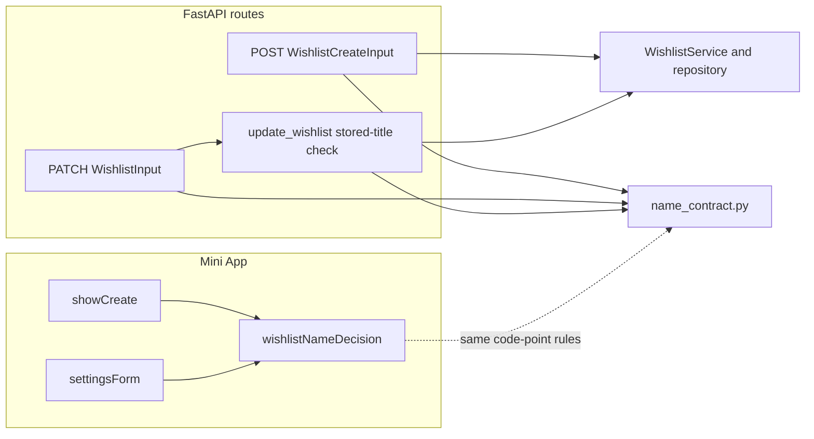

# WISHENKA-320: One name contract for a wishlist

## Research

Wishlist details cross three layers that already exist. None of them is replaced.

- **HTTP boundary.** `POST /api/wishlists` takes `WishlistCreateInput` and `PATCH /api/wishlists/{wishlist_id}` takes `WishlistInput`, both in `wishenka/web/routes/wishlists.py`. Creation is the only place with a name rule today: `_title` strips with `str.strip()`, then requires `1 <= len(trimmed) <= 255`, and raises one `ValueError("title must be 1-255 characters")`. FastAPI turns that into `422` with `loc == ["body", "name"]` and a single `type` of `value_error`. `WishlistInput.name` is `str | None` with no validator. `update_wishlist` copies fields onto the loaded row (`name` is stored as `value or ""`) after `require_member(..., manager=True)`. The owner is `is_admin` in `WishlistAccessPolicy.resolve_context`, so the owner and an administrator already share that gate. The handler does not call `WishlistService.update_wishlist_settings`.
- **Domain service.** `WishlistService.create_wishlist` and `RepoWishlistOps.create_wishlist` store `title` as given, default `""`. Many tests and in-memory fixtures create lists that way. `wl_lists.title` is an unbounded `String`. A database check would reject a later update of a row that already has an empty title, so this task adds no migration and no check constraint.
- **Mini App.** `showCreate` in `wishenka/web/static/miniapp.js` trims with `String.prototype.trim()`, treats an empty result as `miniapp.create.error_title_required`, and a code-point length above `255` (`[...title].length`) as `miniapp.create.error_title_too_long`. Description and event title are trimmed to `null` when blank and have no length check. `mapFailure` sends every `422` whose `loc` ends in `name` to the required-name message. `settingsForm` sends `PATCH` with the raw name and `description || null` / `event_title || null` (a spaces-only string is kept, because it is truthy). It has no field validation. Empty stored names render with `list.name || t('miniapp.common.untitled_wishlist')`. A non-empty invisible title does not use that fallback.

The product gap matches the WISHENKA-296 debt that this task takes on: S-2 (the rule stops at create; invisible-only titles pass), S-4 (empty stored names stay), C-1 and T-1 (a too-long `422` is described as a missing name), T-2 (PATCH is untested for the shared rule), C-3 (the two forms should share field errors). Follow-up item 1 of that debt is this task. It does not choose a length for the description or the event title.

How the two languages trim, checked against current language definitions:

- Python `str.strip()` / `str.isspace()` removes a character in general category Zs, or whose bidirectional class is WS, B, or S ([`str.isspace`](https://docs.python.org/3/library/stdtypes.html#str.isspace), [what `strip` removes](https://stackoverflow.com/questions/58633237/what-does-strip-consider-whitespace)). `U+FEFF` is category Cf, so Python keeps it.
- ECMAScript `String.prototype.trim` removes WhiteSpace and LineTerminator. WhiteSpace includes `U+FEFF` and every Space_Separator, and deliberately not every Unicode White_Space character ([ECMAScript White Space](https://tc39.es/ecma262/multipage/ecmascript-language-lexical-grammar.html#sec-white-space)). `U+200B` and `U+2060` survive both trims. `U+FEFF` is the character the two trims disagree on ([measured comparison](https://fixthislist.com/guides/hidden-characters-in-text/)).

`U+FEFF` is a byte-order mark in this contract, not a space. Using `trim()` on the client would delete it before the invisible-mark check and would shorten a visible name that merely ends with it. The shared trim must follow the Python space rule and must leave `U+FEFF` in the string.

Pydantic 2 (this repo requires `pydantic>=2.10`) reports `Field(max_length=...)` as `type: "string_too_long"` before a custom validator sees the value ([`string_too_long`](https://docs.pydantic.dev/latest/errors/validation_errors/#string_too_long)). That counts untrimmed length and cannot say "missing" for an invisible-only string. A `field_validator` that raises `pydantic_core.PydanticCustomError` sets `type` and `ctx` on the FastAPI `422` detail ([validators](https://docs.pydantic.dev/latest/concepts/validators/#raising-validation-errors)). Two custom types are how the app tells a too-long name from a missing one. `Field(max_length=255)` is the wrong tool for the name, and no `max_length` is added for the description or the event title.

Length is one Unicode code point: Python `len` on `str`, and a code-point walk in JavaScript (`for...of` or spread), not UTF-16 `String.length`. Creation already relies on that (`test_title_is_counted_in_code_points_not_utf16_units`).

Validation tests for this area are HTTP tests: `tests/test_wishlist_create_validation_api.py` uses `TestClient` and a temporary SQLite file. It never calls Telegram. `test_patch_still_accepts_blank_and_absent_names` still encodes the old rule that PATCH may store a blank or a 300-character name. That test is green today, so it is not the red signal.

## Implementation Plan

Keep the current layering. One pure name rule, used by both request models, is mirrored by pure functions in the Mini App. The domain service stays able to load and construct a wishlist whose stored title is empty, so existing rows and existing fixtures stay valid. Refusal happens on the HTTP create and edit that the Mini App and a direct client both use.

1. Add the pure helpers and the two error types. Wire them into `WishlistCreateInput` and `WishlistInput`. On edit, if `name` is absent, refuse with the failure the stored title actually has: required when it is missing, blank, or invisible-only, and too-long when it is over 255 code points. Do not add a schema migration.
2. Teach `showCreate` and `settingsForm` the same name decision and the same optional-text decision. The name each form submits is the normalized string that decision accepted, not a second trim of the field. Map `422` types to the existing required and too-long strings. Reuse those catalog keys so Russian and English stay one meaning.
3. Leave display of an already stored empty name on the untitled fallback. Leave an already stored invisible-only name displayed as it is until the next successful save.

**Mandatory — Failing Repro (next Step 3):** The first red signal is an HTTP contract test, because that is how this codebase tests wishlist validation. Domain `create_wishlist` is not the gate: it still accepts `title=""` so other tests can build a list.

Write `tests/test_wishlist_name_contract_api.py` before any production change. Copy the harness shape of `tests/test_wishlist_create_validation_api.py`: `pytestmark = pytest.mark.timeout(30)`, `TestClient(create_app(...))`, SQLite under `tmp_path`, a bearer session. No network and no Telegram.

The new tests assert the contract against today's code, so the module is red before the fix:

- **Missing name, create and edit.** `POST` with no name, `null`, `""`, or spaces-only is `422`, `loc` ends with `name`, and no row appears. `PATCH` with `name` of `""`, spaces-only, or `null` is `422` with the required-name `type`, and a following `GET` shows the previous title, description, event title, and event date.
- **Invisible-only name, create and edit.** Each of `U+200B`, `U+2060`, `U+FEFF`, `U+200E`, and `U+200F`, and a mix of those marks with spaces, is the same required-name refusal. Nothing is created or changed. A name that also contains a visible character is stored with the marks still in it.
- **Too long, distinguished from missing.** After the shared edge trim, 256 code points (including 256 emoji) is `422` whose `type` is the too-long type and is not the required-name type. The same distinction holds for `PATCH`. The row is unchanged. Today `POST` reports both failures as one `value_error` ("title must be 1-255 characters"), and `PATCH` of a long or invisible name returns `200`, so these assertions fail now.
- **Description and event title stay on creation's acceptance.** Create and edit both accept a description and an event title longer than the name limit, with no `string_too_long` and no new numeric ceiling asserted. Empty and spaces-only are accepted and mean the field is unset. These assertions sit in the same module so a later ceiling fails them. They are guards where the server already accepts a long value; the spaces-only "unset" assertion is red until the shared normalizer exists.
- **Stored empty name stays readable.** Seed `title=""` through the domain service on that test database (HTTP create cannot produce one). `GET` returns `name == ""`. `PATCH` of the description alone, or of an empty or invisible-only name, is `422` with the required-name `type`, and `GET` still returns `""`. `PATCH` with a real name then succeeds. The test does not delete or rename the row by itself.
- **Stored too-long name, name omitted.** Seed a title longer than 255 code points through the domain service. `PATCH` that omits `name` and changes only the description or the event is `422` with the too-long `type`, not the required-name `type`, and `GET` still returns that long title. `PATCH` that sends a new name uses the shared normalizer: a missing, blank, or invisible-only value is the required-name `type`, and a value still over 255 is the too-long `type`. A real name then succeeds.

`test_patch_still_accepts_blank_and_absent_names` stays untouched in Step 3. It is green and states the old PATCH rule. Step 4 replaces it when the new module goes green.

Client and browser coverage is part of the same step, after that API module is red and still before production code. The API `type` values are what the client tests target.

- Extend the create-form UI and browser modules so an invisible-only name uses `miniapp.create.error_title_required`, and a crafted `422` with the too-long `type` uses `miniapp.create.error_title_too_long` rather than the required-name string (C-1 / T-1). The field keeps what was typed and no list is created. The `name` in the POST body is the normalized string that check accepted. A visible name with `U+FEFF` at an edge is submitted with that mark still in it. The body is not built by a second `String.prototype.trim()` (`buildPayload` does that today).
- Add settings-form coverage, Node harness plus browser, for the same three name cases on edit, in `en` and `ru`: the save is not sent, the typed name remains, the message is the required or the too-long catalog string. When the check accepts, the PATCH `name` is that same normalized string, including an edge `U+FEFF` beside a visible character, and not a separate trim of the field. Description and event title fields have no `maxlength` and a long value is still submitted. A list whose `name` is `""` still shows `miniapp.common.untitled_wishlist` and is not rewritten by opening it.

Sequence: this research, then the red API module, then the red client and browser tests, then Step 4 until those tests are green. Do not start the production edit in Step 3.

## Architecture

### Pattern

Boundary validation on the two HTTP models, plus a pure function both models call. The Mini App repeats that function in JavaScript because the static script cannot import Python. The domain service is not a second validator: empty stored titles must remain constructible, and `update_wishlist` does not go through `update_wishlist_settings`. Access control, event-date parsing, sharing, and surprise secrecy stay where they are.

No repository interface changes. No new table, column, or Alembic revision.

### Modules

| Module | Responsibility |
| --- | --- |
| `wishenka/wishlists/name_contract.py` (new) | Pure functions: edge trim, name decision, optional-text decision, and classification of a stored title as required, too long, or already accepted. No I/O, no FastAPI. |
| `WishlistCreateInput` / `WishlistInput` in `wishenka/web/routes/wishlists.py` | Apply the contract before the handler runs. Create always has a name. Edit applies it when `name` is present. |
| `update_wishlist` in the same route module | If `name` was omitted, classify the loaded title and refuse with that failure's type before `setattr`. Permission check stays first among handler rules that touch the row. |
| `showCreate` and `settingsForm` in `wishenka/web/static/miniapp.js` | Same decisions before `POST` or `PATCH`. Field errors already used by create are reused by settings. |
| `wishenka/i18n/catalog.py` | No new meaning. Both forms use `miniapp.create.error_title_required` and `miniapp.create.error_title_too_long`. |
| `WishlistService` / `RepoWishlistOps` / `WishlistRow` | Unchanged. They persist a title the HTTP layer has already accepted, and they still read a legacy empty title. |

### Name rule

`NAME_MAX_CODE_POINTS = 255`. This number applies only to the wishlist name.

Edge spaces are the characters Python `str.isspace()` removes. `str.strip()` is the server implementation. The client uses an equivalent predicate and does not call `String.prototype.trim`, so `U+FEFF` is not treated as a space.

Invisible marks are only this set: `U+200B` zero-width space, `U+2060` word joiner, `U+FEFF` byte-order mark, `U+200E` left-to-right mark, `U+200F` right-to-left mark. Other format characters are out of scope.

`normalize_wishlist_name(value: str) -> str`:

1. Trim edge spaces.
2. If nothing remains, or every remaining character is an invisible mark or an edge-space character, raise the required-name error. A mix of marks and spaces is missing. Do not store the marks.
3. Otherwise, if the code-point length is greater than 255, raise the too-long error. Marks that sit beside a visible character count, and they stay in the returned string.
4. Return the trimmed string. A visible character is any code point outside the invisible-mark set and the edge-space set. Check missing before length, so a long run of only invisible marks is "name required", not "too long".

Errors are `PydanticCustomError` values, not one shared `ValueError`:

- `wishlist_name_required` — missing, blank, or invisible-only.
- `wishlist_name_too_long` — trimmed length above 255, with `ctx` carrying `max_length: 255`.

FastAPI already returns these as `detail[].type`, `loc`, and `msg`. The client branches on `type`. It must not send `wishlist_name_too_long` through the required-name string.

`classify_stored_name(title: str) -> "required" | "too_long" | None` runs those same decisions and does not write. `None` means the stored title already passes. `"required"` means it is missing, blank, or invisible-only. `"too_long"` means that, after the same edge trim, it is longer than 255 code points. A single boolean is the wrong result: both failures fail the contract, and the omitted-name path must report the one that actually applies.

### Edit, when the body omits the name

`WishlistInput.name` stays optional so a `PATCH` that only changes a description can leave a real stored name alone. Distinguish omitted from present via `model_fields_set`.

- `name` present, including `""` or `null`: run `normalize_wishlist_name`. `null` and `""` are required-name failures. A value over 255 code points is the too-long failure. The string stored is the one the normalizer returned. A failure never reaches the assignment that today does `value or ""`.
- `name` omitted: `classify_stored_name(wl.title)` chooses the `422`. `"required"` (missing, blank, or invisible-only) uses `type == wishlist_name_required`. `"too_long"` (a stored title already over 255 code points) uses `type == wishlist_name_too_long` and the same `ctx`. Do not map every stored-name failure to `wishlist_name_required`. A details-only save of a legacy name that is already too long is the too-long failure, not the required-name failure. In both failure cases `loc == ["body", "name"]` and nothing is written, including a save that only intended to change the description or the event. `None` keeps the stored title unchanged.

Opening or listing a wishlist does not rewrite the title. The untitled label stays a display fallback for `""` only.

### Description and event title

`normalize_optional_detail(value: str | None) -> str | None` trims edge spaces and returns `None` when nothing remains. It has no maximum length. Both models use it for `description` and `event_title`. Create and edit therefore accept whatever creation accepts today, which is any length, and they agree that empty or spaces-only means unset. Event date parsing is unchanged. This task does not add `max_length`, a `CHECK`, or a constant ceiling for either field.

The create form already sends `trim() || null` for these two fields. The edit form joins that: spaces-only becomes `null`, and a long value is sent as-is. Neither input gets a `maxlength`.

### Client behaviour

Two functions next to the forms, same decisions as the Python module:

- `wishlistNameDecision(raw) -> { ok: true, name: string } | { ok: false, reason: "required" | "too_long" }`. On success `name` is the one normalized string (edge spaces removed, invisible marks that sit beside a visible character kept, including an edge `U+FEFF`). On failure there is no name to submit.
- `optionalDetail(raw) -> string | null`

`showCreate` replaces its local title branch with `wishlistNameDecision`. `settingsForm` gains the same check before `PATCH`, the same field-error node create already builds (`settings-field-error`, `role="alert"`, `aria-invalid`), and keeps the typed value when it refuses. A refused save does not clear the form and does not navigate away. `mapFailure` (and the settings error path) reads `detail[].type`: too-long type to `error_title_too_long`, any other name failure to `error_title_required`. Messages stay the catalog strings already shipped in English and Russian.

The name in the JSON body is `decision.name`, the string that decision returned, on create and on edit. The form does not trim again before submit. `String.prototype.trim` removes `U+FEFF`, so a second trim would drop a mark the shared rule had kept.

Create splits the two today. `validate` reads `inputs.name.value.trim()`, then `buildPayload` sends `inputs.name.value.trim()` again. A visible name with `U+FEFF` at an edge can pass a check that keeps the mark and then leave in the POST without it. After this change `buildPayload` sends `decision.name` and does not trim the name on its own.

Edit sends `inputs.name.value` today and does not check it. Once `settingsForm` uses the same decision, the PATCH `name` is `decision.name`. It is not the raw field, and it is not a separate `trim()`.

Description and event title stay on `optionalDetail`. That helper has no length ceiling, and those fields are not passed through the name normalizer.

A small field-error helper shared by the two forms is the right shape, because both forms now show the same name errors (debt C-3). It does not change date, member, or delete UI.

### What stays

- Who may edit: `require_member(..., manager=True)` (owner or administrator). A member, a guest, and the bot gain no rename path.
- Rows already stored with an empty or invisible-only name: no migration, no delete, no display change for the invisible-only case.
- Logs: do not add the name, description, or event title to log records. A `422` stays the request log only.
- Idempotency of create, wish-field lengths, and surprise secrecy.

## Q&A

- **Why is the gate the HTTP model and not `WishlistService.create_wishlist`?** Creation's tests and the edit path already decide at the request model and in `update_wishlist`. The service default `title=""` is how fixtures and older rows exist. Putting the refusal there would reject those callers and would still miss PATCH, which does not call `update_wishlist_settings`. The API test is the red signal for that reason.
- **Why two error types instead of the current `ValueError`?** One message cannot tell the Mini App that a 256-character name is too long. `PydanticCustomError` is the Pydantic 2 way to set `detail[].type`. `Field(max_length=255)` fires before trim and would also be the wrong signal for an invisible-only string.
- **Why not `String.prototype.trim`?** It removes `U+FEFF`, and Python `strip()` does not. The requirements count that character as an invisible mark: kept when the name is otherwise visible, and "missing" when it is the whole name. Both sides trim with the Python space rule. The string that check accepts is the string create and edit submit. A second trim in `buildPayload`, or a new one when the settings form builds its body, would delete an edge mark the check had kept.
- **Why can PATCH omit `name` at all?** A list whose stored name already passes the contract may still update its description or event title without restating the name. Omission is "leave the stored name", and that is allowed only when classification returns `None`. Sending `""` or `null` is an attempt to clear it and is refused as a required name. When the stored name fails, the `422` uses that failure: `wishlist_name_required` for missing, blank, or invisible-only, and `wishlist_name_too_long` for a stored title over 255 code points.
- **Why is there no length constant for description or event title?** Creation stores both with no `max_length`, and the product text for this task forbids choosing one. The shared optional helper only trims blank to unset. A later task can add a ceiling in that helper and on both forms together.
- **Why no database constraint?** `wl_lists.title` has no length check today. A `CHECK` of 1..255 would make an ordinary update of a legacy empty row fail, which contradicts "stay readable until the next save". The next save is refused in the route instead.
- **What about a stored title that is already longer than 255?** PATCH can store one until this task ships. A later save that omits `name` reports `wishlist_name_too_long`, not `wishlist_name_required`, and does not write. A later save that sends a new name runs `normalize_wishlist_name`: required when that value is missing, blank, or invisible-only, and too-long when that value is over 255. The save succeeds only when the sent name passes. There is still no cleanup job.
- **Which catalog strings?** The create strings already say "enter a title" and "the title is too long" in both languages. Settings uses them so the meaning cannot drift. No third wording.
