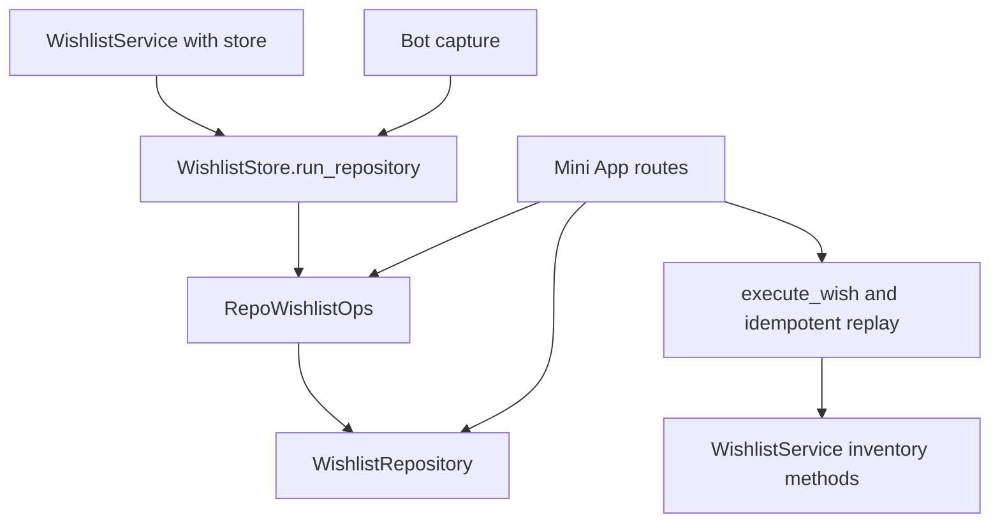

# WISHENKA-323: One wishlist rule set for Mini App screens

## Research

### What a real Mini App request already does

A production screen does not load every wishlist into memory. FastAPI injects
`WishlistRepo` (`wishenka/web/dependencies.py`). `get_wishlist_repository` opens one
connection, starts a transaction, yields `WishlistRepository`, then commits, rolls
back, and flushes commit logs. Handlers build `RepoWishlistOps(repo)` and run the
wishlist action there (`wishenka/wishlists/repo_ops.py`).

That adapter already covers lists, wishes, membership, archive, delete, restore,
favorites, viewing history, and invite join. It also owns the shared-change notice
for those actions (`record_shared_event` writes `SharedEvent` through `EventProducer`
on the same connection), link allocation (`_TOKEN_ATTEMPTS = 5`, then `TokenCollision`),
and viewer projection (`project_wishlist_view`, using the shared helpers
`project_wish_item` and `recipient_view`).

Wish-scoped inventory is a different path and stays that way. Item quantity updates,
reservations, and gift-receipt mutations go through `WishlistStore.execute_wish` or
`execute_wish_idempotent`. The cabinet reads go through
`WishlistStore.get_user_reservations` and `get_user_reservations_summary`. Those
methods hydrate one `WishlistService` for the wish or the cabinet query. A repeated
reservation or receipt is refused by the idempotency record on that path
(`doc/dev/idempotency.md`). `RepoWishlistOps` has no reservation or receipt mutation
methods.

`app.state.domain_service` is a store-backed `WishlistService`
(`wishenka/web/app.py`). Its public methods are wrapped by `_transactional`. With a
store set, a shared action calls `WishlistStore.execute` / `execute_wish`, which
hydrates an in-memory service, mutates the graph, and diff-writes it. That is the
second copy of the shared rules.

### Where screens can still prefer the second copy

Each of these modules reads `request.app.state.wishlist_service` and, when it is
set, runs the action on that object before the repository or the wish transaction:

- `wishenka/web/routes/wishlists.py` (`execute`)
- `wishenka/web/routes/sharing.py` (`_get_service`)
- `wishenka/web/routes/items.py` (`execute`)
- `wishenka/web/routes/items_ui.py`
- `wishenka/web/routes/receipts.py`
- `wishenka/web/routes/receipts_ui.py` (`_execute`)
- `wishenka/web/routes/receipts_ui.py` record-receipt handler and
  `_execute_receipt_mutation_ui`: idempotent replay runs only when the
  attribute is absent (`idempotency_key is not None and injected is None`).
  When the attribute is set, those handlers skip `execute_wish_idempotent`
  and call the injected object.
- `wishenka/web/routes/reservations.py` (`execute`)
- `wishenka/web/routes/reservations.py` `complete_reservation`: when the
  attribute is set, the handler returns `run()` and does not take
  `delivery_lock`.
- `wishenka/web/routes/reservations_ui.py` (cabinet card and list)

Handlers also branch with `isinstance(..., RepoWishlistOps)`. The repository branch
is the screen product. The other branch reads in-memory fields (`_wishlists`,
`_items`, `has_favorite`, `item.receipts`). Those branches exist so an injected
service can answer the same request. Tests that set the attribute are
`tests/test_wishlist_api.py`, `tests/test_history_access_control.py`,
`tests/test_wishenka_305_history_log_once.py`, and
`tests/test_reservation_invalid_quantity_repro.py`.

`receipts_ui.py` still has `_repo_ctx` and, when that context is empty, opens a
repository with `asynccontextmanager(get_wishlist_repository)`. That reach is
WISHENKA-324. This task removes only the `wishlist_service` preference on that
screen.

### Where the two copies disagree

On a rule both copies implement, the person-facing Mini App outcome stands, and
bot capture follows it.

- **Viewing history retention.** `WishlistService.record_view` drops that user's
  older in-memory rows once there are more than 20. The store then deletes those
  rows. `RepoWishlistOps.record_view` inserts or updates one row and leaves older
  rows stored. Listing still returns at most 20 entries, in the order
  `WishlistRepository.list_view_history` already returns. The Mini App outcome is
  the repository one: recording a view does not delete older rows.
- **Share notices for shared actions.** Both copies build the same candidate set
  (owner, members, open-promise givers, actor removed, surprise recipients
  removed). The screen writes that set with `EventProducer.record` inside the
  request transaction. The service copy appends `SharedEvent` to
  `_new_shared_item_events` and lets the snapshot flush it. One writer remains:
  `RepoWishlistOps.record_shared_event`.
- **Link clash.** `RepoWishlistOps` retries token allocation five times and then
  raises `TokenCollision`. `WishlistStore.execute_with_connection` has a second
  five-attempt loop around the whole snapshot. Shared token actions
  (`create_wishlist`, `restore_deleted_wishlist`, `regenerate_public_token`,
  `regenerate_invite_token`) keep the repository loop only. Wrapping them in the
  store loop would be a second clash policy.
- **Viewer projection.** `RepoWishlistOps.project_wishlist_view` is what screens
  return. `WishlistService.get_wishlist_view` inlines the same fields and also
  logs `wishlist_view_projected`. Screens do not emit that debug event. The
  canonical projection is the repository method. The debug event stays off the
  screen path.
- **Invite lookup.** `find_invitation` loads through
  `WishlistRepository.get_by_invite_token` on the screen path, and scans
  `service._wishlists` on the injected path. The repository lookup stands.
- **Archived-list log on add.** `WishlistService.add_wish_item` logs
  `wishlist_archived_mutation_blocked` before raising. `RepoWishlistOps.add_wish_item`
  raises `WishlistArchivedError` from `_ensure_wishlist_active` and logs
  `item_access_denied` / `item_created` for the cases it already logs. The screen
  outcome and its current log events stand, including when bot capture adds a wish.

Reservation confirmation, receipt notices, quantity locks, and idempotent replay
live only on `WishlistService` plus `execute_wish`. They are not a second copy of
the shared wishlist rules. `update_wishlist_settings` and `transfer_ownership`
exist only on `WishlistService`. No screen calls them. They stay on the snapshot
service with their current outcomes. Each one loads the wishlist from the
hydrated graph through a private lookup. That lookup is not the public
shared method.

### Bot capture

`wishenka/bot/capture.py` `mutate` runs inside `WishlistStore.execute_with_connection`.
The hydrated service has no store, so `service.add_wish_item` runs the in-memory
body. `_write` then diffs that graph back to SQLite. Draft updates use the same
connection. Eligibility for the capture keyboard is
`WishlistAccessPolicy.can_add_or_edit_item` over `service._wishlists`
(`_allowed`). That policy allows an owner, admin, or member on an active list.

Calling `RepoWishlistOps.add_wish_item` on that same connection and then letting
`_write` diff the untouched in-memory graph can delete or rewrite the row just
inserted. Capture save has to leave the snapshot unit of work. Draft-only
outcomes (revision, expiry, cancel, unsafe URL, capture order) stay in
`capture.py`.

`WishlistRepository.list_accessible_wishlists(user_id)` already returns active
lists where the user is owner or member, ordered by id. That is the same
eligibility `can_add_or_edit_item` accepts. Capture keeps the order it already
shows. If the hydrated dict order and this query order differ, the order capture
already shows wins. That order is a capture-only outcome.

### External patterns

FastAPI documents `app.dependency_overrides` as the test seam for a `Depends`
callable. The override replaces that callable for the app instance and is cleared
when the test finishes. `app.state` is application state, not the override map
([Testing Dependencies with Overrides][fastapi-overrides],
[discussion of app.state versus Depends][fastapi-state]).
The current `wishlist_service` attribute is a hidden branch inside handlers.
Overriding `get_wishlist_repository` is the framework seam when a test must
substitute storage. Tests that check person-facing screen results use the app
SQLite database the factory already opens.

A service owns the use case and the transaction. A repository loads and saves.
Two services that both decide the same use case drift
([service layer and repository][svc-repo],
[Cosmic Python repository][cosmic-repo]).
An in-memory fake that reimplements unique tokens, history retention, and notice
recipients becomes a second product
([repository tutorial on fakes versus SQLite][repo-fake]).
This task keeps one use-case module, `RepoWishlistOps`, on the repository the
screens already use. It does not add a third service, a new `Protocol` package,
or an in-memory reimplementation of those rules.

Python duck typing stays. Call sites that run a shared action take `RepoWishlistOps`.
Call sites that run a reservation or receipt take the `WishlistService` instance
`execute_wish` passes in. No new base class.

### Decision

`RepoWishlistOps` is the only implementation of the shared wishlist actions.
Store-backed `WishlistService` methods for those actions forward into it on one
new store transaction helper and do not snapshot-diff. In-memory bodies of those
public methods are removed so they cannot drift. The current
`get_wishlist_by_id` body moves to a private in-memory lookup that settings
and ownership transfer call on the hydrated instance. Public
`get_wishlist_by_id` stays the repository forward. The store-backed wrapper
returns that forward and does not enter `execute` or `_write`. Screens
stop reading `app.state.wishlist_service`, including the receipt-UI
idempotent-replay guard and the `complete_reservation` delivery-lock
skip. Reservation and
receipt rules stay on `WishlistService` inside `execute_wish`. Bot capture
save uses `RepoWishlistOps` on the repository `run_repository` opened, and
that unit of work is not snapshot-written afterwards.

## Implementation Plan

Work follows the Top-Down order. Step 3 writes the red tests below and stops
while they fail. Step 4 then changes production code until those tests and the
existing person-facing suites pass. No production edit happens in Step 3.

1. Add `WishlistStore.run_repository` (name can match local style). It opens
   one `BEGIN IMMEDIATE` connection, constructs one `WishlistRepository` on
   that connection, and awaits the caller's async function of that repository.
   On success it commits, then calls `flush_commit_logs` on that same
   repository. On failure it calls `clear_commit_logs` on that repository and
   rolls back. No hydrate, no `_write`, no token-collision loop, and no new
   busy retry.

   The callback receives the `WishlistRepository` the helper constructed, not
   a bare `AsyncConnection`. `RepoWishlistOps` queues post-commit records with
   `defer_commit_log` on that instance (`repo_ops.py`: share-access grant,
   favorite and history revocation on member removal, and share-access
   revoke). Those lists live on the repository object. A connection-only
   callback builds the repository inside the function, so the helper cannot
   flush it after commit. `get_wishlist_repository` flushes the instance it
   yielded (`dependencies.py`). `run_repository` flushes the instance it
   passed in. Callers that also run SQL, including bot capture drafts, use
   `repo.conn` on that instance.
2. Give each store-backed shared method its own wrapper. That wrapper returns
   the `RepoWishlistOps` forward from `run_repository` and does not call
   `WishlistStore.execute` or `_write`.

   Removing the name from `_SINGLE_WISHLIST_METHODS` does not do this.
   `_transactional` wraps every public coroutine. When `_store` is set, a
   method that is not an inventory method reaches `execute` (`service.py`,
   the `scope is None` branch). `execute` calls `execute_with_connection`.
   `_execute_once` hydrates `WishlistService.in_memory()` (`_store is None`)
   and then `_write`s the diff. The method body runs on that hydrated
   instance. Dropping a name from the frozenset only makes `_wishlist_scope`
   return `None`; `execute` still runs. Methods already outside the frozenset
   (`create_wishlist`, `get_wishlist_by_public_token`,
   `list_deleted_wishlists`, `join_by_invite`,
   `get_wishlist_by_invite_token`, `list_favorites`, `record_view`,
   `get_history`, `clear_history`) are unchanged by that removal and already
   enter the unscoped `execute`. A fail-closed body on the hydrated instance
   would still run inside the snapshot, so it is not the store-backed path.

   The class wrapping loop applies this repository wrapper instead of
   `_transactional` for the shared set. When `_store` is set, the wrapper
   returns the forward. When `_store` is None, it fails closed with the
   existing wishlist error type and a stable message that the action requires
   the repository path. The in-memory bodies of those public methods are
   deleted.

   `update_wishlist_settings` and `transfer_ownership` stay on
   `_transactional`, stay in `_SINGLE_WISHLIST_METHODS`, and keep the snapshot
   `execute` / `_write` path. Both bodies call `self.get_wishlist_by_id`
   today (`service.py`, settings at the lookup before the policy check,
   transfer at the lookup before the ownership check). The wrap loop replaces
   every public coroutine on the class, including `get_wishlist_by_id`.
   `execute` runs the original settings and transfer functions on a hydrated
   service whose `_store` is None. A call through the public name then hits
   the fail-closed wrapper and never reads `_wishlists`.

   Move that current body to a private coroutine. The name starts with `_`
   so the wrap loop leaves it in place (the name can match local style). It
   reads `self._wishlists` and keeps the current not-found and deleted
   errors. The two snapshot bodies call that private lookup on the hydrated
   instance. They do not call public `get_wishlist_by_id`. Public
   `get_wishlist_by_id` stays in the shared set. A store-backed service
   forwards it through `run_repository` and does not enter `execute` or
   `_write`. On an in-memory service the public method still fails closed.
   No other method that stays on the snapshot calls `get_wishlist_by_id`.
3. Remove every `app.state.wishlist_service` read listed above. That includes
   the receipt-UI reads outside `_execute` and the complete-reservation read
   outside `reservations.execute`. The record-receipt handler and
   `_execute_receipt_mutation_ui` stop skipping `execute_wish_idempotent`
   when the attribute is set. `complete_reservation` stops returning before
   `delivery_lock` when the attribute is set. With those reads gone, a
   receipt UI mutation that carries an idempotency key uses
   `execute_wish_idempotent`, and complete reservation takes the delivery
   lock when a store is present. Collapse each
   `isinstance(..., RepoWishlistOps)` handler to the repository branch it
   already uses for a real request, including `find_invitation`.
   `receipts_ui._repo_ctx` and its managed-repository fallback stay with
   WISHENKA-324.
4. Move bot capture's database work from `execute_with_connection` to
   `run_repository`. Save calls `RepoWishlistOps.add_wish_item` on the
   repository the helper passed in. Eligibility uses the accessible-list
   query plus the existing policy, preserving the keyboard order capture
   already shows. Draft, cancel, and capture-order SQL stay in `capture.py`
   on `repo.conn` of that same repository.
5. Move tests that set `app.state.wishlist_service`, and in-memory tests of
   shared actions, onto the app SQLite database or onto
   `app.dependency_overrides[get_wishlist_repository]`. Reservation and receipt
   in-memory tests stay on `WishlistService.in_memory()`.

Person-facing HTTP results, Russian and English copy, surprise isolation, and
the reservation/receipt idempotency records stay as they are. Log events the
screen path already emits stay on that path with the same names and fields.
Step 6 records the logging result. This step does not add a user-visible signal.

### Failing repro (Step 3)

File: `tests/test_wishenka_323_one_wishlist_rule_set.py`.

Module marker: `pytestmark = pytest.mark.timeout(30)`. No live network. Use the
app factory and its SQLite file, the same way current wishlist API tests do.

The tests are written before the production change. Each one fails on the tree
as it is today, for the reason below.

1. **Screen ignores an injected service.** Build the app, seed one wishlist
   through the repository path, and set `app.state.wishlist_service` to an
   object whose shared methods raise `AssertionError`. `GET /api/wishlists`
   (or the share page for that list's public token) returns the seeded list
   with status 200. Today `execute` / `_get_service` call the injected object
   first, so the request fails and the test is red.
2. **Recording a view keeps older rows.** Insert 21 history rows for one user
   through `WishlistRepository.record_view`. Call `record_view` on the
   store-backed `WishlistService` (`app.state.domain_service`) for one of those
   lists. Assert 21 rows remain for that user. Today the service copy drops the
   oldest row during the snapshot write, so the count is 20 and the test is
   red. The test does not change the history list query and does not assert a
   cheaper query plan.
3. **Bot capture save uses the repository add.** With the existing capture
   callback harness (a draft saved by `cap:{id}:{rev}:save`), spy on
   `RepoWishlistOps.add_wish_item` and assert the save called it once on the
   open connection and that the new wish row is the row that call persisted.
   Today `mutate` calls `service.add_wish_item` inside
   `execute_with_connection`, so the spy sees no repository call and the test
   is red. Draft cancel and expiry behavior are not re-specified here.

A repeated reservation and a repeated receipt stay covered by the existing
idempotency tests. Those tests already pass. They are not the Step 3 red test.
Step 4 re-runs them and they stay green.

### Left to other tasks

- WISHENKA-325: `get_history` keeps its per-entry wishlist load.
- WISHENKA-324: `receipts_ui._repo_ctx` and the managed-repository fallback stay.
- WISHENKA-326: `get_wishlist_repository` keeps its current busy-storage error.
- WISHENKA-327: no new test whose only point is a link clash or a busy save.
- Splitting `repo_ops.py` or `repository.py` stays out of this task.
- `update_wishlist_settings` and `transfer_ownership` stay on the snapshot
  service.

## Architecture

### Modules

- `wishenka/wishlists/repo_ops.py` holds the shared-action rules, their
  notices, link retries, and viewer projection.
- `wishenka/wishlists/repository.py` holds the SQL for those actions. The
  history list query shape stays.
- `wishenka/web/dependencies.py` holds the request transaction for screens.
  Busy behavior stays.
- `wishenka/wishlists/store.py` gains `run_repository` for callers outside a
  request. Snapshot execute stays for settings, ownership transfer, and wish
  inventory.
- `wishenka/wishlists/service.py` forwards shared actions through a wrapper
  that calls `run_repository` and does not enter `execute` or `_write`. It
  keeps reservation, receipt, quantity, settings, and ownership transfer on
  the snapshot wrapper. `update_wishlist_settings` and `transfer_ownership`
  stay there and load the hydrated wishlist through the private in-memory
  lookup. Public `get_wishlist_by_id` does not serve that load.
- `wishenka/wishlists/policy.py` stays the pure policy the one rule set calls.
- `wishenka/web/routes/` calls `RepoWishlistOps` or `execute_wish`. It does
  not read an injected wishlist service.
- `wishenka/bot/capture.py` keeps draft outcomes. Wish add and eligible lists
  use the repository on `run_repository`.
- `wishenka/notices/events.py` keeps `EventProducer.record` as the writer for
  shared-action notices.

### Dependencies

- Routes depend on `RepoWishlistOps` and, for inventory, on `WishlistStore`.
  They do not depend on an injected `WishlistService`.
- `RepoWishlistOps` depends on `WishlistRepository`, `WishlistAccessPolicy`,
  `EventProducer`, and the projection helpers in `service.py`.
- Store-backed `WishlistService` shared methods depend on `run_repository`.
  They do not depend on the in-memory graph for those actions. Public
  `get_wishlist_by_id` is one of those forwards.
- Inventory methods depend on `execute_wish` and the in-memory graph that
  transaction hydrates. `RepoWishlistOps` does not grow those methods.
- Settings and ownership transfer depend on `execute` and on the private
  in-memory wishlist lookup on the hydrated graph. They do not call public
  `get_wishlist_by_id`.
- Bot capture depends on `run_repository`, `RepoWishlistOps.add_wish_item`,
  and `WishlistRepository` for eligible lists. It does not depend on
  `execute_with_connection` for save.

### Patterns

- **One application service for the shared use cases.** `RepoWishlistOps` is
  that service. The repository stays the persistence port. This matches the
  current screen layering from WISHENKA-80 and removes the parallel
  `WishlistService` bodies.
- **Dependency injection at the request boundary.** Screens keep
  `Depends(get_wishlist_repository)`. Tests that need a substitute override
  that dependency. `app.state` remains the place for the real store, the
  store-backed domain service, and settings.
- **Separate transaction for inventory.** Wish quantity, reservation, and
  receipt stay in `BEGIN IMMEDIATE` via `execute_wish`, with the existing
  idempotency key. Shared actions use the repository transaction and do not
  enter that wish lock.
- **Transactional outbox, one writer per action.** Shared-list notices are
  inserted by `EventProducer` in the repository transaction. Receipt and
  reservation notices stay on the service buffer that `execute_wish` flushes.
  One action uses one of those writers.

### Interfaces

`WishlistStore.run_repository` accepts an async function of the
`WishlistRepository` it constructed and returns that function's result. It
uses the store engine and one immediate transaction. On success it commits,
then flushes commit logs on that repository. On failure it clears those logs
and rolls back. It performs no snapshot read or write. Draft SQL on the same
unit of work uses that repository's connection.

Shared actions on a store-backed `WishlistService` keep their current
signatures and forward to the matching `RepoWishlistOps` method. When the
service has a configured invite TTL and the caller omits
`invite_token_expires_in`, the forward passes that configured TTL. Screens
already pass the settings TTL themselves.

`RepoWishlistOps` method set that is the single rule set:

- `create_wishlist`, `get_wishlist_by_id`, `get_wishlist_or_none`,
  `get_wishlist_view`, `project_wishlist_view`
- `get_wishlist_by_public_token`, `get_wishlist_by_invite_token`
- `add_member`, `remove_member`, `get_members`, `join_by_invite`
- `archive_wishlist`, `unarchive_wishlist`
- `classify_owner_delete`, `delete_wishlist`, `list_deleted_wishlists`,
  `restore_deleted_wishlist`
- `add_wish_item`, `get_wish_item`, `list_wish_items`, `list_gifted_items`,
  `reorder_wish_items`, `archive_wish_item`, `restore_wish_item`
- `regenerate_public_token`, `regenerate_invite_token`
- `add_favorite`, `remove_favorite`, `list_favorites`
- `record_view`, `get_history`, `clear_history`
- `record_shared_event`

An in-memory `WishlistService` does not implement that set. Those public
methods fail closed when `_store` is None. Reservation and receipt methods,
`update_wish_item`, `update_wishlist_settings`, and `transfer_ownership`
keep their current signatures. Settings and ownership transfer keep their
snapshot bodies, and those bodies call the private in-memory wishlist
lookup instead of public `get_wishlist_by_id`. That lookup is not in the
shared set, is not replaced by the class wrapper, and is not forwarded
through `run_repository`.

Screen handlers for shared actions take `RepoWishlistOps`. Inventory handlers
keep taking the service instance supplied by `execute_wish`. Cabinet handlers
call the store cabinet methods only.

### Route outcome

- `wishlists.py` and `sharing.py` run shared actions on `RepoWishlistOps`
  with `WishlistRepo`. The reservation helper in `wishlists.py` stays on
  `execute_wish`.
- `items.py` and `items_ui.py` run shared actions on `RepoWishlistOps`. Item
  update stays on `execute_wish`.
- `receipts.py` and `receipts_ui.py` keep repository reads. `_repo_ctx` stays
  with WISHENKA-324. Receipt mutations stay on `execute_wish` and idempotent
  replay. A receipt UI mutation with an idempotency key uses
  `execute_wish_idempotent` and does not consult `wishlist_service`.
- `reservations.py` uses `execute_wish` and idempotent replay only.
  `complete_reservation` takes `delivery_lock` when a store is present.
- `reservations_ui.py` uses the store cabinet methods only.

### Shared-rule outcomes that win

- Who may act: `WishlistAccessPolicy`, as `RepoWishlistOps` already applies it.
- Who is told: the `record_shared_event` recipient set, written once.
- Link clash: five repository attempts, then `TokenCollision`, with the
  storage failure the screen already returns.
- Viewer: `project_wishlist_view`, `project_wish_item`, and `recipient_view`.
- History: the same list order and limit. `record_view` does not delete older
  rows.
- Invite join: `join_by_invite` and `get_by_invite_token` on the repository.
- Bot add: `RepoWishlistOps.add_wish_item`, with the same permission, notice,
  and refusal as the screen.
- Reservation and receipt: the current `execute_wish` outcome. A repeat does
  not apply twice.

## Q&A

- **Q: Why forward from `WishlistService` at all, if screens call `RepoWishlistOps`?**
  **A:** Tests and other callers use `app.state.domain_service` for the same
  actions. A forward gives them the repository rules without a second body.
  Screens do not go through that forward. They already hold the request
  repository.
- **Q: Why must bot capture leave `execute_with_connection`?**
  **A:** That helper hydrates a graph and writes the diff after the callback.
  A repository insert in the middle of that unit of work is then subject to
  the diff. `run_repository` commits the repository insert and the draft SQL
  together and does not diff a second graph.
- **Q: Why does removing a shared method from `_SINGLE_WISHLIST_METHODS` not
  select the repository path?**
  **A:** `_transactional` still calls `execute` whenever the service has a
  store and the method is not an inventory method. The frozenset only supplies
  `wishlist_id`. `execute` hydrates an in-memory service and `_write`s it.
  Methods already outside the frozenset, including `create_wishlist`,
  `record_view`, `get_history`, and `join_by_invite`, already take that
  unscoped snapshot. The store-backed wrapper returns the `run_repository`
  forward and does not call `execute`. Settings and ownership transfer stay
  on the snapshot wrapper.
- **Q: Why can settings and ownership transfer not call public
  `get_wishlist_by_id` on the hydrated service?**
  **A:** The class loop replaces that public method with the shared wrapper.
  `execute` runs the original settings and transfer bodies on a hydrated
  service whose `_store` is None, so a public call fails closed and never
  reads `_wishlists`. Those bodies call a private in-memory lookup that the
  wrap loop does not replace. Store-backed `get_wishlist_by_id` still
  forwards through `run_repository` and does not enter `execute` or
  `_write`.
- **Q: Why does `run_repository` take a repository instead of a connection?**
  **A:** Post-commit records are stored on the `WishlistRepository` instance
  (`defer_commit_log`). The screen dependency flushes the instance it created.
  The helper must flush that same instance after commit. A callback that only
  receives a connection constructs the repository privately, and the helper
  cannot see the queued logs.
- **Q: Does the cabinet's in-memory hydration count as the second copy?**
  **A:** No. `get_user_reservations` and the summary method are the screen
  path for the cabinet. They stay. The injected `wishlist_service` preference
  in `reservations_ui.py` is the second copy, and it goes away.
- **Q: What happens to `wishlist_view_projected`?**
  **A:** Screens do not emit it today. The canonical projection does not add
  it. Step 6 checks log events the screen path already relies on.
- **Q: Where is the receipt-screen context variable handled?**
  **A:** WISHENKA-324. This task's receipt-screen change is the removed
  `wishlist_service` branch and the single repository branch for wishlist
  rules the screen already shows.
- **Q: Which sources informed the seams?**
  **A:** [FastAPI dependency overrides][fastapi-overrides],
  [app.state versus Depends][fastapi-state],
  [service and repository responsibilities][svc-repo],
  [Cosmic Python repository][cosmic-repo],
  and [fakes versus SQLite][repo-fake].
  Product behavior is fixed by `ai-tasks/WISHENKA-323/10-requirements.md`,
  `specs/00-high.md`, and the current `RepoWishlistOps` screen path.

[fastapi-overrides]: https://fastapi.tiangolo.com/advanced/testing-dependencies/
[fastapi-state]: https://github.com/fastapi/fastapi/discussions/16478
[svc-repo]: https://omarelbasel.github.io/AI-First-Software-Engineering/
[cosmic-repo]: https://www.cosmicpython.com/book/chapter_02_repository
[repo-fake]: https://codezup.com/repository-pattern-tutorial/
