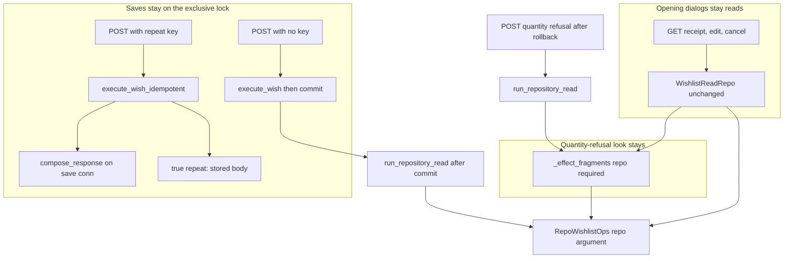

# WISHENKA-324: Pass wishlist access into gift-receipt looks

## Research

Gift-receipt looks live in `wishenka/web/routes/receipts_ui.py`. One helper,
`_execute`, does two jobs. A save whose callable has `_wish_item_id` calls
`WishlistStore.execute_wish` (`BEGIN IMMEDIATE`). Every other look reads
`_repo_ctx`, a module `ContextVar`. When the variable holds a repository,
the look builds `RepoWishlistOps` on it. When it is empty, the helper opens
`get_wishlist_repository`. That third branch is the hidden fallback: a new
shared repository, the same `BEGIN IMMEDIATE` access a save uses.

The three openings already receive `WishlistReadRepo`
(`get_wishlist_read_repository` → `WishlistStore.read_transaction`).
`get_receipt_dialog` and `_open_receipt_entry_modal` store that object in
`_repo_ctx` and reset it in `finally`. The opening checks and the
nothing-remaining refresh call `_execute` with no repository argument, so
they find the slot. WISHENKA-338 left this slot in place on purpose. This
task does not change `read_transaction`, `get_wishlist_read_repository`, or
`query_only`.

`_effect_fragments` is the quantity-refusal look. A quantity above remaining
paints the wish card and the dialog. Nothing remaining paints the list and
the gifted section. The function already declares `repo`, and the body never
reads it. It always calls `_execute`. On `get_receipt_dialog` the slot is
set, so that refresh uses the read repository. On `record_receipt_ui` the
slot is empty, so the same look opens `get_wishlist_repository`. That
happens when the repeat key is absent and when a refused record still
carries the key. The refusal status and sentence stay outside that look:
a domain or busy error inside it returns `None`, and the response keeps the
refusal the screen already shows.

A successful save that carries `Idempotency-Key` does not use the slot.
`execute_wish_idempotent` runs `compose_response` on the save connection
after the wish rows are written and before the idempotency row is stored
(`wishenka/wishlists/store.py`). `compose_receipt` and `compose_mutation`
build `RepoWishlistOps(WishlistRepository(conn))` there. A true repeat hits
the stored row and returns that body. `compose_response` is not called
again. `record_receipt_ui`, `correct_receipt_ui`, and `cancel_receipt_ui`
do not declare a repository. The forms in `receipt.js` send the key.

When the key is absent, the save still uses `execute_wish`, then a second
`_execute` reads the list. That second call has no item id and no slot, so
it is the same fallback. `items_ui._execute` is the pattern already used
next door: the repository is a required argument, and a missing one raises.
It does not open a repository of its own.

Python's `contextvars` module is for context-local state that must cross
layers without a parameter, such as a task copy of the call context
([contextvars](https://docs.python.org/3/library/contextvars.html)).
FastAPI does not treat a `ContextVar` set in a dependency as a stable way
to pass request data: a value set in a synchronous dependency does not
propagate, and the project discussion says to pass data explicitly when
that matters
([FastAPI PR 13453](https://github.com/fastapi/fastapi/pull/13453)).
Current guidance is the same: explicit arguments or a dependency for data
the handler must see; a context variable only for ambient trace data.
The comparison is "FastAPI: request.state vs Context Variables"
(https://dev.to/akarshan/fastapi-requeststate-vs-context-variables-when-to-use-what-2c07).
The Zen of Python, which the Python skill follows, says explicit is better
than implicit. Wishlist access is business data, so it belongs in the
argument list. `items_ui` already does that.

SQLite WAL, which this service sets once at startup, lets a reader and a
writer proceed together. A reader does not block `BEGIN IMMEDIATE`, and a
writer does not block readers
([WAL](https://sqlite.org/wal.html),
[transactions](https://sqlite.org/lang_transaction.html)). A read
transaction sees one snapshot. Once that snapshot has started, later
commits on another connection stay invisible until the reader ends and
starts again
([isolation](https://sqlite.org/isolation.html)). `read_transaction` begins
when the dependency or `run_repository_read` enters, and the snapshot is
fixed by the first read. A read repository opened before a successful save
must not paint the list after that save. The keyed compose already reads
the save connection after the rows are written, so it sees them. This task
leaves that compose where it is.

## Implementation Plan

One module changes its call shape. The read transaction and the keyed save
stay as they are.

1. Delete `_repo_ctx` and the `get_wishlist_repository` branch in
   `_execute`. Drop the `ContextVar` import and the direct
   `get_wishlist_repository` import from `receipts_ui.py`.
2. Make `_execute` match `items_ui._execute`: it requires
   `repo: WishlistRepository` and returns
   `await action(RepoWishlistOps(repo))`. It does not call `execute_wish`
   and it does not open a repository.
3. Opening checks pass the `WishlistReadRepo` the handler already received.
   `get_receipt_dialog`, `get_receipt_edit_dialog`, and
   `get_receipt_cancel_dialog` keep that dependency. They stay reads.
   Nothing-remaining on the receipt dialog passes that same object into
   `_effect_fragments`. No second repository is opened for that refresh.
4. `_effect_fragments` requires `repo` and reads only through it. The card,
   the list, and the gifted section are painted from that read. The HTML
   helpers (`_dialog_html`, `_card_oob`, `_list_oob`, `_gifted_oob`) stay
   painters: they do not look up a wishlist.
5. `record_receipt_ui` does not gain `WishlistReadRepo` on the route. That
   dependency would begin `read_transaction` before the save. On
   `QuantityAboveRemainingError` or `NothingRemainingError`, after the save
   has rolled back, the handler opens one read with the existing
   `WishlistStore.run_repository_read` and passes that repository into
   `_effect_fragments`. The best-effort boundary includes that open: a
   domain or busy error still leaves the refusal status and sentence
   unchanged. This path does not call `get_wishlist_repository`.
6. A successful save that carries the repeat key stays on
   `execute_wish_idempotent` and `compose_response`. The list is still
   built on that connection. A true repeat still returns the stored body
   and does not compose again. Do not pass a separate repository into that
   compose.
7. A successful save with no repeat key still calls `execute_wish` for the
   mutation, with `item_id` and `operation_name` as real arguments. After
   that call commits, the list read uses `run_repository_read` and the
   existing `_read_state` or `_read_full_mutation_state`, with the
   repository passed in. It does not call `get_wishlist_repository`, and it
   does not move onto the keyed compose. Commit-then-read stays, so a
   failed list read does not roll back a receipt that already committed.
8. Remove the unused `repo` parameter on `_execute_receipt_mutation_ui`.
   Callers do not pass it. Leaving it would be another slot. Correction
   and cancellation refusals stay sentence-only. They do not gain the
   quantity-refusal look.
9. Do not edit `get_wishlist_read_repository`, `read_transaction`,
   `run_repository_read`, `get_wishlist_repository`, `execute_wish`, or
   `execute_wish_idempotent`. JSON receipt routes, other Mini App screens,
   surprise projection, and the busy wait stay as they are.

**Mandatory — Failing Repro (next Step 3):** Add
`tests/test_wishenka_324_receipt_access_repro.py` with
`pytestmark = pytest.mark.timeout(30)` before any production change. Use a
file SQLite database under `tmp_path` and `TestClient`. No network and no
external service.

Patch `wishenka.web.routes.receipts_ui.get_wishlist_repository` so a call
raises. Desired behavior: none of the requests below enter it, and the
status, `X-Receipt-Refusal` reason, and fragments stay the ones the screens
return today.

- `GET` the receipt dialog, including nothing remaining: the blocked dialog,
  the list, and the gifted section. The read dependency is the one the
  handler was given.
- `GET` the correction dialog and `GET` the cancellation dialog.
- `POST` a record with `Idempotency-Key` and a quantity above remaining:
  409, `quantity_above_remaining`, the wish card, and the dialog. The
  refusal look's repository is the one passed in, not a new shared
  repository.
- `POST` a record with that key when nothing remains: 409,
  `nothing_remaining`, the list, and the gifted section.
- `POST` a successful record, correction, and cancellation with the key:
  the same out-of-band list as today. A second `POST` with the same key and
  the same body returns that stored answer and does not read the list
  again.
- `POST` a successful record, correction, and cancellation with no key:
  the same fragments, and still no call to `get_wishlist_repository`.

Call `_effect_fragments` with a sentinel repository and an empty slot.
Desired behavior: `RepoWishlistOps` is built on that sentinel. Today the
`repo` argument is ignored and the empty slot opens
`get_wishlist_repository`, so this test is red. Sequencing: this research,
then that red test, then the implementation until those requests stay off
`get_wishlist_repository` and the fragments still match.

## Architecture

The page layer stops storing a repository beside the call. Each look
receives the repository it must use. The transaction is still chosen by
whoever opened the connection. This task changes only which object is
passed in `receipts_ui.py`.



### Modules

- **`receipts_ui._execute`:** a look on a repository the caller passes.
  Same rule as `items_ui._execute`. No context variable and no
  `get_wishlist_repository`.
- **Opening handlers:** still `repo: WishlistReadRepo`. They pass `repo`
  into the membership and receipt checks, and the receipt dialog passes it
  into the nothing-remaining refresh.
- **`_effect_fragments`:** the quantity-refusal look. `repo` is required.
  Above remaining still returns the card and the dialog. Nothing remaining
  still returns the list and the gifted section. Painters stay painters.
- **Keyed saves:** `record_receipt_ui`, `correct_receipt_ui`, and
  `cancel_receipt_ui` still call `execute_wish_idempotent` with
  `compose_response`. The list is composed on that connection. Replay
  returns the stored body.
- **Unkeyed saves:** the mutation stays `execute_wish`. The list read after
  commit uses `run_repository_read` and the repository argument. It is not
  a second shared repository.
- **`WishlistStore.read_transaction` and `get_wishlist_read_repository`:**
  unchanged from WISHENKA-338. `run_repository_read` is the existing helper
  that opens that transaction for one callback.
- **`get_wishlist_repository` and `execute_wish`:** unchanged. Other wish
  mutations keep today's `execute_wish` signature and return value.
- **HTML partials and `receipt.js`:** unchanged. No new sentence, status,
  or screen.

### Patterns

- **Explicit argument.** The repository is a parameter of the look. A
  missing argument is a programming error, as in `items_ui`, not a reason
  to open `get_wishlist_repository`.
- **Repository, caller chooses the transaction.** `RepoWishlistOps` and
  `WishlistRepository` still do not begin a transaction. Openings pass the
  read repository WISHENKA-338 already injects. The keyed list uses the
  save connection `compose_response` already receives. A read after a
  rolled-back or committed save uses `run_repository_read`, which is the
  same `read_transaction` and not a new kind of transaction.
- **Dependency injection for the openings only.** FastAPI still yields
  `WishlistReadRepo` for the three `GET`s. The save routes do not gain that
  dependency. A read snapshot started before `BEGIN IMMEDIATE` would be the
  wrong connection for a list painted after a successful save
  ([isolation](https://sqlite.org/isolation.html)).

### Interfaces

```text
_execute(request, action, *, repo: WishlistRepository) -> T
    # action(RepoWishlistOps(repo)); repo required

_effect_fragments(..., *, repo: WishlistRepository) -> str | None
    # quantity-refusal look; paints from repo only

_open_receipt_entry_modal(..., repo: WishlistRepository) -> Response
    # passes repo into the opening check; does not store it

execute_wish(...) -> T
    # unchanged; unkeyed receipt mutation only

execute_wish_idempotent(..., compose_response=...) -> IdempotentResult
    # unchanged; keyed list composed on conn; replay skips compose

run_repository_read(work) -> T
    # unchanged; work(WishlistRepository) inside read_transaction
```

`get_receipt_dialog`, `get_receipt_edit_dialog`, and
`get_receipt_cancel_dialog` keep `repo: WishlistReadRepo`.

`record_receipt_ui` on `QuantityAboveRemainingError` or
`NothingRemainingError` calls `run_repository_read` and passes the yielded
repository to `_effect_fragments`. A `WishlistError` from that open or from
the look does not replace the refusal response.

Unkeyed success calls `execute_wish`, then `run_repository_read`, then
`_read_state` or `_read_full_mutation_state` with that repository.

### What stays

- Opening a dialog is a read on `read_transaction`. It does not take the
  save lock.
- Recording, correcting, and cancelling take the exclusive lock inside
  `execute_wish` or `execute_wish_idempotent`.
- The list after a successful keyed save is composed on that save. A true
  repeat returns the stored answer and does not compose again.
- The quantity-refusal look stays. The wish card, the list, the gifted
  section, the blocked dialog, and the refusal sentence stay the ones the
  screens already return.
- Surprise masking stays inside the reads those screens already use.
- A busy save is still busy. The wait and the busy sentence are unchanged.
- Screens that only render HTML from data they already hold do not gain a
  lookup.

### Out of scope, unchanged

- `read_transaction`, `query_only`, `get_wishlist_read_repository`, and
  `get_wishlist_repository` (WISHENKA-338, WISHENKA-326).
- The body of `execute_wish` and `execute_wish_idempotent`.
- JSON receipt routes, wishes, members, sharing, and the gifted list
  outside these six screens.
- How long a save waits, and the busy outcome when that wait runs out.
- A second copy of wishlist action rules.
- Correction and cancellation refusals that today return only the sentence.

## Q&A

**Why delete the context variable instead of writing the repository into
it?** The slot is how a later look discovers access the caller already had,
and the empty default is what opens a shared repository. Passing the
object in removes both. FastAPI's own caveat is that context variables are
a poor place for request data the next function must see
([PR 13453](https://github.com/fastapi/fastapi/pull/13453)).

**Why does the quantity-refusal look stay?** A quantity above remaining
still has to show the wish card, and nothing remaining still has to show
the list and the gifted section. Removing the look would drop those
fragments. What goes away is only the branch that opens
`get_wishlist_repository` when no repository was passed.

**Which repository paints a refusal?** The one the caller passes.
`get_receipt_dialog` passes the `WishlistReadRepo` it already receives, so
the nothing-remaining refresh does not open another connection.
`record_receipt_ui` has no repository in hand: the save connection is gone
after rollback. The handler then opens `run_repository_read` and passes
that repository in. That is the existing read transaction, not
`get_wishlist_repository`.

**Why not declare `WishlistReadRepo` on the save routes?** The dependency
starts `read_transaction` before the handler. WAL keeps a reader from
blocking `BEGIN IMMEDIATE`
([WAL](https://sqlite.org/wal.html)), but the reader keeps one snapshot
([isolation](https://sqlite.org/isolation.html)). The successful keyed list
must see the rows just written on the save connection. A read repository
opened before that save must not paint it. The refusal look runs only after
rollback, so it opens its read then.

**Why does the keyed list stay on the save?** The three forms send a repeat
key. `compose_response` already builds the list on that connection, and a
true repeat returns the stored body without reading again. Handing that
compose a separate repository would describe a path the member does not
take. This task does not add a parameter to `execute_wish_idempotent`.

**Why does a save with no key read after commit?** Today that list is the
fallback, a second `get_wishlist_repository` after `execute_wish` has
committed. Folding the read into `execute_wish` would roll back a committed
receipt when the list read fails, and it would change a function every wish
mutation uses. The mutation stays `execute_wish`. The following read uses
`run_repository_read` and a repository argument. The fragments are the ones
read after commit, as they are today.

**Why is the read transaction untouched?** WISHENKA-338 already defined
`BEGIN`, `query_only`, rollback, and the busy mapping. Openings still use
`WishlistReadRepo`. Later reads use `run_repository_read`. Neither helper
is edited.
