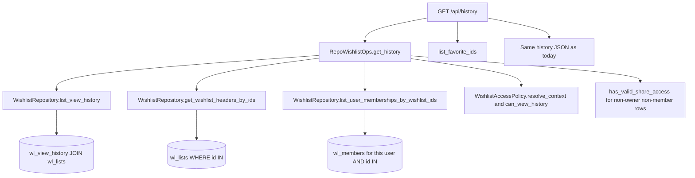

# WISHENKA-325: Opening viewing history gathers wishlists together

## Research

Opening one person's recent viewing history is `GET /api/history`. The route
calls `RepoWishlistOps.get_history` (a store-backed `WishlistService` forwards
that name through `WishlistStore.run_repository`). The method loads the capped
visit list with `WishlistRepository.list_view_history`, then calls
`WishlistRepository.get_wishlist` once per row. `get_wishlist` reads
`wl_lists`, then `wl_members`, then `wl_items`, then `wl_reservations` when
the list has wishes. The history payload does not return wishes, reservations,
or other people's memberships. It returns the list name, description, event
title, event date, viewed time, favorite mark, and the person's role
(`wishenka/web/routes/wishlists.py`).

`list_view_history` already applies the product cap (`LIMIT`, default 20, and
the route passes 20), the order (`viewed_at DESC`, `recorded_seq DESC`), and
the access filter (owner, current member, or a share grant whose token matches
the list). It does not delete stored visits. `record_view` and
`clear_view_history` are separate methods. An in-memory `WishlistService`
fail-closes `get_history` and does not read visits.

`WishlistRepository.get_wishlist_headers_by_ids` already loads the header
columns the history row needs (`title`, `description`, `event_title`,
`event_date`, `owner_id`, `status`, `public_token`, and the other list
columns) with one `IN` query per chunk. Chunking uses `_ID_BATCH_SIZE = 500`
and `_chunked_unique_ids`. An empty id list returns `{}` and runs no
statement. The same method logs `wishlist_repo_batch_read` at debug. Header
rows are built with `members=[]` and `items=[]`.

Role does not come from the header. `WishlistAccessPolicy.resolve_context`
treats `wishlist.owner_id` as owner, then looks for the caller's row in
`wishlist.members`. `GET /api/history` calls `resolve_context` again on the
object `get_history` returned. A header with an empty `members` list would
show a collaborative member as having no role. The caller's own
`wl_members` row has to be attached before that check. Other members' rows
are not read by history.

The per-row share check stays. When the caller is neither owner nor member,
`get_history` still calls `has_valid_share_access` for that row. That call
reads `wl_share_access`. It is not a wishlist aggregate load. Listing already
applied the same grant rule in SQL. This task keeps that second check.

SQLAlchemy 2.0's usual N+1 remedy for ORM relationships is `selectinload`,
which emits one `SELECT ... WHERE id IN (...)` for up to 500 parent keys
([Relationship Loading Techniques](https://docs.sqlalchemy.org/en/20/orm/queryguide/relationships.html)).
This service does not load history through an ORM relationship. Wishlist reads
are SQLAlchemy Core `text()` statements on `WishlistRepository`. A second
`IN` query matches that loading style and the existing header batch. It does
not add a mapped `selectinload` on `wl_view_history`.

SQLite bounds host parameters by `SQLITE_MAX_VARIABLE_NUMBER`: 999 before
3.32.0, and 32766 from 3.32.0 onward
([Implementation Limits For SQLite](https://sqlite.org/limits.html#max_variable_number)).
The repository already chunks `IN` lists at 500, under both defaults. The
history cap is 20, so one opening uses a single chunk. A caller who passes a
larger `limit` still goes through that chunking. This task does not raise the
cap and does not add a migration.

## Implementation Plan

Change only the wishlist load inside `RepoWishlistOps.get_history`.

1. Keep `list_view_history(user.telegram_id, limit=limit)` as the source of
   visit order, the cap, and the stored-row filter.
2. When that list is empty, return `[]` after the existing
   `view_history_listed` log. Do not call a wishlist batch.
3. Otherwise call `get_wishlist_headers_by_ids` once with the visit wishlist
   ids, in visit order.
4. Call a new repository method once for those same ids and this user, and
   append each returned membership onto that header's `members`.
5. Walk the visit list in the order `list_view_history` returned. Skip an id
   that is absent from the header map (the same skip as `get_wishlist`
   returning `None`). Run `resolve_context`, the existing share-grant check
   for a non-owner non-member, and `can_view_history`. Append
   `(wishlist, entry.viewed_at)` when the policy allows it.
6. Leave `record_view`, `clear_history`, `WishlistService.get_history` (the
   fail-closed body), the HTTP route, favorites loading, and copy in Russian
   and English as they are.

Do not add `list_wishlists_by_ids`. A batch clone of `get_wishlist` would
still read `wl_items` and `wl_reservations` for every recent list. History
does not show those rows. Header columns plus the caller's membership are the
data the route already copies.

The share-grant check stays one call per non-owner, non-member row. Do not
fold it into the header query in this task.

**Mandatory — Failing Repro (next Step 3):** Add
`tests/test_wishenka_325_history_batch_repro.py` before any production edit.
Module mark: `pytestmark = pytest.mark.timeout(30)`. Use a file-backed
`WishlistStore` and `WishlistService`, the same local SQLite pattern as
`tests/test_wishenka_304_history_order_repro.py`. No network and no live
Telegram dependency.

Seed, as the viewing person:

- Three wishlists they can open, each with a distinct title, description,
  event title, and event date, and at least one wish item so today's
  `get_wishlist` emits `wl_items` reads. Record a view on each, newest first
  in a known order. Mark one favorite.
- One of those three is collaborative, and the viewer is a member with a
  non-owner role (member or admin), so the returned object must carry that
  role through `WishlistAccessPolicy.resolve_context`.
- One deleted wishlist they previously viewed. It stays off the list.
- One wishlist they can no longer view (membership and share grant both
  gone). It stays off the list.
- More stored visits than the cap (21 recorded lists, `get_history(..., limit=20)`).
  The call returns 20. A direct `list_view_history` or row count shows the
  older visit still stored.
- A second person with their own view. The first person's result does not
  contain it, and the second person's `get_history` does not contain the
  first person's lists.

On current code the test fails. Listen with SQLAlchemy
`before_cursor_execute` on the store engine only around `get_history`.
That event receives compiled SQL. This SQLite engine uses qmark binds, so
the `text()` clause `FROM wl_lists WHERE id = :id` in
`WishlistRepository.get_wishlist` arrives as `FROM wl_lists WHERE id = ?`.
The colon form never appears. Assert all of the following for the owner's
(or member's) three-list open that still has items:

- Zero statements read `wl_items`. Today `get_wishlist` reads items once per
  row, so this fails.
- Zero statements are the per-row list load `FROM wl_lists WHERE id = ?`
  (the select inside `get_wishlist`). Today each `get_wishlist` issues that
  select, so this fails. Match that compiled phrase, not every `id =`, and
  not the source `:id` spelling. A test that looks only for `:id` stays
  green while `get_wishlist` still runs.
- One statement reads `wl_lists` with `WHERE id IN (` for the ids on that
  page. Today the header batch is not used, so this fails.

`list_view_history` always runs inside `get_history` and is unchanged. Its
text is `JOIN wl_lists l ON l.id = vh.wishlist_id`. That contains `id =` and
does not contain `IN (`, but it is a join, not `FROM wl_lists WHERE id = ?`.
Do not count it. `wishlist_id =` in the same statement (member and share
subqueries) is not a `wl_lists` primary-key lookup either. After
`get_history` stops calling `get_wishlist` and uses the header batch, the
`WHERE id = ?` loads are gone, the join remains, and this assertion is
green.

The same test then asserts the person-facing result, so the later fix cannot
trade the batch for a different list:

- Same wishlist ids, newest view first. Equal timestamps keep today's
  `recorded_seq` order because `list_view_history` is unchanged.
- Each kept row's `title`, `description`, `event_title`, `event_date`, and
  `viewed_at` match the stored list and the visit.
- `resolve_context` on the collaborative row returns that member's role.
- The favorite id is the one the route would mark with
  `list_favorite_ids` (the route itself stays unchanged; the test checks the
  id set the route already uses).
- The deleted list, the list they can no longer view, and the other person's
  list are absent.
- Stored visits for this person still number 21 after a 20-row open.
- A following `record_view` on an older list leaves the other stored rows in
  place. `clear_history` then removes that person's rows.

Count only that per-row list load. A statement matches when its compiled
text contains `FROM wl_lists WHERE id = ?`. The history join does not. A later
`wl_members ... IN (` membership read, and `wl_share_access` reads for
share-only rows, are allowed. Do not assert that the total number of
`SELECT`s is one.

Sequencing: this architecture is the research. Step 3 writes the red test
and runs it so the batch assertions fail. Step 4 changes
`RepoWishlistOps.get_history` and adds the membership batch until that test
and the existing history tests pass. No production edit belongs in Step 3.

## Architecture

History listing stays a read inside the current `run_repository` transaction.
This task does not move it to `execute_read`.



### Modules

| Module | Responsibility |
| --- | --- |
| `wishenka/web/routes/wishlists.py` `get_history` | Unchanged. Limit 20. Builds the same JSON from `(Wishlist, viewed_at)` and favorite ids. |
| `wishenka/wishlists/repo_ops.py` `RepoWishlistOps.get_history` | Replaces the per-entry `get_wishlist` loop with one header batch and one membership batch. Keeps order, omissions, the share check, and `view_history_listed`. |
| `wishenka/wishlists/repository.py` `get_wishlist_headers_by_ids` | Existing header batch. No signature change. |
| `wishenka/wishlists/repository.py` `list_user_memberships_by_wishlist_ids` | New. One chunked `IN` read of this user's `wl_members` rows for the given wishlist ids. |
| `wishenka/wishlists/repository.py` `list_view_history`, `record_view`, `clear_view_history`, `has_valid_share_access` | Unchanged. |
| `wishenka/wishlists/policy.py` `WishlistAccessPolicy` | Unchanged pure rules. |
| `wishenka/wishlists/service.py` `WishlistService.get_history` | Unchanged fail-closed body. The store path still forwards to `RepoWishlistOps`. |

### Patterns

- **Repository.** SQL stays on `WishlistRepository`. `RepoWishlistOps` asks for headers and memberships and applies policy. This matches the existing wishlist reads.
- **Batch `IN` read.** Reuse `_chunked_unique_ids`, `_in_clause_params`, and `_ID_BATCH_SIZE`. The history cap is 20, so a normal open is one chunk. The chunk size stays the bound for a larger `limit`.
- **Pure policy.** `resolve_context` and `can_view_history` stay free of I/O. The repository loads the header and the caller's membership first.
- **Same transaction boundary.** `get_history` still runs inside `WishlistStore.run_repository`. Recording and clearing stay on their own calls.

`selectinload` is the ORM pattern for this kind of N+1, and it is the wrong fit here because these reads are explicit SQL, not lazy relationship loads.

### Interfaces

`get_history` keeps its signature and return type:

```python
async def get_history(
    self, user: AuthenticatedUser, limit: int = 20
) -> list[tuple[Wishlist, datetime]]:
    """Return up to limit recent wishlists this person may still see."""
```

The returned `Wishlist` carries header fields from `get_wishlist_headers_by_ids`.
`members` contains only this person's membership when they have one, and is
empty when they are the owner or a share-only viewer. `items` stays empty.
The route's role, name, description, and event fields use those header and
membership values. Wish rows and reservation rows stay out of this object,
which keeps the history response inside the surprise invariant.

Existing header batch, unchanged:

```python
async def get_wishlist_headers_by_ids(
    self, wishlist_ids: Sequence[int]
) -> dict[int, Wishlist]:
    """Return wishlist headers keyed by id. Empty input yields an empty dict."""
```

New membership batch:

```python
async def list_user_memberships_by_wishlist_ids(
    self, user_id: int, wishlist_ids: Sequence[int]
) -> dict[int, WishlistMember]:
    """Return this user's membership keyed by wishlist id.

    Empty input yields an empty dict. Ids are chunked with the existing
    500-id helper. A wishlist with no row for this user is absent.
    """
```

SQL shape for one chunk:

```sql
SELECT id, wishlist_id, user_id, role, joined_at
FROM wl_members
WHERE user_id = :uid AND wishlist_id IN (:wl_0, :wl_1, ...)
```

`get_history` walks visits, not dict order:

```python
entries = await self.repo.list_view_history(user.telegram_id, limit=limit)
ids = [entry.wishlist_id for entry in entries]
headers = await self.repo.get_wishlist_headers_by_ids(ids)
memberships = await self.repo.list_user_memberships_by_wishlist_ids(
    user.telegram_id, ids
)
# For each entry, in that order: skip a missing header, attach membership,
# then resolve_context, has_valid_share_access, and can_view_history.
```

When `entries` is empty, skip both batch calls.

The new method logs the existing debug event `wishlist_repo_batch_read` with
`entity` `wishlist_member`, plus `requested_count`, `chunks_count`, and
`found_count`, the same fields as the header batch. `view_history_listed`
stays the list log: same event name, same `user_id`, and `count` equal to
the length of the list the person receives. No new info-level history event.

### What stays

- Recent-list cap, including the route's `limit=20` and the repository default.
- Older stored visits, including visits past the cap.
- `record_view` does not delete older visits. `clear_history` still clears that person.
- Deleted, missing, and no-longer-visible wishlists stay off the list.
- One person does not receive another person's visits. `list_view_history` is still filtered by `user_id`.
- Russian and English history copy stays as it is.
- WISHENKA-323 rule-set unification, WISHENKA-324 receipt repository wiring, and WISHENKA-326 busy-save retry stay out of this change.
- Revocation on membership removal, token rotation, restore, and ownership transfer stays on its current methods.

## Q&A

- **Q: Why a header batch plus a membership batch, rather than a new `list_wishlists_by_ids` that repeats `get_wishlist`?**
  **A:** The history row needs list metadata and the viewer's role. `get_wishlist_headers_by_ids` already loads that metadata in one chunked `IN` query. `resolve_context` still needs the viewer's `wl_members` row, so one membership `IN` query is attached before the policy check. A full-aggregate batch would also read wishes and reservations, which the history response does not show. WISHENKA-80 named `list_wishlists_by_ids` or a header-only query; the header-only query is the one that matches this payload.
- **Q: Does the person see a different list, a different order, or a higher cap?**
  **A:** They see the same wishlists, the same order, and the same row fields. The cap stays the limit the product already passes. Visits beyond that cap stay stored.
- **Q: Does gathering headers drop the access check?**
  **A:** The access rule stays. `list_view_history` still filters in SQL. `get_history` still runs `can_view_history`. A non-owner who is not a member still goes through `has_valid_share_access` once per such row. That grant read is not the per-row `get_wishlist` this task removes.
- **Q: Will `view_history_listed` or the Mini App strings change?**
  **A:** The list log keeps its name and its count of returned rows. The header and membership batches may emit the existing debug `wishlist_repo_batch_read`. History copy in Russian and English stays as it is.
- **Q: Where is the red test specified?**
  **A:** In the Implementation Plan above:
  `tests/test_wishenka_325_history_batch_repro.py`. It fails today because
  `get_history` still reads each wishlist with `get_wishlist`, including
  `wl_items` and compiled `FROM wl_lists WHERE id = ?`, instead of one `wl_lists`
  `WHERE id IN` batch. The `list_view_history` join is not that failure.
