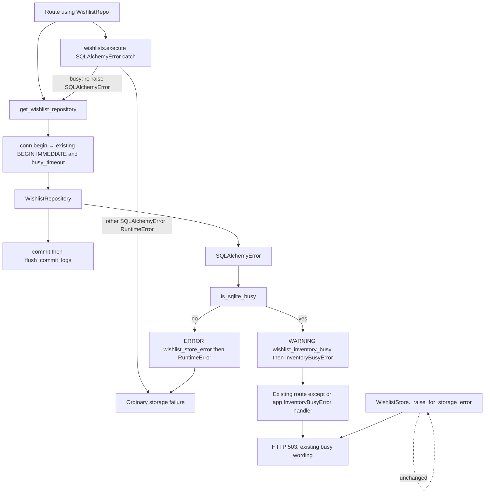

# WISHENKA-326: Map a shared-repository lock to InventoryBusyError

## Research

The brief SQLite wait is already shared. This task changes only the exception and log after that wait, for requests that use `get_wishlist_repository`. It does not add a wait, a second attempt, or a new person-facing sentence.

### What already waits

`configure_immediate_transactions` (`wishenka/sqlite.py`) registers two engine listeners:

- On `connect`: `isolation_level = None` (the sqlite3 driver does not emit its own `BEGIN`), `PRAGMA foreign_keys=ON`, and `PRAGMA busy_timeout=5000`.
- On `begin`: the same busy timeout, then `BEGIN IMMEDIATE`, unless the connection is `AUTOCOMMIT` or `read_only` (plain `BEGIN` only for that read-only option).

SQLite's transaction rules ([BEGIN IMMEDIATE](https://sqlite.org/lang_transaction.html)) take the reserved write lock at `BEGIN IMMEDIATE`. If another connection holds the write lock, SQLite returns `SQLITE_BUSY` (`database is locked` / `database is busy`) only after `busy_timeout`. A deferred `BEGIN` that later upgrades to a write does **not** honor `busy_timeout` on that upgrade ([SQLite locked-database note](https://zeroclarkthirty.com/2024-10-19-sqlite-database-is-locked)). SQLAlchemy's documented pattern is the same pair this code already uses: disable driver `BEGIN`, emit `BEGIN IMMEDIATE` from the `begin` event ([SQLAlchemy SQLite dialect](https://docs.sqlalchemy.org/en/21/dialects/sqlite.html)).

`get_wishlist_repository` calls `await conn.begin()` and does not set `read_only`. Reads and changes on that dependency both already take `BEGIN IMMEDIATE` and both already wait up to 5000 ms. `WishlistStore` saves use the same listeners. The wait stays as it is.

`is_sqlite_busy` walks `exc`, `orig`, and `__cause__`. It is true for `sqlite3.SQLITE_BUSY` or for a sqlite3 / `SQLAlchemyError` message containing `database is locked` or `database is busy`.

### What the store does after the wait

`WishlistStore._raise_for_storage_error` (`wishenka/wishlists/store.py`):

- Busy, and not a reservation-cabinet read: `logger.warning` with `event` `wishlist_inventory_busy` (plus `item_id` / `reservation_id` / `operation` only when the store has them), then `raise InventoryBusyError from exc`. The public message is the exception default: `The wish was busy and the attempt changed nothing`. The log line does not include driver text, a gifter, or gift details.
- Any other `SQLAlchemyError` on that path: `wishlist_store_error` at ERROR when there is no wish scope, then `RuntimeError("Wishlist storage operation failed")`.
- Cabinet reads use `reservation_cabinet_busy` / `reservation_cabinet_error` instead. This task does not call that branch.

`execute_wish` rolls the transaction back inside `_immediate` before `_raise_for_storage_error`. Nothing from the attempt is kept. There is no Python retry around `busy_timeout`.

### What the shared repository does after the wait

`get_wishlist_repository` (`wishenka/web/dependencies.py`) catches every `SQLAlchemyError`, including a busy one:

1. `repo.clear_commit_logs()`
2. `await conn.rollback()` when `conn.in_transaction()`
3. `logger.error` with `event` `wishlist_store_error` and `error_type` set to the exception class name
4. After the connection context closes, `raise RuntimeError("Wishlist storage operation failed")` with no `from` chain

Any other `BaseException` (domain refusals, `HTTPException`, `TokenCollision`) clears commit logs, rolls back, and is re-raised unchanged. Success commits when a transaction is still open, then `repo.flush_commit_logs()`.

`wishlists.execute` (`wishenka/web/routes/wishlists.py`) catches `SQLAlchemyError` inside the route, logs `wishlist_store_error` without `error_type`, and raises the same `RuntimeError`. That happens before the dependency's `except SQLAlchemyError` runs. Wishlist API routes that go through `execute` therefore never reach the dependency mapper today. The dependency still rolls that `RuntimeError` back via `except BaseException` and re-raises it.

### How a busy store save becomes temporarily unavailable

`InventoryBusyError` is not an HTTP response by itself. These handlers already catch it while the route is still running and answer HTTP 503. They do not add a new status or a new sentence:

| Handler | HTTP | Body | Log event |
| --- | --- | --- | --- |
| `items.py` `execute` | 503 | `detail` is `str(exc)` (the existing busy message) | `item_inventory_busy` |
| `reservations.py` `execute` | 503 | `detail` is `str(exc)` | `reservation_inventory_busy` |
| `receipts.py` `_busy` | 503 | `{"reason": "busy", "message": str(exc)}` | `receipt_inventory_busy` |
| `receipts_ui.py` receipt mutations and the open-dialog refusal | 503 | existing `BUSY` fragment / sentence | `receipt_inventory_busy` or the form-refusal log |
| `items_ui.py` edit submit | 503 | existing `web.item.edit_busy_error` modal; fields stay filled | `ui_item_edit_busy` |

Those `except InventoryBusyError` blocks sit on `execute_wish` / domain calls. `items.py` `execute` and `receipts.py` `_run` also wrap a `WishlistRepository` action in the same `try`, so an `InventoryBusyError` raised **inside** that action is already 503.

A `SQLAlchemyError` is not `InventoryBusyError`. The route does not catch it. FastAPI throws it into the dependency generator. The generator's `except` then raises a different exception **after** the route function has left its `try`. The route's `except InventoryBusyError` does not run for that replacement.

`wishenka/web/static/app.js` treats HTTP 503 on a wish card as the existing sentence `web.common.wish_busy_error` (`The wish is busy; the reservation was not changed. Please try again.`). It does not use the response body for that sentence. HTTP 500 does not take that branch.

There is no app-level handler for `InventoryBusyError`. An exception of that type that leaves the dependency is HTTP 500 today (`tests/test_wishlist_api.py` shows the generic storage `RuntimeError` is already HTTP 500). `install_unavailable_page` only replaces GET 401/404 on three page URLs. It is not the busy outcome.

### Boundaries confirmed in code

Out of scope, and unchanged by this design:

- `busy_timeout`, `BEGIN IMMEDIATE`, and `configure_immediate_transactions`
- `WishlistStore` save / `execute_wish` / `execute_read` / `run_repository` mapping, including `wishlist_read_busy` and `reservation_cabinet_busy`
- Link-clash retries (`TokenCollision` / token `IntegrityError` loops in the store and repository)
- `UserStore` (WISHENKA-328 / WISHENKA-342)
- `receipts_ui.py` `_repo_ctx` fallback (WISHENKA-324)
- Where database upgrades start (WISHENKA-335)

## Implementation Plan

One mapping, after the wait that already happened. No Python retry loop.

1. In `get_wishlist_repository`, keep the success path and the non-SQL path as they are. Inside the existing `except SQLAlchemyError` arm, after `clear_commit_logs()` and rollback:
   - If `is_sqlite_busy(exc)`: remember the exception, do not log `wishlist_store_error`, and do not set the generic-failure flag.
   - Otherwise: keep today's ERROR log (`wishlist_store_error`, `error_type` only) and the generic-failure flag.
2. After the connection context closes (same place the generic `RuntimeError` is raised today):
   - Busy: `logger.warning` on `wishenka.web.dependencies` with the store's unscope sentence `Wishlist inventory change rolled back because the database was busy` and `extra={"event": "wishlist_inventory_busy"}`. No `error_type`, no `exc_info`, no driver text, no wishlist id, no person, no gift fields. Then `raise InventoryBusyError() from busy_exc`. The default message stays `The wish was busy and the attempt changed nothing`.
   - Not busy: `raise RuntimeError("Wishlist storage operation failed")` with no `from` chain, as today.
3. In `wishlists.execute` only: if the caught `SQLAlchemyError` is `is_sqlite_busy`, re-raise that `SQLAlchemyError`. Do not log `wishlist_store_error` and do not raise `RuntimeError` for it. The dependency then performs the single busy mapping. Every other `SQLAlchemyError` in `execute` stays on today's generic log and `RuntimeError`. That `RuntimeError` still hits the dependency's `except BaseException` arm (rollback, clear logs, re-raise) and must not be logged a second time.
4. Register one FastAPI exception handler for `InventoryBusyError` beside `install_unavailable_page`. It returns HTTP 503 with `detail` equal to `str(exc)`, the same shape `items.py` `execute` and `reservations.py` `execute` already return. It does not log a second busy event and does not read the database. Route handlers that already catch `InventoryBusyError` still build their own 503 body and never reach this handler, so store saves and receipt/edit screens keep their current responses. The handler exists because the dependency raises `InventoryBusyError` after those `try` blocks have exited; without it the person would still get HTTP 500.

Do not change store methods, link-clash retries, `UserStore`, the receipts ContextVar fallback, or migration startup.

**Mandatory — Failing Repro (next Step 3):** Add `tests/test_wishenka_326_shared_repository_busy_repro.py` with a module `pytest.mark.timeout` before any production change. Call `get_wishlist_repository` directly (no HTTP client, no second process). Force the failure by raising `SQLAlchemyError` from the yielded repository's connection (`OperationalError` whose message contains `database is locked`, or a `sqlite3.OperationalError` with `SQLITE_BUSY` on `__cause__` / `orig`).

- Busy case: the dependency surfaces `InventoryBusyError`, the warning record has `event == "wishlist_inventory_busy"`, there is no `wishlist_store_error` record, commit logs are not flushed, and the transaction is rolled back rather than committed.
- Non-busy case: a `SQLAlchemyError` that `is_sqlite_busy` rejects (for example `OperationalError` with `no such table`) still surfaces `RuntimeError` matching `Wishlist storage operation failed`, logs `wishlist_store_error`, and does not raise `InventoryBusyError`.

The busy case is red on current code because the dependency raises `RuntimeError` for every `SQLAlchemyError`. Sequence: this architecture → that red test → the mapping above until the test is green. Do not add a live lock or a retry loop in the test.

## Architecture

### Modules

- **`wishenka/sqlite.py`**: shared wait and `is_sqlite_busy`. Caller only. No edits.
- **`wishenka/web/dependencies.py`**: the only busy mapping for the shared repository. Yields one `WishlistRepository` per request, commits on success, rolls back on failure.
- **`wishenka/web/routes/wishlists.py` `execute`**: must stop classifying a busy error as the generic failure so the dependency mapping is the one that runs. Non-busy classification stays here.
- **`wishenka/web/app.py`**: HTTP 503 for an `InventoryBusyError` that no route caught, using the exception's existing message.
- **Existing route handlers** listed in Research: still the 503 translation when they catch `InventoryBusyError` themselves. Store saves stay on those handlers.
- **`WishlistStore`**: unchanged reference for the event name, the exception type, and the "rolled back, nothing kept" behavior.

### Patterns

- **Dependency injection**: `WishlistRepo` stays the request-scoped repository. Routes do not open their own engine transaction for this path.
- **Boundary translation**: the same rule the store already uses (`is_sqlite_busy` → `InventoryBusyError`, anything else `SQLAlchemyError` → `RuntimeError`). Applied once, at the dependency, not copied into each repository method and not as a second loop around `busy_timeout`.
- **Fail closed on the attempt**: rollback and `clear_commit_logs` before either raised error. `flush_commit_logs` only after a successful commit. A busy outcome must not emit deferred domain logs.
- **Existing HTTP vocabulary**: 503 plus the message `InventoryBusyError` already carries, or the 503 body a screen already builds. `app.js` already shows `web.common.wish_busy_error` for status 503 on a wish card.

### Interfaces that stay

- `get_wishlist_repository(store) -> AsyncIterator[WishlistRepository]`
- `is_sqlite_busy(exc: BaseException) -> bool`
- `InventoryBusyError(message: str = "The wish was busy and the attempt changed nothing")`
- Success: commit, then `flush_commit_logs()`
- Non-busy `SQLAlchemyError`: `RuntimeError("Wishlist storage operation failed")` and `wishlist_store_error`
- Other exceptions: rollback, `clear_commit_logs()`, re-raise. Permission errors, missing wishlists, and archive/retention refusals stay on their current responses.

### Mapping this task adds

| After the shared wait | Log | Raised error | Person-facing result |
| --- | --- | --- | --- |
| `is_sqlite_busy(exc)` | WARNING `wishlist_inventory_busy` on `wishenka.web.dependencies`. Extra is only `event`. Message is the store's unscope warning. | `InventoryBusyError()` `from exc` | HTTP 503. Route-local handlers keep their current 503 body when they catch the exception inside the route. Otherwise the app handler returns `detail=str(exc)`. |
| Any other `SQLAlchemyError` | ERROR `wishlist_store_error` (dependency adds `error_type`; `wishlists.execute` keeps its current log when it handles this case) | `RuntimeError("Wishlist storage operation failed")` | Ordinary storage failure, HTTP 500, as today |
| Lock released during `busy_timeout` | No busy log | No error | Commit once, then flush commit logs. A read returns the rows the statement read. |

Rollback and commit-log rules that must stay on every failure arm, busy included:

- Call `clear_commit_logs()` before leaving the failure path. Do not call `flush_commit_logs()`.
- If `conn.in_transaction()`, `rollback` before the connection context exits.
- Do not `commit` on the failure path.
- Raise the mapped error after the connection context closes, using the same flag style as today's `storage_failed` flag, so connection cleanup is not a second exception.
- `except BaseException` must not treat `InventoryBusyError` as a database error to rewrite. Raising it only after that `try` keeps domain errors and the busy error from being swapped for each other.

The busy log and `InventoryBusyError` message name no other person and no gift. They do not include `str(exc)`.

## Q&A

**Why is the mapping in the dependency and not in `WishlistStore`?** Store saves already raise `InventoryBusyError` and log `wishlist_inventory_busy`. The gap is `get_wishlist_repository`, which turns the same busy `SQLAlchemyError` into `RuntimeError` and `wishlist_store_error`. Requirements keep the store path unchanged.

**Why must `wishlists.execute` re-raise a busy error?** It catches `SQLAlchemyError` first and raises `RuntimeError`. Wishlist routes that use it would stay an ordinary storage failure if the dependency were the only edit. Re-raising leaves one busy mapping. Non-busy errors stay mapped in `execute`.

**Why an app exception handler if routes already catch `InventoryBusyError`?** Those `except` blocks run only while the route is inside its `try`. The dependency replaces a `SQLAlchemyError` after that `try` has ended, so the existing handlers do not see this error. The handler returns the same HTTP 503 and the same `detail=str(exc)` that `items.py` and `reservations.py` already return. Screens that catch the exception first are unchanged. `app.js` already shows the busy sentence for HTTP 503.

**Why is there no retry?** `PRAGMA busy_timeout=5000` and `BEGIN IMMEDIATE` are the wait. Another Python loop would be a second waiting policy. Link-clash retries stay in the store and repository.

**Are there open questions?** No.
