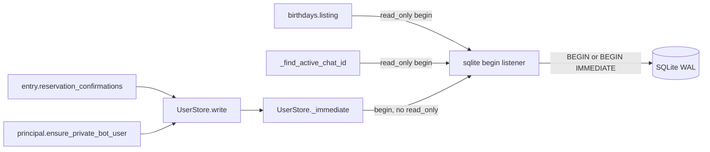

# WISHENKA-328: Reads leave the save lock; two bot saves share the busy outcome

## Research

The exclusive lock is already one listener. A bare `engine.connect()` plus
the first statement still takes it. Two bot writes still open
`users.engine.begin()` outside the helper that turns a leftover lock into
`UserStoreBusyError`.

### Listener

`configure_immediate_transactions` (`wishenka/sqlite.py`) is attached to
both `UserStore.engine` and `WishlistStore.engine`:

- On `connect`: `isolation_level = None` (the sqlite3 driver does not emit
  its own `BEGIN`), `PRAGMA foreign_keys=ON`, and `PRAGMA busy_timeout=5000`.
- On `begin`: the same busy timeout, then `BEGIN` when
  `execution_options` contains `read_only`, otherwise `BEGIN IMMEDIATE`.
  `AUTOCOMMIT` returns before either statement.

SQLAlchemy 2.0 autobegin fires that `begin` event on the first `execute`
([migration guide](https://docs.sqlalchemy.org/en/20/changelog/migration_20.html)).
The SQLite dialect's own pattern is the same pair this listener uses:
turn off the driver `BEGIN`, then emit the transaction from the `begin`
event ([SQLAlchemy SQLite dialect](https://docs.sqlalchemy.org/en/21/dialects/sqlite.html)).

SQLite starts a write transaction at `BEGIN IMMEDIATE`. A deferred `BEGIN`
whose first statement is `SELECT` stays a read transaction. In WAL mode
that read does not take the writer lock
([BEGIN TRANSACTION](https://sqlite.org/lang_transaction.html)).
`UserStore._read` already uses this: `execution_options(read_only=True)`,
then `begin()`, then `rollback` in `finally`. It does not set
`PRAGMA query_only` and it does not map `SQLITE_BUSY`.

### Reads that still emit `BEGIN IMMEDIATE`

**Birthday list.** `listing` in `wishenka/bot/birthdays.py` (the
`async with store.engine.connect()` block, about line 54) runs:

```sql
SELECT id, label, month, day, revision FROM birthday_entries
WHERE owner_id=:owner AND deleted=0 ORDER BY id LIMIT 20
```

`store` is `dependencies.wishlist_store` (about line 37). That engine has
the listener, and the connection has no `read_only` option, so autobegin
emits `BEGIN IMMEDIATE`. Callers are the private `/birthdays` command
(about line 102) and the `birthday:open` callback (about line 143). Both
call `principal()` first, which records the private chat. That recording
stays a save. Only `listing` changes. Add, edit, and delete already use
`store.transaction` (`BEGIN IMMEDIATE`) and stay saves.

**Active private chat after a language save.**
`_find_active_chat_id` in `wishenka/web/routes/profile.py` (about lines
37–55) probes `sqlite_master` for `bot_destinations`, then:

```sql
SELECT chat_id FROM bot_destinations WHERE user_id = :uid AND active = 1
```

`update_profile_locale` calls it (about line 250) only after
`user_store.set_locale` has returned (about line 222). The locale save
already goes through `_immediate` and already raises `UserStoreBusyError`.
This task changes the lookup only. The engine is
`wishlist_store.engine` when `request.app.state.wishlist_store` is set,
and `user_store.engine` otherwise (about lines 41–42). Both engines have
the listener. A missing table or a missing row returns `None`; the saved
locale stays, and the menu refresh is skipped.

### Writes that skip the busy mapping

`UserStore._immediate` (`wishenka/users/store.py`, about lines 91–123)
is the write helper. It calls `conn.begin()` (the listener emits
`BEGIN IMMEDIATE`), runs `work`, and commits. On `SQLAlchemyError` it
rolls back when `conn.in_transaction()`:

- `is_sqlite_busy(exc)`: warning log `event="user_store_busy"` with the
  `operation` string, then
  `UserStoreBusyError("User service is temporarily busy; please retry")`.
- Any other `SQLAlchemyError`: error log `event="user_store_error"` with
  the same `operation`, then
  `RuntimeError("User storage operation failed")`.
- Any other `BaseException`: roll back and re-raise.

There is no second `begin` and no Python retry. `busy_timeout` stays
5000 ms inside the listener. `is_sqlite_busy` is true for
`sqlite3.SQLITE_BUSY` or for a sqlite3 / `SQLAlchemyError` message that
contains `database is locked` or `database is busy`, including `orig` and
`__cause__`.

Two call sites open `users.engine.begin()` themselves, so a
`SQLITE_BUSY` that outlasts that wait leaves as the driver error:

- **Record the private chat.** `ensure_private_bot_user` in
  `wishenka/bot/principal.py` (about lines 51–52) runs
  `upsert_bot_destination` inside `users.engine.begin()`.
  `wishenka/bot/entry.py` `_ensure_private_destination` calls this helper.
  The birthday router calls it too, before the list read. Creating or
  refreshing the person is the earlier `users.upsert_from_bot` call, which
  already uses `_immediate`. That call stays its own transaction.
- **Reservation confirmations on or off.** `reservation_confirmations` in
  `wishenka/bot/entry.py` (about lines 254–263) inserts or updates
  `user_notification_settings` for `event_type='reservation_changes'`
  inside `users.engine.begin()`.

The file split is the opposite of the short names "bot entry records the
chat" and "principal toggles confirmations". The chat `begin()` is in
`principal.py`. The confirmation `begin()` is in `entry.py`.

`_immediate` is private. Nothing outside `UserStore` calls it. A public
forwarder is the seam the bot can use without copying the `except`.

### Helpers that must stay unused for these reads

`WishlistStore.execute_read` already sets `read_only=True`, and it also
sets `PRAGMA query_only` and maps `SQLITE_BUSY` to `InventoryBusyError`.
Pointing the birthday list or the chat lookup at it would add a failure
outcome and a stricter read guard. WISHENKA-342 owns `PRAGMA query_only`
on `UserStore._read`. This task leaves `_read` as it is.

`wishenka/web/dependencies.py` opens the shared wishlist repository with
`conn.begin()` and no `read_only` option. WISHENKA-326 already maps a
remaining lock there to `InventoryBusyError`. That request both reads and
changes wishlist data. It stays on `BEGIN IMMEDIATE`.

## Implementation Plan

1. At the two read call sites, open the engine that site already uses with
   the same shape as `UserStore._read`: `execution_options(read_only=True)`,
   `begin()`, work, `rollback` in `finally`. Leave the SQL text as it is.
2. Add `UserStore.write(work, *, operation: str)` that only returns
   `await self._immediate(work, operation=operation)`. Move the two
   `users.engine.begin()` blocks onto `write`. Keep each save as its own
   transaction. Keep `upsert_from_bot` where it is.
3. Step 3 writes the red tests below and runs them before any production
   edit. Step 4 changes the call sites until those tests pass.

No new wait, no second attempt, no new person-facing sentence, status, or
screen. A busy save raises the existing `UserStoreBusyError`. The bot
error handler stays as it is; these call sites do not catch that error to
invent a reply.

**Mandatory — Failing Repro (next Step 3):**

File: `tests/test_wishenka_328_read_lock_and_bot_busy_repro.py`.

`pytestmark = pytest.mark.timeout(60)`. A real leftover lock waits out
`busy_timeout` (5000 ms), the same budget as
`tests/test_user_store_concurrency_repro.py`. No live Telegram.

Statement capture follows `tests/test_wishenka_182_repro.py`:
`before_cursor_execute` on the engine under test, and a flag that is set
when the statement is `BEGIN IMMEDIATE` and cleared on plain `BEGIN`,
`COMMIT`, or `ROLLBACK`.

1. **Birthday list read.** Drive `listing` (or the `/birthdays` /
   `birthday:open` path far enough to run that `SELECT`). On the wishlist
   engine, the `birthday_entries` `SELECT` runs while the flag is clear,
   and that read's statements include `BEGIN` and exclude
   `BEGIN IMMEDIATE`. The destination save that runs earlier in the full
   command still emits `BEGIN IMMEDIATE`; the assertion is the list query.
   Today autobegin makes this fail.
2. **Chat lookup.** Call `_find_active_chat_id` twice: once with
   `wishlist_store` on `app.state`, once with it absent so the user engine
   is used. On the engine that call opens, the `sqlite_master` probe and
   the `bot_destinations` `SELECT` share one plain `BEGIN` and do not emit
   `BEGIN IMMEDIATE`. A missing row returns `None`. `set_locale` itself
   still emits `BEGIN IMMEDIATE`; the assertion is the lookup. Today this
   fails the same way as the list.
3. **Busy private-chat save.** Seed the person first, so
   `upsert_from_bot` is not the call under the lock. Hold
   `BEGIN IMMEDIATE` on a separate `sqlite3` connection
   (`isolation_level=None`), as in
   `test_user_write_busy_lock_maps_to_user_store_busy_error`. Call
   `ensure_private_bot_user`. It raises `UserStoreBusyError`. The
   `bot_destinations` row stays as it was, and the seeded person stays.
   Today `engine.begin()` lets the driver error out, so this is red.
4. **Busy confirmation save.** Seed the person and a
   `reservation_changes` row. Hold the same external `BEGIN IMMEDIATE`.
   Call the `reservation_confirmations` handler taken from the router
   `create_router` returns, directly, so `entry_error` does not swallow
   the error. It raises `UserStoreBusyError`, and `enabled` stays at the
   seeded value. Today this is red for the same reason.

Sequence: this architecture, then the red file, then the call-site fix
until those four tests pass.

## Architecture



### Modules

| Module | Responsibility |
| --- | --- |
| `wishenka/sqlite.py` | Stays. `read_only` selects `BEGIN`. Other begins stay `BEGIN IMMEDIATE`. |
| `wishenka/users/store.py` | `_immediate` keeps the busy mapping. `write` only forwards. |
| `wishenka/bot/birthdays.py` | `listing` uses a read-only transaction on `wishlist_store.engine`. |
| `wishenka/web/routes/profile.py` | `_find_active_chat_id` uses a read-only transaction. |
| `wishenka/bot/principal.py` | The destination save calls `users.write`. |
| `wishenka/bot/entry.py` | The confirmation save calls `users.write`. |

### Read interface

Both reads use the engine they use today. The shape matches `UserStore._read`
and is inlined at the call site. This task does not add a public
`UserStore` read method: the birthday list always uses the wishlist
engine, and the chat lookup uses that engine whenever the Mini App has a
wishlist store.

```python
async with engine.connect() as raw_conn:
    conn = await raw_conn.execution_options(read_only=True)
    try:
        await conn.begin()
        # existing statements, unchanged
    finally:
        if conn.in_transaction():
            await conn.rollback()
```

The chat lookup keeps the table probe and the `chat_id` select in that
one transaction. There is no `commit`, no `except SQLAlchemyError`, no
`PRAGMA query_only`, and no busy mapping. A read failure stays the
exception the driver already raises.

### Write interface

```python
async def write(
    self,
    work: Callable[[AsyncConnection], Awaitable[T]],
    *,
    operation: str,
) -> T:
    return await self._immediate(work, operation=operation)
```

| Call site | `operation` | `work` |
| --- | --- | --- |
| `ensure_private_bot_user` | `record_private_chat` | existing `upsert_bot_destination(...)` |
| `reservation_confirmations` | `reservation_confirmations` | existing settings insert |

`write` adds no `try`, no second `begin`, and no sleep. The mapping that
stays is the one inside `_immediate`:

- Busy after the listener's wait: roll back, log `user_store_busy` with
  that `operation`, raise `UserStoreBusyError` with the message
  `User service is temporarily busy; please retry`.
- Any other `SQLAlchemyError`: roll back, log `user_store_error`, raise
  `RuntimeError("User storage operation failed")`. That is the ordinary
  failure person saves already use. These two paths adopt it by calling
  the same helper. A non-busy error stays off `UserStoreBusyError`.
- Any other exception: roll back and re-raise.

The person row from `upsert_from_bot` is already committed before
`record_private_chat`. A busy destination save leaves that person row and
leaves `bot_destinations` as it was. A busy confirmation save leaves the
previous `enabled` value. The two steps of opening the bot stay two
transactions.

The bot does not catch `UserStoreBusyError` to add a sentence. The raised
error is the temporary-unavailable outcome.

### Patterns

- **Existing listener strategy.** `read_only` is the switch the `begin`
  listener already implements. The reads set that option; they do not add
  a second locking scheme.
- **Store-owned write boundary.** The bot keeps the SQL and the
  destination helper. `UserStore` owns `BEGIN IMMEDIATE`, rollback, and
  the busy mapping, the same way `set_locale` does.

### Stays as it is

- `wishenka/web/dependencies.py` and the shared wishlist repository
  transaction (WISHENKA-326).
- `UserStore._read`, including the absence of `PRAGMA query_only`
  (WISHENKA-342). No busy outcome and no retry on that helper.
- `WishlistStore.execute_read`.
- Person saves that already use `_immediate`: locale, birthdate, sign-in,
  and `upsert_from_bot`.
- Birthday add, edit, delete, and cancel (`store.transaction`).
- `busy_timeout` of 5000 ms and a single wait per save.

## Q&A

**Why does the birthday list avoid `WishlistStore.execute_read`?**
That helper sets `PRAGMA query_only` and raises `InventoryBusyError`.
This task only stops the list from taking the writer lock. Read failures
stay the driver's exception. `query_only` on person reads is WISHENKA-342.

**Why is there no public `UserStore` read helper?**
The list always reads through `wishlist_store.engine`. The chat lookup
does too when a wishlist store is on the app. A `UserStore` read method
would use the other pool. Both engines already share the listener, so
`execution_options(read_only=True)` at the call site is the whole change.

**Why add `UserStore.write`?**
`_immediate` is private, and the mapping has to stay in that one method.
`write` is the public name and forwards `operation` through. Copying the
`except` into the bot would let the busy outcome drift.

**Which function records the chat, and which one toggles confirmations?**
`principal.ensure_private_bot_user` records the chat.
`entry.reservation_confirmations` turns confirmations on or off.
`entry._ensure_private_destination` only calls the principal helper.

**Are there open questions?** No.
