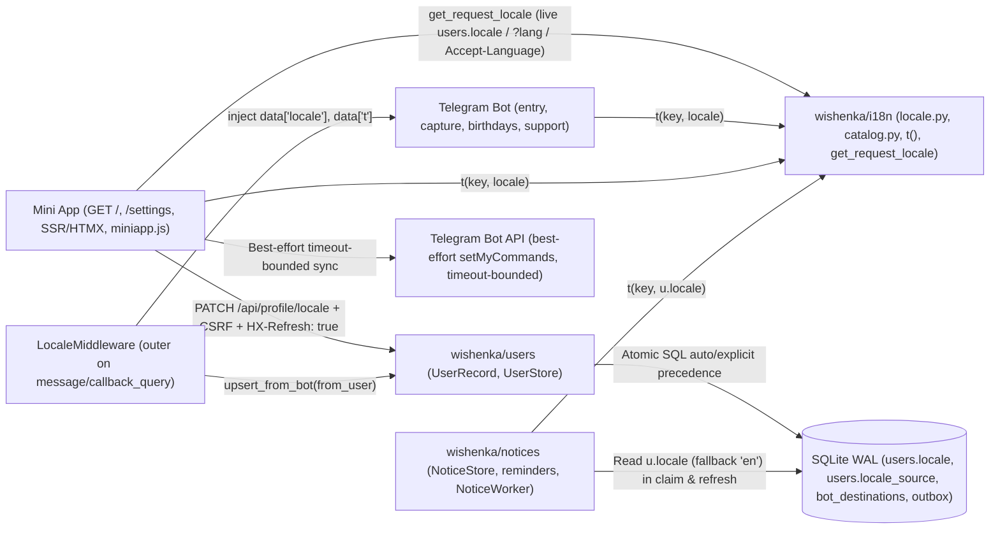

# WISHENKA-33: Двуязычный интерфейс (RU/EN) в Mini App и Telegram-боте

## Research

### 1. Анализ текущей кодовой базы

Проведена точечная инспекция модулей `wishenka/users/`, `wishenka/auth/`, `wishenka/web/`, `wishenka/bot/`, `wishenka/notices/`, миграций Alembic (`wishenka/wishlists/alembic/versions/`, `wishenka/wishlists/migrations.py`) и связанных тестов:

1. **Профиль пользователя и схема БД (`wishenka/users/models.py`, `wishenka/users/store.py`, `wishenka/wishlists/migrations.py`):**
   - `UserRecord` содержит только `id`, `telegram_id`, `first_name`, `last_name`, `username`, `language_code`, `is_premium`, `created_at`, `updated_at`. Поля `locale`, `locale_source` и свойство `display_name` отсутствуют.
   - Таблица `users` создаётся императивно в `UserStore.initialize()` (`CREATE TABLE IF NOT EXISTS users ...`) вне цепочки ревизий Alembic.
   - Текущий head цепочки Alembic (`wishenka/wishlists/alembic/versions/`) — ревизия `add_idempotency_records` (`down_revision = "add_support_channel"`).
   - В `wishenka/wishlists/migrations.py` функция `_adopt_known_schema()` применяется только для очень старых БД без таблицы `alembic_version` и проверяет строгое совпадение с 9 базовыми таблицами `_TABLES` (`wl_lists`, `wl_members`, `wl_items`, `wl_reservations`, `wl_favorites`, `wl_view_history`, `wl_tokens`, `wl_invite_tokens`, `wl_counters`). Изменять `_TABLES` не требуется, чтобы не нарушить контракт совместимости из `tests/test_wishlist_alembic_migrations.py`.
   - `UserStore.upsert_user()` безусловно выполняет `language_code = excluded.language_code` и не хранит `locale` / `locale_source`, а также не имеет метода `upsert_from_bot` / `set_locale`.
   - `wishenka/web/app.py` в `lifespan` сначала вызывает `await app.state.wishlist_store.initialize()`, затем `await app.state.user_store.initialize()`; в `wishenka/bot/__main__.py` вызывается `await wishlist_store.initialize()`, а `UserStore` инициализируется лениво через `_ensure_initialized()`.

2. **Web / Mini App, Jinja2 и HTMX (`wishenka/web/`):**
   - `wishenka/web/templates.py` конфигурирует `Jinja2Templates(directory=str(TEMPLATES_DIR))` без глобальной функции перевода `t()`, без `context_processors` и без передачи локали.
   - `wishenka/web/templates/base.html` жёстко фиксирует `<html lang="ru">`, уже подключает `htmx.org@1.9.12` + `json-enc.js` и при `data-viewer-identified` на `<body>` автоматически получает CSRF-токен через `/api/auth/csrf` и добавляет заголовок `X-CSRF-Token` ко всем не-GET HTMX-запросам (`htmx:configRequest`).
   - `wishenka/web/security.py` (`BrowserSecurityMiddleware`) уже автоматически проверяет `Origin == settings.application_origin` и `X-CSRF-Token` для cookie-сессий на всех методах, кроме `GET`/`HEAD`/`OPTIONS` (включая `PATCH`).
   - `wishenka/web/routes/miniapp.py` (`GET /`) отдаёт статическую HTML-строку с жёстко зашитым `<html lang="en">` и монтирует SPA-оболочку `wishenka/web/static/miniapp.js` (которая в `showHome()` строит `top-nav`, но не имеет точки входа в настройки, а в `unavailableLink()` читает только `bridge.initDataUnsafe.user.language_code || navigator.language`).
   - SSR-маршруты (`GET /web/wishlists/{wishlist_id}` в `items_ui.py`, `GET /web/reservations` в `reservations_ui.py`, `GET /share/{public_token}` и `GET /invite/{invite_token}` в `sharing.py`) не передают `locale` в `TemplateResponse`, а экран настроек `GET /settings` и endpoint `PATCH /api/profile/locale` отсутствуют.

3. **Telegram-бот (`wishenka/bot/`):**
   - `wishenka/bot/entry.py::create_router(dependencies)` создаёт корневой `Router` и включает в него `create_support_router`, `create_birthday_router` и `create_capture_router`. Тот же `create_router(dependencies)` используется как в `wishenka/bot/__main__.py`, так и во всех интеграционных тестах бота (`tests/test_bot_*.py`, `tests/test_notice_*.py`).
   - Установленная версия `aiogram` (`3.31.0`) поддерживает `router.message.outer_middleware(...)` и `router.callback_query.outer_middleware(...)` на уровне `Router` (наблюдатель `update` доступен только на `Dispatcher`).
   - В `entry.py`, `capture.py`, `birthdays.py` и `support.py` языковая логика разрознена:
     - `entry.py::_language()` проверяет `record.language_code` и возвращает `"en"` только при `startswith("en")`, иначе откатывается к `"ru"`.
     - `support.py::principal()` содержит обходной путь, перезаписывающий входной `language_code` значением `existing.language_code` из БД.
     - `capture.py` содержит локальные словари `_LABELS`/`_RU_LABELS`, ветвления `if lang == "ru"` и смешанные двуязычные строки вида `"Cancelled / Отменено"`.
     - `birthdays.py` содержит локальные кортежи/ветвления `if lang == "ru"`.
   - Защитный тест `tests/test_bot_start_repro.py::test_start_failure_log_omits_exception_details` подменяет `wishenka.bot.entry._language` через `monkeypatch` и не подменяет `Bot.__call__`; поэтому вызов `set_my_commands` в `/start` должен происходить **только после** успешного ответа и при наличии валидного/не-placeholder токена (либо безопасной обёртки с перехватом ошибок).

4. **Уведомления и напоминания (`wishenka/notices/`):**
   - `wishenka/notices/store.py`: `ClaimedNotice.language` имеет значение по умолчанию `"ru"`, а `NoticeStore._eligible()` запрашивает `u.language_code` и возвращает `str(row["language_code"] or "ru")`.
   - `wishenka/notices/worker.py`: `_send()` проверяет `claim.language.lower().startswith("en")` и иначе вызывает `notice_text()` с зашитым русским шаблоном.
   - `wishenka/notices/reminders.py`: `claim_reminder()` и `refresh_reminder()` читают `u.language_code`, а `_render()` проверяет `(language or "").lower().startswith("en")` с неявным русским fallback.
   - Три существующих теста явно проверяли старое поведение (`language_code` / fallback `"ru"`):
     - `tests/test_notice_wishlist_events.py::test_shared_event_text_is_localized_and_identifies_the_actual_change` (строка 369: `_render(..., None)` ожидал русский заголовок);
     - `tests/test_notice_delivery_repro.py::test_receipt_uses_language_and_safe_fallback` (строки 766, 777: `"fr"` ожидал `"получ"` и обновлял `users.language_code` прямым SQL);
     - `tests/test_bot_support.py::test_partial_destination_success_stored_language_and_ticket_cleanup` (строка 184: обновлял `users.language_code = 'ru'` прямым SQL).

### 2. Внешние контракты Telegram API и HTMX

1. **Telegram Bot API (`setMyCommands` + `BotCommandScopeChat` в `aiogram` 3.x):**
   - `await bot.set_my_commands(commands=[BotCommand(command=..., description=...), ...], scope=BotCommandScopeChat(chat_id=chat_id))` задаёт персональное меню команд только для приватного чата с конкретным пользователем.
   - Имена команд: нижний регистр, латиница/цифры/`_`, длина 1–32 символа; описания зависят от `locale` (`ru` или `en`).
2. **HTMX (`HX-Refresh`):**
   - Заголовок ответа `HX-Refresh: true` заставляет HTMX выполнить полную перезагрузку страницы (`location.reload()`) до этапа DOM-подстановки, гарантируя немедленное обновление `<html lang="...">`, заголовка и всех элементов интерфейса по живой локали из БД.

---

## Implementation Plan

### Последовательность реализации (Step 4)

1. **Alembic-миграция и синхронизация схемы `users`:**
   - Создать ревизию `wishenka/wishlists/alembic/versions/add_user_locale.py` с `revision = "add_user_locale"`, `down_revision = "add_idempotency_records"`.
   - В `upgrade()`: идемпотентно создать таблицу `users` (если отсутствует) с `locale` и `locale_source` и индексами, проверить `PRAGMA table_info(users)` и добавить недостающие столбцы `locale` и `locale_source`, выполнить backfill существующих строк по правилу `ru* -> 'ru'`, иначе `'en'`, `locale_source = 'auto'`.
   - Синхронизировать `UserStore.initialize()` с тем же DDL и `PRAGMA table_info(users)`-проверкой + backfill (для изолированных тестов без `WishlistStore.initialize()`).
   - **Координация с `WISHENKA-34` и `WISHENKA-35`:** В `WISHENKA-33` добавляются **только** столбцы `locale` и `locale_source` (в соответствии с разграничением в `doc/dev/users.md`), чтобы не оставлять неиспользуемые поля `avatar_url`/`birthday`/`birthday_source`/`deleted_session_revocations` в текущей задаче. Последующая `WISHENKA-34` линейно продолжает цепочку от `down_revision = "add_user_locale"`, а `WISHENKA-35` — от ревизии `WISHENKA-34`.
2. **Пакет централизованного каталога `wishenka/i18n/`:**
   - Создать `wishenka/i18n/locale.py` (`SupportedLocale`, `LocaleSource`, `DEFAULT_LOCALE = "en"`, `SUPPORTED_LOCALES = ("ru", "en")`, `resolve_telegram_locale()`, `resolve_accept_language()`, `validate_locale()`).
   - Создать `wishenka/i18n/catalog.py` с полным каталогом переводов `ru`/`en` для Mini App навигации и настроек, всех бот-сценариев (`entry`, `capture`, `birthdays`, `support`, `commands`) и уведомлений/напоминаний (`notices.*`), а также функцией `t(key, locale, **kwargs)` с логированием отсутствующих ключей и fallback на `en` / `key`.
   - Создать `wishenka/i18n/dependencies.py` (FastAPI `get_request_locale` / `LocaleDep`) и `wishenka/i18n/__init__.py`.
3. **Эволюция домена `wishenka/users/`:**
   - Расширить `UserRecord` полями `locale: SupportedLocale = "en"`, `locale_source: LocaleSource = "auto"` и вычисляемым `@property def display_name -> str`.
   - Обновить `UserStore.upsert_user()` (атомарное SQL-правило сохранения `locale_source='explicit'` при пересчёте `locale` в режиме `auto`), добавить `UserStore.upsert_from_bot(tg_user)` и `UserStore.set_locale(telegram_id, locale)` (плюс алиас `set_explicit_locale = set_locale` для обратной совместимости с контрактом `WISHENKA-32`/`34`).
4. **Web / Mini App, Jinja2, настройки и `PATCH /api/profile/locale`:**
   - Обновить `wishenka/web/templates.py` (глобал `t`, `DEFAULT_LOCALE`, `SUPPORTED_LOCALES` и `context_processors` с живой `request.state.locale`).
   - Обновить `wishenka/web/templates/base.html` (`<html lang="{{ locale|default('en') }}">`, ссылка на `/settings` в навигации авторизованного пользователя, локализация ошибок CSRF/занятости в JS).
   - Обновить `wishenka/web/routes/miniapp.py` (`GET /` с `LocaleDep`, `<html lang="{locale}">`, передачей `data-locale` и локализованного `Loading`/`Загрузка`) и `wishenka/web/static/miniapp.js` (добавить в `showHome()` кнопку/ссылку перехода в `/settings` и чтение начальной локали из `document.documentElement.lang` / `/api/auth/me`).
   - Добавить `LocaleDep` в `GET /api/auth/me` (опционально поле `locale` без кэширования в токене), `GET /share/{public_token}`, `GET /invite/{invite_token}`, `GET /web/wishlists/{wishlist_id}`, `GET /web/reservations`.
   - Создать `wishenka/web/routes/profile.py` (`GET /settings` + `templates/settings.html`, `PATCH /api/profile/locale` с `HX-Refresh: true`, CSRF и неблокирующей/ограниченной по таймауту best-effort синхронизацией `bot.set_my_commands`) и подключить роутер в `wishenka/web/app.py`.
5. **Telegram-бот (`wishenka/bot/`):**
   - Создать `wishenka/bot/i18n.py` (`LocaleMiddleware` + `bot_commands_for_locale` + `sync_user_bot_commands`).
   - Подключить `LocaleMiddleware` как `outer_middleware` на `router.message` и `router.callback_query` внутри `wishenka/bot/entry.py::create_router()`, покрывая `entry`, `support`, `birthdays` и `capture`.
   - Перевести все сообщения, клавиатуры и ошибки в `entry.py`, `capture.py`, `birthdays.py`, `support.py` на `wishenka.i18n.t(..., locale)`; удалить `effective_lang`-обход в `support.py` и смешанные двуязычные строки в `capture.py`; добавить best-effort `sync_user_bot_commands` после успешного `/start`.
6. **Очередь уведомлений и напоминаний (`wishenka/notices/`):**
   - Переключить `NoticeStore._eligible()` и `ClaimedNotice` (`wishenka/notices/store.py`) с `u.language_code` на `u.locale` с fallback `'en'`.
   - Переключить `NoticeWorker._send()` (`wishenka/notices/worker.py`) на `t("notices.gift_received", claim.language, ...)`.
   - Переключить `claim_reminder()`, `refresh_reminder()` и `_render()` (`wishenka/notices/reminders.py`) на чтение `u.locale` с fallback `'en'` и рендеринг через `wishenka.i18n.t(...)`.
7. **Обновление 3 унаследованных тестов (сдвиг fallback `ru -> en` и хранение в `locale`):**
   - `tests/test_notice_wishlist_events.py::test_shared_event_text_is_localized_and_identifies_the_actual_change`: `_render(..., None)` должен ожидать английский заголовок (`"en"` fallback по `FR-1`/`FR-8`).
   - `tests/test_notice_delivery_repro.py::test_receipt_uses_language_and_safe_fallback`: `"fr"` должен ожидать `"received"` (`"en"` fallback), а тест должен обновлять `users.locale` (через `UserStore` / SQL `locale`), а не `language_code`.
   - `tests/test_bot_support.py::test_partial_destination_success_stored_language_and_ticket_cleanup`: симуляция сохранённого выбора `'ru'` должна выставлять `locale='ru', locale_source='explicit'` (через `users.set_locale(101, "ru")`), а не `UPDATE users SET language_code='ru'`.

---

### Mandatory — Failing Repro (next Step 3)

- **Файл red-тестов:** `tests/test_i18n_sync.py` (модульный маркер `pytestmark = pytest.mark.timeout(20)`, **нулевые сетевые вызовы к Telegram API** — используются локальный FastAPI `TestClient`, временный SQLite в `tmp_path`, `monkeypatch` для `aiogram.Bot.__call__` и `FakeNoticeSender`).
- **Последовательность (Step 3 → Step 4):**
  1. На Шаге 3 написать три red-теста в `tests/test_i18n_sync.py` строго по матрице `WISHENKA-32` без изменения production-кода и зафиксировать падение (`ImportError` / неверная локаль / отсутствие `/settings` и `PATCH /api/profile/locale` / русский fallback).
  2. На Шаге 4 реализовать модули по архитектурному плану и довести `tests/test_i18n_sync.py` и всю регрессионную матрицу до зелёного состояния.
- **Состав тест-кейсов в `tests/test_i18n_sync.py`:**
  1. `test_first_login_locale_mapping_ru_en_and_fallback` (`@pytest.mark.timeout(15)`):
     - Создаёт приложение через `create_app(Settings(...))` с временной SQLite БД; выполняет `POST /api/auth/telegram` с валидным `initData` для четырёх пользователей (`language_code`: `"ru-RU"`, `"en-US"`, `"de"`, `None`).
     - Проверяет, что в `UserStore` сохраняются: `"ru-RU"` → `locale == "ru", locale_source == "auto"`; `"en-US"`, `"de"`, `None` → `locale == "en", locale_source == "auto"`, а `UserRecord.display_name` корректно форматирует имя.
  2. `test_auto_locale_tracks_telegram_client_until_explicit_switch` (`@pytest.mark.timeout(15)`):
     - В режиме `locale_source == "auto"` повторный `POST /api/auth/telegram` с изменившимся `language_code` (`"ru"` → `"en-GB"`) и вызов `UserStore.upsert_from_bot` (`"en-GB"` → `"ru-BY"`) обновляют `users.locale`.
     - После `PATCH /api/profile/locale` (`{"locale": "en"}` с валидным CSRF/cookie или Bearer) `locale == "en"`, `locale_source == "explicit"`, в ответе присутствует `HX-Refresh: true`.
     - Повторный `POST /api/auth/telegram` и бот-апдейт `/start` с `language_code="ru"` обновляют сырой `language_code`, но **сохраняют** `locale == "en"` и `locale_source == "explicit"`.
     - Неподдерживаемое значение `{"locale": "de"}` возвращает `422` (или `400`) без изменения БД; неаутентифицированный `PATCH /api/profile/locale` возвращает `401`.
  3. `test_miniapp_switch_immediately_updates_ssr_bot_and_pending_notices` (`@pytest.mark.timeout(25)`):
     - Авторизует пользователя с `language_code="ru-RU"` (`locale="ru"`), выполняет `/start` в боте через перехваченный `Bot.__call__` (создаётся `bot_destinations`), создаёт вишлист/желание/бронь и ставит в очередь `pending`-строки в `notification_outbox` (отметка получения подарка) и `reminder_outbox` (напоминание о событии, пока пользователь на `"ru"`).
     - Переключает язык в Mini App через `PATCH /api/profile/locale` на `"en"` (в том числе проверяет кейс с падением `set_my_commands` — HTTP-ответ остаётся `200` без отката БД).
     - Проверяет сквозную синхронизацию:
       1. Следующие HTML-ответы Mini App (`GET /settings`, `GET /`, `GET /web/reservations`) рендерятся с `<html lang="en">` и английскими строками настроек/навигации; анонимный `GET /share/{public_token}` без cookie возвращает `<html lang="en">` (и `<html lang="ru">` при `?lang=ru` или `Accept-Language: ru-RU,ru;q=0.9`), не создавая запись в `users`.
       2. Следующие вызовы бот-хендлеров (`/start`, `/help`, `/birthdays`, `/support`) при `from_user.language_code="ru"` отвечают на английском (`"en"`), а `SetMyCommands` вызывается с `BotCommandScopeChat` и английскими описаниями (в перехваченном транспорте, без сети).
       3. Предварительно поставленные в очередь `pending` уведомление в `notification_outbox` (`NoticeStore.claim_next` → `refresh_claim` → `NoticeWorker`) и напоминание в `reminder_outbox` (`claim_reminder` → `refresh_reminder`) доставляются на **английском** языке (`"en"`), сохраняя тайну сюрприза.

---

## Architecture

### 1. Диаграмма модулей и потоков данных



### 2. Схема данных и миграция Alembic (`add_user_locale`)

#### 2.1. Ревизия Alembic `add_user_locale`

- Расположение: `wishenka/wishlists/alembic/versions/add_user_locale.py`.
- `revision = "add_user_locale"`, `down_revision = "add_idempotency_records"`.
- Логика `upgrade()`:
  1. Идемпотентно создать таблицу `users` (на случай чистой БД, где `WishlistStore.initialize()` стартует первым):
     ```sql
     CREATE TABLE IF NOT EXISTS users (
         id INTEGER PRIMARY KEY AUTOINCREMENT,
         telegram_id INTEGER NOT NULL UNIQUE,
         first_name TEXT NOT NULL,
         last_name TEXT,
         username TEXT,
         language_code TEXT,
         locale TEXT NOT NULL DEFAULT 'en' CHECK (locale IN ('ru', 'en')),
         locale_source TEXT NOT NULL DEFAULT 'auto' CHECK (locale_source IN ('auto', 'explicit')),
         is_premium INTEGER NOT NULL DEFAULT 0 CHECK (is_premium IN (0, 1)),
         created_at TEXT NOT NULL,
         updated_at TEXT NOT NULL
     );
     CREATE UNIQUE INDEX IF NOT EXISTS idx_users_telegram_id ON users(telegram_id);
     CREATE INDEX IF NOT EXISTS idx_users_username ON users(username);
     ```
  2. Прочитать `PRAGMA table_info(users)` (через `op.get_bind().exec_driver_sql(...)`):
     - если отсутствует `locale` → `ALTER TABLE users ADD COLUMN locale TEXT NOT NULL DEFAULT 'en' CHECK (locale IN ('ru', 'en'))`;
     - если отсутствует `locale_source` → `ALTER TABLE users ADD COLUMN locale_source TEXT NOT NULL DEFAULT 'auto' CHECK (locale_source IN ('auto', 'explicit'))`.
  3. Выполнить backfill существующих профилей:
     ```sql
     UPDATE users
     SET locale = CASE
             WHEN lower(trim(coalesce(language_code, ''))) LIKE 'ru%' THEN 'ru'
             ELSE 'en'
         END,
         locale_source = 'auto'
     WHERE locale IS NULL
        OR locale NOT IN ('ru', 'en')
        OR locale_source IS NULL
        OR locale_source NOT IN ('auto', 'explicit');
     ```
- Логика `downgrade()`: `ALTER TABLE users DROP COLUMN locale_source` и `ALTER TABLE users DROP COLUMN locale` (при наличии столбцов; SQLite 3.46.1 поддерживает `DROP COLUMN`).
- **Синхронизация с `UserStore.initialize()`:** В `wishenka/users/store.py::UserStore.initialize()` используется **идентичный** DDL `CREATE TABLE IF NOT EXISTS users`, та же проверка `PRAGMA table_info(users)` с `ALTER TABLE` для старых БД и тот же SQL-backfill, что гарантирует полное совпадение схем независимо от того, запускается ли приложение полностью или только `UserStore` в изолированном unit-тесте.
- **Статус `_adopt_known_schema()`:** Не изменяется, так как охватывает только 9 исторических pre-Alembic таблиц `wl_*`; все современные БД обновляются стандартной цепочкой до `head_revision() == "add_user_locale"`.
- **Граница с `WISHENKA-34`:** `WISHENKA-34` создаёт следующую линейную ревизию (`down_revision = "add_user_locale"`), добавляющую `avatar_url`, `birthday`, `birthday_source`, не конфликтуя с `WISHENKA-33`.

#### 2.2. Контракт `UserRecord` и `UserStore`

- `wishenka/users/models.py`:
  ```python
  @dataclass(frozen=True)
  class UserRecord:
      id: int
      telegram_id: int
      first_name: str
      last_name: str | None
      username: str | None
      language_code: str | None
      is_premium: bool
      created_at: datetime
      updated_at: datetime
      locale: SupportedLocale = "en"
      locale_source: LocaleSource = "auto"

      @property
      def display_name(self) -> str:
          full = f"{self.first_name} {self.last_name or ''}".strip()
          return full or self.first_name
  ```
- `wishenka/users/store.py`:
  - `upsert_user(self, user: TelegramUser) -> UserRecord`:
    - Вычисляет `resolved_locale = resolve_telegram_locale(user.language_code)`.
    - Внутри одной транзакции (`INSERT ... ON CONFLICT(telegram_id) DO UPDATE`) обновляет `first_name`, `last_name`, `username`, `language_code`, `is_premium`, `updated_at`, а `locale` и `locale_source` обновляет атомарно на уровне SQL (`CASE WHEN users.locale_source = 'explicit' THEN users.locale ELSE excluded.locale END`, исключая гонки при параллельном обращении в Mini App и боте).
    - Возвращает обновлённый `UserRecord` (включая актуальные `locale`, `locale_source`, `display_name`).
  - `upsert_from_bot(self, tg_user: Any) -> UserRecord`:
    - Принимает `aiogram.types.User` (или объект с полями `id`, `first_name`, `last_name`, `username`, `language_code`, `is_premium`), строит `TelegramUser(...)` и делегирует в `upsert_user(...)`.
  - `set_locale(self, telegram_id: int, locale: SupportedLocale) -> UserRecord`:
    - Проверяет `validate_locale(locale)` (`"ru"` | `"en"`, иначе `ValueError`).
    - Выполняет `UPDATE users SET locale = :locale, locale_source = 'explicit', updated_at = :now WHERE telegram_id = :telegram_id RETURNING ...`; при отсутствии пользователя выбрасывает `UserNotFoundError(LookupError)` (или `ValueError` — в маршруте маппится в `404`).
    - Оставляет алиас `set_explicit_locale = set_locale` для совместимости с контрактом `WISHENKA-32`.

### 3. Централизованный модуль локализации (`wishenka/i18n/`)

| Файл | Ответственность | Основные символы |
| --- | --- | --- |
| `wishenka/i18n/locale.py` | Нормализация, валидация, парсинг `Accept-Language` | `SupportedLocale`, `LocaleSource`, `DEFAULT_LOCALE = "en"`, `SUPPORTED_LOCALES = ("ru", "en")`, `resolve_telegram_locale(language_code)`, `resolve_accept_language(header)`, `validate_locale(raw)` |
| `wishenka/i18n/catalog.py` | Словарь `RU`/`EN` переводов и функция рендеринга `t()` | `CATALOG: dict[SupportedLocale, dict[str, str]]`, `t(key, locale=DEFAULT_LOCALE, **kwargs) -> str` |
| `wishenka/i18n/dependencies.py` | FastAPI dependency определения актуальной локали запроса | `get_request_locale(...) -> SupportedLocale`, `LocaleDep` |
| `wishenka/i18n/__init__.py` | Публичный интерфейс пакета | Реэкспорт типов, `t`, `resolve_telegram_locale`, `resolve_accept_language`, `validate_locale` |

Правила нормализации и fallback:
- `resolve_telegram_locale(language_code: str | None) -> SupportedLocale`:
  - `if language_code and language_code.strip().lower().startswith("ru"): return "ru"`
  - `return "en"`
- `resolve_accept_language(header: str | None) -> SupportedLocale`:
  - Разбирает список `tag(;q=weight)?`, сортирует по убыванию `q` (по умолчанию `1.0`) и исходному порядку, пропускает `*` / пустые теги, берёт главный приоритетный тег и пропускает его через `resolve_telegram_locale(...)` (отсутствие заголовка или любой не-`ru*` главный язык дают `"en"`).
- `t(key: str, locale: str | None = "en", **kwargs: Any) -> str`:
  - При `locale not in ("ru", "en")` откатывается к `"en"`.
  - Если ключ отсутствует в выбранной локали, берётся значение из `"en"` с предупреждением `i18n_missing_translation_key` (`WARNING`); если ключ отсутствует и в `"en"`, логируется то же событие с `fallback_locale="key"` и возвращается `key`.

### 4. Web / Mini App, настройки и `PATCH /api/profile/locale`

1. **Jinja2 (`wishenka/web/templates.py`):**
   - `templates = Jinja2Templates(directory=str(TEMPLATES_DIR), context_processors=[_locale_context_processor])`
   - `_locale_context_processor(request: Request) -> dict[str, Any]` возвращает `{"locale": getattr(request.state, "locale", DEFAULT_LOCALE)}` (безопасный fallback `"en"`, если маршрут вызван без `LocaleDep`).
   - В `templates.env.globals` регистрируются `t`, `DEFAULT_LOCALE`, `SUPPORTED_LOCALES`.
2. **FastAPI `get_request_locale` (`wishenka/i18n/dependencies.py`):**
   - Авторизованный запрос (`current_user` от `get_optional_current_user` не `None`): читает свежий профиль `await user_store.get_by_telegram_id(current_user.telegram_id)` — локаль **никогда** не берётся из cookie/JWT `SessionClaims`. Если запись найдена, возвращает `record.locale`; если запись отсутствует (синтетические токены в изолированных маршрутных тестах), применяет анонимную цепочку без создания строки в БД.
   - Анонимный запрос (`current_user is None`):
     1. `?lang=` query-параметр (если непустой) → `resolve_telegram_locale(lang_param)`
     2. Заголовок `Accept-Language` → `resolve_accept_language(...)`
     3. Fallback → `"en"`
     При этом `UserStore` **не** модифицируется.
   - Найденная локаль записывается в `request.state.locale` исключительно на время текущего HTTP-запроса (для `_locale_context_processor`).
3. **Оболочка Mini App и точка входа в настройки:**
   - `wishenka/web/templates/base.html`: `<html lang="{{ locale|default('en') }}">`; в шапке при `viewer_identified` выводится явная ссылка на настройки `<a href="/settings" class="settings-link">{{ t('nav.settings', locale) }}</a>` (с безопасной стилизацией); inline-скрипт `base.html` получает локализованные строки busy/CSRF-ошибок через `t(...)`.
   - `wishenka/web/routes/miniapp.py` (`GET /`): зависит от `LocaleDep`, рендерит `<html lang="{locale}">`, локализует начальный статус `t("nav.loading", locale)` и передаёт `data-locale="{locale}"` на `#app`.
   - `wishenka/web/static/miniapp.js`: в `showHome()` добавляет в `.top-nav` ссылку/кнопку перехода в настройки (`Settings` / `Настройки` в соответствии с `document.documentElement.lang` или `locale` из `/api/auth/me`, ведущую на `/settings`). Оставшиеся клиентские строки карточек и ролей не затрагиваются сверх необходимого и остаются в зоне `WISHENKA-73`.
   - `wishenka/web/routes/sharing.py`, `items_ui.py`, `reservations_ui.py`: HTML-обработчики принимают `locale: LocaleDep` и передают `"locale": locale` в `TemplateResponse`, благодаря чему все SSR-страницы (включая публичные `/share/{public_token}` и `/invite/{invite_token}`) корректно выставляют `<html lang="...">`.
4. **Маршруты профиля и селектора языка (`wishenka/web/routes/profile.py`):**
   - `GET /settings` (`response_class=HTMLResponse`): требует `get_current_user` + `LocaleDep`; запрашивает `user_record = await user_store.get_by_telegram_id(current_user.telegram_id)` и рендерит `templates/settings.html` (`viewer_identified=True`, `locale`, `locale_source`, ссылка назад на `/`, радиокнопки/кнопки выбора `Русский` (`ru`) и `English` (`en`) с `hx-patch="/api/profile/locale"`, `hx-ext="json-enc"`, `hx-swap="none"`).
   - `PATCH /api/profile/locale`:
     - Защита: `Depends(get_current_user)` (`401` при отсутствии/невалидности сессии) + `BrowserSecurityMiddleware` (Origin & `X-CSRF-Token` для cookie-сессий, или Bearer).
     - Вход: `{"locale": "ru" | "en"}` (Pydantic `LocaleUpdateRequest`, плюс поддержка `application/x-www-form-urlencoded` для прогрессивного HTML/HTMX). Любое иное значение отклоняется с `422` (или `400`) и логирует `locale_invalid_request` (`WARNING`) без записи в БД.
     - Действие: вызывает `await user_store.set_locale(current_user.telegram_id, target_locale)` (`locale_source = 'explicit'`), логирует `locale_explicit_updated` (`INFO`).
     - Синхронизация меню команд бота (неблокирующая, ограниченная по времени, best-effort):
       - Читает `chat_id` из `bot_destinations WHERE user_id = :uid AND active = 1` (таблица может отсутствовать в изолированных веб-тестах без `WishlistStore` — проверка через `sqlite_master` или `try/except`).
       - Если `chat_id` найден и `bot_token` валиден (не пустой и не `PLACEHOLDER_TOKEN` — или зарегистрирован тестовый хук `app.state.bot_command_sync`), запускает `sync_user_bot_commands(...)` с коротким таймаутом (`asyncio.wait_for(..., timeout=2.0)`). При любой сетевой/API ошибке или таймауте логирует `bot_commands_locale_sync_failed` (`WARNING`) и **не** откатывает БД и **не** ломает ответ.
     - Ответ: `JSONResponse({"locale": updated.locale, "locale_source": updated.locale_source}, headers={"HX-Refresh": "true"})`.

### 5. Интеграция с `aiogram` v3 (`wishenka/bot/`)

1. **`LocaleMiddleware` (`wishenka/bot/i18n.py`):**
   - Регистрируется как `outer_middleware` на корневом роутере в `wishenka/bot/entry.py::create_router(dependencies)` сразу для `router.message.outer_middleware(...)` и `router.callback_query.outer_middleware(...)`. За счёт вложенности это автоматически охватывает `entry`, `support`, `birthdays` и `capture` как в `wishenka/bot/__main__.py`, так и во всех тестах.
   - Поток обработки события (`Message` / `CallbackQuery`):
     1. Извлекает `from_user` и приватный `chat_id`.
     2. Если `dependencies.user_store` задан и `from_user` присутствует (в личном чате `chat_id == from_user.id`): вызывает `record = await user_store.upsert_from_bot(from_user)` (внутри контекстного фильтра подавления приватных логов `_private_bot_user`), выставляет `locale = record.locale` и `data["user_record"] = record`.
     3. Если `dependencies.user_store` отсутствует (облегчённые unit-тесты с `SimpleNamespace`), выставляет `locale = resolve_telegram_locale(from_user.language_code if from_user else None)`.
     4. Помещает в `data`: `data["locale"] = locale` и `data["t"] = lambda key, **kw: t(key, locale, **kw)`.
2. **Локализация меню команд (`bot_commands_for_locale` и `sync_user_bot_commands`):**
   - Формирует `list[BotCommand]` для `/start`, `/help`, `/birthdays`, `/support`, `/reservation_confirmations`, `/cancel` с описаниями из `wishenka.i18n.t("bot.commands.*", locale)`.
   - Вызывается best-effort с `BotCommandScopeChat(chat_id=chat_id)` и `asyncio.wait_for(..., timeout=2.0)`:
     - при успешном `/start` в `wishenka/bot/entry.py` (после отправки приветственного сообщения, чтобы не мешать тестам ошибок `_language`);
     - при явном переключении языка через `PATCH /api/profile/locale`.
3. **Обновление роутеров бота:**
   - `wishenka/bot/entry.py`: использует `locale` из middleware / `_language(..., resolved_locale=locale)` (сохраняя вызов `_language` для существующего теста перехвата исключений) и `t("bot.entry.*", locale)`; заменяет локальный `_COPY`.
   - `wishenka/bot/capture.py`: переводит все сообщения, поля (`bot.capture.field.*`), ошибки и кнопки на `t("bot.capture.*", locale)`, устраняя смешанные строки вида `"Cancelled / Отменено"`.
   - `wishenka/bot/birthdays.py`: переводит все сообщения, кнопки и подсказки на `t("bot.birthdays.*", locale)`.
   - `wishenka/bot/support.py`: заменяет `_SUPPORT_COPY` на `t("bot.support.*", locale)`, убирает старый override `language_code` в `principal()`, передаёт в `DiagnosticContext` актуальную `effective_language=locale` и сырой `telegram_language_code` из события/записи.

### 6. Уведомления и напоминания (`wishenka/notices/`)

1. **`wishenka/notices/store.py` (`NoticeStore`):**
   - `ClaimedNotice.language` по умолчанию меняется с `"ru"` на `"en"`.
   - В `NoticeStore._eligible()` SQL-запрос выбирает `u.locale` вместо `u.language_code`:
     ```sql
     SELECT d.chat_id, u.locale, i.title AS wish_title, l.title AS list_title
     FROM notification_outbox o ...
     JOIN users u ON u.telegram_id = o.giver_user_id
     JOIN bot_destinations d ON d.user_id = u.id AND d.active = 1
     ```
   - Возвращаемая локаль нормализуется строго: `locale = row["locale"] if row["locale"] in ("ru", "en") else "en"` (fallback `'en'`).
   - Так как `NoticeWorker.run_once()` всегда вызывает `refresh_claim()` непосредственно перед отправкой, переключение языка в Mini App между постановкой `notification_outbox` и отправкой гарантирует доставку на новом языке.
2. **`wishenka/notices/worker.py` (`NoticeWorker._send`):**
   - Заменяет ветвление с зашитой русской строкой на `t("notices.gift_received", claim.language, wish=claim.wish_title[:TITLE_LIMIT], wishlist=claim.list_title[:TITLE_LIMIT])`.
3. **`wishenka/notices/reminders.py` (`claim_reminder`, `refresh_reminder`, `_render`):**
   - Оба запроса (`claim_reminder` и `refresh_reminder`) выбирают `u.locale` вместо `u.language_code`.
   - `_render(kind, title, item, date, language)` нормализует локаль через `resolve_telegram_locale(language)` (`"ru"` для `ru*`, `"en"` для `"en"`, `None` или любых иных значений) и формирует текст через `t("notices.reminder.*", locale, ...)` с сохранением прежнего ограничения длины `100` символов и тайны сюрприза.

### 7. Наблюдаемость и инварианты приватности (согласно `WISHENKA-32` / `doc/dev/users.md`)

Все новые события пишутся через стандартный `logging` (`wishenka/logging.py` `JsonFormatter`) без ПДн (`first_name`, `last_name`, `username`, `display_name`), без секретов (`initData`, токенов бота, CSRF/сессионных токенов) и без зарезервированных полей `LogRecord`:

| Уровень | Logger | Событие (`extra["event"]`) | Безопасные поля `extra` |
| --- | --- | --- | --- |
| `DEBUG` | `wishenka.i18n` / `wishenka.users.store` | `locale_auto_resolved` | `channel`, `resolved_locale`, `locale_source`, `changed`, `fallback_used` |
| `INFO` | `wishenka.web.profile` / `wishenka.users.store` | `locale_explicit_updated` | `user_id`, `previous_locale`, `new_locale`, `previous_source`, `locale_source` |
| `WARNING` | `wishenka.web.profile` | `locale_invalid_request` | `user_id`, `status_code` (`400` \| `422`) |
| `WARNING` | `wishenka.i18n` | `i18n_missing_translation_key` | `i18n_key`, `locale`, `fallback_locale` (`en` \| `key`) |
| `WARNING` | `wishenka.bot.i18n` | `bot_commands_locale_sync_failed` | `user_id`, `target_locale`, `error_type` |
| `DEBUG` | `wishenka.notices.store` / `wishenka.notices.reminders` | `notice_locale_resolved` | `channel`, `locale`, `fallback_used` |

### 8. Обоснование архитектурных решений

- **Хранение `locale` и `locale_source` в SQLite (`users`) без кеширования в `SessionClaims`:** гарантирует немедленную консистентность между Mini App, ботом и фоновыми воркерами (`NFR-1`, `FR-6`) без рассинхрона TTL cookie-сессий.
- **Атомарный `ON CONFLICT ... CASE WHEN users.locale_source = 'explicit'`:** защищает ручной выбор пользователя от перезаписи при гонках между одновременным открытием Mini App и сообщением боту (`NFR-3`).
- **`LocaleMiddleware` на корневом `Router` (`entry.create_router`):** одинаково работает в production (`bot/__main__.py`) и во всех тестах без необходимости модифицировать каждый тестовый `Dispatcher`.
- **Ограниченная по таймауту best-effort синхронизация `set_my_commands`:** обновление командного меню в Telegram никогда не блокирует и не откатывает изменение настройки в Mini App (`NFR-2`), а при тестовом `PLACEHOLDER_TOKEN` полностью пропускает сеть.

---

## Q&A

- **Q1: Почему в миграции Alembic для `WISHENKA-33` добавляются только `locale` и `locale_source`, а не все поля профиля из `WISHENKA-34` и `WISHENKA-35` сразу?**
  - **A1:** Такое разделение соответствует `doc/dev/users.md` и границам задач в `10-requirements.md`: в `WISHENKA-33` не остаются неиспользуемые столбцы (`avatar_url`, `birthday`, `birthday_source`, `deleted_session_revocations`), а `WISHENKA-34` и `WISHENKA-35` линейно продолжают ту же цепочку Alembic от `down_revision = "add_user_locale"` с идемпотентной проверкой `PRAGMA table_info(users)`.

- **Q2: Почему `LocaleMiddleware` вешается на `router.message` и `router.callback_query` внутри `entry.create_router()`, а не на `Dispatcher` в `bot/__main__.py`?**
  - **A2:** В `aiogram` v3.31.0 на `Router` (в отличие от `Dispatcher`) отсутствуют `update`-наблюдатели, а все тестовые наборы (`tests/test_bot_*.py`, `tests/test_notice_*.py`) подключают к `Dispatcher` именно результат `entry.create_router(dependencies)`. Размещение outer middleware на корневом `Router` обеспечивает единое поведение и в production, и в тестах.

- **Q3: Не сломает ли `LocaleMiddleware` тесты, где в `dependencies` не передан `user_store` или подменена `_language`?**
  - **A3:** Нет: при `user_store is None` middleware переходит на `resolve_telegram_locale(from_user.language_code)` без обращения к БД; в `entry.py` сохраняется вызов `_language(..., resolved_locale=locale)`, чтобы защитный тест `test_start_failure_log_omits_exception_details` продолжал перехватывать исключение.

- **Q4: Почему при обновлении локали в `PATCH /api/profile/locale` ответ возвращает `HX-Refresh: true` вместе с JSON?**
  - **A4:** HTMX при наличии `HX-Refresh: true` перезагружает страницу целиком (перерисовывая `<html lang="...">`, шапку и контент на новой локали), а API-клиенты и тесты получают стандартный JSON `{"locale": ..., "locale_source": "explicit"}` без необходимости отдельных маршрутов.

- **Q5: Какие существующие тесты требуют корректировки на Шаге 4 из-за смены fallback по умолчанию с `ru` на `en` и чтения `users.locale`?**
  - **A5:** Три унаследованных теста явно проверяли старое поведение: `test_shared_event_text_is_localized_and_identifies_the_actual_change` (`None` → `ru`), `test_receipt_uses_language_and_safe_fallback` (`"fr"` → `ru` и прямой SQL `UPDATE users SET language_code`) и `test_partial_destination_success_stored_language_and_ticket_cleanup` (прямой SQL `UPDATE users SET language_code='ru'`). На Шаге 4 они обновляются на согласованный fallback `"en"` и запись в `users.locale` / `UserStore.set_locale`.
