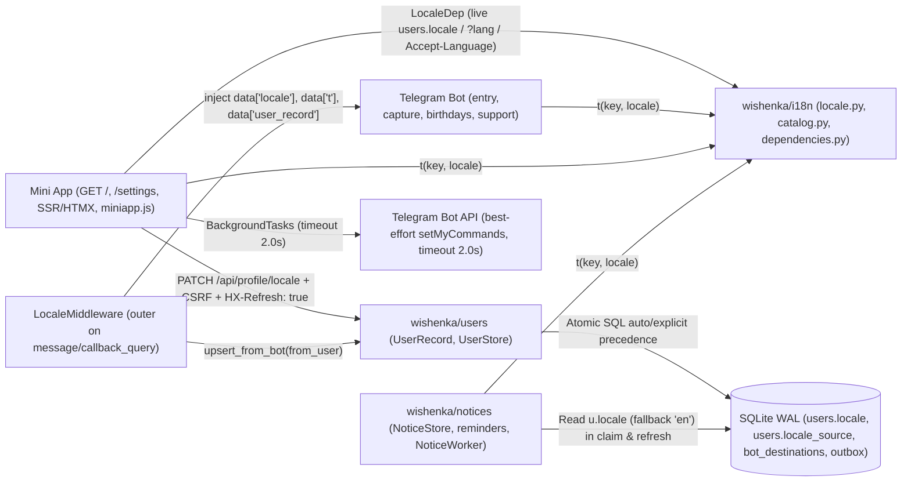
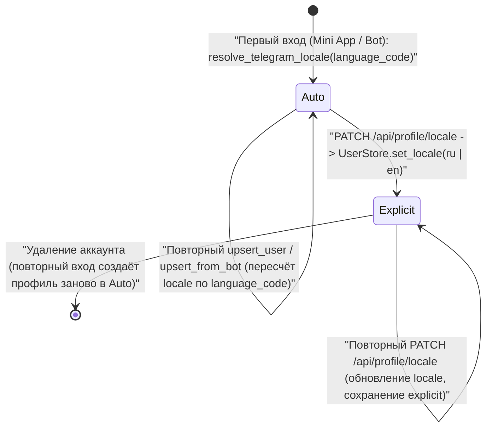

# Спецификация: WISHENKA-33 — Двуязычный интерфейс (RU/EN) в Mini App и Telegram-боте

**Задача в Jira:** `WISHENKA-33` (эпик `WISHENKA-31`, реализация требований `WISHENKA-32` `FR-5`–`FR-9`, `NFR-4` и `in-docs/spec.md` §10.3)  
**Статус:** реализовано  
**Платформы:** Telegram Bot (`aiogram` v3) + Telegram Mini App (FastAPI, Jinja2, HTMX, JS)  
**Языки интерфейса:** русский (`ru`), английский (`en`)  
**Хранилище:** SQLite WAL + Alembic  

## 1. Назначение и бизнес-цель

### 1.1. Проблема и бизнес-контекст

До реализации `WISHENKA-33` тексты пользовательского интерфейса в Telegram Mini App, диалогах Telegram-бота и асинхронных уведомлениях/напоминаниях формировались разрозненно и не опирались на единый механизм локализации (`RU` / `EN`):

- отсутствовал централизованный каталог переводов для веб-слоя, бота и фоновых задач;
- в боте, напоминаниях и уведомлениях использовался неявный откат на русский язык вместо согласованного языка по умолчанию `en`, а в отдельных сценариях присутствовали смешанные двуязычные строки и обходные переопределения `language_code`;
- языковая настройка пользователя безусловно перезаписывалась значением `language_code` клиента Telegram при повторных визитах, из-за чего отсутствовала возможность зафиксировать выбранный язык в Mini App и гарантировать его использование в ответах бота и отложенных сообщениях.

### 1.2. Цели задачи

1. **Нулевой языковой барьер при первом входе:** автоматически показывать сервис новому пользователю на русском или английском языке по языковым настройкам его клиента Telegram (с единым fallback на `en` для остальных языков или при отсутствии кода языка).
2. **Приоритет явного выбора пользователя:** позволить пользователю в любой момент переключить язык (`ru` ↔ `en`) на экране настроек Mini App и защитить этот выбор от перезаписи при последующих входах и обращениях к боту.
3. **Сквозная согласованность между каналами:** обеспечить немедленное обновление интерфейса Mini App после переключения языка, а также синхронизацию всех последующих ответов бота, его персонального меню команд и уже поставленных в очередь уведомлений и напоминаний.
4. **Единая базовая инфраструктура локализации:** создать централизованный двуязычный каталог и API-зависимости, на которые без дублирования опираются последующие задачи спринта по переводу оставшихся клиентских и SSR-экранов (`WISHENKA-73` и `WISHENKA-89`).

### 1.3. Ценность для пользователей и системы

- Пользователь сразу начинает работу на привычном языке без обязательного ручного выбора и при смене языка клиента Telegram (до ручной настройки) автоматически получает обновлённый интерфейс.
- Пользователь, зафиксировавший предпочитаемый язык вручную, получает предсказуемый перевод во всех точках контакта независимо от языковых настроек устройства или клиента Telegram.
- Система получает единый источник истины о локали профиля (`users.locale` и `users.locale_source`), исключающий расхождения между сессиями веб-интерфейса, ботом и фоновой доставкой сообщений.

### 1.4. Границы реализации

**Входит в состав `WISHENKA-33`:**

- централизованный двуязычный пакет локализации (`ru` / `en`) с нормализацией кодов, парсингом `Accept-Language`, каталогом переводов и FastAPI-зависимостью определения локали;
- хранение `locale` и `locale_source` (`auto` | `explicit`) в профиле пользователя (миграция Alembic + `UserStore` с приведением существующих записей);
- точка входа в настройки в навигации Mini App, экран настроек с переключателем языка (`ru` ↔ `en`) и немедленным обновлением страницы;
- полная локализация сценариев, клавиатур, ошибок и персонального меню команд Telegram-бота (`aiogram` v3);
- перевод формирования исходящих уведомлений и напоминаний на живую локаль профиля получателя с fallback на `en`;
- правила определения языка для неавторизованного посетителя публичной ссылки без создания профиля.

**Не входит в состав `WISHENKA-33` (разграничение со смежными задачами):**

- перевод оставшихся унаследованных JS-экранов и бейджей ролей Mini App (вынесено в `WISHENKA-73`);
- перевод оставшихся SSR-шаблонов страниц вишлистов, шаринга, приглашений, кабинета бронирований и частичных фрагментов (вынесено в `WISHENKA-89`);
- расширенные настройки даты рождения, аватара и гранулярных уведомлений (`WISHENKA-34`);
- интерфейс и каскадное удаление аккаунта (`WISHENKA-35`);
- поддержка иных языков помимо `ru` и `en`, а также отдельная команда смены языка в диалоге Telegram-бота.

## 2. Функциональные требования и пользовательские сценарии

### 2.1. Пользовательские сценарии

- **UC-01 (Автоопределение при первом входе):** новый пользователь впервые открывает Mini App или пишет Telegram-боту. Система создаёт профиль с локалью, вычисленной из `language_code` клиента Telegram (`ru*` → `ru`, иначе `en`), и источником `auto`.
- **UC-02 (Автообновление в режиме `auto`):** пользователь, ещё не переключавший язык вручную, меняет язык своего клиента Telegram и снова открывает Mini App или обращается к боту. Профиль пересчитывает `locale` по новому `language_code`, а интерфейс и ответы бота переходят на новый язык.
- **UC-03 (Явное переключение языка в Mini App):** аутентифицированный пользователь переходит по ссылке/кнопке настроек на `/settings`, выбирает `Русский` (`ru`) или `English` (`en`). Система сохраняет выбор со статусом `explicit`, возвращает `HX-Refresh: true` для немедленной перерисовки интерфейса и запускает фоновое обновление меню команд бота.
- **UC-04 (Защита явного выбора `explicit`):** пользователь с `locale_source = 'explicit'` открывает Mini App или пишет боту с клиента Telegram с другим `language_code`. Сырой `language_code` в профиле актуализируется, но сохранённая локаль и статус `explicit` остаются неизменными.
- **UC-05 (Синхронизированная работа Telegram-бота):** пользователь взаимодействует со сценариями `/start`, `/help`, `/birthdays`, `/support`, `/reservation_confirmations`, `/cancel` и быстрым добавлением желаний; все ответы, подсказки, кнопки и командное меню отображаются на актуальной локали профиля.
- **UC-06 (Доставка отложенных уведомлений и напоминаний):** пользователь меняет язык в Mini App после постановки уведомления о получении подарка или напоминания о событии в очередь, но до его отправки. Воркер перепроверяет `users.locale` непосредственно перед отправкой и доставляет сообщение на новом языке.
- **UC-07 (Анонимный просмотр публичной ссылки):** неавторизованный посетитель открывает публичную ссылку. Система выбирает язык по цепочке `?lang=` → `Accept-Language` → `en`, не создавая записи в таблице пользователей.

### 2.2. Функциональные требования

- **FR-1 (Поддерживаемые языки и правило нормализации):** поддерживаются ровно две локали — `ru` и `en` (язык по умолчанию `DEFAULT_LOCALE = "en"`). Любой тег, начинающийся на первичный подтег `ru` (без учёта регистра, пробелов и разделителя `-` / `_`, например `ru`, `ru-RU`, `ru_BY`, `RU`), нормализуется к `ru`; теги `en*`, иные языки (`de`, `uk`, `fr` и т. п.), пустые строки и `None` нормализуются к `en`.
- **FR-2 (Первичная фиксация и автообновление в режиме `auto`):** при первом контакте через Mini App (`POST /api/auth/telegram`) или через приватный чат Telegram-бота (`upsert_from_bot`) сохраняется вычисленная локаль со статусом `auto`. Пока `locale_source == 'auto'`, каждое последующее взаимодействие пересчитывает `locale` по актуальному `language_code`.
- **FR-3 (Инициализация существующих профилей):** при обновлении БД ранее существовавшие записи `users` инициализируются по сохранённому `language_code` (`ru*` → `ru`, иначе `en`) со статусом `auto`.
- **FR-4 (Настройки Mini App и валидация ввода):** в шапке Mini App и на домашнем экране доступна точка входа в `/settings`. Только аутентифицированный владелец профиля может изменять свою локаль через `PATCH /api/profile/locale`. Передача значений, отличных от `"ru"` или `"en"`, отклоняется со статусом `422` без изменения БД.
- **FR-5 (Приоритет явного выбора `explicit`):** любое ручное сохранение языка (в том числе совпадающего с текущим языком клиента Telegram) переводит `locale_source` в `'explicit'`. Последующие логины в Mini App и обновления из бота не перезаписывают `locale`. Повторные ручные переключения (`ru` ↔ `en`) разрешены неограниченно и сохраняют `locale_source = 'explicit'`.
- **FR-6 (Немедленное обновление Mini App без сессионного кеша):** ответ `PATCH /api/profile/locale` содержит заголовок `HX-Refresh: true` для полной перерисовки открытого окна HTMX. Локаль каждого HTTP-запроса читается из БД в реальном времени и не кешируется в cookie/JWT `SessionClaims`.
- **FR-7 (Локализация и синхронизация Telegram-бота):** все роутеры бота (`entry`, `capture`, `birthdays`, `support`) используют единый каталог `wishenka.i18n.t(..., locale)` на основе профиля пользователя. Обновление персонального меню команд `setMyCommands` (с областью `BotCommandScopeChat`) выполняется в режиме best-effort при `/start` и в фоновой задаче при `PATCH /api/profile/locale`; ошибка Telegram API или отсутствие чата не прерывают и не откатывают смену языка.
- **FR-8 (Синхронизация исходящих уведомлений и напоминаний):** служба уведомлений (`NoticeStore` / `NoticeWorker`) и напоминаний (`wishenka/notices/reminders.py`) читает `users.locale` как при первичном захвате записи из outbox, так и при обновлении перед самой отправкой (`refresh_claim` / `refresh_reminder`), с единым fallback на `"en"`.
- **FR-9 (Анонимное определение языка):** для неавторизованного запроса (или при отсутствии строки профиля) порядок приоритета таков:
  1. query-параметр `?lang=`, если он распознаётся как поддерживаемая локаль (`ru*` → `ru`, `en*` → `en` через `resolve_optional_locale`; неподдерживаемое значение вроде `?lang=de` игнорируется);
  2. заголовок `Accept-Language` с учётом весов `q=` (`resolve_accept_language`);
  3. fallback `DEFAULT_LOCALE` (`"en"`).
- **FR-10 (Граница локализации внутри спринта):** `WISHENKA-33` охватывает базовую инфраструктуру i18n, оболочку и настройки Mini App, все сценарии бота и все уведомления/напоминания; оставшиеся унаследованные строки клиентских представлений и SSR-страниц передаются в `WISHENKA-73` и `WISHENKA-89`.

### 2.3. Инварианты и граничные случаи

- **Тайна сюрприза:** переводы уведомлений и напоминаний на обоих языках не раскрывают получателю сведения о бронированиях, покупках и личностях дарителей.
- **Отсутствие диалога с ботом:** переключение языка в Mini App до первого сообщения боту сохраняется в `users` без ошибки синхронизации меню; при первом последующем `/start` пользователь получает приветствие и команды на выбранном языке.
- **Повторный вход после удаления аккаунта:** после удаления записи пользователя повторный вход создаёт новый профиль с режимом `auto` по текущему `language_code` клиента Telegram.
- **Отсутствующий столбец в устаревших тестовых БД напоминаний:** при `sqlite3.OperationalError` с `"no such column"` модуль напоминаний безопасно откатывается к `"en"`.

## 3. Архитектура, компоненты и интерфейсы

### 3.1. Общая схема взаимодействия модулей



### 3.2. Модули, классы и функции

| Компонент | Файл | Назначение и ключевые символы |
| --- | --- | --- |
| Нормализация и парсинг | `wishenka/i18n/locale.py` | `SupportedLocale`, `LocaleSource`, `DEFAULT_LOCALE`, `SUPPORTED_LOCALES`, `LOCALE_LABELS`, `resolve_optional_locale`, `resolve_telegram_locale`, `resolve_accept_language`, `validate_locale` |
| Каталог переводов | `wishenka/i18n/catalog.py` | `CATALOG` (`"en"` и `"ru"`), `t(key, locale=DEFAULT_LOCALE, **kwargs)` с fallback на `"en"` и `key` и логированием `WARNING` |
| Зависимость FastAPI | `wishenka/i18n/dependencies.py` | `get_request_locale`, `LocaleDep` (устанавливает `request.state.locale`) |
| Публичный API i18n | `wishenka/i18n/__init__.py` | Реэкспорт типов, констант, `t`, функций нормализации и валидации |
| Модель пользователя | `wishenka/users/models.py` | `UserRecord` (поля `locale: SupportedLocale = "en"`, `locale_source: LocaleSource = "auto"`, свойство `display_name`) |
| Хранилище пользователей | `wishenka/users/store.py` | `UserStore.initialize()`, `upsert_user`, `upsert_from_bot`, `set_locale` (алиас `set_explicit_locale`), `UserNotFoundError` |
| Миграция БД | `wishenka/wishlists/alembic/versions/add_user_locale.py` | Ревизия `add_user_locale` (`down_revision = "add_idempotency_records"`): DDL `users`, проверка `PRAGMA table_info(users)`, backfill и `downgrade()` |
| Шаблонизатор Jinja2 | `wishenka/web/templates.py` | `_locale_context_processor` (`locale` из `request.state.locale` с fallback `"en"`), глобалы `t`, `DEFAULT_LOCALE`, `SUPPORTED_LOCALES` |
| Профиль и настройки Web | `wishenka/web/routes/profile.py` | `GET /settings` (`settings_page`), `PATCH /api/profile/locale` (`update_profile_locale`), `_extract_requested_locale`, `_find_active_chat_id`, `_sync_bot_commands_best_effort` |
| Оболочка Mini App и SSR | `wishenka/web/routes/miniapp.py`, `templates/base.html`, `templates/settings.html`, `static/miniapp.js`, `routes/sharing.py`, `items_ui.py`, `reservations_ui.py` | `<html lang="{{ locale }}">`, ссылка на `/settings`, передача `LocaleDep` в SSR-обработчики, локализация `showHome()` через встроенный словарь `HOME_I18N` |
| Middleware и команды бота | `wishenka/bot/i18n.py` | `LocaleMiddleware`, `bot_commands_for_locale`, `sync_user_bot_commands`, `_private_bot_user`, `_PrivateUserLogFilter` |
| Роутеры бота | `wishenka/bot/entry.py`, `capture.py`, `birthdays.py`, `support.py` | Подключение `LocaleMiddleware` как `outer_middleware` на `router.message` и `router.callback_query` в `entry.create_router`, перевод всех сообщений и клавиатур на `t()`, вызов `sync_user_bot_commands` после `/start` |
| Уведомления и напоминания | `wishenka/notices/store.py`, `worker.py`, `reminders.py` | `ClaimedNotice.language = "en"`, выборка `u.locale` в `NoticeStore._eligible()`, `claim_reminder()`, `refresh_reminder()`, нормализация в `_normalize_row_locale` с fallback `"en"`, рендеринг через `t(...)` |

### 3.3. Контракты данных и схема БД

#### Схема таблицы `users` (ревизия `add_user_locale`)

В `add_user_locale.py` и синхронно в `UserStore.initialize()` гарантируются столбцы:

- `locale TEXT NOT NULL DEFAULT 'en' CHECK (locale IN ('ru', 'en'))`;
- `locale_source TEXT NOT NULL DEFAULT 'auto' CHECK (locale_source IN ('auto', 'explicit'))`.

При миграции существующих записей применяется backfill:

```sql
UPDATE users
SET locale = CASE
        WHEN lower(trim(coalesce(language_code, ''))) LIKE 'ru%' THEN 'ru'
        ELSE 'en'
    END,
    locale_source = 'auto'
WHERE locale IS NULL
   OR locale NOT IN ('ru', 'en')
   OR locale_source IS NULL
   OR locale_source NOT IN ('auto', 'explicit');
```

#### HTTP-интерфейсы локализации

- **`GET /settings`** (`HTMLResponse`): требует `Depends(get_current_user)` и `LocaleDep`. Читает `UserRecord` из `UserStore`, передаёт в `settings.html` параметры `viewer_identified=True`, `locale`, `locale_source` и отображает селектор языка (`Русский` / `English`) с HTMX-отправкой `hx-patch="/api/profile/locale"` (`hx-ext="json-enc"`, `hx-swap="none"`).
- **`PATCH /api/profile/locale`** (`JSONResponse`):
  - **Авторизация и защита:** `Depends(get_current_user)` + `BrowserSecurityMiddleware` (Origin и `X-CSRF-Token` для cookie-сессий или Bearer).
  - **Вход:** JSON `{"locale": "ru" | "en"}` либо форма `application/x-www-form-urlencoded` / `multipart/form-data` с полем `locale`.
  - **Успех (`200 OK`):** JSON `{"locale": "ru" | "en", "locale_source": "explicit"}` и заголовок `HX-Refresh: true`. Если у пользователя найдена активная запись в `bot_destinations`, в FastAPI `BackgroundTasks` ставится неблокирующий вызов `_sync_bot_commands_best_effort` (таймаут `2.0` с).
  - **Ошибки:** `401` при невалидной/отсутствующей сессии; `422` при значении, не прошедшем `validate_locale`; `404` при `UserNotFoundError`.

#### Контракт `Accept-Language` (`resolve_accept_language`)

Заголовок разбивается по запятым на пары `tag(;q=weight)?`. Пустые теги, символ `*`, нечисловые веса, значения `NaN`, веса `< 0` или `> 1` и записи с `q <= 0` отбрасываются. Оставшиеся теги сортируются по убыванию `q` (по умолчанию `1.0`) с сохранением исходного порядка при равенстве, после чего наиболее приоритетный тег нормализуется через `resolve_telegram_locale` (`DEFAULT_LOCALE = "en"` при отсутствии валидных кандидатов).

### 3.4. Переходы состояний локали профиля



На уровне SQL в `UserStore.upsert_user()` правило защищено от гонок атомарным выражением `INSERT INTO users ... ON CONFLICT(telegram_id) DO UPDATE SET locale = CASE WHEN users.locale_source = 'explicit' THEN users.locale ELSE excluded.locale END, locale_source = CASE WHEN users.locale_source = 'explicit' THEN users.locale_source ELSE excluded.locale_source END`.

## 4. Нефункциональные требования, безопасность и наблюдаемость

### 4.1. Нефункциональные требования и производительность

- **Межканальная консистентность (`NFR-1`):** локаль не хранится в cookie/JWT `SessionClaims`; каждый веб-запрос, обработчик бота и воркер уведомлений/напоминаний читают актуальное состояние из таблицы `users`.
- **Отказоустойчивость синхронизации меню (`NFR-2`):** обновление командного меню бота выполняется в `BackgroundTasks` (для веб-запроса) или после отправки ответа `/start` (для бота) с ограничением `asyncio.wait_for(..., timeout=2.0)`. При ошибке сети/Telegram API, отсутствии токена или значении `PLACEHOLDER_TOKEN` сохранение профиля не откатывается.
- **Атомарность при конкурентных запросах (`NFR-3`):** SQL-условие `CASE WHEN users.locale_source = 'explicit'` гарантирует сохранность ручного выбора при параллельных обращениях из Mini App и Telegram-бота.
- **Ограничения форматирования уведомлений:** при рендеринге уведомлений и напоминаний сохраняются существующие ограничения на длину подставляемых названий (до `100` символов в напоминаниях и `TITLE_LIMIT` в `NoticeWorker._send`).

### 4.2. Безопасность и приватность

- **Контроль доступа (`NFR-4`):** читать и изменять персональную языковую настройку на `/settings` и `PATCH /api/profile/locale` может только аутентифицированный владелец аккаунта; мутирующие cookie-запросы защищены проверкой `Origin` и `X-CSRF-Token` в `BrowserSecurityMiddleware`.
- **Изоляция анонимного просмотра:** для неавторизованных посетителей публичных ссылок запись в `users` не создаётся и существующие профили не изменяются.
- **Минимизация ПДн в логах:** в структурированных событиях локализации не логируются `first_name`, `last_name`, `username`, `display_name`, `initData`, токены бота, cookie и CSRF-токены. Дополнительно `_PrivateUserLogFilter` (управляется через `ContextVar` `_private_bot_user` в `wishenka/bot/i18n.py`) подавляет записи логгера `wishenka.users` во время приватных взаимодействий с ботом, предотвращая утечку идентификаторов.

### 4.3. Наблюдаемость и структурированное логирование

Все события логируются через `wishenka/logging.py` (`JsonFormatter` при `json_logs=True` или структурированный текстовый форматтер) без зарезервированных полей `LogRecord`. Проектный экспортер Prometheus/OpenTelemetry отсутствует; мониторинг и алертинг строятся по JSON-логам в `stdout` и проверке миграции Alembic на старте.

| Уровень | Файл и логгер | Событие (`extra["event"]`) | Поля контекста (`extra`) | Назначение |
| --- | --- | --- | --- | --- |
| `WARNING` | `wishenka/web/routes/profile.py` (`wishenka.web.profile`) | `locale_invalid_request` | `event`, `user_id`, `status_code` | Отклонённый запрос `PATCH /api/profile/locale` с неподдерживаемой локалью |
| `WARNING` | `wishenka/bot/i18n.py`, `wishenka/web/routes/profile.py` (`wishenka.bot.i18n`) | `bot_commands_locale_sync_failed` | `event`, `user_id`, `target_locale`, `error_type` | Сбой или таймаут `setMyCommands` (best-effort) |
| `WARNING` | `wishenka/i18n/catalog.py` (`wishenka.i18n`) | `i18n_missing_translation_key` | `event`, `i18n_key`, `locale`, `fallback_locale` | Отсутствующий ключ в каталоге переводов |
| `INFO` | `wishenka/users/store.py` (`wishenka.users`) | `locale_explicit_updated` | `event`, `user_id`, `previous_locale`, `new_locale`, `previous_source`, `locale_source` | Успешное сохранение ручного выбора `explicit` |
| `DEBUG` | `wishenka/users/store.py` (`wishenka.users`) | `locale_auto_resolved` | `event`, `channel`, `resolved_locale`, `locale_source`, `changed`, `fallback_used` | Автоопределение или обновление локали (в приватном чате подавляется `_PrivateUserLogFilter`) |
| `DEBUG` | `wishenka/bot/i18n.py` (`wishenka.bot.i18n`) | `bot_commands_locale_synced` | `event`, `user_id`, `target_locale` | Успешная синхронизация командного меню чата |
| `DEBUG` | `wishenka/notices/store.py`, `wishenka/notices/reminders.py` (`wishenka.notices.store`, `wishenka.notices.reminders`) | `notice_locale_resolved` | `event`, `channel`, `locale`, `fallback_used` | Разрешение локали получателя при выборке уведомления или напоминания |

## 5. Верификация и критерии приёмки

### 5.1. Тестовые сценарии и результаты проверок

Все тесты изолированы от внешней сети Telegram API (используются `TestClient`, временные SQLite БД, перехват `aiogram.Bot.__call__` и тестовые отправители) и снабжены явными маркерами `pytest.mark.timeout`:

1. **Сквозные интеграционные сценарии (`tests/test_i18n_sync.py`):**
   - `test_first_login_locale_mapping_ru_en_and_fallback`: проверяет первичное сохранение `ru-RU` → `ru`, `en-US` / `de` / `None` → `en` (со статусом `auto`) и формирование `UserRecord.display_name` через `POST /api/auth/telegram`.
   - `test_auto_locale_tracks_telegram_client_until_explicit_switch`: проверяет автообновление локали при `POST /api/auth/telegram` и `UserStore.upsert_from_bot` в режиме `auto`, перевод в `explicit` через `PATCH /api/profile/locale` с заголовком `HX-Refresh: true`, неизменность локали при последующих входах с другим `language_code`, а также ответы `422` (на `"de"`) и `401` (без авторизации).
   - `test_miniapp_switch_immediately_updates_ssr_bot_and_pending_notices`: проверяет переключение `ru` → `en` (включая устойчивость при падении `set_my_commands`), немедленное обновление `GET /settings`, `/`, `/web/reservations`, правила анонимного `GET /share/{public_token}` (`en`, `?lang=ru`, `Accept-Language: ru-RU,ru;q=0.9`), ответы бот-хендлеров (`/start`, `/help`, `/birthdays`, `/support`), вызов `SetMyCommands` и доставку ранее поставленных в очередь `pending`-строк `notification_outbox` и `reminder_outbox` на новом языке.
2. **Юнит- и регрессионное тестирование (`tests/test_i18n_unit.py` и обновлённые наборы):**
   - проверка паритета ключей и плейсхолдеров в `CATALOG`, логирования отсутствующих ключей, парсинга `Accept-Language`, `resolve_optional_locale`, миграции `add_user_locale.py` (включая backfill и починку невалидных значений), fallback на `"en"` при `OperationalError` (`"no such column"`) в `reminders.py` и теста наблюдаемости `test_i18n_observability_structured_logs_and_no_pii` (формат `JsonFormatter`, наличие ожидаемых событий и отсутствие ПДн);
   - обновление утверждений в унаследованных тестах `tests/test_notice_wishlist_events.py`, `tests/test_notice_delivery_repro.py` и `tests/test_bot_support.py` под единый fallback `"en"` и чтение `users.locale`.
3. **Итоговый прогон контроля качества (после финальных правок Шага 6):**
   - `make analyze` (Ruff lint, `ruff format --check`, Mypy strict по 188 исходным файлам): без ошибок и предупреждений;
   - `make test`: `1070 passed` (после Шага 5 — `1069 passed`, после добавления теста наблюдаемости на Шаге 6 — `1070 passed`).

### 5.2. Критерии приёмки

1. При первом входе через Mini App или бота локаль определяется по правилу `ru*` → `ru`, иначе `en` со статусом `auto`; существующие записи мигрированы аналогично.
2. Пока `locale_source == 'auto'`, смена `language_code` клиента Telegram автоматически обновляет локаль пользователя во всех каналах.
3. Аутентифицированный пользователь может переключить язык (`ru` ↔ `en`) в настройках Mini App; некорректные и неавторизованные запросы отклоняются (`422` / `401`).
4. После ручного выбора `locale_source` фиксируется как `explicit` и не перезаписывается при последующих визитах в Mini App или обращениях к боту независимо от `language_code`.
5. Переключение языка в Mini App немедленно обновляет UI через `HX-Refresh: true`, последующие ответы и командное меню бота (в режиме best-effort), а также доставляет уже поставленные в очередь уведомления и напоминания на новом языке с сохранением тайны сюрприза.
6. Анонимные запросы к публичным ссылкам выбирают язык по цепочке `?lang=` → `Accept-Language` → `en` без создания профиля в БД.

### 5.3. Известные ограничения и дальнейшие доработки (по `60-tech-debt.md`)

1. **Частичная локализация клиентского JS (`wishenka/web/static/miniapp.js`):** в рамках `WISHENKA-33` локализована только навигация и домашний экран `showHome()` через встроенный словарь `HOME_I18N`; экраны `showHistory()`, `showList()`, `sharePanel()`, `roleLabel()` и часть сообщений об ошибках содержат зашитые русские/английские строки и используют `HOME_I18N` вместо единого каталога. Запланировано в **[WISHENKA-73](https://pypost.atlassian.net/browse/WISHENKA-73)**.
2. **Частичная локализация SSR-шаблонов Jinja2:** переведены `base.html`, `settings.html`, `partials/item_card.html`, `partials/item_edit_modal.html` и `partials/item_receipt_modal.html`; остальные шаблоны (`wishlist_detail.html`, `share_wishlist.html`, `invite_preview.html`, `reservations_cabinet.html` и 10 оставшихся partials, включая жёсткий формат `strftime('%d.%m.%Y')`) сохраняют унаследованные строки, что в `EN`-сессиях создаёт смешанный язык интерфейса. Запланировано в **[WISHENKA-89](https://pypost.atlassian.net/browse/WISHENKA-89)**.
3. **Технический долг в `wishenka/web/routes/profile.py`:** дублирующий запрос `get_by_telegram_id` в `GET /settings`, зашитый `DEFAULT_LOCALE` в тексте ошибки `422` при `PATCH /api/profile/locale`, прямой SQL к `bot_destinations` в `_find_active_chat_id` (обработка только первой активной строки) и создание временного экземпляра `Bot` на каждый запрос вместо переиспользования. Запланировано в **[WISHENKA-192](https://pypost.atlassian.net/browse/WISHENKA-192)**.
4. **Консолидация нормализации уведомлений и недостающие тесты:** дублирование `_normalize_row_locale` в `wishenka/notices/store.py` и `wishenka/notices/reminders.py`, а также отсутствие автоматических тестов на `add_user_locale.py` `downgrade()` и конкурентные гонки `upsert_user` / `set_locale`. Запланировано в **[WISHENKA-193](https://pypost.atlassian.net/browse/WISHENKA-193)**.
5. **Ограничения базового каталога и покрытия UI:** `CATALOG` в `wishenka/i18n/catalog.py` является плоским словарём без правил плюрализации и локализованного форматирования дат/чисел; для не-home JS-экранов и немигрированных SSR-шаблонов отсутствуют DOM/Playwright-тесты переключения `RU`/`EN`; схема и backfill-SQL дублируются между `UserStore.initialize()` и `add_user_locale.py` ради работы изолированных тестов без Alembic.
