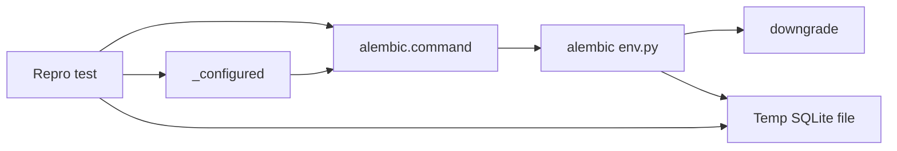

# WISHENKA-334: Rolling the person-key change backward restores the earlier identity

## Research

The person-key change is the Alembic revision
`unify_user_keys_and_cascades` in
`wishenka/wishlists/alembic/versions/unify_user_keys_and_cascades.py`.
Its `revision` is `unify_user_keys_and_cascades` and its `down_revision`
is `add_receipt_delivery_fence`. `ROLLBACK_POLICY` is `reversible`.
The backward function is `downgrade` in that module. Alembic calls it
only when the script directory walks from `unify_user_keys_and_cascades`
to `add_receipt_delivery_fence`.

`downgrade` rebuilds eight tables through the existing `_rebuild` helper
(rename to `*_legacy`, create the earlier table, copy rows, drop the
legacy table). It does not add a revision and it does not alter `users`.
Both identities stay on the person: `users.id` and `users.telegram_id`.

What `downgrade` restores:

- Remembered links move from `users.telegram_id` back to `users.id` by
  joining `users.telegram_id` to the post-upgrade key.
  `bot_destinations.user_id`, `birthday_entries.owner_id`,
  `birthday_input.owner_id`, and `support_input.owner_id` are written as
  `users.id`. The rebuilt tables have no `REFERENCES` clause, so they no
  longer cascade from `users`.
- Invite tokens. The post-upgrade table is
  `(token TEXT PRIMARY KEY, wishlist_id INTEGER NOT NULL REFERENCES
  wl_lists(id) ON DELETE CASCADE)` plus
  `idx_wl_invite_tokens_wishlist`. `downgrade` recreates
  `wl_invite_tokens (token TEXT PRIMARY KEY)`, copies `token`, and drops
  `idx_wl_invite_tokens_wishlist`. The wishlist pointer and the cascade
  are gone. Upgrade keeps a token only when `wl_lists.invite_token`
  equals that token (`JOIN wl_lists l ON l.invite_token = i.token`).
  Tokens that match no wishlist are already dropped on the way forward
  and are out of scope.
- Support ticket owner. The post-upgrade table is
  `(id, ticket_ref, telegram_id REFERENCES users(telegram_id)
  ON DELETE CASCADE, created_at)` with
  `idx_support_tickets_owner_time` on `(telegram_id, created_at)`.
  `downgrade` recreates
  `(id, ticket_ref, owner_id, telegram_id, created_at)` with no foreign
  key. `owner_id` is `users.id` from
  `JOIN users u ON u.telegram_id = st.telegram_id`. `ticket_ref`,
  `telegram_id`, and `created_at` are copied. The index returns to
  `(owner_id, created_at)`.

`downgrade` also rebuilds `reminder_outbox` and `wl_tokens` without
cascade foreign keys, but it copies `user_id` and `wishlist_id` unchanged.
Those rows already used the messenger identity or the wishlist id before
this revision. The check must not require them to switch to `users.id`.

The forward check is
`test_migration_unifies_user_keys_to_telegram_id_and_enforces_fks` in
`tests/test_wishenka_188_user_key_unification_repro.py`. It upgrades with
`command.upgrade(_configured(db_url), "add_receipt_delivery_fence")`,
seeds `users.id = 42` and `users.telegram_id = 999001`, then calls
`upgrade_to_head`. The module already has
`pytestmark = pytest.mark.timeout(30)`. The same file imports
`command`, `_configured`, `sql_exec`, `sql_rows`, and `_table_columns`.
`command.downgrade` takes the same `Config` as `command.upgrade`
([Alembic 1.20.1 commands](https://alembic.sqlalchemy.org/en/latest/api/commands.html)).
A relative target such as `"-1"` is the wrong call here: current head is
`add_view_history_recorded_seq`, and
`purge_legacy_non_member_view_history.downgrade` raises
`NotImplementedError`. Walking from head back to
`add_receipt_delivery_fence` would fail in a later one-way revision and
would not isolate this `downgrade`.

WISHENKA-188 recorded this gap as TD-1
(`ai-tasks/WISHENKA-188/60-tech-debt.md`). TD-2, a shared migration
runner, is WISHENKA-335 and stays out of this task. No public
`downgrade_to` helper is added. The test uses the private `_configured`
helper the forward test already uses.

## Implementation Plan

This task adds a downgrade check. It does not add a migration. Step 4
edits `downgrade` in
`wishenka/wishlists/alembic/versions/unify_user_keys_and_cascades.py`
only when the check shows that the earlier identity or the earlier
invite-token and support-ticket shapes are not restored. `_rebuild`
changes only if that same failure is inside the helper and the existing
forward tests still pass. No other revision is edited.

**Mandatory — Failing Repro (next Step 3):** Extend
`tests/test_wishenka_188_user_key_unification_repro.py`. The file's
harness can host the check: a `tmp_path` SQLite file, synchronous
`alembic.command` on `_configured(db_url)`, and the existing SQL helpers.
Do not add a sibling module. The module `pytestmark` already sets
`pytest.mark.timeout(30)`. Do not raise that timeout.

New test, same module timeout, local file only:

1. `command.upgrade(config, "add_receipt_delivery_fence")`.
2. Seed one person whose identities differ (`users.id` 42,
   `users.telegram_id` 999001), the same four remembered rows and the
   support ticket the forward test already inserts, plus one
   `wl_lists` row and one `wl_invite_tokens` row that share the same
   token text. The list insert must fill the `NOT NULL` columns present
   at `add_receipt_delivery_fence` (`owner_id`, `owner_name`, `title`,
   `public_token`, `invite_token`, `created_at`, `updated_at`).
   `warn_on_delete_reserved` has a default.
3. `command.upgrade(config, "unify_user_keys_and_cascades")`. Do not call
   `upgrade_to_head`. Assert the forward shape so a no-op rollback fails:
   the four remembered keys are 999001, `support_tickets` has no
   `owner_id` and `telegram_id` 999001, and `wl_invite_tokens` has
   `wishlist_id`. Leave
   `test_migration_unifies_user_keys_to_telegram_id_and_enforces_fks`
   unchanged.
4. `command.downgrade(config, "add_receipt_delivery_fence")`. That single
   step is `unify_user_keys_and_cascades.downgrade`. Assert
   `alembic_version` is `add_receipt_delivery_fence`.
5. Assert the earlier identity and the earlier schema:
   - `users` still has `id` 42 and `telegram_id` 999001.
   - `bot_destinations.user_id`, `birthday_entries.owner_id`,
     `birthday_input.owner_id`, and `support_input.owner_id` are 42.
   - The support ticket keeps `ticket_ref` and `created_at`,
     `owner_id` is 42, and `telegram_id` is 999001.
     `idx_support_tickets_owner_time` is on `(owner_id, created_at)`.
     With `PRAGMA foreign_keys = ON`, `DELETE FROM users` does not
     delete the ticket.
   - The invite row still has the same `token`. `table_info` has no
     `wishlist_id`. With `PRAGMA foreign_keys = ON`,
     `DELETE FROM wl_lists` does not delete the token.
   - Do not assert that `reminder_outbox.user_id` or `wl_tokens` move
     onto `users.id`.

The check is red when step 5 fails. There is no fault injection and no
live service. If `downgrade` already restores this shape, Step 3 stays
green and Step 4 does not change production code.

Sequencing: this architecture, then the red check, then a fix only while
that check is red.

## Architecture

The running product is unchanged. The new piece is one test. The behavior
under test is the revision that already exists.

### Modules

- **Repro test** (`tests/test_wishenka_188_user_key_unification_repro.py`).
  Builds a database at `add_receipt_delivery_fence`, applies only
  `unify_user_keys_and_cascades`, calls `downgrade`, and reads rows and
  `PRAGMA` results. It does not open Telegram, HTTP, or `UserStore`.
- **Alembic config** (`wishenka.wishlists.migrations._configured`).
  Points `script_location` at `wishenka/wishlists/alembic` and
  `sqlalchemy.url` at the temp file. Already used by the forward test.
  This task does not move that helper. That move is WISHENKA-335.
- **Revision script**
  (`wishenka/wishlists/alembic/versions/unify_user_keys_and_cascades.py`).
  `downgrade` is the only function this task may change, and only after
  the check fails. `upgrade` stays as it is.
- **Alembic env** (`wishenka/wishlists/alembic/env.py`). Online mode uses
  one short synchronous connection and one transaction. The test does
  not change it. SQLite foreign keys stay off on that connection, which
  is what lets `_rebuild` rename tables. The test turns
  `PRAGMA foreign_keys = ON` only on its own assertion connection, the
  same way the forward cascade checks do.

### Dependencies

The test depends on `alembic.command`, `_configured`, and a temp SQLite
file. `downgrade` depends on Alembic `op` and `_rebuild`. It does not
depend on application services. Later revisions are not on the path:
`add_share_access_and_purge_favorites` sits above this revision, and
`purge_legacy_non_member_view_history` refuses to downgrade.

### Patterns

- **Expand the existing characterization test.** The forward direction
  is already a temp-file Alembic test. The backward direction uses that
  harness instead of a new runner.
- **One reversible revision, absolute targets.** Upgrade target
  `unify_user_keys_and_cascades`, downgrade target
  `add_receipt_delivery_fence`. Absolute ids avoid the one-way revision
  above this one and avoid a relative `"-1"` from head.
- **Table rebuild.** SQLite will not drop `wishlist_id` or `owner_id`
  with `ALTER TABLE`. `downgrade` already recreates the earlier tables.
  No second migration is required unless those copies are wrong.

### Interfaces

| Caller | Call | Effect |
| --- | --- | --- |
| Test | `command.upgrade(config, "add_receipt_delivery_fence")` | Schema before this revision |
| Test | `command.upgrade(config, "unify_user_keys_and_cascades")` | Runs `upgrade` only |
| Test | `command.downgrade(config, "add_receipt_delivery_fence")` | Runs `downgrade` only |
| `downgrade` | `_rebuild(...)` for the eight tables | Restores keys and shapes listed in Research |
| Test | row reads, `PRAGMA`, and `DELETE` with foreign keys on | Earlier identity and schema |

`config` is `_configured(db_url)` with
`db_url = f"sqlite+aiosqlite:///{tmp_path / '...'}"`. No new public
migration API.

## Q&A

**Why is this a test and not a new migration?** `downgrade` already maps
remembered links and the support-ticket owner back to `users.id`, and it
already recreates invite tokens as `token` alone. The missing piece is
the check. A new revision would describe a different rollback.

**When does production code change?** Only when the new check fails.
The editable surface is `downgrade` in
`unify_user_keys_and_cascades.py`.

**Why not `upgrade_to_head` and then downgrade to the parent?** Head is
`add_view_history_recorded_seq`. The path back crosses
`purge_legacy_non_member_view_history`, whose `downgrade` raises
`NotImplementedError`. The check would then fail for a reason outside
this task.

**Why can the existing file host the test?** It already runs
`command.upgrade` on `_configured` inside an async test with a 30-second
module timeout. `command.downgrade` is the matching call. A sibling file
is unnecessary.

**Why stay away from WISHENKA-335?** That task extracts a shared runner
from `wishenka.wishlists.migrations`. This check calls Alembic the way
the forward test already does and does not add a downgrade entry point.

**Why must the seeded identities differ?** If `users.id` and
`users.telegram_id` were equal, a `downgrade` that forgot the join would
still look correct. The seed keeps 42 and 999001, matching the forward
test.

**Are reminders and ordinary access tokens asserted?** No. `downgrade`
copies their ids through. Requiring `users.id` there would contradict
the requirements.
