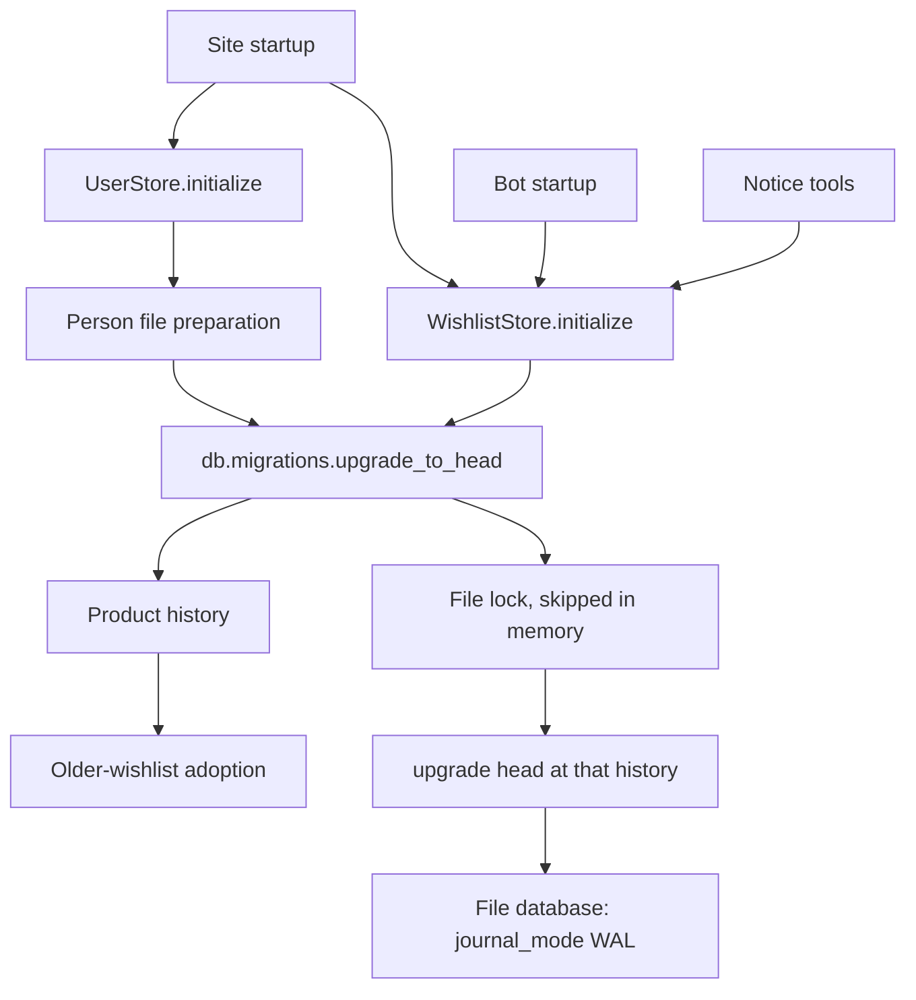

# WISHENKA-335: One shared way to bring a database current

## Research

Today one procedure brings a database to the latest change in its
history, and that procedure lives in `wishenka/wishlists/migrations.py`.
`upgrade_to_head_sync` logs a start, takes a file lock, adopts a
recognized older wishlist, runs Alembic `upgrade` to `head`, sets
`PRAGMA journal_mode=WAL` on a file database, then logs failure or
completion. `upgrade_to_head` runs that function on a worker thread.
An in-memory URL skips the lock. A non-SQLite URL raises `ValueError`
(`Wishlist migrations support only SQLite URLs`). The lock waits up to
60 seconds and then raises `TimeoutError` (`Timed out waiting for
another process to finish wishlist migration`).

The history is the Alembic environment at
`wishenka/wishlists/alembic/`, selected by `_configured` through
`script_location`. Revisions stay in `versions/`, including
`unify_user_keys_and_cascades.py` (the person-key change). `env.py`
opens a short-lived synchronous connection with `NullPool`. It does not
set a custom version table, so Alembic uses `alembic_version` in the
file being upgraded. `alembic.ini` at the repository root is the config
file; the runner overrides `script_location` and `sqlalchemy.url`.

Recognizing an older wishlist is separate from that sequence. It is
`_REVISIONS`, `_TABLES`, the schema signatures, and
`_adopt_known_schema`. Those names are wishlist rules. The adoption log
`wishlist_migration_legacy_schema_adopted` is emitted on
`wishenka.wishlists.migrations`, as are `wishlist_migration_started`,
`wishlist_migration_completed`, and `wishlist_migration_failed`.
Existing checks filter on that logger name.

Callers of the procedure:

- `WishlistStore.initialize` calls `upgrade_to_head` and, on dispose of
  a temporary file, deletes the sidecar from `migration_lock_path`.
- `UserStore.initialize` prepares a file database (`journal_mode=WAL`,
  `synchronous=NORMAL`, `busy_timeout=5000`) and then calls
  `wishenka.wishlists.migrations.upgrade_to_head`. That import is the
  coupling recorded as TD-2 on WISHENKA-188. The preparation stays in
  the person store.
- Site startup initializes the wishlist store, then the person store.
  Bot startup and the notice tools initialize the wishlist store only.

`tests/test_wishenka_188_user_key_unification_repro.py` (WISHENKA-334)
imports `_configured`, `head_revision`, and `upgrade_to_head` from
`wishenka.wishlists.migrations`. This task does not edit that file or
the person-key revision. Other checks import the same module. Those
names have to keep working with the same one-argument URL signatures.

People and wishlists share one database file, so they share one
`alembic_version` chain. A second call on an already-current file is an
Alembic no-op, and adoption returns immediately once `alembic_version`
is present. The lock is held across that re-read.

Alembic 1.20.1 documents the shape this split needs. Programmatic
`Config` plus `command.upgrade` is the supported in-process API
([Configuration][alembic-config]).
Independent histories use separate environments: each has its own
`script_location`, `env.py`, and `alembic_version` table
([Run Multiple Alembic Environments][alembic-multi-env]).
Multiple bases are a different feature: several lineages share one
version table
([Working with Multiple Bases][alembic-multi-base]).
This task uses the independent-environment pattern so a later database
can carry its own history. It does not add that database, and it does
not put a second lineage in the current file. The project depends on
`alembic>=1.14.0` (`pyproject.toml`). Alembic does not lock two
processes out of one SQLite file; the existing `fcntl` lock stays.

## Implementation Plan

1. Add package `wishenka.db` (`wishenka/db/__init__.py` and
   `wishenka/db/migrations.py`). The package root does not re-export the
   runner. Callers import `wishenka.db.migrations`.
2. Move the apply sequence into that module: SQLite URL check, file
   path, sidecar lock, optional adopt callback, `command.upgrade` to
   `head`, WAL on a file database, and the start, failure, and
   completion logs. Keep the 60 second wait, the 0.05 second poll, and
   the `.migrate.lock` suffix.
3. Leave wishlist recognition, the Alembic tree, `env.py`, and every
   revision file in `wishenka.wishlists`. Do not edit
   `unify_user_keys_and_cascades.py`.
4. Point `WishlistStore.initialize` and `UserStore.initialize` at
   `wishenka.db.migrations.upgrade_to_head`. Leave the person store's
   own file preparation ahead of that call. Leave
   `WishlistStore.dispose` deleting the same sidecar, imported from
   `wishenka.db.migrations.migration_lock_path`.
5. Keep `wishenka.wishlists.migrations` as the history owner and as the
   compatibility surface for existing imports, including the
   WISHENKA-334 test. Do not edit that test.
6. Step 8 updates `doc/dev/migrations.md` and the migration paragraph
   in `doc/dev/architecture.md`. This step does not.

**Mandatory — Failing Repro (next Step 3):** Add
`tests/test_wishenka_335_shared_migration_runner.py` with
`pytestmark = pytest.mark.timeout(10)` before any production edit. The
test imports `wishenka.users.store`, `wishenka.wishlists.store`, and
`wishenka.db.migrations` and asserts both stores'
`upgrade_to_head` is `wishenka.db.migrations.upgrade_to_head`. It fails
today because both names are
`wishenka.wishlists.migrations.upgrade_to_head`, and because
`wishenka.db.migrations` does not exist yet. No database, network, or
Alembic run is required. Do not put the test in
`tests/test_wishenka_188_user_key_unification_repro.py`. Sequencing:
this research, then that red test, then the move until the red test and
the existing migration checks are green. Those existing checks are the
regression net for apply behavior. Step 3 does not duplicate them.

## Architecture

The shared way is a history-agnostic apply procedure. A history is the
ordered changes for one database plus the steps that belong only to
that history. The current product has one history, still stored under
wishlists, because people and wishlists still share one database. The
procedure does not contain wishlist table rules, and it does not own a
revision.



### Modules

- `wishenka.db.migrations` applies one history to one SQLite URL. It
  refuses a non-SQLite URL, locks a file database, calls that history's
  adopt hook when it has one, upgrades to head, selects WAL on a file,
  and logs start, failure, and completion on that history's logger.
- `wishenka.wishlists.migrations` is the current product history: the
  script directory, older-wishlist adoption, the adoption log,
  `head_revision`, and the compatibility wrappers.
- `wishenka.wishlists.alembic` is the unchanged environment and the
  revision files, including the person-key revision.
- `wishenka.wishlists.store` calls the shared `upgrade_to_head` on
  startup. Dispose still removes the sidecar lock file.
- `wishenka.users.store` still prepares its own file database, then
  calls the shared `upgrade_to_head`. It does not import
  `wishenka.wishlists`.

### History value

`MigrationHistory` is a frozen dataclass in `wishenka.db.migrations`.
It is the only new type. Fields:

- `script_location: Path` — absolute path of that database's Alembic
  environment (`env.py` and `versions/`).
- `adopt: Callable[[str], None] | None` — called with the application
  URL inside the lock, before `upgrade`. `None` means there is nothing
  to adopt. The wishlist history passes `_adopt_known_schema`.
- `log: logging.Logger` — receives the three apply events and is the
  logger the adopt hook already uses.
- `unsupported_url_message: str` — `ValueError` text for a non-SQLite
  URL.
- `lock_timeout_message: str` — `TimeoutError` text when the wait runs
  out.
- `started_event` and `started_message` — info log before the lock.
- `failed_event` and `failed_message` — exception log, then re-raise.
- `completed_event` and `completed_message` — info log after success.
  The message takes the integer duration in milliseconds, matching
  `Wishlist database migration completed in %d ms`.

The product history is a module-level `PRODUCT_HISTORY` in
`wishenka.wishlists.migrations`. `script_location` is the absolute path
of `wishenka/wishlists/alembic` (the same path `_configured` builds
today). `log` is `logging.getLogger("wishenka.wishlists.migrations")`,
which is that module's current logger. The two messages stay
byte-for-byte:

- `Wishlist migrations support only SQLite URLs`
- `Timed out waiting for another process to finish wishlist migration`

`_product_history()` in `wishenka.db.migrations` returns that value by
importing it inside the function. `wishenka.wishlists.migrations` may
import `wishenka.db.migrations` at module level. The reverse import
happens only inside `_product_history()`, so the two modules can load
in either order.

### Interfaces

```python
def migration_lock_path(path: Path) -> Path: ...

def configured(database_url: str, *, script_location: Path) -> Config: ...

def apply_history_sync(database_url: str, history: MigrationHistory) -> None: ...

async def apply_history(database_url: str, history: MigrationHistory) -> None: ...

def upgrade_to_head_sync(database_url: str) -> None: ...

async def upgrade_to_head(database_url: str) -> None: ...
```

`upgrade_to_head_sync` is the product binding. It calls
`apply_history_sync(database_url, _product_history())`.
`upgrade_to_head` is `asyncio.to_thread` of that function, as today.
Both stores call `upgrade_to_head(database_url)` and pass nothing else.
A later database calls `apply_history` with its own `MigrationHistory`.
This task adds no such caller and no second script directory.

`configured` loads the repository `alembic.ini` from the same relative
location the current `_configured` uses (`parents[2]` of the new
module is still the repository root), then sets `script_location` and
the synchronous `sqlalchemy.url`. It does not set `version_table`.

`apply_history_sync` keeps the current order:

1. Log `history.started_message` at info on `history.log` with
   `extra={"event": history.started_event}`.
2. Resolve the path. `:memory:` yields no path and takes no lock.
3. Under the lock, call `history.adopt(database_url)` when `adopt` is
   not `None`, then `command.upgrade(configured(...), "head")`.
4. On a file path, open SQLite and execute `PRAGMA journal_mode=WAL`.
5. On success, log `history.completed_message` with the duration in
   milliseconds and `extra={"event": history.completed_event,
   "duration_ms": duration_ms}`. On any exception, log
   `history.failed_message` with `history.failed_event` and re-raise.

The runner logs only through `history.log`. It does not also log on
`wishenka.db.migrations`. No path, URL, or row text is added.

`PRODUCT_HISTORY` supplies the strings the current checks already
assert: logger `wishenka.wishlists.migrations`; events
`wishlist_migration_started`, `wishlist_migration_completed`, and
`wishlist_migration_failed`; messages `Starting wishlist database
migration`, `Wishlist database migration failed`, and
`Wishlist database migration completed in %d ms`. The adopt hook still
logs `wishlist_migration_legacy_schema_adopted` with `revision` from
`wishenka.wishlists.migrations`. A later history supplies its own
logger, events, and messages.

The product history's adopt hook stays `_adopt_known_schema` in
`wishenka.wishlists.migrations`, moved only in the sense that the
runner calls it. The function body, the baseline signatures, the
marker map, the stamp, and the adoption log stay in that module.

### Compatibility surface

`wishenka.wishlists.migrations` keeps these call signatures so existing
imports, including the unedited WISHENKA-334 test, keep working:

- `_configured(database_url)` delegates to `configured` with
  `PRODUCT_HISTORY.script_location`.
- `head_revision(database_url=...)` still reads that config and still
  raises `RuntimeError` with `Wishlist migrations have no head
  revision` when there is no head.
- `upgrade_to_head_sync(database_url)` delegates to
  `apply_history_sync(database_url, PRODUCT_HISTORY)`.
- `upgrade_to_head(database_url)` delegates to
  `apply_history(database_url, PRODUCT_HISTORY)`.
- `migration_lock_path` is the same function object as
  `wishenka.db.migrations.migration_lock_path`.

The stores do not call these wrappers. They call
`wishenka.db.migrations.upgrade_to_head`. The wrappers exist so the
WISHENKA-334 test and the other current imports do not need to change
in this task.

### Patterns

Dependency injection of a history into one apply procedure. The
procedure depends on `MigrationHistory`, not on wishlist tables. The
product binding `upgrade_to_head` is the current composition root: one
database, one history. A callback on that history
(`adopt`) is the extension point for older-shape recognition. Wishlist
recognition stays data of the wishlist history, not a branch inside
the runner.

This is not a second repository, and it is not Alembic's multiple-base
mode. Multiple bases would share `alembic_version` across lineages in
one file. Here each database file keeps the version table Alembic
creates for the history that was applied to it. The current file keeps
the one chain it has now.

### Boundaries of the move

Unchanged files and behavior:

- `wishenka/wishlists/alembic/**`, including
  `versions/unify_user_keys_and_cascades.py`.
- `tests/test_wishenka_188_user_key_unification_repro.py`.
- `alembic.ini` and `env.py`.
- Person-store file preparation before the shared call.
- External `AsyncEngine` still migrates `self.database_url`. That gap
  is not this task.
- Wait length, refusal when the wait runs out, and the sentences above.
- No new screen, no new person-facing sentence, no new revision, no
  second history for people.

Startup order is unchanged. The site still runs wishlist startup and
then person startup. The second apply locks, sees `alembic_version`,
does not adopt again, and `upgrade head` changes nothing. The bot and
the notice tools still reach the procedure only through wishlist
startup.

## Q&A

**Why does the runner not move the revision files?** The debt is who
owns the apply procedure. The history is already the wishlist Alembic
tree, and people share it because they share the database. Moving
`unify_user_keys_and_cascades.py` would touch the person-key change,
which this task leaves as it is.

**Why does person startup not import the wishlist wrapper?** TD-2 is
the `users` package importing `wishenka.wishlists.migrations` in order
to apply changes. Both startups call
`wishenka.db.migrations.upgrade_to_head`. The wishlist module still
holds the history. The runner loads that history inside
`_product_history()`, so the person store never names the wishlist
package.

**Why keep wrappers on `wishenka.wishlists.migrations`?** The
WISHENKA-334 test imports `_configured`, `head_revision`, and
`upgrade_to_head` from that module, and this task does not edit the
test. The wrappers delegate. They are not a second copy of the lock,
the upgrade, or the WAL step.

**Why is the logger still `wishenka.wishlists.migrations`?** The
existing checks capture that logger and the four event names. The
logger and the three apply event names are fields of the product
history. A later history passes its own. The runner does not emit a
parallel log on its own name.

**Why is there no second `alembic_version`?** People and wishlists
share one file and one chain. A separate version table would split
that history. A later database is a different file and a different
`script_location`, which gets its own `alembic_version` from Alembic's
normal upgrade. This task does not add that file.

[alembic-config]: https://alembic.sqlalchemy.org/en/latest/api/config.html
[alembic-multi-env]: https://alembic.sqlalchemy.org/en/latest/cookbook.html
[alembic-multi-base]: https://alembic.sqlalchemy.org/en/latest/branches.html
