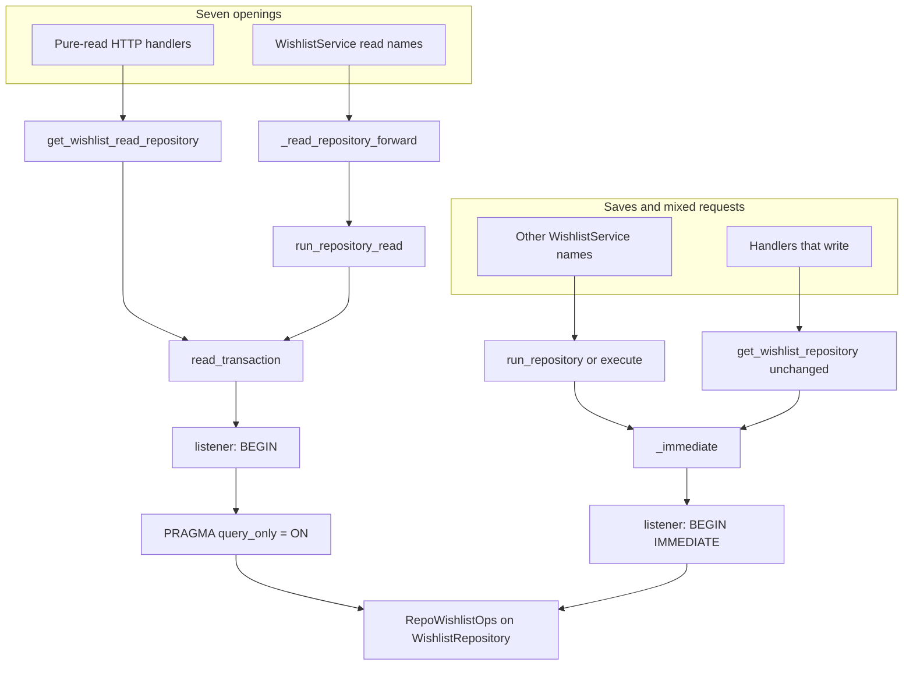

# WISHENKA-338: One-wishlist reads leave the save lock free

## Research

The seven openings already read one wishlist. Six of them no longer rewrite
it. All seven still take the exclusive lock a save takes. This task moves
only those openings onto the read-only transaction this store already has.
It does not add a lock, a wait, or a person-facing outcome.

### How this code chooses `BEGIN` or `BEGIN IMMEDIATE`

`configure_immediate_transactions` (`wishenka/sqlite.py`) sets
`isolation_level = None` on connect so the sqlite3 driver does not emit its
own `BEGIN`. The `begin` listener then applies `PRAGMA busy_timeout` and
opens the transaction:

- `execution_options(read_only=True)` emits plain `BEGIN`.
- Every other begin emits `BEGIN IMMEDIATE`.
- `isolation_level == "AUTOCOMMIT"` returns without a `BEGIN`, which is how
  `execute_read` resets `PRAGMA query_only` afterwards.

`read_only` is a flag this listener reads. It is not a SQLAlchemy isolation
level and it does not open the file with SQLite's `mode=ro` URI. The same
engine still serves saves. SQLAlchemy's SQLite documentation describes the
same shape this file already uses: the driver must not emit `BEGIN`, and
the `begin` event emits it
([SQLAlchemy SQLite dialect](https://docs.sqlalchemy.org/en/20/dialects/sqlite.html)).

SQLite's transaction rules
([BEGIN IMMEDIATE](https://sqlite.org/lang_transaction.html),
[WAL isolation](https://sqlite.org/isolation.html)):

- `BEGIN IMMEDIATE` starts a write transaction and takes the reserved lock
  at the start. A second `BEGIN IMMEDIATE` waits, then returns
  `SQLITE_BUSY` after `busy_timeout` (5000 ms here).
- Plain `BEGIN` is deferred. The first `SELECT` starts a read transaction.
  In WAL mode that read does not take the writer lock, and a writer does
  not block it. The reader sees the snapshot from when its read started.
- `PRAGMA query_only = ON` rejects `INSERT`, `UPDATE`, `DELETE`, and DDL
  with `SQLITE_READONLY`. `BEGIN IMMEDIATE` on that connection asks for a
  write transaction and is the wrong opener. The listener's plain `BEGIN`
  is the opener that belongs with `query_only`.

`tests/test_wishenka_254_execute_read_hardening_repro.py` already shows
`execute_read` returning the pre-write snapshot within 2 seconds while
another connection holds `BEGIN IMMEDIATE`.

### What `WishlistStore` does today

`execute_read` (`wishenka/wishlists/store.py`) is the read-only unit of
work:

1. `execution_options(read_only=True)`, so the listener emits `BEGIN`.
2. `PRAGMA query_only = ON` before the callback.
3. On `SQLITE_BUSY`, log `wishlist_read_busy` and raise `InventoryBusyError`.
4. In `finally`, roll back, then `PRAGMA query_only = OFF` on an
   `AUTOCOMMIT` connection. If that reset fails, log
   `wishlist_read_query_only_reset_failed` and `invalidate()` the
   connection.

It does not commit and it does not flush commit logs. Cabinet reads
(`get_user_reservations`, `get_user_reservations_summary`) already use it.
This task uses that helper. It does not copy `UserStore._read`
(WISHENKA-342), which sets `read_only` and does not set `query_only`.

`run_repository` wraps work in `_immediate`: `Connection.begin()` with no
`read_only` flag, so the listener emits `BEGIN IMMEDIATE`, then commit, then
`flush_commit_logs()`. Saves and the remaining shared names stay here.

`execute` / `_execute_once` also use `_immediate`. They hydrate one
wishlist when `wishlist_id` is set, run the domain call, then `_write()`.
`_write()` issues `UPDATE`s for the loaded rows.

### How the seven openings are dispatched

`WishlistService` (`wishenka/wishlists/service.py`) wraps public coroutines
at import time.

| Opening | Method | Wrapper today | Transaction today |
| --- | --- | --- | --- |
| One wishlist | `get_wishlist_by_id` | `_repository_forward` | `run_repository` / immediate |
| Detail | `get_wishlist_view` | `_repository_forward` | `run_repository` / immediate |
| Members | `get_members` | `_repository_forward` | `run_repository` / immediate |
| One wish | `get_wish_item` | `_repository_forward` | `run_repository` / immediate |
| Wish list | `list_wish_items` | `_repository_forward` | `run_repository` / immediate |
| Gifted wishes | `list_gifted_items` | `_repository_forward` | `run_repository` / immediate |
| Favorite mark | `is_favorite` | `_transactional` | `execute` / immediate + `_write()` |

The six shared names are in `_SHARED_REPOSITORY_METHODS`. Their service
bodies fail closed. The wrapper builds `RepoWishlistOps` inside
`run_repository`. Those bodies do not run, and `_write()` does not run.
The older note that every look rewrites the wishlist is not what these six
do now. They still reserve the save lock because `run_repository` begins
immediate.

`is_favorite` is the exception. It is one of three
`_SINGLE_WISHLIST_METHODS` (`update_wishlist_settings`,
`transfer_ownership`, `is_favorite`). The wrapper calls `execute`, which
hydrates that wishlist and then `_write()`s it. The method itself only
reads the hydrated favorite set. The rewrite is the wrapper, and the lock
is the same `BEGIN IMMEDIATE`. `RepoWishlistOps` has no `is_favorite`.
`WishlistRepository.is_favorite` is the `SELECT` the HTTP wishlist read
already uses.

`update_wishlist_settings` and `transfer_ownership` stay on `execute`.
They change the wishlist.

A save that calls `RepoWishlistOps.get_wishlist_by_id` does so on the
repository instance already bound to the write connection. The service
wrapper is not entered again. The transaction is chosen by the caller that
opened the connection, not by the method name inside `RepoWishlistOps`.

### Why the HTTP reads still take the lock

Screens do not call the service wrapper. They build `RepoWishlistOps` on
the request repository from `get_wishlist_repository`
(`wishenka/web/dependencies.py`). That dependency calls `conn.begin()`
with no `read_only` flag, so every request that uses it takes
`BEGIN IMMEDIATE`, including a request that only reads. On success it
commits and flushes commit logs. A busy `SQLAlchemyError` becomes
`InventoryBusyError` and `wishlist_inventory_busy` (WISHENKA-326). The
app handler turns that into HTTP 503 with the existing detail.

Changing only `_repository_forward` would leave those screens on the save
lock. Changing `get_wishlist_repository` would also change requests that
write. This task does not change that function.

### Which requests only read

These handlers perform one or more of the seven openings and do not write.
They are the screens that must stop using `WishlistRepo`:

- `GET /api/wishlists/{wishlist_id}` (`get_wishlist`), including
  `repo.is_favorite` in that same request.
- `GET /api/wishlists/{wishlist_id}/members` (`list_members`).
- `GET` wish list and `GET` one wish (`list_items`, `get_item`).
- `GET` gifted wishes (`list_gifted`).
- Detail page (`view_wishlist_detail`), including its gifted rows.
- Member partial (`get_members_partial`).
- Wish card (`get_item_card_partial`).
- Share modal (`get_share_modal`), new-wish modal (`get_new_item_modal`),
  edit modal (`get_edit_item_modal`), and archive confirm
  (`archive_confirm_ui`). Each only loads that one wishlist.
- Receipt open, edit, and cancel dialogs (`get_receipt_dialog`,
  `get_receipt_edit_dialog`, `get_receipt_cancel_dialog`). They only read.
  They keep passing the injected repository through `_repo_ctx`.

These stay on `get_wishlist_repository` because the request writes, or
because the opening is out of scope:

- Every create, update, archive, restore, delete, member change, token
  reset, favorite mark or unmark, and reorder.
- `POST` restore of a deleted wishlist, which reads `repo.is_favorite`
  after the save, inside the write transaction.
- Member removal, item archive, and item restore, which read the list
  again on the same write repository.
- `_nothing_remaining_response`, which receives that write repository.
- Public link and invite (`view_public_share`, invite preview, public API).
  The share page also records a view.
- The multi-wishlist reads: wishlist list, favorites list, history, and
  deleted wishlists.
- `receipts_ui._execute` when no repository was injected. That fallback
  still calls `get_wishlist_repository` (WISHENKA-324). This task does not
  change the fallback.

`UserStore` reads stay as they are (WISHENKA-342).

## Implementation Plan

One read path, reused. No new lock and no new HTTP sentence.

1. Turn the body of `execute_read` into an async context manager on
   `WishlistStore` (name it `read_transaction`). `execute_read` becomes
   `async with self.read_transaction() as conn: return await work(conn)`.
   Cabinet reads keep today's behavior: plain `BEGIN`, `query_only`,
   rollback, reset, busy mapping, and invalidation.
2. Add `run_repository_read`. It opens `read_transaction`, builds one
   `WishlistRepository`, runs the callback, and `clear_commit_logs()`
   before leaving. It does not commit and does not flush logs.
   `query_only` rejects a write. `run_repository` stays the write helper.
3. Add `RepoWishlistOps.is_favorite`. A missing person returns `False`
   without a query. Otherwise it returns `WishlistRepository.is_favorite`.
   It does not load or save the wishlist.
4. Add `_READ_REPOSITORY_METHODS` with the seven names. Remove those six
   from `_SHARED_REPOSITORY_METHODS`. Remove `is_favorite` from
   `_SINGLE_WISHLIST_METHODS`, leaving settings and ownership transfer.
   A new `_read_repository_forward` matches `_repository_forward` but
   calls `run_repository_read`. When `_store` is `None`, `is_favorite`
   still runs today's in-memory body. The other six still fail closed.
   When a store is set, `is_favorite` uses `RepoWishlistOps` and does not
   enter `execute` or `_write()`.
5. Add `get_wishlist_read_repository` beside `get_wishlist_repository`.
   It yields `WishlistRepository` inside `read_transaction`. It does not
   commit, flush logs, or map busy errors itself. `InventoryBusyError`
   from `read_transaction` propagates. Do not edit
   `get_wishlist_repository`.
6. Switch only the pure-read handlers listed above from `WishlistRepo` to
   the read dependency. Handlers that write keep `WishlistRepo`.

**Mandatory — Failing Repro (next Step 3):** Add
`tests/test_wishenka_338_read_openings_repro.py` with module
`pytestmark = pytest.mark.timeout(30)`. Use a file SQLite database under
`tmp_path` and two connections. No network and no external service.

Hold one connection in `BEGIN IMMEDIATE` with an uncommitted title change.
In one `asyncio.wait_for(..., timeout=2)` gather, call the seven
`WishlistService` methods for that wishlist. Desired behavior: each returns
within 2 seconds with the pre-write snapshot (same title, same members,
same wish order, same gifted rows, same favorite yes or no). A missing
wishlist still raises `WishlistNotFoundError`. A deleted wishlist still
raises `WishlistDeletedError`. A missing wish still raises
`ItemNotFoundError`. A non-member `get_members` and a non-author
`list_gifted_items` still raise `PermissionDeniedError`. A signed-out
`is_favorite` is `False`. After the reader returns, roll the writer back
and read the title from a new connection: it is the original title, so the
opening did not commit a rewrite.

The same hold, then `TestClient` `GET /api/wishlists/{id}` and
`GET` of the wish list, members, one wish, and gifted wishes, each bounded
by 2 seconds via `asyncio.to_thread` plus `asyncio.wait_for`. Desired
behavior: the same body and the same refusal status those routes return
when no save is in progress. The wishlist `GET` includes the same
`is_favorite` value.

A second test in that module holds the same lock and starts one save
(`add_wish_item` or `update_wishlist_settings`). Desired behavior: that
save does not finish within 2 seconds. This guard already passes and must
still pass after the fix.

Today the openings test is red: each opening uses `BEGIN IMMEDIATE` and
blocks until `busy_timeout` (5000 ms), so the 2 second bound raises
`TimeoutError`. Sequencing: this research, then that red test, then the
implementation until the openings return and the save still waits.

## Architecture

The repository methods stay transaction-agnostic. The caller that opens
the connection chooses the transaction. A pure read of one wishlist opens
`read_transaction`. A save, and any HTTP request that writes, opens
`BEGIN IMMEDIATE` and may call the same methods on that connection.



### Modules

- **`wishenka/sqlite.py`**: unchanged. The `begin` listener already emits
  `BEGIN` when `read_only` is set.
- **`WishlistStore.read_transaction`**: the existing `execute_read`
  lifecycle as a context manager. `execute_read` delegates to it. Cabinet
  reads stay on `execute_read`.
- **`WishlistStore.run_repository_read`**: one repository inside
  `read_transaction`. Clears commit logs. Does not commit or flush.
- **`WishlistStore.run_repository` / `execute` / `_immediate`**: unchanged.
  Settings, ownership transfer, members, wishes, archive, restore, delete,
  and marking or unmarking a favorite stay here.
- **`RepoWishlistOps`**: unchanged rule bodies for the six reads. New
  `is_favorite` is a yes-or-no `SELECT`, or `False` when the person is
  absent. Surprise projection, archived-wish filtering, member refusal,
  and gifted-author refusal stay in the methods that already implement
  them.
- **`WishlistService` dispatch**: the seven names use
  `_read_repository_forward`. Everything else keeps its current wrapper.
- **`get_wishlist_read_repository`**: request-scoped read repository.
  **`get_wishlist_repository`**: unchanged write repository, including its
  commit, log flush, and `wishlist_inventory_busy` mapping.
- **`UserStore`**: unchanged.

### Patterns

- **Repository.** `WishlistRepository` and `RepoWishlistOps` stay the rule
  set. They do not begin a transaction.
- **Unit of work chosen by the caller.** A read opening and a save can call
  `get_wishlist_by_id` on the same class. Only the opener differs. Putting
  `BEGIN` inside `RepoWishlistOps.get_wishlist_by_id` would split a save
  that loads the wishlist before writing. This design does not do that.
- **Existing deferred read.** Reuse `execute_read`'s `read_only` flag,
  `query_only`, rollback, and busy mapping. Do not add a second read
  helper and do not retarget `UserStore`.

### Interfaces

```text
WishlistStore.read_transaction() -> AsyncIterator[AsyncConnection]
WishlistStore.execute_read(work) -> T          # delegates to read_transaction
WishlistStore.run_repository_read(work) -> T   # work(WishlistRepository) -> T
WishlistStore.run_repository(work) -> T        # unchanged, BEGIN IMMEDIATE

get_wishlist_read_repository(store) -> AsyncIterator[WishlistRepository]
get_wishlist_repository(store) -> AsyncIterator[WishlistRepository]  # unchanged

RepoWishlistOps.is_favorite(user, wishlist_id) -> bool
```

`_READ_REPOSITORY_METHODS`:

`get_wishlist_by_id`, `get_wishlist_view`, `get_members`, `get_wish_item`,
`list_wish_items`, `list_gifted_items`, `is_favorite`.

Store-backed calls of those names go through `run_repository_read`. Calls
with no store keep today's fail-closed behavior, except `is_favorite`,
which keeps the in-memory answer.

### Lock and outcome

A pure read does not take the reserved lock. A concurrent save's
`BEGIN IMMEDIATE` does not wait behind it. The read sees the last commit.
It does not insert a favorite, a view, a member, a wish, or a receipt.
`query_only` makes a stray write fail inside the read, and the context
manager rolls back.

A request that still uses `get_wishlist_repository` still waits up to
5000 ms and still becomes `InventoryBusyError` / HTTP 503 with the
existing detail when the lock outlasts that wait. This task does not
change that wait or that sentence.

If a read hits `SQLITE_BUSY`, `read_transaction` keeps the existing
`wishlist_read_busy` warning and `InventoryBusyError`. That is the cabinet
read's outcome, not a new sentence. The read path does not add a Python
retry.

### Out of scope, unchanged

- `UserStore` reads and saves (WISHENKA-342).
- `get_wishlist_repository` and every handler that writes (WISHENKA-326).
- Public-link and invite openings.
- Favorites list, view history, recording a view, and deleted-wishlist
  list.
- `receipts_ui._execute` fallback to `get_wishlist_repository`.
- Snapshot `_write()` for settings and ownership transfer, and dirty
  tracking of unchanged rows (WISHENKA-339).

## Q&A

**Why not only change the service wrapper?** HTTP screens bind
`RepoWishlistOps` to `get_wishlist_repository`, which begins immediate
before the method runs. The wrapper never sees those calls. Both the
store-backed names and the pure-read handlers have to open
`read_transaction`.

**Why not set `read_only` on `get_wishlist_repository`?** That dependency
is the shared path for requests that write. WISHENKA-326 mapped its busy
outcome and left `BEGIN IMMEDIATE` in place. A request that writes keeps
it, including when the same request also loads the wishlist or the
favorite mark.

**Why does `is_favorite` leave `execute`?** The other six already avoid
`_write()`. `is_favorite` is still on `execute`, so a favorite question
still hydrates the wishlist and `_write()`s it under `BEGIN IMMEDIATE`.
The read transaction cannot update. The yes-or-no answer comes from the
existing `wl_favorites` `SELECT`. Marking and unmarking stay on
`run_repository`.

**Why is the favorite mark in the same read as the wishlist `GET`?** The
screen asks both questions while showing one wishlist. One
`read_transaction` covers both `SELECT`s. The mark is not a second write
transaction.

**Why can a save still call `get_wishlist_by_id`?** The save already holds
the write connection. `RepoWishlistOps` uses that connection. The read
forwarder runs only when the public service method is the caller and a
store is configured.
