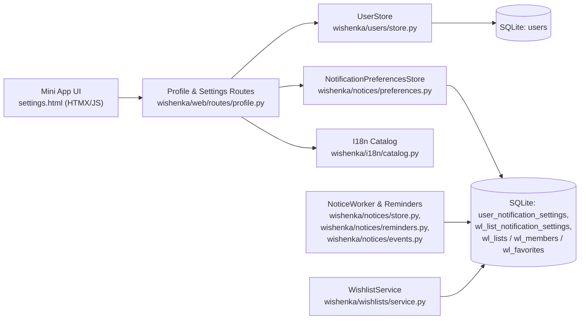

# WISHENKA-34: Настройки уведомлений и персональных предпочтений

## Research

В ходе анализа кодовой базы и проектных спецификаций (`in-docs/spec.md` §9, §10.2, `doc/dev/architecture.md`) выявлено текущее состояние подсистем:

1. **Таблицы настроек уведомлений уже созданы миграцией `add_notice_outbox` (`wishenka/wishlists/alembic/versions/add_notice_outbox.py`):**
   - `user_notification_settings(user_id, event_type, enabled, updated_at)` — глобальные настройки пользователя (ключ `user_id` хранит `Telegram ID`, что подтверждено в `wishenka/notices/events.py`, `wishenka/notices/store.py`, `wishenka/notices/reminders.py`, `wishenka/bot/entry.py`).
   - `wl_list_notification_settings(user_id, wishlist_id, event_type, enabled, updated_at)` — персональные переопределения по вишлисту с `ON DELETE CASCADE` на `wl_lists(id)`.
   - На текущий момент эти таблицы только читаются контуром доставки (`notices/store.py`, `notices/reminders.py`, `notices/events.py`, `wishlists/service.py`) и частично записываются только командой бота `/confirmations on|off` (`wishenka/bot/entry.py`) для `event_type = 'reservation_changes'`. Пользовательского API и UI в Mini App для управления настройками нет.

2. **Используемые в контуре доставки категории (`event_type`):**
   - `wishlist_changes` — изменения желаний и вишлистов (`item_created`, `item_updated`, `item_archived`, `item_restored`, `list_updated`, `list_archived`, `list_restored`, `membership_changed` в `wishenka/notices/reminders.py`).
   - `reservation_changes` — изменения бронирований и подтверждения (`reservation_changed`, `reservation_confirmation` в `wishenka/notices/events.py`, `wishenka/notices/reminders.py`, `wishenka/bot/entry.py`). Для `reservation_confirmation` требуется явный opt-in (`enabled = 1`).
   - `gift_received` — отметка о получении подарка (`wishenka/notices/models.py`, `wishenka/notices/store.py`, `wishenka/wishlists/service.py`, по умолчанию `1`).
   - `reminders` — напоминания о событиях вишлиста (`kind = 'list'` в `wishenka/notices/reminders.py`, по умолчанию `1`).
   - `birthday_reminders` — выделяемая категория уровня профиля для напоминаний о днях рождения (`kind = 'birthday'` в `wishenka/notices/reminders.py`). Сейчас `reminders.py` проверяет только `event_type = 'reminders'` для `list` и `birthday`. Добавление приоритетной проверки `birthday_reminders` с fallback на `reminders` и затем `1` позволяет независимо включать/отключать напоминания о днях рождения, не затрагивая напоминания по вишлистам и не удаляя записи `birthday_entries`.

3. **Профиль пользователя и настройки Mini App (`WISHENKA-33`):**
   - `wishenka/users/store.py` (`UserStore`) управляет таблицей `users` (включая `locale` и `locale_source IN ('auto', 'explicit')` с идемпотентным добавлением колонок в `initialize()`).
   - Поля даты рождения (`birth_day`, `birth_month`, `birth_year`, `birthdate_source`) в `users` и `UserRecord` пока отсутствуют.
   - `wishenka/web/routes/profile.py` и `wishenka/web/templates/settings.html` уже реализуют аутентифицированный экран `/settings` и `PATCH /api/profile/locale` с поддержкой HTMX, CSRF (`BrowserSecurityMiddleware`) и двуязычного каталога `wishenka/i18n/catalog.py` (`ru` / `en`).

4. **Идентификаторы пользователей в БД:**
   - `AuthenticatedUser.telegram_id` — внешний `Telegram ID`, используемый в `wl_lists.owner_id`, `wl_members.user_id`, `wl_favorites.user_id`, `user_notification_settings.user_id`, `wl_list_notification_settings.user_id`.
   - `AuthenticatedUser.user_id` — внутренний `users.id`, используемый в `birthday_entries.owner_id` и `bot_destinations.user_id`.

## Implementation Plan

1. **Слой данных профиля (`wishenka/users/models.py`, `wishenka/users/store.py`):**
   - Расширить `users` и `UserRecord` полями `birth_day: int | None`, `birth_month: int | None`, `birth_year: int | None`, `birthdate_source: Literal["auto", "explicit"] = "auto"`.
   - Добавить валидацию календарных дат (включая 29 февраля без года и запрет невалидных дат вроде 30 февраля) и методы `set_birthdate(...)` / `clear_birthdate(...)`, выставляющие `birthdate_source = 'explicit'`.
   - Защитить `upsert_user` от перезаписи или очистки даты рождения при `birthdate_source = 'explicit'`.

2. **Сервис/хранилище настроек уведомлений (`wishenka/notices/preferences.py` + `wishenka/notices/reminders.py`):**
   - Выделить чистый асинхронный репозиторий/сервис `NotificationPreferencesStore` (работающий поверх `WishlistStore.engine`) для чтения/записи глобальных настроек (`user_notification_settings`), персональных переопределений по вишлистам (`wl_list_notification_settings`), вычисления эффективного статуса и проверки прав доступа к вишлисту (владелец, участник или избранное для неудалённого списка).
   - Обновить `wishenka/notices/reminders.py` (`refresh_reminder` и `claim_reminder`), чтобы для `kind == "birthday"` приоритетно проверялась настройка `birthday_reminders` (с fallback на `reminders`, затем `1`).

3. **Web API и UI настроек (`wishenka/web/routes/profile.py`, `wishenka/web/templates/settings.html`, `wishenka/i18n/catalog.py`):**
   - Добавить эндпоинты:
     - `GET /api/profile/preferences`
     - `PATCH /api/profile/birthdate`
     - `PUT /api/profile/notifications/global`
     - `GET /api/profile/notifications/wishlists/{wishlist_id}`
     - `PUT /api/profile/notifications/wishlists/{wishlist_id}`
   - Расширить `GET /settings` и шаблон `settings.html` секциями: персональные предпочтения (дата рождения), напоминания о днях рождения, глобальные переключатели уведомлений и список доступных вишлистов с управлением переопределениями («Включено» / «Отключено» / «Как в общих») и индикацией итогового статуса.
   - Добавить все ключи локализации `ru` и `en` в `wishenka/i18n/catalog.py`.

**Mandatory — Failing Repro (next Step 3):**
- **Где разместить:** `tests/test_wishenka_34_repro.py` (с обязательным `@pytest.mark.timeout(...)` согласно `do-testing`).
- **Что проверяет red-тест (желаемое поведение до написания production-кода):**
  1. Аутентифицированный запрос `GET /api/profile/preferences` и `PUT /api/profile/notifications/global` возвращает `200` (сейчас `404`, так как эндпоинты отсутствуют).
  2. Персональное переопределение для вишлиста (`PUT /api/profile/notifications/wishlists/{id}`) имеет приоритет над глобальной настройкой профиля, а сброс (`null`) возвращает эффективное значение к глобальному; запрос к недоступному вишлисту отклоняется (`404`).
  3. Отключение `birthday_reminders` подавляет доставку уже поставленного в `reminder_outbox` напоминания о ДР (`claim_reminder` возвращает `None`, `refresh_reminder` переводит в `skipped`), сохраняя запись в `birthday_entries`.
  4. Ручное указание и очистка даты рождения (`PATCH /api/profile/birthdate`) сохраняет `birthdate_source = 'explicit'` и не перезаписывается последующим вызовом `UserStore.upsert_user(...)`, а некорректная дата (`30 февраля`) отклоняется с `422`.
  5. Инвариант тайны сюрприза: при включённых глобальных и списочных настройках получатель подарка не получает уведомлений/драфтов о бронированиях и получении своего желания.
- **Изоляция без внешних зависимостей:** все тесты используют локальную временную SQLite БД (`sqlite+aiosqlite:///...`), `TestClient`/`AsyncClient` FastAPI с тестовой сессией и мок-отправитель уведомлений (без сети и Telegram Bot API).
- **Последовательность:** исследование (выполнено) → написание и проверка падения `tests/test_wishenka_34_repro.py` (Шаг 3) → реализация изменений до зелёного прохождения всех тестов (Шаг 4).

## Architecture

### Системная диаграмма модулей

### Описание модулей и их ответственности

1. **`wishenka/users/models.py` & `wishenka/users/store.py` (Профиль и дата рождения):**
   - Хранит персональные предпочтения профиля (`locale`, `locale_source`, `birth_day`, `birth_month`, `birth_year`, `birthdate_source`).
   - Валидирует дату рождения и гарантирует безусловный приоритет ручного ввода/очистки (`birthdate_source = 'explicit'`) над последующей синхронизацией с Telegram (`upsert_user` / `upsert_from_bot`).

2. **`wishenka/notices/preferences.py` (Управление предпочтениями уведомлений):**
   - Инкапсулирует поддерживаемые категории:
     - Глобальные: `wishlist_changes` (default `True`), `reservation_changes` (default `False`), `gift_received` (default `True`), `reminders` (default `True`), `birthday_reminders` (default `True`).
     - По вишлисту: `wishlist_changes`, `reservation_changes`, `gift_received`, `reminders` (состояние `True` / `False` / `None` = наследовать глобальную).
   - Проверяет доступность вишлиста для `telegram_id` (неудалённый список, где пользователь — `owner_id`, участник `wl_members` или в `wl_favorites`).
   - Вычисляет эффективную политику: `override (list)` → `global (user)` → `default`.

3. **`wishenka/notices/reminders.py` (Контур проверки перед доставкой):**
   - При `refresh_reminder` и `claim_reminder` для `kind == "birthday"` проверяет `birthday_reminders` с fallback на `reminders` и `1`.
   - При отключении `birthday_reminders` уже поставленные в `reminder_outbox` напоминания подавляются/пропускаются без удаления записей из `birthday_entries`.
   - Инвариант тайны сюрприза (`recipient_user_id <> user` и запрет владельцу несовместного списка) остаётся жёстко зафиксированным до и независимо от настроек уведомлений.

4. **`wishenka/web/routes/profile.py` & `wishenka/web/templates/settings.html` & `wishenka/i18n/catalog.py` (Presentation & API):**
   - Предоставляет HTML-экран `/settings` и JSON/HTMX API `/api/profile/*` под защитой `get_current_user` и `BrowserSecurityMiddleware`.
   - Полная двуязычная поддержка (`ru` / `en`).

### Выбранные архитектурные паттерны и обоснование

- **Repository / Store Pattern (`UserStore`, `NotificationPreferencesStore`):** отделяет SQL-логику и транзакционную работу со SQLite WAL от HTTP-роутов FastAPI, упрощая модульное и интеграционное тестирование.
- **Single Source of Truth в БД:** UI и API пишут напрямую в `user_notification_settings`, `wl_list_notification_settings` и `users`, которые читаются `NoticeStore`, `ReminderScheduler`/`reminders.py`, `EventProducer` и `WishlistService` без промежуточного кэша, обеспечивая немедленную консистентность (NFR-2).
- **Fail-Closed Authorization & Surprise Invariant:** доступ к настройкам вишлиста проверяется явно по роли пользователя в списке; тайна сюрприза проверяется на уровне домена и SQL-предикатов доставки независимо от пользовательских переключателей.

### Основные интерфейсы и контракты

1. **Схема БД (`users`):**
   - Новые nullable-колонки: `birth_day INTEGER`, `birth_month INTEGER`, `birth_year INTEGER`, `birthdate_source TEXT NOT NULL DEFAULT 'auto' CHECK (birthdate_source IN ('auto', 'explicit'))`.
   - Добавляются идемпотентно в `UserStore.initialize()` по аналогии с `locale` и `locale_source`.

2. **API эндпоинты (`wishenka/web/routes/profile.py`):**
   - `GET /api/profile/preferences` → `{locale, locale_source, birthdate: {day, month, year, source}, birthday_reminders: bool, global_notifications: dict[str, bool], wishlists: list[{id, title, role, overrides: dict[str, bool | None], effective: dict[str, {enabled: bool, source: str}]}]}`.
   - `PATCH /api/profile/birthdate` → тело `{day: int | null, month: int | null, year: int | null, clear?: bool}` → `200` с обновлённым `birthdate` или `422` при невалидной дате.
   - `PUT /api/profile/notifications/global` → тело `{settings: dict[str, bool]}` → `200` с актуальными глобальными настройками или `422` при неизвестной категории/небулевом значении.
   - `GET /api/profile/notifications/wishlists/{wishlist_id}` → `200` с `overrides` и `effective` или `404` для недоступного/несуществующего списка.
   - `PUT /api/profile/notifications/wishlists/{wishlist_id}` → тело `{overrides: dict[str, bool | null]}` (`null` удаляет переопределение и сбрасывает к глобальной настройке) → `200` или `404`/`422`.

## Q&A

- **Как соотносится настройка `birthday_reminders` с существующей категорией `reminders`?**
  Для `kind == "birthday"` в `wishenka/notices/reminders.py` используется `COALESCE(birthday_reminders, reminders, 1)`: явный переключатель напоминаний о ДР имеет приоритет, а при его отсутствии наследуется глобальная настройка `reminders` (по умолчанию `1`). Для напоминаний о событиях вишлиста (`kind == "list"`) продолжает действовать `reminders` (с учётом `wl_list_notification_settings`).
- **Почему `NotificationPreferencesStore` работает с `telegram_id`, а не внутренним `users.id`?**
  Все существующие таблицы вишлистов (`wl_lists`, `wl_members`, `wl_favorites`) и настроек уведомлений (`user_notification_settings`, `wl_list_notification_settings`) уже используют `Telegram ID` в качестве `user_id`, что гарантирует совместимость с `notices/store.py`, `notices/events.py`, `notices/reminders.py` и `bot/entry.py`.
