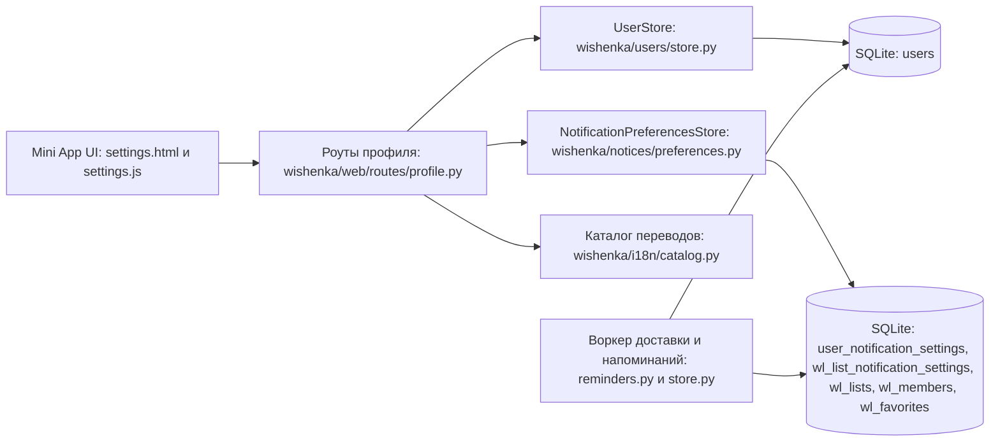

# Спецификация: WISHENKA-34 — Настройки уведомлений и персональных предпочтений

**Задача:** WISHENKA-34 (эпик WISHENKA-31)  
**Статус:** реализовано  
**Платформы:** Telegram Mini App + Telegram Bot  
**Язык реализации:** Python (FastAPI, SQLite WAL, Jinja2, HTML/JS для Mini App)  
**Связанные спецификации:** `in-docs/spec.md` (§9, §10.2), `specs/00-high.md`, `doc/dev/users.md`, `doc/dev/notifications.md`

---

## 1. Назначение и бизнес-цель

### 1.1. Проблема и контекст

До выполнения задачи `WISHENKA-34` в сервисе «Вишенка» уже были реализованы базовая подсистема доставки уведомлений и напоминаний (`WISHENKA-29`), модель профиля и приватности (`WISHENKA-32`), а также экран настроек Mini App с переключением языка `RU` / `EN` (`WISHENKA-33`). Таблицы `user_notification_settings` и `wl_list_notification_settings` уже присутствовали в схеме БД (миграция `add_notice_outbox`), однако использовались контуром доставки в основном в режиме чтения; единственной точкой записи служила команда бота `/reservation_confirmations on|off` для категории `reservation_changes`.

В результате у пользователя отсутствовали:

- графический интерфейс и API в Telegram Mini App для управления глобальными категориями уведомлений;
- механизм индивидуального переопределения правил уведомлений для отдельных вишлистов и сброса к общему правилу профиля;
- отдельный переключатель напоминаний о днях рождения без необходимости вручную удалять отслеживаемые записи;
- управление персональными предпочтениями профиля в настройках Mini App, включая ручное указание и очистку даты рождения с приоритетом над автоматической синхронизацией из Telegram.

### 1.2. Цели и ценность для пользователей и системы

1. **Защита от информационного шума:** пользователь самостоятельно выбирает на уровне профиля, какие категории событий ему интересны, сокращая лишние сообщения от Telegram-бота.
2. **Точечное управление по вишлистам:** участник, владелец или даритель может заглушить шумный совместный список или, наоборот, включить все уведомления по важному вишлисту с гарантированным приоритетом списочного правила над глобальным и явной индикацией итогового статуса (`override` / `global` / `default`).
3. **Осознанный контроль напоминаний о днях рождения:** отдельный переключатель `birthday_reminders` позволяет в один шаг отключать и повторно включать доставку напоминаний о днях рождения без потери сохранённых записей в `birthday_entries` и без влияния на напоминания о датах вишлистов.
4. **Контроль персональных данных профиля:** ручное задание даты рождения (полной или без года) и её явная очистка имеют безусловный приоритет (`birthdate_source = 'explicit'`) над синхронизацией профиля с Telegram в едином двуязычном интерфейсе (`ru` / `en`).
5. **Единый источник истины:** настройки, сохранённые в Mini App, напрямую записываются в SQLite без промежуточного кэша и немедленно учитываются воркерами доставки перед отправкой сообщений.

### 1.3. Границы решения (Scope)

**Входит в состав реализации:**

- расширение профиля `users` / `UserRecord` полями даты рождения и признаком источника (`birth_day`, `birth_month`, `birth_year`, `birthdate_source`);
- сервис-репозиторий `NotificationPreferencesStore` для глобальных и списочных настроек, проверки доступа и вычисления эффективного статуса;
- приоритетная проверка `birthday_reminders` с fallback на `reminders` в контуре доставки `wishenka/notices/reminders.py`;
- HTTP API `/api/profile/preferences`, `/api/profile/birthdate`, `/api/profile/notifications/global`, `/api/profile/notifications/wishlists/{wishlist_id}` и расширение страницы `/settings` (`settings.html` / `settings.js`, переводы `ru` / `en`).

**Не входит в рамки задачи (Non-Goals):**

- удаление аккаунта и каскадная очистка данных (`WISHENKA-35`);
- перевод экранов карточек и списков Mini App за пределами раздела настроек (`WISHENKA-73`, `WISHENKA-89`);
- добавление новых каналов доставки (email, SMS, внешние push) и новых категорий событий сверх модели `in-docs/spec.md` §9;
- настройка «тихих часов», частоты или пользовательских сроков заблаговременности напоминаний;
- автоматическая синхронизация `avatar_url` и `ChatFullInfo.birthdate` из Telegram (оставлены как будущие улучшения профиля).

---

## 2. Функциональные требования и пользовательские сценарии

### 2.1. Пользовательские сценарии

- **US-1 (Глобальные переключатели уведомлений):** Пользователь открывает настройки Mini App, видит поддерживаемые категории уведомлений и включает или отключает каждую из них для всего профиля.
- **US-2 (Персональные настройки для отдельного вишлиста):** Владелец, участник или даритель (добавивший список в избранное) задаёт для конкретного вишлиста явное разрешение, запрет или сброс к общему правилу профиля.
- **US-3 (Понимание итогового статуса):** На карточке настроек вишлиста пользователь видит фактический итоговый статус по каждой категории и понимает, действует ли глобальное правило или индивидуальное переопределение.
- **US-4 (Управление напоминаниями о днях рождения):** Пользователь отключает или повторно включает напоминания о днях рождения в Mini App; при отключении уже запланированные напоминания не приходят, но сохранённые записи дней рождения остаются нетронутыми.
- **US-5 (Управление датой рождения в профиле):** Пользователь вручную указывает полную дату (`день`, `месяц`, `год`) или дату без года (`день`, `месяц`), изменяет либо очищает её; последующие входы через Telegram не перезаписывают и не восстанавливают вручную изменённую дату.
- **US-6 (Сохранение тайны сюрприза):** Получатель подарка даже при включённых глобальных и списочных настройках не получает уведомлений о бронированиях, покупках и получении подарков по своим желаниям.

### 2.2. Категории уведомлений и модель приоритета

Поддерживаются следующие категории (`event_type`):

| Категория (`event_type`) | Уровень настройки | Значение по умолчанию | Охватываемые события и поведение |
| --- | --- | --- | --- |
| `wishlist_changes` | Глобально и по вишлисту | Включено (`True`) | Изменения желаний и списков (`item_created`, `item_updated`, `item_archived`, `item_restored`, `list_updated`, `list_archived`, `list_restored`, `membership_changed`, `item_quantity_overbooked`) |
| `reservation_changes` | Глобально и по вишлисту | Отключено (`False`, opt-in) | Собственные подтверждения действий с бронью (`reservation_confirmation`); устаревший тип `reservation_changed` безусловно блокируется |
| `gift_received` | Глобально и по вишлисту | Включено (`True`) | Отметки о получении подарка и корректировки (`gift_received`, `receipt_increased`, `receipt_reverted`) |
| `reminders` | Глобально и по вишлисту | Включено (`True`) | Напоминания о приближающихся событиях вишлистов (`kind = 'list'`); служит fallback для напоминаний о ДР |
| `birthday_reminders` | Только глобально | Включено (`True`) | Напоминания о частных записях дней рождения (`kind = 'birthday'` в `reminder_outbox`) |

**Правило вычисления эффективной настройки для вишлиста:**

1. Если для пары `(telegram_id, wishlist_id, category)` существует строка в `wl_list_notification_settings` — используется её значение (`source = "override"`).
2. Иначе, если для `(telegram_id, category)` существует строка в `user_notification_settings` — используется она (`source = "global"`).
3. Иначе применяется значение из `GLOBAL_NOTIFICATION_DEFAULTS` (`source = "default"`).

**Правило вычисления настройки для напоминаний о днях рождения (`kind == "birthday"`):**

- Читается выражение `COALESCE(birthday_reminders, reminders)` из `user_notification_settings` (при отсутствии обеих записей по умолчанию принимается `1` — разрешено).
- Настройка `birthday_reminders = False` подавляет напоминания о ДР, не отключая напоминания о датах вишлистов (`reminders`).
- Настройка `birthday_reminders = True` разрешает напоминания о ДР даже при отключённой глобальной категории `reminders = False`.

### 2.3. Функциональные требования, входы и выходы

- **FR-1 (Просмотр настроек и предпочтений):** Аутентифицированный пользователь на странице `/settings` и через `GET /api/profile/preferences` получает текущие `locale`, `locale_source`, `birthdate` (`day`, `month`, `year`, `source`), флаг `birthday_reminders`, карту `global_notifications` по всем пяти категориям и перечень доступных (неудалённых) вишлистов с `overrides` и вычисленными значениями `effective`.
- **FR-2 (Управление глобальными переключателями):** Через `PUT /api/profile/notifications/global` пользователь передаёт словарь `{settings: {<category>: <bool>}}` (частичное или полное обновление поддерживаемых глобальных категорий).
  - *Ограничения входа:* тело должно быть непустым JSON-объектом, ключи — только из `GLOBAL_NOTIFICATION_DEFAULTS`, значения — строго булевы (`bool`). Нарушения отклоняются с `422` без изменения сохранённых значений.
- **FR-3 (Персональные настройки вишлиста):** Через `GET/PUT /api/profile/notifications/wishlists/{wishlist_id}` пользователь управляет переопределениями `{overrides: {<category>: true | false | null}}` для конкретного списка.
  - *Допустимые списки:* только вишлисты со статусом `'active'` или `'archived'`, к которым у пользователя есть доступ как у владельца (`owner_id`), участника (`wl_members`) или через избранное (`wl_favorites`).
  - *Сброс:* передача `null` удаляет строку из `wl_list_notification_settings`, возвращая категорию к наследованию глобальной настройки.
  - *Отказы:* попытка чтения или записи настроек несуществующего, удалённого или недоступного пользователю вишлиста возвращает `404`; невалидный payload или категория — `422`. Изменение одного списка не затрагивает остальные.
- **FR-4 (Приоритет списочных переопределений):** И при формировании ответа API/UI, и в контуре доставки (`wishenka/notices/reminders.py`, `wishenka/notices/store.py`, `wishenka/notices/events.py`) переопределение в `wl_list_notification_settings` имеет безусловный приоритет над `user_notification_settings`.
- **FR-5 (Управление напоминаниями о днях рождения):** Переключение `birthday_reminders` немедленно влияет на обработку очереди `reminder_outbox`. Если к моменту выборки (`claim_reminder`) или повторной проверки перед отправкой (`refresh_reminder`) для пользователя действует запрет (`0`), уже поставленное в очередь напоминание не отправляется (`status = 'skipped'` на этапе `claim`, возврат `None` на этапе `refresh`), а записи в `birthday_entries` и дата рождения в `users` полностью сохраняются. Повторное включение разрешает доставку будущих напоминаний.
- **FR-6 (Дата рождения в профиле и её валидация):** Через `PATCH /api/profile/birthdate` пользователь может:
  - задать полную дату `{day, month, year}` или дату без года `{day, month, year: null}`;
  - явно очистить дату `{clear: true}`.
  - *Правила валидации (`validate_birthdate`):* `day` и `month` обязательны (целые числа, не `bool`); `year` может быть `null` либо целым числом (не `bool`) в диапазоне `1900 .. current_utc_year`. Календарная дата проверяется через `datetime.date(year or 2000, month, day)`: дата `29 февраля` без года допустима (в невисокосные годы планировщик обрабатывает её как `28 февраля`), а календарно невозможные даты (`30 февраля`, `29 февраля 2023`, `31 апреля`) отклоняются с `422`.
  - *Приоритет источника:* операции `set_birthdate` и `clear_birthdate` фиксируют `birthdate_source = 'explicit'`. Последующие вызовы `UserStore.upsert_user` и `UserStore.upsert_from_bot` не перезаписывают и не очищают дату рождения.
- **FR-7 (Тайна сюрприза и изоляция данных):** Настройки уведомлений никогда не переопределяют проверку роли получателя подарка. Запрос и изменение настроек разрешены только аутентифицированному владельцу профиля.

### 2.4. Ключевые инварианты

1. **Абсолютный приоритет тайны сюрприза:** проверка `recipient_user_id <> user` и запрет владельцу несовместного списка (`is_collaborative = 0`) в `_event_authorized`, `claim_reminder`, `refresh_reminder` и `NoticeStore` выполняются безусловно; ни одна комбинация настроек не раскрывает получателю факт бронирования, покупки или получения подарка.
2. **Иерархия предпочтений:** для событий с `list_id` действует `override (список) > global (профиль) > default`; для `kind == "birthday"` действует `birthday_reminders > reminders > default (1)`.
3. **Безусловный приоритет ручного ввода даты рождения:** при `birthdate_source = 'explicit'` повторный вход в Mini App или обращение к боту не изменяют и не восстанавливают `birth_day`, `birth_month`, `birth_year`.
4. **Неразрушающее отключение напоминаний:** отключение `birthday_reminders` влияет только на доставку из `reminder_outbox` и не удаляет данные `birthday_entries`.
5. **Отказоустойчивое сокрытие чужих списков (fail-closed):** для недоступного или удалённого вишлиста API всегда возвращает `404` без раскрытия заголовка, роли или состава настроек.

---

## 3. Архитектура, компоненты и интерфейсы

### 3.1. Диаграмма взаимодействия компонентов



### 3.2. Модули, классы и функции

| Модуль | Основные сущности и функции | Назначение |
| --- | --- | --- |
| `wishenka/users/models.py` | `BirthdateSource`, `UserRecord` | Доменная модель профиля с полями `birth_day`, `birth_month`, `birth_year`, `birthdate_source` (`'auto'` \| `'explicit'`) |
| `wishenka/users/store.py` | `validate_birthdate`, `UserNotFoundError`, `UserStore` (`initialize`, `upsert_user`, `upsert_from_bot`, `set_birthdate`, `clear_birthdate`) | Идемпотентная миграция схемы `users`, валидация календарных дат, сохранение/очистка даты с `birthdate_source = 'explicit'` и защитой от перезаписи в `upsert_user` |
| `wishenka/notices/preferences.py` | `GLOBAL_NOTIFICATION_DEFAULTS`, `WISHLIST_NOTIFICATION_CATEGORIES`, `EffectiveSetting`, `WishlistNotificationSummary`, `_resolve_effective`, `NotificationPreferencesStore` | Асинхронный репозиторий для чтения/записи `user_notification_settings` и `wl_list_notification_settings`, проверки доступа к вишлистам и расчёта итоговых настроек |
| `wishenka/notices/reminders.py` | `_event_category`, `_event_authorized`, `_read_user_setting`, `claim_reminder`, `refresh_reminder`, `settle_reminder` | Двухфазная проверка прав, тайны сюрприза и актуальных настроек (включая приоритет `birthday_reminders` над `reminders`) перед отправкой в Telegram |
| `wishenka/web/routes/profile.py` | `_get_preferences_store`, `_serialize_birthdate`, `_read_json_dict`, `settings_page`, `get_profile_preferences`, `update_profile_birthdate`, `update_global_notifications`, `get_wishlist_notifications`, `update_wishlist_notifications` | HTML-страница `/settings` и JSON-эндпоинты `/api/profile/*` под защитой `get_current_user` и CSRF |
| `wishenka/web/templates/settings.html`, `wishenka/web/static/settings.js`, `wishenka/i18n/catalog.py` | Форма даты рождения, тумблер `birthday_reminders`, глобальные чекбоксы, карточки переопределений вишлистов, ключи `settings.*` (`ru`/`en`) | Двуязычный клиентский интерфейс настроек (при первоначальной реализации `WISHENKA-34` скрипт находился inline в `settings.html`, в актуальной кодовой базе вынесен в `settings.js`) |

**Методы `NotificationPreferencesStore` (`wishenka/notices/preferences.py`):**

- `get_global_settings(telegram_id: int) -> dict[str, bool]` — объединяет строки `user_notification_settings` со значениями `GLOBAL_NOTIFICATION_DEFAULTS`.
- `update_global_settings(telegram_id: int, settings: dict[str, object]) -> dict[str, bool]` — валидирует и выполняет upsert в `user_notification_settings`, возвращая полный актуальный словарь глобальных настроек.
- `list_accessible_wishlists_with_preferences(telegram_id: int) -> list[WishlistNotificationSummary]` — выбирает доступные неудалённые вишлисты (`active` / `archived`, отсортированные по `id ASC`) с ролями (`owner` / `member` / `favorite`), переопределениями и вычисленными `effective`.
- `get_wishlist_preferences(telegram_id: int, wishlist_id: int) -> WishlistNotificationSummary | None` — возвращает сводку по одному доступному вишлисту или `None`.
- `update_wishlist_overrides(telegram_id: int, wishlist_id: int, overrides: dict[str, object]) -> WishlistNotificationSummary | None` — валидирует категории и значения (`bool | None`), для `None` удаляет строку из `wl_list_notification_settings`, для `bool` выполняет upsert, для недоступного списка возвращает `None`.

### 3.3. Разделение идентификаторов пользователей

В базе данных SQLite WAL сосуществуют два пользовательских ключа, которые учитываются во всех запросах подсистемы:

- **`users.telegram_id` (`AuthenticatedUser.telegram_id`):** используется в `wl_lists.owner_id`, `wl_members.user_id`, `wl_favorites.user_id`, `user_notification_settings.user_id`, `wl_list_notification_settings.user_id`, `reminder_outbox.user_id` и `notification_outbox.giver_user_id`.
- **`users.id` (`AuthenticatedUser.user_id`):** внутренний суррогатный ключ, используемый в `birthday_entries.owner_id` и `bot_destinations.user_id` (связывается с `telegram_id` через `JOIN users`).

### 3.4. Контракты данных

#### Схема таблицы `users` (расширение `WISHENKA-34`)

В `UserStore.initialize()` таблица `users` создаётся и при необходимости идемпотентно дополняется через `PRAGMA table_info(users)` следующими колонками:

```sql
birth_day INTEGER,
birth_month INTEGER,
birth_year INTEGER,
birthdate_source TEXT NOT NULL DEFAULT 'auto'
    CHECK (birthdate_source IN ('auto', 'explicit'))
```

Таблицы `user_notification_settings(user_id, event_type, enabled, updated_at)` и `wl_list_notification_settings(user_id, wishlist_id, event_type, enabled, updated_at)` (с `ON DELETE CASCADE` на `wl_lists(id)`) используются без изменения DDL.

#### Контракты HTTP API (`wishenka/web/routes/profile.py`)

| Метод и путь | Тело запроса | Успешный ответ (`200`) | Коды ошибок |
| --- | --- | --- | --- |
| `GET /settings` | — | HTML-страница `settings.html` на языке `locale` с формой даты рождения, глобальными и списочными настройками | `401` |
| `GET /api/profile/preferences` | — | `{"locale", "locale_source", "birthdate": {"day", "month", "year", "source"}, "birthday_reminders": bool, "global_notifications": {...}, "wishlists": [{"id", "title", "role", "overrides", "effective": {<cat>: {"enabled", "source"}}}]}` | `401` |
| `PATCH /api/profile/birthdate` | `{"day": int, "month": int, "year": int \| null}` или `{"clear": true}` | `{"day": int \| null, "month": int \| null, "year": int \| null, "source": "explicit"}` | `401`, `404`, `422` |
| `PUT /api/profile/notifications/global` | `{"settings": {<cat>: bool}}` | `{"global_notifications": {...}, "birthday_reminders": bool}` | `401`, `422` |
| `GET /api/profile/notifications/wishlists/{wishlist_id}` | — | `{"id", "title", "role", "overrides", "effective"}` | `401`, `404` |
| `PUT /api/profile/notifications/wishlists/{wishlist_id}` | `{"overrides": {<cat>: bool \| null}}` | `{"id", "title", "role", "overrides", "effective"}` | `401`, `404`, `422` |

### 3.5. Переходы состояний

1. **Источник даты рождения (`birthdate_source`):**
   - Исходно при создании профиля через Telegram: `birthdate_source = 'auto'`.
   - При вызове `PATCH /api/profile/birthdate` (`set_birthdate` или `clear_birthdate`): переход в `birthdate_source = 'explicit'`. Обратный переход в `'auto'` через стандартные операции синхронизации (`upsert_user`, `upsert_from_bot`) заблокирован.
2. **Переопределение категории для вишлиста:**
   - Наследование (`overrides[cat] = None`, строка в `wl_list_notification_settings` отсутствует) → при передаче `true` или `false` создаётся/обновляется запись (`effective[cat].source = "override"`).
   - Явное переопределение (`true` / `false`) → при передаче `null` запись удаляется из `wl_list_notification_settings`, а `effective[cat].source` возвращается к `"global"` или `"default"`.
3. **Очередь отложенных напоминаний (`reminder_outbox`):**
   - `pending` → `skipped`: если при `claim_reminder` эффективная настройка равна `0` (включая `birthday_reminders = 0`), статус `reservation_confirmation` не равен `1` или не пройдена авторизация события.
   - `sending` → подавление отправки: если между `claim_reminder` и `refresh_reminder` пользователь отключил категорию (или `birthday_reminders`), `refresh_reminder` возвращает `None`, предотвращая вызов `NoticeSender`.

---

## 4. Нефункциональные требования, безопасность и наблюдаемость

### 4.1. Безопасность и разграничение доступа

- **Аутентификация и CSRF:** все маршруты `/settings` и `/api/profile/*` требуют валидной сессии (`Depends(get_current_user)`, без сессии возвращается `401`); мутирующие запросы защищены механизмом CSRF (`BrowserSecurityMiddleware`, заголовок `X-CSRF-Token` в `settings.js`).
- **Привязка к субъекту:** все операции чтения и записи настроек используют исключительно `current_user.telegram_id` из проверенных клеймов сессии; передача чужого `user_id` через URL или тело запроса невозможна.
- **Авторизация по вишлисту:** `_fetch_accessible_wishlist_meta` допускает доступ только к спискам со статусом `'active'` или `'archived'`, где пользователь является `owner_id`, состоит в `wl_members` или имеет запись в `wl_favorites`. Посторонние пользователи и удалённые списки получают единообразный ответ `404`.
- **Защита от SQL-инъекций:** используются исключительно параметризованные SQL-выражения (`sqlalchemy.text`) со связываемыми параметрами; на движке `UserStore` включён `hide_parameters=True`.

### 4.2. Приватность данных и локализация

- **Отсутствие PII в новых логах:** поля `extra` в `NotificationPreferencesStore`, профильных роутах `profile.py` и методах `set_birthdate` / `clear_birthdate` не содержат `telegram_id` (логируется только внутренний `user_id`), значений дня/месяца/года рождения (передаётся только флаг `has_year: bool`) или пользовательских текстов.
- **Двуязычный интерфейс (`ru` / `en`):** все подписи UI, названия категорий, состояния (`Включено` / `Отключено` / `Как в общих` и английские аналоги) и тексты ошибок (`settings.invalid_birthdate`, `settings.invalid_notification_setting`, `settings.wishlist_not_found`) локализованы в `wishenka/i18n/catalog.py`.

### 4.3. Производительность, ограничения и консистентность

- **Режим БД:** SQLite WAL (`PRAGMA journal_mode=WAL`, `PRAGMA foreign_keys=ON`, `PRAGMA busy_timeout=5000`); воркеры доставки и веб-API разделяют одну БД без кэширования настроек в памяти.
- **Задержка вступления изменений в силу:** немедленная для всех новых и ещё не отправленных событий благодаря повторной проверке внутри транзакции `BEGIN IMMEDIATE` на шагах `claim_reminder` и `refresh_reminder`.
- **Границы масштабирования:** `update_global_settings` и `update_wishlist_overrides` выполняют не более 4–5 операторов записи внутри одной транзакции; в `list_accessible_wishlists_with_preferences` присутствует известный паттерн N+1 запросов по числу доступных вишлистов пользователя (см. раздел 5.3).

### 4.4. Наблюдаемость: структурированное логирование и метрики

Логирование реализовано через `wishenka/logging.py` (`JsonFormatter`) с передачей плоских скалярных полей (`str`, `int`, `bool`) в `extra`. Отдельный сборщик метрик (Prometheus / StatsD) в проекте не применяется — мониторинг и агрегация опираются на поле `event` в структурированных JSON-логах.

| Уровень | Событие (`event`) | Модуль / функция | Контекстные поля (`extra`) | Назначение |
| --- | --- | --- | --- | --- |
| `WARNING` | `profile_malformed_json` | `profile.py` (`_read_json_dict`) | `status_code=422` | Некорректный JSON или не-объект в теле запроса |
| `WARNING` | `birthdate_invalid_request` | `profile.py` (`update_profile_birthdate`) | `user_id`, `status_code=422` | Ошибка валидации даты рождения или отсутствующие `day`/`month` |
| `WARNING` | `birthdate_user_not_found` | `profile.py` (`update_profile_birthdate`) | `user_id`, `status_code=404` | Отсутствующий профиль при обновлении даты рождения |
| `WARNING` | `notification_global_invalid_request` | `profile.py` (`update_global_notifications`) | `user_id`, `status_code=422` | Неверный формат, пустой объект или неподдерживаемая категория |
| `WARNING` | `notification_wishlist_not_found` | `profile.py` (`get_wishlist_notifications`, `update_wishlist_notifications`) | `user_id`, `wishlist_id`, `status_code=404` | Обращение к недоступному, удалённому или несуществующему вишлисту |
| `WARNING` | `notification_wishlist_invalid_request` | `profile.py` (`update_wishlist_notifications`) | `user_id`, `wishlist_id`, `status_code=422` | Некорректные переопределения или неизвестная категория |
| `INFO` | `notification_global_updated` | `preferences.py` (`update_global_settings`) | `updated_count`, `categories` | Успешное обновление глобальных настроек |
| `INFO` | `notification_wishlist_updated` | `preferences.py` (`update_wishlist_overrides`) | `wishlist_id`, `role`, `updated_count`, `cleared_count` | Обновление или сброс переопределений вишлиста |
| `INFO` | `birthdate_explicit_updated` | `users/store.py` (`set_birthdate`) | `user_id`, `has_year`, `birthdate_source` | Явное сохранение даты рождения без раскрытия самой даты |
| `INFO` | `birthdate_explicit_cleared` | `users/store.py` (`clear_birthdate`) | `user_id`, `birthdate_source` | Явная очистка даты рождения в профиле |
| `DEBUG` | `service_notice_skipped` | `notices/reminders.py` (`claim_reminder`) | `outbox_id`, `kind`, `reason` | Диагностика пропуска напоминаний (в т.ч. `birthday` при отключении `birthday_reminders`) |

---

## 5. Верификация и критерии приёмки

### 5.1. Автоматизированные тестовые сценарии и результаты проверок

Вся функциональность покрыта изолированными тестами на локальной SQLite БД (`sqlite+aiosqlite`) и `TestClient` FastAPI без обращения к внешним сетевым сервисам:

1. **`tests/test_wishenka_34_repro.py`** (`pytest.mark.timeout(60)`):
   - `test_profile_preferences_and_global_notifications_api`: чтение `/api/profile/preferences`, обновление и сохранение настроек через `PUT /api/profile/notifications/global`.
   - `test_wishlist_notification_override_precedence_reset_and_authz`: приоритет переопределения вишлиста над глобальной настройкой, сброс через `null` к глобальному значению, ответ `404` для постороннего пользователя.
   - `test_birthday_reminders_disabled_suppresses_delivery_and_keeps_entries`: отключение `birthday_reminders` при активном `reminders` подавляет доставку и в `claim_reminder` (`status = 'skipped'`), и в `refresh_reminder` (`None`), сохраняя записи `birthday_entries`.
   - `test_birthdate_explicit_source_survives_upsert_and_rejects_invalid_date`: ошибка `422` для 30 февраля, принятие 29 февраля без года с `source = 'explicit'`, устойчивость к последующему `UserStore.upsert_user(...)` и явная очистка (`clear: true`) с сохранением `source = 'explicit'`.
   - `test_surprise_invariant_holds_when_recipient_enables_all_notifications`: включение `reservation_changes` и `gift_received` глобально и для своего вишлиста не приводит к отправке уведомлений получателю при бронировании и отметке получения подарка.
2. **`tests/test_wishenka_34_preferences.py`** (`pytest.mark.timeout(30)`):
   - `test_validate_birthdate_cases`: граничные проверки валидных и невалидных дат (`29.02` без года и в `2000`, отказ для `30.02`, `29.02.2023`, `31.04`, нулевых/выходящих за предел значений, года `< 1900`, булевых аргументов).
   - `test_user_store_birthdate_lifecycle_and_not_found`: `UserNotFoundError` при обращении к отсутствующему пользователю, жизненный цикл `set_birthdate` → `upsert_user` → `clear_birthdate`.
   - `test_preferences_store_validation_roles_and_isolation`: дефолтные значения `GLOBAL_NOTIFICATION_DEFAULTS`, отклонение пустых и некорректных словарей (`ValueError`), определение ролей `owner` / `favorite`, изоляция между разными списками и `None` для постороннего.
   - `test_preferences_api_auth_validation_and_bilingual_settings_page`: проверка `401` без авторизации, `422` на невалидных входах, SSR-рендеринг `/settings` на `en` и после переключения локали на `ru`.
   - `test_birthday_reminders_reenable_resumes_future_delivery`: повторное включение `birthday_reminders` возобновляет получение будущих напоминаний.

**Результаты прогона проверок качества (после завершения реализации, из `40-code-cleanup.md`):**

- `make analyze`: Ruff linter (`All checks passed!`), Ruff format (`191 files already formatted`), Mypy (`Success: no issues found in 191 source files`).
- `make test`: `1080 passed, 5 warnings in 64.37s` (включая оба тестовых модуля `WISHENKA-34`).

### 5.2. Критерии приёмки

| Критерий | Условие приёмки | Статус верификации |
| --- | --- | --- |
| Глобальные настройки (`FR-1`, `FR-2`) | Все категории отображаются в `/settings` и `/api/profile/preferences`, сохраняются через `PUT /api/profile/notifications/global` и немедленно учитываются доставкой | Подтверждено тестами API и `NoticeWorker` |
| Приоритет списочных настроек (`FR-3`, `FR-4`) | Переопределение для доступного вишлиста перекрывает глобальную настройку, `null` возвращает наследование, недоступный список даёт `404` | Подтверждено `test_wishlist_notification_override_precedence_reset_and_authz` и unit-тестами `NotificationPreferencesStore` |
| Напоминания о ДР (`FR-5`) | Выключение `birthday_reminders` подавляет ещё не отправленные напоминания в `claim_reminder` и `refresh_reminder`, не удаляя `birthday_entries`; повторное включение возобновляет доставку | Подтверждено repro- и unit-тестами |
| Дата рождения и приоритет (`FR-6`) | Допустимы полная дата и дата без года (вкл. 29 февраля), некорректные даты отклоняются с `422`, ручной ввод и очистка защищены от `upsert_user` | Подтверждено тестами `validate_birthdate`, `UserStore` и `/api/profile/birthdate` |
| Тайна сюрприза и доступ (`FR-7`, `NFR-1`) | Все эндпоинты требуют аутентификации (`401` без сессии); получатель не получает уведомлений о бронях/получении ни при каких настройках | Подтверждено `test_surprise_invariant_holds_when_recipient_enables_all_notifications` и тестами авторизации |
| Локализация и наблюдаемость (`NFR-3`) | UI и ошибки доступны на `ru` и `en`; структурированные логи фиксируют изменения и ошибки валидации без утечки PII | Подтверждено тестами `/settings`, `make analyze` и ревью логов |

### 5.3. Известные ограничения и задачи технического долга

По результатам анализа `ai-tasks/WISHENKA-34/60-tech-debt.md` зафиксированы следующие компромиссы и последующие доработки:

1. **N+1 запросов и дублирование SQL-фильтра доступа в `NotificationPreferencesStore` (`wishenka/notices/preferences.py`):**
   - `list_accessible_wishlists_with_preferences` загружает переопределения отдельным `SELECT` на каждый доступный вишлист, а предикат доступа (`owner_id` / `wl_members` / `wl_favorites`) и расчёт роли дублируются между `_fetch_accessible_wishlist_meta` и `list_accessible_wishlists_with_preferences`.
   - Заведена задача: [WISHENKA-194](https://pypost.atlassian.net/browse/WISHENKA-194) (`Priority: Low`) — заменить на единый пакетный `SELECT` с группировкой по `wishlist_id` и вынести общий хелпер доступа.
2. **Позапросное создание `NotificationPreferencesStore` (`wishenka/web/routes/profile.py`):**
   - Хелпер `_get_preferences_store` создаёт экземпляр хранилища на каждый запрос и при отсутствии `app.state.wishlist_store` откатывается к `user_store.engine`.
   - Заведена задача: [WISHENKA-195](https://pypost.atlassian.net/browse/WISHENKA-195) (`Priority: Low`) — внедрить единый экземпляр через `app.state` и `Depends(...)`.
3. **Статичные бейджи `effective` при переключении глобальных тумблеров и недостающее клиентское/краевое тестовое покрытие:**
   - В `settings.js` (при первоначальной реализации `WISHENKA-34` — inline-скрипт в `settings.html`) обработчик `updateGlobalNotification` показывает статус сохранения, но не пересчитывает в DOM бейджи `[data-effective-for]` для списков с режимом `"inherit"` до перезагрузки страницы.
   - Отсутствуют браузерные/DOM E2E-тесты для клиентских обработчиков настроек, отдельный тест для `UserStore.upsert_from_bot` и явный тест fallback-ветки, когда `birthday_reminders` не задан и действует `reminders = False`.
   - Заведена задача: [WISHENKA-196](https://pypost.atlassian.net/browse/WISHENKA-196) (`Priority: Low`).
4. **Эволюция схемы `users` вне Alembic (`wishenka/users/store.py`):**
   - Колонки `birth_day`, `birth_month`, `birth_year`, `birthdate_source` добавляются идемпотентно в `UserStore.initialize()` по образцу `locale`/`locale_source` (обеспечивает автономность изолированных тестов, но оставляет DDL этих колонок вне миграций Alembic).
5. **Повторяющийся шаблон обработки 422-ошибок в `wishenka/web/routes/profile.py`:**
   - В `update_profile_birthdate`, `update_global_notifications` и `update_wishlist_notifications` повторяются однотипные блоки `logger.warning(...)` + `HTTPException(422, ...)`.
