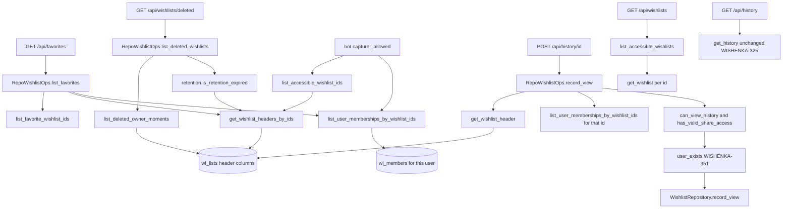

# WISHENKA-340: Personal screens read the current person's records

## Research

Four openings already start from the signed-in person, then open each chosen
list through `WishlistRepository.get_wishlist`. That method reads `wl_lists`,
every `wl_members` row, every `wl_items` row, and `wl_reservations` when the
list has wishes. The screens leave wishes and reservations off the page.

The loaders today:

- **Favorites.** `RepoWishlistOps.list_favorites` calls
  `list_favorite_wishlists`. The SQL already keeps this person's bookmarks of
  other people's non-deleted lists they can still open (member, or a share
  grant whose token matches), ordered by `wl_favorites.created_at DESC`. The
  method then calls `get_wishlist` once per id.
  `GET /api/favorites` copies name, description, occasion, status, role, and
  the favorite mark. Role comes from `WishlistAccessPolicy.resolve_context`,
  which treats `owner_id` as owner and otherwise looks only for this person
  in `wishlist.members`. A share-only bookmark has no membership, and the
  route already shows that role as `favorite`.
- **Recently deleted lists.** `RepoWishlistOps.list_deleted_wishlists` calls
  `list_deleted_by_owner`, which selects this owner's `status = 'deleted'`
  ids (`updated_at DESC, id ASC`) and calls `get_wishlist` for each, including
  lists past recovery. The operation then keeps rows where
  `can_restore_deleted` is true and `retention.is_retention_expired` is false,
  and sorts by `updated_at` descending. The route copies name, description,
  occasion, `updated_at` as the deletion moment, `expires_at`, and
  `days_remaining`. `can_restore_deleted` is owner-only, and
  `resolve_context` decides ownership from `owner_id` without members.
  `wishenka/wishlists/retention.py` is the single restorability rule. Call
  sites look that function up in Python so one change covers the route and
  both backends.
- **Bot list offer.** `wishenka/bot/capture.py` `_allowed` calls
  `list_accessible_wishlists`, which selects active lists this person owns or
  belongs to (`ORDER BY l.id ASC`) and calls `get_wishlist` for each. It then
  keeps lists where `can_add_or_edit_item` is true. The keyboard uses `id`
  and `title`. Saving the picked wish still goes through `RepoWishlistOps`
  and the existing wish rules, which load that one list in full.
  `GET /api/wishlists` uses the same `list_accessible_wishlists` and returns
  each list's wishes. That cabinet list stays on the full read.
- **Recording a visit.** `RepoWishlistOps.record_view` calls `get_wishlist`,
  then refuses a missing or deleted list, checks `has_valid_share_access` and
  `can_view_history`, then `user_exists`, then writes the visit. The missing
  person check and its `view_history_user_missing` log are WISHENKA-351.
  `record_view` is in `_SHARED_REPOSITORY_METHODS`, so a store-backed service
  runs it through `run_repository` (a write transaction). It writes a row, so
  it does not belong on the read-only opening path from WISHENKA-338.

History listing already avoids this. `get_history` (WISHENKA-325) loads the
capped visit list, then `get_wishlist_headers_by_ids` and
`list_user_memberships_by_wishlist_ids`. Headers are built with `members=[]`
and `items=[]`. Clearing history deletes this person's rows and does not
load lists. Both stay as they are.

`get_wishlist_header` is the one-id form of that header select. The batch
helpers chunk ids at `_ID_BATCH_SIZE = 500` via `_chunked_unique_ids`. An
empty id list returns immediately and runs no statement. An in-memory
`WishlistService` fail-closes these four names when no store is configured.
That fail-closed body stays.

SQLAlchemy 2.0's `selectinload` emits a second `SELECT` with a parent-key
`IN` clause, 500 keys per statement by default
([Relationship Loading Techniques](https://docs.sqlalchemy.org/en/20/orm/queryguide/relationships.html)).
These wishlist reads are SQLAlchemy Core `text()` statements on
`WishlistRepository`, not ORM relationships. Reusing the header and
membership batches matches that `IN` shape without mapping `selectinload`
onto `wl_lists`.

SQLite bounds host parameters by `SQLITE_MAX_VARIABLE_NUMBER`: 999 before
3.32.0, and 32766 from 3.32.0 onward
([Implementation Limits For SQLite](https://sqlite.org/limits.html#max_variable_number)).
The repository already chunks `IN` lists at 500, under both defaults. This
task does not raise that chunk size and does not add a migration.

## Implementation Plan

Keep each opening's selection, order, permission, and response. Replace the
per-list `get_wishlist` on the four paths with the header columns the screen
or the permission check already uses. Attach this person's membership only
where `resolve_context` needs it to tell a member from a stranger.

1. **Favorites.** Add `list_favorite_wishlist_ids` with the same SQL, filter,
   and `created_at DESC` order as today's `list_favorite_wishlists` id
   select. `RepoWishlistOps.list_favorites` loads those ids, and when the
   list is non-empty calls `get_wishlist_headers_by_ids` and
   `list_user_memberships_by_wishlist_ids` for this person. Walk the ids in
   SQL order, skip a missing header, and append this person's membership
   before returning. Leave `list_favorite_ids` (the unordered set the cabinet
   and history use for the favorite mark) unchanged. Remove the
   `get_wishlist` loop from `list_favorite_wishlists` by making that method
   return through the ordered ids plus the same header assembly, or by
   deleting the loop once `list_favorites` is the only caller. Do not add a
   second share-grant check. The favorite SQL already applied it.
2. **Recently deleted lists.** Add `list_deleted_owner_moments` selecting
   `id, updated_at` for this owner and `status = 'deleted'`, ordered
   `updated_at DESC, id ASC`. `list_deleted_wishlists` drops moments
   `retention.is_retention_expired` already rejects, then loads headers for
   the survivors with `get_wishlist_headers_by_ids`. Keep
   `can_restore_deleted`, `deletion_moment`, `days_remaining`, and the
   existing `updated_at` sort. Do not copy the cutoff into SQL. Do not load
   memberships. `list_deleted_by_owner` loses its `get_wishlist` loop. It
   can return those same headers for any remaining caller, but
   `list_deleted_wishlists` must not ask it to open expired lists' wishes.
   Expired rows are identified from `id` and `updated_at` only.
3. **Bot offer.** Add `list_accessible_wishlist_ids` with the same `SELECT`,
   `WHERE`, and `ORDER BY l.id ASC` that `list_accessible_wishlists` already
   uses. `list_accessible_wishlists` may call that id select and must still
   `get_wishlist` each id, so `GET /api/wishlists` still returns wishes.
   `_allowed` stops calling `list_accessible_wishlists`. It loads the ids
   (active lists only, as today), then the header batch and this person's
   membership batch, walks ids in that order, and applies the same
   `can_add_or_edit_item` filter. The save command still checks eligibility
   with `_allowed`, then adds the wish through the existing wishlist write.
4. **Recording a visit.** In `record_view`, load `get_wishlist_header`
   instead of `get_wishlist`. Keep the same refusal order: missing, deleted
   (`view_history_deleted_wishlist_denied`), then this person's membership
   on that one id, then `has_valid_share_access`, then `can_view_history`
   (`view_history_access_denied`), then `user_exists`
   (`view_history_user_missing`, WISHENKA-351), then `repo.record_view`.
   A deleted or missing list does not load members, wishes, or reservations.

Do not edit `get_history`, `clear_history`, `get_wishlist`,
`get_wishlist_headers_by_ids`, `list_user_memberships_by_wishlist_ids`,
`user_exists`, the save lock, or `_READ_REPOSITORY_METHODS`. These four
names stay on `run_repository`. The in-memory fail-closed bodies stay.
Routes, copy, and the favorite mark / unmark and restore flows stay.

**Mandatory — Failing Repro (next Step 3):** Add
`tests/test_wishenka_340_personal_hydration_repro.py` before any production
edit. Module mark: `pytestmark = pytest.mark.timeout(30)`. Use a file-backed
`WishlistStore` and `WishlistService`, the same local SQLite pattern as
`tests/test_wishenka_325_history_batch_repro.py`. No network and no live
Telegram dependency.

Seed two people. The first person has:

- A collaborative list they belong to with a non-owner role, a distinct
  title, description, and occasion, and at least one wish with a reservation.
  They bookmark it.
- A second list they can open only through a current share grant, also
  bookmarked, with a wish. Their own list is not bookmarked onto the
  favorites screen. A deleted list they bookmarked stays off that screen.
- Two soft-deleted lists they own, each with a wish. One is inside the
  recovery window and one is past it (`updated_at` old enough that
  `is_retention_expired` is true).
- Two active lists they may add a wish to, ordered by id, each with a wish.
  Another person's list is present and must not be offered.

Listen with SQLAlchemy `before_cursor_execute` on the store engine only
around the call under test. Assert `wl_items` and `wl_reservations` are
absent for `list_favorites`, `list_deleted_wishlists`, `_allowed`, and
`record_view` (success and the deleted-list refusal). On current code each
of those calls reaches `get_wishlist`, so the test fails.

Also assert the visible result, so a later fix cannot go green by returning
the wrong lists:

- Favorites: bookmark order, the member role, the share-only role
  `favorite` once the route mapping is applied or `resolve_context` leaves
  role empty, and the own and deleted lists absent. Card fields match the
  header (name, description, occasion, status).
- Recently deleted: only the in-window list, newest first, with the same
  `days_remaining` the retention helpers compute. The past-recovery list is
  absent. The listener shows no full-member read (`wl_members` without this
  task's user filter is enough to fail today).
- Bot offer: the two editable titles in id order. The other person's list
  is absent. `_allowed` does not read `wl_items`.
- `record_view` on a list they may see stores their visit. A deleted list
  and a list they may not see raise `WishlistNotFoundError` and write no
  visit. A person who is not in `users`, on a list they would otherwise be
  allowed to record, still raises `WishlistNotFoundError` after
  `user_exists` and writes no visit.

`get_history` and `clear_history` are not the red assertion. Seeding and
the history read stay outside the listener.

Sequence: this research, then that red test, then the production change
until the test is green. No production edit in the repro step.

## Architecture



The cabinet and the history list stay on their current reads. The four
changed paths never call `get_wishlist`. Wishes and reservations stay on
the one-list opening and on the wish save.

### Modules

| Module | Responsibility |
| --- | --- |
| `wishenka/wishlists/repository.py` | User-scoped id and moment selects. Existing header and membership batches. `get_wishlist` remains the full aggregate for the cabinet and for opening one list. |
| `wishenka/wishlists/repo_ops.py` | Assembles headers and this person's membership, then applies the existing policy and retention helpers. Writes the visit only after those checks. |
| `wishenka/wishlists/policy.py` | Unchanged pure checks: `resolve_context`, `can_view_history`, `can_restore_deleted`, `can_add_or_edit_item`. |
| `wishenka/wishlists/retention.py` | Unchanged recovery cutoff, deletion moment, and days remaining. |
| `wishenka/bot/capture.py` | `_allowed` offers titles from headers. The save command still uses the existing wish write. |
| `wishenka/web/routes/wishlists.py` | Unchanged payloads for favorites and recently deleted lists. |
| `wishenka/wishlists/service.py` | Unchanged forwarding. The four names stay on `run_repository`. |

### Patterns

- **Repository.** New reads are SQLAlchemy Core `text()` on
  `WishlistRepository`. Operations stay in `RepoWishlistOps` and the bot
  adapter. This matches the wishlist store already in the service.
- **Header projection, not a second aggregate.** A batch clone of
  `get_wishlist` would still read wishes and reservations. The screen and
  the permission check use list columns plus, where role matters, this
  person's `wl_members` row.
- **Pure policy.** `resolve_context` and the `can_*` checks stay free of
  I/O. The repository loads the header and, when needed, one membership
  first. Empty `members` still means "not a member", which is the right
  answer for a share-only favorite and for an owner (ownership comes from
  `owner_id`).
- **One retention rule.** Expired deleted lists are dropped with
  `retention.is_retention_expired` after a moment read, not with a second
  cutoff in SQL.
- **Stable transactions.** Listing these screens and recording a visit stay
  on the write transaction they use today. Moving them to
  `run_repository_read` would reopen the save lock from WISHENKA-338.

### Interfaces

Ordered favorite ids, same filter as `list_favorite_wishlists` today:

```python
async def list_favorite_wishlist_ids(self, user_id: int) -> list[int]:
    """Bookmark ids this person may still open, newest bookmark first."""
```

Owner's deleted moments, without wishes:

```python
async def list_deleted_owner_moments(
    self, owner_id: int
) -> list[tuple[int, datetime]]:
    """Deleted lists this owner has, as id and updated_at, newest first."""
```

Accessible ids, same select `list_accessible_wishlists` already runs:

```python
async def list_accessible_wishlist_ids(
    self, user_id: int, *, include_archived: bool = False
) -> list[int]:
    """Active, or non-deleted, lists this person owns or belongs to, by id."""
```

Existing batches, called and not redefined:

```python
async def get_wishlist_header(self, wishlist_id: int) -> Wishlist | None: ...

async def get_wishlist_headers_by_ids(
    self, wishlist_ids: Sequence[int]
) -> dict[int, Wishlist]: ...

async def list_user_memberships_by_wishlist_ids(
    self, user_id: int, wishlist_ids: Sequence[int]
) -> dict[int, WishlistMember]: ...
```

`list_favorites` still returns `list[Wishlist]`. Each object carries header
fields and this person's membership only. `items` stays empty.
`list_deleted_wishlists` still returns
`list[tuple[Wishlist, datetime, int]]` for lists inside the window.
`_allowed` still returns the editable lists in id order, with `title` set
and `items` empty. `record_view` still returns `ViewHistoryEntry` or raises
`WishlistNotFoundError` for a missing list, a deleted list, a list the
person may not see, and a person who is not stored.

Walk ids in the select's order. `get_wishlist_headers_by_ids` returns a
dict, so dict order is not the screen order. Skip an id with no header, the
same skip `get_wishlist` returning `None` uses today. Append a membership
only when this person has a row:

```python
member = memberships.get(wl.id)
if member is not None and member not in wl.members:
    member.wishlist = wl
    wl.members.append(member)
```

That is the same attachment `get_history` already uses. Do not move it by
editing `get_history`.

### Left unchanged

- `get_history` and `clear_history` (history summaries are WISHENKA-325).
- `get_wishlist`, `run_repository_read`, and the save lock (WISHENKA-338).
- The `user_exists` refusal, its log, and its place after the permission
  check (WISHENKA-351).
- `list_accessible_wishlists` still hydrates each cabinet list with
  `get_wishlist`.
- Adding or removing a favorite, restoring a deleted list, and saving the
  wish after the person picks a list.
- Who may see a list, the history cap, and the words on these screens.

## Q&A

**Why reuse the history header batch instead of a new aggregate query?**
The four screens need the same list columns history already loads, plus
this person's role when the screen or the permission check shows it. A new
full-list batch would keep reading wishes and reservations.

**Why does the bot get its own id read while the cabinet still uses `get_wishlist`?**
`GET /api/wishlists` returns each list's wishes. The offer returns titles.
Sharing `list_accessible_wishlist_ids` keeps one select. The cabinet keeps
the per-id aggregate. The offer stops calling that aggregate.

**Why does recording a visit stay on the write transaction?**
It inserts or updates `wl_view_history`. The read-only opening and its save
lock are WISHENKA-338. This task only narrows the read that happens before
the write.

**Why filter recovery in Python after reading `updated_at`?**
`retention.is_retention_expired` is the one cutoff the route and both
backends already share. The moment query is how the opening learns which
owned deleted lists are still inside that window. Their wishes stay unread,
and lists past the window stay off the screen.

**Why leave history listing alone?**
It already reads this person's visits and header summaries, and it already
leaves wishes and reservations unread. Clearing history already deletes only
that person's rows.
