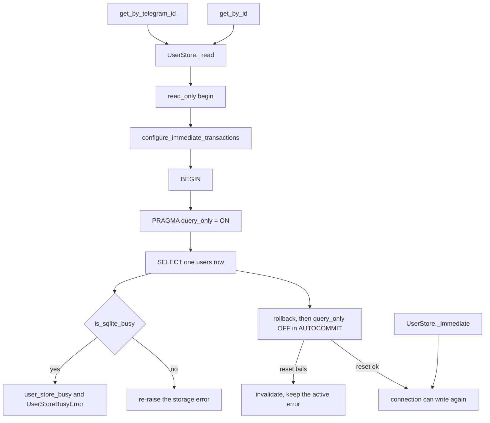

# WISHENKA-342: A person lookup refuses changes and reports a busy database

## Research

Both person lookups already run through one private helper,
`UserStore._read` (`wishenka/users/store.py`). `get_by_telegram_id` and
`get_by_id` are the only callers. Each selects one `users` row and returns
the record or `None`. `_read` already sets
`execution_options(read_only=True)` and rolls the transaction back. It does
not set `PRAGMA query_only`, it does not map `SQLITE_BUSY`, and it does not
wrap other storage errors.

The write path is a different helper. `UserStore._immediate` opens
`BEGIN IMMEDIATE`. On `is_sqlite_busy` it logs `user_store_busy` and raises
`UserStoreBusyError`. Any other `SQLAlchemyError` logs `user_store_error`
and raises `RuntimeError("User storage operation failed")`. `initialize`
uses that same wrap for its `AUTOCOMMIT` pragmas. `_read` does neither.
This task maps only the busy clash on `_read`.

### How this process already opens a read

`configure_immediate_transactions` (`wishenka/sqlite.py`) sets
`isolation_level = None` on connect so the sqlite3 driver does not emit its
own `BEGIN`. The `begin` listener then applies `PRAGMA busy_timeout` and
opens the transaction:

- `execution_options(read_only=True)` emits plain `BEGIN`.
- Every other begin emits `BEGIN IMMEDIATE`.
- `isolation_level == "AUTOCOMMIT"` returns without a `BEGIN`.

`read_only` is a flag that listener reads. It is not a SQLAlchemy isolation
level and it does not open the file with SQLite's `mode=ro` URI. The same
engine still serves saves. SQLAlchemy documents this shape: the driver must
not emit `BEGIN`, and the `begin` event emits it
([SQLAlchemy SQLite dialect](https://docs.sqlalchemy.org/en/20/dialects/sqlite.html)).
`Connection.execution_options(isolation_level="AUTOCOMMIT")` is the
per-connection autocommit switch
([SQLAlchemy connections](https://docs.sqlalchemy.org/en/20/core/connections.html)).

SQLite's transaction rules
([BEGIN IMMEDIATE](https://sqlite.org/lang_transaction.html),
[WAL isolation](https://sqlite.org/isolation.html)):

- `BEGIN IMMEDIATE` starts a write transaction and takes the reserved lock
  at the start. A second `BEGIN IMMEDIATE` waits, then returns
  `SQLITE_BUSY` after `busy_timeout` (5000 ms here).
- Plain `BEGIN` is deferred. The first `SELECT` starts a read transaction.
  In WAL mode that read does not take the writer lock, and a writer does
  not block it.
- `PRAGMA query_only = ON` rejects `CREATE`, `DELETE`, `DROP`, `INSERT`,
  and `UPDATE` with `SQLITE_READONLY`. The database is not a file opened
  read-only: checkpoint and `COMMIT` can still run
  ([PRAGMA query_only](https://sqlite.org/pragma.html#pragma_query_only)).
  Some pragmas apply at `sqlite3_prepare`, not only at `sqlite3_step`
  ([pragma compile-time note](https://sqlite.org/pragma.html)). The reset
  must be executed, which `exec_driver_sql` already does.

`tests/test_user_store_concurrency_repro.py`
(`test_user_read_lookups_do_not_block_on_external_write_lock`) already
shows both lookups finishing within one second while another connection
holds `BEGIN IMMEDIATE`. A deferred read behind that lock is not
`SQLITE_BUSY`. The busy outcome has to be forced on the lookup itself.

### The pattern to copy

`WishlistStore.read_transaction` (`wishenka/wishlists/store.py`) is the
read this task copies. `execute_read` only enters that context and runs
the callback. The sequence is:

1. `execution_options(read_only=True)`, so the listener emits `BEGIN`.
2. `exec_driver_sql("PRAGMA query_only = ON")` before the callback.
3. On `SQLAlchemyError`, if `is_sqlite_busy(exc)`, log and raise the
   store's busy error. Any other `SQLAlchemyError` is re-raised.
4. In `finally`, roll back while a transaction is open, then
   `execution_options(isolation_level="AUTOCOMMIT")` and
   `exec_driver_sql("PRAGMA query_only = OFF")`.
5. If that reset raises, log a warning and `await raw_conn.invalidate()`.
   Re-raise the reset error only when `sys.exc_info()[1]` is `None`, so a
   failure already in flight stays the one reported.

`tests/test_wishenka_254_execute_read_hardening_repro.py` covers that
sequence for wishlists: an immediate `OperationalError` on write, a pool
connection left writable, a synthetic `database is locked` mapped to
`InventoryBusyError`, and a failed `AUTOCOMMIT` reset that invalidates.

### What stays outside this change

WISHENKA-328 left two reads on `execution_options(read_only=True)` and
`begin()` without `query_only` and without a busy mapping:

- `listing` in `wishenka/bot/birthdays.py`, on the wishlist engine.
- `_find_active_chat_id` in `wishenka/web/routes/profile.py`, on the
  wishlist engine when that store is present, otherwise the user engine.

`ensure_private_bot_user` (`wishenka/bot/principal.py`) still saves through
`UserStore.write` (`operation="record_private_chat"`). Session checks in
`wishenka/auth/dependencies.py` use `read_transaction` when the wishlist
store is present. None of those are `UserStore._read`.

Wishlist reads stay on `read_transaction`. This task does not extract a
shared helper and does not edit `wishenka/wishlists/store.py`.

## Implementation Plan

Change only `UserStore._read` and the two call sites inside the same class
that must pass `operation` into the existing busy log. Leave
`UserStoreBusyError`, its message, `_immediate`, `write`, `initialize`,
and every public method signature as they are.

`_read` keeps `execution_options(read_only=True)` and `conn.begin()`.
After begin, and before `work`, it runs
`await conn.exec_driver_sql("PRAGMA query_only = ON")`.

On `SQLAlchemyError` from begin, the pragma, or `work`:

- `is_sqlite_busy(exc)` is true: emit the warning `_immediate` and
  `initialize` already emit, then
  `raise UserStoreBusyError("User service is temporarily busy; please retry") from exc`.
  The warning is logger `wishenka.users`, message
  `User store operation rolled back because the database was busy`,
  extra `event="user_store_busy"` and `operation` set to the public method
  name (`get_by_telegram_id` or `get_by_id`). That is the current busy log.
  There is no second wait and no second attempt. `busy_timeout` stays the
  listener's existing 5000 ms.
- Otherwise re-raise that `SQLAlchemyError`. Do not log `user_store_error`.
  Do not raise `RuntimeError("User storage operation failed")`. A refused
  write is `SQLITE_READONLY` (`OperationalError` matching `readonly`). That
  is not busy, so it stays that driver error.

In `finally`, keep the current rollback (`conn.rollback()` while
`conn.in_transaction()`). Then reset on the raw connection, as
`read_transaction` does:

```python
autocommit_conn = await raw_conn.execution_options(isolation_level="AUTOCOMMIT")
await autocommit_conn.exec_driver_sql("PRAGMA query_only = OFF")
```

If the reset raises, log a warning on `wishenka.users` and
`await raw_conn.invalidate()`. The warning is the failure counterpart of
`wishlist_read_query_only_reset_failed`: event
`user_store_query_only_reset_failed`, extra `error_type` set to
`type(exc).__name__`, no person id and no SQL text. No user-store event
exists for this invalidate. Re-raise the reset error only when no exception
is already active (`sys.exc_info()[1] is None`). A busy lookup, a refused
write, or any other error from `work` stays the reported error.

A successful lookup adds no log. Do not add an info or success event.

`get_by_telegram_id` and `get_by_id` keep their SQL and their `None`
result. They pass `operation="get_by_telegram_id"` and
`operation="get_by_id"` into `_read` so the existing busy log has the same
`operation` field writes already use.

Do not add HTTP or bot handlers. `update_profile_birthdate` already catches
`UserStoreBusyError` around its lookup and returns the existing 503 detail.
Other callers keep the exception they receive.

**Mandatory — Failing Repro (next Step 3):** Add
`tests/test_wishenka_342_user_read_hardening_repro.py` with module
`pytestmark = pytest.mark.timeout(30)` before changing `_read`. Use a
temporary SQLite file and `UserStore`, as the WISHENKA-254 read tests do.
No live Telegram or HTTP server.

These assertions fail before the production change:

1. **Write refused at once.** Seed a person, then call `_read` with an
   `UPDATE` of that row. Expect `OperationalError` matching `readonly`.
   A following `get_by_telegram_id` still returns the seeded name. Today
   the `UPDATE` runs and the final rollback undoes it, so no readonly
   error is raised.
2. **Busy maps to the save outcome.** Inside `_read` work, raise
   `OperationalError("SELECT 1", {}, sqlite3.OperationalError("database is locked"))`.
   Expect `UserStoreBusyError` with the existing message, and one
   `user_store_busy` warning on `wishenka.users` whose `operation` is the
   lookup name. Do not hold `BEGIN IMMEDIATE` on another connection for
   this case: WAL lookups already succeed under that lock. Today the
   synthetic error propagates as `OperationalError`.
3. **Reset failure discards the connection.** Wrap `engine.connect` the
   way `test_execute_read_logs_warning_and_invalidates_on_query_only_reset_failure`
   does, so `execution_options(isolation_level="AUTOCOMMIT")` raises.
   After a successful read callback, expect that reset error, one
   `user_store_query_only_reset_failed` warning, and `invalidate()` called.
   A second case raises from `work` and fails the reset: the `work`
   exception propagates, and `invalidate()` still runs. Today there is no
   reset and no invalidate.

One guard already passes and must stay green: a non-busy
`OperationalError` (`disk I/O error`) from `_read` propagates as that
error, not `RuntimeError("User storage operation failed")`, and does not
log `user_store_error`.

The existing non-blocking lookup test stays the proof that both lookups
still finish while a writer holds `BEGIN IMMEDIATE`. Do not weaken it.

Sequencing: this research, then the red file, then the `_read` change
until those tests and the existing user-store concurrency tests are green.

## Architecture

One module changes: `UserStore._read`. Everything else is a dependency
that stays, or a caller that already uses the two lookups.



### Modules

- `wishenka/sqlite.py` stays. `configure_immediate_transactions` emits
  `BEGIN` when `read_only` is set, and skips `BEGIN` for `AUTOCOMMIT`.
  `is_sqlite_busy` walks `exc`, `.orig`, and `.__cause__`.
- `UserStore._read` in `wishenka/users/store.py` is the only production
  change. Deferred read, `query_only` on, busy mapping, `query_only` off,
  and invalidate when the reset fails.
- `get_by_telegram_id` and `get_by_id` stay the two lookups. Same SQL,
  same `None`. They pass `operation` into `_read`.
- `_immediate`, `write`, and `initialize` stay the exclusive-lock saves
  and the init pragmas, including their `RuntimeError` wrap.
- `UserStoreBusyError` stays the temporary-unavailable outcome. Same
  class, same message.
- `WishlistStore.read_transaction` and `execute_read` stay the reference.
  They are not edited.
- `birthdays.listing` and `profile._find_active_chat_id` stay the
  WISHENKA-328 reads. No `query_only`, no busy mapping.
- `ensure_private_bot_user` stays `UserStore.write` with
  `record_private_chat`.
- Profile, auth, locale, and bot callers stay. No new handler, sentence,
  or status.

### Patterns

- **Existing store helper.** The lookup boundary is already `_read`. The
  change fills that helper. It does not add a repository, a second engine,
  or a read-only URI.
- **Copied finally, not a new abstraction.** The control flow matches
  `read_transaction` so the pooled connection is writable after the lookup
  or discarded when the reset fails. Wishlist code stays the original.
- **One busy translator.** `is_sqlite_busy` plus `UserStoreBusyError` is
  the translator saves already use. Reads do not gain the write-path
  `RuntimeError` translator.

### Interfaces

`_read` gains a keyword-only `operation: str`, used only as the existing
`user_store_busy` extra. Public signatures stay:

- `get_by_telegram_id(telegram_id: int) -> UserRecord | None`
- `get_by_id(user_id: int) -> UserRecord | None`

Raised from `_read` after this change:

- A `SELECT` that finds a row or finds none returns `UserRecord` or
  `None`. No new log.
- A SQL write while `query_only` is on raises the driver's
  `OperationalError` (`readonly`), then rolls back and sets
  `query_only = OFF`.
- `is_sqlite_busy` on begin, `query_only = ON`, or `work` emits the
  existing `user_store_busy` warning and raises `UserStoreBusyError`.
- Any other `SQLAlchemyError` is that same error, after rollback. No
  `user_store_error`, and no `RuntimeError` wrap.
- When `query_only = OFF` fails and the lookup already failed,
  `invalidate()` runs, the warning
  `user_store_query_only_reset_failed` is written, and the original error
  is kept.
- When `query_only = OFF` fails and the lookup succeeded, `invalidate()`
  runs, that warning is written, and the reset error propagates.

`invalidate` is `AsyncConnection.invalidate` on the connection from
`engine.connect()`. The reset uses `isolation_level="AUTOCOMMIT"` so the
`begin` listener does not open a transaction for `PRAGMA query_only = OFF`.

## Q&A

**Why `_read` and not the two public methods?** Both lookups already share
`_read`. The refusal, the reset, and the busy mapping belong on that one
path. The public methods keep their SQL.

**Why copy `read_transaction` instead of calling it?** It lives on
`WishlistStore`, maps busy to `InventoryBusyError`, and logs wishlist
events. The person lookup must raise `UserStoreBusyError` and use
`user_store_busy`. Sharing the helper would redesign the wishlist read.

**Why is a refused write not `UserStoreBusyError`?** `query_only` returns
`SQLITE_READONLY`. `is_sqlite_busy` does not treat that as busy. The
requirement is to refuse the change at once and leave every non-busy
storage error on the current `_read` path.

**Why can a later save still write?** `query_only` is per connection.
`PRAGMA query_only = OFF` in `AUTOCOMMIT` clears it before the pool reuses
the connection. `BEGIN IMMEDIATE` on the next `_immediate` is unchanged.
If the reset fails, `invalidate()` drops that connection.

**Why is there no success log?** The lookups are quiet today. The accepted
requirements forbid a new success message. The only new log is the reset
failure warning, because no user-store event covers invalidate. The busy
warning is the one `_immediate` already writes.

**Why leave the birthday list and the private-chat lookup alone?**
WISHENKA-328 put them on plain `BEGIN` and left `query_only` and the busy
outcome to this person lookup. They are not callers of `_read`.

**Are there open questions?** No.
