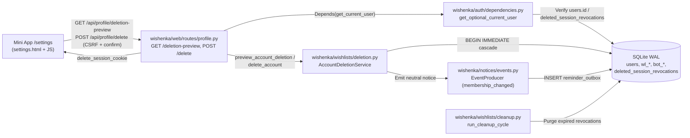

# WISHENKA-35: Механизм удаления профиля и очистки персональных данных

## Research

При проектировании изучены:
- Бизнес-требования в [`ai-tasks/WISHENKA-35/10-requirements.md`](10-requirements.md) и спецификация в [`in-docs/spec.md`](../../in-docs/spec.md) (§11).
- Архитектура подсистемы пользователей и целевой контракт `WISHENKA-32` в [`doc/dev/architecture.md`](../../doc/dev/architecture.md) (§2.4, §3) и [`doc/dev/users.md`](../../doc/dev/users.md).
- Текущее состояние кодовой базы после реализации `WISHENKA-33` и `WISHENKA-34`:
  - **Миграции Alembic (`wishenka/wishlists/alembic/versions/`):** текущий `head` — ревизия `add_user_locale` (`down_revision = "add_idempotency_records"`), таблица `deleted_session_revocations` ещё не создана.
  - **Хранилище пользователей (`wishenka/users/store.py`):** таблица `users` содержит `id` (`INTEGER PRIMARY KEY AUTOINCREMENT`), `telegram_id` (`UNIQUE`), `first_name`, `last_name`, `username`, `language_code`, `locale`, `locale_source`, `birth_day`, `birth_month`, `birth_year`, `birthdate_source`, `is_premium`, `created_at`, `updated_at`.
  - **Разделение идентификаторов в БД:** таблицы домена вишлистов (`wl_lists`, `wl_members`, `wl_items`, `wl_reservations`, `wl_favorites`, `wl_view_history`, `wl_idempotency_records`), настроек/уведомлений (`user_notification_settings`, `wl_list_notification_settings`, `notification_outbox`, `notice_receipt_keys`, `reminder_outbox`) ключуются по `users.telegram_id`, а таблицы доставки/бота/поддержки (`bot_destinations`, `birthday_entries`, `support_tickets`) — по внутреннему `users.id` (в `birthday_input`, `support_input`, `bot_drafts`, `bot_capture_order` используются `owner_id`/`owner` и `chat_id`).
  - **Тайна сюрприза (`wishenka/wishlists/policy.py`):** `WishlistAccessPolicy.is_recipient_id(user_id, item)` считает владельца (`owner_id`) получателем всех желаний только при `is_collaborative == 0`. В совместных списках (`is_collaborative == 1`) получатель определяется только через `item.recipient_user_id`. Поэтому при передаче владения совместным списком флаг `is_collaborative = 1` должен сохраняться даже если других участников в `wl_members` не осталось.
  - **Аутентификация (`wishenka/auth/dependencies.py`, `wishenka/auth/models.py`, `wishenka/auth/session.py`):** `SessionClaims` уже содержит `user_id: int | None` и `iat: int`, а `delete_session_cookie(response, settings)` реализована. Однако `get_optional_current_user` сейчас проверяет только криптографическую подпись и `exp` токена без проверки существования `users.id` в БД и без проверки `deleted_session_revocations`.
  - **Очередь уведомлений (`wishenka/notices/store.py`, `wishenka/notices/reminders.py`, `wishenka/notices/events.py`):** `NoticeStore.refresh_claim` и `refresh_reminder` уже выполняют повторную проверку `JOIN users` и `JOIN bot_destinations` внутри `BEGIN IMMEDIATE` непосредственно перед отправкой в Telegram; `EventProducer.record` поддерживает безопасное событие `membership_changed`.
  - **UI настроек (`wishenka/web/routes/profile.py`, `wishenka/web/templates/settings.html`, `wishenka/i18n/catalog.py`):** экран `/settings` с CSRF-защищённым JS-хелпером `settingsFetch` (`X-CSRF-Token`) и двуязычным каталогом `RU`/`EN` уже развёрнут.

## Implementation Plan

1. **Миграция схемы БД (`wishenka/wishlists/alembic/versions/add_deleted_session_revocations.py`):**
   - Добавить линейную ревизию от `down_revision = "add_user_locale"`, создающую таблицу `deleted_session_revocations(subject_hash TEXT PRIMARY KEY, revoked_before INTEGER NOT NULL, expires_at INTEGER NOT NULL)` и индекс `idx_deleted_session_revocations_expires`.
2. **Сервис удаления и предпросмотра (`wishenka/wishlists/deletion.py`):**
   - Реализовать `DeletionPreviewDTO`, `DeletionResultDTO` и `AccountDeletionService` с методами `preview_account_deletion` и `delete_account`.
   - Выполнять `delete_account` в единой транзакции `WishlistStore.transaction` (`BEGIN IMMEDIATE`, `PRAGMA foreign_keys = ON`, `PRAGMA busy_timeout = 5000`) с идемпотентной проверкой, 6-шаговым каскадом, детерминированной передачей владения совместными списками, обезличиванием `wl_items.recipient_user_id`, полной очисткой ПДн и состояний бота и записью `HMAC-SHA256` маркера отзыва в `deleted_session_revocations`.
3. **Проверка живости сессии и очистка просроченных отзывов (`wishenka/auth/dependencies.py`, `wishenka/wishlists/cleanup.py`):**
   - Расширить `get_optional_current_user`: при `claims.user_id is not None` проверять наличие `(id, telegram_id)` в `users`; при `claims.user_id is None` проверять `deleted_session_revocations` (`claims.iat <= revoked_before`). При отказе возвращать `401 Unauthorized` и писать псевдонимизированный лог `session_rejected_revoked_or_deleted`.
   - Добавить периодическую очистку истёкших записей `deleted_session_revocations` в `WishlistStore` / `run_cleanup_cycle`.
4. **HTTP API и интерфейс Mini App (`wishenka/web/routes/profile.py`, `wishenka/web/templates/settings.html`, `wishenka/i18n/catalog.py`):**
   - Добавить эндпоинты `GET /api/profile/deletion-preview` и `POST /api/profile/delete` (проверка `confirm: true`, CSRF, удаление cookie через `delete_session_cookie`).
   - Добавить в `settings.html` секцию «Удаление аккаунта» с предпросмотром последствий, предупреждением о необратимости, явным подтверждением, отменой и экраном завершения удаления (на `RU` и `EN`).

**Mandatory — Failing Repro (next Step 3):**
- **Где:** `tests/test_account_deletion_repro.py` (новый файл автотестов, все тесты с `@pytest.mark.timeout(...)` согласно `do-testing`).
- **Что проверяет (желаемое поведение, которое сейчас падает):**
  1. `GET /api/profile/deletion-preview` и `POST /api/profile/delete` для аутентифицированного пользователя возвращают `404` до реализации (ожидается `200`, предпросмотр последствий без чужих броней, затем удаление с `confirm: true` и сбросом cookie).
  2. Полный сквозной сценарий удаления (`AccountDeletionService` / HTTP API) без внешних зависимостей (локальный SQLite WAL + `TestClient` / `AsyncClient`):
     - личный список с желаниями и чужой активной/купленной бронью удаляется безвозвратно;
     - совместный список с другими участниками сохраняется с `is_collaborative = 1`, права владельца переходят детерминированно (`admin` -> `coauthor` -> `member`, далее `joined_at`, `users.created_at`, `telegram_id`), чужие брони остаются, авторство желаний обезличено (`recipient_user_id = NULL`, `recipient_name = NULL`);
     - собственная бронь удаляемого пользователя в чужом списке снимается, увеличивая `available_quantity`, без уведомления получателю;
     - строка в `users` и ПДн/состояния бота удаляются, а ранее выданные токены (с `user_id` и без `user_id`) немедленно отклоняются с `401` даже после повторного входа «с чистого листа» (новый `users.id` по `AUTOINCREMENT`);
     - повторный вызов удаления идемпотентен (`already_deleted=True`).
- **Как форсируется падение без внешних сервисов:** тесты используют изолированную временную SQLite БД через `WishlistStore` / `UserStore` и FastAPI `TestClient`, без обращений к Telegram API. На текущем коде отсутствуют маршруты `/api/profile/deletion-preview`, `/api/profile/delete`, модуль `wishenka.wishlists.deletion` и проверка отзыва токенов в `get_optional_current_user` — тесты гарантированно падают (red).
- **Последовательность:** Step 3 (создание и ревью красного теста без правки production-кода) -> Step 4 (миграция, `AccountDeletionService`, auth-проверки, API, UI и i18n до зелёных тестов).

## Architecture

### Схема модулей и взаимодействий



### Модули и зоны ответственности

| Модуль | Статус | Ответственность |
| --- | --- | --- |
| `wishenka/wishlists/alembic/versions/add_deleted_session_revocations.py` | Новый | Версионная ревизия Alembic от `add_user_locale`: создаёт таблицу `deleted_session_revocations` и индекс по `expires_at`. |
| `wishenka/wishlists/deletion.py` | Новый | `AccountDeletionService`, `DeletionPreviewDTO`, `DeletionResultDTO`, вычисление `subject_hash`, детерминированный выбор преемника, 6-шаговый атомарный каскад. |
| `wishenka/auth/dependencies.py` | Изменение | Проверка живости `users.id` (при `claims.user_id is not None`) и проверка `deleted_session_revocations` (при `claims.user_id is None`) в `get_optional_current_user`. |
| `wishenka/wishlists/cleanup.py` и `wishenka/wishlists/store.py` | Изменение | Метод очистки просроченных записей `deleted_session_revocations` (`expires_at <= now_epoch`) и его вызов из `run_cleanup_cycle`. |
| `wishenka/web/routes/profile.py` | Изменение | Маршруты `GET /api/profile/deletion-preview` и `POST /api/profile/delete` (с валидацией `confirm: true` и вызовом `delete_session_cookie`). |
| `wishenka/web/templates/settings.html` и `wishenka/i18n/catalog.py` | Изменение | Секция удаления аккаунта в `/settings`, запрос предпросмотра, модальное/встроенное подтверждение с отменой, экран результата, ключи локализации `RU`/`EN`. |

### Архитектурные паттерны и обоснование

1. **Единая транзакция `BEGIN IMMEDIATE` с `PRAGMA foreign_keys = ON`:**
   - Гарантирует атомарность (`NFR-1`) и исключает гонки с одновременными бронированиями, фиксацией получений (`wl_receipts`) и доставкой уведомлений (`NoticeStore.refresh_claim`, `refresh_reminder`). При любой ошибке транзакция полностью откатывается.
2. **Двухуровневый отзыв stateless-токенов без хранения ПДн:**
   - Токены с `claims.user_id` автоматически инвалидируются удалением строки из `users` (`INTEGER PRIMARY KEY AUTOINCREMENT` гарантирует, что при повторном входе «с чистого листа» будет выдан новый `users.id`, не совпадающий со старым).
   - Токены без `claims.user_id` (legacy/тестовые) проверяются по таблице `deleted_session_revocations` по ключу `HMAC-SHA256(secret_key, f"deleted:{telegram_id}")` (`subject_hash`). Таблица не содержит ни `telegram_id`, ни `users.id`, ни ПДн и очищается по TTL (`expires_at`).
3. **Детерминированная передача владения с сохранением `is_collaborative = 1`:**
   - Преемник выбирается по строгому кортежу `(role_rank, joined_at_utc, user_created_at_utc, user_id)`: `admin (1)` -> `coauthor`/`collaborator (2)` -> `member`/иные (3), затем наименьшая дата `wl_members.joined_at`, затем наименьшая `users.created_at`, затем наименьший `telegram_id`.
   - Сохранение `is_collaborative = 1` обязательно, чтобы `WishlistAccessPolicy.is_recipient_id` не начал трактовать нового владельца как получателя чужих желаний в списке.
4. **Обезличивание желаний и защита тайны сюрприза:**
   - В сохраняемых совместных списках `wl_items.recipient_user_id` и `recipient_name` сбрасываются в `NULL`; бронирования других дарителей сохраняются.
   - Уведомление `membership_changed` отправляется через `EventProducer` только оставшимся участникам, без упоминания удалившегося пользователя или бронирований.
   - При доставке из `notification_outbox` / `reminder_outbox` уже существующие `refresh_claim` и `refresh_reminder` перепроверяют `JOIN users` и `JOIN bot_destinations`, отменяя отправку удалённому пользователю.

### Контракты и интерфейсы

#### Python API (`wishenka/wishlists/deletion.py`)

```python
@dataclass(frozen=True)
class DeletionPreviewDTO:
    personal_lists_count: int
    collaborative_transferred_count: int
    collaborative_deleted_count: int
    reservations_count: int

@dataclass(frozen=True)
class DeletionResultDTO:
    already_deleted: bool
    deleted_lists: int
    transferred_lists: int
    cancelled_reservations: int
    anonymized_items: int = 0

class AccountDeletionService:
    def __init__(self, store: WishlistStore) -> None: ...

    async def preview_account_deletion(self, telegram_id: int) -> DeletionPreviewDTO: ...

    async def delete_account(
        self,
        telegram_id: int,
        *,
        secret_key: str,
        session_ttl_seconds: int,
        now: datetime | None = None,
    ) -> DeletionResultDTO: ...
```

#### HTTP API (`wishenka/web/routes/profile.py`)

- `GET /api/profile/deletion-preview` (требует `get_current_user`) -> `200 OK`:
  ```json
  {
    "personal_lists_count": 2,
    "collaborative_transferred_count": 1,
    "collaborative_deleted_count": 0,
    "reservations_count": 3
  }
  ```
- `POST /api/profile/delete` (требует `get_current_user` + CSRF-токен при cookie-аутентификации):
  - Тело запроса: `{"confirm": true}` (при отсутствии или `confirm != true` — `422 Unprocessable Entity`).
  - Действие: вызывает `AccountDeletionService.delete_account(...)`, удаляет session cookie (`delete_session_cookie`), возвращает `200 OK`:
    ```json
    {
      "already_deleted": false,
      "deleted_lists": 2,
      "transferred_lists": 1,
      "cancelled_reservations": 3,
      "anonymized_items": 1
    }
    ```

#### Поля таблиц для очистки ПДн и состояний бота

1. По `telegram_id`: `wl_favorites`, `wl_view_history`, `user_notification_settings`, `wl_list_notification_settings`, `notification_outbox` (`giver_user_id`), `notice_receipt_keys` (`giver_user_id`), `reminder_outbox` (`user_id`), `wl_idempotency_records` (`actor_id`).
2. По `internal_user_id` (`users.id`) / `telegram_id` / `chat_id` (с безопасной проверкой наличия необязательных таблиц в изолированных тестах): `birthday_entries` (`owner_id`), `birthday_input` (`owner_id` / `chat_id`), `bot_destinations` (`user_id`), `support_input` (`owner_id` / `chat_id`), `support_tickets` (`owner_id`, `telegram_id`), `bot_drafts` (`owner`), `bot_capture_order` (`owner`), затем `users` (`telegram_id`).

## Q&A

- **Нужно ли отдельное хранилище отозванных JWT/токенов с `telegram_id`?**
  Нет. Для основных сессий с `claims.user_id` достаточно проверки существования пары `(id, telegram_id)` в `users` (благодаря `AUTOINCREMENT` повторная регистрация создаст новый `id`). Для токенов без `user_id` используется `deleted_session_revocations` с необратимым `HMAC-SHA256` хэшем `subject_hash`, что полностью исключает хранение ПДн.
- **Что происходит, если у совместного списка удаляемого владельца нет других участников?**
  Такой список закрывается и удаляется по правилам личного вишлиста (подсчитывается в `collaborative_deleted_count` в предпросмотре и жёстко удаляется вместе с желаниями, историей получений, токенами и бронями других дарителей).
- **Почему при передаче владения нельзя сбрасывать `is_collaborative = 1`?**
  Потому что `WishlistAccessPolicy.is_recipient_id` при `is_collaborative == 0` считает `owner_id` получателем всех желаний списка, что нарушит видимость и тайну сюрприза для нового владельца.
