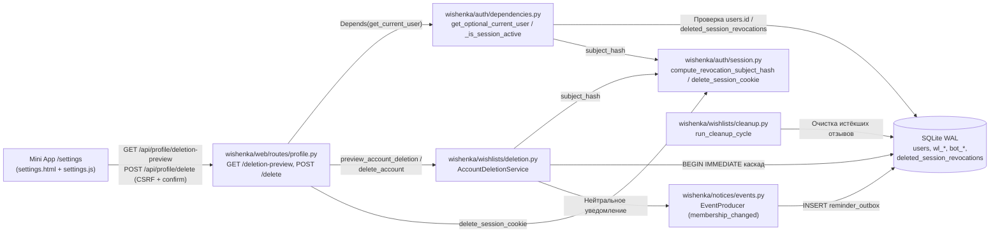

# Спецификация: WISHENKA-35 — Механизм удаления профиля и очистки персональных данных

**Задача:** WISHENKA-35 (эпик `WISHENKA-31`)  
**Статус:** реализовано и верифицировано  
**Платформы и стек:** Telegram Mini App (FastAPI, Jinja2, JS), Telegram Bot (aiogram), SQLite WAL (Alembic)  
**Языки интерфейса:** русский (`ru`), английский (`en`)  
**Связанные документы:** [`in-docs/spec.md`](../../in-docs/spec.md) (§11), [`doc/dev/users.md`](../../doc/dev/users.md), [`doc/dev/auth.md`](../../doc/dev/auth.md), [`doc/dev/wishlists.md`](../../doc/dev/wishlists.md)

## 1. Назначение и бизнес-цель

### 1.1. Постановка проблемы и бизнес-контекст

В рамках эпика `WISHENKA-31` были определены требования и модель данных управления аккаунтом (`WISHENKA-32`, [`in-docs/spec.md`](../../in-docs/spec.md) §11), реализован двуязычный экран настроек Mini App (`WISHENKA-33`), а также настройка даты рождения и уведомлений (`WISHENKA-34`). При этом в продукте отсутствовал рабочий контур самостоятельного удаления профиля:

- пользователь не мог инициировать удаление аккаунта и персональных данных из интерфейса Mini App;
- не существовало единой атомарной операции очистки профиля, личных списков, настроек, истории просмотров, состояний диалогов в боте и очереди исходящих уведомлений;
- отсутствовали детерминированная передача владения совместными вишлистами при уходе владельца и обезличивание привязки автора на желаниях;
- не было немедленного отзыва всех активных пользовательских сессий и токенов доступа при удалении профиля.

Задача `WISHENKA-35` реализует требования раздела §11 [`in-docs/spec.md`](../../in-docs/spec.md) и пользовательского сценария `UC-11` («Управление данными»).

### 1.2. Цели и ценность для пользователей и системы

- **Суверенитет над персональными данными:** предоставить каждому пользователю возможность полностью и необратимо удалить свой профиль и связанные личные данные через Mini App без обращения в поддержку и без остаточных активных сессий.
- **Защита от случайного удаления:** перед выполнением необратимой операции показать пользователю явное предупреждение и персональную сводку последствий (число затрагиваемых личных списков, передаваемых и удаляемых совместных списков, собственных броней к снятию) с обязательным подтверждением.
- **Непрерывность совместных вишлистов:** при удалении аккаунта владельца сохранить совместные вишлисты с другими участниками путём детерминированной передачи прав владения преемнику, сохранив существующие желания и бронирования других дарителей.
- **Неприкосновенность тайны сюрприза:** гарантировать, что удаление аккаунта, передача владения, обезличивание желаний, снятие броней и уведомления ни при каких обстоятельствах не раскроют получателям подарков личность дарителя или факт существования его бронирований и покупок.
- **Чистый повторный вход:** позволить человеку после удаления аккаунта заново открыть бота или Mini App и зарегистрироваться «с чистого листа» без восстановления удалённых данных и без возврата валидности отозванным токенам.

### 1.3. Границы решения (Scope и Non-Goals)

В рамки `WISHENKA-35` входят:

- интерфейс запуска удаления аккаунта, предпросмотр последствий и панель подтверждения/отмены на экране настроек Mini App (`/settings`) на русском и английском языках;
- защита доступа (удаление доступно только аутентифицированному владельцу профиля) и CSRF-проверка для cookie-сессий;
- атомарная и идемпотентная транзакция удаления профиля, каскадной обработки списков и броней, очистки персональных данных и состояний бота, отмены неотправленных уведомлений и записи маркера отзыва сессий;
- проверка активности пользователя и отсутствия отзыва в middleware/зависимостях аутентификации для каждого запроса;
- фоновая очистка истёкших записей отзыва сессий по истечении TTL.

В текущую функциональность явно **не входят**:

- отзыв сообщений, уже доставленных в чат Telegram до момента удаления аккаунта (остаются в истории клиента Telegram);
- мягкое удаление с «периодом охлаждения» и функцией восстановления аккаунта;
- выгрузка/экспорт персональных данных пользователя в файл;
- административное удаление чужих аккаунтов и модераторская панель.

## 2. Функциональные требования и пользовательские сценарии

### 2.1. Пользовательские истории (`US-1`–`US-6`)

- **US-1 (Инициация и предупреждение перед удалением):** пользователь в настройках Mini App открывает удаление аккаунта, видит предупреждение о необратимости и персональную сводку последствий (без чужих броней и данных получателей) и может подтвердить или отменить действие.
- **US-2 (Удаление данных и отзыв доступа):** после подтверждения удаления профиль, личные вишлисты, настройки, история, состояния бота и активные сессии на всех устройствах немедленно очищаются и отзываются.
- **US-3 (Сохранение совместного вишлиста при уходе владельца):** при удалении аккаунта владельцем совместный вишлист с другими участниками не исчезает; права владельца переходят наиболее приоритетному участнику с сохранением желаний и броней других дарителей.
- **US-4 (Выход из чужих совместных списков):** при удалении профиля участника он исключается из чужих совместных списков, а добавленные им желания обезличиваются без поломки списка и чужих броней.
- **US-5 (Освобождение броней без раскрытия сюрприза):** активные и отмеченные как купленные бронирования удаляемого пользователя в чужих списках немедленно снимаются, возвращая доступный остаток другим дарителям без уведомления получателей.
- **US-6 (Повторный вход «с чистого листа»):** при последующем открытии бота или Mini App создаётся новый профиль с новым внутренним идентификатором без восстановления удалённых данных; старые токены остаются отклонёнными.

### 2.2. Сценарий взаимодействия пользователя в Mini App (`UC-11`)

1. Аутентифицированный пользователь открывает `/settings` в Telegram Mini App и нажимает кнопку начала удаления (`#delete-account-start-btn`).
2. Клиентский контроллер `settings.js` запрашивает `GET /api/profile/deletion-preview`, получает агрегированную сводку последствий и открывает панель подтверждения `#delete-account-confirm-panel` с предупреждением о необратимости.
3. Пользователь либо отменяет операцию (`#delete-account-cancel-btn`), скрывая панель без изменения состояния в БД, либо нажимает кнопку подтверждения (`#delete-account-confirm-btn`).
4. При подтверждении клиент отправляет `POST /api/profile/delete` с телом `{"confirm": true}` и заголовком `X-CSRF-Token`.
5. Сервер выполняет атомарное удаление и очищает cookie сессии (`delete_session_cookie`); интерфейс скрывает кнопку старта и панель подтверждения, выводя локализованное сообщение о завершении удаления.

### 2.3. Функциональные требования и правила (`FR-1`–`FR-11`)

- **FR-1 (Предпросмотр последствий):** `GET /api/profile/deletion-preview` возвращает только персональную сводку: `personal_lists_count`, `collaborative_transferred_count`, `collaborative_deleted_count`, `reservations_count` (количество собственных броней со статусами `active` и `purchased`). Чужие бронирования и личности дарителей/получателей в сводку не включаются.
- **FR-2 (Явное подтверждение):** `POST /api/profile/delete` отклоняет любой запрос без JSON-тела `{"confirm": true}` со статусом `422 Unprocessable Content`.
- **FR-3 (Права доступа и идемпотентность):** оба маршрута защищены `Depends(get_current_user)` (анонимные или отозванные обращения отклоняются с `401 Unauthorized`). Повторный вызов `AccountDeletionService.delete_account` для уже удалённого пользователя при отсутствии записей в `users`, `wl_lists`, `wl_members` и `wl_reservations` возвращает `DeletionResultDTO(already_deleted=True, ...)` с нулевыми счётчиками без ошибок и повторных побочных эффектов.
- **FR-4 (Удаление личных и одиночных совместных вишлистов):** все личные вишлисты (`is_collaborative = 0`) и совместные вишлисты без других участников в `wl_members` (независимо от статуса — активные, архивные или помеченные к удалению) безвозвратно удаляются из `wl_lists` (каскадом внешних ключей удаляются `wl_items`, чужие `wl_reservations`, `wl_receipts`, `wl_members`, `wl_favorites`, `wl_view_history`, `notification_outbox`, `notice_receipt_keys`), а также очищаются `wl_list_notification_settings`, `wl_tokens` и `wl_invite_tokens`.
- **FR-5 (Детерминированная передача владения совместными вишлистами):** для каждого совместного вишлиста (`is_collaborative = 1`), в котором есть иные участники в `wl_members`:
  1. Преемник выбирается детерминированно по минимальному кортежу `(role_rank, joined_at_utc, user_created_at_utc, user_id)`:
     - приоритет роли (`_role_rank`): `admin` -> `1`, `coauthor` / `collaborator` -> `2`, `member` / прочие роли -> `3`;
     - стаж участия в списке: наиболее ранняя дата `wl_members.joined_at` (нормализованная к UTC; при отсутствии/невалидности используется `datetime.max` UTC);
     - дата создания профиля в сервисе: наиболее ранняя `users.created_at` (при отсутствии строки `users` — `datetime.max` UTC);
     - tie-breaker: наименьший числовой `telegram_id` (`wl_members.user_id`).
  2. В `wl_lists` обновляются `owner_id`, `owner_name` и `updated_at`, при этом флаг **`is_collaborative = 1` обязательно сохраняется** даже если в `wl_members` не осталось других участников.
  3. Записи прежнего владельца и нового владельца удаляются из `wl_members`.
  4. На желаниях этого списка, где `recipient_user_id = :uid` либо (для legacy-строк) `recipient_user_id IS NULL AND recipient_name IS NOT NULL`, поля `recipient_user_id` и `recipient_name` сбрасываются в `NULL`, а `anonymized_items` увеличивается.
  5. Все желания и активные/купленные бронирования других дарителей сохраняются.
  6. Через `EventProducer` ставится нейтральное событие `SharedEvent(kind="membership_changed")` для оставшихся участников (без ПДн удалённого пользователя и без упоминания броней).
- **FR-6 (Исключение из чужих совместных вишлистов):** для каждого чужого совместного вишлиста, где пользователь числится в `wl_members`:
  - желания с `recipient_user_id = :uid` обезличиваются (`recipient_user_id = NULL`, `recipient_name = NULL`);
  - запись пользователя удаляется из `wl_members`;
  - желания, раздел «Подаренные» (`wl_receipts`) и брони других дарителей сохраняются;
  - владельцу и оставшимся участникам ставится нейтральное событие `SharedEvent(kind="membership_changed")`.
- **FR-7 (Аннулирование собственных бронирований):** удаляются все строки `wl_reservations` с `user_id = :uid` (независимо от статуса — `active`, `purchased` и др.), что немедленно возвращает занятое количество в доступный остаток для других дарителей. В `wl_receipts` не хранятся `user_id` и `reservation_id`, поэтому история получений остаётся согласованной; получателям подарков уведомления не отправляются.
- **FR-8 (Неприкосновенность тайны сюрприза):** ни один этап удаления, передачи владения, обезличивания, снятия броней, исходящих уведомлений и структурированного логирования не раскрывает получателю личность дарителя или факт существования бронирований и покупок.
- **FR-9 (Очистка персональных данных, состояний бота и очереди уведомлений):**
  - удаляются строки по `telegram_id` из `wl_favorites`, `wl_view_history`, `user_notification_settings`, `wl_list_notification_settings`, `notification_outbox` (`giver_user_id`), `notice_receipt_keys` (`giver_user_id`), `reminder_outbox` (`user_id`), `wl_idempotency_records` (`actor_id`);
  - удаляются строки по внутреннему `users.id` / `telegram_id` / `chat_id` из `birthday_entries`, `birthday_input`, `bot_destinations`, `support_input`, `support_tickets`, `bot_drafts`, `bot_capture_order`, после чего удаляется запись в `users`;
  - непосредственно перед доставкой отложенных сообщений `NoticeStore.refresh_claim` и `refresh_reminder` перепроверяют `JOIN users` и `JOIN bot_destinations` в транзакции `BEGIN IMMEDIATE` и отменяют доставку, если аккаунт удалён.
- **FR-10 (Немедленный отзыв сессий и токенов):**
  - при наличии `claims.user_id` проверяется существование строки `users(id, telegram_id)`; удаление строки `users` немедленно отзывает все токены с `user_id` на всех устройствах;
  - для токенов без `claims.user_id` в той же транзакции обновляется/добавляется запись в `deleted_session_revocations` по `subject_hash`; любой токен с `claims.iat <= revoked_before` отклоняется с `401`;
  - HTTP-ответ `POST /api/profile/delete` дополнительно очищает cookie сессии.
- **FR-11 (Повторный вход после удаления):** при повторном открытии бота или Mini App пользователь регистрируется через `UserStore.upsert_user` заново с новым `users.id` (`INTEGER PRIMARY KEY AUTOINCREMENT`) и настройками по умолчанию; старые личные списки, настройки и брони не восстанавливаются, а ранее выданные токены (как с прежним `users.id`, так и с `user_id = None` и `iat <= revoked_before`) остаются недействительными.

### 2.4. Доменные инварианты и граничные случаи

- **Разделение ключей идентификаторов:** таблицы домена вишлистов и уведомлений (`wl_*`, `user_notification_settings`, `notification_outbox`, `notice_receipt_keys`, `reminder_outbox`) ключуются по `users.telegram_id`, а таблицы доставки и модулей бота (`bot_destinations`, `birthday_entries`, `support_tickets`) — по внутреннему `users.id` (для диалоговых черновиков также используются `chat_id` / `owner` / `chat`).
- **Инвариант `is_collaborative = 1`:** сохранение флага при передаче владения необходимо, так как `WishlistAccessPolicy.is_recipient_id` трактует владельца списка получателем всех желаний только при `is_collaborative == 0`. Сброс флага привёл бы к нарушению правил видимости и тайны сюрприза для нового владельца.
- **Незатрагиваемые внешние сообщения:** уже отправленные до удаления сообщения в истории чата Telegram не подлежат отзыву.

## 3. Архитектура, компоненты и интерфейсы

### 3.1. Диаграмма взаимодействия компонентов



### 3.2. Модули и зоны ответственности

| Модуль | Статус | Ответственность |
| --- | --- | --- |
| `wishenka/wishlists/alembic/versions/add_deleted_session_revocations.py` | Новый | Линейная обратимая миграция Alembic (`down_revision = "add_user_locale"`): создаёт таблицу `deleted_session_revocations` и индекс `idx_deleted_session_revocations_expires`. |
| `wishenka/wishlists/deletion.py` | Новый | `DeletionPreviewDTO`, `DeletionResultDTO`, `AccountDeletionService`, хелперы `_role_rank`, `_parse_utc_datetime`, `_table_exists`, `_delete_if_table_exists`, `_delete_if_table_exists_in`. |
| `wishenka/auth/session.py` | Изменение | Добавлена функция `compute_revocation_subject_hash(telegram_id, secret_key)` (вынесена из `dependencies.py` для исключения циклического импорта) и используется `delete_session_cookie`. |
| `wishenka/auth/dependencies.py` | Изменение | Функция `_is_session_active` и проверка живости/отзыва сессии в `get_optional_current_user` с возвратом `401 Unauthorized` (`"Session revoked or account deleted"`). |
| `wishenka/wishlists/store.py` | Изменение | Метод `WishlistStore.cleanup_expired_session_revocations(now)` для удаления записей с `expires_at <= now_epoch`. |
| `wishenka/wishlists/cleanup.py` | Изменение | Вызов `store.cleanup_expired_session_revocations(effective_now)` в `run_cleanup_cycle` и поле `CleanupStats.session_revocations_cleaned`. |
| `wishenka/web/routes/profile.py` | Изменение | Маршруты `GET /api/profile/deletion-preview` (`get_deletion_preview`) и `POST /api/profile/delete` (`delete_profile_account`). |
| `wishenka/web/templates/settings.html` | Изменение | Секция `.settings-danger-zone` с кнопкой запуска, предупреждением, списком счётчиков последствий и кнопками подтверждения/отмены. |
| `wishenka/web/static/settings.js` | Изменение | Обработчики `openDeletionPreview`, `cancelDeletionPreview`, `confirmAccountDeletion`, CSRF-запросы через `settingsFetch`. |
| `wishenka/i18n/catalog.py` | Изменение | Двуязычные ключи `settings.delete_*` для `en` и `ru`. |

### 3.3. Контракты данных и схема БД

#### Схема таблицы `deleted_session_revocations`

```sql
CREATE TABLE IF NOT EXISTS deleted_session_revocations (
    subject_hash TEXT PRIMARY KEY,
    revoked_before INTEGER NOT NULL,
    expires_at INTEGER NOT NULL
);

CREATE INDEX IF NOT EXISTS idx_deleted_session_revocations_expires
    ON deleted_session_revocations(expires_at);
```

- `subject_hash` — hex-дайджест `HMAC-SHA256(secret_key, f"deleted:{telegram_id}")`.
- `revoked_before` — UNIX timestamp момента удаления (секунды UTC); при повторных операциях обновляется через `MAX(revoked_before, excluded.revoked_before)`.
- `expires_at` — `now_epoch + max(1, session_ttl_seconds)`; обновляется через `MAX(expires_at, excluded.expires_at)`.

#### Python-контракты (`wishenka/wishlists/deletion.py` и `wishenka/auth/session.py`)

```python
@dataclass(frozen=True)
class DeletionPreviewDTO:
    personal_lists_count: int
    collaborative_transferred_count: int
    collaborative_deleted_count: int
    reservations_count: int


@dataclass(frozen=True)
class DeletionResultDTO:
    already_deleted: bool
    deleted_lists: int
    transferred_lists: int
    cancelled_reservations: int
    anonymized_items: int = 0


class AccountDeletionService:
    def __init__(self, store: WishlistStore) -> None: ...

    async def preview_account_deletion(self, telegram_id: int) -> DeletionPreviewDTO: ...

    async def delete_account(
        self,
        telegram_id: int,
        *,
        secret_key: str,
        session_ttl_seconds: int,
        now: datetime | None = None,
    ) -> DeletionResultDTO: ...
```

- `compute_revocation_subject_hash(telegram_id: int, secret_key: str) -> str` в `wishenka/auth/session.py`.
- `WishlistStore.cleanup_expired_session_revocations(now: datetime | None = None) -> int` в `wishenka/wishlists/store.py`.

#### HTTP API (`wishenka/web/routes/profile.py`)

| Метод и путь | Авторизация и валидация | Ответ `200 OK` | Ошибки |
| --- | --- | --- | --- |
| `GET /api/profile/deletion-preview` | `Depends(get_current_user)` | `{"personal_lists_count": int, "collaborative_transferred_count": int, "collaborative_deleted_count": int, "reservations_count": int}` | `401` без валидной активной сессии |
| `POST /api/profile/delete` | `Depends(get_current_user)`, CSRF (для cookie), JSON `{"confirm": true}` | `{"already_deleted": bool, "deleted_lists": int, "transferred_lists": int, "cancelled_reservations": int, "anonymized_items": int}` + `delete_session_cookie` | `401` при невалидной/отозванной сессии; `422` при невалидном JSON или `confirm is not True` |

### 3.4. Переходы состояний и пошаговый каскад удаления

Внутри единой транзакции `WishlistStore.transaction` (`BEGIN IMMEDIATE`, `PRAGMA foreign_keys = ON`, `PRAGMA busy_timeout = 5000`) выполняются следующие шаги:

1. **Идемпотентная проверка:** запрашиваются `users.id` (если таблица `users` существует), `wl_lists WHERE owner_id = :uid`, `wl_members WHERE user_id = :uid`, `wl_reservations WHERE user_id = :uid`. Если все отсутствуют, возвращается `DeletionResultDTO(already_deleted=True, deleted_lists=0, transferred_lists=0, cancelled_reservations=0, anonymized_items=0)`.
2. **Обработка собственных списков (`wl_lists WHERE owner_id = :uid ORDER BY id ASC`):**
   - если `is_collaborative = 0` или в `wl_members` нет других участников (`user_id != :uid`) — список помечается к жёсткому удалению (`wl_list_notification_settings`, `wl_tokens`, `wl_invite_tokens`, `wl_lists`);
   - если в `wl_members` есть другие участники — выбирается преемник, обновляется `wl_lists` (`owner_id`, `owner_name`, `is_collaborative = 1`, `updated_at`), прежний и новый владельцы удаляются из `wl_members`, обезличиваются соответствующие `wl_items`, формируется `SharedEvent(kind="membership_changed")` для оставшихся участников.
3. **Выход из чужих совместных списков:** для каждого списка из `wl_members WHERE user_id = :uid` обезличиваются `wl_items` с `recipient_user_id = :uid`, удаляется членство из `wl_members`, формируется `SharedEvent(kind="membership_changed")` для владельца списка и оставшихся участников.
4. **Снятие собственных броней:** выполняется `DELETE FROM wl_reservations WHERE user_id = :uid`.
5. **Очистка ПДн и состояний бота:** очищаются перечисленные в FR-9 таблицы (с проверкой наличия необязательных таблиц через `_table_exists`), затем удаляется строка из `users`.
6. **Отзыв сессий и запись уведомлений:** выполняется upsert в `deleted_session_revocations` и публикация накопленных `SharedEvent(kind="membership_changed")` через `EventProducer.record` (при наличии таблицы `reminder_outbox`).

Переходы состояний сессии и токенов при проверке в `_is_session_active`:

- `claims.user_id is not None` -> наличие строки `users(id = claims.user_id, telegram_id = claims.telegram_id)`: если найдена — доступ разрешён (`True`); если строка удалена (в том числе при повторной регистрации с новым `AUTOINCREMENT id`) — отказ `401 Session revoked or account deleted` (`False`).
- `claims.user_id is None` -> поиск `revoked_before` в `deleted_session_revocations` по `subject_hash`: при `claims.iat <= revoked_before` — отказ `401` (`False`); иначе — доступ разрешён (`True`).

## 4. Нефункциональные требования, безопасность и наблюдаемость

### 4.1. Атомарность, целостность и эксплуатационные лимиты

- **Транзакционная изоляция:** вся операция `delete_account` выполняется внутри одной `BEGIN IMMEDIATE` транзакции с `PRAGMA foreign_keys = ON` и `PRAGMA busy_timeout = 5000`, исключая частичное удаление и гонки с бронированиями, фиксацией получений и доставкой уведомлений. При исключении внутри транзакции изменения полностью откатываются.
- **Срок жизни записей отзыва:** `expires_at` рассчитывается как `now_epoch + max(1, session_ttl_seconds)` (значение по умолчанию в конфигурации `WISHENKA_SESSION_TTL_SECONDS` — 30 дней). Периодический цикл `run_cleanup_cycle` удаляет только просроченные записи (`expires_at <= now_epoch`).
- **Зависимость от конфигурации (`Settings`):**
  - `WISHENKA_DATABASE_URL` — единый файл SQLite WAL для всех доменов;
  - `WISHENKA_SECRET_KEY` — ключ вычисления `HMAC-SHA256` для `deleted_session_revocations` и `subject_hash_prefix`;
  - `WISHENKA_SESSION_TTL_SECONDS` — определяет TTL маркеров отзыва.

### 4.2. Безопасность и инварианты приватности

- **Авторизация и защита от подделки запросов:** эндпоинты удаления и предпросмотра требуют `Depends(get_current_user)`; `POST /api/profile/delete` в браузере/Mini App использует cookie-аутентификацию с CSRF-заголовком `X-CSRF-Token` (`settingsFetch`) и требует явного `{"confirm": true}`.
- **Отсутствие ПДн в механизме отзыва:** таблица `deleted_session_revocations` хранит только необратимый `HMAC-SHA256` хэш `subject_hash`, `revoked_before` и `expires_at` без `telegram_id`, `users.id`, имён и токенов.
- **Гигиена логирования:** в логах запрещены `telegram_id`, `user_id`, `first_name`, `last_name`, `username`, `invite_token`, сырые токены сессий, даты рождения, черновики/тикеты и связки `(reservation_id, giver_user_id, recipient_user_id, item_id)`. Сквозная корреляция выполняется только по 12-символьному префиксу `subject_hash_prefix` (`subject_hash[:12]`).

### 4.3. Структурированное логирование и метрики

Логирование выполняется через `wishenka.logging.JsonFormatter` с плоскими скалярными полями в `extra`.

| Событие (`event`) | Уровень | Логгер | Поля `extra` |
| --- | --- | --- | --- |
| `account_deletion_preview_computed` | `DEBUG` | `wishenka.wishlists.deletion` | `personal_lists_count`, `collaborative_transferred_count`, `collaborative_deleted_count`, `reservations_count` |
| `account_deleted` | `INFO` | `wishenka.wishlists.deletion` | `subject_hash_prefix`, `deleted_lists`, `transferred_lists`, `cancelled_reservations`, `anonymized_items`, `duration_ms` |
| `account_deletion_already_deleted` | `INFO` | `wishenka.wishlists.deletion` | `subject_hash_prefix`, `duration_ms` |
| `account_deletion_failed` | `ERROR` | `wishenka.wishlists.deletion` | `subject_hash_prefix`, `error_class`, `duration_ms` (с `exc_info=True`) |
| `account_deletion_rejected` | `WARNING` | `wishenka.web.profile` | `reason` (`"missing_confirmation"`), `status_code` (`422`) |
| `session_rejected_revoked_or_deleted` | `WARNING` | `wishenka.auth` | `subject_hash_prefix`, `auth_method` |
| `session_revocations_purged` | `INFO` | `wishenka.wishlists.store` | `purged_count` |
| `background_cleanup_completed` | `INFO` | `wishenka.wishlists.cleanup` | `expired_tokens_cleaned`, `wishlists_purged`, `idempotency_records_cleaned`, `session_revocations_cleaned`, `birthdays_purged`, `bot_destinations_purged`, `receipt_keys_purged`, `duration_ms` |

Отдельный стек метрик (Prometheus/OpenTelemetry) в проекте не подключён; временные показатели (`duration_ms`), бизнес-счётчики удалённых/переданных/аннулированных/обезличенных сущностей и системный счётчик `session_revocations_cleaned` передаются в структурированных JSON-логах и соответствуют целевым определениям метрик в [`doc/dev/users.md`](../../doc/dev/users.md).

## 5. Верификация и критерии приёмки

### 5.1. Автоматизированные тестовые сценарии и проверки

Все тесты задачи снабжены маркером `pytestmark = pytest.mark.timeout(60)` и выполняются без внешних сетевых сервисов на изолированных SQLite WAL базах и FastAPI `TestClient`.

- [`tests/test_account_deletion_repro.py`](../../tests/test_account_deletion_repro.py):
  - `test_deletion_preview_and_confirm_api_contract` — проверка `401` без авторизации, `200` для `/api/profile/deletion-preview` без утечки чужих броней, cookie + CSRF потока, `422` при `confirm: false`, `200` и сброса session cookie при `confirm: true`;
  - `test_account_deletion_e2e_cascade_ownership_privacy_and_revocation` — сквозная проверка удаления личного списка и чужой брони, передачи совместного списка администратору с `is_collaborative = 1`, обезличивания желания и сохранения чужой брони, снятия собственной брони с сохранением тишины в `notification_outbox`, удаления `users` и ПДн/состояний бота, идемпотентности повторного вызова (`already_deleted=True`), отклонения старых токенов (с `user_id` и с `user_id=None`) кодом `401` и повторной регистрации с новым `users.id` без реанимации старых токенов.
- [`tests/test_account_deletion.py`](../../tests/test_account_deletion.py):
  - `test_ownership_transfer_deterministic_tie_breakers` — проверка приоритета ролей (`admin` побеждает `member` с более ранним `joined_at`), `users.created_at` и наименьшего `telegram_id`;
  - `test_solo_collaborative_and_foreign_membership_and_purchased_booking` — удаление одиночного совместного списка, выход из чужого совместного списка с обезличиванием авторства (`recipient_user_id = None`, `recipient_name = None`), аннулирование купленной брони (`status = 'purchased'`) без уведомления в `notification_outbox`;
  - `test_pending_notices_cancelled_and_revocation_cleanup_cycle` — удаление записей из `reminder_outbox` и `notification_outbox`, сохранение маркера `deleted_session_revocations` до истечения TTL и его удаление после истечения в `run_cleanup_cycle`;
  - `test_settings_ui_renders_bilingual_delete_section_and_validation` — SSR-рендеринг секции удаления в `/settings` на `ru` и `en`, проверка `422` при отсутствии `confirm`, небулевом `confirm` и невалидном JSON;
  - `test_account_deletion_structured_logging_has_no_pii` — проверка генерации событий `account_deletion_rejected`, `account_deleted`, `session_rejected_revoked_or_deleted`, `account_deletion_already_deleted` через `JsonFormatter` и отсутствия в логах `telegram_id`, `first_name`, `username` и сырого токена.
- Статический анализ и прогон набора тестов (после финальных правок, зафиксировано в [`ai-tasks/WISHENKA-35/40-code-cleanup.md`](40-code-cleanup.md) и [`ai-tasks/WISHENKA-35/50-observability.md`](50-observability.md)):
  - `make analyze`: Ruff linter (`All checks passed!`), Ruff format check (`195 files already formatted`), Mypy (`Success: no issues found in 195 source files`);
  - `make test`: `1086 passed, 5 warnings in 61.96s`.

### 5.2. Критерии приёмки

1. На странице `/settings` Mini App аутентифицированный пользователь видит секцию удаления аккаунта на `ru` или `en`, получает предупреждение о необратимости и сводку последствий из `GET /api/profile/deletion-preview` (без чужих броней), может отменить действие и должен явно подтвердить удаление.
2. Запрос `POST /api/profile/delete` без аутентификации отклоняется с `401`, без `confirm: true` — с `422`, а при `confirm: true` атомарно выполняет каскадное удаление и сбрасывает session cookie.
3. Все личные и одиночные совместные вишлисты удаляемого пользователя (активные, архивные и помеченные к удалению) безвозвратно удаляются вместе с желаниями, историей получений, токенами доступа и бронями других дарителей.
4. Совместные вишлисты с другими участниками сохраняются с `is_collaborative = 1`, права владельца передаются детерминированно (`role_rank` -> `joined_at` -> `users.created_at` -> `telegram_id`), желания и чужие брони сохраняются, привязка к удалённому пользователю обезличивается, а оставшимся участникам формируется нейтральное событие `membership_changed`.
5. Пользователь исключается из чужих совместных списков с обезличиванием его привязки на желаниях и сохранением списка и чужих броней.
6. Все активные и купленные бронирования удаляемого пользователя немедленно снимаются, увеличивая доступный остаток, без уведомления получателей подарков.
7. Профиль в `users`, избранное, история просмотров, настройки уведомлений, записи дней рождения, состояния диалогов/черновиков бота и неотправленные уведомления удаляются; доставка отложенных уведомлений удалённому пользователю отменяется.
8. Все ранее выданные токены (с `user_id` и без `user_id`) отклоняются с `401` на всех устройствах, в том числе после повторного входа «с чистого листа», при котором создаётся новая запись `users` с новым `id`.
9. Повторный вызов `AccountDeletionService.delete_account` выполняется идемпотентно без ошибок и побочных эффектов, а логи и таблица `deleted_session_revocations` не содержат ПДн.

### 5.3. Известные ограничения и технический долг (`60-tech-debt.md`)

Зафиксированные в [`ai-tasks/WISHENKA-35/60-tech-debt.md`](60-tech-debt.md) неблокирующие ограничения и последующие задачи (`Debt`, приоритет Low):

1. **Рефакторинг и связность схемы ([WISHENKA-197](https://pypost.atlassian.net/browse/WISHENKA-197)):**
   - Внутренняя корутина `work(conn)` внутри `AccountDeletionService.delete_account` (`wishenka/wishlists/deletion.py`) имеет размер ~345 строк и совмещает все фазы каскада; её целесообразно разбить на сфокусированные приватные хелперы.
   - `AccountDeletionService` выполняет runtime-проверки существования ~17 таблиц через `sqlite_master` (`_table_exists`, `_delete_if_table_exists`, `_delete_if_table_exists_in`) и жёстко связан с перечнем таблиц разных модулей; при этом SQL проверки `sqlite_master` дублируется между `wishenka/wishlists/deletion.py` и `wishenka/auth/dependencies.py`.
   - В `_is_session_active` (`wishenka/auth/dependencies.py`) при `claims.user_id is not None` и отсутствии таблицы `users` (в минимальных тестовых фикстурах) возвращается `True` без fallback-проверки `deleted_session_revocations`.
2. **Пробелы в тестовом покрытии ([WISHENKA-198](https://pypost.atlassian.net/browse/WISHENKA-198)):**
   - Нет браузерного E2E-теста (Playwright) для клиентского JS-сценария подтверждения удаления в `settings.html` / `settings.js`.
   - Нет выделенного unit-теста (`caplog`) для ветки ошибки транзакции `account_deletion_failed` уровня `ERROR` в `wishenka/wishlists/deletion.py`.
   - Не все опциональные таблицы бота и поддержки (`support_tickets`, `support_input`, `bot_capture_order`, `birthday_input`) проверяются в одном сквозном тесте на полной схеме миграций.
3. **Производительность ([WISHENKA-199](https://pypost.atlassian.net/browse/WISHENKA-199)):**
   - В `preview_account_deletion` и `delete_account` (`wishenka/wishlists/deletion.py`) присутствуют N+1 запросы в циклах по совместным вишлистам пользователя; при большом количестве списков их можно заменить пакетными SQL-запросами.
   - В `_is_session_active` (`wishenka/auth/dependencies.py`) каждый аутентифицированный HTTP-запрос выполняет 1–2 SQLite-запроса (`sqlite_master` и `users` / `deleted_session_revocations`) без короткого TTL-кэша или удаления runtime-проверки `sqlite_master`.
