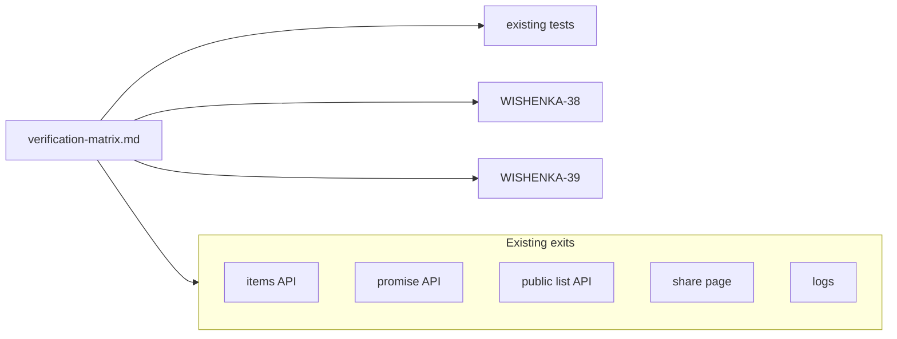

# WISHENKA-37: Verification matrix for product invariants

## Research

Accepted requirements live in `ai-tasks/WISHENKA-37/10-requirements.md`.
The product already enforces the three families. This task maps those
families onto exits that exist today. WISHENKA-38 owns the end-to-end
surprise suite. WISHENKA-39 owns race and load. WISHENKA-18, WISHENKA-19,
WISHENKA-20, and WISHENKA-57 already shipped promise actions, the wish
card, the cabinet, and the shared quantity outcome.

### API exits

Recipient and gifter wish reads go through `project_wish_item` in
`wishenka/wishlists/service.py`. `WishlistAccessPolicy.is_recipient` in
`wishenka/wishlists/policy.py` decides the wish's recipient. A recipient
receives `WishItemRecipientViewDTO` (`quantity`, `received_quantity`, no
reservation fields). Anyone else receives `WishItemGifterViewDTO`, which
includes `available_quantity` and that caller's own promise fields. Both
types are in `wishenka/wishlists/schemas.py`.

HTTP wish reads are `list_items` and `get_item` in
`wishenka/web/routes/items.py` (`wishenka.web.items`). Promise actions
are the routes in `wishenka/web/routes/reservations.py`
(`wishenka.web.reservations`), prefix
`/api/wishlists/{wishlist_id}/items/{item_id}/reservations`. A gifter
success uses `PromiseActionDTO`. A recipient refusal is the existing
answer on that route.

The public list answer is `public_wishlist` in
`wishenka/web/routes/wishlists.py` (`GET /api/public/wishlists/{token}`).
It returns `projection(wl, None, True)`. That item dict includes
`quantity` and `received_quantity` and omits `available_quantity`.
`tests/test_wishlist_management_ui.py`
`test_anonymous_public_display_ignores_stale_session_and_hides_reservation`
calls this JSON route with a stale `session_id` cookie. The test file
is a UI suite. The exit it checks is the public list API.

### Share page

`view_public_share` in `wishenka/web/routes/sharing.py` renders
`wishenka/web/templates/share_wishlist.html` for
`GET /share/{public_token}`. The wish card partial is
`get_item_card_partial` and
`wishenka/web/templates/partials/item_card.html`.

For an unidentified caller, `project_wish_item` returns the gifter DTO,
so the card can show `available_quantity`. The booking form is rendered
only when `can_promise` is true, and `can_promise` requires
`viewer_identified`. That is the accepted split with the public list
answer: the share page shows the free remainder and hides the booking
control; the public list answer omits the free remainder.

The cabinet is `wishenka/web/routes/reservations_ui.py`. Item management
UI, including guest denial of quick-add and edit, is
`wishenka/web/routes/items_ui.py`.

### Logs

`ShareTokenAccessFilter` and `RequestLoggingMiddleware` in
`wishenka/web/app.py` rewrite `/share/{token}` and
`/api/public/wishlists/{token}` before those paths are logged.
`wishenka/logging.py` formats the records (`JsonFormatter`,
`configure_logging`). Promise-route logs use `wishenka.web.reservations`.
Domain audit uses `wishenka.wishlists`. Wish-transaction commit and
rollback logs use `wishenka.wishlists.store`. The shared-view event
`wishlist_shared_view` records the wishlist id, not the token.

Operator records of a gifter's own booking still identify that gifter.
`tests/test_reservation_observability.py`
`test_item_reserved_observability_event` and the sibling booking events
in that module check that stream. S5 leaves it on the stories that
shipped it.

### Notifications

A search of `wishenka/` finds no notification sender and no
`notification` symbol. `doc/dev/architecture.md` still names a
`notification_outbox` table from the original service sketch. No module
writes that table. S6 has no implementation to index and no test that
inspects message text. The gap owner stays WISHENKA-38. This task does
not add a sender.

### Ceiling already in force

`project_wish_item` computes the visible remainder as requested quantity
minus received units minus the sum of `ACTIVE` and `PURCHASED` promise
quantities, floored at zero. One process also has
`ItemConcurrencyCoordinator` in `wishenka/wishlists/concurrency.py`.
Other processes cannot see that lock. Cross-process exclusion is
`WishlistStore.execute_wish` in `wishenka/wishlists/store.py`, shipped
by WISHENKA-57. R1 indexes the one-copy tests. R2 indexes the
multiprocess tests. R5 is the load gap owned by WISHENKA-39.

### Anonymous access

Opening `/share/{public_token}` uses the optional session. Storing a
promise uses `get_current_user` on the reservations router. A user row
is written from Telegram authentication
(`wishenka/web/routes/auth.py`, `wishenka/users/store.py`).
`tests/test_auth_user_store.py`
`test_guest_request_does_not_create_user` calls `GET /healthz` and then
checks that user id 1 is absent. That is not a share-link visit. A3
records the missing share-link check and names WISHENKA-38.

### Tests the matrix cites

Every function below is present in the named test module. The durable
rows are in `doc/dev/verification-matrix.md`.

`tests/test_wish_items_crud_api.py`:

- `test_get_items_and_single_item_surprise_invariant` (S1)
- `test_get_items_collaborative_addressing_surprise_invariant` (S1)
- `test_item_observability_privacy_invariants_no_tokens_or_auth_data`
  (S5)

`tests/test_reservation_actions_api.py`:

- `test_recipient_create_and_wish_reads_stay_silent` (S1, S2)
- `test_recipient_cancel_does_not_reveal_the_promise` (S2)
- `test_recipient_create_refusal_hides_whether_a_promise_exists` (S2, S5)
- `test_recipient_mutation_refusal_matches_a_missing_promise` (S2, S5)
- `test_completed_promise_log_omits_the_gifter` (S5)
- `test_busy_promise_logs_warning_without_gifter` (S5)
- `test_shortage_names_the_free_remainder` (R1, R4)
- `test_unauthenticated_create_is_rejected` (A3)
- `test_unauthenticated_mutation_is_rejected` (A3)

`tests/test_reservations_surprise_invariant.py`:

- `test_recipient_view_has_no_reservation_attributes` (S1)
- `test_recipient_cannot_book_own_gift_raises_self_reservation_error` (S2)
- `test_coauthor_cannot_book_item_where_they_are_explicit_recipient` (S2)
- `test_concurrent_race_condition_prevented_by_coordinator` (R1)
- `test_update_reservation_quantity_rejects_insufficient_balance` (R1)
- `test_purchased_reservation_retains_inventory_lock` (R3)
- `test_cancel_reservation_restocks_available_quantity` (R3)

`tests/test_wishlist_roles_lifecycle.py`:

- `test_zero_leak_projection_omits_reservation_data` (S1)
- `test_reservation_audit_logging` (S5)
- `test_warning_logging_on_access_denial_and_surprise_invariant` (S5)
- `test_public_token_provides_read_and_gifter_access_without_exposing_invite`
  (A1)
- `test_token_regeneration_invalidates_old_tokens` (A6)

`tests/test_wishlists_htmx_sharing.py`:

- `test_public_share_view_owner_surprise_invariant` (S3, A5)
- `test_public_share_view_guest_sees_reservations_and_items` (A1)

`tests/test_wish_card_giver_controls.py`:

- `test_personal_owner_display_name_hides_giver_facts` (S3)
- `test_recipient_notice_refresh_has_no_booking_sentence` (S3)
- `test_collaborative_list_decides_recipient_per_wish` (S3)
- `test_personal_owner_mutations_are_not_found` (S2)
- `test_personal_owner_display_name_cannot_promise` (S2)
- `test_gifter_refusal_notice_names_no_holder` (S4, R4)
- `test_shortage_leaves_the_last_promise` (S4, R3, R4)
- `test_busy_inventory_does_not_look_like_a_booking` (R3)
- `test_anonymous_share_shows_availability_without_a_book_control` (A2)

`tests/test_wish_items_list_reorder_ui.py`:

- `test_rbac_and_surprise_invariant_on_reorder_and_archive` (S3)

`tests/test_reservations_cabinet_ui.py`:

- `test_groups_only_the_callers_promises` (S4)
- `test_success_refresh_hides_the_other_gifter` (S4)
- `test_personal_owner_and_collaborative_recipient` (S4)
- `test_anonymous_gets_neither` (A1)

`tests/test_reservation_observability.py`:

- `test_zero_surprise_leaks_in_recipient_audit_trails` (S5)
- `test_item_reserved_observability_event` (operator stream noted on S5)

`tests/test_shared_inventory_multiprocess.py`:

- `test_last_free_units_one_success_across_processes` (S4, R2, R4)
- `test_increase_refused_leaves_earlier_promise` (R2)
- `test_cancel_releases_units_once` (R2)
- `test_smaller_quantity_releases_units_once` (R2)
- `test_lower_requested_quantity_sees_other_process_booking` (R2)
- `test_receipt_is_not_capped_by_occupied_units` (R2)
- `test_different_wishes_both_succeed` (R2)
- `test_one_store_keeps_self_booking_and_archive_rules` (R2)
- `test_locked_wish_raises_inventory_busy_and_leaves_balance` (R2)
- `test_wish_transaction_logs_commit_without_row_or_gifter` (S5)
- `test_wish_transaction_logs_domain_rollback_without_gifter` (S5)
- `test_wish_transaction_logs_storage_rollback_without_row_dump` (S5)

`tests/test_wishlists_sqlite_repo.py`:

- `test_atomic_reservation_allocation_and_rollback` (R1)

`tests/test_wishlist_api.py`:

- `test_anonymous_public_view_hides_existing_reservation` (S7)
- `test_public_api_shows_persisted_wish_without_reservation_details` (S7)
- `test_sharing_is_private_revocable_and_persists_after_restart` (A1, A6)
- `test_server_access_log_filter_redacts_public_token` (A7)
- `test_management_authorization_lifecycle_and_log_redaction` (A7)

`tests/test_wishlist_management_ui.py`:

- `test_anonymous_public_display_ignores_stale_session_and_hides_reservation`
  (S7)

`tests/test_wish_items_tma_ui.py`:

- `test_tma_ui_observability_privacy_invariants` (S5)
- `test_guest_and_anonymous_access_denied_to_item_ui` (A1)

`tests/test_wishlists_htmx_observability.py`:

- `test_share_token_access_filter_redaction` (A7)

`tests/test_auth_user_store.py`:

- `test_guest_request_does_not_create_user` (health check, not A3)

Rows with no test: S6, S8, R5, and the A3 share-link account check.

### Traceability practice

A verification matrix records forward coverage (invariant to test) and
names gaps instead of treating a missing test as an implicit pass.
[ArcKit's traceability guide](https://arckit.org/guide/traceability.html)
keeps the matrix lightweight by citing paths, and separates covered,
partial, and gap. [AroTrace's requirements-verification
architecture](https://arotrace.com/resources/reference-architectures/requirements-verification/)
keeps "intended to be verified by" separate from executing the test and
from changing the product. That split matches this task: the checklist
cites tests that already exist, and sibling stories own the suites that
do not.

Safety-style matrices that generate the grid in CI, or that demand a
formal property per row, add a checker. The accepted requirements ask
for a document and forbid new tests. This design does not add a
generator or a CI orphan check.

Python project docs for this repository live in `doc/dev/`, next to
`doc/dev/architecture.md`. The language guide's `docs/` folder is the
same idea. The service package stays `wishenka/`.

## Implementation Plan

N/A — no behavioral change. The surprise rule, the free-remainder
ceiling, and anonymous open-by-link already run in the modules named
above. The accepted requirements make this task a checklist of those
exits and of the tests that already cover them. A red test whose only
job is to fail until a markdown file exists is not an accepted
requirement, and it would not assert product behavior.

Step 3 is N/A for the same reason. There is no production fix to put
after a failing repro. WISHENKA-38 writes the missing end-to-end
surprise checks. WISHENKA-39 writes race and load. This task does not
sequence either suite.

The developer checklist is `doc/dev/verification-matrix.md`, linked from
`doc/dev/architecture.md`. No route, DTO, log line, template, or test
is added.

## Architecture

The deliverable is an index. It has no runtime module, no new
interface, and no place on the request path.

### Pattern

The pattern is a requirements-to-verification matrix: one row per exit
or scenario, citing the existing module and the existing test, with an
explicit gap owner when no test exists. Forward reading answers "which
exit already has a check?" Backward reading answers "which row does
this test cover?" A pass on one row is a pass on that exit alone.

Role projection stays the existing pair of DTOs. The ceiling stays the
wish-scoped transaction from WISHENKA-57. Anonymous read stays the
share route plus the optional session. Those are the interfaces the
matrix indexes. They are not redesigned here.

### Module diagram

S6 has no exit box. No sender exists. The row still points at
WISHENKA-38.

### Modules and responsibilities

| Module | Responsibility the matrix indexes |
| --- | --- |
| `wishenka/web/routes/items.py` | Recipient and gifter wish JSON |
| `wishenka/web/routes/reservations.py` | Promise answers and promise-route logs |
| `wishenka/web/routes/wishlists.py` | Public list JSON that omits the remainder |
| `wishenka/web/routes/sharing.py` | Share page and wish card |
| `wishenka/web/templates/partials/item_card.html` | Remainder text and booking control |
| `wishenka/web/routes/reservations_ui.py` | Gifter cabinet |
| `wishenka/web/routes/items_ui.py` | Management UI and guest denial |
| `wishenka/wishlists/service.py` | `project_wish_item` and domain audit |
| `wishenka/wishlists/policy.py` | Who the recipient of a wish is |
| `wishenka/wishlists/schemas.py` | Recipient DTO, gifter DTO, promise DTO |
| `wishenka/wishlists/store.py` | Cross-process ceiling and transaction logs |
| `wishenka/wishlists/concurrency.py` | In-process coordinator cited by R1 |
| `wishenka/web/app.py` | Access-log redaction of the share token |
| `wishenka/logging.py` | Log formatting |
| `wishenka/users/store.py` | User rows created by Telegram auth |
| `tests/` modules listed in Research | Evidence already attached to a row |

Notification sender: no module. S6 records that absence.

### Interaction

A request still enters one exit, uses the projection or log filter that
exit already uses, and returns. Tests in `tests/` call those exits.
The matrix names both. Nothing in `wishenka/` reads the matrix.

Gaps do not add a call. S5's combined answer-plus-log walk, S6, S8, and
the A3 share-link account check wait on WISHENKA-38. R5 waits on
WISHENKA-39. R1–R4 and the covered surprise rows stay on the tests
already listed.

Promise actions, the wish card, the cabinet, and the shared quantity
outcome stay on WISHENKA-18, WISHENKA-19, WISHENKA-20, and WISHENKA-57.
The matrix points at their modules. It does not describe those features
again as new work.

### Interfaces recorded

These are the contracts already returned. The matrix does not change
fields.

- Recipient wish body: `WishItemRecipientViewDTO`. Includes requested
  quantity and received quantity. Omits the gifter, the reservation,
  the booked quantity, and the free remainder.
- Gifter wish body: `WishItemGifterViewDTO`. Includes
  `available_quantity` and that caller's promise fields.
- Public list item: `projection(..., public=True)` in
  `wishenka/web/routes/wishlists.py`. Omits `available_quantity`.
- Share card for an unidentified opener:
  `partials/item_card.html` shows the remainder and omits the booking
  form while `viewer_identified` is false.
- Recipient share card: giver block omitted because `is_recipient` is
  true.
- Promise route: recipient refusal omits the gifter, the booked
  quantity, and the free remainder, and matches the missing-promise
  answer. Unauthenticated create and mutation store nothing.
- Logs on a recipient path and on the client promise route omit the
  gifter. Access logs do not print the share token.
- Recipient notification: no payload exists. S6 is the gap.

### Where the checklist lives

Developers read subsystem docs in `doc/dev/`. The durable matrix is
`doc/dev/verification-matrix.md`. `doc/dev/architecture.md` links it
from the subsystem list. `ai-tasks/WISHENKA-37/10-requirements.md`
remains the accepted rule text. This file is the index design.

Row shape, matching the accepted "how to read a row":

1. Identifier (`S1`–`S8`, `R1`–`R5`, `A1`–`A7`).
2. Rule for that exit or scenario.
3. Module that implements the exit.
4. Existing test, or the statement that no test exists.
5. Gap, naming WISHENKA-38 or WISHENKA-39 when a suite is still open.

A bare "covered" without a test name is not a row.

## Q&A

- **Why is the checklist under `doc/dev/`?** That directory is where a
  developer already looks for subsystem behavior
  (`doc/dev/architecture.md` and the domain notes). The task folder
  keeps the accepted requirements and this design. The rows a reviewer
  uses while changing an exit are in
  [`doc/dev/verification-matrix.md`](../../doc/dev/verification-matrix.md).
- **Why is Step 3 N/A?** There is no runtime behavioral change. The
  invariants already run in the modules above. The accepted definition
  of done is the document, and it forbids new tests. A test that fails
  until the markdown file exists would not check an exit.
- **Why name modules and tests on each row?** A pass on one exit is a
  pass on that exit alone. The module tells the reader which answer,
  page, or log can break the rule. The test tells the reader which
  check already exists.
  [ArcKit](https://arckit.org/guide/traceability.html) describes that
  forward link.
  [AroTrace](https://arotrace.com/resources/reference-architectures/requirements-verification/)
  keeps the planned check separate from building a new one.
- **Why are S6, S8, A3, and R5 gaps?** S6 has no sender and no test.
  S8 has no single walk across the recipient answer, the log, and a
  notification. A3's missing check is a share-link visit that creates
  no account. The health-check test is a different request. R5 has no
  load suite. WISHENKA-38 owns the surprise gaps, including A3 as
  role-context end-to-end. WISHENKA-39 owns R5.
- **Why do the share page and the public list differ on the free
  remainder?** That difference is accepted product behavior. The share
  page (`sharing.py`, `item_card.html`) shows the remainder and hides
  the booking control for an unidentified opener. The public list
  (`projection` with `public=True`) omits the remainder. A recipient
  exit omits the gifter, the reservation, the booked quantity, and the
  free remainder. A2, S7, and A4 record the decision.
- **Why can some operator logs still name the acting gifter?** Those
  records are the operator stream of that gifter's own booking, already
  checked in `tests/test_reservation_observability.py`. S5 indexes
  recipient-path logs and client promise-route logs. The matrix leaves
  the operator stream on the stories that shipped it.
- **Does this design add a notification module or a load harness?**
  No. S6 and R5 name the owners of those suites. The package has no
  notification sender to extend.
- **Does this design re-specify booking, the card, the cabinet, or the
  shared quantity outcome?** It points at WISHENKA-18, WISHENKA-19,
  WISHENKA-20, and WISHENKA-57 and at the modules those stories
  shipped.
