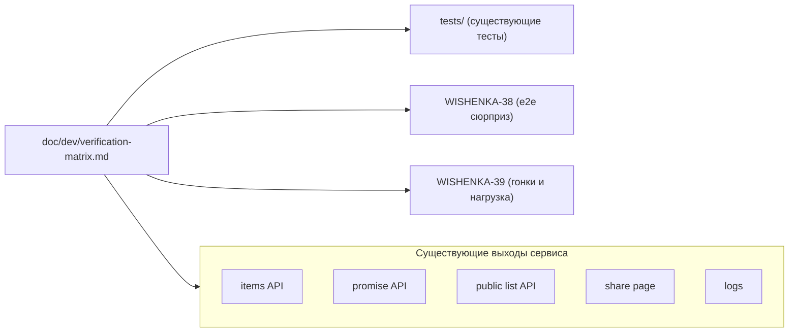

# Спецификация: WISHENKA-37 — Матрица верификации продуктовых инвариантов

- **Ключ задачи:** `WISHENKA-37`
- **Тип результата:** документация разработчика (без изменения runtime-кода и без добавления новых автотестов)
- **Язык сервиса:** Python 3.12+
- **Основной артефакт:** `doc/dev/verification-matrix.md` (связан из `doc/dev/architecture.md`)
- **Связанные задачи:** `WISHENKA-18`, `WISHENKA-19`, `WISHENKA-20`, `WISHENKA-57` (реализованное поведение); `WISHENKA-38`, `WISHENKA-39` (запланированные тестовые наборы)

## 1. Назначение и бизнес-цель

### 1.1. Постановка проблемы

В продуктовой и функциональной спецификациях сервиса **Telegram Wishlist Service («Вишенка»)** (`specs/00-high.md`, раздел 6, и `in-docs/spec.md`) уже закреплены три ключевых инварианта:

1. Получатель подарка ни при каких обстоятельствах не узнаёт о факте бронирования, личности дарителя, забронированном количестве и статусе покупки.
2. Открытие вишлиста по публичной ссылке не требует отдельной регистрации или прохождения онбординга.
3. Суммарное количество забронированных экземпляров ограничивается свободным остатком относительно запрошенного владельцем количества (межпроцессный потолок, реализованный в `WISHENKA-57`).

На уровне кода эти правила уже работают, однако их автоматические проверки распределены по разным тестовым модулям в `tests/`. Изменение логики на одном участке может сохранить инвариант на одном «выходе» системы (например, в JSON-ответе) и нарушить его на другом (в HTML-карточке, журнале логирования или уведомлении), либо удержать потолок остатка в одиночном сценарии, но пропустить гонку при конкурентных запросах. До создания матрицы у разработчиков и ревьюеров не было единого индекса, позволяющего быстро ответить на вопрос, какой именно выход уже проверен и каким тестом, а какие проверки ещё отсутствуют.

### 1.2. Цели задачи

- Сформировать единый долгоживущий чеклист разработчика (`doc/dev/verification-matrix.md`), индексируемый из `doc/dev/architecture.md`, который связывает продуктовые инварианты с конкретными точками выхода сервиса, существующими тестами и явными пробелами покрытия.
- Охватить три семейства инвариантов:
  1. **Тайна сюрприза на каждом выходе (`S1`–`S8`)** — ответы API, страница шеринга, логи и уведомления.
  2. **Конкурентное бронирование и потолок свободного остатка (`R1`–`R5`)** — интрапроцессное и межпроцессное исключение, удержание купленных единиц и информирование проигравшего.
  3. **Анонимный доступ дарителя по публичной ссылке (`A1`–`A7`)** — чтение без сессии, различие публичных выходов, запрет безымянной брони, ротация ссылки и редактирование токена в логах доступа.
- Зафиксировать строгое разделение ответственности между задачами:
  - `WISHENKA-37` поставляет только документ-матрицу покрытия и пробелов, ссылаясь на уже реализованную функциональность (`WISHENKA-18` — действия с обещаниями и молчание для получателя, `WISHENKA-19` — элементы управления дарителя на карточке желания, `WISHENKA-20` — кабинет «Мои бронирования», `WISHENKA-57` — общий межпроцессный учёт остатка).
  - `WISHENKA-38` отвечает за сквозные end-to-end проверки тайны сюрприза и ролевого контекста.
  - `WISHENKA-39` отвечает за нагрузочное тестирование и гонки поверх базовых примеров.

### 1.3. Бизнес- и системная ценность

- **Для разработчиков:** прозрачная двунаправленная трассировка при изменении желаний, обещаний, публичных ссылок и сообщений без необходимости вручную искать разрозненные проверки по всему каталогу `tests/`.
- **Для ревьюеров:** точная привязка каждого инварианта к конкретному выходу (ответу, странице, логу или уведомлению), исключающая ложную уверенность, когда успешная проверка одного выхода ошибочно переносится на остальные.
- **Для сервиса и пользователей:** системный контроль регрессий по ключевым продуктовым гарантиям (тайна сюрприза, предотвращение дублирующих покупок и низкий порог входа по ссылке).

### 1.4. Границы области действия

- **Входит в объём задачи:** трёхсемейная матрица (`S1`–`S8`, `R1`–`R5`, `A1`–`A7`), перечень индексируемых модулей выхода, точные ссылки на существующие тесты и фиксация владельцев открытых пробелов (`WISHENKA-38`, `WISHENKA-39`).
- **Не входит в объём задачи:** добавление или изменение продуктового Python-кода, написание новых автотестов, реализация сервиса отправки уведомлений, повторная спецификация API обещаний/карточки/кабинета/межпроцессного учёта, пересмотр исключения для авторского предупреждения перед архивированием (в `items_ui.py`), а также закрытие открытых продуктовых вопросов (получатель без аккаунта Telegram, судьба броней при удалении профиля, платежи, краудфандинг и секретные подарки вне списка).

## 2. Функциональные требования и пользовательские сценарии

### 2.1. Роли и основные сущности

Ролевая модель следует продуктовой спецификации:

- **Владелец (`owner`)** и **соавтор (`co-author`)** — авторы вишлиста.
- **Даритель (`gifter`)** — пользователь, просматривающий список и бронирующий доступные единицы желаний.
- **Получатель (`recipient`)** — адресат подарка, определяемый **на уровне конкретного желания**: в личном вишлисте получателем каждого желания является владелец (в том числе если у желания заполнено только отображаемое имя); в совместном вишлисте получатель указывается для каждого желания отдельно, поэтому один и тот же человек может быть получателем одного желания и дарителем другого в одном списке.

Основные понятия матрицы:

| Понятие                              | Определение в контексте матрицы                                                                                                                               |
| ------------------------------------ | ------------------------------------------------------------------------------------------------------------------------------------------------------------- |
| Желание (`Wish`)                     | Запрос подарка с запрошенным (`quantity`) и полученным (`received_quantity`) количеством                                                                      |
| Обещание (`Promise` / `Reservation`) | Бронь дарителя на положительное число единиц в статусе `ACTIVE` (задумано), `PURCHASED` (куплено) или `CANCELLED` (отменено); скрыта от получателя            |
| Публичная ссылка (`public_token`)    | Токен-возможность (capability) для чтения списка без отдельной регистрации; перевыпуск отзывает прежнюю ссылку; отделён от токена приглашения `invite_token` |
| Выход (`Exit`)                       | Тело ответа (JSON или HTML), уведомление или запись лога, доступная пользователю или оператору; инвариант сюрприза проверяется на каждом выходе отдельно      |
| Свободный остаток (`Free remainder`) | `max(0, requested − received − occupied)`, где `occupied` — сумма единиц по обещаниям в статусах `ACTIVE` и `PURCHASED`                                       |

### 2.2. Пользовательские сценарии

1. **Проверка изменений разработчиком:** разработчик перед правкой логики желания, обещания, публичной ссылки или уведомлений обращается к единому чеклисту, чтобы определить, какие выходы уже покрыты тестами по тайне сюрприза, потолку остатка и анонимному доступу.
2. **Аудит выхода ревьюером:** ревьюер проверяет, что каждый затронутый выход (ответ, уведомление или лог) имеет собственную поименованную проверку либо явно отмеченный пробел с владельцем.
3. **Изоляция получателя на всех выходах:** при обращении получателя к списку, карточке, действиям с бронью или при получении им уведомлений/логов любой выход исключает дарителя, наличие брони, забронированное количество, статус покупки и свободный остаток.
4. **Согласованное поведение публичных выходов для гостя:** неидентифицированный посетитель HTML-страницы шеринга (`GET /share/{public_token}`) видит свободный остаток, но не видит элементов управления бронированием (`A2`), тогда как публичный JSON-ответ (`GET /api/public/wishlists/{token}`) полностью опускает свободный остаток (`S7`, `A4`).
5. **Бесшовный доступ и честная конкуренция для дарителя:** даритель открывает вишлист по публичной ссылке без отдельной регистрации; при одновременной попытке занять последние единицы остаток после завершения операции остаётся неотрицательным, а проигравший не узнаёт личность победителя.

### 2.3. Правила структуры и чтения матрицы

Каждая строка матрицы имеет фиксированный формат и обязательные элементы:

1. **Идентификатор строки:** `S1`–`S8` (семейство 1), `R1`–`R5` (семейство 2), `A1`–`A7` (семейство 3).
2. **Правило инварианта:** точные входные условия, допустимые поля и запрещённые к раскрытию сведения для данного выхода или сценария.
3. **Реализующие модули:** конкретные модули в `wishenka/`, через которые проходит данный выход.
4. **Существующие тесты или констатация отсутствия:** путь к тестовому модулю и точное имя тестовой функции (пометка «covered» без имени теста не допускается).
5. **Пробел (Gap):** `none`, если выход подтверждён указанными тестами, либо ссылка на владельца открытого тестового набора (`WISHENKA-38` или `WISHENKA-39`).

Статус «покрыто» для отдельного выхода означает проверку только этого выхода и не отменяет сквозной проверки (такой как `S8`), если она выделена в отдельный открытый пробел.

### 2.4. Функциональные инварианты по семействам

#### Семейство 1. Тайна сюрприза на каждом выходе (`S1`–`S8`)

Правило семейства: любой ответ получателю, лог обслуживания этого запроса и уведомление получателю обязаны опускать личность дарителя, факт брони, забронированное количество, свободный остаток и статус покупки.

| ID   | Выход / сценарий                                | Требуемое поведение, входы и выходы                                                                                                                                                              | Статус в `WISHENKA-37`                                                                                               |
| ---- | ----------------------------------------------- | ------------------------------------------------------------------------------------------------------------------------------------------------------------------------------------------------ | -------------------------------------------------------------------------------------------------------------------- |
| `S1` | Чтение желания получателем                      | Ответ списка и одного желания включает `quantity` и `received_quantity`, но опускает дарителя, бронь, забронированное количество и свободный остаток                                             | Покрыто (5 тестов); сквозной проход вынесен в `S8`                                                                   |
| `S2` | Отказ получателю в операциях брони              | Попытка создать бронь даёт одинаковый отказ как для свободного, так и для уже занятого желания; попытка изменить/отменить/отметить покупку отвечает как для отсутствующей брони без утечки полей | Покрыто (8 тестов); пробел для выхода: `none`                                                                        |
| `S3` | Страница шеринга и карточка желания получателя  | Страница `/share/{public_token}` и частичный шаблон карточки не содержат имя дарителя, фразу о бронировании и свободный остаток при просмотре получателем                                        | Покрыто (5 тестов); пробел для выхода: `none`                                                                        |
| `S4` | Другой даритель и кабинет «Мои бронирования»    | Даритель видит свободный остаток и только собственную бронь; отказ при нехватке не называет держателя других единиц; кабинет и обновление показывают только брони вызывающего                   | Покрыто (7 тестов); нагрузка по потолку вынесена в семейство 2                                                       |
| `S5` | Логи запросов получателя и клиентских маршрутов | Лог чтения получателем и лог клиентского маршрута бронирования не называют дарителя; отказ создания для получателя одинаков с бронью и без; отказ изменения несёт путь без дарителя             | Покрыто по отдельным модулям (8 тестов); **пробел:** нет комбинированного теста «ответ + лог запроса» (`WISHENKA-38`) |
| `S6` | Уведомления получателю                          | Сообщение получателю о желании, получении, архиве или напоминании опускает дарителя, бронь, занятое количество и свободный остаток                                                               | Тестов нет; в базовом коде нет отправителя уведомлений; **пробел:** `WISHENKA-38`                                    |
| `S7` | Публичный JSON-ответ неидентифицированному      | `GET /api/public/wishlists/{token}` опускает свободный остаток, дарителя, бронь и занятое количество, в том числе при передаче устаревшей cookie-сессии                                          | Покрыто (3 теста); отличие от `A2` принято продуктом; пробел: `none`                                                 |
| `S8` | Единый сквозной проход по выходам               | Для одного забронированного желания ответ получателю, уведомление получателю (при наличии отправителя) и лог этого запроса одновременно удовлетворяют `S1`, `S5` и `S6`                          | Единого теста нет; **пробел:** `WISHENKA-38`                                                                         |

#### Семейство 2. Конкурентное бронирование и потолок свободного остатка (`R1`–`R5`)

Правило семейства (реализовано в `WISHENKA-57`): свободный остаток равен `max(0, requested − received − occupied)`. После успешного создания или увеличения брони остаток `>= 0`. Попытка увести остаток в минус отклоняется и сохраняет последний зафиксированный баланс. Покупка удерживает единицы; отмена или уменьшение освобождают их однократно; фиксация получения не закрывает бронь. При гонке за последние единицы побеждает ровно одна попытка, а проигравшая получает свободный остаток без указания победителя.

| ID   | Сценарий конкурентности                  | Требуемое поведение и инвариант остатка                                                                                                                                                                             | Статус в `WISHENKA-37`                       |
| ---- | ---------------------------------------- | ------------------------------------------------------------------------------------------------------------------------------------------------------------------------------------------------------------------- | -------------------------------------------- |
| `R1` | Один процесс, последние единицы          | Две попытки занять одни и те же свободные единицы в одном процессе оставляют остаток `>= 0`; побеждает только одна; увеличение сверх остатка отклоняется                                                            | Покрыто (3 теста); пробел: `none`            |
| `R2` | Несколько процессов (`WISHENKA-57`)      | Межпроцессная согласованность `execute_wish`: один успех на последние единицы, сохранение брони при отказе увеличения, однократный возврат единиц, проверка снижения количества, изоляция разных желаний и откат занятости | Покрыто (9 тестов); пробел: `none`           |
| `R3` | Купленные единицы удерживаются           | Покупка сохраняет единицы занятыми; отмена возвращает их в свободный остаток; карточка после нехватки показывает остаток и не выглядит как сохранённая бронь                                                        | Покрыто (4 теста); пробел: `none`            |
| `R4` | Ответ проигравшему при нехватке          | Видимый остаток равен свободному остатку после успешной попытки (`>= 0`), текст отказа не называет держателя единиц                                                                                                 | Покрыто (4 теста); пробел: `none`            |
| `R5` | Повторная конкуренция и нагрузка         | Многократная гонка, множество дарителей и нагрузочный профиль при сохранении того же потолка остатка                                                                                                                | Нагрузочного набора нет; **пробел:** `WISHENKA-39` |

#### Семейство 3. Анонимный доступ дарителя по публичной ссылке (`A1`–`A7`)

Правило семейства: владелец ссылки может открыть вишлист в Mini App без отдельной регистрации или онбординга. Просмотр не даёт прав редактирования. Сохранение обещания по-прежнему требует идентификации пользователя Telegram (`WISHENKA-18`). Секрет приглашения соавторов не попадает на публичную страницу, а замена публичной ссылки отзывает старую.

| ID   | Сценарий доступа по ссылке                | Требуемое поведение, входы и выходы                                                                                                                                    | Статус в `WISHENKA-37`                                                                                                  |
| ---- | ----------------------------------------- | ---------------------------------------------------------------------------------------------------------------------------------------------------------------------- | ----------------------------------------------------------------------------------------------------------------------- |
| `A1` | Открытие по ссылке без сессии             | Страница шеринга показывает название списка и желания, скрывает быстрое добавление, редактирование, кабинет «Мои бронирования» и секрет приглашения (`invite_token`)   | Покрыто (5 тестов); пробел: `none`                                                                                      |
| `A2` | Остаток на share-странице без кнопки      | Неидентифицированный посетитель `/share/{public_token}` видит свободный остаток, но не видит форму/кнопку бронирования (согласованное отличие от `S7` и от получателя) | Покрыто (1 тест); пробел: `none`                                                                                        |
| `A3` | Запрет безымянной брони и создания аккаунта | Попытка создать или изменить бронь без сессии отклоняется без записи в БД; открытие share-ссылки без сессии не должно создавать пользователя                           | Отказ брони покрыт (2 теста API); **пробел:** нет теста визита по share-ссылке на несоздание пользователя (`WISHENKA-38`) |
| `A4` | Два публичных выхода для одной ссылки     | Согласованное различие: share-страница (`A2`) показывает остаток без формы брони, публичный JSON (`S7`) опускает остаток, а выход получателя (`S1`/`S3`) скрывает всё  | Покрыто (6 тестов по всем выходам); пробел: `none`                                                                      |
| `A5` | Получатель открывает публичную ссылку     | При идентификации получателя на странице шеринга применяются правила семейства 1 (`S3`)                                                                                | Покрыто через `S3` (1 тест); пробел: `none`                                                                             |
| `A6` | Заменённая или неизвестная ссылка         | После перевыпуска токена старая ссылка не открывает список (неизвестный токен даёт `404`), новая открывает                                                             | Покрыто (2 теста); пробел: `none`                                                                                       |
| `A7` | Отсутствие токена ссылки в логах доступа  | Лог публичного открытия страницы или JSON API не выводит `public_token`                                                                                                | Покрыто (3 теста); пробел: `none`                                                                                       |

## 3. Архитектура, компоненты и интерфейсы

### 3.1. Архитектурный паттерн и место в системе

Задача `WISHENKA-37` реализована по паттерну **матрицы трассируемости требований к верификации** (`doc/dev/verification-matrix.md`), оформленной как статический документ в каталоге документации подсистем `doc/dev/` со ссылкой из `doc/dev/architecture.md`.

Ключевые архитектурные принципы:

- **Отсутствие runtime-зависимости:** ни один модуль пакета `wishenka/` не читает файл матрицы; матрица не находится на пути выполнения HTTP-запросов.
- **Изоляция от CI-генераторов:** автоматическая генерация таблиц или проверка «сиротских» тестов в рамках данной задачи не вводилась, чтобы сохранить лёгкость поддержки без изменения сборочного конвейера.
- **Неизменность существующих интерфейсов:** разделение ролевых проекций (`WishItemRecipientViewDTO` и `WishItemGifterViewDTO`), межпроцессная wish-scoped транзакция (`WishlistStore.execute_wish`) и анонимное чтение по `Optional`-сессии только индексируются без изменения их контрактов.

Для строки `S6` (уведомления получателю) на диаграмме отсутствует узел реализованного выхода, так как в кодовой базе на момент выполнения `WISHENKA-37` модуль рассылки уведомлений отсутствовал.

### 3.2. Индексируемые модули и компоненты

| Модуль / шаблон                                 | Классы, функции и маршруты                                                                                        | Роль в матрице и проверяемые строки                                                             |
| ----------------------------------------------- | ----------------------------------------------------------------------------------------------------------------- | ----------------------------------------------------------------------------------------------- |
| `wishenka/web/routes/items.py`                  | `list_items`, `get_item` (`/api/wishlists/{wishlist_id}/items`)                                                   | JSON-ответы чтения списка и одного желания; логгер `wishenka.web.items` (`S1`, `S5`, `S8`)      |
| `wishenka/web/routes/reservations.py`           | Маршруты `/api/wishlists/{wishlist_id}/items/{item_id}/reservations`, зависимость `get_current_user`              | Ответы и отказы при операциях обещания; логгер `wishenka.web.reservations` (`S2`, `S5`, `R1`, `R4`, `A3`) |
| `wishenka/web/routes/wishlists.py`              | `public_wishlist` (`GET /api/public/wishlists/{token}`), `projection`, сброс `POST .../share/reset`               | Публичный JSON без `available_quantity`, перевыпуск ссылки, событие `public_wishlist_viewed` (`S7`, `A4`, `A6`, `A7`) |
| `wishenka/web/routes/sharing.py`                | `view_public_share` (`GET /share/{public_token}`), `get_item_card_partial` (`GET /wishlists/{wishlist_id}/items/{item_id}/card`) | Рендеринг публичной страницы и HTMX-карточки, очистка уведомлений дарителя, событие `wishlist_shared_view` (`S2`, `S3`, `A1`, `A2`, `A4`–`A7`) |
| `wishenka/web/templates/share_wishlist.html`    | HTML-шаблон публичного списка                                                                                     | Страница публичного шеринга без управляющих элементов автора (`S3`, `A1`)                       |
| `wishenka/web/templates/partials/item_card.html` | HTML-фрагмент карточки желания                                                                                    | Условный рендеринг по `item.is_recipient` и `can_promise`, текст остатка и отказа (`S3`, `S4`, `R3`, `R4`, `A2`, `A4`) |
| `wishenka/web/routes/reservations_ui.py`        | Кабинет дарителя `GET /web/reservations`                                                                          | Список броней только вызывающего дарителя; отказ неаутентифицированному пользователю (`S4`, `A1`) |
| `wishenka/web/routes/items_ui.py`               | Маршруты управления элементами и архивации/сортировки                                                             | Запрет UI редактирования гостям; проекция получателя при перестановке и архивации (`S3`, `A1`) |
| `wishenka/wishlists/service.py`                 | `project_wish_item`, `regenerate_public_token`, `get_wishlist_by_public_token`                                    | Расчёт остатка и выбор DTO, запрет самоброни, перевыпуск токена, аудит `wishenka.wishlists` (`S1`, `S2`, `S5`, `S8`, `R3`, `A1`, `A2`, `A6`) |
| `wishenka/wishlists/policy.py`                  | `WishlistAccessPolicy.is_recipient`                                                                               | Определение статуса получателя на уровне конкретного желания (`S1`)                             |
| `wishenka/wishlists/schemas.py`                 | `WishItemRecipientViewDTO`, `WishItemGifterViewDTO`, `PromiseActionDTO`                                           | Строго разделённые контракты проекции получателя, дарителя и результата обещания (`S1`, `S4`)   |
| `wishenka/wishlists/store.py`                   | `WishlistStore.execute_wish`                                                                                      | Межпроцессная wish-scoped транзакция SQLite WAL (`WISHENKA-57`), транзакционные логи `wishenka.wishlists.store` (`S4`, `S5`, `R1`, `R2`, `R4`) |
| `wishenka/wishlists/concurrency.py`             | `ItemConcurrencyCoordinator`                                                                                      | Интрапроцессная блокировка по желанию (`R1`)                                                    |
| `wishenka/web/app.py`                           | `ShareTokenAccessFilter`, `RequestLoggingMiddleware`                                                              | Редактирование `public_token` в путях `/share/{token}` и `/api/public/wishlists/{token}` до записи в лог (`S8`, `A7`) |
| `wishenka/logging.py`                           | `JsonFormatter`, `configure_logging`                                                                              | Структурированный JSON-формат логов                                                             |
| `wishenka/users/store.py`, `wishenka/web/routes/auth.py` | Хранилище пользователей и аутентификация Telegram                                                        | Запись строки пользователя только при Telegram-аутентификации, но не при публичном чтении (`A3`) |

### 3.3. Контракты данных и переходы состояний

Матрица фиксирует следующие неизменяемые контракты данных на существующих выходах:

- **`WishItemRecipientViewDTO`:** возвращается через `project_wish_item`, когда `WishlistAccessPolicy.is_recipient` истинно. Содержит `quantity` и `received_quantity`; поля бронирования, дарителя, забронированного количества и `available_quantity` отсутствуют на уровне схемы.
- **`WishItemGifterViewDTO`:** возвращается, когда вызывающий не является получателем (включая неидентифицированного посетителя `view_public_share`). Содержит `available_quantity` (равный `max(0, requested − received − occupied)`) и поля собственной брони `my_*`. В `partials/item_card.html` блок дарителя скрывается при `item.is_recipient == True`, а форма бронирования рендерится только при `can_promise == True` (`viewer_identified` и активный вишлист).
- **Публичный JSON-элемент (`public_wishlist`):** формируется через `projection(wl, None, True)`; включает `quantity` и `received_quantity`, но не содержит `available_quantity` независимо от наличия устаревшей cookie-сессии.
- **Ответы маршрута обещаний (`/reservations`, `PromiseActionDTO`):** при отказе получателю скрывают наличие/отсутствие чужой брони, дарителя и количества; при нехватке единиц показывают только свободный остаток без держателя; при отсутствии сессии отклоняются через `get_current_user` без изменения состояния БД.

Переходы состояний, отслеживаемые матрицей:

- **Единицы обещания:** перевод в `ACTIVE` или `PURCHASED` удерживает единицы в `occupied`; уменьшение количества или перевод в `CANCELLED` однократно возвращает освободившиеся единицы в свободный остаток; фиксация получения подарка не закрывает обещания дарителя.
- **Публичная ссылка:** активный `public_token` открывает список на чтение; вызов `regenerate_public_token` (`POST /api/wishlists/{wishlist_id}/share/reset`) немедленно переводит прежний токен в недействительное состояние (`404`), сохраняя изоляцию от `invite_token`.

## 4. Нефункциональные требования, безопасность и наблюдаемость

### 4.1. Нефункциональные требования и ограничения

- **Требование к доказательности строк матрицы:** каждая строка считается валидной только при указании точного имени тестового модуля и функции либо явной фиксации отсутствия теста; неконкретное обозначение «covered» без ссылки на тест запрещено.
- **Отсутствие runtime-оверхеда и конфигурации:** файл `doc/dev/verification-matrix.md` не загружается сервисом, не имеет настроек и не добавляет задержек на обработку запросов. Целевые показатели производительности и нагрузочные профили в рамках `WISHENKA-37` не задаются и отнесены к `WISHENKA-39` (`R5`).
- **Стандарты оформления:** документация разработчика в `doc/dev/verification-matrix.md` оформлена на английском языке без таблиц, без хвостовых пробелов и с валидной перекрёстной ссылкой из `doc/dev/architecture.md`.

### 4.2. Безопасность и инварианты приватности

- **Защита тайны сюрприза:** двухуровневая изоляция (DTO-проекции + шаблоны/обработчики) гарантирует, что получатель не получает сведений о бронях и покупках ни через API, ни через HTML-страницу, ни через отказы в действиях (`S1`–`S3`). При этом существующее предупреждение автору о наличии брони перед архивированием желания (`items_ui.py` / `item_archive_modal.html`) зафиксировано как осознанное продуктовое исключение для автора, не являющееся выходом получателя.
- **Защита от раскрытия дарителей между собой:** при конфликте или нехватке единиц (`S4`, `R4`) даритель узнаёт только оставшееся свободным количество, а не личность держателя остальных единиц.
- **Capability-безопасность и аутентификация:** публичный `public_token` ограничивается режимом чтения без раскрытия `invite_token` и без создания учётной записи (`A1`–`A3`), поддерживает мгновенный отзыв при перевыпуске (`A6`), а любые мутации бронирования защищены обязательной проверкой Telegram-сессии (`get_current_user`).
- **Редактирование токенов в логах доступа (`A7`):** `ShareTokenAccessFilter` на `uvicorn.access` и `RequestLoggingMiddleware` на `wishenka.web` маскируют сегмент `{token}` в путях `/share/{token}` и `/api/public/wishlists/{token}` до эмиссии записи, а доменные события `wishlist_shared_view` и `public_wishlist_viewed` логируют только `wishlist_id`.

### 4.3. Наблюдаемость: структурированное логирование и метрики

В рамках `WISHENKA-37` не добавлялось новых записей логов (ни на одном из уровней от `EMERG` до `DEBUG`), новых метрик, экспортеров или интеграций с системами мониторинга (Prometheus, Grafana, ELK, Loki, alerting). Вместо этого матрица индексирует существующую наблюдаемость по строкам `S5` и `A7` (с сохранением стандартного формата `JsonFormatter` и `configure_logging` из `wishenka/logging.py`):

- **Получательский и клиентский поток (`S5`):**
  - Логгеры: `wishenka.web.reservations`, `wishenka.wishlists`, `wishenka.wishlists.store`, `wishenka.web.items`, а также логи `wishenka/web/routes/items_ui.py`.
  - Контракт приватности: логи при просмотре получателем и на клиентских маршрутах обещаний не содержат идентификатора дарителя; транзакционные логи commit/rollback в `WishlistStore` не печатают дамп строки и дарителя; отказ получателю в создании брони формирует идентичный лог независимо от наличия чужой брони; отказ изменения содержит идентификатор пути без дарителя.
- **Операторский поток бронирования (примечание к `S5`):**
  - Записи операторского аудита о собственном действии дарителя могут содержать `gifter_id` (покрывается `tests/test_reservation_observability.py::test_item_reserved_observability_event` и `tests/test_wishlist_roles_lifecycle.py::test_reservation_audit_logging`). Этот поток относится к задачам, реализовавшим наблюдаемость бронирования, и не считается выходом получателя, пока не вызывается на пути получателя.
- **Поток публичных открытий (`A7`):**
  - Логгеры `uvicorn.access`, `wishenka.web`, `wishenka.web.sharing` (`wishlist_shared_view`), `wishenka.web.wishlists` (`public_wishlist_viewed`) фиксируют факт обращения и `wishlist_id`, не раскрывая `public_token`.

## 5. Верификация и критерии приёмки

### 5.1. Подход к верификации

Поскольку `WISHENKA-37` является документационной задачей без изменения кода и без добавления новых тестов:

- Этап создания падающего воспроизведения (`Step 3`) неприменим (`N/A`).
- Статический анализатор кода (`make analyze`) и тестовый прогон (`pytest`) в рамках очистки Markdown не запускались.
- Выполнена содержательная ревизия всех ссылок в `doc/dev/verification-matrix.md` относительно реальных утверждений каждого теста (Шаги 4, 5 и 7), проверка отсутствия дублирования заметок, отсутствия хвостовых пробелов, корректности синтаксиса Markdown и разрешения ссылки из `doc/dev/architecture.md`.

По результатам ревизии из списков `Covered by` в `WISHENKA-37` были намеренно исключены 4 теста, не доказывающие целевой инвариант строки:

- Для `S5` оставлены в пояснительном примечании (не в `Covered by`), так как проверяют имена warning-событий, секреты CRUD или отсутствие дампа строки, но не отсутствие дарителя в логе получателя: `test_warning_logging_on_access_denial_and_surprise_invariant`, `test_item_observability_privacy_invariants_no_tokens_or_auth_data`, `test_wish_transaction_logs_storage_rollback_without_row_dump`.
- Для `R1` оставлен в пояснительном примечании `tests/test_wishlists_sqlite_repo.py::test_atomic_reservation_allocation_and_rollback`, так как он проверяет откат одной неудачной аллокации до `available_quantity = 2`, а не конкуренцию двух броней.

### 5.2. Проиндексированные тестовые сценарии (на момент `WISHENKA-37`)

| Строка    | Модули и тестовые функции покрытия                                                                                                                                                                                                                              |
| --------- | --------------------------------------------------------------------------------------------------------------------------------------------------------------------------------------------------------------------------------------------------------------- |
| `S1`      | `tests/test_wish_items_crud_api.py` (`test_get_items_and_single_item_surprise_invariant`, `test_get_items_collaborative_addressing_surprise_invariant`), `tests/test_reservation_actions_api.py` (`test_recipient_create_and_wish_reads_stay_silent`), `tests/test_reservations_surprise_invariant.py` (`test_recipient_view_has_no_reservation_attributes`), `tests/test_wishlist_roles_lifecycle.py` (`test_zero_leak_projection_omits_reservation_data`) |
| `S2`      | `tests/test_reservation_actions_api.py` (`test_recipient_cancel_does_not_reveal_the_promise`, `test_recipient_create_and_wish_reads_stay_silent`, `test_recipient_create_refusal_hides_whether_a_promise_exists`, `test_recipient_mutation_refusal_matches_a_missing_promise`), `tests/test_wish_card_giver_controls.py` (`test_personal_owner_mutations_are_not_found`, `test_personal_owner_display_name_cannot_promise`), `tests/test_reservations_surprise_invariant.py` (`test_recipient_cannot_book_own_gift_raises_self_reservation_error`, `test_coauthor_cannot_book_item_where_they_are_explicit_recipient`) |
| `S3`      | `tests/test_wishlists_htmx_sharing.py` (`test_public_share_view_owner_surprise_invariant`), `tests/test_wish_card_giver_controls.py` (`test_personal_owner_display_name_hides_giver_facts`, `test_recipient_notice_refresh_has_no_booking_sentence`, `test_collaborative_list_decides_recipient_per_wish`), `tests/test_wish_items_list_reorder_ui.py` (`test_rbac_and_surprise_invariant_on_reorder_and_archive`) |
| `S4`      | `tests/test_wish_card_giver_controls.py` (`test_own_line_and_availability_show_together`, `test_gifter_refusal_notice_names_no_holder`, `test_shortage_leaves_the_last_promise`), `tests/test_reservations_cabinet_ui.py` (`test_groups_only_the_callers_promises`, `test_success_refresh_hides_the_other_gifter`, `test_personal_owner_and_collaborative_recipient`), `tests/test_shared_inventory_multiprocess.py` (`test_last_free_units_one_success_across_processes`) |
| `S5`      | `tests/test_reservation_observability.py` (`test_zero_surprise_leaks_in_recipient_audit_trails`), `tests/test_reservation_actions_api.py` (`test_completed_promise_log_omits_the_gifter`, `test_recipient_create_refusal_hides_whether_a_promise_exists`, `test_recipient_mutation_refusal_matches_a_missing_promise`, `test_busy_promise_logs_warning_without_gifter`), `tests/test_shared_inventory_multiprocess.py` (`test_wish_transaction_logs_commit_without_row_or_gifter`, `test_wish_transaction_logs_domain_rollback_without_gifter`), `tests/test_wish_items_tma_ui.py` (`test_tma_ui_observability_privacy_invariants`) |
| `S7`      | `tests/test_wishlist_api.py` (`test_anonymous_public_view_hides_existing_reservation`, `test_public_api_shows_persisted_wish_without_reservation_details`), `tests/test_wishlist_management_ui.py` (`test_anonymous_public_display_ignores_stale_session_and_hides_reservation`) |
| `R1`      | `tests/test_reservations_surprise_invariant.py` (`test_concurrent_race_condition_prevented_by_coordinator`, `test_update_reservation_quantity_rejects_insufficient_balance`), `tests/test_reservation_actions_api.py` (`test_shortage_names_the_free_remainder`) |
| `R2`      | `tests/test_shared_inventory_multiprocess.py` (`test_last_free_units_one_success_across_processes`, `test_increase_refused_leaves_earlier_promise`, `test_cancel_releases_units_once`, `test_smaller_quantity_releases_units_once`, `test_lower_requested_quantity_sees_other_process_booking`, `test_receipt_is_not_capped_by_occupied_units`, `test_different_wishes_both_succeed`, `test_one_store_keeps_self_booking_and_archive_rules`, `test_locked_wish_raises_inventory_busy_and_leaves_balance`) |
| `R3`      | `tests/test_reservations_surprise_invariant.py` (`test_purchased_reservation_retains_inventory_lock`, `test_cancel_reservation_restocks_available_quantity`), `tests/test_wish_card_giver_controls.py` (`test_shortage_leaves_the_last_promise`, `test_busy_inventory_does_not_look_like_a_booking`) |
| `R4`      | `tests/test_reservation_actions_api.py` (`test_shortage_names_the_free_remainder`), `tests/test_wish_card_giver_controls.py` (`test_shortage_leaves_the_last_promise`, `test_gifter_refusal_notice_names_no_holder`), `tests/test_shared_inventory_multiprocess.py` (`test_last_free_units_one_success_across_processes`) |
| `A1`      | `tests/test_wishlists_htmx_sharing.py` (`test_public_share_view_guest_sees_reservations_and_items`), `tests/test_wish_items_tma_ui.py` (`test_guest_and_anonymous_access_denied_to_item_ui`), `tests/test_reservations_cabinet_ui.py` (`test_anonymous_gets_neither`), `tests/test_wishlist_roles_lifecycle.py` (`test_public_token_provides_read_and_gifter_access_without_exposing_invite`), `tests/test_wishlist_api.py` (`test_sharing_is_private_revocable_and_persists_after_restart`) |
| `A2`      | `tests/test_wish_card_giver_controls.py` (`test_anonymous_share_shows_availability_without_a_book_control`) |
| `A3`      | `tests/test_reservation_actions_api.py` (`test_unauthenticated_create_is_rejected`, `test_unauthenticated_mutation_is_rejected`); проверка `tests/test_auth_user_store.py::test_guest_request_does_not_create_user` вызывает `GET /healthz` и не закрывает визит по share-ссылке |
| `A4`      | `tests/test_wish_card_giver_controls.py` (`test_anonymous_share_shows_availability_without_a_book_control`, `test_personal_owner_display_name_hides_giver_facts`), `tests/test_wishlist_api.py` (`test_anonymous_public_view_hides_existing_reservation`, `test_public_api_shows_persisted_wish_without_reservation_details`), `tests/test_wishlist_management_ui.py` (`test_anonymous_public_display_ignores_stale_session_and_hides_reservation`), `tests/test_wishlists_htmx_sharing.py` (`test_public_share_view_owner_surprise_invariant`) |
| `A5`      | `tests/test_wishlists_htmx_sharing.py` (`test_public_share_view_owner_surprise_invariant`) (делегирует `S3`) |
| `A6`      | `tests/test_wishlist_api.py` (`test_sharing_is_private_revocable_and_persists_after_restart`), `tests/test_wishlist_roles_lifecycle.py` (`test_token_regeneration_invalidates_old_tokens`) |
| `A7`      | `tests/test_wishlist_api.py` (`test_server_access_log_filter_redacts_public_token`, `test_management_authorization_lifecycle_and_log_redaction`), `tests/test_wishlists_htmx_observability.py` (`test_share_token_access_filter_redaction`) |

### 5.3. Критерии приёмки (Definition of Done)

1. Документ матрицы `doc/dev/verification-matrix.md` создан и связан из `doc/dev/architecture.md`; каждая строка содержит правило, выход/сценарий, имя существующего теста (либо явное указание на отсутствие теста) и владельца пробела при его наличии.
2. Матрица охватывает все три продуктовых семейства: тайна сюрприза на каждом выходе (`S1`–`S8`), конкурентное бронирование и потолок свободного остатка (`R1`–`R5`), анонимный доступ дарителя по публичной ссылке (`A1`–`A7`).
3. Явно зафиксировано, что документ регистрирует покрытие и пробелы и не реализует тестовые наборы `WISHENKA-38` и `WISHENKA-39`.
4. Действия с обещаниями (`WISHENKA-18`), карточка желания (`WISHENKA-19`), кабинет «Мои бронирования» (`WISHENKA-20`) и общий учёт количества (`WISHENKA-57`) указаны как уже реализованное поведение без дублирования спецификации.
5. В рамках задачи не добавлен продуктовый код и не добавлены новые тесты (язык сервиса — Python 3.12+).
6. В матрице зафиксировано согласованное продуктовое поведение: неидентифицированный посетитель страницы шеринга видит свободный остаток без формы бронирования (`A2`), публичный JSON-ответ списка опускает свободный остаток (`S7`, `A4`), а любой получательский выход скрывает дарителя, бронь, забронированное количество и свободный остаток (`S1`–`S3`).

### 5.4. Известные ограничения и последующие задачи (по `60-tech-debt.md`)

- **Технический долг в коде и тестах:** отсутствует, поскольку `WISHENKA-37` не изменяла файлы Python, маршруты и тестовые модули (вопрос отсутствия pytest-таймаутов к задаче неприменим; все цитируемые имена тестов сверены с их реальными утверждениями).
- **Открытые пробелы, переданные в `WISHENKA-38` (end-to-end проверки тайны сюрприза и ролевого контекста):**
  - `S5` (комбинированный проход): единый сценарий, проверяющий ответ получателю и лог этого же запроса вместе.
  - `S6` (уведомления получателю): на момент `WISHENKA-37` модуль отправки уведомлений и проверки текста уведомлений отсутствуют.
  - `S8` (единый сквозной проход): одновременная проверка ответа получателю (`S1`), лога (`S5`) и отсутствия/безопасности уведомления (`S6`) для одного забронированного желания.
  - `A3` (проверка визита по share-ссылке): открытие `/share/{public_token}` без сессии с подтверждением того, что учётная запись пользователя не создаётся (существующий тест `test_guest_request_does_not_create_user` проверяет `GET /healthz`, а не share-ссылку).
- **Открытые пробелы, переданные в `WISHENKA-39` (нагрузка и конкурентность):**
  - `R5`: повторяемая конкуренция, большое число дарителей и нагрузочный профиль поверх базовых сценариев `R1`–`R4`.
