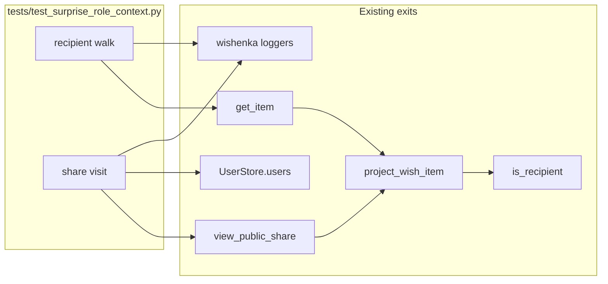

# WISHENKA-38: End-to-end surprise and role-context tests

## Research

Accepted requirements are `ai-tasks/WISHENKA-38/10-requirements.md`.
The product already keeps a recipient surprised and already treats a
share link as a read, not a registration. This task adds checks. It
does not add a notification sender, and it does not take race or load
work from WISHENKA-39 (matrix row R5).

The checklist is `doc/dev/verification-matrix.md`. S1–S4, S7, A1, A2,
and A4–A7 already name tests. The open rows for this task are S5
(response and the log of that same request), S6 (no recipient-facing
notification), S8 (one walk of those exits), and A3 (the share-link
visit creates no account).

### Recipient projection

`WishlistAccessPolicy.is_recipient` in `wishenka/wishlists/policy.py`
treats the owner of a personal list as the recipient of every wish,
including a wish that has only a display name. A display name is not
compared to a user. `project_wish_item` in
`wishenka/wishlists/service.py` then returns
`WishItemRecipientViewDTO` from `wishenka/wishlists/schemas.py`.

That DTO carries `quantity` and `received_quantity`. It has no
`available_quantity`, no `my_reservation_*` fields, and no purchase
status. A non-recipient receives `WishItemGifterViewDTO`, which does
carry the free remainder and that caller's own promise.

The recipient HTTP read is `get_item` in `wishenka/web/routes/items.py`:

`GET /api/wishlists/{wishlist_id}/items/{item_id}`

`get_wish_item` projects the wish and does not write a gifter log.
`list_items` is a different request. S1 already checks both bodies in
`tests/test_wish_items_crud_api.py`
`test_get_items_and_single_item_surprise_invariant`. That test does
not pair the body with the log of the same request, and it does not
scan headers.

### Logs of one request

`RequestLoggingMiddleware` in `wishenka/web/app.py` logs the completed
call on `wishenka.web` (method, redacted path, status, duration).
`configure_logging` in `wishenka/logging.py` attaches a console
`StreamHandler` and removes only existing `StreamHandler`s. Pytest's
capture handler is a different handler type, so `caplog` still
receives records. Sibling suites already wrap `TestClient` calls in
`caplog.at_level`.

A gifter booking does name that gifter. `create_reservation` logs
`gifter_id`, and `mark_reservation_purchased` logs
`reservation_purchased` with `user_id`. Those records are the
operator audit of the gifter's own action. They are allowed.
`tests/test_reservation_observability.py`
`test_item_reserved_observability_event` and
`tests/test_wishlist_roles_lifecycle.py`
`test_reservation_audit_logging` already cover that stream. A
recipient-facing log is only the records emitted while the recipient
request runs.

Separate S5 checks stay where the matrix cites them, including
`tests/test_reservation_observability.py`
`test_zero_surprise_leaks_in_recipient_audit_trails`. None of them
asserts the answer and the log of one request together.

Pytest captures that window in-process. `TestClient` serves the app
in the test process, and `caplog.at_level` collects records for the
`with` block. The project requires pytest 8 or newer
(`pyproject.toml`, `minversion = "8.0"`). Capture behavior is the
`caplog` fixture documented by pytest:

<https://docs.pytest.org/en/8.1.x/how-to/logging.html>

A logger with `propagate=False` would miss the root handler. The
service loggers used here propagate. `caplog.clear()` before the
recipient call drops the booking audit from the window.

### Notifications

A search of `wishenka/**/*.py` finds no `notification` symbol, no
`aiogram` bot, and no outbox writer. `UserStore` creates only
`users`. Wishlist tables in `wishenka/wishlists/db_models.py` are
`wl_lists`, `wl_members`, `wl_items`, `wl_reservations`,
`wl_favorites`, `wl_view_history`, `wl_tokens`, `wl_invite_tokens`,
and `wl_counters`.

`doc/dev/architecture.md` still names `user_notification_settings`
and `notification_outbox` from the original sketch. No module creates
those tables. S6 is the absence of a recipient-facing notice during
the walk. Notification copy stays out of this task.

### Share link and accounts

`view_public_share` in `wishenka/web/routes/sharing.py` serves
`GET /share/{public_token}` and renders
`wishenka/web/templates/share_wishlist.html`. The card is
`wishenka/web/templates/partials/item_card.html`. An unidentified
caller is not a recipient, so the card can show
`available_quantity`. The booking form is rendered only when
`can_promise` is true, and `can_promise` requires
`viewer_identified`. The visible remainder line is
`Доступно: {available} из {quantity}`. The booking control is the
submit labeled `Забронировать`.

That display is accepted product behavior. Row A2 stays on
`tests/test_wish_card_giver_controls.py`
`test_anonymous_share_shows_availability_without_a_book_control`.

A user row is inserted only by `UserStore.upsert_user`, called from
`POST /api/auth/telegram` in `wishenka/web/routes/auth.py`. The share
route uses `get_optional_current_user`, which returns `None` when no
credential is sent and does not call `upsert_user`. Minting a test
session with `SessionTokenService` also writes no `users` row.

`tests/test_auth_user_store.py`
`test_guest_request_does_not_create_user` calls `GET /healthz`. That
is a different request and leaves A3 open. The unauthenticated
promise refusals in `tests/test_reservation_actions_api.py` also
leave A3 open.

### Bounds

`pytest-timeout` is already a dependency (`pytest-timeout>=2.3.1`).
The marker `pytest.mark.timeout` bounds one test, in seconds, and a
module-level `pytestmark` covers every test in the file. The plugin
does not time tests out unless a timeout is set:

<https://github.com/pytest-dev/pytest-timeout>

Sibling HTTP suites use 30 seconds
(`tests/test_wish_items_crud_api.py`). These checks are one in-process
call each, with no sleep and no poll.

### What this task does not change

No production module gains a behavior, a sender, or a new route.
WISHENKA-39 keeps R5. Per-exit tests the matrix already marks covered
stay in place.

## Implementation Plan

`N/A — no behavioral change`. The surprise rule and the share-link
visit already behave as the accepted requirements describe. Step 3
records that note and does not add a red test of a defect. There is
no production fix to sequence. The new checks belong to the test
suite and are expected to pass against the current service.

The checks live in a new module,
`tests/test_surprise_role_context.py`. It uses the existing harness:
`create_app`, an isolated SQLite file, `TestClient`, and
`SessionTokenService`. The module sets
`pytestmark = pytest.mark.timeout(30)`. `make test` already collects
`tests/`. No new dependency and no load profile.

Seed data is built with `WishlistService` before the captured call,
the same way `tests/test_wishlists_htmx_sharing.py` seeds a list.
The captured call is the only request the assertions judge.

### One walk for S5, S6, and S8

`test_recipient_walk_hides_booking_in_response_log_and_notice`

Setup, outside the log window:

- A personal list. The caller is the owner and therefore the
  recipient.
- One wish with a display name only (`recipient_name` set,
  `recipient_user_id` left empty), `quantity` 8.
- Receipt recorded as `received_quantity` 1, through
  `record_item_fulfillment`, still outside the window.
- Another person books 3 units and marks that booking purchased,
  through `create_reservation` and `mark_reservation_purchased`.
  The free remainder is then 4. Those service logs may name the
  gifter. They stay outside the window.

The judged request is the owner's
`GET /api/wishlists/{wishlist_id}/items/{item_id}`.
`caplog.clear()` runs first, then `caplog.at_level(logging.INFO)`
wraps only that call.

S5 response. Status is 200. JSON keys are a subset of
`WishItemRecipientViewDTO` fields. `quantity` is 8 and
`received_quantity` is 1. Requested quantity and received quantity
may remain in the body. The body and every response header name and
value omit the gifter, the reservation, the booked quantity, the
free remainder, and whether the gift has been bought. The body omits
`available_quantity`, `is_fully_reserved`, `is_reserved_by_me`,
`my_reserved_quantity`, `my_reservation_status`, `my_reservation_id`,
`my_latest_reservation_quantity`, and
`my_occupying_reservation_count`. Header names and values omit that
same set: the gifter (name, username, and Telegram id), the
reservation, the booked quantity, the free remainder, and whether
the gift has been bought (`purchased`, `Куплено`). The display name
of the wish may remain.

S5 log. For each record captured during that call, the message and
the record extras omit the same gifter identity. Setup records from
the booking are not part of this set. The test does not require the
gifter's own booking audit to drop `gifter_id`.

S6. During that same call, no recipient-facing notification is
produced. The check passes on that absence. It fails if a captured
record has an event or message that names a notification, an outbox
enqueue, or a push, or if the test database gains a
`notification_outbox` or `user_notification_settings` table. The
check does not look for notice copy and does not add a sender.

S8. This one test is the single walk: the same booked wish, the same
owner request, the response rule, the log rule, and the absent
notice together.

### A separate visit for A3

`test_share_link_visit_creates_no_account`

An unidentified client calls `GET /share/{public_token}` with no
`Authorization` header and no session cookie. The visit is not
`GET /healthz` and not a promise attempt.

Before and after that call, `SELECT COUNT(*) FROM users` is the same,
and the captured log has no `user_created` event. A new `users` row
fails the check.

The same response is judged by the accepted share-page rule: the card
shows the free remainder (`Доступно:`) and does not show
`Забронировать`. That opener is outside the recipient rule. This
assertion does not replace the existing A2 test, and it does not
require the share page to hide the remainder.

### Left untouched

- No notification sender, push channel, or notice copy.
- No race or load test, and no change for row R5.
- No second proof of S1, S2, S3, S4, S7, A1, A2, A4, A5, A6, A7, or
  R1–R4.
- No change to the author's archive warning.
- `doc/dev/verification-matrix.md` is not edited in this step. When
  the checks exist, a later documentation step points S5, S6, S8, and
  A3 at them.

## Architecture

No production module changes. The new component is the test module.
It calls the exits the product already has.

There is no notification module on this diagram. S6 asserts that the
walk does not produce one.

### Modules

| Module | Responsibility in this task |
| --- | --- |
| `tests/test_surprise_role_context.py` | New. Walk for S5, S6, and S8. Visit for A3. |
| `wishenka/web/routes/items.py` | Recipient read `get_item`. Unchanged. |
| `wishenka/wishlists/service.py` | Recipient projection and seed. Unchanged. |
| `wishenka/wishlists/policy.py` | Personal-list owner is the recipient. Unchanged. |
| `wishenka/wishlists/schemas.py` | Allowed recipient response shape. Unchanged. |
| `wishenka/web/app.py` | Request log for the captured call. Unchanged. |
| `wishenka/web/routes/sharing.py` | Share page for the unidentified visit. Unchanged. |
| `wishenka/users/store.py` | Account table `users`. The visit must not insert. Unchanged. |
| `wishenka/web/routes/auth.py` | Only current caller of `upsert_user`. Not judged. |

### Dependencies

The test module depends on the existing app, the wishlist service,
the user store, and pytest's `caplog`. Product modules keep their
current dependencies. Nothing new depends on a notification sender.
The share visit reads `users` and does not call the Telegram auth
route.

### Patterns

The service already uses a role projection: one DTO for the
recipient and another for everyone else. These checks lock that
projection in place. They do not add a second projection, a
repository, or a sender.

The checks are in-process characterization tests. `TestClient` calls
the real routes. The log window starts after the gifter's booking is
stored, so the operator audit and the recipient log stay different
streams.

Each test declares a 30-second bound with `pytest.mark.timeout`,
matching the sibling HTTP modules. There is no wait loop.

### Interfaces

Judged recipient call:

- `GET /api/wishlists/{wishlist_id}/items/{item_id}`
- Auth: bearer session of the personal-list owner
- Success body: `WishItemRecipientViewDTO` with requested quantity
  (`quantity`) and received quantity (`received_quantity`). The body
  omits the gifter, the reservation, the booked quantity, the free
  remainder, and whether the gift has been bought.
- Headers: every header name and value omits the same set: the
  gifter, the reservation, the booked quantity, the free remainder,
  and whether the gift has been bought.

Judged share call:

- `GET /share/{public_token}`
- Auth: none
- Success body: HTML from `share_wishlist.html` and `item_card.html`
- Account side effect: `users` row count unchanged, no `user_created`

Log interface for the window:

- Records from loggers that propagate to the root logger
- Identity check uses `getMessage()` and extras, not the formatted
  line alone, so a gifter id stored only in `extra` still fails S5

Account interface:

- `SELECT COUNT(*) FROM users` on the test database
- `user_created` is the log `UserStore.upsert_user` emits for an
  insert

Notification interface:

- None in the product. The check's failure signal is a captured
  notice event or a notification table appearing in the test
  database.

## Q&A

- **Why is the failing repro N/A?** The behavior under test is
  already the running behavior. A red test would require breaking
  the product first. Step 3 records `N/A — no behavioral change`.
  The checks above are the deliverable and should pass as written.
- **Why one request for S5 and S8?** The accepted requirements allow
  one walk to close S5, S6, and S8 when that walk asserts all three
  for the same recipient request. A3 stays a separate visit.
- **Why `get_item` and not the share page for the recipient walk?**
  S5 is the recipient response and the log of that request. `get_item`
  is the single-wish read, and the recipient DTO is the shape the
  rule names. The share page for an unidentified opener is A3, and
  that opener is outside the recipient rule.
- **Why may the booking log name the gifter?** That record is the
  operator audit of the gifter's own action. The suite captures logs
  only around the recipient request, so the two streams stay apart.
- **Why does S6 pass without notice text?** The product has no
  sender. Requiring copy would invent a channel. Absence during the
  walk is the proof. A notice produced during the walk fails it.
- **Why does the share check also look at the remainder?** The
  accepted requirements say the suite judges the unidentified opener
  by the share-page rule: free remainder visible, no booking control.
  Row A2 stays on its existing test.
- **Why is the health check not A3?** A3 is the share-link visit.
  `GET /healthz` does not open the list.
- **Why are the sketched notification tables not built here?** They
  appear in `doc/dev/architecture.md` and not in the schema. This
  task proves no notice is produced. It does not add the tables or a
  worker.
- **Why is R5 absent?** Repeated contention and load belong to
  WISHENKA-39.
