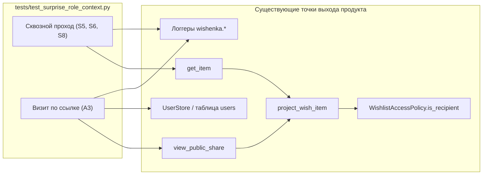

# Спецификация: WISHENKA-38 — Сквозные тесты принципа сюрприза и ролевого контекста

**Версия документа:** 1.0  
**Статус:** реализовано (сквозные автоматические тесты и обновление матрицы верификации)  
**Эпик:** WISHENKA-36  
**Связанные задачи:** WISHENKA-37 (матрица верификации), WISHENKA-39 (строка R5)  
**Язык реализации:** Python 3.12+

## 1. Назначение и бизнес-цель

### 1.1. Контекст и постановка проблемы

Принцип сюрприза и строгое разделение ролевых контекстов являются фундаментальными инвариантами сервиса вишлистов (`specs/00-high.md`, раздел 6; `in-docs/spec.md`, разделы 4.5 и 6.3). Получатель подарка ни при каких обстоятельствах не должен видеть сведения о бронировании и покупке своих желаний, а просмотр вишлиста по публичной ссылке должен оставаться анонимным чтением без скрытой регистрации пользователя.

До выполнения задачи WISHENKA-38 матрица верификации (`doc/dev/verification-matrix.md`, подготовленная в рамках WISHENKA-37) уже фиксировала проверки отдельных точек выхода (`S1–S4`, `S7`, `A1`, `A2`, `A4–A7`, `R1–R4`), однако оставляла открытыми четыре сквозных пробела:

- **S5:** проверки ответа получателю и записей журнала выполнялись раздельно — отсутствовал сценарий, проверяющий HTTP-ответ (тело и заголовки) и лог того же самого запроса одновременно.
- **S6:** не было подтверждения того, что активность получателя не порождает исходящего уведомления в адрес получателя.
- **S8:** отсутствовал единый проход («one walk») по одному забронированному желанию на личном вишлисте, одновременно контролирующий ответ получателю, журнал этого запроса и отсутствие уведомления получателю.
- **A3:** отсутствовала проверка того, что открытие вишлиста по публичной ссылке (`GET /share/{public_token}`) неидентифицированным посетителем не создаёт учётную запись (проверка `GET /healthz` в `tests/test_auth_user_store.py` и отказ на неаутентифицированное бронирование в `tests/test_reservation_actions_api.py` этот сценарий не закрывали).

### 1.2. Цели и ценность для пользователей и системы

- **Цель задачи:** закрепить действующее поведение продукта автоматизированными сквозными тестами на Python 3.12+ и закрыть строки **S5**, **S6**, **S8** и **A3** в матрице верификации `doc/dev/verification-matrix.md` без изменения продуктовой логики.
- **Ценность для получателя:** гарантия защиты тайны сюрприза сразу на всех смежных выходах одного запроса — в JSON-ответе, HTTP-заголовках, записях журнала и канале уведомлений.
- **Ценность для неидентифицированного посетителя:** подтверждение нулевого порога входа — чтение списка по публичной ссылке не приводит к созданию аккаунта в таблице `users`.
- **Ценность для эксплуатации и аудита:** чёткое разграничение потоков логирования: легитимный операторский аудит действий дарителя (`item_reserved`, `reservation_purchased`) остаётся разрешённым, не смешиваясь с журналом запроса получателя.

### 1.3. Границы задачи

**Входит в область задачи:**

- Автоматические сквозные проверки в модуле `tests/test_surprise_role_context.py`, закрывающие строки `S5`, `S6`, `S8` и `A3`.
- Обновление указателей для строк `S5`, `S6`, `S8` и `A3` в `doc/dev/verification-matrix.md` и ссылки в `doc/dev/architecture.md`.

**Не входит в область задачи:**

- Изменение продуктового поведения или добавление новых маршрутов и сервисных функций.
- Реализация отправителя уведомлений, push-канала, текстов уведомлений или настроек уведомлений.
- Тесты гонок и нагрузочного профиля (строка `R5` относится к задаче **WISHENKA-39**).
- Повторное доказательство строк матрицы, уже отмеченных как покрытые (`S1–S4`, `S7`, `A1`, `A2`, `A4–A7`, `R1–R4`).
- Предупреждение автора перед архивацией желания (является авторским диалогом, а не выходом получателя).

## 2. Функциональные требования и пользовательские сценарии

### 2.1. Роли и контексты доступа

| Роль | Контекст в WISHENKA-38 | Правило видимости и побочных эффектов |
| --- | --- | --- |
| Владелец / Получатель | Владелец личного вишлиста; по политике доступа является получателем каждого желания в списке, включая желания только с отображаемым именем (`recipient_name`) | Получает `WishItemRecipientViewDTO`; видит `quantity` и `received_quantity`, но не видит бронь, дарителя, забронированное количество, свободный остаток и статус покупки; не получает уведомлений |
| Даритель | Пользователь с сессией, бронирующий экземпляры и отмечающий покупку | Создаёт бронь и отметку покупки; его действия фиксируются в операторском аудите (`gifter_id`, `user_id`) вне окна запроса получателя |
| Неидентифицированный посетитель ссылки | Клиент без заголовка `Authorization` и cookie сессии, открывающий `GET /share/{public_token}` | Видит свободный остаток (`Доступно:`), не видит форму бронирования (`Забронировать`); визит не создаёт строку в `users` |
| Оператор | Потребитель системного аудита действий дарителя | Получает идентификатор дарителя в записях `item_reserved` и `reservation_purchased`, но не в логах запроса получателя |

### 2.2. Пользовательские сценарии

- **US-01 (Сквозной проход получателя — S5, S6, S8):** владелец личного вишлиста запрашивает карточку своего забронированного желания. Единственный проход подтверждает, что ни тело ответа, ни HTTP-заголовки, ни журнал этого же запроса не раскрывают личность дарителя или детали бронирования, а само обращение не формирует уведомление получателю.
- **US-02 (Визит по публичной ссылке — A3):** неидентифицированный посетитель открывает вишлист по `public_token`. Визит не создаёт учётную запись в базе данных и не пишет событие `user_created`, отображая при этом свободный остаток без элемента управления бронированием (правило `A2`).
- **US-03 (Изоляция операторского аудита):** аудит собственного действия дарителя сохраняет `gifter_id` / `user_id` для операторов, оставаясь отделённым от логов запроса получателя.

### 2.3. Функциональные требования и инварианты

#### S5. Ответ получателю и журнал того же запроса

Для одного запроса владельца личного вишлиста `GET /api/wishlists/{wishlist_id}/items/{item_id}` по забронированному желанию (в том числе когда у желания заполнено только `recipient_name` и пусто `recipient_user_id`):

1. HTTP-ответ возвращает статус `200`, а множество ключей JSON является подмножеством полей `WishItemRecipientViewDTO`.
2. В ответе допустимы запрошенное количество (`quantity`) и полученное количество (`received_quantity`), а также отображаемое имя получателя (`recipient_name`).
3. Тело ответа и **каждое имя и значение каждого HTTP-заголовка** обязаны полностью исключать:
   - идентификаторы дарителя (имя, `username`, `Telegram ID`);
   - упоминание брони (`reservation`) и поля проекции дарителя (`available_quantity`, `is_fully_reserved`, `is_reserved_by_me`, `my_reserved_quantity`, `my_reservation_status`, `my_reservation_id`, `my_latest_reservation_quantity`, `my_occupying_reservation_count`);
   - забронированное количество и свободный остаток (как отдельные числа);
   - отметку о покупке (`purchased`, `Куплено`, `bought`).
4. Каждая запись журнала, порождённая при обслуживании этого запроса (на уровне `INFO` и выше), не должна содержать идентификаторы дарителя ни в тексте сообщения (`getMessage()`), ни в дополнительных атрибутах записи (`extra`).

#### S6. Отсутствие уведомления получателю

1. В ходе прохода получателя не должно создаваться уведомление, обращённое к получателю (о желании, получении, архивации или напоминании).
2. На момент выполнения WISHENKA-38 в сервисе отсутствовал отправитель уведомлений, поэтому доказательством `S6` является отсутствие события уведомления/очереди (`notification`, `outbox`, `push`) в логах запроса и отсутствие попыток создания или заполнения очередей уведомлений для получателя.
3. Тест не проверяет тексты уведомлений и не добавляет канал доставки.

#### S8. Единый проход по выходам

Один и тот же запрос владельца личного вишлиста по одному и тому же забронированному и купленному желанию обязан одновременно удовлетворять требованиям:

- правила ответа получателю (`S5`);
- правила логов того же запроса (`S5`);
- правила отсутствия уведомления получателю (`S6`).

#### A3. Открытие публичной ссылки не создаёт аккаунт

1. Неидентифицированный посетитель (без `Authorization` и cookie сессии) выполняет `GET /share/{public_token}` — запрос не подменяется вызовом `GET /healthz` и не является попыткой бронирования.
2. Количество записей в таблице `users` (`SELECT COUNT(*) FROM users`) до и после запроса совпадает.
3. В логах, захваченных во время визита, отсутствует событие `user_created`.
4. HTML-ответ соответствует принятому правилу страницы шеринга (`A2`): отображает свободный остаток (`Доступно:`) и не содержит кнопку бронирования (`Забронировать`).

### 2.4. Основные сущности модели

- **Желание (Wish):** элемент списка; на личном вишлисте владелец считается получателем каждого желания, включая желания только с `recipient_name`.
- **Бронирование (Reservation):** занятие дарителем одного или нескольких экземпляров (в том числе со статусом покупки); полностью скрыто от получателя.
- **Свободный остаток (Free remainder):** доступное к бронированию количество (`quantity - received_quantity - occupied`, не ниже нуля); отсутствует в ответе получателю, но виден неидентифицированному посетителю страницы шеринга.
- **Ответ получателю:** совокупность тела JSON и HTTP-заголовков запроса получателя.
- **Журнал получателя:** записи лога, сформированные исключительно в окне обслуживания запроса получателя.
- **Операторский аудит:** записи аудита бронирования и покупки в потоке дарителя (`item_reserved`, `reservation_purchased`).
- **Уведомление получателю:** сообщение получателю о событиях желания; в рамках прохода не формируется.
- **Публичная ссылка (Share link) и Аккаунт (Account):** токен публичного чтения `public_token` и запись пользователя в `users`, создаваемая только при аутентификации через Telegram.

## 3. Архитектура, компоненты и интерфейсы

### 3.1. Архитектурное решение и структура компонентов

Задача не меняет продуктовый код (`N/A — no behavioral change` на шагах проектирования архитектуры и воспроизведения падения). Единственным добавляемым программным компонентом является тестовый модуль `tests/test_surprise_role_context.py`, выполняющий внутрипроцессные характеризационные проверки поверх реального FastAPI-приложения (`create_app`), изолированной базы данных SQLite, `TestClient`, `SessionTokenService` и `WishlistService`.

### 3.2. Модули и распределение ответственности

| Модуль | Ответственность в контексте WISHENKA-38 | Статус изменения |
| --- | --- | --- |
| `tests/test_surprise_role_context.py` | Сквозной проход для `S5`, `S6`, `S8` и анонимный визит по ссылке для `A3` | Новый модуль |
| `wishenka/web/routes/items.py` | Эндпоинт `get_item` (`GET /api/wishlists/{wishlist_id}/items/{item_id}`) | Без изменений |
| `wishenka/wishlists/service.py` | `WishlistService`: подготовка данных, `project_wish_item`, `get_wish_item`, `get_wishlist_by_public_token` | Без изменений |
| `wishenka/wishlists/policy.py` | `WishlistAccessPolicy.is_recipient` — определение получателя для личного вишлиста | Без изменений |
| `wishenka/wishlists/schemas.py` | `WishItemRecipientViewDTO` и `WishItemGifterViewDTO` — контракты ролевых проекций | Без изменений |
| `wishenka/web/app.py` | `create_app`, `RequestLoggingMiddleware`, `ShareTokenAccessFilter` | Без изменений |
| `wishenka/web/routes/sharing.py` | `view_public_share` (`GET /share/{public_token}`) и `get_optional_current_user` | Без изменений |
| `wishenka/web/templates/share_wishlist.html`, `partials/item_card.html` | Рендеринг страницы шеринга, строки остатка (`Доступно:`) и условия `can_promise` / `viewer_identified` | Без изменений |
| `wishenka/users/store.py`, `wishenka/web/routes/auth.py` | `UserStore.upsert_user` (вызывается только из `POST /api/auth/telegram`), таблица `users` | Без изменений |
| `doc/dev/verification-matrix.md`, `doc/dev/architecture.md` | Актуализация ссылок строк `S5`, `S6`, `S8` и `A3` на новый тестовый модуль | Обновлены (Шаг 8) |

### 3.3. Контракты данных и интерфейсы

#### Интерфейс 1: Запрос карточки желания получателем (`S5`, `S6`, `S8`)

- **Запрос:** `GET /api/wishlists/{wishlist_id}/items/{item_id}` с заголовком `Authorization: Bearer <token>` владельца личного вишлиста.
- **Выходной контракт DTO (`WishItemRecipientViewDTO`):** содержит поля `id`, `title`, `description`, `link`, `image_url`, `price`, `currency`, `store_name`, `store_icon_url`, `quantity`, `received_quantity`, `priority`, `category`, `display_order`, `is_archived`, `recipient_user_id`, `recipient_name`, `is_recipient`, `remaining_quantity` (где `remaining_quantity = max(0, quantity - received_quantity)`).
- **Запрещённый набор полей и маркеров (`_booking_leaks`):**
  - поля проекции дарителя (`_GIVER_FIELDS`): `available_quantity`, `is_fully_reserved`, `is_reserved_by_me`, `my_reserved_quantity`, `my_reservation_status`, `my_reservation_id`, `my_latest_reservation_quantity`, `my_occupying_reservation_count`;
  - идентификаторы дарителя (`_GIFTER_MARKS`): имя, `username`, `Telegram ID`;
  - маркеры покупки (`_PURCHASE_MARKS`): `purchased`, `Куплено`, `bought`;
  - подстрока `reservation` и отдельные числа забронированного количества (`3`) и свободного остатка (`4`).
- **Поверхность проверки:** проверяется как сериализованный текст тела `response.text`, так и каждая пара `"<header_name>: <header_value>"` из `response.headers`.

#### Интерфейс 2: Визит по публичной ссылке (`A3`)

- **Запрос:** `GET /share/{public_token}` без заголовка `Authorization` и без cookie сессии.
- **Выходной контракт (`200 OK`):** HTML из `share_wishlist.html` и `partials/item_card.html`. Так как `get_optional_current_user` возвращает `None`, флаг `viewer_identified` ложен, `can_promise` ложен, карточка отображает `Доступно:` и не содержит кнопку `Забронировать`.
- **Побочный эффект в БД:** неизменность `SELECT COUNT(*) FROM users`.

#### Интерфейс 3: Контракт перехвата логов и состояния БД

- Логгеры `wishenka.*` распространяют записи в корневой логгер (`propagate=True`). Функция `configure_logging` в `wishenka/logging.py` удаляет только `StreamHandler`, не затрагивая обработчик pytest `caplog`.
- Проверка каждой записи `record` использует функцию `_record_text(record)`, объединяющую `record.getMessage()` и все дополнительные поля `extra` из `record.__dict__` (за вычетом стандартных полей `LogRecord`, `message` и `asctime`), чтобы исключить передачу данных дарителя в структурированных полях мимо форматированного сообщения.
- Для проверки уведомлений в исходной редакции WISHENKA-38 проверялось отсутствие таблиц `notification_outbox` и `user_notification_settings` через `sqlite_master`. После внедрения очереди уведомлений для дарителей в последующей задаче (WISHENKA-23) тестовый модуль был адаптирован и проверяет: `notice_rows(app) == []`, отсутствие строк с `giver_user_id == _OWNER_ID`, а также ограничение схемы `wl_receipts` фиксированным набором колонок `_RECEIPT_COLUMNS = {"id", "wish_item_id", "quantity", "received_at", "is_approximate"}`.

### 3.4. Последовательность состояний сквозного прохода

1. **Подготовка данных (вне окна перехвата логов):**
   - `service.create_wishlist(owner=owner, title="Alice Birthday")` — создание личного вишлиста владельца `_OWNER_ID = 101`.
   - `service.add_wish_item(..., title="Kettle", quantity=8, recipient_name="Sam")` — добавление желания с явным именем получателя и пустым `recipient_user_id`.
   - `service.record_item_fulfillment(..., received_quantity=1)` — фиксация частичного получения.
   - `service.create_reservation(..., user=gifter, quantity=3)` — бронь дарителем `_GIFTER_ID = 88001122` (`"Greta"`, `username="greta_gift"`); свободный остаток равен `4`.
   - `service.mark_reservation_purchased(..., user=gifter)` — отметка покупки дарителем.
2. **Очистка буфера логов:** `caplog.clear()`.
3. **Проверяемое действие (внутри `with caplog.at_level(logging.INFO):`):** вызов `GET /api/wishlists/{wishlist_id}/items/{item_id}` с bearer-токеном владельца.
4. **Верификация выходов:** проверка тела ответа, всех HTTP-заголовков, захваченных записей лога и состояния таблиц уведомлений/получений.

## 4. Нефункциональные требования, безопасность и наблюдаемость

### 4.1. Производительность и лимиты выполнения

- **Ограничение времени выполнения:** в модуле `tests/test_surprise_role_context.py` задан обязательный маркер `pytestmark = pytest.mark.timeout(30)` (с использованием зависимости `pytest-timeout>=2.3.1`).
- **Детерминизм без ожиданий:** оба теста выполняют по одному синхронному внутрипроцессному вызову через `TestClient` без `sleep`, циклов ожидания (polling) и межпроцессной синхронизации. Время выполнения обоих тестов на контрольном прогоне составило `0.86s`.
- **Нагрузочный профиль:** целевые значения задержек и нагрузочное тестирование в задаче не задаются (вынесены в `WISHENKA-39` / строку `R5`).

### 4.2. Инварианты безопасности и приватности

- **Запрет утечки по всем каналам получателя:** фильтрация полей DTO, HTTP-заголовков, логов запроса и очереди уведомлений проверяется комплексно в одном проходе. Проверка числовых значений `_BOOKED` (`3`) и `_REMAINDER` (`4`) использует регулярное выражение с границами цифр `(?<!\d){number}(?!\d)`.
- **Изоляция регистрации:** маршрут `GET /share/{public_token}` использует `get_optional_current_user` и никогда не вызывает `UserStore.upsert_user` (единственной точкой вызова `upsert_user` остаётся `POST /api/auth/telegram`).
- **Маскировка токенов публичного доступа:** `RequestLoggingMiddleware` и `ShareTokenAccessFilter` (`wishenka/web/app.py`) подменяют токен в пути запроса на `/share/{token}` до вывода записи в лог.
- **Изоляция тестовых секретов:** тестовый ключ подписи `SessionTokenService` и временная база SQLite (`tmp_path / "surprise_role_context.db"`) локализованы внутри тестовой фикстуры `test_app`.

### 4.3. Наблюдаемость: логирование и метрики

В рамках WISHENKA-38 **не добавлялись** новые записи логов (ни на одном уровне `EMERG`–`DEBUG`), новые счётчики/метрики или интеграции с внешними системами мониторинга. Структура логирования `JsonFormatter` и `configure_logging` (`wishenka/logging.py`) осталась без изменений.

Потоки логов, контролируемые и учитываемые тестовым модулем:

| Поток / Логгер | События и состав полей | Правило в WISHENKA-38 |
| --- | --- | --- |
| `wishenka.web` (`RequestLoggingMiddleware`) | `HTTP request completed` (`method`, `path`, `status_code`, `duration_ms`); для share-запросов путь маскируется как `/share/{token}` | В окне `INFO` запроса получателя не содержит данных дарителя |
| `wishenka.wishlists.store` (`WishlistStore._read`, `WishlistStore._write`) | `wishlist_store_read` (`wishlists_count`, `items_count`, `reservations_count`, `members_count`, `favorites_count`, `history_count`) и `wishlist_store_write` (счётчики записей/удалений) | Передают только агрегированные счётчики строк, без данных дарителя и деталей броней |
| `wishenka.web.sharing` (`view_public_share`) | `wishlist_shared_view` (`wishlist_id`, `is_recipient`, `is_collaborative`) | Логирует факт публичного просмотра без создания пользователя |
| `wishenka.users` (`UserStore.upsert_user`) | `user_created` | Не должен появляться при анонимном визите на `/share/{public_token}` |
| `wishenka.wishlists` (`WishlistService`) | `item_reserved` (`gifter_id`), `reservation_purchased` (`user_id`) | Операторский аудит дарителя; выполняется в фазе подготовки до `caplog.clear()` и остаётся вне окна получателя |

Записи уровня `DEBUG` (`HTTP request started` и `auth_session_resolved` с идентификатором владельца сессии) не попадают в окно `INFO` и также не содержат личность дарителя. При успешном чтении желания `get_wish_item` в `wishenka/wishlists/service.py` записей в журнал не добавляет.

## 5. Верификация и критерии приёмки

### 5.1. Тестовые сценарии и результаты проверок

В модуле `tests/test_surprise_role_context.py` реализованы два сквозных теста:

1. **`test_recipient_walk_hides_booking_in_response_log_and_notice` (строки матрицы `S5`, `S6`, `S8`):**
   - **Предусловия:** личный вишлист владельца `101`; желание `"Kettle"` (`quantity=8`, `recipient_name="Sam"`, `recipient_user_id=None`); получена `1` единица; даритель `88001122` (`"Greta"`, `username="greta_gift"`) бронирует `3` единицы (остаток `4`) и отмечает покупку.
   - **Действие:** очистка `caplog` и запрос `GET /api/wishlists/{wishlist_id}/items/{item_id}` от имени владельца внутри `caplog.at_level(logging.INFO)`.
   - **Ожидаемый результат:** статус `200`; поля JSON входят в `WishItemRecipientViewDTO`; `quantity == 8`, `received_quantity == 1`; `_booking_leaks` не находит утечек ни в теле, ни в заголовках; в записях `caplog.records` отсутствуют `_gifter_marks()` и маркеры уведомлений (`notification`, `outbox`, `push`); отсутствуют уведомления получателю в БД.
2. **`test_share_link_visit_creates_no_account` (строка матрицы `A3`, с подтверждением `A2`):**
   - **Предусловия:** личный вишлист `"Open List"` с желанием `"Mug"` (`quantity=2`) и публичным токеном `public_token`; зафиксирован начальный `user_count(app)`.
   - **Действие:** очистка `caplog` и анонимный запрос `GET /share/{public_token}` (в актуальной ревизии после интернационализации шаблонов передаётся заголовок `Accept-Language: ru`) внутри `caplog.at_level(logging.INFO)`.
   - **Ожидаемый результат:** статус `200`; путь запроса отличен от `/healthz`; `user_count(app)` не изменился; в `caplog.records` нет события `user_created`; в HTML присутствует `"Доступно:"` и отсутствует `"Забронировать"`.

**Зафиксированные результаты верификации (`40-code-cleanup.md`):**

- `make analyze` (Ruff check, Ruff format check, Mypy): ошибок не обнаружено (`All checks passed!`, 83 файла отформатированы корректно, 0 ошибок Mypy в 83 файлах).
- `make test PYTEST=".venv/bin/pytest tests/test_surprise_role_context.py"`: оба теста прошли за `0.86s` (код возврата `0`, зафиксировано только внешнее предупреждение `StarletteDeprecationWarning` из установленного FastAPI; полный набор тестов на этапе cleanup не запускался).
- `git diff --check`: замечаний по пробельным символам нет; максимальная длина строки — 100 символов (в пределах лимита `pyproject.toml`).

### 5.2. Критерии приёмки (Definition of Done)

1. Автоматические тесты закрывают открытые строки `doc/dev/verification-matrix.md`: `S5`, `S6`, `S8` и `A3`.
2. **S5:** единый сценарий проверяет ответ получателю (тело и заголовки) и лог того же запроса; ответ исключает дарителя, бронь, забронированное количество, свободный остаток и факт покупки (при сохранении `quantity` и `received_quantity`), а лог запроса не называет дарителя.
3. **S6:** доказано, что действие получателя не порождает уведомление получателю (без создания отправителя уведомлений или текстов сообщений).
4. **S8:** один проход по одному забронированному желанию на личном вишлисте (вызов владельца, выступающего получателем) одновременно проверяет ответ, лог запроса и отсутствие уведомления.
5. **A3:** анонимное открытие списка по публичной ссылке не создаёт учётную запись (проверяется именно визит на страницу шеринга, а не `GET /healthz`).
6. Неидентифицированный посетитель страницы шеринга оценивается по принятому правилу (`A2`): видит свободный остаток и не видит кнопку бронирования.
7. Операторский аудит собственного бронирования дарителя сохраняет возможность указывать идентификатор дарителя, оставаясь изолированным от журнала запроса получателя.
8. Тесты написаны на Python 3.12+ и ограничены явным таймаутом (`30` секунд); поведение продукта остаётся неизменным.

### 5.3. Известные ограничения, техдолг и последующие задачи

По данным анализа технического долга (`ai-tasks/WISHENKA-38/60-tech-debt.md`):

- **Новые задачи техдолга (Follow-ups):** отсутствуют — оба сквозных теста реализованы в полном объёме, а указатели в `doc/dev/verification-matrix.md` обновлены на Шаге 8 данной задачи.
- **Связанные незакрытые направления за рамками WISHENKA-38:**
  - **WISHENKA-39 (строка `R5`):** конкурентные гонки и нагрузочный профиль потолка бронирований.
  - **Открытые продуктовые вопросы:** идентификация получателя без учётной записи Telegram и жизненный цикл бронирований при удалении профиля пользователя оставлены без изменений.
- **Замечание по эволюции схемы уведомлений:** на этапе WISHENKA-38 таблицы `notification_outbox` и `user_notification_settings` из эскиза `doc/dev/architecture.md` не существовали. Позднее, в задаче WISHENKA-23, были добавлены таблицы `notification_outbox` (для уведомлений дарителям) и `wl_receipts`, в связи с чем тест `test_recipient_walk_hides_booking_in_response_log_and_notice` в `tests/test_surprise_role_context.py` был синхронизирован для проверки пустоты `notification_outbox` и допустимых колонок `wl_receipts` без ослабления исходных инвариантов WISHENKA-38.
