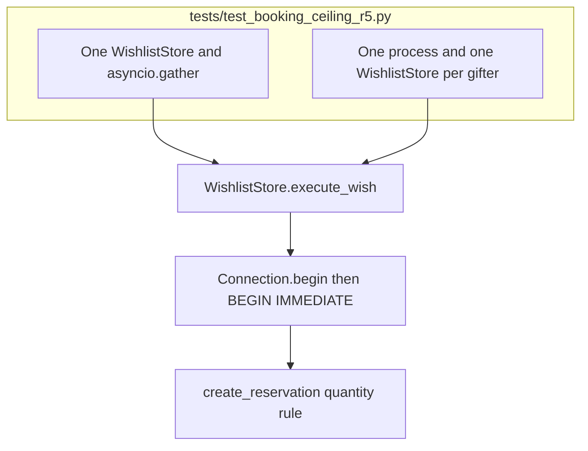

# WISHENKA-39: Load and concurrent booking checks

## Research

### What the product does today

Booking of one wish is a wish-scoped write. `WishlistStore.execute_wish`
in `wishenka/wishlists/store.py` opens `Connection.begin()`. The engine
listener then runs `BEGIN IMMEDIATE` with `isolation_level = None` and
`busy_timeout` of 5000 ms. Inside that transaction `_load_wish` reads
that wish only, `create_reservation` applies the existing quantity
rule, and `_persist_wish` writes the changed rows. A domain refusal
rolls the transaction back.

`create_reservation` in `wishenka/wishlists/service.py` refuses the
whole request when `quantity` is greater than
`item.available_quantity`. That property is
`max(0, quantity - received_quantity - reserved_quantity)`, and
`reserved_quantity` is the sum of `ACTIVE` and `PURCHASED` promises.
The refusal is `InsufficientQuantityError`. It adds no promise. The
store logs `wishlist_inventory_rolled_back` at WARNING. The service
logs `insufficient_quantity_blocked` at WARNING. Neither path is an
ERROR log.

The HTTP promise route calls this same `execute_wish`. A configured
`WishlistService(store=...)` reaches it through the `_transactional`
wrapper. The service built inside `_load_wish` has no store, so the
quantity rule runs in the transaction that already started. It does
not open a second one.

`ItemConcurrencyCoordinator` in `wishenka/wishlists/concurrency.py` is
an `asyncio.Lock` map on one service instance. `_load_wish` builds a
new `WishlistService()` per transaction, so that lock is not shared
across bookings and is not visible to another process. This task does
not change that object. WISHENKA-49 owns further locking.

### What R1–R4 already check

Row R5 in `doc/dev/verification-matrix.md` names the same write path
as R2 and says no load harness is present.

| Row | What it already proves | Where it lives |
| --- | --- | --- |
| R1 | Two bookings inside one in-memory service, and a refused increase. The named race uses ten gifters on `WishlistService()` with no store. | `tests/test_reservations_surprise_invariant.py` |
| R2 | Two copies, last unit, refused increase, release once, receipt, two wishes, busy lock. | `tests/test_shared_inventory_multiprocess.py` |
| R3 | A purchased promise stays occupied. | surprise-invariant and wish-card tests named on the row |
| R4 | The loser is told the free remainder and not the winner. | reservation API, wish card, and the R2 last-unit test |

R2's worker is the harness to copy, not the call to copy. `_worker`
waits on `multiprocessing.Barrier`, then `_run_copies` joins each
process (`timeout=25`), drains a `Queue` until a 5 second deadline,
and `terminate`s anything still alive. Those checks call
`store.execute`, which is the full-snapshot transaction. Production
booking calls `execute_wish`. R5 must call `execute_wish`. It must
not edit the R1–R4 tests.

### Probe of the wish-scoped path

A local probe, not a suite test, seeded a temporary SQLite file
through `WishlistStore.initialize` and `store.execute`, then raced
`execute_wish` → `create_reservation`. Five gifters, Python 3.13, the
project virtualenv. No new lock.

| Case | Result |
| --- | --- |
| One store, `asyncio.gather`, 5 gifters, 2 free units, 1 each | 2 successes, 3 `InsufficientQuantityError`, occupied 2, available 0 |
| One store, 5 gifters, each asks for all 3 free units | 1 success, 4 refusals, occupied 3, available 0 |
| Five processes, same two shapes | Same counts. No `InventoryBusyError` |
| Five processes, 1 unit already booked on a wish of 4, then 5 gifters ask for 1 | 3 new promises, the seeded row unchanged, occupied 4, available 0 |
| Three rounds, two wishes (free 2 and free 3) | Each wish matched its shape. Available ended at 0 |

The whole probe finished in about 10 seconds. Losers logged a
rollback and left no occupying row.

### Bounded concurrency testing

SQLite still has one writer. WAL allows concurrent readers. Writers
queue on the reserved lock taken by `BEGIN IMMEDIATE`. A crowd that
only deepens that queue can outrun `busy_timeout` and surface
`SQLITE_BUSY` even when each transaction is correct. That showed up
when a large writer fan-out met a 5 second busy timeout
([Gitea resource-index flake](https://github.com/go-gitea/gitea/issues/37847)).
`busy_timeout` retries the lock. It does not repair a transaction
that already read a stale balance. `BEGIN IMMEDIATE` is what makes
the read and the write the same lock
([SQLite transactions](https://sqlite.org/lang_transaction.html),
[WAL](https://sqlite.org/wal.html)).

A barrier before the write is the usual way to overlap those lock
attempts without adding another lock
([file locking and SQLite tests](https://www.peterspython.com/en/blog/multiprocessing-file-locking-sqlite-and-testing)).
Turning `synchronous` off, or adding an application mutex, is a
different design. This task does not do that.

`pytest-timeout` 2.3.1 is already a dev dependency. On Linux the
default method is `signal` (`SIGALRM`). The alarm interrupts the
pytest process. It does not kill child processes by itself
([pytest-timeout](https://pypi.org/project/pytest-timeout/2.3.1/),
[child processes left behind](https://github.com/pytest-dev/pytest-timeout/issues/159)).
The R2 harness already bounds `Barrier.wait`, `Process.join`, and the
queue drain, and it terminates survivors in `finally`. R5 keeps that
shape. The marker stays the default signal method. `method="thread"`
kills the whole pytest process and is the wrong fit for this suite.

The project timeout note is `doc/dev/infrastructure.md` (section 4.1).
There is no `doc/dev/testing.md`. There is no global timeout in
`pyproject.toml`. Each test carries its own marker.

### Decision

The product already keeps the ceiling the requirements describe. Five
gifters do not overbook. Booked units equal the free units they were
racing for. A refusal is `InsufficientQuantityError` and adds no row.
The free remainder stays at zero. The same outcome holds for one
store and for one store per process.

These checks are characterization tests. They are expected to pass.
Step 3 does not plant a red test. A red failure would be a product
defect, and this story does not change the lock.

## Implementation Plan

No production change. No new module under `wishenka/`. No edit to
`ItemConcurrencyCoordinator`, `execute_wish`, or `create_reservation`.
No edit to the R1–R4 modules or to `tests/test_surprise_role_context.py`.

**Mandatory — Failing Repro (next Step 3):** `N/A — no behavioral
change`. The wish-scoped path already meets the requirements. The
probe above is the evidence. A check written to those assertions
passes on the current service, so it is not a red repro of a defect.
Step 3 records this note and does not add a test. Step 4 adds the
characterization module below. If a run of that module fails, stop.
The failure belongs to the harness or to a later locking story
(WISHENKA-49), not to a lock change in this task.

Step 8 records the new tests on row R5 of
`doc/dev/verification-matrix.md`. Step 4 does not edit that file.

### Where the checks live

New module: `tests/test_booking_ceiling_r5.py`.

`make test` already collects `tests/`. No new dependency.

The module sets `pytestmark = pytest.mark.timeout(120)`. Every test
function also sets its own `@pytest.mark.timeout(...)`, which is the
bound for that check. Closest marker wins.

| Check | Marker |
| --- | --- |
| One copy, one unit each | 30 |
| Many copies, one unit each | 60 |
| One copy, whole remainder | 30 |
| Many copies, whole remainder | 60 |
| Repeated contention, many copies | 90 |
| Load profile, both modes | 120 |

Internal waits, copied from the R2 harness:

- `Barrier.wait(timeout=20)`
- `Process.join(timeout=25)`
- queue drain deadline of 5 seconds
- `terminate` then `join(timeout=5)` in `finally`

An `InventoryBusyError` fails the check. At this crowd it means the
fan-out was too wide for `busy_timeout`, not that a new lock is
required. The probe at five gifters did not see it. Do not raise
`busy_timeout`. Do not retry a busy error inside the test.

Shortage logs are WARNING. The ERROR `caplog` contract does not
apply. Do not assert the sentence the loser is shown. That sentence
stays on R4.

### Bounds

| Name | Value | Why |
| --- | --- | --- |
| Gifters | 5 | More than two, and fewer than a queue that exhausts `busy_timeout` |
| One-unit free remainder | 2 | At least one free unit, and fewer free units than gifters |
| Whole remainder | 3 | Each gifter asks for all of it |
| Repetitions | 3 per shape | More than once, from a known remainder |
| Load rounds | 2 per mode | A bounded series, not a capacity target |

Gifters are not the owner, so the self-booking rule stays out of
these checks. Setup may seed one earlier promise. That seed is not
part of the contention.

### One copy and many copies

One copy: one `WishlistStore` on a temporary file. `asyncio.gather`
runs five `execute_wish` calls together. Each call runs
`create_reservation` on the service the store loaded. This is not
`WishlistService()` with no store. That object is the R1 coordinator
test, and it stays as it is.

Many copies: `multiprocessing.get_context("spawn")`. One process per
gifter. Each process builds its own `WishlistStore` on the same file.
The worker waits on the barrier, then calls `execute_wish`. The parent
uses the R2 join, drain, and terminate sequence. Processes do not
share an engine or an `asyncio.Lock`.

Seed and the later balance read use `store.execute` on a store opened
for that purpose, the same way the R2 helpers seed and load. The
racing calls use `execute_wish` only.

### What each check asserts

Available quantity is the free remainder read before the barrier.
Booked quantity is the sum of units on occupying rows that were not
present before the contention. Occupying means `ACTIVE` or
`PURCHASED`.

After the contention:

- Booked quantity equals the available quantity for that start.
- Each new occupying row belongs to one successful gifter, and the
  quantities add up to the booked quantity.
- Every other gifter is `InsufficientQuantityError` and has no
  occupying row.
- Requested quantity and received quantity are unchanged.
- Free remainder is zero or positive. For these two shapes it is
  zero, because the winners take the whole starting remainder.
- A pre-seeded occupying row keeps its gifter, quantity, and status.

One unit each: five gifters, two free units, each asks for one.
Two succeed. Three are refused. Occupied increases by two.

Whole remainder: five gifters, three free units, each asks for three.
One succeeds. Four are refused. Occupied increases by three.

Repeated contention: three one-unit starts and three whole-remainder
starts, many copies. The first two of each shape are fresh wishes
with the bounds above. The third of each shape starts from a wish
that already has one occupying unit:

- One-unit third start: requested 4, one unit already booked, free
  remainder 3. Five gifters ask for one. Booked quantity of this
  contention is 3. The seeded row is unchanged.
- Whole-remainder third start: requested 4, one unit already booked,
  free remainder 3. Five gifters each ask for 3. Exactly one
  succeeds. The seeded row is unchanged.

A fresh wish is the setup that gives the next repetition a known
remainder. It does not add a release rule.

Load profile: two rounds on one copy and two rounds on many copies.
Each round has two wishes, judged separately. One wish is the
one-unit shape (free 2). The other is the whole-remainder shape
(free 3). After every contention in the series, when every attempt
in that contention has finished:

- the free remainder of that wish is zero or positive
- booked quantity is equal to the available quantity of that
  repetition, which is the stricter form of "does not exceed"
- requested and received quantities are unchanged

The series ends in that state. The profile has no response-time
target and no throughput target.

Reading the wish while other attempts in the same contention are
still inside `execute_wish` is not a finished attempt. The balance
read runs after those attempts have joined.

## Architecture

**Decision:** characterization checks on the existing wish-scoped
write. The lock stays the SQLite immediate transaction from
WISHENKA-57.

### Modules

| Module | Responsibility in this task |
| --- | --- |
| `tests/test_booking_ceiling_r5.py` | New R5 checks. Owns crowd size, repetitions, the load series, and the timeouts. |
| `wishenka/wishlists/store.py` | Unchanged. `execute_wish` is the write under test. `execute` remains the seed and balance read. |
| `wishenka/wishlists/service.py` | Unchanged. `create_reservation` is the quantity rule. |
| `tests/test_shared_inventory_multiprocess.py` | Unchanged. Pattern for spawn, barrier, queue, join, and terminate. |
| `wishenka/wishlists/concurrency.py` | Unchanged. Not the exclusion these checks prove. |
| `doc/dev/verification-matrix.md` | Unchanged until Step 8 names the new tests on row R5. |

### Patterns

The service already uses a transactional unit of work per wish. The
checks call that unit. They do not add a repository, a lock
decorator, or a second coordinator.

The test style matches the R2 module: plain pytest functions, a
temporary SQLite file, explicit timeouts, and bounded process waits.
Python 3.12+ type hints on helpers. No new framework.

### Interfaces

Racing write, one gifter:

- `WishlistStore.execute_wish(operation, item_id=item_id, operation_name="create_reservation")`
- `operation` calls `create_reservation(item_id, user, quantity)` on
  the service passed in

One copy fans that call out with `asyncio.gather` on one store.
Many copies fan it out with one spawned process per call.

Result record from each attempt: gifter id, requested quantity, and
either success or `InsufficientQuantityError`. Any other exception
fails the check.

Balance read after the attempts have finished: requested quantity,
received quantity, and the occupying rows (gifter, quantity, status).
The free remainder is
`max(0, requested - received - occupied)`.

Out of this interface: the in-memory coordinator, the full-snapshot
`store.execute` write used by R2, surprise reads, and the loser
sentence.

## Q&A

- **Why is Step 3 N/A?** The ceiling already holds on `execute_wish`
  for five gifters, both shapes, one store, and several processes.
  The probe booked exactly the free units and refused the rest with
  `InsufficientQuantityError`. A red test would need a product defect
  this story is not allowed to fix. Step 4 adds checks that are
  expected to pass.
- **Why not call `_run_copies`?** That helper writes through
  `store.execute`. R5 has to write through `execute_wish`, which is
  the path the promise route uses. The process lifecycle around it
  stays the R2 lifecycle.
- **Why is the ten-gifter test in the surprise module not R5?** It
  races `WishlistService()` with no store. The coordinator lock on
  that instance is not the shared inventory. The matrix leaves it on
  R1.
- **Why five gifters, not a larger crowd?** Five is more than two.
  SQLite still runs one writer. A wider fan-out mostly lengthens the
  `BEGIN IMMEDIATE` queue and can hit `busy_timeout`
  ([Gitea resource-index flake](https://github.com/go-gitea/gitea/issues/37847)).
  The probe at five stayed inside that timeout.
- **Why is `InventoryBusyError` a failed check?** These shapes must
  end with booked quantity equal to the free quantity. A busy
  refusal books nothing and would drop a unit that still fits. R2
  already covers the busy lock. WISHENKA-49 owns further locking.
- **Why are the loser sentence and the surprise walk absent?** R4
  owns the sentence. WISHENKA-38 owns S5, S6, S8, and A3.
- **What does the load profile measure?** That each wish in a short
  series still ends on the ceiling. It sets no latency target and no
  throughput target.
- **How does a later repetition get a free remainder?** Setup creates
  a wish with a known quantity, or seeds one promise before the
  barrier. That setup is not a new release rule. The seeded promise
  stays occupied and is not granted again.
