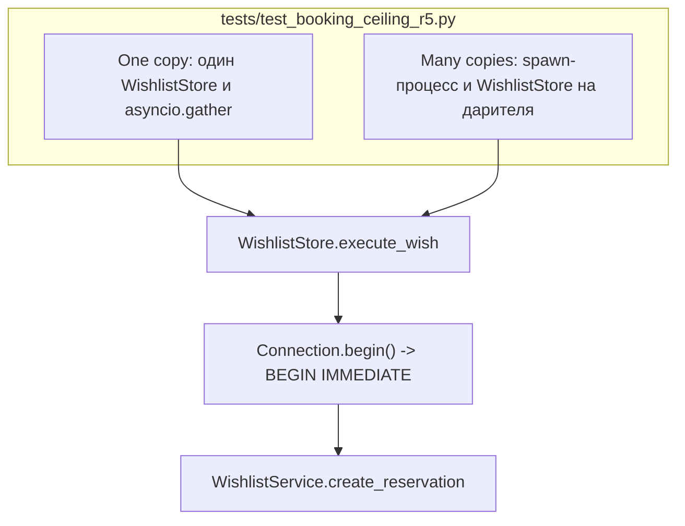

# Спецификация: WISHENKA-39 — Нагрузочные и конкурентные проверки потолка бронирования (R5)

**Задача:** WISHENKA-39 (родительский эпик: WISHENKA-36)  
**Матрица верификации:** строка `R5` (`doc/dev/verification-matrix.md`)  
**Статус реализации:** выполнена (`STEP 1`–`COMMIT` закрыты в `00-roadmap.md`)  
**Язык и стек:** Python 3.12+, `pytest`, `pytest-timeout` 2.3.1, `asyncio`, `multiprocessing` (`spawn`), SQLite WAL

## 1. Назначение и бизнес-цель

### 1.1. Постановка проблемы

Ключевой инвариант сервиса Telegram Wishlist Service (раздел 6 высокоуровневой спецификации `specs/00-high.md`) запрещает перебронирование: суммарное количество экземпляров желания, занятых дарителями, не может превышать запрошенное владельцем количество.

Ранее задача `WISHENKA-57` обеспечила единый разделяемый баланс инвентаря на транзакционном пути записи `WishlistStore.execute_wish`, включая конкурентный доступ со стороны нескольких запущенных копий сервиса. В матрице верификации `doc/dev/verification-matrix.md` (опубликованной в `WISHENKA-37`) строки `R1`–`R4` уже были закрыты короткими проверками для двух дарителей или изолированного экземпляра `WishlistService()` без хранилища.

Строка `R5` оставалась открытой: в наборе тестов отсутствовало автоматизированное доказательство того, что потолок бронирования сохраняется на реальном транзакционном пути `WishlistStore.execute_wish` при одновременной конкуренции более чем двух дарителей (`N > 2`), при повторяющихся раундах гонки с известным свободным остатком и в ограниченной серии конкуренций (нагрузочном профиле) — как внутри одного экземпляра хранилища, так и между несколькими независимыми процессами.

### 1.2. Цели задачи

- Создать автоматизированный набор характерологических проверок в модуле `tests/test_booking_ceiling_r5.py`, закрывающий строку `R5` матрицы верификации.
- Подтвердить точное распределение последних доступных единиц желания при одновременной конкуренции группы дарителей (`5` участников) в двух формах запросов: по `1` единице каждому и на весь свободный остаток целиком.
- Подтвердить воспроизводимость потолка при повторных гонках и в ограниченном нагрузочном профиле как в одноэкземплярном (`asyncio.gather` на одном `WishlistStore`), так и в многопроцессном (`spawn`, отдельный `WishlistStore` на процесс) режимах.
- Оставить продуктовое поведение, код подсистемы `wishenka/` и существующие механизмы блокировок полностью без изменений.

### 1.3. Ценность для пользователей и системы

- **Для дарителей:** уверенность в том, что при одновременной попытке нескольких друзей забрать последние свободные экземпляры подарка одна и та же единица не будет обещана двоим, а доступные единицы не будут потеряны.
- **Для владельца вишлиста:** гарантия того, что серия конкурентных бронирований удерживает суммарно занятое количество в пределах запрошенного, а ранее созданные обещания не повреждаются и не дублируются.
- **Для разработки и эксплуатации:** воспроизводимое автоматическое доказательство работы потолка на боевом пути `WishlistStore.execute_wish` сверх двухпользовательских сценариев `R1`–`R2`.

### 1.4. Границы области действия

- **В рамках задачи:**
  - Характерологические тесты строки `R5` в `tests/test_booking_ceiling_r5.py`.
  - Документирование покрытия `R5`, команды запуска и ограничений в `doc/dev/verification-matrix.md` и обновление ссылки в `doc/dev/architecture.md`.
- **Вне рамок задачи:**
  - Проектирование или изменение блокировок и уровней изоляции БД (задача `WISHENKA-57` уже обеспечивает единый баланс, а дальнейшее развитие блокировок относится к задаче `WISHENKA-49`).
  - Повторная реализация или изменение тестов строк `R1`–`R4`.
  - Проверки тайны сюрприза и анонимного доступа по публичной ссылке (строки `S5`, `S6`, `S8` и `A3` закрыты в задаче `WISHENKA-38` модулем `tests/test_surprise_role_context.py`).
  - Планирование пропускной способности (capacity plan), целевые метрики задержки (latency) и пропускной способности (throughput).
  - Частичное исполнение запросов (partial fills), идемпотентный повтор одного нажатия одним дарителем, отправка уведомлений, платежи, краудфандинг и секретные подарки вне вишлиста.

## 2. Функциональные требования и пользовательские сценарии

### 2.1. Доменные сущности и формула расчёта остатка

| Сущность / Понятие | Определение в контексте R5 |
| --- | --- |
| Желание (`Wish`) | Позиция вишлиста с запрошенным количеством (`quantity`), полученным количеством (`received_quantity`) и связанными бронированиями |
| Обещание / Бронь (`Promise`) | Заявка дарителя на положительное число единиц желания; остаток занимают статусы `ACTIVE` и `PURCHASED` |
| Свободный остаток (`Free remainder`) | `max(0, quantity - received_quantity - occupied)`, где `occupied` — сумма `quantity` по всем бронированиям в статусах `ACTIVE` и `PURCHASED` |
| Доступное количество (`Available quantity`) | Значение `free_remainder` конкретного желания в момент перед началом конкуренции |
| Забронированное количество (`Booked quantity`) | Сумма единиц по новым занимающим строкам (`ACTIVE` или `PURCHASED`), созданным в данной конкуренции |
| Даритель (`Gifter`) | Пользователь, отличный от владельца вишлиста, участвующий в конкуренции |
| Конкуренция (`Contention`) | Одновременная попытка более двух дарителей забронировать одно желание до полного успеха или полного отказа каждой попытки |
| Нагрузочный профиль (`Load profile`) | Ограниченная серия конкуренций на нескольких желаниях с независимой оценкой потолка по каждому желанию |
| Исполняющий экземпляр (`Running copy`) | Экземпляр `WishlistStore`, принимающий бронирования (один общий экземпляр или отдельный процесс со своим `WishlistStore`) |

### 2.2. Пользовательские сценарии

- **US-01 (Даритель — конкуренция за последние единицы):** при одновременной попытке группы дарителей забронировать последние свободные единицы желания успешно бронируется ровно доступный остаток без двойного бронирования одной единицы и без потери свободных единиц.
- **US-02 (Даритель — повторяемая конкуренция):** при многократном повторении гонки от известного свободного остатка результат остаётся детерминированным по потолку, а ранее занятые единицы не выдаются повторно.
- **US-03 (Владелец — серия бронирований):** при последовательной серии одновременных бронирований от нескольких друзей суммарно занятое количество по каждому желанию не превышает доступное, а список остаётся согласованным с запросом.
- **US-04 (Оператор сервиса — доказательство для многих дарителей):** автоматизированный прогон подтверждает соблюдение потолка при `N > 2` участниках, повторных раундах и нагрузочном профиле, а не только на примере двух дарителей.

### 2.3. Функциональные требования, входы и выходы

1. **Форма «Многие дарители по одной единице» (`One unit each`):**
   - **Вход:** более двух дарителей (`5`) одновременно вызывают бронирование одного желания с запросом `1` единицы каждый; начальный свободный остаток положителен и меньше числа дарителей (`2` на свежем желании или `3` при старте с предварительно занятой единицей).
   - **Выход:** количество успешно забронированных единиц равно `available_quantity`; каждая успешная бронь принадлежит ровно одному дарителю с `quantity == 1` и совпадающим `reservation_id`; все остальные дарители получают полный отказ `InsufficientQuantityError` без создания строки бронирования; итоговый `free_remainder == 0`.
2. **Форма «Весь свободный остаток» (`Whole remainder`):**
   - **Вход:** более двух дарителей (`5`) одновременно пытаются забронировать весь свободный остаток одного желания (`available_quantity >= 1`, в тестах — `3` единицы).
   - **Выход:** ровно `1` даритель добивается успеха и занимает весь остаток (`booked == available_quantity`); остальные `4` дарителя получают полный отказ `InsufficientQuantityError` без добавления строк; итоговый `free_remainder == 0`.
3. **Повторная конкуренция (`Repeated contention`):**
   - **Вход:** обе формы гонки выполняются более одного раза (`3` старта для каждой формы), каждый раз от известного свободного остатка, включая старт на желании с уже существующей предзасеянной бронью (`quantity = 4`, предзанято `1`, свободный остаток `3`). Подготовка нового желания и предзасеянной брони является настройкой теста и не добавляет правил освобождения или получения.
   - **Выход:** в каждом повторении `booked == available_quantity` этого повторения; уже занятые единицы остаются занятыми однократно, а предзасеянная строка сохраняет исходного дарителя, количество и статус.
4. **Нагрузочный профиль (`Load profile`):**
   - **Вход:** ограниченная серия конкуренций (`2` раунда в режиме одного экземпляра и `2` раунда в многопроцессном режиме; в каждом раунде по два отдельных желания: для формы «по `1` единице» с остатком `2` и для формы «весь остаток» с остатком `3`).
   - **Выход:** каждое желание оценивается отдельно; после завершения каждой конкуренции и после завершения всей серии `free_remainder >= 0`, `booked == available_quantity`, а `quantity` и `received_quantity` неизменны.
5. **Общий разделяемый инвентарь (`Shared inventory`):**
   - Требования пп. 1–4 выполняются одинаково при конкуренции внутри одного экземпляра `WishlistStore` и между несколькими независимыми процессами с отдельными экземплярами `WishlistStore` на общем файле SQLite. Исполняющие копии не ведут приватного счётчика остатков.

### 2.4. Продуктовые и тестовые инварианты

- **Потолок остатка:** после каждой завершённой попытки свободный остаток желания удовлетворяет условию `free_remainder >= 0`, а `booked <= available_quantity` (для обеих проверяемых форм запроса — строго `booked == available_quantity`).
- **Атомарность отказа:** запрос, превышающий `available_quantity`, отклоняется целиком (`InsufficientQuantityError`); отказ не добавляет бронь и не меняет последний зафиксированный баланс.
- **Сохранность смежных полей и существующих строк:** конкуренция не изменяет `quantity`, `received_quantity` и ранее существовавшие строки бронирования (включая их `user_id`, `quantity` и `status`).
- **Запрет маскировки сбоев блокировки:** исключение `InventoryBusyError` не считается штатным отказом по остатку и немедленно проваливает проверку.
- **Неизменность прочих продуктовых правил:** запрет самобронирования владельцем, правила архивных желаний, сообщение проигравшему дарителю без раскрытия победителя (`R4`) и тайна сюрприза для получателя (`S5`, `S6`, `S8`, `A3`) продолжают действовать без изменений.

## 3. Архитектура, компоненты и интерфейсы

### 3.1. Архитектурное решение и схема взаимодействия

Решение строится как характерологический тестовый набор над существующей транзакционной единицей работы на уровне одного желания (`WishlistStore.execute_wish`). Внутри транзакции `Connection.begin()` драйвер SQLite выполняет `BEGIN IMMEDIATE` с `isolation_level = None` и `busy_timeout = 5000` мс. Операция `_load_wish` считывает только целевое желание, `WishlistService.create_reservation` применяет проверку остатка, а `_persist_wish` фиксирует изменения либо откатывает транзакцию при доменном отказе.

Внутритранзакционный объект `WishlistService`, создаваемый в `_load_wish`, не использует `store` и не разделяет `ItemConcurrencyCoordinator` (карту `asyncio.Lock` в памяти одного экземпляра сервиса) между конкурентными вызовами и процессами. Поэтому реальное взаимное исключение в обоих режимах (`one copy` и `many copies`) обеспечивает сериализация писателей SQLite на уровне `BEGIN IMMEDIATE`.



### 3.2. Модули и распределение ответственности

| Модуль | Статус в задаче | Ответственность и роль |
| --- | --- | --- |
| `tests/test_booking_ceiling_r5.py` | Создан | Реализация 6 проверок `R5`, константы границ, таймауты, запуск гонок и сверка баланса |
| `wishenka/wishlists/store.py` | Без изменений | `WishlistStore.execute_wish` — тестируемый путь записи; `execute` и `initialize` — настройка теста и чтение снимка |
| `wishenka/wishlists/service.py` | Без изменений | `WishlistService.create_reservation` — правило проверки `quantity > item.available_quantity` |
| `wishenka/wishlists/concurrency.py` | Без изменений | `ItemConcurrencyCoordinator` (не является механизмом межпроцессной блокировки для `R5`) |
| `tests/test_shared_inventory_multiprocess.py` | Без изменений | Образец жизненного цикла процессов (`spawn`, `Barrier`, `Queue`, `join`, `terminate` в `finally`), использующий `store.execute` для `R2` |
| `doc/dev/verification-matrix.md` | Обновлён (Шаг 8) | Привязка строки `R5` к 6 тестам `tests/test_booking_ceiling_r5.py`, документация команды запуска и правил диагностики |
| `doc/dev/architecture.md` | Обновлён (Шаг 8) | Обновление указателя матрицы для `R5` на `tests/test_booking_ceiling_r5.py` |

### 3.3. Классы, функции и контракты данных в `tests/test_booking_ceiling_r5.py`

#### Структуры снимка и результата (`frozen` dataclasses)

- `_ReservationRow(reservation_id: int, user_id: int, quantity: int, status: str)` — строка бронирования на момент чтения снимка.
- `_ItemBalance(item_id: int, quantity: int, received: int, reservations: tuple[_ReservationRow, ...])` — снимок баланса желания со свойствами:
  - `occupied`: сумма `row.quantity` для строк со статусом в `_OCCUPYING` (`{ReservationStatus.ACTIVE.value, ReservationStatus.PURCHASED.value}`).
  - `free_remainder`: `max(0, self.quantity - self.received - self.occupied)`.
- `_Attempt(gifter_id: int, quantity: int, status: str, error_type: str | None = None, reservation_id: int | None = None)` — нормализованный исход попытки одного дарителя.

#### Функции запуска конкуренции и проверки баланса

- `_reserve(store, item_id, user_id, first_name, quantity)` — вызывает `store.execute_wish(operation, item_id=item_id, operation_name="create_reservation")`, где `operation` обращается к `service.create_reservation(item_id=item_id, user=user, quantity=quantity)`. Перехватывает только `InsufficientQuantityError` и возвращает словарь со статусом `"ok"` (и `reservation_id`) либо `"error"` (и `error_type`).
- `_race_one_store(db_path, item_id, quantity)` — создаёт один `WishlistStore(f"sqlite+aiosqlite:///{db_path}")`, запускает `5` вызовов `_reserve` через `asyncio.gather` и закрывает пул через `await store.engine.dispose()`.
- `_worker(...)` / `_book_in_process(...)` / `_race_processes(db_path, item_id, quantity)` — порождает `5` процессов через `multiprocessing.get_context("spawn")`, синхронизирует их на `ctx.Barrier(5)`, в каждом процессе открывает собственный `WishlistStore`, выполняет `_reserve`, отправляет результат в `ctx.Queue` и освобождает движок; родительский процесс ожидает завершения процессов, вычитывает очередь, завершает выжившие процессы в `finally` и проверяет `len(payloads) == 5` и `exitcode == 0`.
- `_require_attempt(payload)` — преобразует результат в `_Attempt`; при `error_type == "InventoryBusyError"` немедленно поднимает `AssertionError`; допускает только успешный исход (`status == "ok"`, `error_type is None`) или отказ по остатку (`status == "error"`, `error_type == "InsufficientQuantityError"`).
- `_execute` / `_seed_wishlist` / `_seed_reservation` / `_load` — вспомогательные вызовы через `store.execute` (инициализация схемы при первом обращении, создание вишлиста и желаний, предзасев брони от `_SEED_ID = 86006`, чтение состояния из `service._items.get(item_id)`).
- `_contend` и `_assert_ceiling` — снимают баланс `before`, запускают гонку (в одном хранилище или в процессах), снимают баланс `after` строго после завершения всех попыток и проверяют равенство `booked == before.free_remainder`, соответствие победителей и новых строк, отсутствие строк у отказанных дарителей, сохранность предыдущих строк и `after.free_remainder == 0`.

### 3.4. Контракты транзакции и переходы состояний

Вызов пути записи:

```python
await store.execute_wish(
    operation,
    item_id=item_id,
    operation_name="create_reservation",
)
```

Переходы состояний внутри одной транзакции `BEGIN IMMEDIATE` и на уровне конкуренции:

1. **Успех (`quantity <= item.available_quantity`):** создаётся строка `Reservation` со статусом `ACTIVE`, `available_quantity` уменьшается на `quantity`, транзакция фиксируется (`COMMIT`), возвращается `reservation.id`.
2. **Отказ по остатку (`quantity > item.available_quantity`):** сервис поднимает `InsufficientQuantityError`, `execute_wish` выполняет откат (`ROLLBACK`), баланс и список броней не изменяются.
3. **Таймаут ожидания блокировки (`SQLITE_BUSY` по истечении `5000` мс):** хранилище поднимает `InventoryBusyError` — в проверках `R5` трактуется как сбой теста без повторных попыток.
4. **Жизненный цикл конкуренции в тесте:**
   - `Начальное состояние (free_remainder > 0)` → `Одновременный старт 5 попыток (gather или Barrier)` → `Фиксация победителей в рамках остатка + откат проигравших` → `Завершённая конкуренция (join/gather завершены, booked == available_quantity, free_remainder == 0)`.
   - Чтение баланса во время незавершённых вызовов `execute_wish` не считается завершённым результатом и не используется в проверках; `_load` выполняется только до запуска конкуренции и после завершения всех попыток.

## 4. Нефункциональные требования, безопасность и наблюдаемость

### 4.1. Ограничения, границы испытаний и таймауты

#### Фиксированные границы тестового набора (`tests/test_booking_ceiling_r5.py`)

| Параметр | Значение | Обоснование |
| --- | --- | --- |
| `_OWNER_ID` / `_OWNER_NAME` | `1001` / `"OwnerAda"` | Владелец вишлиста; не входит в список дарителей |
| `_GIFTER_COUNT` (`_GIFTERS`) | `5` (`81001`–`85005`) | Больше двух участников, но не переполняет очередь `BEGIN IMMEDIATE` сверх `busy_timeout` |
| `_SEED_ID` / `_SEED_NAME` | `86006` / `"GifterSeed"` | Даритель предварительно созданной брони для повторных стартов |
| `_ONE_UNIT_FREE` / `_ONE_UNIT_ASK` | `2` / `1` | Минимум `1` свободная единица и меньше свободных единиц, чем дарителей |
| `_WHOLE_FREE` | `3` | Каждый даритель запрашивает весь свободный остаток целиком |
| `_SEEDED_REQUESTED` / `_SEEDED_OCCUPIED` / `_SEEDED_FREE` | `4` / `1` / `3` | Старт с уже занятой единицей для третьего повторения каждой формы |
| `_REPETITIONS` | `3` на форму | Повторная конкуренция от известного остатка (`2` свежих + `1` предзасеянное) |
| `_LOAD_ROUNDS` | `2` на режим | Ограниченная серия (`2` раунда `one copy` + `2` раунда `many copies`, по `2` желания) |

#### Таймауты и ограничения ожидания

- **Модульный таймаут:** `pytestmark = pytest.mark.timeout(120)` через `pytest-timeout` 2.3.1 (на Linux используется метод по умолчанию `signal` / `SIGALRM`; `method="thread"` не применяется; глобальный таймаут в `pyproject.toml` отсутствует).
- **Потестовые таймауты (действует ближайший маркер):** `30` с для одиночных тестов в одном хранилище, `60` с для одиночных многопроцессных тестов, `90` с для повторной конкуренции, `120` с для нагрузочного профиля.
- **Ограничения процессов и очередей (по образцу R2):**
  - `_BARRIER_TIMEOUT_SECONDS = 20`
  - `_JOIN_TIMEOUT_SECONDS = 25`
  - `_DRAIN_TIMEOUT_SECONDS = 5` (чтение из очереди шагами по `0.2` с)
  - `_TERMINATE_TIMEOUT_SECONDS = 5` (принудительное завершение выживших процессов в `finally`)
- **Производительность и внешние зависимости:**
  - База SQLite создаётся во временном каталоге `tmp_path`; внешний веб-сервер и внешняя конфигурация не требуются.
  - Целевые значения времени отклика и пропускной способности не задаются.
  - Повышать `busy_timeout` (`5000` мс) или повторять `InventoryBusyError` в тестах запрещено.

### 4.2. Инварианты безопасности и приватности

- **Сохранение тайны сюрприза:** задача не изменяет проекции API, HTML-фрагменты, права доступа и уведомления; изоляция получателя подарка от факта и деталей бронирований сохраняется в полном объёме (`S5`, `S6`, `S8` покрыты в `tests/test_surprise_role_context.py`).
- **Анонимный доступ и отсутствие утечки держателей броней:** ссылка просмотра не создаёт аккаунт (`A3`), а сообщения об отказе дарителям не раскрывают личности победителей (`R4`).
- **Приватность записей отката хранилища:** в логах отката `WishlistStore` (`wishlist_inventory_rolled_back` на логгере `wishenka.wishlists.store`) фиксируются только `error_type`, `item_id` и `operation`, без `gifter_id`.

### 4.3. Наблюдаемость: структурированное логирование и метрики

- **Новые инструменты наблюдаемости:** в `WISHENKA-39` **не добавлялись** новые записи логов (ни одного уровня от `DEBUG` до `EMERG`), метрики (производительности, бизнеса или здоровья системы), экспортёры, дашборды или правила оповещения.
- **Существующие структурированные логи на пути `execute_wish` (без изменений):**
  - **Отказ по нехватке количества в сервисе:** `WishlistService.create_reservation` логирует событие `insufficient_quantity_blocked` с уровнем `WARNING` через `logging.getLogger("wishenka.wishlists")` (`extra={"event": ...}` с полями `item_id`, `gifter_id`, `requested_quantity`, `available_quantity`) и выбрасывает `InsufficientQuantityError`.
  - **Откат транзакции в хранилище:** `_log_wish_rollback` в `wishenka/wishlists/store.py` логирует событие `wishlist_inventory_rolled_back` с уровнем `WARNING` через `wishenka.wishlists.store` (поля `error_type`, `item_id`, `operation="create_reservation"`, без `gifter_id`).
  - **Конфликт блокировки SQLite (`SQLITE_BUSY`):** хранилище логирует `wishlist_inventory_busy` с уровнем `WARNING` через `wishenka.wishlists.store` и поднимает `InventoryBusyError`.
  - **Успешная фиксация транзакции:** логируется событием `wishlist_inventory_committed` с уровнем `INFO` на `wishenka.wishlists.store`.
- **Сигналы в автотестах R5:**
  - Тесты не читают `caplog` и не проверяют тексты предупреждений; поскольку штатные отказы логируются как `WARNING`, контракт отсутствия `ERROR`-логов в `caplog` не применяется.
  - Проверяемыми сигналами служат исключительно исходы попыток (`ok` или `InsufficientQuantityError`; любой `InventoryBusyError` проваливает тест) и состояние баланса желания после завершения гонки.

## 5. Верификация и критерии приёмки

### 5.1. Сценарии тестирования (`tests/test_booking_ceiling_r5.py`)

| Тест | Таймаут | Режим и входные параметры | Ожидаемый результат |
| --- | --- | --- | --- |
| `test_one_copy_one_unit_each` | `30` с | `1` `WishlistStore`, `asyncio.gather`, `5` дарителей, остаток `2`, запрос по `1` | `2` успеха, `3` `InsufficientQuantityError`, занято `2`, остаток `0` |
| `test_many_copies_one_unit_each` | `60` с | `5` процессов (`spawn` + `Barrier`), свой `WishlistStore` в каждом, остаток `2`, запрос по `1` | `2` успеха, `3` `InsufficientQuantityError`, занято `2`, остаток `0` |
| `test_one_copy_whole_remainder` | `30` с | `1` `WishlistStore`, `asyncio.gather`, `5` дарителей, остаток `3`, запрос по `3` | `1` успех, `4` `InsufficientQuantityError`, занято `3`, остаток `0` |
| `test_many_copies_whole_remainder` | `60` с | `5` процессов (`spawn` + `Barrier`), свой `WishlistStore` в каждом, остаток `3`, запрос по `3` | `1` успех, `4` `InsufficientQuantityError`, занято `3`, остаток `0` |
| `test_repeated_contention_many_copies` | `90` с | `5` процессов, `3` старта формы «по 1» (`2`, `2`, предзасеянный `4 - 1 = 3`) и `3` старта формы «весь остаток» (`3`, `3`, `4 - 1 = 3`) | Каждый старт занимает ровно свой свободный остаток; предзасеянная бронь `_SEED_ID` на `1` не меняется; остаток `0` |
| `test_load_profile_one_copy_and_many_copies` | `120` с | `2` раунда `one copy` + `2` раунда `many copies`; в каждом раунде `2` желания (остатки `2` и `3`); повторное чтение `_load` в конце | После каждой гонки и повторного чтения в финале `booked == available_quantity`, `free_remainder >= 0`, `quantity` и `received` неизменны |

### 5.2. Команды проверки и зафиксированные результаты

- **Примечание к Шагу 3 (`td-25-failing-repro`):** шаг зафиксирован как `N/A — no behavioral change`. Предварительная проверка пяти дарителей на пути `WishlistStore.execute_wish` подтвердила, что потолок уже соблюдается без изменения блокировок, поэтому воспроизводимый красный дефект отсутствует.
- **Изолированный прогон тестов `R5` (Шаг 5):**

  ```bash
  make test PYTEST=".venv/bin/pytest tests/test_booking_ceiling_r5.py"
  ```

  Результат: `6 passed in 13.49s`, код возврата `0`, без предупреждений (полный набор тестов репозитория в рамках Шага 5 не запускался).
- **Статический анализ (`make analyze`, Шаг 5):**
  - Ruff check: `"All checks passed!"` по `wishenka` и `tests`.
  - Ruff format check: `84` файла уже отформатированы.
  - Mypy: `"Success: no issues found in 84 source files"`.
  - Максимальная длина строки в `tests/test_booking_ceiling_r5.py`: `99` символов (в пределах лимита `100` в `pyproject.toml`).

### 5.3. Критерии приёмки (Definition of Done)

1. Автоматические проверки закрывают строку `R5` в `doc/dev/verification-matrix.md` (повторная конкуренция, многие дарители и нагрузочный профиль).
2. При одновременной попытке более двух дарителей (`5`) забронировать по `1` единице желания с остатком меньше числа дарителей и не менее `1` бронируется ровно свободный остаток, каждый победитель получает свою строку, остальные получают отказ без изменения баланса.
3. При одновременной попытке более двух дарителей (`5`) забронировать весь свободный остаток побеждает ровно `1` даритель, занятое количество равно доступному, остальные получают отказ без изменения баланса.
4. При повторной конкуренции от известного свободного остатка для обеих форм в каждом повторении бронируется ровно доступный остаток этого повторения, а ранее занятые единицы не выдаются повторно.
5. В ограниченном нагрузочном профиле для каждого затронутого желания после каждой завершённой попытки свободный остаток `>= 0`, `booked <= available_quantity`, а для заданных форм `booked == available_quantity`.
6. Проверки работают через общий разделяемый инвентарь (`WishlistStore.execute_wish`) как для одного экземпляра, так и для нескольких процессов.
7. Проверки строк `R1`–`R4` остаются на ранее назначенных им тестах без изменений.
8. Проверки строк `S5`, `S6`, `S8` и `A3` остаются закрытыми задачей `WISHENKA-38`.
9. Все тесты написаны на Python 3.12+ и ограничены конечными таймаутами без бесконечных ожиданий.
10. Продуктовое поведение остаётся неизменным; новый дизайн блокировок или изоляции не вводится.

### 5.4. Известные ограничения и дальнейшие задачи (`60-tech-debt.md`)

- **Новые задачи техдолга (follow-up):** отсутствуют. Все шесть тестов реализованы с явными таймаутами (`30`/`60`/`90`/`120` с и таймаутами процессов/барьера/очереди), а обновление `doc/dev/verification-matrix.md` и ссылки в `doc/dev/architecture.md` выполнено на Шаге 8 данной задачи.
- **Принятые границы реализации (не считаются долгом):**
  - Копирование схемы управления процессами (`spawn`, `Barrier`, `Queue`, `join`, `terminate`) из `tests/test_shared_inventory_multiprocess.py` выполнено намеренно, чтобы вызывать `execute_wish` вместо `store.execute`, и не требует последующего вынесения в общий helper.
  - Чтение баланса в тестах обращается к `service._items`, как и в существующих тестах разделяемого инвентаря.
  - Испытание ограничено `5` дарителями, чтобы очередь писателей SQLite WAL не исчерпывала `busy_timeout = 5000` мс; проектирование дополнительных блокировок и изоляции под более высокую конкуренцию остаётся в зоне ответственности существующей задачи `WISHENKA-49`.
  - Целевые показатели времени отклика и пропускной способности не проверяются и не задаются.
