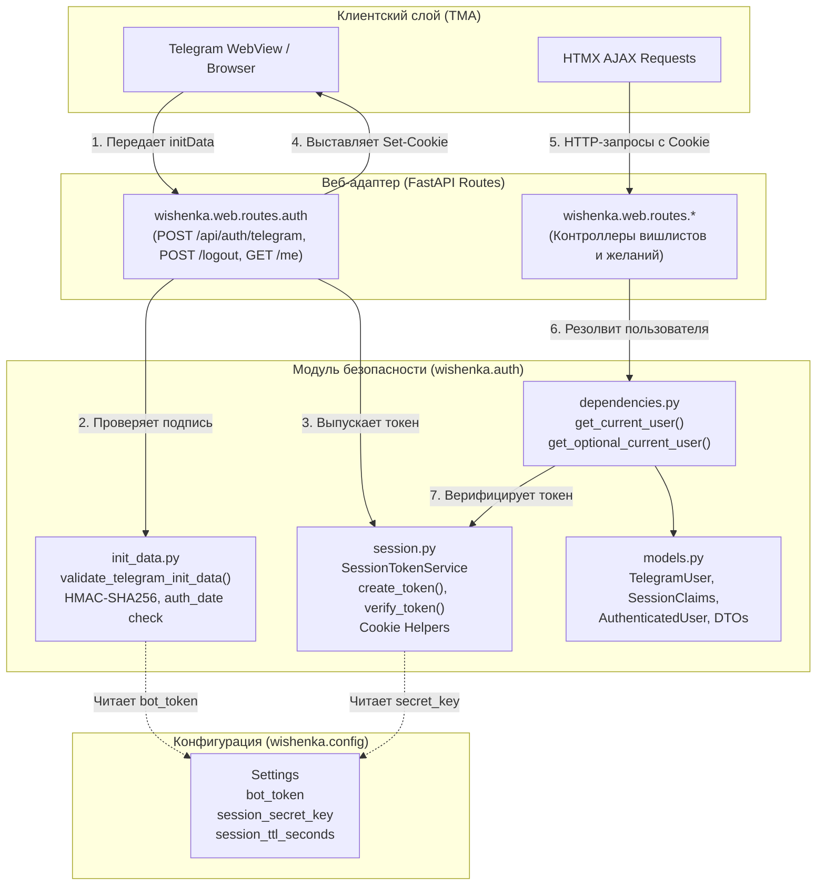

# WISHENKA-4: [Аутентификация] Валидация Telegram WebApp initData и сессионный контекст

## Research

### 1. Спецификация валидации Telegram WebApp `initData`

В среде Telegram Mini App (TMA) клиентское приложение при запуске внутри нативного WebView (iOS, Android, macOS, Desktop, Web) получает строку инициализации через `window.Telegram.WebApp.initData`. Строка представляет собой query string вида:
```text
auth_date=1700000000&query_id=AAHdF6IQAAAAAN0XohDhrOrc&user=%7B%22id%22%3A279058397%2C%22first_name%22%3A%22Vladislav%22%2C%22last_name%22%3A%22K%22%2C%22username%22%3A%22vlad%22%2C%22language_code%22%3A%22ru%22%7D&hash=d3b07384d113edec49eaa6238ad5ff00...
```

#### Алгоритм криптографической проверки подписи (HMAC-SHA256):
1. **Разбор query-строки**: Строка декодируется в набор пар ключ-значение.
2. **Извлечение хеша**: Параметр `hash` извлекается из набора и сохраняется для сверки; из набора проверяемых параметров он исключается.
3. **Формирование строки проверки данных (`data_check_string`)**:
   - Оставшиеся пары сортируются в алфавитном порядке по ключу (`key=value`).
   - Пары объединяются через символ переноса строки `\n`.
4. **Вычисление секретного ключа (`secret_key`)**:
   - Вычисляется HMAC-SHA256, где в качестве ключа используется константная строка `"WebAppData"` (`b"WebAppData"`), а в качестве сообщения — токен Telegram-бота (`bot_token.encode("utf-8")`):
     $$\text{secret\_key} = \text{HMAC-SHA256}(\text{key} = \text{"WebAppData"}, \text{msg} = \text{bot\_token})$$
5. **Вычисление контрольного хеша**:
   - Вычисляется HMAC-SHA256 от сформированной строки `data_check_string` с использованием `secret_key`:
     $$\text{calculated\_hash} = \text{HMAC-SHA256}(\text{key} = \text{secret\_key}, \text{msg} = \text{data\_check\_string}).\text{hex}()$$
6. **Защищенное сравнение (Constant-Time Compare)**:
   - Сравнение переданного `hash` и `calculated_hash` выполняется исключительно через `hmac.compare_digest(calculated_hash, hash)`, что исключает утечки по времени (timing attacks).
7. **Контроль актуальности временной метки (`auth_date`)**:
   - `auth_date` представляет собой Unix timestamp авторизации в Telegram.
   - Защита от дрейфа часов в будущем: `auth_date > current_time + max_clock_drift` (допустимый дрейф 60 сек) $\rightarrow$ отклонение запроса.
   - Защита от replay-атак: `current_time - auth_date > max_age_seconds` (по умолчанию 86400 сек / 24 часа) $\rightarrow$ отклонение запроса.
8. **Десериализация профиля пользователя**:
   - Параметр `user` десериализуется из JSON в DTO-модель `TelegramUser` (поля: `id`, `first_name`, `last_name`, `username`, `language_code`, `is_premium`).

---

### 2. Сессионный механизм для HTMX и двойной режим аутентификации

#### Особенности окружения Telegram Mini App:
- Mini App запускается внутри iframe или WebView клиентов Telegram.
- Для HTMX наиболее естественной и прозрачной моделью является работа через cookie: при отправке `hx-get`, `hx-post` браузер нативно прикрепляет установленные cookie к каждому запросу.
- В то же время Telegram Web может работать в кросс-доменном iframe (`web.telegram.org`), что накладывает строгие требования к cookie:
  - `SameSite=None`: обязателен для кросс-сайтовых iframe/встраиваний;
  - `Secure=True`: обязателен при `SameSite=None` (передача только по HTTPS, в локальной разработке допускается конфигурационный флаг `session_cookie_secure: bool = False`);
  - `HttpOnly=True`: предотвращает доступ к сессионной cookie из JavaScript (`document.cookie`), блокируя кражу сессии через XSS;
  - `Path=/`: действие на все маршруты приложения;
  - `Max-Age=2592000` (30 суток): долгоживущая сессия для бесшовного UX.

#### Архитектура сессионного токена:
- Для исключения накладных расходов на чтение БД на каждый HTMX-запрос сессионный токен проектируется как **Stateless Signed Token**:
  - Токен состоит из полезной нагрузки (JSON с полями `telegram_id`, `first_name`, `username`, `iat`, `exp`), сериализованной в URL-safe base64, и криптографической подписи HMAC-SHA256, вычисленной на основе `session_secret_key`.
  - Формат токена: `<payload_b64>.<sig_b64>`.
  - Подпись токена гарантирует защиту от подделки и модификации клиентом.
  - Проверка токена выполняется за $O(1)$ в памяти процесса без внешних I/O вызовов.
- Преимущества реализации на стандартной библиотеке Python (`hmac`, `hashlib`, `json`, `base64`, `time`):
  - Отсутствие внешних нестабильных зависимостей;
  - Полная прозрачность и детерминированность алгоритма;
  - Легковесность и высокая скорость работы;
  - Совместимость с любыми версиями Python 3.12+.

#### Двойной режим аутентификации (Dual-Mode):
1. Проверка заголовка `Authorization: Bearer <token>` (приоритет для API-клиентов, внешних интеграций и тестовых утилит).
2. Проверка cookie `session_id` (основной механизм для TMA WebView и HTMX).
3. Если токен найден в любом из источников, он верифицируется; при успешной проверке формируется объект `AuthenticatedUser`.

---

### 3. Зависимости безопасности FastAPI (`FastAPI Security Dependencies`)

FastAPI предоставляет мощную систему внедрения зависимостей (`Depends`). Для прозрачного разделения защищенных и публичных маршрутов проектируются две фабрики зависимостей:
1. `get_optional_current_user`:
   - Извлекает токен из заголовка `Authorization` или cookie `session_id`.
   - Если учетные данные отсутствуют — возвращает `None` (гостевой режим, анонимный доступ).
   - Если учетные данные переданы, но невалидны или просрочены — возбуждает `HTTPException(status_code=401, detail="Invalid session token")`.
   - Если токен валиден — возвращает `AuthenticatedUser`.
2. `get_current_user`:
   - Опирается на `get_optional_current_user`.
   - Если пользователь не определен (`None`), возбуждает `HTTPException(status_code=401, detail="Authentication required")`.
   - Гарантирует вызывающему эндпоинту непустой экземпляр `AuthenticatedUser`.

---

## Implementation Plan

### Высокоуровневые этапы реализации

1. **Конфигурация приложения (`wishenka/config.py`)**:
   - Расширение класса `Settings` параметрами безопасности сессий:
     - `session_secret_key: str = "wishenka-insecure-dev-secret-change-me"`
     - `session_ttl_seconds: int = 2592000` (30 дней)
     - `session_cookie_name: str = "session_id"`
     - `session_cookie_secure: bool = False` (по умолчанию `False` для локальной разработки, `True` в production)
     - `session_cookie_samesite: str = "none"`
     - `telegram_auth_max_age_seconds: int = 86400` (24 часа)

2. **Модели предметной области аутентификации (`wishenka/auth/models.py`)**:
   - `TelegramUser`: DTO профиля из Telegram (id, first_name, last_name, username, language_code, is_premium).
   - `SessionClaims`: полезная нагрузка токена (telegram_id, first_name, username, iat, exp).
   - `AuthenticatedUser`: контекст авторизованного пользователя в запросе (telegram_id, first_name, last_name, username, auth_method).
   - `TelegramAuthRequest`: DTO входящего запроса обмена `{ "init_data": "..." }`.
   - `AuthResponse`: DTO ответа авторизации `{ "token": "...", "user": TelegramUser }`.

3. **Криптографический валидатор Telegram `initData` (`wishenka/auth/init_data.py`)**:
   - Исключения: `AuthValidationError`, `InvalidSignatureError`, `ExpiredInitDataError`, `MalformedInitDataError`.
   - Функция `validate_telegram_init_data(init_data_raw: str, bot_token: str, max_age_seconds: int = 86400, clock_drift_seconds: int = 60) -> TelegramUser`.

4. **Менеджер сессионных токенов и cookie (`wishenka/auth/session.py`)**:
   - Класс `SessionTokenService`:
     - `create_token(claims: SessionClaims) -> str`
     - `verify_token(token: str) -> SessionClaims`
   - Хелперы установки и удаления cookie в `Response`:
     - `set_session_cookie(response: Response, token: str, settings: Settings) -> None`
     - `delete_session_cookie(response: Response, settings: Settings) -> None`

5. **Зависимости разрешения контекста пользователя (`wishenka/auth/dependencies.py`)**:
   - `get_optional_current_user(request: Request, settings: Settings = Depends(get_settings)) -> AuthenticatedUser | None`
   - `get_current_user(user: AuthenticatedUser | None = Depends(get_optional_current_user)) -> AuthenticatedUser`

6. **Маршрутизатор аутентификации (`wishenka/web/routes/auth.py`)**:
   - `POST /api/auth/telegram`: валидация initData, создание сессии, установка cookie, возврат профиля и токена.
   - `POST /api/auth/logout`: удаление сессионной cookie, возврат статуса.
   - `GET /api/auth/me`: защищенный эндпоинт (`Depends(get_current_user)`), возвращающий данные текущего пользователя.

7. **Регистрация роутера в фабрике приложения (`wishenka/web/app.py`)**:
   - Подключение `auth_router` в `FastAPI` приложение.

---

### Mandatory — Failing Repro (next Step 3)

В рамках следующего Шага 3 (Failing Repro) до внесения изменений в рабочий код сервиса создается модуль тестов `tests/test_auth.py`, проверяющий все требования спецификации и падающий с красным статусом (red test):

#### Локация теста:
- `tests/test_auth.py`

#### Набор проверяемых сценариев:
1. **Тестовая фикстура генерации валидного `initData`**:
   - Утилита `create_test_init_data(user_dict, bot_token, auth_date=None, tampered=False)` вычисляет корректный HMAC-SHA256 хеш по правилам Telegram WebApp.
2. **Тест валидации эталонной подписи (`test_validate_init_data_success`)**:
   - Передает сгенерированную валидную query-строку.
   - Утверждает успешный парсинг и соответствие полей `TelegramUser` (`id`, `first_name`, `username`).
3. **Тест отклонения скомпрометированных данных (`test_validate_init_data_tampered_fails`)**:
   - Модифицирует значение в строке данных (например, подмена `user.id` или изменение `auth_date`) без пересчета хеша.
   - Утверждает возбуждение `InvalidSignatureError`.
4. **Тест отклонения устаревшей даты авторизации (`test_validate_init_data_expired_fails`)**:
   - Формирует строку с `auth_date` двухдневной давности (> 86400 с).
   - Утверждает возбуждение `ExpiredInitDataError`.
5. **Тест эндпоинта обмена `POST /api/auth/telegram` (`test_auth_exchange_endpoint_sets_cookie`)**:
   - Отправляет HTTP POST запрос с валидным `{ "init_data": "..." }`.
   - Утверждает HTTP 200, тело с `token` и данными пользователя, а также заголовок `Set-Cookie` с параметрами `session_id`, `HttpOnly`, `SameSite=none`.
6. **Тест защиты закрытых маршрутов без авторизации (`test_protected_endpoint_without_session_returns_401`)**:
   - Отправляет GET запрос на `/api/auth/me` без cookie и заголовка `Authorization`.
   - Утверждает HTTP 401 Unauthorized.
7. **Тест доступа к закрытому маршруту с сессией (`test_protected_endpoint_with_session_returns_200`)**:
   - Отправляет GET запрос на `/api/auth/me` с сессионной cookie или заголовком `Authorization: Bearer <token>`.
   - Утверждает HTTP 200 и возврат корректного `telegram_id`.
8. **Тест опциональной авторизации (`test_optional_auth_resolution`)**:
   - Проверяет эндпоинт с опциональной авторизацией: для гостя возвращается признак анонимного доступа, для авторизованного клиента — профиль пользователя.

#### Правило do-testing:
- Все тесты помечаются маркером `@pytest.mark.timeout(10)`.

---

## Architecture

### 1. Архитектурная диаграмма последовательности (Auth Sequence Diagram)

```mermaid
sequenceDiagram
    autonumber
    actor User as Пользователь Telegram
    participant TMA as Mini App Client (WebView)
    participant AuthEP as FastAPI (/api/auth/telegram)
    participant Validator as InitData Validator
    participant SessionSvc as Session Token Service
    participant ProtectedEP as Защищенный API / HTMX View

    User->>TMA: Открывает Mini App
    TMA->>AuthEP: POST /api/auth/telegram { init_data: "..." }
    AuthEP->>Validator: validate_telegram_init_data(init_data, bot_token)
    
    alt Подпись невалидна или auth_date просрочен
        Validator-->>AuthEP: Ошибка (InvalidSignature / Expired)
        AuthEP-->>TMA: 401 Unauthorized { "detail": "Invalid initData" }
    else Подпись корректна
        Validator-->>AuthEP: TelegramUser(id, first_name, username)
        AuthEP->>SessionSvc: create_token(SessionClaims)
        SessionSvc-->>AuthEP: session_token
        AuthEP-->>TMA: 200 OK + Set-Cookie: session_id=<token>; HttpOnly; Secure; SameSite=None
    end

    Note over TMA,ProtectedEP: Последующие запросы HTMX (автоматическая отправка Cookie)
    
    TMA->>ProtectedEP: GET /api/auth/me (Cookie: session_id=<token>)
    ProtectedEP->>SessionSvc: verify_token(token)
    SessionSvc-->>ProtectedEP: SessionClaims(telegram_id, first_name)
    ProtectedEP-->>TMA: 200 OK HTML / JSON (Authenticated Context)
```

---

### 2. Компонентная диаграмма модулей безопасности



---

### 3. Структура модулей и файлов

```text
wishenka/
├── config.py                 # Добавление настроек безопасности сессий и токена бота
├── auth/
│   ├── __init__.py           # Экспорт основных интерфейсов и зависимостей
│   ├── models.py             # DTO и модели Pydantic (TelegramUser, AuthenticatedUser, etc.)
│   ├── init_data.py          # Криптографическая валидация HMAC-SHA256 строки initData
│   ├── session.py            # Выпуск, проверка сессионных токенов и управление cookie
│   └── dependencies.py       # FastAPI зависимости (get_current_user, get_optional_current_user)
└── web/
    ├── app.py                # Подключение auth_router
    └── routes/
        ├── __init__.py
        └── auth.py           # Эндпоинты /api/auth/telegram, /logout, /me
```

---

### 4. Описание интерфейсов и моделей (DTO / Schemas)

#### `wishenka/auth/models.py`

```python
from dataclasses import dataclass
from pydantic import BaseModel, ConfigDict, Field


class TelegramUser(BaseModel):
    """Telegram user profile extracted and verified from WebApp initData."""

    model_config = ConfigDict(frozen=True)

    id: int = Field(description="Telegram numeric user ID")
    first_name: str = Field(description="User's first name")
    last_name: str | None = Field(default=None, description="User's last name if provided")
    username: str | None = Field(default=None, description="Telegram username without @")
    language_code: str | None = Field(default=None, description="User language code (e.g. 'ru', 'en')")
    is_premium: bool = Field(default=False, description="Whether user has Telegram Premium")


class SessionClaims(BaseModel):
    """Payload stored inside signed session token."""

    model_config = ConfigDict(frozen=True)

    telegram_id: int
    first_name: str
    username: str | None = None
    iat: int = Field(description="Issued at timestamp")
    exp: int = Field(description="Expiration timestamp")


@dataclass(frozen=True)
class AuthenticatedUser:
    """Security context resolved for request caller."""

    telegram_id: int
    first_name: str
    username: str | None = None
    auth_method: str = "cookie"  # 'cookie' or 'bearer'


class TelegramAuthRequest(BaseModel):
    """Request payload for /api/auth/telegram."""

    init_data: str = Field(description="Raw Telegram.WebApp.initData query string")


class AuthResponse(BaseModel):
    """Response payload for successful authentication exchange."""

    token: str = Field(description="Signed session token")
    user: TelegramUser = Field(description="Verified Telegram user profile")
```

#### `wishenka/auth/init_data.py`

```python
class AuthValidationError(Exception):
    """Base exception for authentication validation errors."""


class InvalidSignatureError(AuthValidationError):
    """Raised when Telegram initData hash signature does not match computed digest."""


class ExpiredInitDataError(AuthValidationError):
    """Raised when Telegram initData auth_date is older than allowed TTL."""


class MalformedInitDataError(AuthValidationError):
    """Raised when Telegram initData cannot be parsed or lacks mandatory fields."""


def validate_telegram_init_data(
    init_data_raw: str,
    bot_token: str,
    max_age_seconds: int = 86400,
    clock_drift_seconds: int = 60,
) -> TelegramUser:
    """Validate Telegram WebApp initData string and extract verified user profile.

    Args:
        init_data_raw: Raw query string from Telegram.WebApp.initData
        bot_token: Telegram bot token used as HMAC key material
        max_age_seconds: Maximum allowed age for auth_date timestamp (default 24h)
        clock_drift_seconds: Maximum allowed future timestamp drift (default 60s)

    Returns:
        TelegramUser instance with verified data.

    Raises:
        InvalidSignatureError: Hash check failed
        ExpiredInitDataError: auth_date expired or too far in future
        MalformedInitDataError: String unparseable or missing user/hash/auth_date
    """
    ...
```

#### `wishenka/auth/session.py`

```python
class SessionTokenService:
    """Service for issuing and verifying HMAC-SHA256 signed stateless session tokens."""

    def __init__(self, secret_key: str, default_ttl_seconds: int = 2592000):
        self.secret_key = secret_key.encode("utf-8")
        self.default_ttl_seconds = default_ttl_seconds

    def create_token(
        self,
        telegram_id: int,
        first_name: str,
        username: str | None = None,
        ttl_seconds: int | None = None,
    ) -> str:
        """Create signed session token string."""
        ...

    def verify_token(self, token: str) -> SessionClaims:
        """Verify token signature and expiration, returning SessionClaims.

        Raises:
            AuthValidationError: If token is malformed, signature invalid, or expired.
        """
        ...


def set_session_cookie(response: Response, token: str, settings: Settings) -> None:
    """Attach session cookie with HttpOnly, Secure, and SameSite policies."""
    ...


def delete_session_cookie(response: Response, settings: Settings) -> None:
    """Clear session cookie from client."""
    ...
```

#### `wishenka/auth/dependencies.py`

```python
async def get_optional_current_user(
    request: Request,
    settings: Settings = Depends(get_settings),
) -> AuthenticatedUser | None:
    """Extract and verify user context from Authorization header or session cookie.

    Returns:
        AuthenticatedUser if valid credentials present, None if no credentials provided.

    Raises:
        HTTPException(401): If provided credentials are explicitly invalid or expired.
    """
    ...


async def get_current_user(
    user: AuthenticatedUser | None = Depends(get_optional_current_user),
) -> AuthenticatedUser:
    """Enforce authenticated user context for protected endpoints.

    Raises:
        HTTPException(401): If user is unauthenticated.
    """
    ...
```

---

## Q&A

### В1: Почему для валидации `initData` используется постоянное время сравнения (`constant-time compare`)?
**О1**: При проверке криптографического хеша стандартный оператор `==` выполняет сравнение побайтово и прерывается при первом несовпадающем символе. Злоумышленник может измерять время отклика сервера с высокой точностью (микросекунды) и последовательно подбирать байты подписи (Timing Attack). Использование `hmac.compare_digest()` гарантирует, что время проверки фиксировано и не зависит от позиции первого несовпадающего байта, полностью предотвращая атаки по времени.

### В2: Почему для сессий выбран компактный `Stateless Signed Token`, а не хранение в SQLite?
**О2**: В архитектуре с HTMX пользователь совершает десятки интерактивных микро-запросов (клики, подгрузки карточек, переключения вкладок). Если на каждый запрос обращаться к таблице сессий в SQLite, это создавало бы лишнюю конкуренцию за чтение/блокировки базы данных. Подписанный токен (`HMAC-SHA256`) верифицируется в оперативной памяти за доли микросекунды, является самодостаточным (stateless) и исключает I/O оверхед.

### В3: Как обрабатываются cross-origin и iframe ограничения Telegram Mini App в различных клиентах?
**О3**: Telegram Mini App запускается в WebView на мобильных устройствах, но в десктопном или веб-клиенте Telegram (`web.telegram.org`) приложение встраивается через `iframe`. В современных браузерах для передачи cookies внутри стороннего iframe обязательно требуются атрибуты `SameSite=None` и `Secure=True`. Конфигурация сессионной cookie сервиса настраивается с `samesite="none"` и `secure=True` (с возможностью отключения `secure` для локальных HTTP-тестов).

### В4: Что произойдет, если запрос передаст и cookie `session_id`, и заголовок `Authorization: Bearer`?
**О4**: Реализуется четкий приоритет: заголовок `Authorization: Bearer` проверяется в первую очередь. Если он передан, валидируется его значение. Если заголовок отсутствует, проверяется сессионная cookie. Это позволяет API-клиентам или автоматизированным тестам явно переопределять сессию, даже если в браузере сохранены старые cookie.

### В5: Как обрабатывается ситуация истечения срока жизни сессионного токена?
**О5**: При истечении `exp` токена парсер `verify_token` возбуждает `ExpiredInitDataError`/`AuthValidationError`. В защищенных эндпоинтах вызывающая сторона получает структурированный ответ `401 Unauthorized` с заголовком `WWW-Authenticate`. На клиенте Mini App скрипт может перехватить 401 и прозрачно перезапустить обмен `POST /api/auth/telegram` со свежим `window.Telegram.WebApp.initData`.
