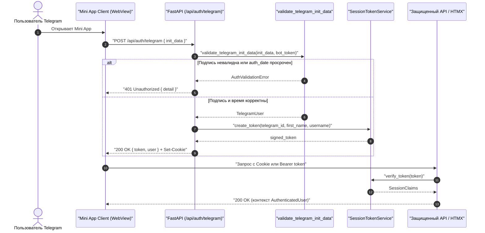
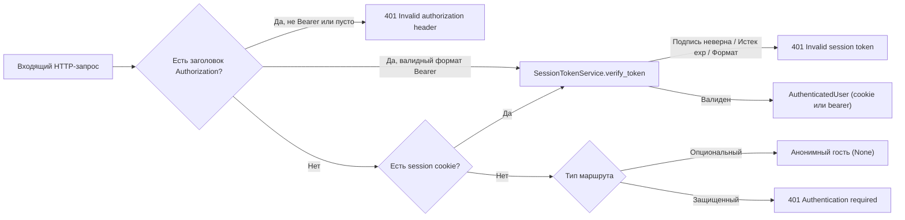

# Спецификация: WISHENKA-4 — Валидация Telegram WebApp initData и сессионный контекст

**Задача:** WISHENKA-4  
**Компонент:** Подсистема аутентификации и сессионного контекста (`wishenka.auth`)  
**Платформа и стек:** Python 3.12+ (FastAPI, Pydantic, HTMX, Telegram Mini App)  
**Статус:** реализовано и принято по процессу Top-Down (артефакты `ai-tasks/WISHENKA-4/`)

## 1. Назначение и бизнес-цель

### 1.1. Постановка проблемы

Сервис **«Вишенка» (Telegram Wishlist Service)** работает как веб-приложение внутри среды Telegram Mini App (TMA), взаимодействуя с сервером через начальную загрузку и последующие фоновые фрагментные запросы HTMX, а также через REST API. В экосистеме Telegram пользователь идентифицируется числовым идентификатором `telegram_id`, передаваемым клиентской частью внутри строки инициализации `window.Telegram.WebApp.initData`.

Без строгой криптографической верификации на стороне сервера злоумышленник мог бы подделать параметры запроса и выдать себя за другого пользователя, получив несанкционированный доступ к личным спискам желаний, бронированиям или удалению элементов. Вместе с тем выполнение полной криптографической проверки `initData` (разбор URL-параметров, сортировка, вычисление HMAC-SHA256 от токена бота) на каждый мелкий HTMX-запрос создавало бы избыточную нагрузку и усложняло бы клиентский код.

### 1.2. Цели задачи

- Обеспечить криптографическую проверку подлинности и свежести данных инициализации Telegram WebApp (`initData`) в соответствии со спецификацией платформы.
- Реализовать бесшовный вход (Zero-friction SSO) без паролей, СМС-подтверждений и сторонних OAuth-провайдеров.
- Ввести легкий механизм stateless-сессий на базе подписанных токенов и защищенных HTTP cookie для быстрого ($O(1)$) разрешения контекста пользователя при последующих HTMX- и API-запросах.
- Предоставить обработчикам FastAPI унифицированные зависимости для защиты закрытых маршрутов и поддержки анонимного гостевого доступа на публичных страницах.

### 1.3. Ценность для пользователей и системы

- **Защита приватности и предотвращение спуфинга:** криптографическая проверка подписи исключает подмену `telegram_id` и защищает вишлисты от несанкционированного доступа.
- **Соблюдение «Тайны сюрприза»:** достоверное определение личности вызывающей стороны позволяет бизнес-логике строго разграничивать роли Получателя и Дарителя и скрывать данные о бронированиях от получателя.
- **Мгновенный отклик интерфейса:** после однократного обмена `initData` сессионная cookie автоматически передается браузером в каждом HTMX-запросе без лишних операций на стороне клиента и без обращений к БД при проверке токена.
- **Универсальность интеграции:** поддержка как cookie (для TMA WebView и iframe), так и заголовка `Authorization: Bearer <token>` (для API-клиентов и автотестов).

### 1.4. Границы реализации (Scope и Non-Goals)

В рамки задачи **WISHENKA-4** входят только криптографическая валидация `initData`, доменные модели аутентификации, сервис stateless-токенов и cookie, зависимости FastAPI и API-эндпоинты `/api/auth/telegram`, `/api/auth/logout`, `/api/auth/me`.

Вне рамок **WISHENKA-4** остаются:

- Сохранение профилей пользователей в SQLite и миграции схемы БД (отложено в последующие задачи, см. раздел 5.3).
- Клиентская логика фронтенда TMA (`Telegram.WebApp.ready()`, отправка `initData` на JavaScript, UI-экраны).
- Альтернативные способы входа (логин/пароль, OAuth, вход по номеру телефона).
- Серверный отзыв токенов и черный список сессий в распределенном или дисковом хранилище.

## 2. Функциональные требования и пользовательские сценарии

### 2.1. Пользовательские сценарии

| Идентификатор | Сценарий | Краткое описание |
| :--- | :--- | :--- |
| **US-1** | Бесшовный вход в TMA | При открытии Mini App клиент передает `initData`; сервер верифицирует подпись, устанавливает сессионную cookie и возвращает профиль пользователя. |
| **US-2** | Прозрачная аутентификация HTMX | Все последующие фоновые запросы (`hx-get`, `hx-post`) автоматически передают cookie; сервер идентифицирует пользователя без повторной авторизации. |
| **US-3** | Просмотр публичных списков гостем | При открытии публичного маршрута без учетных данных система распознает анонимного посетителя (`None`), позволяя чтение без ошибок доступа. |
| **US-4** | Защита от подмены и replay-атак | Изменение любого поля `initData`, неверная подпись или устаревший `auth_date` приводят к немедленному отказу (`HTTP 401`). |
| **US-5** | Обработка истечения сессии | При просроченном или поврежденном токене сервер возвращает `HTTP 401`, позволяя клиенту инициировать повторный обмен свежего `initData`. |
| **US-6** | Доступ API-клиентов и тестов | Внешние клиенты и тесты могут передавать сессионный токен в заголовке `Authorization: Bearer <token>` наравне с cookie. |

### 2.2. Функциональные требования и алгоритмы

#### Валидация Telegram WebApp `initData`

1. Входными данными служат сырая query-строка `init_data_raw`, токен бота `bot_token`, максимальный возраст подписи `max_age_seconds` (по умолчанию `86400` с) и допустимый дрейф часов `clock_drift_seconds` (по умолчанию `60` с).
2. Строка должна быть непустой и корректно разбираться функцией `urllib.parse.parse_qsl(..., keep_blank_values=True)`.
3. Обязательное присутствие параметров `hash`, `auth_date` (целое число, Unix timestamp) и `user` (JSON-объект).
4. Из набора параметров извлекается и исключается `hash`; оставшиеся пары `key=value` сортируются в алфавитном порядке по ключу и объединяются через `\n` в проверочную строку `data_check_string`.
5. Вычисляется секретный ключ `HMAC-SHA256(key=b"WebAppData", msg=bot_token.encode("utf-8"))`, затем ожидаемый хеш `HMAC-SHA256(key=secret_key, msg=data_check_string.encode("utf-8")).hexdigest()`.
6. Сравнение вычисленного и полученного `hash` выполняется функцией постоянного времени `hmac.compare_digest`.
7. Проверяется актуальность `auth_date` относительно текущего времени сервера `now = int(time.time())`:
   - если `auth_date > now + clock_drift_seconds`, запрос отклоняется (ошибка будущего времени);
   - если `now - auth_date > max_age_seconds`, запрос отклоняется (истекший `initData`).
8. Параметр `user` десериализуется из JSON и валидируется в модель `TelegramUser` (обязательны `id` и `first_name`; опциональны `last_name`, `username`, `language_code`, `is_premium`).

#### Аутентификационный обмен, выход и проверка сессии

- **Обмен `initData` (`POST /api/auth/telegram`):** принимает `TelegramAuthRequest` (`{"init_data": "..."}`), проверяет подпись и свежесть `initData`, выпускает подписанный сессионный токен с TTL `session_ttl_seconds`, устанавливает сессионную cookie в ответе и возвращает `AuthResponse` (`token` и `user`). При невалидном `initData` возвращает `HTTP 401 Unauthorized`.
- **Выход из сессии (`POST /api/auth/logout`):** удаляет сессионную cookie у клиента через `delete_session_cookie` и возвращает `{"status": "ok"}`. Если в запросе присутствовал валидный токен (в cookie или `Authorization: Bearer`), из него извлекаются `telegram_id` и `username` для записи события выхода в журнал аудита.
- **Текущий контекст (`GET /api/auth/me`):** защищенный маршрут (`Depends(get_current_user)`), возвращающий атрибуты авторизованного пользователя (`telegram_id`, `first_name`, `username`, `auth_method`).

#### Двойной режим и разрешение контекста вызывающей стороны

1. Зависимость `get_optional_current_user` проверяет источники учетных данных в строгом порядке приоритета:
   - сначала заголовок `Authorization`: если заголовок передан, он должен начинаться с префикса `"Bearer "` и содержать непустой токен после удаления пробелов; при нарушении формата возвращается `HTTP 401` (`"Invalid authorization header"`), и `auth_method` устанавливается в `"bearer"`;
   - затем cookie: проверяется cookie с именем `settings.session_cookie_name`, а при его отсутствии — резервные имена `"session_id"` и `"wishenka_session"`; при обнаружении `auth_method` устанавливается в `"cookie"`.
2. Если токен не передан ни одним из способов, `get_optional_current_user` возвращает `None` (анонимный гостевой доступ).
3. Если токен передан, выполняется его криптографическая проверка и проверка срока действия `exp`: при ошибке возвращается `HTTP 401 Unauthorized` с заголовком `WWW-Authenticate: Bearer`.
4. Зависимость `get_current_user` опирается на `get_optional_current_user` и для анонимного вызова (`None`) отклоняет запрос со статусом `HTTP 401 Unauthorized` (`"Authentication required"`) и заголовком `WWW-Authenticate: Bearer`.

### 2.3. Ключевые инварианты

- Первичная идентификация пользователя жестко привязана к неизменяемому 64-битному `telegram_id`.
- Изменяемые поля профиля (`first_name`, `username`) актуализируются при каждом успешном обмене `initData` в `POST /api/auth/telegram`.
- Заголовок `Authorization: Bearer` всегда имеет приоритет над сессионной cookie, что позволяет явно переопределять контекст для API-клиентов и автотестов.
- Передача заведомо невалидного или просроченного токена даже на опционально защищенный маршрут приводит к `HTTP 401`, а не к тихому понижению прав до гостя.
- Ответы об ошибках `401` не содержат секретных ключей, токена бота, сырых данных `initData` и стек-трейсов.

## 3. Архитектура, компоненты и интерфейсы

### 3.1. Структура модулей

```text
wishenka/
├── config.py                 # Класс Settings с параметрами бота и сессий
├── auth/
│   ├── __init__.py           # Публичные реэкспорты модуля wishenka.auth
│   ├── models.py             # Доменные модели, DTO и иерархия исключений
│   ├── init_data.py          # Криптографическая валидация и парсинг initData
│   ├── session.py            # SessionTokenService и хелперы управления cookie
│   └── dependencies.py       # FastAPI-зависимости get_current_user / get_optional_current_user
└── web/
    ├── app.py                # Подключение роутера аутентификации в FastAPI
    └── routes/
        └── auth.py           # Маршруты /api/auth/telegram, /api/auth/logout, /api/auth/me
```

### 3.2. Взаимодействие компонентов



### 3.3. Конфигурация приложения (`wishenka/config.py`)

Параметры класса `Settings` (префикс переменных окружения `WISHENKA_`):

| Параметр | Тип | Значение по умолчанию | Назначение |
| :--- | :--- | :--- | :--- |
| `bot_token` | `str` | `"dummy_bot_token"` | Токен Telegram-бота для вычисления ключа HMAC при проверке `initData` |
| `secret_key` | `str` | `"wishenka_default_secret_key_change_in_prod"` | Симметричный ключ подписи и проверки сессионных токенов |
| `session_secret_key` | `str` | `"wishenka_default_secret_key_change_in_prod"` | Зарезервированный параметр ключа сессий в конфигурации (фактически `SessionTokenService` использует `settings.secret_key`) |
| `session_cookie_name` | `str` | `"session_id"` | Имя HTTP cookie для хранения токена сессии |
| `session_ttl_seconds` | `int` | `2592000` | Время жизни сессии в секундах (30 суток) |
| `session_cookie_secure` | `bool` | `False` | Флаг передачи cookie только по HTTPS (`True` в production) |
| `session_cookie_samesite` | `str` | `"none"` | Политика `SameSite` (`"none"`, `"lax"` или `"strict"`) |
| `session_cookie_domain` | `str \| None` | `None` | Домен cookie (при необходимости совместного использования поддоменов) |
| `telegram_auth_max_age_seconds` | `int` | `86400` | Максимально допустимый возраст `auth_date` в `initData` (24 часа) |
| `log_json` | `bool` | `False` | Включение вывода структурированных логов в JSON |

### 3.4. Модели данных и исключения (`wishenka/auth/models.py`)

#### Иерархия исключений

- `AuthValidationError(Exception)` — базовое исключение ошибок валидации аутентификации.
- `InvalidSignatureError(AuthValidationError)` — несовпадение HMAC-SHA256 подписи `initData` или сессионного токена (а также ошибка декодирования подписи токена).
- `ExpiredInitDataError(AuthValidationError)` — устаревший или опережающий время параметр `auth_date` либо истекший `exp` сессионного токена.
- `MalformedInitDataError(AuthValidationError)` — пустая или нечитаемая query-строка `initData`, отсутствие `hash`/`auth_date`/`user`, некорректный `auth_date` или ошибка валидации JSON объекта `user`.

#### Доменные модели и DTO

- `TelegramUser(BaseModel, frozen=True)`:
  - `id: int` — числовой `telegram_id`;
  - `first_name: str` — имя пользователя;
  - `last_name: str | None = None` — фамилия (опционально);
  - `username: str | None = None` — публичное имя без `@` (опционально);
  - `language_code: str | None = None` — языковой код ISO (опционально);
  - `is_premium: bool = False` — признак Telegram Premium.
- `TelegramInitData(BaseModel, frozen=True)`:
  - `auth_date: int`, `hash: str`, `query_id: str | None = None`, `user: TelegramUser`, `raw_params: dict[str, Any]`.
- `SessionClaims(BaseModel, frozen=True)`:
  - `telegram_id: int`, `first_name: str`, `username: str | None = None`, `iat: int` (метка выпуска), `exp: int` (метка истечения).
- `AuthenticatedUser` (`@dataclass(frozen=True)`):
  - `telegram_id: int`, `first_name: str`, `username: str | None = None`, `auth_method: str = "cookie"` (`"cookie"` или `"bearer"`).
- `TelegramAuthRequest(BaseModel)`:
  - `init_data: str` — сырая строка `Telegram.WebApp.initData`.
- `AuthResponse(BaseModel)`:
  - `token: str` — подписанный сессионный токен;
  - `user: TelegramUser` — верифицированный профиль пользователя.

### 3.5. Программные интерфейсы и контракты данных

#### Криптографический валидатор (`wishenka/auth/init_data.py`)

- `validate_telegram_init_data(init_data_raw: str, bot_token: str, max_age_seconds: int = 86400, clock_drift_seconds: int = 60) -> TelegramUser` — выполняет полный цикл разбора, проверки HMAC-SHA256, проверки временных меток и валидации `TelegramUser`.
- `parse_telegram_init_data(init_data_raw: str) -> TelegramInitData` — разбирает query-строку в `TelegramInitData` без проверки криптографической подписи.
- `TelegramInitDataValidator(bot_token: str, max_age_seconds: int = 86400, clock_drift_seconds: int = 60)` — объектная обертка с методами `parse(init_data_raw: str) -> TelegramInitData` и `validate(init_data_raw: str) -> TelegramUser`.

#### Менеджер сессионных токенов и cookie (`wishenka/auth/session.py`)

Формат stateless-токена:

```text
<payload_b64>.<sig_b64>
```

- `<payload_b64>` — JSON-сериализация `SessionClaims`, закодированная в URL-safe Base64 без завершающих символов `=`.
- `<sig_b64>` — URL-safe Base64 (без `=`) от результата `HMAC-SHA256(key=secret_key.encode("utf-8"), msg=payload_b64.encode("ascii"))`.

Методы и функции модуля:

- `SessionTokenService(secret_key: str, default_ttl_seconds: int = 2592000)`:
  - `create_token(telegram_id: int, first_name: str, username: str | None = None, ttl_seconds: int | None = None) -> str` — формирует `SessionClaims` с `iat = int(time.time())`, `exp = iat + ttl` и возвращает подписанный токен.
  - `verify_token(token: str) -> SessionClaims` — проверяет структуру из 2 частей (`AuthValidationError`), проверяет подпись через `hmac.compare_digest` (`InvalidSignatureError`), декодирует `SessionClaims` (`AuthValidationError`) и проверяет `claims.exp < int(time.time())` (`ExpiredInitDataError`).
- `set_session_cookie(response: Response, token: str, settings: Settings) -> None` — устанавливает cookie с ключом `settings.session_cookie_name`, `max_age=settings.session_ttl_seconds`, `httponly=True`, `secure=settings.session_cookie_secure`, нормализованным `samesite` (`"none"`, `"strict"` или `"lax"` по умолчанию), `domain=settings.session_cookie_domain` и `path="/"`.
- `delete_session_cookie(response: Response, settings: Settings) -> None` — удаляет cookie с теми же параметрами `path`, `domain`, `secure`, `httponly` и `samesite`.

#### Зависимости FastAPI (`wishenka/auth/dependencies.py`)

- `get_settings(request: Request) -> Settings` — получает экземпляр `Settings` из `request.app.state.settings` или создает конфигурацию по умолчанию.
- `get_optional_current_user(request: Request, settings: Annotated[Settings, Depends(get_settings)]) -> AuthenticatedUser | None` — извлекает токен из `Authorization: Bearer` или cookie и возвращает `AuthenticatedUser` либо `None`.
- `get_current_user(user: Annotated[AuthenticatedUser | None, Depends(get_optional_current_user)]) -> AuthenticatedUser` — требует валидного `AuthenticatedUser` и отклоняет неавторизованный вызов с `HTTP 401`.

#### HTTP-контракты (`wishenka/web/routes/auth.py`)

| Метод и путь | Доступ | Вход | Успешный ответ (`200 OK`) | Ошибки |
| :--- | :--- | :--- | :--- | :--- |
| `POST /api/auth/telegram` | Публичный | JSON `{"init_data": "<str>"}` | JSON `{"token": "<str>", "user": {...}}` + `Set-Cookie` | `401` (`{"detail": "Invalid initData: ..."}`) |
| `POST /api/auth/logout` | Публичный | Cookie или `Bearer` (опционально) | JSON `{"status": "ok"}` + удаление cookie | — |
| `GET /api/auth/me` | Защищенный | Cookie или `Authorization: Bearer` | JSON `{"telegram_id", "first_name", "username", "auth_method"}` | `401` (`WWW-Authenticate: Bearer`) |

### 3.6. Переходы состояний контекста запроса и сессии



Примечание по завершению сессии: вызов `POST /api/auth/logout` переводит браузерный клиент из состояния активной cookie-сессии в неавторизованное состояние за счет удаления cookie на клиенте (`delete_session_cookie`), однако в рамках stateless-модели WISHENKA-4 ранее выпущенный токен остается криптографически действительным до наступления `exp`.

## 4. Нефункциональные требования, безопасность и наблюдаемость

### 4.1. Производительность и ограничения

- **Сложность проверки сессии:** верификация токена `SessionTokenService.verify_token` выполняется за $O(1)$ в памяти процесса без сетевых обращений к Telegram API и без дисковых операций ввода-вывода к SQLite.
- **Зависимости криптографии:** используется исключительно стандартная библиотека Python (`hmac`, `hashlib`, `json`, `base64`, `time`, `urllib.parse`) без внешних криптографических библиотек.
- **Временные лимиты:**
  - допустимый возраст `initData.auth_date`: `86400` с (24 часа, настраивается через `telegram_auth_max_age_seconds`);
  - допустимое опережение серверных часов (`clock_drift_seconds`): `60` с;
  - время жизни сессионного токена и cookie: `2592000` с (30 суток, настраивается через `session_ttl_seconds`);
  - таймаут выполнения каждого автоматизированного теста: `10` с (`pytestmark = pytest.mark.timeout(10)`).
- **Известные узкие места (отложены в техдолг):** пересчет HMAC-ключа `"WebAppData"` на каждый вызов `validate_telegram_init_data`, создание экземпляра `SessionTokenService` на каждый запрос вместо singleton-зависимости и отсутствие LRU-кеширования результатов проверки часто используемых токенов (см. раздел 5.3).

### 4.2. Инварианты безопасности и приватности

- **Защита от атак по времени (Timing Attacks):** сверка HMAC-хеша Telegram `initData` и подписи сессионного токена выполняется исключительно через `hmac.compare_digest`.
- **Защита от повторного воспроизведения (Replay Protection):** отклонение `initData` со старой или ушедшей в будущее меткой `auth_date`.
- **Безопасность cookie в кросс-сайтовом iframe:** атрибут `HttpOnly=True` защищает токен от чтения через `document.cookie` при XSS; комбинация `SameSite=None` и `Secure=True` обеспечивает передачу cookie внутри iframe веб-клиента Telegram (`web.telegram.org`) в production (с возможностью переключения `session_cookie_secure=False` для локальной HTTP-разработки и тестов).
- **Запрет утечки секретов (Zero Secret Leakage):** `bot_token`, `secret_key`, производные HMAC-ключи, сырые строки `initData`, значения `hash` и токены сессий строго исключены из сообщений об ошибках и записей журналов.

### 4.3. Структурированное логирование и метрики

Все события аутентификации пишутся в иерархию логгера `wishenka.auth` с передачей структурированного словаря `extra`. В production-режиме при `Settings.log_json = True` (`WISHENKA_LOG_JSON=true`) логи сериализуются через `JsonFormatter` в поток вывода stdout/stderr контейнера (готово для сбора через Vector, Fluentbit, Loki, ELK).

#### Карта событий логирования

| Уровень | Источник | Событие (`extra.event`) | Дополнительные поля `extra` и причина |
| :--- | :--- | :--- | :--- |
| `DEBUG` | `wishenka/auth/init_data.py:validate_telegram_init_data` | `init_data_validated` | `telegram_id`, `username` |
| `DEBUG` | `wishenka/auth/dependencies.py:get_optional_current_user` | `auth_session_resolved` | `telegram_id`, `username`, `auth_method` |
| `INFO` | `wishenka/web/routes/auth.py:auth_telegram` | `auth_success` | `telegram_id`, `username` |
| `INFO` | `wishenka/web/routes/auth.py:logout` | `logout` | `telegram_id`, `username` (если извлечены из валидного токена) |
| `WARNING` | `wishenka/auth/init_data.py:validate_telegram_init_data` | `auth_failure` | `reason="invalid_signature"` |
| `WARNING` | `wishenka/auth/init_data.py:validate_telegram_init_data` | `auth_failure` | `reason="expired_init_data"`, `auth_date`, опционально `age_seconds` |
| `WARNING` | `wishenka/auth/init_data.py:validate_telegram_init_data` | `auth_failure` | `reason="malformed_init_data"` |
| `WARNING` | `wishenka/auth/dependencies.py:get_optional_current_user` | `auth_failure` | `reason="invalid_session_token"`, `auth_method`, `error_type` |
| `WARNING` | `wishenka/auth/dependencies.py:get_current_user` | `auth_failure` | `reason="missing_credentials"` |

Штатные отказы клиентской аутентификации не используют уровни `ERROR`, `CRITICAL`, `ALERT`, `EMERG` или `NOTICE` и регистрируются как `WARNING`.

#### Метрики и мониторинг

- **Метрики производительности:** время обработки `duration_ms` на `/api/auth/telegram`, `/api/auth/logout` и `/api/auth/me` измеряется в `RequestLoggingMiddleware`; пропускная способность отслеживается по HTTP-логам доступа к `/api/auth/*`; доля ошибок — по ответам `401 Unauthorized` и `WARNING`-событиям `wishenka.auth`.
- **Бизнес-метрики на базе структурированных логов:** количество успешных входов (`event="auth_success"` и уникальные `telegram_id`), отказы аутентификации (`event="auth_failure"` в разрезе `reason`), количество выходов (`event="logout"`).
- **Здоровье компонента:** базовое состояние сервиса контролируется через `/healthz` и стандартные метрики CPU/памяти контейнера.
- **Отложенные интеграции мониторинга:** экспорт метрик Prometheus, дашборды Grafana и правила оповещения SIEM/Alertmanager о всплесках подбора подписей отложены в отдельный эпик телеметрии.

## 5. Верификация и критерии приёмки

### 5.1. Критерии приёмки

- **AC-1 (Криптографическая проверка `initData`):** реализован полный алгоритм Telegram WebApp (`"WebAppData"` + `bot_token`, сортировка параметров по ключу с разделителем `\n`, HMAC-SHA256, сравнение через `hmac.compare_digest`).
- **AC-2 (Защита от replay-атак):** проверяется обязательность `auth_date`, его допустимый возраст (`<= max_age_seconds`, по умолчанию 86400 с) и отсутствие чрезмерного опережения серверного времени (`<= clock_drift_seconds`, по умолчанию 60 с).
- **AC-3 (Парсинг пользователя):** `user` десериализуется из JSON в `TelegramUser`; некорректный JSON или отсутствие обязательных полей `id` и `first_name` отклоняются с `MalformedInitDataError`.
- **AC-4 (Обмен и выпуск сессии):** `POST /api/auth/telegram` при валидном `initData` выпускает подписанный токен, возвращает `AuthResponse` и устанавливает cookie с `HttpOnly`, `Secure` (из настроек), `SameSite` и `Max-Age`.
- **AC-5 (Разрешение контекста):** `get_current_user` и `get_optional_current_user` поддерживают оба канала (`Authorization: Bearer` и cookie), отклоняют отсутствующие/невалидные учетные данные на защищенных маршрутах со статусом `401` и пропускают анонимных гостей (`None`) на опциональных маршрутах.
- **AC-6 (Безопасность ошибок):** некорректные запросы аутентификации возвращают `401 Unauthorized` (`{"detail": "..."}`, а для защищенных маршрутов с проверкой сессии также `WWW-Authenticate: Bearer`) без раскрытия секретов или стек-трейсов.
- **AC-7 (Тесты и наблюдаемость):** детерминированные тесты в `tests/test_auth.py` снабжены таймаутом `10` с, не выполняют сетевых вызовов к Telegram API и подтверждают как функциональное поведение, так и выпуск структурированных логов.

### 5.2. Тестовые сценарии и результаты проверок

Автоматизированный набор тестов размещен в `tests/test_auth.py` (с глобальным маркером `pytestmark = pytest.mark.timeout(10)` и вспомогательной функцией генерации подписанных данных `create_test_init_data`):

- **Криптографическая валидация и парсинг `initData`:**
  - `test_validate_init_data_success` — проверка эталонной подписи и всех полей `TelegramUser`.
  - `test_telegram_init_data_validator_class` — проверка методов `TelegramInitDataValidator.parse`, `TelegramInitDataValidator.validate` и `parse_telegram_init_data`.
  - `test_validate_init_data_tampered_hash` — отклонение модифицированного хеша с `InvalidSignatureError`.
  - `test_validate_init_data_expired` — отклонение устаревшего `auth_date` (старше 24 часов) с `ExpiredInitDataError`.
- **Эндпоинты и зависимости FastAPI:**
  - `test_auth_endpoint_exchange` — обмен `POST /api/auth/telegram`, проверка тела ответа и установки cookie `session_id`.
  - `test_protected_endpoint_requires_auth` — отказ `401` без сессии и успешный доступ `200` как по cookie `session_id`, так и по заголовку `Authorization: Bearer`.
  - `test_optional_auth_resolution` — возврат анонимного ответа при отсутствии токена и профиля пользователя при наличии валидной cookie.
- **Наблюдаемость и аудит логов (`caplog`):**
  - `test_auth_logging_success` (`INFO`, `event="auth_success"`).
  - `test_auth_logging_logout` (`INFO`, `event="logout"`).
  - `test_auth_logging_invalid_signature_warning` (`WARNING`, `event="auth_failure"`, `reason="invalid_signature"`).
  - `test_auth_logging_expired_warning` (`WARNING`, `event="auth_failure"`, `reason="expired_init_data"`).
  - `test_auth_logging_malformed_warning` (`WARNING`, `event="auth_failure"`, `reason="malformed_init_data"`).
  - `test_auth_logging_invalid_session_token_warning` (`WARNING`, `event="auth_failure"`, `reason="invalid_session_token"`).

По итогам приемки задачи (зафиксировано в `ai-tasks/WISHENKA-4/40-code-cleanup.md` и `ai-tasks/WISHENKA-4/50-observability.md`):

- Проверка кода на этапе cleanup (`40-code-cleanup.md`): `ruff check .` (0 ошибок в 17 файлах), `ruff format --check .`, `mypy` (0 ошибок в 17 файлах), `make test` (12/12 тестов пройдено).
- Итоговый Quality Gate после добавления наблюдаемости (`50-observability.md`): `make check` полностью пройден (18 тестов пройдено, 0 ошибок линтера, 0 ошибок типизации).

### 5.3. Известные ограничения, техдолг и задачи развития

Согласно анализу технического долга (`ai-tasks/WISHENKA-4/60-tech-debt.md`), при реализации WISHENKA-4 зафиксированы следующие ограничения и непокрытые случаи:

1. **Архитектурные упрощения:**
   - **Отсутствие серверного отзыва токенов:** `POST /api/auth/logout` очищает cookie на клиенте, но stateless-токен остается действительным до истечения `exp` (по умолчанию 30 дней).
   - **Отсутствие записи профиля в БД:** в рамках WISHENKA-4 пользователь не сохраняется в таблицу `users` SQLite; в токен помещаются только `telegram_id`, `first_name` и `username`.
   - **Один статический секретный ключ:** `SessionTokenService` использует единый `settings.secret_key` без механизма ротации ключей и заголовка/поля версии `kid`.
   - **Резервные имена cookie:** `wishenka/auth/dependencies.py` дополнительно проверяет `"session_id"` и `"wishenka_session"`, если не найдена cookie `settings.session_cookie_name`.
2. **Вопросы качества кода и производительности:**
   - Предупреждение `StarletteDeprecationWarning` из-за использования `fastapi.testclient.TestClient` вместо `httpx.AsyncClient` с `ASGITransport`.
   - Создание объекта `SessionTokenService` при каждом HTTP-запросе вместо внедрения singleton-зависимости через состояние приложения.
   - Локальное приведение строки `session_cookie_samesite` в `wishenka/auth/session.py` с подавлением типа `# type: ignore[arg-type]` вместо типизированного `Literal["lax", "strict", "none"]` или `Enum` в `Settings`.
   - Повторная HMAC-проверка токена на каждый защищенный запрос (без LRU-кеширования) и повторное вычисление ключа `WebAppData` при каждой валидации `initData`.
3. **Непокрытые тестовые сценарии:**
   - Unicode, эмодзи, RTL-символы, экранированные кавычки и переводы строк в полях профиля Telegram.
   - Явный граничный тест отклонения `auth_date` из будущего (`auth_date > now + clock_drift_seconds`).
   - Граничные тесты на сверхдлинные query-строки (50–100 КБ) и посторонние параметры в `initData`.
   - Нестандартное форматирование заголовка `Authorization` (`bearer` в нижнем регистре, лишние пробелы, пустой `Bearer `).

Для устранения указанных ограничений в Jira заведены следующие задачи развития:

- [WISHENKA-44](https://pypost.atlassian.net/browse/WISHENKA-44) (*Medium*, 3 SP): сохранение `TelegramUser` в SQLite при авторизационном обмене (`POST /api/auth/telegram`).
- [WISHENKA-45](https://pypost.atlassian.net/browse/WISHENKA-45) (*Low*, 2 SP): реализация серверного отзыва сессий и черного списка токенов.
- [WISHENKA-41](https://pypost.atlassian.net/browse/WISHENKA-41) (*Low*, 1 SP): миграция набора тестов на `httpx.AsyncClient` (`ASGITransport`).
- [WISHENKA-46](https://pypost.atlassian.net/browse/WISHENKA-46) (*Low*, 2 SP): добавление граничных и Unicode-тестов для парсинга `initData` и заголовков авторизации.
- [WISHENKA-47](https://pypost.atlassian.net/browse/WISHENKA-47) (*Low*, 2 SP): вынос `SessionTokenService` в singleton-зависимость и предвычисление HMAC-ключа `WebAppData`.
