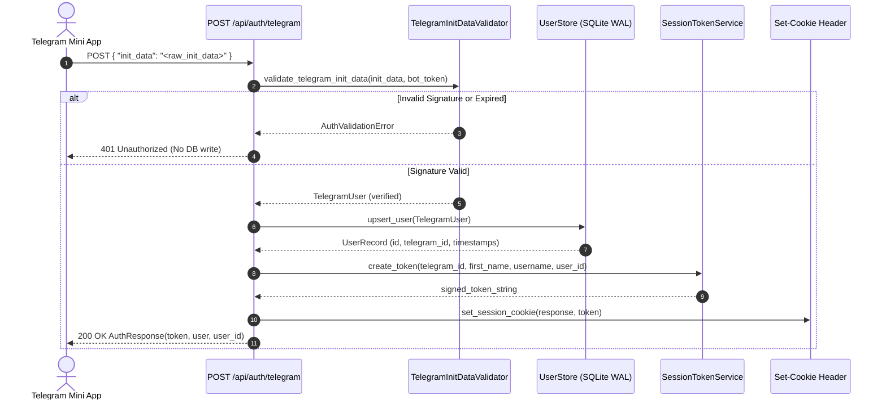
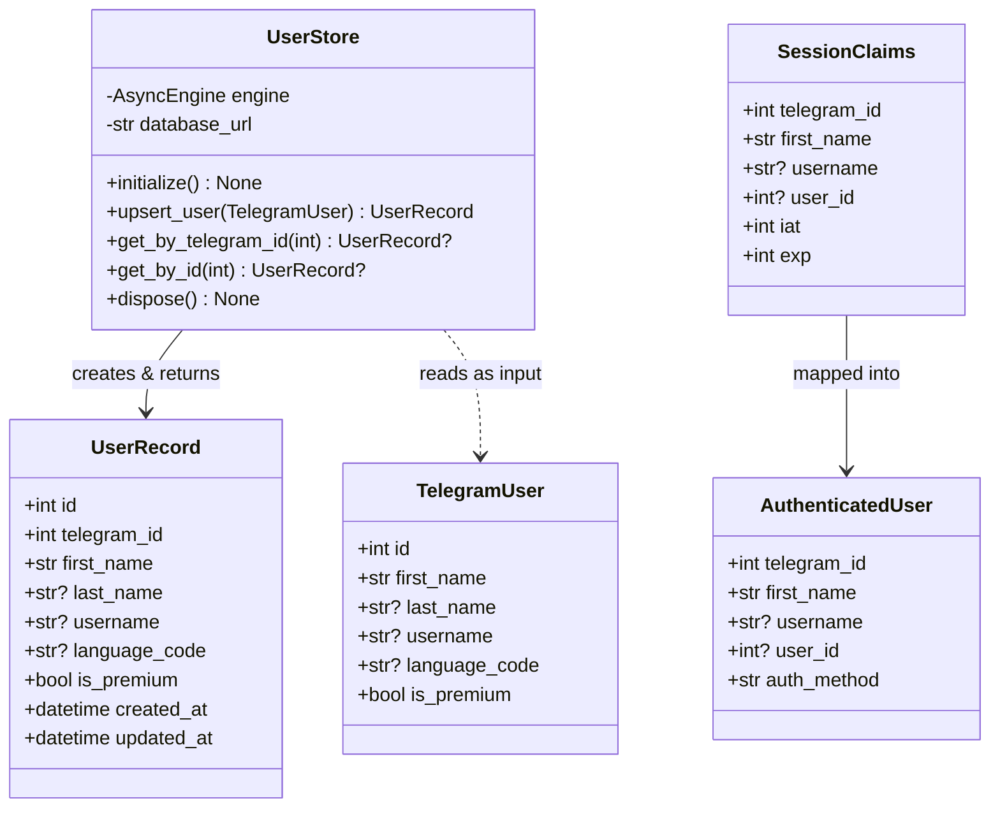

# WISHENKA-44: [Аутентификация] Сохранение TelegramUser в базу данных при успешной авторизации

## Research

### 1. Telegram WebApp Authentication Flow & Verified Identity
In task WISHENKA-4, cryptographic verification of Telegram WebApp `initData` was implemented.
When a client launches the Telegram Mini App (TMA), Telegram passes a query string
containing authenticated user attributes signed with the bot's secret token via HMAC-SHA256:
- `id` (int64): Telegram numeric user ID.
- `first_name` (str): Mandatory user first name.
- `last_name` (str | None): Optional user last name.
- `username` (str | None): Optional Telegram handle without '@'.
- `language_code` (str | None): Optional ISO language code (e.g., 'ru', 'en').
- `is_premium` (bool): Telegram Premium subscription flag.

Currently, `POST /api/auth/telegram` verifies this payload, issues a stateless signed session
cookie, and returns an `AuthResponse`. However, verified user profiles are not persisted in
local storage. Without durable user records:
- Domain entities (wishlists, items, reservations) cannot establish foreign key references to users.
- Profile changes on Telegram (e.g., changed username or first name) are lost on server restart.
- Background services and notification dispatchers cannot look up user profiles offline.

### 2. SQLite WAL Concurrency & Upsert Semantics
The Wishenka architecture (`doc/dev/architecture.md`) designates SQLite with `aiosqlite` and
Write-Ahead Logging (WAL) as the primary storage engine:
- `PRAGMA journal_mode = WAL;` enables concurrent readers to execute without blocking writers
  and writers to operate without blocking readers.
- `PRAGMA busy_timeout = 5000;` prevents `sqlite3.OperationalError: database is locked` during
  transient concurrency peaks by waiting up to 5 seconds.
- `PRAGMA foreign_keys = ON;` enforces referential integrity.

For user profile persistence, users re-authenticate frequently upon opening the Mini App.
A naive "check-then-insert" approach (`SELECT` followed by `INSERT` or `UPDATE`) introduces a
race condition under concurrent requests from the same user across tabs or clients.

SQLite 3.24+ introduced native upsert support:
```sql
INSERT INTO users (...) VALUES (...)
ON CONFLICT(telegram_id) DO UPDATE SET ...
```
Furthermore, SQLite 3.35+ supports `RETURNING`, allowing the generated primary key `id`,
`created_at`, and `updated_at` to be retrieved atomically in a single round-trip without
secondary lookups or race conditions. In Python 3.12+ with SQLite 3.46+, this executes in
less than 1ms, comfortably satisfying NFR-1 (< 20ms).

### 3. Decoupling External Identifiers from Internal Identity
Telegram user IDs are external 64-bit integers managed by a third-party platform.
Relying directly on external platform IDs for internal database relationships introduces
tight coupling and potential scaling limitations:
- Internal tables (`wishlists`, `wl_members`, `wl_favorites`, `wl_view_history`, `reservations`)
  benefit from compact internal integer primary keys (`id INTEGER PRIMARY KEY AUTOINCREMENT`).
- Maintaining `telegram_id` as a unique indexed alternate key preserves fast lookups while
  insulating domain logic from external provider format changes.
- Storing internal `user_id` inside `SessionClaims` allows request handlers to resolve the
  internal user ID immediately without hitting the database on every authenticated request.

### 4. Repository & Architecture Alignment
Following project conventions:
- `wishenka/wishlists/store.py` encapsulates wishlist domain persistence with SQLite.
- A dedicated `wishenka/users/` domain package (`models.py`, `store.py`) encapsulates user
  persistence and data access, adhering to the Single Responsibility and Repository patterns.
- Authentication dependencies in `wishenka/auth/dependencies.py` will supply `UserStore` via
  FastAPI dependency injection (`Depends(get_user_store)`), allowing effortless test isolation
  and lifecycle management.

---

## Implementation Plan

### High-Level Iterations

#### Iteration 1: User Domain Model, SQLite Schema, and UserStore
- Create package `wishenka/users/`:
  - `wishenka/users/models.py`: Define `UserRecord` dataclass representing a persisted user.
  - `wishenka/users/store.py`: Implement `UserStore` using SQLAlchemy async engine and `aiosqlite`.
  - Provide `initialize()`, `upsert_user()`, `get_by_telegram_id()`, `get_by_id()`, `dispose()`.
  - Schema definition: `users` table with `INTEGER PRIMARY KEY AUTOINCREMENT`, unique index on
    `telegram_id`, and index on `username`.
  - `wishenka/users/__init__.py`: Export public API symbols.

#### Iteration 2: Web Layer Integration & Endpoint Persistence
- Update `wishenka/auth/dependencies.py`:
  - Define `get_user_store(request: Request) -> UserStore` dependency pulling from
    `request.app.state.user_store` with fallback to `Settings.database_url`.
- Update `wishenka/web/routes/auth.py`:
  - Inject `UserStore` into `POST /api/auth/telegram`.
  - Call `await user_store.upsert_user(user)` upon successful `validate_telegram_init_data`.
  - Return updated `AuthResponse` containing `user_id`.
- Update `wishenka/web/app.py`:
  - Attach `app.state.user_store = UserStore(settings.database_url)`.
  - Initialize `user_store` in lifespan startup and dispose in shutdown.

#### Iteration 3: Session Context Linkage & Backward Compatibility
- Update `wishenka/auth/models.py`:
  - Add optional `user_id: int | None = None` to `SessionClaims`.
  - Add optional `user_id: int | None = None` to `AuthenticatedUser`.
  - Add optional `user_id: int | None = None` to `AuthResponse`.
- Update `wishenka/auth/session.py`:
  - Update `SessionTokenService.create_token` to accept `user_id: int | None = None`.
  - Ensure token verification seamlessly handles tokens without `user_id` (backward compatibility).
- Update `wishenka/auth/dependencies.py`:
  - Populate `AuthenticatedUser.user_id` from `claims.user_id`.
- Update `GET /api/auth/me`:
  - Include `user_id` in response payload.

### Mandatory — Failing Repro (next Step 3)
Before making any changes to production code in Step 4, an automated failing test suite must
be written in `tests/test_auth_user_store.py`:

1. **Test Module**: `tests/test_auth_user_store.py`
2. **Timeout Rule**: Enforce `pytestmark = pytest.mark.timeout(10)` per `do-testing` standard.
3. **Target Assertions (Desired Behavior)**:
   - `test_auth_telegram_persists_new_user`: Authenticating a new user via `POST /api/auth/telegram`
     creates a record in `users` table with matching attributes and returns `user_id` > 0.
   - `test_auth_telegram_updates_existing_user`: Authenticating an existing user with modified
     `first_name` and `username` updates the record without changing `id` or `created_at`.
   - `test_user_store_upsert_and_queries_direct`: Direct calls to `upsert_user`, `get_by_id`,
     and `get_by_telegram_id` return accurate `UserRecord` instances.
   - `test_session_token_and_me_endpoint_contain_user_id`: Session issued on `/telegram` includes
     `user_id`, and `GET /api/auth/me` reflects `user_id`.
   - `test_invalid_init_data_does_not_persist_user`: Unauthenticated / tampered payloads do not
     write to `users` table.
   - `test_guest_request_does_not_create_user`: Anonymous visits do not create user records.
4. **Failure Mechanism Prior to Fix**:
   - The test will fail immediately because `wishenka.users` does not exist, `app.state.user_store`
     is undefined, and `POST /api/auth/telegram` does not invoke any persistence layer.
5. **Sequencing**:
   - Red test execution (Step 3) confirms failure $\rightarrow$ Step 4 implementation
     $\rightarrow$ Green test run verifies all assertions pass.

---

## Architecture

### 1. Architecture Overview & Component Diagram





### 2. Database Schema

#### Table: `users`
The `users` table persists user identities within the Wishenka SQLite database.

```sql
CREATE TABLE IF NOT EXISTS users (
    id INTEGER PRIMARY KEY AUTOINCREMENT,
    telegram_id INTEGER NOT NULL UNIQUE,
    first_name TEXT NOT NULL,
    last_name TEXT,
    username TEXT,
    language_code TEXT,
    is_premium INTEGER NOT NULL DEFAULT 0,
    created_at TEXT NOT NULL,
    updated_at TEXT NOT NULL
);

CREATE UNIQUE INDEX IF NOT EXISTS idx_users_telegram_id ON users(telegram_id);
CREATE INDEX IF NOT EXISTS idx_users_username ON users(username);
```

#### Field Specifications
| Column | Type | Nullable | Constraints & Defaults | Description |
|---|---|---|---|---|
| `id` | INTEGER | NO | PRIMARY KEY AUTOINCREMENT | Internal unique user ID |
| `telegram_id` | INTEGER | NO | UNIQUE | 64-bit Telegram user ID |
| `first_name` | TEXT | NO | None | User's display first name |
| `last_name` | TEXT | YES | DEFAULT NULL | Optional user last name |
| `username` | TEXT | YES | DEFAULT NULL | Optional Telegram username |
| `language_code` | TEXT | YES | DEFAULT NULL | User language code |
| `is_premium` | INTEGER | NO | DEFAULT 0 (0 or 1) | Telegram Premium flag |
| `created_at` | TEXT | NO | ISO-8601 UTC string | Account creation timestamp |
| `updated_at` | TEXT | NO | ISO-8601 UTC string | Last profile sync timestamp |

### 3. Data Access Layer / UserStore

#### Location and Structure
The User domain layer is organized into `wishenka/users/`:
- `wishenka/users/models.py`: Contains domain model `UserRecord`.
- `wishenka/users/store.py`: Contains repository class `UserStore`.
- `wishenka/users/__init__.py`: Exports `UserRecord` and `UserStore`.

#### Domain Model: `UserRecord`
```python
from dataclasses import dataclass
from datetime import datetime


@dataclass(frozen=True)
class UserRecord:
    """Represents a persisted user profile in the database."""

    id: int
    telegram_id: int
    first_name: str
    last_name: str | None
    username: str | None
    language_code: str | None
    is_premium: bool
    created_at: datetime
    updated_at: datetime
```

#### Repository Class: `UserStore`
```python
class UserStore:
    """Async transactional SQLite storage for user entities."""

    def __init__(self, database_url: str) -> None:
        prefix = "sqlite+aiosqlite:///"
        if not database_url.startswith(prefix):
            raise ValueError("UserStore requires SQLite database URL")
        path = database_url[len(prefix) :]
        if path != ":memory:":
            Path(path).parent.mkdir(parents=True, exist_ok=True)
        self.engine = create_async_engine(
            database_url,
            connect_args={"timeout": 5},
            hide_parameters=True,
        )

    async def initialize(self) -> None:
        """Initialize table schema and WAL mode idempotently."""
        async with self.engine.begin() as conn:
            await conn.exec_driver_sql("PRAGMA journal_mode=WAL")
            await conn.exec_driver_sql("PRAGMA foreign_keys=ON")
            await conn.exec_driver_sql("PRAGMA busy_timeout=5000")
            await conn.exec_driver_sql(
                """
                CREATE TABLE IF NOT EXISTS users (
                    id INTEGER PRIMARY KEY AUTOINCREMENT,
                    telegram_id INTEGER NOT NULL UNIQUE,
                    first_name TEXT NOT NULL,
                    last_name TEXT,
                    username TEXT,
                    language_code TEXT,
                    is_premium INTEGER NOT NULL DEFAULT 0,
                    created_at TEXT NOT NULL,
                    updated_at TEXT NOT NULL
                )
                """
            )
            await conn.exec_driver_sql(
                "CREATE UNIQUE INDEX IF NOT EXISTS idx_users_telegram_id ON users(telegram_id)"
            )
            await conn.exec_driver_sql(
                "CREATE INDEX IF NOT EXISTS idx_users_username ON users(username)"
            )

    async def upsert_user(self, user: TelegramUser) -> UserRecord:
        """Insert new user or update mutable attributes if already exists."""
        now_iso = datetime.now(timezone.utc).isoformat()
        stmt = text(
            """
            INSERT INTO users (
                telegram_id, first_name, last_name, username,
                language_code, is_premium, created_at, updated_at
            ) VALUES (
                :telegram_id, :first_name, :last_name, :username,
                :language_code, :is_premium, :created_at, :updated_at
            )
            ON CONFLICT(telegram_id) DO UPDATE SET
                first_name = excluded.first_name,
                last_name = excluded.last_name,
                username = excluded.username,
                language_code = excluded.language_code,
                is_premium = excluded.is_premium,
                updated_at = excluded.updated_at
            RETURNING id, telegram_id, first_name, last_name,
                      username, language_code, is_premium,
                      created_at, updated_at
            """
        )
        params = {
            "telegram_id": user.id,
            "first_name": user.first_name,
            "last_name": user.last_name,
            "username": user.username,
            "language_code": user.language_code,
            "is_premium": 1 if user.is_premium else 0,
            "created_at": now_iso,
            "updated_at": now_iso,
        }
        async with self.engine.begin() as conn:
            result = await conn.execute(stmt, params)
            row = result.one()
            return self._row_to_record(row)

    async def get_by_telegram_id(self, telegram_id: int) -> UserRecord | None:
        """Find user by numeric Telegram ID."""
        stmt = text(
            """
            SELECT id, telegram_id, first_name, last_name,
                   username, language_code, is_premium,
                   created_at, updated_at
            FROM users WHERE telegram_id = :telegram_id
            """
        )
        async with self.engine.connect() as conn:
            result = await conn.execute(stmt, {"telegram_id": telegram_id})
            row = result.first()
            return self._row_to_record(row) if row else None

    async def get_by_id(self, user_id: int) -> UserRecord | None:
        """Find user by internal database primary key."""
        stmt = text(
            """
            SELECT id, telegram_id, first_name, last_name,
                   username, language_code, is_premium,
                   created_at, updated_at
            FROM users WHERE id = :id
            """
        )
        async with self.engine.connect() as conn:
            result = await conn.execute(stmt, {"id": user_id})
            row = result.first()
            return self._row_to_record(row) if row else None

    async def dispose(self) -> None:
        """Cleanly close connection pools."""
        await self.engine.dispose()
```

### 4. Web Layer Integration

#### Dependency Injection
In `wishenka/auth/dependencies.py`:
```python
def get_user_store(request: Request) -> UserStore:
    """Retrieve UserStore from application state or create default instance."""
    store = getattr(request.app.state, "user_store", None)
    if isinstance(store, UserStore):
        return store
    settings = getattr(request.app.state, "settings", None) or Settings()
    return UserStore(settings.database_url)
```

#### Route Update: `POST /api/auth/telegram`
In `wishenka/web/routes/auth.py`:
```python
@router.post("/telegram", response_model=AuthResponse)
async def auth_telegram(
    payload: TelegramAuthRequest,
    response: Response,
    settings: Annotated[Settings, Depends(get_settings)],
    user_store: Annotated[UserStore, Depends(get_user_store)],
) -> AuthResponse:
    # 1. Cryptographic validation of initData
    try:
        user = validate_telegram_init_data(
            init_data_raw=payload.init_data,
            bot_token=settings.bot_token,
            max_age_seconds=settings.telegram_auth_max_age_seconds,
        )
    except AuthValidationError as err:
        raise HTTPException(
            status_code=status.HTTP_401_UNAUTHORIZED,
            detail=f"Invalid initData: {err}",
        ) from err

    # 2. Persist / synchronize user profile in database
    user_record = await user_store.upsert_user(user)

    # 3. Create session token bound to internal user_id
    service = SessionTokenService(
        secret_key=settings.secret_key,
        default_ttl_seconds=settings.session_ttl_seconds,
    )
    token = service.create_token(
        telegram_id=user.id,
        first_name=user.first_name,
        username=user.username,
        user_id=user_record.id,
    )

    set_session_cookie(response=response, token=token, settings=settings)
    return AuthResponse(token=token, user=user, user_id=user_record.id)
```

#### Security Models & Claims Alignment
- `SessionClaims`:
  ```python
  class SessionClaims(BaseModel):
      model_config = ConfigDict(frozen=True)

      telegram_id: int
      first_name: str
      username: str | None = None
      user_id: int | None = None
      iat: int
      exp: int
  ```
- `AuthenticatedUser`:
  ```python
  @dataclass(frozen=True)
  class AuthenticatedUser:
      telegram_id: int
      first_name: str
      username: str | None = None
      auth_method: str = "cookie"
      user_id: int | None = None
  ```
- `AuthResponse`:
  ```python
  class AuthResponse(BaseModel):
      token: str
      user: TelegramUser
      user_id: int | None = None
  ```

### 5. Error Handling & Concurrency

1. **Transactional Integrity & Rollback**:
   - `UserStore.upsert_user` executes within `async with self.engine.begin() as conn:`.
   - If a database failure occurs during upsert:
     - The transaction is automatically rolled back.
     - An exception propagates out to FastAPI exception handlers.
     - No session cookie is emitted and no session token is issued, preserving AC-4.
2. **Concurrent Login Safety**:
   - SQLite atomic `ON CONFLICT(telegram_id) DO UPDATE` ensures that parallel requests for the
     same user do not cause duplicate key violations or lost updates.
   - `PRAGMA busy_timeout = 5000;` ensures concurrent writes cleanly queue rather than failing.
3. **Guest Request Isolation**:
   - Anonymous access (`get_optional_current_user` returning `None`) does not execute database
     queries against `users`, satisfying FR-5.
4. **Data Sanitization & Types**:
   - All SQL statements use parameterized binds (`:telegram_id`, etc.), preventing SQL injection.
   - Timestamps are formatted in RFC 3339 / ISO-8601 UTC format.
   - Boolean `is_premium` is mapped to `0` or `1` for SQLite integer column representation.

---

## Q&A

### Q1: Why use SQLite `ON CONFLICT ... RETURNING` rather than separate SELECT and INSERT?
**A1**: Separate SELECT followed by INSERT creates a race condition when two requests from the same
user arrive concurrently (e.g. rapid page reloads or parallel API calls). SQLite's native upsert
with `RETURNING` performs the operation atomically within a single SQL statement, eliminating race
conditions and returning the generated/existing `id` and timestamps without a second query.

### Q2: Why generate an internal `id` instead of using `telegram_id` as primary key?
**A2**: Telegram IDs are external 64-bit provider IDs. Decoupling the internal surrogate key (`id`)
from external platform identifiers ensures clean foreign key semantics across internal tables,
reduces index key size, and insulates internal relations from any third-party identifier shifts.

### Q3: How is backward compatibility preserved for existing session tokens?
**A3**: In `SessionClaims` and `AuthenticatedUser`, `user_id` has default value `None`. Existing
tokens issued before this task continue to verify and deserialize without validation errors.
New tokens include `user_id`, making adoption seamless without forcing global logout.

### Q4: How is database lifecycle managed between FastAPI app and UserStore?
**A4**: In `create_app`, `app.state.user_store = UserStore(settings.database_url)`. During FastAPI
lifespan startup, `await app.state.user_store.initialize()` creates tables and indices.
On shutdown, `await app.state.user_store.dispose()` closes connection pools.

### Q5: Why create `wishenka/users/` rather than placing user tables in `wishenka/wishlists/`?
**A5**: User identity is a foundational cross-cutting domain entity shared across wishlists,
reservations, and authentication. Placing user persistence in `wishenka/users/` follows domain
boundaries outlined in `doc/dev/architecture.md` without polluting wishlist-specific modules.
